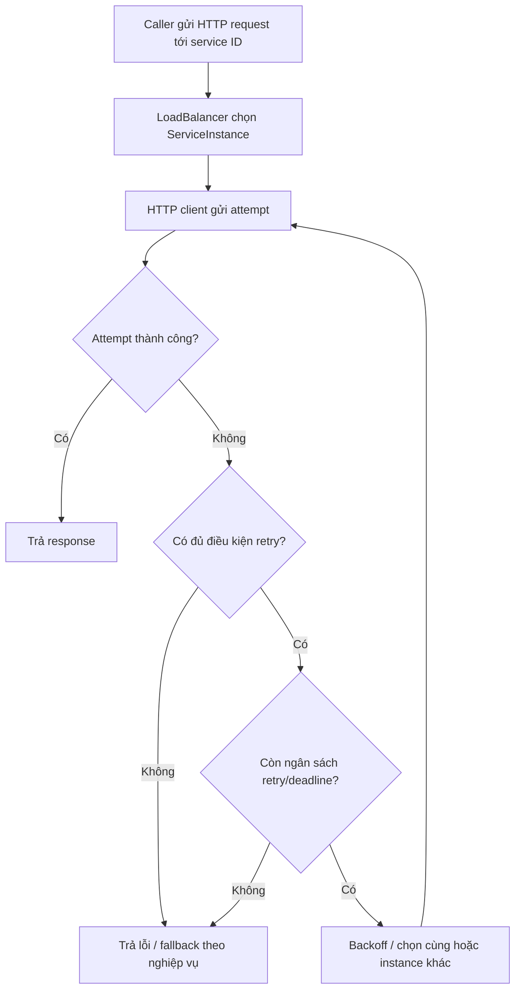
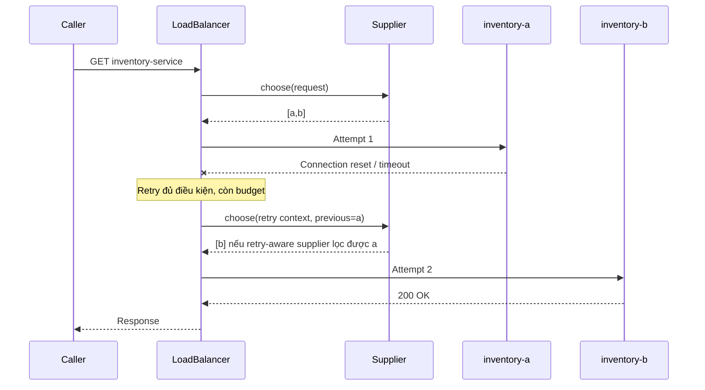

# Điều kiện bật retry cho luồng blocking và reactive

Trong kiến trúc microservices, một request từ `order-service` tới `inventory-service` đôi khi thất bại vì kết nối bị reset, instance vừa bị thu hồi, gateway quá tải hoặc downstream phản hồi chậm. **Retry (gửi lại yêu cầu)** có thể giúp vượt qua lỗi tạm thời, nhưng retry sai cách cũng có thể nhân đôi tác dụng phụ, làm cạn thread/connection pool và khuếch đại sự cố. Với Spring Cloud LoadBalancer, cần quan tâm cả **điều kiện được retry** lẫn **instance nào được chọn cho lần thử lại**.

Bài học thuộc chương **Gửi lại yêu cầu**, nằm trong module **Spring Cloud Service Communication Load Balancing**, tập trung vào những điều kiện để bật retry cho HTTP client **blocking** (`RestTemplate`, `RestClient`, và lưu ý riêng cho OpenFeign) và **reactive** (`WebClient`). Nội dung bao gồm Spring Retry, Reactor retry/backoff, service discovery, `ServiceInstanceListSupplier`, chính sách retry trên cùng/khác `ServiceInstance`, timeout, idempotency và cách chứng minh bằng thử nghiệm rằng cấu hình thực sự hoạt động.

## 1. Retry là một quyết định nghiệp vụ và vận hành, không chỉ là một cờ cấu hình

Giả sử caller gửi:

```http
GET /api/items/42 HTTP/1.1
Host: inventory-service
```

Spring Cloud LoadBalancer có thể chọn `inventory-a` ở `10.0.1.10:8080`. Nếu kết nối thất bại, một retry policy phù hợp có thể yêu cầu LoadBalancer chọn `inventory-b` và thử lại request. Nhưng nếu đó là `POST /api/orders`, việc gửi lại có thể tạo thêm một đơn hàng khi response của attempt đầu bị mất.



Trước khi bật retry phải trả lời **ít nhất năm câu hỏi**:

1. **Thao tác có an toàn khi thực hiện lại không?** HTTP method, nghiệp vụ, idempotency key và khả năng replay request body phải phù hợp.
2. **Lỗi có khả năng chỉ là tạm thời không?** Không phải mọi HTTP status hay exception đều có thể phục hồi bằng cách thử lại.
3. **Có đủ deadline, retry budget và năng lực downstream không?** Retry không được kéo dài vô hạn hoặc phá hủy SLO của request gốc.
4. **Ai là chủ sở hữu chính sách retry?** Retry ở LoadBalancer, HTTP client, Feign, Reactor, gateway và service mesh không nên vô tình chồng lên nhau.
5. **Lần thử tiếp theo có một đích hợp lệ không?** Chuyển instance chỉ có ích nếu nguồn discovery/health có ứng viên phù hợp và không vi phạm ràng buộc tenant/region/version.

Không thỏa mãn một trong các điều kiện trên thì có thể **không bật retry** cho loại request đó, dù thư viện cung cấp sẵn thuộc tính retry.

## 2. Phân biệt request, attempt, retry và failover

| Khái niệm | Ý nghĩa | Ví dụ |
|---|---|---|
| **Logical request** | Lời gọi nghiệp vụ từ caller | `getItem(42)` một lần |
| **Attempt** | Một lần HTTP client thực sự thử gửi request | Gửi tới `inventory-a` |
| **Retry** | Một attempt bổ sung sau khi attempt trước lỗi | Thử lần hai sau connect timeout |
| **Same-instance retry** | Thử lại cùng một `ServiceInstance` | `inventory-a` → `inventory-a` |
| **Next-instance retry** | Chọn lại một `ServiceInstance` cho lần thử mới | `inventory-a` → `inventory-b` |
| **Failover** | Chuyển sang đích dự phòng theo chính sách | Bỏ zone-a để chọn instance trong zone-b khi được phép |
| **Backoff** | Khoảng chờ giữa các lần thử, thường có jitter | 100 ms rồi 200 ms ± jitter |

Một **retry không nhất thiết đồng nghĩa chuyển instance**. Nếu `max-retries-on-same-service-instance` lớn hơn 0, một số lần retry được gửi lại cùng đích. Ngược lại, retry trên instance tiếp theo không bảo đảm chắc chắn một IP khác nếu danh sách chỉ có một instance hoặc chính sách chọn không loại được đích cũ.

### 2.1. Lỗi xảy ra trước hay sau khi server nhận request?

Một phân biệt quyết định độ an toàn của retry:

- **Lỗi trước khi kết nối thành công** (ví dụ `Connection refused`): request thường chưa được server mục tiêu xử lý. Retry có thể hữu ích nếu có instance khác đang khỏe.
- **Lỗi khi đang gửi body:** không thể chắc server đã nhận một phần hay toàn bộ payload; request streaming có thể không replay được.
- **Read/response timeout sau khi gửi:** server **có thể đã xử lý và commit giao dịch**, chỉ mất response trên đường về.
- **HTTP 503:** server đang từ chối hoặc quá tải; không nên tự động retry dày đặc ngay lập tức.
- **HTTP 409:** có thể phản ánh xung đột nghiệp vụ, không mặc định là lỗi tạm thời.

Vì caller không phải lúc nào cũng xác định được server đã thực hiện nghiệp vụ hay chưa, **tính idempotent của thao tác** quan trọng hơn giả định “timeout nghĩa là chưa làm gì”.

## 3. Điều kiện về HTTP method và tính idempotent

Một thao tác idempotent cho kết quả trạng thái nghiệp vụ tương đương khi thực hiện nhiều lần cùng request. HTTP method chỉ là gợi ý về semantics; implementation của API mới quyết định an toàn thực tế.

| Thao tác | Khuyến nghị retry | Điều kiện cần lưu ý |
|---|---|---|
| `GET /items/42` | Thường phù hợp với lỗi transient | GET thực sự chỉ đọc, không gây side effect nghiệp vụ |
| `HEAD` / `OPTIONS` | Có thể xem xét | Backend tuân thủ semantics, request replay được |
| `PUT /items/42` | Có thể an toàn nếu thiết kế idempotent | Cùng nội dung cập nhật tới cùng trạng thái; kiểm soát version/concurrency |
| `DELETE /items/42` | Tùy API | Xóa lặp phải được xử lý nhất quán; `404` lần sau có thể là trạng thái đã xóa |
| `POST /orders` | **Không bật retry tự động** nếu thiếu cơ chế chống trùng | Cần idempotency key/deduplication trước khi thử lại |
| `POST /payments` | Rủi ro cao | Dùng khóa idempotency, trạng thái giao dịch, reconciliation và hợp đồng provider |
| Upload streaming | Thường không replay tùy tiện | Body phải tái tạo hoặc seek lại được, có kiểm tra toàn vẹn |

Spring Cloud LoadBalancer có thuộc tính `spring.cloud.loadbalancer.retry.retry-on-all-operations`, **mặc định `false`** trong bảng cấu hình hiện hành. Khi chưa bật thuộc tính này, cơ chế retry được thiết kế bảo thủ cho các thao tác GET. Đặt `true` **không khiến POST tự trở thành an toàn**: chỉ mở rộng những thao tác có thể được retry theo cấu hình, còn nghĩa vụ chống thực hiện trùng vẫn thuộc ứng dụng.

### 3.1. Idempotency key cho lệnh có tác dụng phụ

Ví dụ một lời gọi tạo đơn hàng:

```http
POST /api/orders HTTP/1.1
Host: order-service
Idempotency-Key: 9e9d1d4d-55e8-42f6-99e1-7b43b765798c
Content-Type: application/json

{"sku":"BOOK-42","quantity":1}
```

Để retry an toàn, server phải **lưu và kiểm tra key một cách nhất quán**, thường kết hợp caller/tenant và fingerprint nội dung; thực hiện thao tác một lần rồi trả kết quả đã ghi nhận cho các attempt trùng. Chỉ thêm header mà phía server không triển khai deduplication **không tạo idempotency**.

Với payment hoặc order processing, phải cân nhắc giao dịch nguyên tử, thời gian sống key, concurrency và xử lý trạng thái `in-progress`/`completed`/`failed`. Nếu chưa có bảo đảm này, trả lỗi có thể an toàn hơn việc tự động thử lại.

## 4. Điều kiện về lỗi: không phải cứ thất bại là retry

| Lỗi / HTTP status | Có thể retry? | Lý do và điều kiện |
|---|---|---|
| Connect timeout, connection reset, `IOException` | Thường cân nhắc | Lỗi mạng transient, nhưng phải kiểm tra replay và ngân sách |
| Read timeout | Có thể với GET/idempotent operation | Server có thể đã xử lý request; không an toàn mặc định cho POST |
| `502 Bad Gateway` | Cân nhắc có giới hạn | Gateway/upstream tạm lỗi; cần tránh khuếch đại tải |
| `503 Service Unavailable` | Cân nhắc + backoff/jitter | Có thể do quá tải; giảm concurrency nếu cần |
| `504 Gateway Timeout` | Cân nhắc cho request an toàn | Upstream có thể vẫn đang thực thi; không retry vô hạn |
| `429 Too Many Requests` | Thường cần chính sách riêng | Tôn trọng `Retry-After` nếu hợp lệ và không vượt deadline |
| `408 Request Timeout` | Tùy client/server semantics | Xác định giai đoạn lỗi và khả năng replay |
| `400`, `401`, `403`, `404` | Thường **không** | Dữ liệu sai, auth hoặc không có tài nguyên hiếm khi được sửa bằng retry y hệt |
| `409 Conflict` | Tùy hợp đồng nghiệp vụ | Thường cần đọc trạng thái hoặc giải quyết xung đột trước |
| Lỗi decode/validation do schema không tương thích | Thường **không** | Thử cùng dữ liệu ở instance khác không sửa được contract |

Trạng thái `502/503/504` trong bảng là **ứng viên để cấu hình**, không phải khẳng định Spring Cloud tự retry tất cả các status đó. Trong bảng configuration properties hiện hành, `spring.cloud.loadbalancer.retry.retryable-status-codes` mặc định là **tập rỗng**; khi muốn retry dựa trên status, hãy chọn cụ thể theo API và kiểm tra cơ chế exception mapping của HTTP client.

Spring Cloud Commons có các kiểu exception thường dùng trong retry policy như `IOException`, `TimeoutException` và `RetryableStatusCodeException` khi không khai báo `retryable-exceptions` riêng. Cần kiểm chứng cách một exception do HTTP client cụ thể ném ra được chuyển tới chính sách retry; không có bảo đảm mọi `WebClientResponseException` hoặc exception nghiệp vụ bất kỳ đều tự động được retry.

**Tránh `retry-on-all-exceptions: true`** trừ trường hợp tương thích đặc biệt đã kiểm chứng: nó có thể thử lại lỗi lập trình, xác thực, serialization hoặc validation vốn không phải transient.

## 5. Điều kiện chung về replay, deadline và tải

Ngay cả một `GET` có thể replay cũng cần một **ngân sách retry**. Trước khi thử lại, kiểm tra:

1. Request body/header có thể tái tạo đầy đủ, không tiêu thụ một stream dùng một lần hoặc gửi lại token đã hết hạn.
2. Còn thời gian trong tổng deadline của request upstream; các request con không được sống lâu hơn lời gọi nghiệp vụ đã bị hủy mà không có lý do.
3. Có giới hạn `max attempts`, tổng retry duration và khoảng backoff.
4. Có giới hạn tải: connection pool, thread pool, `boundedElastic`, rate limiter, bulkhead và năng lực server.
5. Có quan sát được **số attempt thật** để không nhân retry vô thức giữa các tầng.

### 5.1. Bài toán retry amplification

Nếu gateway retry tối đa 3 attempt và service bên trong cũng retry tối đa 3 attempt, trong trường hợp xấu có thể phát sinh tới:

\[
N_{outbound} \le 3\times3=9\ \text{attempt cho một logical request}
\]

Thêm một lớp service mesh retry 2 lần có thể nâng cận trên thành 18 attempt, nếu các điều kiện ở mỗi tầng đều cho phép. Đây là **cận trên minh họa**, không phải công thức mọi framework luôn áp dụng. Lưu lượng retry có thể khiến chính downstream đang quá tải tiếp tục quá tải hơn.

**Khuyến nghị:** chỉ định **một tầng sở hữu retry chính** cho mỗi lời gọi; nếu nhiều tầng bắt buộc phải retry, áp dụng retry budget tổng và kiểm chứng số outbound request trong test.

## 6. Luồng blocking: RestTemplate và RestClient

`RestTemplate` và `RestClient` thực hiện lời gọi đồng bộ; caller thường chờ tới khi request hoàn thành hoặc timeout. Spring Cloud LoadBalancer hỗ trợ đường chọn đích blocking thông qua `BlockingLoadBalancerClient` và integration tương ứng.

### 6.1. Để retry của Spring Cloud LoadBalancer có hiệu lực

Theo tài liệu Spring Cloud Commons, với **`RestTemplate` load-balanced**, retry blocking không mặc nhiên bật chỉ vì có LoadBalancer; cơ chế Spring Retry phải có trên classpath. Dependency Maven minh họa:

```xml
<dependency>
    <groupId>org.springframework.cloud</groupId>
    <artifactId>spring-cloud-starter-loadbalancer</artifactId>
</dependency>
<dependency>
    <groupId>org.springframework.retry</groupId>
    <artifactId>spring-retry</artifactId>
</dependency>
```

Cấu hình `@LoadBalanced RestTemplate`:

```java
@Configuration(proxyBeanMethods = false)
class BlockingInventoryClientConfiguration {

    @Bean
    @LoadBalanced
    RestTemplate inventoryRestTemplate() {
        return new RestTemplate();
    }
}

@Service
class InventoryGateway {

    private final RestTemplate restTemplate;

    InventoryGateway(@LoadBalanced RestTemplate restTemplate) {
        this.restTemplate = restTemplate;
    }

    String readItem(long id) {
        return restTemplate.getForObject(
                "http://inventory-service/api/items/{id}", String.class, id);
    }
}
```

Spring Cloud có cơ chế auto-configuration retry cho các client blocking phù hợp khi dependency và properties cho phép. **Không giả định dependency Spring Retry đã đủ để chứng minh mọi đường gọi đều retry**: cần xem bean interceptor/wrapper thực tế, xác nhận service ID được load balance và chạy failure-injection test.

`RestClient` cũng là client blocking và hỗ trợ `@LoadBalanced RestClient.Builder`:

```java
@Bean
@LoadBalanced
RestClient.Builder loadBalancedRestClientBuilder() {
    return RestClient.builder();
}

// Inject @LoadBalanced RestClient.Builder trong gateway:
RestClient inventory = loadBalancedBuilder
        .baseUrl("http://inventory-service")
        .build();

String body = inventory.get()
        .uri("/api/items/{id}", 42)
        .retrieve()
        .body(String.class);
```

Ví dụ thứ hai lược bỏ class chứa đoạn sử dụng builder; nó minh họa cách dựng `RestClient`, không phải file Java độc lập hoàn chỉnh. Với Spring Boot, cân nhắc `RestClientBuilderConfigurer` để giữ customizer, request factory và observability. Tích hợp **retry** ở `RestClient` có thể khác chi tiết theo Spring Cloud release train và HTTP request factory; cần xác minh đường đi retry của phiên bản đang dùng bằng test, thay vì suy thẳng từ khả năng retry đã được tài liệu mô tả cho `RestTemplate`.

### 6.2. Backoff trong blocking dùng Spring Retry

Với đường Spring Retry, Spring Cloud cho phép dùng `LoadBalancedRetryFactory` để cung cấp `BackOffPolicy` theo service ID:

```java
@Configuration(proxyBeanMethods = false)
class BlockingRetryConfiguration {

    @Bean
    LoadBalancedRetryFactory loadBalancedRetryFactory() {
        return new LoadBalancedRetryFactory() {
            @Override
            public BackOffPolicy createBackOffPolicy(String service) {
                ExponentialBackOffPolicy policy = new ExponentialBackOffPolicy();
                policy.setInitialInterval(100L);
                policy.setMultiplier(2.0);
                policy.setMaxInterval(1000L);
                return policy;
            }
        };
    }
}
```

Các kiểu `BackOffPolicy`, `ExponentialBackOffPolicy` đến từ Spring Retry; ví dụ rút gọn phần import. Đây là cấu hình minh họa; chọn khoảng chờ dựa trên deadline và năng lực server. **Ở luồng blocking, việc chờ backoff có thể giữ thread trong thời gian sleep**, nên phải đo số worker đồng thời, queue, connection pool và throughput. Đừng đặt backoff dài khiến Servlet request sống vượt deadline từ gateway.

## 7. Luồng reactive: WebClient và Reactive LoadBalancer

`WebClient` có thể xử lý I/O không blocking qua `ReactorLoadBalancerExchangeFilterFunction` khi được cấu hình phù hợp. Retry reactive có thể do **Spring Cloud LoadBalancer retry integration** đảm nhiệm hoặc do **Reactor `.retryWhen(...)`** trong pipeline ứng dụng. Hai cách này **không tự động tương đương** và không nên chồng lên nhau thiếu kiểm soát.

### 7.1. Cấu hình WebClient tích hợp LoadBalancer

```java
@Configuration(proxyBeanMethods = false)
class ReactiveInventoryClientConfiguration {

    @Bean
    @LoadBalanced
    WebClient.Builder loadBalancedWebClientBuilder() {
        return WebClient.builder();
    }

    @Bean
    WebClient inventoryWebClient(
            @LoadBalanced WebClient.Builder builder) {
        return builder.baseUrl("http://inventory-service").build();
    }
}
```

Gọi một request GET:

```java
Mono<ItemReply> result = inventoryWebClient.get()
        .uri("/api/items/{id}", 42)
        .retrieve()
        .bodyToMono(ItemReply.class);
```

`ItemReply` là DTO giả định. Việc phương thức trả `Mono<ItemReply>` **không có nghĩa retry đã bật**. Cần bảo đảm client thực sự đi qua reactive LB filter, có nguồn `ServiceInstance`, và chính sách retry được cấu hình cho đường gọi đó.

### 7.2. Bật retry ở tầng Spring Cloud LoadBalancer

Một cấu hình có chủ đích bảo thủ cho API `GET` có thể như sau:

```yaml
spring:
  cloud:
    loadbalancer:
      retry:
        enabled: true
        max-retries-on-same-service-instance: 0
        max-retries-on-next-service-instance: 1
        retry-on-all-operations: false
        retry-on-all-exceptions: false
        retryable-status-codes:
          - 503
          - 504
        backoff:
          enabled: true
          min-backoff: 100ms
          max-backoff: 1s
          jitter: 0.5
```

Ý nghĩa:

| Thuộc tính | Ý nghĩa |
|---|---|
| `retry.enabled` | Cờ cho phép LoadBalancer retry; mặc định trong bảng properties hiện hành là `true`, nhưng **có cờ không có nghĩa mọi client đều retry** |
| `max-retries-on-same-service-instance: 0` | Không cấp thêm attempt để thử lại cùng instance |
| `max-retries-on-next-service-instance: 1` | Cho phép thêm tối đa một lần retry ở lần chọn instance tiếp theo |
| `retry-on-all-operations: false` | Không mở retry rộng cho các thao tác ngoài GET |
| `retry-on-all-exceptions: false` | Không thử lại mọi exception bất kể nguyên nhân |
| `retryable-status-codes: [503, 504]` | Chỉ định thêm các HTTP status muốn xem xét retry |
| `backoff.enabled: true` | Bật backoff **cho reactive Retry** theo semantics của configuration property |
| `min-backoff`, `max-backoff`, `jitter` | Giới hạn và làm ngẫu nhiên khoảng chờ để tránh retry dồn cùng thời điểm |

Các con số trên dùng cho **bài thực hành**, không phải mặc định sản phẩm. Tài liệu configuration properties hiện hành cho biết mặc định `same=0`, `next=1`, `retry-on-all-operations=false`, `retry-on-all-exceptions=false`, `backoff.enabled=false`, `min-backoff=5ms`, `jitter=0.5`; luôn đối chiếu release train đã khóa vì semantics có thể thay đổi. Không suy luận rằng mặc định `enabled=true` đồng nghĩa hệ thống đã bật retry hữu hiệu trên `RestTemplate`, `RestClient`, `WebClient` và OpenFeign cùng lúc.

**Lưu ý đọc tài liệu:** một đoạn diễn giải trong mục “Retrying Failed Requests” của Spring Cloud Commons có câu gây nhầm lẫn về `backoff.enabled=false`, trong khi bảng `Configuration Properties` định nghĩa đây là cờ bật áp dụng Reactor Retry backoff, mặc định false. Khi cấu hình để **sử dụng backoff**, chọn `enabled: true` và xác minh thực tế khoảng chờ bằng integration test.

### 7.3. Cấu hình riêng cho một service ID

Phần lớn các thuộc tính LoadBalancer hỗ trợ override theo `spring.cloud.loadbalancer.clients.<clientId>.*`. Ví dụ, chỉ điều chỉnh số retry của `inventory-service`:

```yaml
spring:
  cloud:
    loadbalancer:
      retry:
        enabled: true
        max-retries-on-next-service-instance: 0
      clients:
        inventory-service:
          retry:
            max-retries-on-next-service-instance: 1
            retryable-status-codes:
              - 503
```

Các cấu hình theo client được merge với cấu hình chung, khi có giá trị trùng thì cấu hình client được ưu tiên. Tuy nhiên, **`spring.cloud.loadbalancer.retry.enabled` là công tắc toàn cục đặc biệt**: khi đã tắt retry globally, không thể chỉ bật lại cho một client bằng prefix `clients`; khi bật globally có thể tắt cho một client cụ thể. Vì thế cần kiểm tra thứ tự ưu tiên properties và không để cấu hình một service nhầm làm thay đổi toàn bộ các service khác.

### 7.4. Reactive không chặn event-loop khi chờ backoff

Với reactive Retry, backoff được lên lịch bằng Reactor scheduler, không cần gọi `Thread.sleep()` trong filter hoặc event-loop. Tuy nhiên, HTTP connection pool, số request đang inflight và tài nguyên downstream vẫn có giới hạn; backoff không tự giải quyết quá tải.

Không gọi `.block()` hoặc `Future.get()` trong `ExchangeFilterFunction` để triển khai retry. Nếu cần một API blocking trong pipeline, hãy offload có giới hạn bằng `Mono.fromCallable(...).subscribeOn(Schedulers.boundedElastic())`, nhưng ưu tiên đường I/O reactive thực sự.

## 8. Dùng Reactor `.retryWhen()` khi chủ động quản lý ở tầng ứng dụng

Khi muốn retry dựa trên logic riêng ở một caller, có thể dùng Reactor `Retry` trong pipeline. **Nên tắt retry tại LoadBalancer cho đường gọi tương ứng** để không vô tình nhân số attempt với `.retryWhen()` của ứng dụng.

Ví dụ minh họa retry một request **GET**, giới hạn hai lần thử lại và tổng thời gian:

```java
private boolean isTransient(Throwable error) {
    if (error instanceof WebClientRequestException) {
        return true; // Lỗi transport: cần đánh giá thêm khi vận hành thực tế.
    }
    if (error instanceof WebClientResponseException response) {
        int status = response.getStatusCode().value();
        return status == 503 || status == 504;
    }
    return false;
}

public Mono<ItemReply> readWithRetry(long id) {
    return inventoryWebClient.get()
            .uri("/api/items/{id}", id)
            .retrieve()
            .bodyToMono(ItemReply.class)
            .retryWhen(Retry.backoff(2, Duration.ofMillis(100))
                    .maxBackoff(Duration.ofSeconds(1))
                    .jitter(0.5)
                    .filter(this::isTransient))
            .timeout(Duration.ofSeconds(3));
}
```

`Retry` ở đây là `reactor.util.retry.Retry`, không phải annotation `@Retryable` của Spring Retry. `.retryWhen(Retry.backoff(2,...))` cho phép **hai lần retry ngoài attempt ban đầu**, tức tối đa ba attempt khi mọi lần đều thất bại theo điều kiện. `.timeout(...)` đặt **sau** `.retryWhen(...)` để giới hạn thời gian toàn bộ chuỗi retry trong ví dụ; hãy kiểm tra thêm timeout connect/response của HTTP client phía dưới.

`retrieve()` thường chuyển các HTTP response lỗi thành exception; filter chỉ định mã `503`, `504` và lỗi transport. Đây là **chính sách cấp ứng dụng**, không phải thiết lập mặc định của Spring Cloud LoadBalancer. Nếu cần tôn trọng `Retry-After`, phân biệt lỗi trước/sau khi gửi hoặc yêu cầu xác thực khác, hãy xây dựng filter chặt chẽ hơn thay vì `retryOnAllErrors`.

**Quan trọng:** mỗi lần resubscribe có thể làm HTTP client gửi một attempt mới. Nếu client đã tích hợp LoadBalancer, quá trình chọn instance có thể chạy lại, nhưng không bảo đảm chắc chắn nó chọn instance khác; còn phụ thuộc supplier, caching và chính sách chọn. Không dựa vào `.retryWhen()` đơn thuần để cam kết failover sang một zone hoặc replica khác.

### 8.1. Không tự tạo vòng retry vô hạn trong filter

```java
// KHÔNG NÊN: Mọi exception đều retry mãi, không có deadline.
return next.exchange(request).retry();
```

Hoặc:

```java
// KHÔNG NÊN: .retryWhen() được thêm ở mọi lớp.
return next.exchange(request)
        .retryWhen(Retry.max(3));
```

Nếu cùng HTTP client còn có LoadBalancer retry, ba lần retry ở mỗi tầng có thể nhân số attempt. Một filter thấp hơn `retrieve()` cũng có thể nhìn lỗi ở mức khác so với code xử lý status tại service layer. **Đặt retry tại một ranh giới được kiểm soát**, có filter điều kiện, deadline và metric theo attempt.

## 9. Retry cùng instance hay sang instance tiếp theo?

Spring Cloud LoadBalancer có các thuộc tính:

```yaml
spring:
  cloud:
    loadbalancer:
      retry:
        max-retries-on-same-service-instance: 0
        max-retries-on-next-service-instance: 1
        avoid-previous-instance: true
```

`max-retries-on-same-service-instance` đếm các lần retry thêm trên **cùng** instance; `max-retries-on-next-service-instance` đếm các lần retry khi **chọn lại** instance. `RetryAwareServiceInstanceListSupplier` có thể cố gắng loại instance đã thử khỏi danh sách khi có ứng viên thay thế và chính sách `avoid-previous-instance` đang hoạt động.



Sơ đồ là **hành vi mong muốn để kiểm thử**, không phải bảo đảm rằng mọi retry đều chọn được `inventory-b`. Nếu chỉ có một instance, hoặc supplier không nhận được retry context, hoặc bộ lọc theo zone/tenant chỉ còn `inventory-a`, lần thử lại có thể phải dùng chính đích cũ hoặc trả lỗi tùy chính sách.

### 9.1. Ước lượng số attempt tối đa

Trong một mô hình minh họa, nếu `R_same` là số retry thêm **trên mỗi instance đã chọn** và `R_next` là số lần chọn instance tiếp theo được phép, cận trên lý tưởng có thể tính:

\[
N_{attempt} \le (R_{next}+1)(R_{same}+1)
\]

Ví dụ `R_same=1` và `R_next=2` có thể tạo tối đa 6 attempt theo mô hình các lần retry này. Đây chỉ là phép tính **ngân sách ước lượng**, không thay thế việc kiểm tra triển khai hoặc cấu hình retry của framework, và thực tế có thể dừng sớm do lỗi không retryable, hết deadline, danh sách rỗng hoặc circuit breaker mở.

Nếu không có một cơ chế retry khác, giá trị `R_same=0`, `R_next=1` tương ứng nhiều nhất **hai lần thử** trong trường hợp retry được kích hoạt. Nếu có thêm Reactor `.retryWhen`, Feign retryer, client SDK hoặc gateway retry, phải tính toán lại tổng số outbound attempt.

### 9.2. Hard constraints phải được giữ nguyên khi retry

Nếu request yêu cầu `tenant-a` chỉ được xử lý trong `region-a`, retry sang instance ngoài `region-a` **không hợp lệ**. `RetryAwareServiceInstanceListSupplier` chỉ nên hoạt động trên tập ứng viên đã qua lọc ràng buộc cứng; không vì tránh instance cũ mà bỏ điều kiện authorization, API version hay data residency.

Đặt cache gần nguồn discovery, trước các bộ lọc phụ thuộc request; bảo đảm retry context tiếp tục đi qua `get(Request)` của supplier khi policy cần biết instance đã thử. Khi tất cả instance đều lỗi, nên trả lỗi có kiểm soát hơn là lặp vô hạn.

## 10. Backoff, jitter và tổng thời gian chờ

Không có backoff, nhiều caller có thể cùng retry ngay sau một outage, tạo **thundering herd**. Exponential backoff với jitter giúp dãn và phân tán các attempt:

\[
D_k = \min(D_{max}, D_{base}\cdot 2^{k-1})
\]

Trong đó `D_k` là khoảng chờ dự kiến trước lần retry thứ `k`; jitter có thể biến đổi khoảng chờ thực tế quanh giá trị này theo implementation. Công thức là mô hình phổ biến, **không phải cam kết chính xác của mọi `RetryBackoffSpec`**.

| Attempt | Trạng thái | Khoảng chờ ví dụ trước attempt |
|---|---|---|
| 1 | Lời gọi đầu | `0 ms` |
| 2 | Retry sau lỗi transient | khoảng `100 ms` ± jitter |
| 3 | Retry tiếp nếu còn budget | khoảng `200 ms` ± jitter |
| 4 | Nếu chính sách còn cho phép | khoảng `400 ms` ± jitter |

Một tổng deadline cần tính cả connect, chờ response, chờ connection pool, backoff, chọn instance và xử lý client:

\[
T_{total}\ \lesssim\ \sum_{i=1}^{N}
(T_{connect,i}+T_{response,i}+T_{overhead,i})
+\sum_{i=2}^{N}D_i
\]

Đây là mô hình lập ngân sách, không phải một ràng buộc tự động mà framework thực thi. Nếu có tối đa 3 attempt, mỗi attempt được phép chờ 2 giây, cộng backoff 100 ms và 200 ms, tổng có thể vượt 6,3 giây. Một request upstream chỉ cho phép 4 giây sẽ cần **cắt ngắn retry hoặc timeout từng attempt** thay vì để tất cả attempt chạy đủ thời gian.

**Dừng retry khi deadline hoặc budget hết**, kể cả nếu một lỗi vẫn thuộc nhóm retryable. Cần tính thêm giới hạn tối đa số request đang inflight, vì 10.000 request cùng retry hai lần có thể tăng đáng kể số connection và tải backend.

## 11. Những điều khác nhau giữa blocking và reactive

| Chủ đề | Blocking: RestTemplate/RestClient | Reactive: WebClient |
|---|---|---|
| Thread trong thời gian chờ HTTP | Caller thường bị chiếm | I/O có thể không chặn event-loop |
| Cơ chế retry điển hình | Spring Retry với LB integration phù hợp; hoặc retry bên ngoài do app quản lý | Reactive LB retry và/hoặc Reactor `Retry` có kiểm soát |
| Điều kiện kích hoạt | Spring Retry classpath, cấu hình, bean interceptor/client đúng | Reactive LB filter, cờ/config tương thích hoặc `.retryWhen` |
| Backoff | `BackOffPolicy` có thể chờ trên thread blocking | Reactor lên lịch bất đồng bộ, không tự sleep event-loop |
| Cancellation | Ngắt request chưa chắc hủy HTTP đang block | Subscription có thể cancel, nhưng transport và tác vụ blocking bên dưới chưa chắc dừng ngay |
| Rủi ro nổi bật | Servlet thread pool và HTTP connection pool bị bão hòa | Chồng operator retry; blocking trong filter; quá nhiều subscription/inflight |
| Công cụ kiểm thử | MockWebServer/WireMock, thread dump, Spring Retry listener | StepVerifier, Reactor virtual time, stub server, Reactor Netty metrics |

**Không được kết luận:** “Reactive retry luôn nhanh hơn” hoặc “blocking retry là sai”. Chọn mô hình phù hợp với kiến trúc hiện tại, đo SLO và tài nguyên thực tế. Reactive tránh chiếm thread trong lúc đợi network, nhưng không giải quyết được backend chậm, lỗi idempotency hay tải retry khuếch đại.

## 12. OpenFeign: kiểm tra retry ở một lớp riêng

`@FeignClient(name = "inventory-service")` thường dùng đường HTTP blocking và có thể tích hợp `FeignBlockingLoadBalancerClient` khi Spring Cloud LoadBalancer hiện diện. **Spring Cloud OpenFeign mặc định cấu hình `Retryer.NEVER_RETRY` cho lớp Feign**, khác với retryer mặc định của Feign lõi. Tuy vậy, điều này **không chứng minh** mọi tầng đều không retry: LoadBalancer, HTTP transport hoặc cơ chế resilience bên ngoài có thể vẫn có chính sách riêng.

Ví dụ cấu hình timeout Feign cho client:

```yaml
spring:
  cloud:
    openfeign:
      client:
        config:
          inventory-service:
            connectTimeout: 1000
            readTimeout: 2500
```

Các giá trị timeout trong ví dụ là **mili giây** theo cấu hình OpenFeign. Khi cần bật retry ở Feign, phải cung cấp `Retryer` hoặc cấu hình được release train hỗ trợ và xác định rõ số attempt, loại lỗi, backoff. Không mặc định rằng `spring.cloud.loadbalancer.retry.*` điều khiển **mọi** loại Feign retry; phải test HTTP attempt thật, nhất là khi dự án đồng thời có Spring Retry và Feign retryer.

Đối với hệ thống mới, Spring Cloud OpenFeign ở trạng thái feature-complete và Spring khuyến nghị cân nhắc Spring HTTP Service Clients. Khi chuyển Feign sang `RestClient` hoặc `WebClient`, **không sao chép mù quáng retry policy**, bởi semantics timeout, retry status/error mapping và đường tích hợp LoadBalancer có thể khác.

## 13. Quan sát và kiểm chứng retry bằng server-side evidence

Log câu “retrying request” không đủ để chứng minh backend nhận attempt nào. Để kiểm thử đúng, hãy dùng hai stub instance có thể cấu hình lỗi:

```text
inventory-a :18081  -> 503 ở một số request, ghi attempt-id
inventory-b :18082  -> 200 OK, ghi attempt-id
Caller            -> GET http://inventory-service/api/items/42
```

`SimpleDiscoveryClient` trong test có thể cung cấp danh sách tĩnh:

```yaml
spring:
  cloud:
    discovery:
      client:
        simple:
          instances:
            inventory-service:
              - uri: http://127.0.0.1:18081
              - uri: http://127.0.0.1:18082
```

Với cấu hình có một lần retry trên next instance, bài test nên quan sát **một logical request** tạo tối đa hai HTTP attempts khi lỗi nằm trong nhóm retryable và policy được kích hoạt. Tuy nhiên, thứ tự round-robin và cách bộ lọc chọn instance có thể khác; cần kiểm soát state để không viết test cứng rằng lần đầu luôn trúng A.

### 13.1. Bộ test bắt buộc

| Trường hợp | Kỳ vọng cần kiểm chứng |
|---|---|
| GET gặp `503` rồi instance khác trả `200` | Retry chỉ xảy ra nếu `503` được cấu hình và còn budget |
| GET gặp `404` | Không retry theo policy chỉ cho phép `503/504` |
| GET timeout trước khi connect | Retry có giới hạn, không giữ socket/thread vô hạn |
| POST tạo đơn không có idempotency key | Không có retry tự động xuyên tầng |
| POST có idempotency key, server đã commit nhưng response mất | Không tạo bản ghi thứ hai khi retry, nếu server có dedup đúng |
| Chỉ còn một instance | Không giả định next retry chắc chắn chọn endpoint khác |
| Source discovery trả rỗng | Không lặp retry vô hạn, báo lỗi không có instance phù hợp |
| Hết total deadline trước retry cuối | Dừng sớm theo deadline, không cố thử đủ số attempt |
| Hai tầng retry cùng được bật | Đếm attempts và phát hiện amplification |
| Nhiều caller cùng gặp `503` | Backoff/jitter giúp phân tán, không tạo retry storm vượt ngưỡng |
| Failover sang zone bị cấm | Phải bị hard constraints chặn, dù có instance khác khỏe |

### 13.2. Phân biệt ba số liệu khi đo

1. **Logical requests:** lượng yêu cầu nghiệp vụ đi vào caller.
2. **Outbound attempts:** số lần HTTP client thực sự gửi/định gửi request; tăng khi retry.
3. **Backend received requests:** số lần một backend thực sự nhận request; có thể thấp hơn attempts nếu lỗi trước khi kết nối.

Nên gắn một correlation ID ổn định cho logical request và một attempt index riêng cho từng lần thử. Tránh dùng ID người dùng/tenant làm metric label có cardinality cao; dùng group/status/route chuẩn hóa. Theo dõi thêm:

- Số retry bắt đầu, thành công sau retry, retry bị từ chối và retry hết budget.
- Kết quả theo service ID, instance ID (với giới hạn cardinality), status và loại exception.
- p95/p99 latency của logical request và của từng attempt; tổng thời gian backoff.
- Thời gian chờ connection pool, active HTTP connections và queue của thread/scheduler.
- Trạng thái discovery/health của các instance trước và sau failover.

Spring Cloud LoadBalancer cung cấp `LoadBalancerLifecycle` và có thể tích hợp Micrometer khi bật `spring.cloud.loadbalancer.stats.micrometer.enabled=true` cùng `MeterRegistry`. Không mặc định rằng mọi metric retry riêng lẻ đã được framework bật sẵn; cần kết hợp server access logs và custom instrumentation để biết chính xác số attempt.

## 14. Quy trình thực hành cấu hình và đánh giá

**Bước 1 — Bắt đầu từ không retry.** Tắt LB retry bằng `spring.cloud.loadbalancer.retry.enabled=false`; tắt retry bên ngoài nếu có để lấy baseline lỗi và latency trong test.

**Bước 2 — Chọn thao tác idempotent.** Dùng `GET /api/items/{id}`; không lấy `POST /orders` làm bài thử đầu tiên.

**Bước 3 — Chọn mô hình thực thi.** Với `RestTemplate`, kiểm tra Spring Retry dependency và interceptor retry; với `WebClient`, kiểm tra reactive LB filter. Không kết luận từ thuộc tính YAML nếu chưa thấy attempt ở stub.

**Bước 4 — Chỉ bật một tầng.** Chọn LB retry hoặc `.retryWhen`/retryer của ứng dụng. Đặt một lần retry sang next instance; chưa bật mọi exception hoặc mọi HTTP operation.

**Bước 5 — Cấy lỗi.** Cho một backend trả `503` rồi chuyển về `200`, thử connection reset, chậm response và `404`; đối chiếu cặp `(logicalRequestId, attemptIndex)` ở caller/stub.

**Bước 6 — Thêm backoff và deadline.** Chọn min/max delay và jitter, đo p95/p99, outbound request rate và số connection chờ. Bảo đảm tổng deadline của request không bị vượt chỉ vì retry.

**Bước 7 — Kiểm tra sự cố đồng loạt.** Khi tất cả instance trả `503`, retry không được làm sập caller hoặc backend; áp dụng bulkhead, rate limiting và circuit breaker khi phù hợp.

**Bước 8 — Kiểm tra rollback.** Có thể tắt retry nhanh, theo dõi error rate trở lại baseline và không để cấu hình còn sót ở một tầng khác.

## 15. Lỗi cấu hình thường gặp

| Triệu chứng | Nguyên nhân có thể | Cách xử lý |
|---|---|---|
| Đặt `retry.enabled=true` nhưng không thấy retry blocking | Chưa có Spring Retry, sai client/interceptor hoặc error không retryable | Kiểm tra classpath, bean thực tế và fault-injection test |
| Retry xảy ra trên POST dù chưa chủ đích | Có `.retryWhen`, Feign retryer hoặc gateway retry ngoài LB policy | Kiểm kê tầng retry, tắt hoặc giới hạn theo method |
| GET `503` không được retry | Chưa cấu hình retryable status hoặc exception mapping không khớp | Xem status/exception thực tế, đặt retryable codes phù hợp |
| `404` bị retry nhiều lần | `retry-on-all-exceptions` hay `retryWhen` quá rộng | Chỉ retry transient errors đã định nghĩa |
| Retry vẫn đến instance cũ | Không có ứng viên khác, retry-aware supplier không hiệu lực | Kiểm tra `avoid-previous-instance`, supplier và danh sách đã lọc |
| Đã có backoff nhưng latency quá lớn | Tính attempt timeout và backoff vượt deadline | Giảm attempts, timeout/backoff, thêm deadline toàn cục |
| Tăng retry làm tăng `503` | Downstream đang quá tải, retry storm | Jitter, bulkhead, circuit breaker, retry budget nhỏ hơn |
| Response timeout nhưng server tạo trùng đơn | Thiếu idempotency/dedup ở server | Không retry operation unsafe khi chưa có bảo đảm chống trùng |
| Reactive event-loop bị chậm | Dùng `.block()`, `Thread.sleep` hoặc blocking SDK trong filter/retry hook | Dùng composition async; offload blocking có kiểm soát |
| Feign không retry dù đã chỉnh LB | Feign có `Retryer.NEVER_RETRY`, các lớp retry khác nhau | Xác minh bean retry, đường gọi và số HTTP attempts |

## 16. Checklist quyết định bật retry

- [ ] Tôi đã xác định logical request và tất cả tầng có thể thực hiện retry.
- [ ] HTTP operation thực sự idempotent hoặc có idempotency key được backend thực thi.
- [ ] Request body, headers và auth token có thể replay đúng cho attempt tiếp theo.
- [ ] Chỉ lỗi transient được retry; status code và exception được chọn tường minh.
- [ ] Có giới hạn attempt, backoff/jitter, tổng deadline và retry budget.
- [ ] Biết rõ retry được gửi tới cùng instance hay chọn instance tiếp theo.
- [ ] Tập ứng viên giữ nguyên ràng buộc cứng về tenant, region, quyền và API version.
- [ ] Với blocking client, dependency Spring Retry và wiring/HTTP request factory đã được kiểm chứng.
- [ ] Với reactive WebClient, client thực sự dùng reactive LB filter; không block event-loop.
- [ ] Với Feign, đã xác minh retryer, LB retry và retry của gateway/mesh không chồng ngoài ý muốn.
- [ ] Có test cho GET 503/404, timeout, all-instances-down, POST chống trùng và cancel/deadline.
- [ ] Có metrics theo logical request và outbound attempts, cùng cách tắt retry an toàn.

**Kết luận:** điều kiện bật retry cho luồng blocking và reactive về bản chất giống nhau: **thao tác phải an toàn khi lặp, lỗi có thể phục hồi, còn ngân sách thời gian/tải và có một chính sách retry duy nhất được kiểm chứng**. Điểm khác biệt nằm ở cơ chế thực thi: blocking thường kết hợp Spring Retry và có thể giữ thread trong thời gian chờ; reactive dùng LoadBalancer retry/Reactor retry và không nên chặn event-loop. Trong cả hai trường hợp, Spring Cloud LoadBalancer chỉ giúp chọn `ServiceInstance`; tính đúng đắn của idempotency, tổng deadline và an toàn nghiệp vụ vẫn do ứng dụng đảm bảo.

## Tài liệu tham khảo

- [Spring Cloud Commons — Common Abstractions, Retrying Failed Requests](https://docs.spring.io/spring-cloud-commons/reference/spring-cloud-commons/common-abstractions.html): Spring Retry cho blocking, reactive retry, backoff và `RetryAwareServiceInstanceListSupplier`.
- [Spring Cloud Commons — Configuration Properties](https://docs.spring.io/spring-cloud-commons/reference/configprops.html): defaults của `spring.cloud.loadbalancer.retry.*`, phân biệt same/next và cờ retry.
- [Spring Cloud Commons — Spring Cloud LoadBalancer](https://docs.spring.io/spring-cloud-commons/reference/spring-cloud-commons/loadbalancer.html): cấu hình theo client, supplier, cache và metrics.
- [Spring Cloud OpenFeign — Features](https://docs.spring.io/spring-cloud-openfeign/reference/spring-cloud-openfeign.html): `Retryer.NEVER_RETRY` mặc định và cấu hình Feign.
- [Project Reactor — Retry and Schedulers](https://projectreactor.io/docs/core/release/reference/coreFeatures/error-handling.html): retry bằng Reactor, điều kiện lọc lỗi và cách quản lý tín hiệu lỗi.
