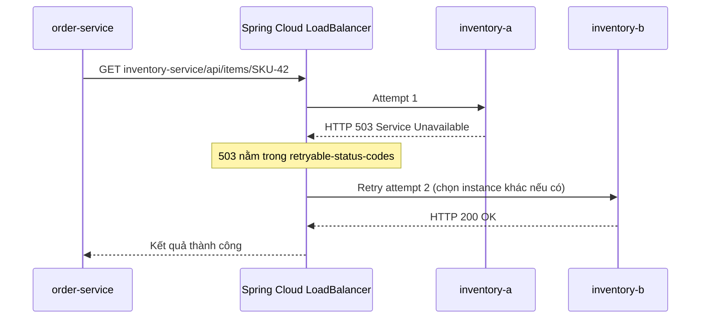
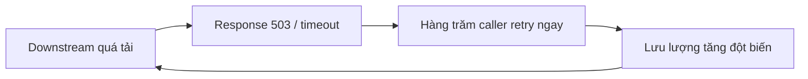

# Retryable status, ngoại lệ và giới hạn số lần thử

## Mục tiêu

Khi `order-service` gọi `inventory-service` bằng `RestClient`, `RestTemplate`, `WebClient` hoặc OpenFeign, một bản sao có thể vừa shutdown, quá tải hoặc tạm thời không phản hồi. **Retry** (gửi lại yêu cầu) giúp tăng khả năng hoàn thành lời gọi nếu sự cố chỉ là tạm thời. Tuy nhiên, retry không đúng điều kiện có thể tạo đơn hàng trùng, tăng số request trong lúc downstream quá tải và kéo dài thời gian chờ của caller.

Spring Cloud LoadBalancer hỗ trợ chọn lại `ServiceInstance` khi retry và cung cấp các thuộc tính quan trọng:

- `retryable-status-codes`: những mã HTTP có thể kích hoạt retry.
- `retryable-exceptions`: những lớp ngoại lệ có thể kích hoạt retry.
- `max-retries-on-same-service-instance`: giới hạn retry trên cùng instance.
- `max-retries-on-next-service-instance`: giới hạn retry khi chọn lại instance.
- `retry-on-all-operations`, `retry-on-all-exceptions`, `avoid-previous-instance` và backoff: các điều kiện bổ sung.

Sau bài này, bạn có thể phân loại response và exception, thiết kế ngân sách retry theo HTTP method, cấu hình mặc định và theo từng service ID, kiểm thử số lần gửi request thực tế, đồng thời tránh nhầm retry của LoadBalancer với retry riêng của Feign, Reactor hoặc gateway.

> Phạm vi: Spring Cloud Commons/LoadBalancer 5.0.4 và Spring Cloud OpenFeign tương ứng là mốc tham khảo cho các property và hành vi được mô tả. Luôn đối chiếu Release Train đang dùng vì integration và cách kích hoạt retry có thể thay đổi giữa các thế hệ.

## 1. Một retry có điều kiện, không phải cứ lỗi là gửi lại

Giả sử `inventory-service` có hai instance:

| Instance | Địa chỉ | Trạng thái ở thời điểm gọi |
|---|---|---|
| `inventory-a` | `10.0.1.11:8080` | Vừa quá tải, đôi khi trả HTTP 503 |
| `inventory-b` | `10.0.1.12:8080` | Khỏe mạnh, trả HTTP 200 |

Caller gọi:

```http
GET /api/items/SKU-42 HTTP/1.1
Host: inventory-service
Accept: application/json
```

Một retry hợp lý có thể diễn ra:



Việc retry chỉ nên diễn ra khi **nhiều điều kiện cùng thỏa mãn**:

1. HTTP client thật sự được tích hợp chức năng retry của Spring Cloud LoadBalancer.
2. Retry không bị tắt bởi cấu hình toàn cục hoặc cấu hình service ID.
3. Phương thức/operation được phép thực thi lại.
4. Mã HTTP hoặc loại ngoại lệ thuộc nhóm có thể retry.
5. Số lần thử lại còn trong giới hạn và ngân sách thời gian còn đủ.
6. Request có thể gửi lại an toàn theo yêu cầu nghiệp vụ.

Property có mặt trong `application.yml` chưa chắc chứng minh retry đang chạy: phải kiểm tra dependency, interceptor/exchange filter và HTTP client integration đang hoạt động.

## 2. Retryable HTTP status: chọn đúng mã phản hồi

Không phải mọi mã HTTP khác `2xx` đều là lỗi tạm thời. Cũng không phải tất cả `5xx` đều nên retry tự động.

| HTTP status | Ý nghĩa thường gặp | Có nên đưa vào danh sách retry? |
|---|---|---|
| `200`, `201`, `204` | Request thành công | Không |
| `400` | Dữ liệu request không hợp lệ | Không; sửa request trước |
| `401`, `403` | Thiếu xác thực hoặc không đủ quyền | Không; retry y nguyên không sửa được quyền |
| `404` | Tài nguyên không tồn tại | Thường không; xem hợp đồng eventual consistency nếu có ngoại lệ nghiệp vụ |
| `408` | Request Timeout do phía server/gateway trả | Có thể, nếu request an toàn để gửi lại và chính sách cho phép |
| `409`, `422` | Xung đột hoặc dữ liệu không hợp lệ | Thường không; phải xử lý nghiệp vụ |
| `429` | Too Many Requests / rate limit | Chỉ cân nhắc khi có backoff phù hợp và tôn trọng `Retry-After` hoặc chính sách rate limiting |
| `500` | Internal Server Error | Không mặc định xem là tạm thời; cần hiểu nguyên nhân |
| `502` | Bad Gateway | Thường là ứng viên retry đối với GET idempotent |
| `503` | Service Unavailable | Thường là ứng viên retry nếu sự cố tạm thời |
| `504` | Gateway Timeout | Có thể retry, nhưng backend có thể đã nhận hoặc xử lý request |

Một cấu hình minh họa chỉ cho retry HTTP `502`, `503` và `504`:

```yaml
spring:
  cloud:
    loadbalancer:
      retry:
        enabled: true
        retryable-status-codes:
          - 502
          - 503
          - 504
```

`retryable-status-codes` là **danh sách cho phép** chứ không phải công tắc “retry mọi lỗi HTTP”. Nếu để rỗng, không tự suy luận rằng tất cả `5xx` sẽ được thử lại. Các loại retryable exception vẫn có thể hoạt động độc lập theo chính sách.

### 2.1. HTTP response khác lỗi kết nối

Các tình huống dưới đây rất khác nhau:

- **HTTP 503:** caller đã kết nối được một backend hoặc gateway và nhận response có status 503.
- **Connect timeout:** không hoàn tất kết nối đến host/port đã chọn; có thể chưa có HTTP request nào được nhận.
- **Read timeout:** request có thể đã đến backend nhưng caller không nhận đủ response đúng hạn.
- **No instances available:** LoadBalancer không có `ServiceInstance` để chọn, có thể lỗi trước khi kết nối HTTP.

`retryable-status-codes` chỉ áp dụng khi có **HTTP status** đi qua cơ chế retry tương ứng. Lỗi `IOException`, timeout hoặc không chọn được instance không tự biến thành HTTP 503.

### 2.2. Retry-After không đồng nghĩa backoff tự động

HTTP 429 và một số response 503 có thể có header:

```http
HTTP/1.1 429 Too Many Requests
Retry-After: 5
```

Đây là tín hiệu server yêu cầu chờ trước khi thử lại. **Không giả định** chỉ cần liệt kê 429 trong `retryable-status-codes` là mọi tích hợp Spring Cloud LoadBalancer sẽ tự đọc và tôn trọng `Retry-After`. Nếu cần hành vi đó, hãy kiểm tra implementation hoặc viết chính sách backoff ở tầng thích hợp. Retry 429 ngay lập tức có thể làm rate limit nghiêm trọng hơn.

## 3. Retryable exceptions: chỉ chọn lỗi thực sự có thể phục hồi

Ngoài HTTP status, Spring Cloud LoadBalancer cho phép cấu hình những lớp exception được retry qua `retryable-exceptions`.

Theo tài liệu Spring Cloud Commons 5.0.4, nếu **không khai báo danh sách exception riêng**, những loại retryable exception mặc định bao gồm:

- `java.io.IOException`;
- `java.util.concurrent.TimeoutException`;
- `RetryableStatusCodeException` của Spring Cloud (phục vụ retry dựa trên status).

Chúng phản ánh nhóm lỗi I/O/timeout thường có khả năng tạm thời. **Không có nghĩa mọi ngoại lệ Java đều được retry**.

Ví dụ cấu hình danh sách exception minh họa:

```yaml
spring:
  cloud:
    loadbalancer:
      retry:
        enabled: true
        retryable-exceptions:
          - java.io.IOException
          - java.util.concurrent.TimeoutException
        retry-on-all-exceptions: false
```

Khi chỉ định `retryable-exceptions`, Spring Cloud vẫn duy trì hỗ trợ `RetryableStatusCodeException` để danh sách status cấu hình có thể kích hoạt retry. Tuy nhiên, exception ở phía application có thể được bọc bởi `ResourceAccessException`, `WebClientRequestException` hoặc các lớp khác tùy HTTP client. Phải kiểm thử với **root cause và wrapper thực tế**, thay vì suy luận tên exception từ log mức cao.

### 3.1. Những ngoại lệ không nên retry mù quáng

| Loại lỗi | Có thể retry? | Lý do |
|---|---|---|
| Kết nối bị reset trong lúc gửi GET | Có thể | Nếu operation idempotent và còn instance khác |
| Socket/connect timeout | Có thể | Lỗi mạng tạm thời, nhưng phải tôn trọng deadline |
| Read timeout sau POST thanh toán | Nguy hiểm | Backend có thể đã xử lý thanh toán nhưng response bị mất |
| Lỗi validate DTO / request sai schema | Không | Gửi lại dữ liệu không hợp lệ không sửa vấn đề |
| Lỗi phân quyền `401`/`403` | Không | Retry cùng credential thường không đổi kết quả |
| Bug `NullPointerException` trong xử lý caller | Không | Gửi HTTP lần nữa không sửa bug |
| `IllegalArgumentException` do input sai | Không | Phải sửa dữ liệu hoặc cấu hình |

**Không bật `retry-on-all-exceptions: true` chỉ để “hết lỗi timeout”.** Cờ này mở rộng điều kiện retry rất mạnh; lỗi không thể phục hồi cũng có thể tạo thêm attempts và gây quá tải.

### 3.2. Thận trọng với lỗi đã có side effect

Giả sử `order-service` gửi `POST /payments` và đợi response. Nếu caller bị read timeout, không thể suy ra server chưa xử lý: server có thể đã lưu giao dịch thành công rồi mới bị cắt kết nối. Retry có thể thu tiền lần thứ hai.

Để retry thao tác ghi an toàn cần có idempotency key, khóa nghiệp vụ duy nhất, cơ chế deduplication hoặc bảo đảm tương đương ở backend. Đối với request không idempotent, ưu tiên kiểm tra trạng thái giao dịch thay vì phát lại tùy tiện.

## 4. Giới hạn retry trên cùng instance và instance khác

Hai property thường gặp:

```yaml
spring:
  cloud:
    loadbalancer:
      retry:
        max-retries-on-same-service-instance: 0
        max-retries-on-next-service-instance: 1
```

Ý nghĩa:

- `max-retries-on-same-service-instance`: số **lần thử lại** trên instance đã chọn, không tính lời gọi ban đầu. Theo tài liệu, đếm riêng cho mỗi instance được chọn.
- `max-retries-on-next-service-instance`: số lần retry cần **chọn lại** một `ServiceInstance` theo chính sách LoadBalancer.

Hai trường nói về **retry**, không phải tổng số attempts; request đầu tiên luôn là attempt ban đầu khi lời gọi được thực hiện.

### 4.1. Cấu hình tối giản dễ kiểm soát

Với `same = 0` và `next = 1`:

```text
Attempt 1: inventory-a → HTTP 503 (retryable)
Attempt 2: chọn lại instance, ưu tiên inventory-b nếu có
Kết thúc: không retry thêm ở tầng này
```

Trong ví dụ lý tưởng với một cơ chế retry LoadBalancer duy nhất, đây là **tối đa hai lần gửi HTTP** cho lỗi đủ điều kiện. Nếu có thêm retry ở Feign, Reactor, gateway hoặc SDK, số lần gửi thực tế có thể cao hơn rất nhiều.

Đối với cấu hình `same = 1` và `next = 1`, thuật toán có thể thử thêm trên cùng instance và sau đó trên instance được chọn tiếp theo. **Không đọc hai số 1 và 1 thành “chỉ một request”**; cần quan sát attempt thực tế vì số lần retry cùng instance được tính theo từng instance được chọn và behavior còn phụ thuộc implementation.

### 4.2. Retry chọn lại chưa chắc là một IP khác

Spring Cloud có `RetryAwareServiceInstanceListSupplier` để **tránh instance vừa thất bại** khi chọn lại nếu có lựa chọn phù hợp. Property:

```yaml
spring:
  cloud:
    loadbalancer:
      retry:
        avoid-previous-instance: true
```

Mặc định của property này trong Spring Cloud Commons là `true` khi cơ chế tương ứng được kích hoạt. Nhưng nó là **ưu tiên**, không phải cam kết có một instance mới:

- Registry chỉ có một instance → lần retry vẫn có thể chọn lại chính instance đó.
- Health check/hint/zone filter chỉ giữ một ứng viên → không có đích khác hợp lệ.
- Retry-aware supplier chưa được gắn đúng vào chain → behavior có thể khác kỳ vọng.
- Discovery/cache cũ vẫn chứa instance đã shutdown → lần chọn tiếp theo có thể thất bại.

Nếu nghiệp vụ yêu cầu chỉ thử lại sang backend khác, phải thiết kế chính sách chặt chẽ hơn, không chỉ đặt `avoid-previous-instance: true` rồi coi là bảo đảm tuyệt đối.

## 5. Một cấu hình tổng thể và cấu hình riêng theo service ID

Ví dụ `order-service` gọi hai dịch vụ:

- `inventory-service`: GET đọc tồn kho, cho phép retry giới hạn.
- `payment-service`: thao tác nhạy cảm với xử lý trùng, tắt retry của LoadBalancer.

```yaml
spring:
  cloud:
    loadbalancer:
      retry:
        enabled: true
        max-retries-on-same-service-instance: 0
        max-retries-on-next-service-instance: 1
        retry-on-all-operations: false
        retry-on-all-exceptions: false
        retryable-status-codes:
          - 502
          - 503
          - 504
        retryable-exceptions:
          - java.io.IOException
          - java.util.concurrent.TimeoutException
        avoid-previous-instance: true
      clients:
        inventory-service:
          retry:
            max-retries-on-next-service-instance: 1
        payment-service:
          retry:
            enabled: false
```

Các property dưới `clients.<serviceId>` **ghi đè** giá trị chung cho service ID tương ứng, trong khi giá trị không ghi đè được kế thừa.

**Ngoại lệ cần nhớ:** `spring.cloud.loadbalancer.retry.enabled` là **cổng bật/tắt toàn cục**. Nếu tắt retry toàn cục, không thể bật riêng cho `inventory-service` chỉ bằng `clients.inventory-service.retry.enabled: true`. Nếu bật toàn cục, có thể tắt riêng cho `payment-service` như ví dụ.

`spring.cloud.loadbalancer.retry.enabled` có giá trị mặc định `true` trong bảng configuration properties, nhưng **retry hiệu lực thực tế phụ thuộc HTTP client và classpath**. Chẳng hạn, với `RestTemplate` blocking cần Spring Retry tương ứng; tài liệu cũng mô tả behavior reactive riêng. Không suy luận một giá trị default `true` đồng nghĩa mọi RestTemplate tự động retry dù thiếu tích hợp.

### 5.1. Bảng thuộc tính cần nhớ

| Property (đều sau `spring.cloud.loadbalancer.retry.`) | Default trong Commons 5.0.4 | Vai trò |
|---|---|---|
| `enabled` | `true` | Cổng toàn cục cho retry LoadBalancer |
| `max-retries-on-same-service-instance` | `0` | Không retry trên cùng instance theo mặc định |
| `max-retries-on-next-service-instance` | `1` | Cho phép một retry cần chọn lại instance |
| `retryable-status-codes` | Rỗng | Không tự chọn sẵn danh sách HTTP status |
| `retryable-exceptions` | Rỗng | Khi không khai báo: dùng nhóm exception mặc định |
| `retry-on-all-exceptions` | `false` | Chỉ retry exception đủ điều kiện |
| `retry-on-all-operations` | `false` | Mặc định không thử lại operation khác GET |
| `avoid-previous-instance` | `true` | Ưu tiên tránh instance vừa lỗi nếu có |
| `backoff.enabled` | `false` | Backoff reactive mặc định chưa bật |
| `backoff.min-backoff` | `5ms` | Khoảng backoff tối thiểu của retry reactive |
| `backoff.jitter` | `0.5` | Biến thiên ngẫu nhiên của backoff reactive |

Khi dùng nhiều phiên bản Spring Cloud khác nhau, kiểm tra lại tên property và default trong `configprops` của phiên bản thật. Chú ý tên được viết dạng **kebab-case** trong YAML, không ghi sai `maxRetriesOnNextServiceInstance` khi muốn theo cách đặt tên chuẩn của file cấu hình.

## 6. HTTP method và tính idempotent

Mặc định `retry-on-all-operations: false` có nghĩa retry LoadBalancer chỉ nhắm tới thao tác **GET** theo tài liệu. Không nên bật lại mọi HTTP method chỉ để tăng “tỷ lệ thành công”:

| Method | Thường có thể retry tự động? | Lưu ý |
|---|---|---|
| `GET` | Có, với retryable status/exception và ngân sách hợp lý | Không nên có side effect ở endpoint GET |
| `HEAD` | Về HTTP thường idempotent, nhưng cờ mặc định LoadBalancer không tự bao gồm mọi operation | Kiểm tra policy nếu muốn xử lý |
| `PUT` | Về giao thức idempotent nếu thực hiện đúng | Cần xem semantics và xử lý server |
| `DELETE` | Về giao thức idempotent, response của lần lặp có thể khác | Xác minh nghiệp vụ và điều kiện đồng thời |
| `POST` | Thường không | Cần idempotency key và deduplication |
| `PATCH` | Không mặc định | Phụ thuộc loại patch và cơ chế xử lý trùng |

Ví dụ mở rộng retry sang những operation khác GET:

```yaml
spring:
  cloud:
    loadbalancer:
      retry:
        retry-on-all-operations: true
```

Đây là một công tắc **rộng**, không phải “retry PUT nhưng không retry POST”. Nếu cần policy riêng từng method hoặc endpoint, hãy thiết kế custom retry policy/HTTP client wrapper và kiểm thử thay vì bật toàn bộ.

### 6.1. Idempotency key là một hợp đồng phía server

Với nghiệp vụ tạo đơn, caller có thể gửi:

```http
POST /api/orders HTTP/1.1
Host: order-service
Idempotency-Key: checkout-8412-v1
Content-Type: application/json

{"sku":"SKU-42","quantity":1}
```

Khi nhận lại **cùng khóa và cùng request**, backend phải nhận diện request đã xử lý và không tạo thêm đơn thứ hai. Chỉ thêm header `Idempotency-Key` ở caller mà không triển khai logic deduplication tại server **không** làm retry an toàn.

Đặc biệt lưu ý request body có thể không replay được, như upload streaming hoặc một input stream đã được đọc. Retry cần kiểm tra khả năng gửi lại dữ liệu, không chỉ điều kiện HTTP method và status.

## 7. Cấu hình theo từng HTTP client

### 7.1. RestTemplate blocking với Spring Retry

Để dùng LoadBalancer retry cho `RestTemplate` blocking, tài liệu Spring Cloud yêu cầu có **Spring Retry** trên classpath:

```xml
<dependency>
    <groupId>org.springframework.cloud</groupId>
    <artifactId>spring-cloud-starter-loadbalancer</artifactId>
</dependency>

<dependency>
    <groupId>org.springframework.retry</groupId>
    <artifactId>spring-retry</artifactId>
</dependency>
```

Đăng ký `RestTemplate` bean có `@LoadBalanced`:

```java
import org.springframework.cloud.client.loadbalancer.LoadBalanced;
import org.springframework.context.annotation.Bean;
import org.springframework.context.annotation.Configuration;
import org.springframework.web.client.RestTemplate;

@Configuration(proxyBeanMethods = false)
class InventoryClientConfiguration {

    @Bean
    @LoadBalanced
    RestTemplate inventoryRestTemplate() {
        return new RestTemplate();
    }
}
```

Và sử dụng:

```java
import org.springframework.cloud.client.loadbalancer.LoadBalanced;
import org.springframework.stereotype.Component;
import org.springframework.web.client.RestTemplate;

@Component
class InventoryGateway {

    private final RestTemplate client;

    InventoryGateway(@LoadBalanced RestTemplate client) {
        this.client = client;
    }

    String getInventory(String sku) {
        return client.getForObject(
                "http://inventory-service/api/items/{sku}",
                String.class,
                sku
        );
    }
}
```

Khi Spring Retry và LoadBalancer retry integration hoạt động, status/exception đủ điều kiện có thể làm lời gọi được thực hiện lại trên cùng hoặc instance mới tùy cấu hình. `RestTemplate` trực tiếp (`new RestTemplate()`) không tự tham gia Spring Cloud LoadBalancer và cũng không tự thừa hưởng retry integration từ bean có `@LoadBalanced`.

Với blocking retry, nếu muốn backoff đặc thù, Spring Cloud mô tả cách cung cấp `LoadBalancedRetryFactory` với `BackOffPolicy`. Không nhầm với `retry.backoff.enabled` là property dành cho nhánh **reactive retry**.

### 7.2. RestClient blocking

`RestClient` có thể dùng service ID bằng bean `@LoadBalanced RestClient.Builder`:

```java
import org.springframework.cloud.client.loadbalancer.LoadBalanced;
import org.springframework.context.annotation.Bean;
import org.springframework.context.annotation.Configuration;
import org.springframework.web.client.RestClient;

@Configuration(proxyBeanMethods = false)
class InventoryRestClientConfiguration {

    @Bean
    @LoadBalanced
    RestClient.Builder loadBalancedRestClientBuilder() {
        return RestClient.builder();
    }
}
```

```java
import org.springframework.cloud.client.loadbalancer.LoadBalanced;
import org.springframework.stereotype.Component;
import org.springframework.web.client.RestClient;

@Component
class InventoryRestClientGateway {

    private final RestClient client;

    InventoryRestClientGateway(@LoadBalanced RestClient.Builder builder) {
        this.client = builder.baseUrl("http://inventory-service").build();
    }

    String getInventory(String sku) {
        return client.get()
                .uri("/api/items/{sku}", sku)
                .retrieve()
                .body(String.class);
    }
}
```

`RestClient` và `RestTemplate` đều blocking, nhưng cách cấu hình interceptor và các khả năng retry có thể khác theo Spring Cloud release. **Không giả định** thêm `spring-retry` và một property sẽ làm mọi phiên bản `RestClient` hoạt động hệt `RestTemplate`; hãy kiểm tra interceptor và integration test theo phiên bản đang triển khai.

### 7.3. WebClient reactive và backoff

Với `WebClient` có `@LoadBalanced`, có thể bật retry reactive và backoff:

```yaml
spring:
  cloud:
    loadbalancer:
      retry:
        enabled: true
        max-retries-on-same-service-instance: 0
        max-retries-on-next-service-instance: 1
        retryable-status-codes: [502, 503, 504]
        retry-on-all-operations: false
        backoff:
          enabled: true
          min-backoff: 50ms
          max-backoff: 500ms
          jitter: 0.5
```

Tạo client:

```java
import org.springframework.cloud.client.loadbalancer.LoadBalanced;
import org.springframework.context.annotation.Bean;
import org.springframework.context.annotation.Configuration;
import org.springframework.web.reactive.function.client.WebClient;

@Configuration(proxyBeanMethods = false)
class InventoryWebClientConfiguration {

    @Bean
    @LoadBalanced
    WebClient.Builder loadBalancedWebClientBuilder() {
        return WebClient.builder();
    }
}
```

```java
import org.springframework.cloud.client.loadbalancer.LoadBalanced;
import org.springframework.stereotype.Component;
import org.springframework.web.reactive.function.client.WebClient;
import reactor.core.publisher.Mono;

@Component
class InventoryReactiveGateway {

    private final WebClient client;

    InventoryReactiveGateway(@LoadBalanced WebClient.Builder builder) {
        this.client = builder.baseUrl("http://inventory-service").build();
    }

    Mono<String> getInventory(String sku) {
        return client.get()
                .uri("/api/items/{sku}", sku)
                .retrieve()
                .bodyToMono(String.class);
    }
}
```

Không thêm `.retryWhen(Retry.max(...))` tùy tiện khi LoadBalancer đã retry, vì retry ở Reactor tầng ứng dụng có thể **lặp lại toàn bộ chuỗi exchange** và làm tăng số HTTP attempts ngoài giới hạn bạn dự kiến ở LoadBalancer. Nếu đặt deadline tổng bằng `Mono.timeout(...)`, phải tính cả backoff, kết nối và thời gian backend xử lý.

`WebClient.retrieve()` có thể chuyển status 4xx/5xx thành `WebClientResponseException` ở tầng ứng dụng; retryable status của LoadBalancer được xét ở lớp exchange tương ứng. Đừng kết luận status không được retry chỉ từ kiểu exception cuối cùng xuất hiện sau khi hết attempts.

### 7.4. OpenFeign có retry policy riêng

Spring Cloud OpenFeign mặc định tạo bean **`Retryer.NEVER_RETRY`**, khác với default của Feign thuần. Điều này có nghĩa retry ở **lớp Feign Retryer** được tắt theo mặc định.

Khi có `spring-cloud-starter-loadbalancer`, OpenFeign có thể sử dụng `FeignBlockingLoadBalancerClient`; các bản phát hành có hỗ trợ Spring Retry có thể dùng một biến thể retry-aware khi đủ điều kiện. Vì thế phải phân biệt:

| Tầng | Cấu hình / thành phần | Vai trò |
|---|---|---|
| Feign retry | `Retryer`, `ErrorDecoder`, Feign `RetryableException` | Retry bên trong Feign |
| Spring Cloud LoadBalancer retry | `spring.cloud.loadbalancer.retry.*`, integration tương ứng | Retry và chọn `ServiceInstance` |
| HTTP transport | Apache HC5/OkHttp connect/response timeout | Kết nối thật, không tự định nghĩa mọi retry nghiệp vụ |
| Gateway / resilience library | Spring Cloud CircuitBreaker, Resilience4j hoặc gateway retry | Có thể bổ sung các attempts bên ngoài |

`@FeignClient(name="inventory-service")` **không khai báo URL cố định** mới có đường đi qua discovery/LoadBalancer. Nếu đặt `url = "http://localhost:8081"`, client gọi trực tiếp, không có việc chọn instance mới qua LoadBalancer khi lỗi.

Không tự bật cả `Feign Retryer` và LoadBalancer retry mà chưa đếm tổng số attempts. Ví dụ một tầng retry 2 attempts bọc quanh tầng khác 2 attempts có thể tạo đến 4 lần gửi tới backend; thêm gateway retry có thể nhân tiếp.

## 8. Backoff, jitter và retry storm

Nếu mỗi caller retry **ngay lập tức** khi nhận 503, tất cả caller có thể đổ thêm request vào những instance vừa quá tải. Hiện tượng này được gọi là **retry storm**.



Backoff tăng khoảng cách giữa các lần thử; jitter thêm biến thiên để nhiều caller không dồn retry vào cùng một thời điểm.

Ví dụ minh họa chiến lược:

```text
Attempt 1: t=0ms
Retry 1: sau khoảng 80-150ms, có jitter
Retry 2: sau khoảng 160-300ms, có jitter
Kết thúc nếu hết attempts hoặc deadline
```

Đây là **minh họa chiến lược**, không phải cam kết chính xác của từng thuật toán Reactor Retry. Với Spring Cloud reactive LoadBalancer, cấu hình `backoff.enabled`, `min-backoff`, `max-backoff` và `jitter` kiểm soát backoff tương ứng. Với blocking Spring Retry, dùng `BackOffPolicy` qua tích hợp phù hợp.

Khi nhận 429 kèm `Retry-After`, cân nhắc thời gian phía server yêu cầu thay vì chỉ dùng backoff cố định. Với 503 do quá tải hệ thống, có thể cần **từ chối sớm** hoặc giảm concurrency, chứ không đơn thuần tăng số attempts.

## 9. Time budget: mỗi retry đều tiêu tốn thời gian và tải

Một request người dùng có deadline 1.500ms. Giả sử mỗi attempt tối đa 600ms, và có một khoảng backoff 150ms. Hai attempts có thể tiêu tốn gần 1.350ms, **chưa tính** discovery, xếp hàng connection pool, TLS, serialization và overhead ở application.

```text
Attempt 1: 600ms
Backoff:    150ms
Attempt 2: 600ms
----------------
Subtotal: 1,350ms
```

Nếu caller còn retry ở một tầng khác, deadline 1.500ms rất dễ bị vượt. Vì thế:

- Giới hạn tổng attempts cho **một operation**, không chỉ mỗi thư viện.
- Đặt connect, pool-acquire, response timeout và total deadline rõ ràng.
- Chừa thời gian cho caller trả phản hồi hoặc fallback.
- Hạn chế retry khi downstream đang quá tải hoặc circuit breaker đã mở.
- Theo dõi tổng số lần HTTP request tới backend, không chỉ số lần method Java được gọi.

Ví dụ ba tầng đều được cấu hình tối đa hai attempts có thể nhân thành **2 × 2 × 2 = 8 lần gửi HTTP** cho một request phía người dùng trong trường hợp xấu. Đây là lý do mỗi tầng phải biết trách nhiệm của mình; không bật retry đồng loạt ở application, Feign, LoadBalancer và gateway.

## 10. Thực hành: chứng minh status 503 được retry sang instance khác

Mục tiêu: hai instance cùng service ID, một instance trả HTTP 503 và instance kia trả 200. Đếm số request đến từng backend và quan sát LoadBalancer có chọn lại instance hay không.

### Bước 1. Tạo backend demo

Mỗi instance `inventory-service` expose endpoint sau. Để kiểm thử dễ quan sát, dùng cấu hình `demo.instance-id` và `demo.fail-with-503` riêng cho từng tiến trình:

```java
import java.util.Map;
import java.util.concurrent.atomic.AtomicInteger;
import org.springframework.beans.factory.annotation.Value;
import org.springframework.http.HttpStatus;
import org.springframework.http.ResponseEntity;
import org.springframework.web.bind.annotation.GetMapping;
import org.springframework.web.bind.annotation.RestController;

@RestController
class InventoryDemoController {

    private final AtomicInteger hits = new AtomicInteger();
    private final String instanceId;
    private final boolean failWith503;

    InventoryDemoController(
            @Value("${demo.instance-id:unknown}") String instanceId,
            @Value("${demo.fail-with-503:false}") boolean failWith503) {
        this.instanceId = instanceId;
        this.failWith503 = failWith503;
    }

    @GetMapping("/demo/inventory")
    ResponseEntity<Map<String, Object>> inventory() {
        int hit = hits.incrementAndGet();
        var body = Map.<String, Object>of(
                "instanceId", instanceId,
                "hit", hit
        );
        return failWith503
                ? ResponseEntity.status(HttpStatus.SERVICE_UNAVAILABLE).body(body)
                : ResponseEntity.ok(body);
    }
}
```

Chạy hai backend:

```text
inventory-a:
  --server.port=8081
  --demo.instance-id=inventory-a
  --demo.fail-with-503=true

inventory-b:
  --server.port=8082
  --demo.instance-id=inventory-b
  --demo.fail-with-503=false
```

Như vậy instance A luôn trả 503, instance B trả 200. Trường `hit` giúp nhận diện số lần endpoint thật sự được xử lý. Kịch bản chỉ dùng trong local/test, không đưa endpoint cố ý trả lỗi vào production.

### Bước 2. Tạo caller với discovery tĩnh

`application.yml` của `order-service`:

```yaml
server:
  port: 8080

spring:
  application:
    name: order-service
  cloud:
    discovery:
      client:
        simple:
          instances:
            inventory-service:
              - uri: http://localhost:8081
              - uri: http://localhost:8082
    loadbalancer:
      retry:
        enabled: true
        max-retries-on-same-service-instance: 0
        max-retries-on-next-service-instance: 1
        avoid-previous-instance: true
        retry-on-all-operations: false
        retryable-status-codes: [503]
```

Thêm `spring-cloud-starter-loadbalancer`, `spring-retry` và dependency HTTP/MVC phù hợp với phiên bản Spring Boot. Với Spring Boot 4.x, ứng dụng có controller MVC có thể sử dụng `spring-boot-starter-webmvc`.

### Bước 3. Tạo RestTemplate và endpoint ở caller

```java
import org.springframework.cloud.client.loadbalancer.LoadBalanced;
import org.springframework.context.annotation.Bean;
import org.springframework.context.annotation.Configuration;
import org.springframework.web.client.RestTemplate;

@Configuration(proxyBeanMethods = false)
class LoadBalancedClientConfiguration {

    @Bean
    @LoadBalanced
    RestTemplate restTemplate() {
        return new RestTemplate();
    }
}
```

```java
import org.springframework.cloud.client.loadbalancer.LoadBalanced;
import org.springframework.web.bind.annotation.GetMapping;
import org.springframework.web.bind.annotation.RestController;
import org.springframework.web.client.RestTemplate;

@RestController
class RetryDemoController {

    private final RestTemplate client;

    RetryDemoController(@LoadBalanced RestTemplate client) {
        this.client = client;
    }

    @GetMapping("/test/retry-inventory")
    String getInventory() {
        return client.getForObject(
                "http://inventory-service/demo/inventory",
                String.class
        );
    }
}
```

### Bước 4. Gửi request và phân tích

```bash
curl -i "http://localhost:8080/test/retry-inventory"
curl -i "http://localhost:8080/test/retry-inventory"
curl -i "http://localhost:8080/test/retry-inventory"
```

Khi attempt đầu chọn `inventory-b`, caller có thể nhận ngay 200 mà **không cần retry**. Khi attempt đầu chọn `inventory-a`, status 503 nằm trong `retryable-status-codes`, vì vậy integration retry đủ điều kiện có thể chọn lại `inventory-b` và nhận 200.

**Không dự đoán cứng instance nào được chọn đầu tiên.** Round robin, concurrent requests, cache và retry-aware supplier có thể ảnh hưởng thứ tự; hãy đối chiếu `hit` hoặc log ở cả hai backend.

### Bước 5. Thử các thay đổi

| Thử nghiệm | Điều cần xác minh |
|---|---|
| Đổi `retryable-status-codes: [502]` | HTTP 503 không còn nằm trong danh sách cho phép; kiểm tra kết quả 503 cuối cùng. |
| Đặt `max-retries-on-next-service-instance: 0` | Không có retry chuyển instance tại tầng LoadBalancer theo cấu hình. |
| Đặt `retry.enabled: false` | Tắt retry của LoadBalancer. |
| Chỉ còn một backend A | Không có instance khác để chuyển; `avoid-previous-instance` không bảo đảm đổi đích. |
| Đổi lỗi backend A sang HTTP 400 | Không tự retry 400 khi danh sách chỉ có 503. |
| Đổi HTTP method sang POST | Mặc định `retry-on-all-operations: false` không mở retry cho POST. |
| Tăng timeout/độ trễ backend | Tổng latency tăng theo thời gian mỗi attempt và backoff. |

Với kiểm thử tự động, nên có một test trong đó mock HTTP client trả 503 rồi 200 và đếm attempts, cùng một integration test dùng discovery/supplier thật. Đừng chỉ xem caller cuối cùng nhận 200: nó có thể là thành công ngay ở attempt đầu mà **không có retry**.

## 11. Chẩn đoán số lần retry và nguyên nhân lỗi

Trong môi trường phát triển, có thể bật log cho các thành phần liên quan:

```yaml
logging:
  level:
    org.springframework.cloud.loadbalancer: DEBUG
    org.springframework.cloud.client.loadbalancer: DEBUG
    org.springframework.retry: DEBUG
```

Log thực tế tùy phiên bản và client. Để quan sát chắc chắn, hãy thu thập:

| Tín hiệu | Câu hỏi cần trả lời |
|---|---|
| `serviceId` | Caller đang gọi dịch vụ logic nào? |
| `instanceId` | Attempt đầu và attempt retry đã đến backend nào? |
| `attemptIndex` hoặc tổng attempts | Có bao nhiêu lần thật sự gửi HTTP? |
| HTTP status / root exception | Retry xảy ra vì 503, IOException hay timeout? |
| HTTP method và endpoint | Operation có an toàn để thực thi lại? |
| Backoff / retry wait | Có retry ngay hay chờ? |
| Overall latency / deadline | Retry có khiến caller vượt SLA? |
| Retry success rate | Bao nhiêu operation được cứu nhờ retry? |
| Downstream rate/CPU/queue | Retry có khuếch đại quá tải downstream không? |

Spring Cloud LoadBalancer hỗ trợ `LoadBalancerLifecycle` để quan sát lựa chọn instance và kết quả request. Cần phân biệt **request logical** của người dùng với **physical HTTP attempts**; chỉ số theo instance nên được gắn tag có cardinality hợp lý.

Không ghi body thanh toán, token hoặc header chứa thông tin nhạy cảm vào log. Với metric, không sử dụng request ID hoặc URL có biến động cao làm tag không giới hạn.

## 12. Lỗi thường gặp

| Triệu chứng | Nguyên nhân có thể | Cách khắc phục |
|---|---|---|
| Đặt retryable status 503 nhưng không thấy retry | Thiếu Spring Retry/integration, retry bị tắt, đang gọi client direct hoặc method không đủ điều kiện | Kiểm tra classpath, `@LoadBalanced`, service ID và config thực tế. |
| Backend trả 500 nhưng vẫn thấy nhiều lần gọi | Retry có thể ở tầng khác hoặc ngoại lệ connection đã kích hoạt retry | Đếm attempts theo tầng, kiểm tra Feign/Resilience4j/gateway. |
| POST bị tạo trùng | Bật `retry-on-all-operations` hoặc retry ở tầng khác nhưng thiếu idempotency | Dùng idempotency key và tắt retry không an toàn. |
| Config `retryable-exceptions` không khớp lỗi log | Ngoại lệ bị wrapper của HTTP client bọc | Xem root cause và kiểm thử exception classifier. |
| Chỉ có một instance nhưng vẫn retry | Không có instance khác; retry-aware supplier có thể chọn lại instance cũ | Giới hạn attempts hoặc chờ discovery có backend khỏe mạnh. |
| Tăng `max-retries-on-next-service-instance` nhưng độ trễ tăng mạnh | Mỗi attempt lại tốn connect/response timeout, có backoff | Đặt deadline tổng và giảm số attempts. |
| Chỉ bật `clients.inventory-service.retry.enabled=true` nhưng không chạy | Global gate `retry.enabled` đang false | Bật global rồi override service cần tắt. |
| HTTP 429 bị gửi lại ngay lập tức | Không có backoff hoặc không tôn trọng `Retry-After` | Thiết kế retry policy theo rate-limit. |
| Lỗi `IOException` được retry dù không có status | Retryable exceptions độc lập với retryable status codes | Kiểm tra cả hai danh sách. |
| OpenFeign không retry như tài liệu Feign thuần | Spring Cloud OpenFeign mặc định `Retryer.NEVER_RETRY` | Phân biệt Feign retry và LoadBalancer retry, cấu hình có chủ đích. |
| WebClient retry nhiều hơn dự kiến | Vừa bật LB retry vừa dùng `retryWhen(...)` | Bỏ một tầng hoặc định rõ attempt budget toàn operation. |
| Retry làm backend quá tải | Retry storm và queue không có giới hạn | Thêm backoff+jitter, concurrency limit và circuit breaker. |

## 13. Checklist triển khai

- [ ] Phân biệt HTTP status (502/503/504…) với exception I/O/timeout.
- [ ] Chỉ liệt kê status thực sự tạm thời trong `retryable-status-codes`.
- [ ] Kiểm tra exception allowlist, wrapper và root cause.
- [ ] Không bật `retry-on-all-exceptions` nếu chưa kiểm soát được side effect.
- [ ] Hiểu `same instance retries` và `next instance retries` đều là **lần thử lại**, không tính attempt đầu.
- [ ] Kiểm tra `avoid-previous-instance` khi chỉ có một ứng viên sau filter.
- [ ] Cổng `retry.enabled` toàn cục không bị tắt nếu cần retry theo service.
- [ ] Có chính sách riêng cho dịch vụ nhạy cảm như payment.
- [ ] Chỉ mở retry non-GET khi đã phân tích idempotency, body replay và quyền tạo side effect.
- [ ] Phân biệt Spring Retry blocking, retry reactive và Feign Retryer.
- [ ] Không bật thêm retry ở Reactor, Feign, gateway mà chưa đếm tổng attempts.
- [ ] Có backoff và jitter phù hợp cho retry reactive; blocking cần cấu hình tương ứng.
- [ ] Có connect/pool-acquire/response timeout và total deadline để giới hạn tail latency.
- [ ] Quan sát attempt count, service ID, instance ID, status/exception, downstream load.
- [ ] Có test 503→200, 400 không retry, 503 khi hết attempts, lỗi kết nối và POST có side effect.

## Kết luận

Retry trong Spring Cloud LoadBalancer là **một chính sách có điều kiện**. `retryable-status-codes` chọn những HTTP response có khả năng tạm thời; `retryable-exceptions` chọn những lỗi I/O/timeout phù hợp; `max-retries-on-same-service-instance` và `max-retries-on-next-service-instance` giới hạn việc lặp lại trên cùng hoặc instance được chọn tiếp theo.

Không có cấu hình retry an toàn nào chỉ dựa trên một con số. Cần đồng thời xét **HTTP method, idempotency, khả năng replay request, deadline, backoff, số replica thực có và tổng các tầng retry**. Với GET đọc dữ liệu, retry giới hạn sang một instance khác có thể tăng khả năng thành công. Với thao tác thanh toán hoặc tạo đơn, retry mù quáng có thể gây trùng dữ liệu và khuếch đại sự cố. Luôn đo những HTTP attempts thực sự được gửi và kiểm thử trên đúng loại HTTP client của dự án.

## Tài liệu tham khảo

- [Spring Cloud Commons 5.0.4 — Retrying Failed Requests](https://docs.spring.io/spring-cloud-commons/reference/spring-cloud-commons/common-abstractions.html#retrying-failed-requests)
- [Spring Cloud Commons 5.0.4 — LoadBalancer Configuration Properties](https://docs.spring.io/spring-cloud-commons/reference/configprops.html)
- [Spring Cloud LoadBalancer — Configuring Individual LoadBalancerClients](https://docs.spring.io/spring-cloud-commons/reference/spring-cloud-commons/loadbalancer.html#configuring-individual-loadbalancerclients)
- [Spring Cloud OpenFeign — Retryer, ErrorDecoder và Spring Cloud LoadBalancer](https://docs.spring.io/spring-cloud-openfeign/reference/spring-cloud-openfeign.html)
- [Spring Framework — RestClient, RestTemplate và WebClient](https://docs.spring.io/spring-framework/reference/integration/rest-clients.html)
- [RFC 9110 — HTTP Semantics: idempotent methods and server errors](https://www.rfc-editor.org/rfc/rfc9110.html)
- [RFC 6585 — 429 Too Many Requests](https://www.rfc-editor.org/rfc/rfc6585)
