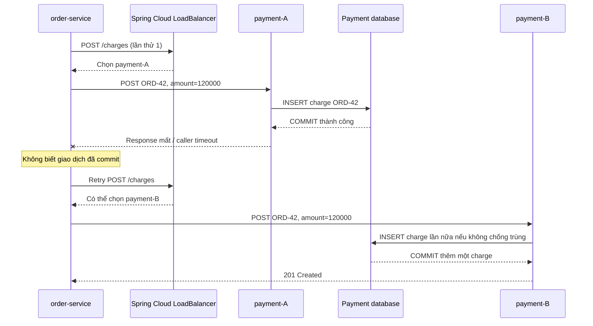
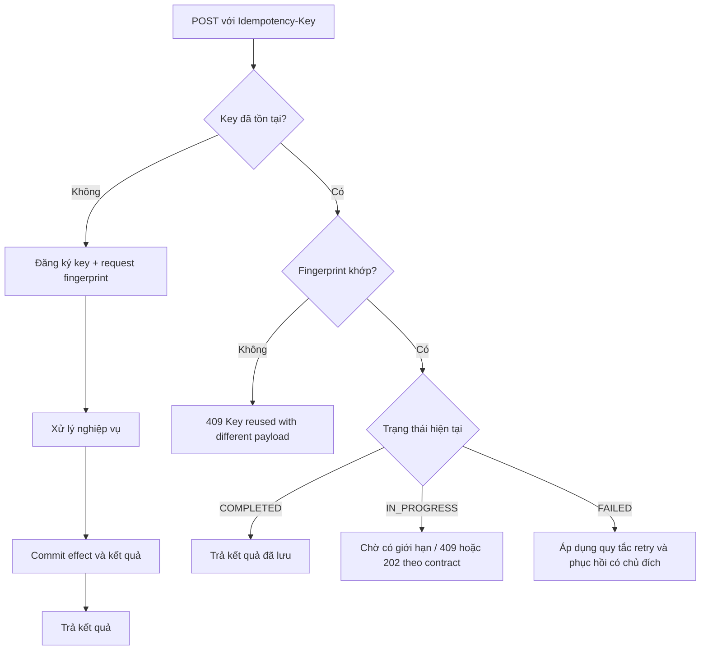

# Phương thức HTTP được retry và rủi ro với thao tác ghi

Trong hệ thống microservices, một lời gọi qua `RestClient`, `RestTemplate`, `WebClient` hoặc OpenFeign có thể thất bại vì timeout, kết nối bị ngắt, HTTP `503` hoặc một `ServiceInstance` vừa ngừng hoạt động. Spring Cloud LoadBalancer có thể giúp thực hiện lại request trên cùng hoặc một instance khác, tùy HTTP client, thư viện retry và cấu hình đang dùng. Tuy nhiên, việc **thử lại một HTTP request** không luôn tương đương với **thực hiện lại nghiệp vụ một cách an toàn**.

Đây là rủi ro đặc biệt lớn với thao tác ghi: tạo đơn hàng, trừ tồn kho, ghi giao dịch, thanh toán hoặc gửi thông báo. Request đầu tiên có thể **đã ghi dữ liệu thành công**, nhưng response bị mất. Nếu client retry mà server không nhận diện được đây là cùng một thao tác logic, hệ thống có thể tạo hai đơn hàng hoặc thực hiện hai lần thanh toán.

Bài học này phân biệt ngữ nghĩa **safe/idempotent** của HTTP với **chính sách retry thực tế của Spring Cloud LoadBalancer**, giải thích vì sao mặc định thường thận trọng với phương thức ngoài GET, cách thiết kế `Idempotency-Key` và trạng thái xử lý để chống ghi trùng, đồng thời đưa ra cấu hình, ví dụ Java, kịch bản kiểm thử và các chỉ số cần theo dõi.

## 1. Vì sao retry có thể gây ghi trùng?

Giả sử `order-service` gọi `payment-service` bằng service ID:

```http
POST /api/v1/charges HTTP/1.1
Host: payment-service
Content-Type: application/json

{"orderId":"ORD-42","amountMinor":120000}
```

Spring Cloud LoadBalancer chọn `payment-A`. Server xử lý request, ghi giao dịch thành công, nhưng trước khi response đến được `order-service` thì kết nối bị ngắt. Client chỉ nhìn thấy `SocketException` hoặc timeout. **Nó không thể suy ra request có được commit hay chưa** từ việc không nhận được response.



Kết quả có thể là **hai bản ghi giao dịch cho một yêu cầu thanh toán logic**. Đổi instance khi retry không tạo ra an toàn nghiệp vụ; ngược lại, nếu deduplication chỉ nằm trong bộ nhớ `payment-A`, `payment-B` còn có thể không biết request đã được xử lý.

### Bốn thời điểm thất bại cần phân biệt

| Thời điểm lỗi | Server đã thấy request? | Ghi dữ liệu có thể đã xảy ra? | Hành động an toàn |
|---|---|---|---|
| Không chọn được instance | Chưa gửi đến provider | Chưa, đối với attempt này | Kiểm tra discovery; retry có điều kiện và deadline |
| TCP connect thất bại trước khi gửi payload | Thường chưa | Thường chưa, nhưng phải dựa trên bằng chứng transport | Có thể retry nếu phù hợp và còn budget |
| Request đã gửi, server đang xử lý | Có thể | **Không biết** | Cần idempotency hoặc cách tra cứu kết quả |
| Server đã commit, response bị mất | Có | **Đã xảy ra** | Retry chỉ an toàn nếu server deduplicate cùng thao tác |

Với timeout hoặc connection reset sau khi đã gửi request, thông tin quan sát từ phía caller thường là **kết quả không xác định** (*ambiguous outcome*), chứ không phải “chưa thực hiện”.

## 2. Safe, idempotent và retryable là ba thuộc tính khác nhau

Theo ngữ nghĩa HTTP, một phương thức được xem là **safe** nếu tác dụng được yêu cầu về cơ bản là đọc dữ liệu, không yêu cầu làm thay đổi trạng thái. Phương thức **idempotent** nếu nhiều request giống nhau có *tác dụng được yêu cầu lên server* tương đương một request. Đây là thuộc tính của **ngữ nghĩa thao tác**, không phải bảo đảm hai lần gọi trả cùng HTTP status, cùng body hay cùng log.

| HTTP method | Safe theo chuẩn HTTP? | Idempotent theo chuẩn HTTP? | Lưu ý khi retry |
|---|---|---|---|
| `GET` | Có | Có | Thường phù hợp, **nếu endpoint thật sự là đọc** |
| `HEAD` | Có | Có | An toàn về ngữ nghĩa, nhưng không vì thế tự được LoadBalancer retry |
| `OPTIONS` | Có | Có | Thường đọc khả năng hỗ trợ, không nên tạo side effect nghiệp vụ |
| `TRACE` | Có theo chuẩn | Có | Thường bị vô hiệu hóa trong hệ thống thực vì lý do bảo mật |
| `PUT` | Không | Có | Cùng representation lặp lại phải đạt cùng trạng thái mong muốn; vẫn cần kiểm tra conflict/version |
| `DELETE` | Không | Có | Xóa hai lần cùng resource có thể cho 204 rồi 404, nhưng tác dụng cuối vẫn là đã xóa |
| `POST` | Không | **Không mặc định** | Tạo resource/thanh toán dễ phát sinh nhiều side effect |
| `PATCH` | Không | **Không bảo đảm** | Phụ thuộc ý nghĩa patch, ví dụ “tăng 1” khác “đặt thành 10” |

Một request có thể tạo log/access metric nhiều lần dù được coi là safe/idempotent; tiêu chuẩn nói về **tác dụng mà client yêu cầu**, không phải cấm mọi ghi log hệ thống. Ngược lại, API viết sai ngữ nghĩa, chẳng hạn `GET /withdraw?amount=100` làm giảm số dư, **không an toàn chỉ vì dùng GET**.

Ví dụ khác biệt:

```http
PUT /api/v1/products/42
Content-Type: application/json

{"name":"Book","price":50000}
```

Gửi hai lần cùng nội dung thường có **trạng thái cuối giống nhau**, nên PUT idempotent theo ý nghĩa HTTP. Nhưng:

```http
POST /api/v1/orders
Content-Type: application/json

{"productId":"42","quantity":1}
```

Nếu mỗi POST tạo một order mới, hai lần gửi sẽ tạo hai order. Muốn retry POST an toàn, cần thiết kế nghiệp vụ **idempotent theo request logic**, không chỉ dựa vào HTTP method.

### Safe ≠ idempotent ≠ có thể retry trong mọi trường hợp

- **Safe** nói về tác dụng được yêu cầu của phương thức.
- **Idempotent** nói về việc lặp lại cùng request có đổi tác dụng cuối cùng hay không.
- **Retryable** là **quyết định vận hành** còn phụ thuộc lỗi xảy ra ở đâu, tính đúng đắn của endpoint, khả năng phát lại body, token, deadline, idempotency key và chính sách retry được bật.

Vì vậy, `PUT` hoặc `DELETE` có thể idempotent theo chuẩn nhưng **không mặc định được Spring Cloud LoadBalancer retry**; còn `POST` có thể được cho phép retry một cách có kiểm soát nếu server triển khai deduplication chắc chắn.

## 3. Phương thức nào được Spring Cloud LoadBalancer retry?

Cần phân biệt **ngữ nghĩa HTTP** với **quy tắc mặc định của một implementation**. Trong Spring Cloud Commons, thuộc tính:

```properties
spring.cloud.loadbalancer.retry.retry-on-all-operations=false
```

có mô tả chính thức: retry được phép cho thao tác **`HttpMethod.GET`**; đặt `true` mới mở khả năng retry những phương thức khác. **Điều này không có nghĩa GET chắc chắn luôn được retry**: còn phải có đúng HTTP client integration, hạ tầng retry, loại lỗi đủ điều kiện, instance và số lần thử cho phép.

| Phương thức | Khi `retry-on-all-operations=false` | Khi `retry-on-all-operations=true` |
|---|---|---|
| GET | Có thể retry nếu các điều kiện khác thỏa | Có thể retry |
| HEAD, OPTIONS | Không được bật chỉ vì chúng safe | Có thể retry nếu policy khác thỏa |
| PUT, DELETE | Không được bật chỉ vì chúng idempotent | Có thể retry, **phải xác minh semantics của API** |
| POST, PATCH | Không được bật theo policy mặc định | Có thể retry, **rất rủi ro nếu chưa chống ghi trùng** |

Đây là **bộ lọc theo HTTP method của Spring Cloud LoadBalancer retry**, không phải lời cam kết về hành vi của Feign Retryer, Reactor `retryWhen`, API gateway, service mesh hoặc HTTP transport. Nếu một lớp khác tự retry POST, thuộc tính này **không bảo vệ được lời gọi của lớp đó**.

### Ví dụ cấu hình giới hạn retries cho lab

```yaml
spring:
  cloud:
    loadbalancer:
      retry:
        enabled: true
        retry-on-all-operations: false
        max-retries-on-same-service-instance: 0
        max-retries-on-next-service-instance: 1
        retryable-status-codes:
          - 502
          - 503
          - 504
        retry-on-all-exceptions: false
        avoid-previous-instance: true
```

Ý định của cấu hình:

1. Vẫn giữ **GET-only** ở tầng LoadBalancer retry.
2. Giới hạn số lần thử lại trên instance hiện tại và instance mới, thay vì retry vô hạn.
3. Xét các mã 502/503/504 là những response có thể retry theo policy này.
4. Khi retry lên instance khác, cố tránh instance đã chọn trước nếu còn lựa chọn phù hợp.

**Điểm cần xác minh:** bật `retry.enabled` trong YAML **không tự chứng minh** mọi client đã bật retries. Với blocking `RestTemplate` cần sự hiện diện và tích hợp Spring Retry phù hợp; với reactive `WebClient` cần cấu hình integration reactive. Các tham số đã có default và điều kiện kích hoạt khác nhau giữa release train, vì vậy hãy kiểm tra phiên bản, dependency, log và **số HTTP attempts thực tế**.

`RetryAwareServiceInstanceListSupplier` có thể hỗ trợ tránh instance trước đó trong một số integration; `avoid-previous-instance=true` **không bảo đảm** lần thử kế tiếp luôn sang instance khác, nhất là khi chỉ có một instance hoặc supplier lọc còn một ứng viên.

**Không nên** đổi `retry-on-all-operations` thành `true` trên toàn hệ thống chỉ để “sửa lỗi 503 của POST”. Nếu cần retry một số thao tác ghi đã bảo vệ bằng idempotency, tốt hơn là xác định policy theo từng operation và tầng trách nhiệm; việc bật global có thể khiến các POST/PATCH khác bị retry ngoài dự kiến.

## 4. Lỗi nào có thể retry và lỗi nào nên dừng?

Retry là phản ứng đối với một **loại thất bại có khả năng phục hồi**, không phải phản ứng mặc định đối với mọi exception.

| Dấu hiệu | Ý nghĩa thường gặp | Retry có thể hợp lý? |
|---|---|---|
| HTTP `400`, `401`, `403` | Request sai, chưa xác thực hoặc không đủ quyền | Không lặp y nguyên |
| HTTP `404` | Không tìm thấy resource hoặc sai tuyến | Thường không, trừ chính sách nhất quán eventual rõ ràng |
| HTTP `409`, `412` | Conflict hoặc điều kiện phiên bản không thỏa | Cần đọc/đồng bộ lại dữ liệu; không retry y nguyên mù quáng |
| HTTP `429` | Rate limit | Chỉ khi policy cho phép, xét `Retry-After` và budget |
| HTTP `502`, `503`, `504` | Gateway/backend không phục vụ hoặc timeout | Có thể, **nếu thao tác an toàn** và còn deadline |
| Connect timeout trước khi gửi request | Không kết nối được | Thường phù hợp hơn với thao tác idempotent |
| Read timeout sau khi gửi request | Response không về kịp | Kết quả có thể đã commit; cần chống trùng nếu ghi |
| Connection reset sau khi server nhận request | Không rõ trạng thái xử lý | Cần xác minh hoặc idempotency |
| JSON decode error | Response vi phạm contract | Thường không giải quyết bằng retry |
| Không có ServiceInstance | Discovery/supplier rỗng | Cân nhắc có thể khôi phục không; không có phép màu để tạo instance |

Với response `503`, cần kiểm tra nó đến từ provider, gateway hay LoadBalancer integration khi danh sách instance trống. Một số lỗi **không xảy ra ở provider**, nên chỉ log status 503 không đủ để chẩn đoán.

### Không có response không có nghĩa là không có side effect

Đặc biệt với POST, PATCH và các lệnh ghi khác, lỗi mạng/timeout sau khi gửi request có thể xảy ra **sau khi transaction đã commit**. Đây là lý do không thể quyết định retry chỉ bằng `IOException` hoặc `TimeoutException`: phải kết hợp **tính idempotent của thao tác**.

## 5. Vì sao chọn ServiceInstance khác không ngăn được duplicate?

Giả sử LoadBalancer chuyển từ instance A sang B khi retry. Cùng một lệnh thanh toán có thể được gửi lại qua B và dẫn đến ghi trùng nếu server không có cơ chế phối hợp:

```text
request #1, key=none -> payment-A -> INSERT charge #1001 -> response lost
request #2, key=none -> payment-B -> INSERT charge #1002 -> 201
```

Nếu A và B sử dụng hai bộ nhớ riêng để ghi “đã xử lý request”, chúng vẫn không chia sẻ được thông tin deduplication. Ngay cả khi database dùng chung, việc đơn thuần gọi `INSERT` trong mỗi request mà không có **unique constraint** cho mã thao tác logic cũng không loại được bản ghi trùng.

Điểm mấu chốt: **Load balancing quyết định nơi gửi request; idempotency quyết định việc lặp request có tạo thêm tác dụng nghiệp vụ hay không.** Hai trách nhiệm phải được thiết kế ở hai tầng khác nhau.

## 6. Idempotency-Key: nhận diện một thao tác logic qua nhiều lần thử

Một cách thực tế để retry thao tác ghi an toàn là client tạo **idempotency key** duy nhất cho một thao tác nghiệp vụ, rồi gửi **cùng key và cùng nội dung** cho mọi HTTP attempt của thao tác đó:

```http
POST /api/v1/charges HTTP/1.1
Host: payment-service
Content-Type: application/json
Idempotency-Key: charge-ord-42-attempt-group-1

{"orderId":"ORD-42","amountMinor":120000}
```

Nếu lần đầu hoàn thành nhưng response bị mất, lần retry mang **cùng `Idempotency-Key`**. Server tra cứu key và trả về kết quả đã lưu, **không tạo charge thứ hai**.

Nguyên tắc:

1. **Sinh key một lần cho một nghiệp vụ logic**, không sinh UUID mới cho mỗi HTTP attempt.
2. **Giữ cùng payload**. Nếu cùng key nhưng amount/order khác, phải coi là conflict, không âm thầm trả kết quả cũ hoặc thực thi request mới.
3. **Phân vùng key theo chủ thể và thao tác** (ví dụ `tenantId + operation + idempotencyKey`), không dùng một bảng key toàn hệ thống thiếu context.
4. **Ghi nhận kết quả và tác dụng nghiệp vụ một cách nguyên tử** trong phạm vi có thể, thay vì đánh dấu “xử lý rồi” trước khi thực hiện nghiệp vụ và để lỡ transaction.
5. **Dùng một kho trạng thái chia sẻ** cho mọi instance; một `ConcurrentHashMap` riêng ở từng replica không đủ cho production.
6. **Có TTL và chính sách hết hạn**: key được giữ ít nhất trong khoảng có thể nhận retry hợp lệ; nếu key đã bị xóa quá sớm thì retry muộn vẫn có nguy cơ ghi trùng.
7. **Bảo vệ khóa và dữ liệu**: key nên đủ khó đoán, có kiểm soát truy cập; không lấy key từ người dùng chưa xác thực làm bằng chứng đã thanh toán.

Header `Idempotency-Key` ở đây là một contract HTTP do hệ thống chọn hỗ trợ. Spring Cloud LoadBalancer **không tự sinh key, không tự lưu kết quả, cũng không đảm bảo exactly-once** cho request.

### Trạng thái xử lý idempotency



Các trạng thái `IN_PROGRESS`, `COMPLETED`, `FAILED` và response lặp lại cần **được định nghĩa trong API contract**. Ví dụ nếu request đang xử lý, server có thể trả HTTP 409 hoặc 202 với đường tra cứu trạng thái; không nên cho phép tiến trình khác thực thi cùng nghiệp vụ lần thứ hai chỉ vì kết quả chưa được lưu.

## 7. Thực hành: endpoint POST có và không có idempotency

Để nhìn thấy rủi ro rõ ràng, có thể tạo một provider Spring Boot Web chạy trên máy local. Chương trình sau có **bộ đếm số charge đã thực thi** và một map lưu response theo key. Ví dụ hoàn chỉnh trong **một JVM**:

```java
import java.util.UUID;
import java.util.concurrent.ConcurrentHashMap;
import java.util.concurrent.ConcurrentMap;
import java.util.concurrent.atomic.AtomicInteger;

import org.springframework.http.HttpStatus;
import org.springframework.http.ResponseEntity;
import org.springframework.web.bind.annotation.PostMapping;
import org.springframework.web.bind.annotation.RequestBody;
import org.springframework.web.bind.annotation.RequestHeader;
import org.springframework.web.bind.annotation.RestController;

record ChargeRequest(String orderId, long amountMinor) {
}

record ChargeResult(String chargeId, int totalExecutedCharges) {
}

record SavedCharge(String fingerprint, ChargeResult result) {
}

@RestController
class ChargeDemoController {

    private final AtomicInteger executedCharges = new AtomicInteger();
    private final ConcurrentMap<String, SavedCharge> saved =
            new ConcurrentHashMap<>();

    @PostMapping("/api/v1/charges")
    ResponseEntity<ChargeResult> charge(
            @RequestHeader(
                    name = "Idempotency-Key",
                    required = false) String key,
            @RequestBody ChargeRequest request) {

        if (request.orderId() == null
                || request.orderId().isBlank()
                || request.amountMinor() <= 0) {
            return ResponseEntity.badRequest().build();
        }

        // Không có key: mỗi HTTP POST tạo một charge mới.
        if (key == null || key.isBlank()) {
            return ResponseEntity.status(HttpStatus.CREATED)
                    .body(newCharge());
        }

        // Fingerprint đơn giản chỉ phù hợp cho bài lab.
        String fingerprint =
                request.orderId() + "|" + request.amountMinor();

        // compute bảo đảm tại một JVM chỉ có một lần khởi tạo
        // kết quả cho cùng key, kể cả khi hai thread gọi đồng thời.
        SavedCharge record = saved.compute(key,
                (ignoredKey, previous) -> previous != null
                        ? previous
                        : new SavedCharge(fingerprint, newCharge()));

        if (!record.fingerprint().equals(fingerprint)) {
            return ResponseEntity.status(HttpStatus.CONFLICT).build();
        }

        return ResponseEntity.status(HttpStatus.CREATED)
                .body(record.result());
    }

    private ChargeResult newCharge() {
        return new ChargeResult(
                UUID.randomUUID().toString(),
                executedCharges.incrementAndGet());
    }
}
```

Điểm cần quan sát:

- **Không có header:** hai POST giống nhau thực thi `newCharge()` hai lần.
- **Có cùng key và payload:** request sau dùng lại `ChargeResult` của request đầu, không tăng bộ đếm thêm lần nữa.
- **Cùng key nhưng payload khác:** trả `409 Conflict`, không thực thi charge mới.
- `ConcurrentHashMap.compute` bảo vệ thao tác tạo response cho **một key trong một tiến trình**, chứ không biến ví dụ thành hệ thống thanh toán đáng tin cậy.

**Giới hạn rất quan trọng:** đây là **demo một JVM**, không có database, không có durable storage, không bảo toàn trạng thái khi restart và **không đồng bộ giữa các replica**. Nếu A và B chạy cùng code nhưng có hai map riêng, một retry chuyển từ A sang B vẫn có thể tạo hai charge. Tuyệt đối không dùng map kiểu này để chống ghi trùng cho tiền, tồn kho hoặc dữ liệu production.

### 7.1. Thử hai POST không có idempotency key

Chạy provider trên `localhost:8091`, rồi gọi:

```bash
curl -i -X POST http://localhost:8091/api/v1/charges \
  -H 'Content-Type: application/json' \
  -d '{"orderId":"ORD-42","amountMinor":120000}'

curl -i -X POST http://localhost:8091/api/v1/charges \
  -H 'Content-Type: application/json' \
  -d '{"orderId":"ORD-42","amountMinor":120000}'
```

Kỳ vọng: hai response có hai `chargeId` khác nhau, và `totalExecutedCharges` tăng ở mỗi request. Không cần lỗi mạng để thấy được hậu quả: hai HTTP attempts của cùng tác vụ đã đủ tạo hai side effects.

### 7.2. Thử lại với cùng một key

```bash
curl -i -X POST http://localhost:8091/api/v1/charges \
  -H 'Content-Type: application/json' \
  -H 'Idempotency-Key: demo-order-43-charge' \
  -d '{"orderId":"ORD-43","amountMinor":120000}'

curl -i -X POST http://localhost:8091/api/v1/charges \
  -H 'Content-Type: application/json' \
  -H 'Idempotency-Key: demo-order-43-charge' \
  -d '{"orderId":"ORD-43","amountMinor":120000}'
```

Hai response cho request mang key giống nhau phải chứa **cùng `chargeId`** và **cùng `totalExecutedCharges`** theo code demo. Số đếm tổng có thể không bắt đầu từ 1 vì phụ thuộc các lời gọi trước đó; so sánh **sự thay đổi giữa hai lần**, không gắn cứng vào giá trị tuyệt đối.

Để thấy việc tái sử dụng key sai nội dung bị chặn:

```bash
curl -i -X POST http://localhost:8091/api/v1/charges \
  -H 'Content-Type: application/json' \
  -H 'Idempotency-Key: demo-order-43-charge' \
  -d '{"orderId":"ORD-43","amountMinor":200000}'
```

Kỳ vọng `409 Conflict`. Với hệ thống thật, fingerprint nên được tạo từ payload đã được chuẩn hóa theo contract, lưu cùng tenant/operation và kiểm tra nội dung một cách an toàn, không ghép vài chuỗi đơn giản rồi coi là định danh bảo mật.

## 8. Thiết kế idempotency bền vững cho nhiều ServiceInstance

Khi `payment-service` có nhiều bản sao sau LoadBalancer, **mọi bản sao phải nhìn thấy cùng kết quả xử lý** của một key. Một thiết kế thường dùng là database có unique constraint trên **phạm vi idempotency** và thao tác lưu dữ liệu nghiệp vụ.

Ví dụ mô hình bảng trên PostgreSQL:

```sql
CREATE TABLE idempotency_operations (
    tenant_id        VARCHAR(80) NOT NULL,
    operation_name   VARCHAR(80) NOT NULL,
    idempotency_key  VARCHAR(200) NOT NULL,
    request_hash     CHAR(64) NOT NULL,
    state            VARCHAR(20) NOT NULL,
    response_status  INTEGER,
    response_body    JSONB,
    created_at       TIMESTAMPTZ NOT NULL DEFAULT now(),
    PRIMARY KEY (tenant_id, operation_name, idempotency_key)
);
```

Lưu ý:

- **Primary key** ngăn hai transaction độc lập ghi cùng key trong một phạm vi.
- `request_hash` giúp phát hiện cùng key nhưng nội dung khác, không chỉ dựa vào HTTP method.
- `state` có thể biểu diễn `IN_PROGRESS`, `COMPLETED`, `FAILED` theo contract; phải định nghĩa rõ việc phục hồi record dở dang.
- `response_status` và `response_body` cho phép trả lại **kết quả tương thích** cho request trùng; không tạo thêm side effect.
- `tenant_id` và `operation_name` ngăn xung đột key vô ý giữa các khách hàng và endpoint khác nhau.

### 8.1. Transaction boundary quan trọng hơn tên header

Với một thao tác ghi **chỉ tác động tới cùng database**, có thể thiết kế transaction:

1. Thử đăng ký key và request hash với ràng buộc unique.
2. Nếu key đã tồn tại, kiểm tra hash và trạng thái; trả kết quả đã lưu hoặc báo đang xử lý.
3. Nếu key mới, thực hiện thao tác nghiệp vụ **trong phạm vi transaction có điều phối thích hợp**.
4. Ghi status/response của request logic.
5. Commit dữ liệu nghiệp vụ và kết quả idempotency sao cho không có trạng thái “đã ghi nghiệp vụ nhưng mất dấu idempotency”.

Nếu ghi record `IN_PROGRESS` ở transaction riêng **rồi mới** ghi nghiệp vụ mà không có cách phục hồi, crash có thể để lại record treo. Nếu thực hiện nghiệp vụ trước **rồi mới** ghi key, hai request song song có thể cùng thực hiện side effect trước khi bị phát hiện trùng. Đây là các lỗi thiết kế phổ biến.

Đối với thao tác gọi **dịch vụ thanh toán bên ngoài** hoặc gửi message, một database transaction cục bộ không thể bảo đảm rollback side effect ở hệ thống khác. Cần kết hợp idempotency key ở **dịch vụ thực sự tạo side effect**, outbox/inbox, state machine hoặc cơ chế đối soát. Không nên tuyên bố đạt “exactly once delivery” chỉ vì lưu một hàng idempotency.

### 8.2. Xử lý request đồng thời cùng key

Hai request có cùng key có thể đến A và B **cùng lúc**, đặc biệt khi client retry trước khi attempt đầu hoàn tất. Cần xác định điều gì xảy ra khi một request đang xử lý:

| Trạng thái key | Request mới với cùng fingerprint | Request mới với fingerprint khác |
|---|---|---|
| Chưa tồn tại | Một request giành quyền xử lý qua khóa/unique constraint | Một request giành quyền xử lý |
| `IN_PROGRESS` | Chờ có giới hạn, trả 202/409 hoặc link tra cứu theo contract | 409 Conflict |
| `COMPLETED` | Trả kết quả được lưu | 409 Conflict |
| `FAILED` | Theo chính sách recovery/retry đã định nghĩa, không tự ghi lại mù quáng | 409 Conflict |

Không đồng nhất `FAILED` với “đảm bảo chưa có side effect”: lỗi có thể xảy ra **sau khi commit**. Nếu trạng thái không rõ, cần truy vấn kết quả nghiệp vụ bằng mã thao tác logic hoặc thực hiện đối soát trước khi cho phép thử lại.

### 8.3. PUT, DELETE, PATCH vẫn cần xem xét logic ghi

- **PUT:** mặc dù idempotent theo HTTP, việc luôn phát event `ProductUpdated` hoặc ghi nhận thanh toán phụ sau mỗi PUT có thể gây side effect không mong muốn. Event/logic phụ phải được thiết kế nhất quán với semantics.
- **DELETE:** hai request giống nhau có thể trả `204` rồi `404`; caller cần hiểu rằng kết quả cuối vẫn là resource đã được xóa. Nếu DELETE kích hoạt hủy đơn và hoàn tiền, không được hoàn tiền nhiều lần.
- **PATCH:** `{"op":"increment","value":1}` có thể tăng số dư hoặc tồn kho nhiều lần. Một PATCH đặt giá trị tuyệt đối với version/check condition có thể thiết kế idempotent, nhưng **không được giả định** tất cả PATCH đều vậy.
- **POST:** có thể trở nên an toàn khi retry với idempotency key, business key/unique constraint và outcome replay hợp lệ, nhưng phải đảm bảo cả các service phụ thuộc cũng không lặp side effect.

Với cập nhật có cạnh tranh, có thể dùng `ETag`/`If-Match`, optimistic locking hoặc version field để phát hiện lost update. **Version check và idempotency key giải quyết hai vấn đề khác nhau**: một bên kiểm soát cập nhật đồng thời, bên kia nhận diện nhiều attempts của cùng thao tác logic.

## 9. Gửi cùng Idempotency-Key từ RestClient

Ví dụ ứng dụng `order-service` gọi `payment-service` qua Spring Cloud LoadBalancer, dùng `RestClient` với bean builder:

```java
import org.springframework.cloud.client.loadbalancer.LoadBalanced;
import org.springframework.context.annotation.Bean;
import org.springframework.context.annotation.Configuration;
import org.springframework.web.client.RestClient;

@Configuration
class HttpClientConfiguration {

    @Bean
    @LoadBalanced
    RestClient.Builder loadBalancedRestClientBuilder() {
        return RestClient.builder();
    }
}
```

Gateway:

```java
import org.springframework.beans.factory.annotation.Qualifier;
import org.springframework.stereotype.Service;
import org.springframework.web.client.RestClient;

record ChargeCommand(String orderId, long amountMinor) {
}

record ChargeReceipt(String chargeId, int totalExecutedCharges) {
}

@Service
class PaymentGateway {
    private final RestClient client;

    PaymentGateway(
            @Qualifier("loadBalancedRestClientBuilder")
            RestClient.Builder builder) {
        this.client = builder
                .baseUrl("http://payment-service")
                .build();
    }

    ChargeReceipt createCharge(
            ChargeCommand command, String stableOperationKey) {
        return client.post()
                .uri("/api/v1/charges")
                .header("Idempotency-Key", stableOperationKey)
                .body(command)
                .retrieve()
                .body(ChargeReceipt.class);
    }
}
```

Đây là **đoạn client gửi header**, không tự kích hoạt retry và cũng không thực thi idempotency ở server. Caller phải tạo `stableOperationKey` **một lần cho nghiệp vụ logic** (chẳng hạn khi tạo lệnh charge), lưu/tái sử dụng nó cho mọi attempt, kể cả khi request được xử lý bởi một worker khác sau restart.

Khi gọi qua LoadBalancer, cấu hình discovery của ứng dụng có thể chứa:

```yaml
spring:
  cloud:
    discovery:
      client:
        simple:
          instances:
            payment-service:
              - uri: http://localhost:8091
              - uri: http://localhost:8092
```

Nếu dùng đúng demo `ChargeDemoController` ở mục 7, hãy lưu ý map in-memory **không chia sẻ qua hai provider**, do đó **không được coi thử hai bản sao này là chứng minh retry POST an toàn**. Muốn kiểm thử qua hai instance, cần triển khai kho idempotency chung hoặc bảng unique constraint như mục 8.

### 9.1. Vì sao không sinh key ngay trong hàm retry?

Ví dụ sai:

```java
// SAI: mỗi attempt có key mới, server không nhận ra trùng lặp.
ChargeReceipt retryAttempt(ChargeCommand command) {
    return paymentGateway.createCharge(
            command, java.util.UUID.randomUUID().toString());
}
```

Nếu caller retry bằng cách gọi `retryAttempt(command)` nhiều lần, mỗi lần có key khác, server hợp lệ coi đó là những thao tác mới. Ngay cả khi client gắn key trước một `retryWhen`, cần chú ý một **request nghiệp vụ được submit lại từ bên ngoài** vẫn phải dùng lại cùng logical operation key.

**Cách đúng:** tạo mã thao tác ở tầng orchestration/command, lưu nó cùng lệnh nghiệp vụ và truyền xuống gateway. Nếu process restart rồi đọc lại công việc từ queue, mã đó vẫn còn. Idempotency key không nên chỉ sống trong stack frame của một HTTP attempt.

## 10. Retry ở tầng WebClient hoặc Feign có thể khác policy của LoadBalancer

Trong thực tế có thể xuất hiện **nhiều lớp retry**:

| Lớp | Ví dụ | Rủi ro |
|---|---|---|
| Spring Cloud LoadBalancer retry | `max-retries-on-next-service-instance` | Có thể gọi lại cùng hoặc instance khác |
| Reactor retry | `Mono.retryWhen(...)` trong `WebClient` | Không tự biết thao tác có phải GET hay POST |
| OpenFeign Retryer | `Retryer` khi được cấu hình | Có thể thử lại cả request ghi theo exception |
| Resilience4j/Spring Retry | `@Retry` / `RetryTemplate` | Có thể bọc **toàn bộ** business method có side effect |
| API gateway, service mesh, proxy | Retry request HTTP upstream | Caller ứng dụng không luôn nhìn thấy số attempts thật |
| Queue/consumer | Re-delivery khi chưa ACK | Lặp lại **message** có thể dẫn đến gửi lại HTTP request |

Đặc biệt, Spring Cloud OpenFeign thường tạo bean `Retryer.NEVER_RETRY` mặc định, trong khi Feign core có thể retry một số `IOException`/`RetryableException` nếu dùng Retryer khác. Không được suy ra rằng toàn bộ stack **không có retry** chỉ vì Feign Retryer bị tắt: tầng gateway, LoadBalancer hoặc caller vẫn có thể thử lại.

### 10.1. WebClient retry POST sau khi đã gắn key

Ví dụ dưới đây minh họa **chủ động retry một POST**, *chỉ* thích hợp nếu server có idempotency bền vững và đã kiểm thử. `client` phải là WebClient được xây từ `@LoadBalanced WebClient.Builder`, có `baseUrl("http://payment-service")`:

```java
import java.time.Duration;

import org.springframework.web.reactive.function.client.WebClient;
import org.springframework.web.reactive.function.client.WebClientRequestException;
import org.springframework.web.reactive.function.client.WebClientResponseException;
import reactor.core.publisher.Mono;
import reactor.util.retry.Retry;

final class ReactivePaymentGateway {
    private final WebClient client;

    ReactivePaymentGateway(WebClient client) {
        this.client = client;
    }

    Mono<ChargeReceipt> createCharge(
            ChargeCommand command, String stableOperationKey) {
        return client.post()
                .uri("/api/v1/charges")
                .header("Idempotency-Key", stableOperationKey)
                .bodyValue(command)
                .retrieve()
                .bodyToMono(ChargeReceipt.class)
                .retryWhen(Retry.backoff(1, Duration.ofMillis(100))
                        .filter(error -> error instanceof WebClientRequestException
                                || (error instanceof WebClientResponseException http
                                        && (http.getStatusCode().value() == 502
                                        || http.getStatusCode().value() == 503
                                        || http.getStatusCode().value() == 504))))
                .timeout(Duration.ofSeconds(2));
    }
}
```

Giải thích:

- `stableOperationKey` được truyền **từ bên ngoài**, không thay đổi giữa các lần subscribe lại do retry.
- `Retry.backoff(1, ...)` cho phép **tối đa một lần retry** sau attempt ban đầu.
- `.timeout(2s)` đặt **ngoài retryWhen** để giới hạn thời gian chờ toàn chuỗi, gồm backoff.
- Bộ lọc không retry HTTP 400/404/409/429 trong ví dụ; với 429 cần đọc `Retry-After` và chính sách rate limit riêng.
- **Reactor `retryWhen` không tự áp dụng bộ lọc GET-only của Spring Cloud LoadBalancer**. Vì vậy đoạn này vẫn có thể retry POST ngay cả khi `retry-on-all-operations=false`.
- Việc có chọn `ServiceInstance` khác ở lần retry hay không phụ thuộc filter/integration và snapshot discovery; không được suy đoán chỉ từ số lần retry.

Đây là ví dụ về **request body có thể phát lại** bằng `bodyValue(command)`. Nếu request body là stream chỉ đọc một lần, upload file hoặc dữ liệu lấy từ input stream, retry có thể không phát lại được body; cần xem xét cách tạo lại body và rủi ro tốn memory trước khi bật retry.

**Không dùng ví dụ này cho charge thực tế nếu server chỉ dùng `ConcurrentHashMap` như mục 7.** Với nhiều replica, cần deduplication chung và đáng tin như mục 8.

### 10.2. Số attempts có thể bị nhân lên qua nhiều tầng

Giả sử một gateway được phép tối đa **2 attempts**, LoadBalancer bên trong lại được phép tối đa **2 attempts**:

\[
N_{\mathrm{HTTP-attempts}}\le 2\times2=4
\]

Đây là ví dụ về **giới hạn trên trong một cách lồng retries cụ thể**, không phải công thức mà mọi tích hợp đều áp dụng. Nếu có thêm tầng retry nữa, số attempts có thể tăng nhanh. Một nghiệp vụ chỉ nên có **chủ sở hữu chính sách retry** rõ ràng; các lớp còn lại cần được cấu hình nhất quán để không tạo vòng lặp nhân số lần thử.

## 11. Retry budget, deadline, backoff và bảo vệ hệ thống

Ngay cả khi retry an toàn về **tính đúng đắn**, retry quá dày vẫn có thể gây **retry storm** và làm dịch vụ đang chậm càng quá tải.

Một ngân sách cho một chuỗi attempts:

\[
\sum_i T_{\mathrm{attempt},i}
+\sum_j T_{\mathrm{backoff},j}
+T_{\mathrm{overhead}}
\le T_{\mathrm{deadline}}
\]

Ví dụ request chỉ còn 650 ms để gọi `payment-service`:

| Thành phần | Ngân sách ví dụ |
|---|---:|
| Attempt 1 | 200 ms |
| Backoff + jitter | 80 ms |
| Attempt 2 | 200 ms |
| Truy vết, xử lý kết quả và reserve | 170 ms |
| **Tổng** | **650 ms** |

Những con số trên chỉ là ước lượng để thiết kế; **deadline tổng phải được thực thi ở runtime**, không chỉ đặt timeout riêng từng attempt rồi hy vọng tổng thời gian đúng như bảng.

Khi thấy lỗi tạm thời:

1. Kiểm tra HTTP method và **ngữ nghĩa thực tế** của operation.
2. Với ghi dữ liệu, xác nhận có idempotency key và xử lý deduplication bền vững.
3. Kiểm tra loại lỗi có thực sự retryable không; 4xx thường không nên thử lại y nguyên.
4. Tính **remaining deadline**; không thử tiếp nếu đã hết thời gian hữu ích.
5. Dùng exponential backoff, jitter và giới hạn attempts.
6. Tôn trọng rate limit, circuit breaker và concurrency/bulkhead.
7. Theo dõi kết quả cuối cùng của **một thao tác logic**, không nhầm với tổng số HTTP attempts.

Với `429 Too Many Requests`, `Retry-After` có thể là số giây hoặc HTTP-date. Cần parse theo HTTP semantics, giới hạn maximum delay và không retry khi thời gian chờ vượt deadline.

## 12. Ma trận kiểm thử: phát hiện ghi trùng và false confidence

Một phép thử chỉ kiểm tra HTTP 201 của lần retry là **không đủ**. Cần kiểm tra **side effect thực tế**.

| Kịch bản | Dữ liệu gửi | Hành vi cần kiểm chứng |
|---|---|---|
| GET thành công | `GET /items/42` | Kết quả đọc đúng, không phát sinh side effect nghiệp vụ |
| GET trả 503 rồi 200 | Cấu hình retry GET | Đếm số attempts và instance được chọn, không mặc định 503 là do provider |
| POST không key gửi hai lần | Cùng order và amount | Lab tạo **hai charge** để minh họa rủi ro |
| POST có key gửi hai lần | Cùng key và payload | Lab một JVM tạo **một charge**, replay response |
| POST cùng key nhưng amount khác | Cùng key, payload khác | 409, không ghi thêm |
| Hai POST cùng key đồng thời | Hai thread/requests | Không được hai lần tạo side effect trong phạm vi bảo vệ |
| POST qua hai instance | Retry A → B | Deduplication **phải dùng state chung**, không dựa trên map từng instance |
| POST đã commit, response mất | Lỗi sau transaction | Retry cùng key **không tạo charge thứ hai** |
| Key hết TTL rồi bị retry muộn | Key cũ không còn trong store | Cần định nghĩa retention/đối soát để tránh ghi trùng |
| Provider trả 409 | Conflict/đang xử lý | Không retry liên tục với payload y nguyên |
| POST không có key nhưng bật all-operations | Retryable 503/timeout | Đánh giá nguy cơ trùng; không sử dụng như cấu hình mặc định production |
| Nhiều tầng retry cùng bật | Feign/WebClient và LoadBalancer | Tổng HTTP attempts không vượt budget đã phê duyệt |

### 12.1. Unit/integration test cho demo một JVM

Với Spring Boot Test và MockMvc, ví dụ đặt các import trong lớp test:

```java
import static org.junit.jupiter.api.Assertions.assertEquals;
import static org.springframework.test.web.servlet.request.MockMvcRequestBuilders.post;
import static org.springframework.test.web.servlet.result.MockMvcResultMatchers.status;

import java.util.UUID;
import org.junit.jupiter.api.Test;
import org.springframework.beans.factory.annotation.Autowired;
import org.springframework.boot.test.autoconfigure.web.servlet.AutoConfigureMockMvc;
import org.springframework.boot.test.context.SpringBootTest;
import org.springframework.http.MediaType;
import org.springframework.test.web.servlet.MockMvc;

@SpringBootTest
@AutoConfigureMockMvc
class ChargeIdempotencyTest {

    @Autowired
    MockMvc mvc;

    @Test
    void repeatingSameKeyDoesNotCreateSecondCharge() throws Exception {
        String key = UUID.randomUUID().toString();
        String body = "{\"orderId\":\"ORD-43\",\"amountMinor\":120000}";

        String first = mvc.perform(post("/api/v1/charges")
                        .header("Idempotency-Key", key)
                        .contentType(MediaType.APPLICATION_JSON)
                        .content(body))
                .andExpect(status().isCreated())
                .andReturn()
                .getResponse()
                .getContentAsString();

        String second = mvc.perform(post("/api/v1/charges")
                        .header("Idempotency-Key", key)
                        .contentType(MediaType.APPLICATION_JSON)
                        .content(body))
                .andExpect(status().isCreated())
                .andReturn()
                .getResponse()
                .getContentAsString();

        assertEquals(first, second);
    }
}
```

Test này minh họa **replay cùng response** và dùng key mới cho mỗi ca chạy. Nó **không chứng minh** tính an toàn khi hai JVM cùng truy cập nhiều database transaction; muốn kiểm tra production architecture phải có integration test hai replica, kho idempotency chung, chạy đồng thời và kiểm tra số side effects trong database.

### 12.2. Tạo lỗi sau commit một cách an toàn trong lab

Để mô phỏng đúng lỗi “đã ghi nhưng caller không nhận response”, hãy dùng **fault injection trong môi trường test**:

1. Gửi POST với một idempotency key ổn định.
2. Cho provider thực hiện transaction thành công, sau đó mô phỏng việc response bị mất tại proxy/test harness.
3. Client nhận timeout/connection reset, nhưng database đã có side effect.
4. Retry đúng **cùng key, cùng payload**; có thể đến instance khác.
5. Xác minh có **duy nhất một giao dịch logic** và kết quả replay phù hợp.

Không làm rớt response, đóng kết nối hay ép retry trên môi trường production chỉ để thực hành. Không thể kết luận hệ thống an toàn chỉ từ một test gọi hai lần rồi nhìn HTTP status: phải truy vấn dữ liệu nghiệp vụ và số lần gọi tới các hệ thống phụ thuộc.

## 13. Quan sát retry và phát hiện duplicate trong vận hành

Hãy phân biệt hai cấp số liệu:

- **Logical requests:** số thao tác nghiệp vụ duy nhất do người dùng yêu cầu.
- **HTTP attempts:** tổng số lần HTTP request thực sự được gửi bởi các lớp retry.

Ví dụ 100 logical requests, mỗi request có trung bình 1,2 attempts thì hệ thống nhận khoảng **120 HTTP attempts**, dù chỉ có 100 nghiệp vụ. Nếu 20 attempts bổ sung mang các thao tác POST không idempotent, rủi ro duplicate không thể bỏ qua.

| Tín hiệu | Câu hỏi |
|---|---|
| `serviceId`, HTTP method, endpoint template | Đang gọi dịch vụ, loại thao tác nào? |
| `logicalOperationId` hoặc key đã băm | Những attempts nào thuộc cùng thao tác logic? |
| `attemptCount` | Đã retry bao nhiêu lần, ở lớp nào? |
| `retryReason` | Vì timeout, connect reset, HTTP 503 hay 429? |
| `selectedInstance` | Attempt sau có đổi instance không? |
| `idempotencyHit` / `idempotencyMiss` | Server đã replay hay xử lý mới? |
| `idempotencyConflict` | Key bị dùng lại với payload khác? |
| `businessSideEffectCount` | Có tạo trùng charge/order/event không? |
| `latency`, `remainingDeadlineMs` | Retry tiêu thụ bao nhiêu thời gian? |
| `httpStatus` / `exceptionClass` | Lỗi xảy ra trước hay sau HTTP response? |

Các tên trên là **gợi ý cho instrumentation**, không phải tất cả đều là metric mặc định Spring Cloud LoadBalancer. Không đưa trực tiếp `Idempotency-Key`/order ID có cardinality cao vào nhãn metric; có thể dùng correlation ID hoặc hash ở log/trace được bảo vệ, còn metric tổng hợp theo service, method, retry reason và bucket số attempts.

### Khi thấy số lượng ghi tăng bất thường

Đi theo trình tự:

1. Kiểm tra có thay đổi `retry-on-all-operations` hoặc bật retry ở tầng khác không.
2. Xác nhận HTTP method và ngữ nghĩa thật của endpoint đang bị retry.
3. Lấy một logical operation ID, đối chiếu tất cả attempts, response và instance được chọn.
4. Kiểm tra record idempotency và unique constraint của **kho dùng chung**, không chỉ log từng pod.
5. Đối chiếu database nghiệp vụ, outbox/event bus và lời gọi sang external provider.
6. Nếu nghi ngờ side effect trùng, dừng policy retry không an toàn và kích hoạt quy trình đối soát/khắc phục theo nghiệp vụ.

## 14. Các sai lầm cần tránh

| Sai lầm | Vì sao nguy hiểm |
|---|---|
| “POST trả 503 thì chắc chưa ghi” | Response 503 có thể đến sau khi một side effect đã xảy ra |
| “Timeout nghĩa là server không xử lý” | Server có thể đã commit rồi response bị mất |
| “GET luôn an toàn dù endpoint làm ghi dữ liệu” | Safe phải xuất phát từ semantics, không chỉ tên method |
| “PUT và DELETE idempotent nên không có tác dụng phụ trùng” | Event, hoàn tiền hoặc logic phụ vẫn cần bảo vệ |
| “Bật retry mọi method giúp hệ thống ổn định hơn” | Có thể nhân số giao dịch ghi và làm retry storm |
| “Đổi instance là tránh ghi trùng” | Instance mới vẫn có thể xử lý cùng command lần nữa |
| “Map local với idempotency key là đủ” | Replica khác và restart không có cùng dữ liệu |
| “Tạo UUID mới cho mỗi attempt” | Mỗi retry trở thành thao tác logic mới |
| “Có một unique key nghĩa là exactly-once toàn hệ thống” | Side effects ngoài DB cần outbox/idempotency/đối soát |
| “Chỉ cần kiểm tra response success” | Phải kiểm tra số side effects thực tế |
| “Retry ở WebClient sẽ bị chặn bởi GET-only của LoadBalancer” | `retryWhen` là cơ chế độc lập, có thể retry POST |

## 15. Checklist thiết kế retry cho một endpoint ghi

- [ ] Xác định HTTP method và **tính idempotent của operation thực tế**, không chỉ tên method.
- [ ] Liệt kê side effects: database, payment provider, message, email, inventory, audit.
- [ ] Xác định retry owner duy nhất hoặc quy tắc phối hợp giữa các tầng retry.
- [ ] Không bật `retry-on-all-operations=true` toàn cục khi chưa kiểm soát mọi endpoint ghi.
- [ ] Có idempotency key **ổn định** theo logical operation hoặc business key/unique constraint tương đương.
- [ ] Server kiểm tra cùng key cùng fingerprint; khác payload phải có conflict rõ ràng.
- [ ] Lưu idempotency state **dùng chung** giữa mọi replica, có transaction/concurrency control.
- [ ] Có chính sách trạng thái `IN_PROGRESS`, hoàn thành, thất bại, TTL, recovery và replay response.
- [ ] Bảo vệ side effects vượt ranh giới database bằng key ở downstream/outbox/đối soát phù hợp.
- [ ] Cấu hình attempts, backoff/jitter, timeout, deadline và retryable status/exception có giới hạn.
- [ ] Không mặc định retry chọn instance khác; đo thực tế load balancer và HTTP attempts.
- [ ] Kiểm thử response bị mất **sau commit**, concurrent retries, cross-replica retries và key bị dùng sai.
- [ ] Có observability phân biệt logical operations, HTTP attempts và duplicate suppression.

## 16. Tổng kết

**Không phải mọi phương thức HTTP đều nên retry theo cùng một cách.** GET thường có tính đọc/idempotent, trong khi POST/PATCH và những thao tác ghi phải được xét kỹ về side effect. PUT/DELETE được định nghĩa idempotent theo HTTP nhưng vẫn cần bảo đảm rằng event, thanh toán và các thao tác phụ không bị thực hiện trùng.

Spring Cloud LoadBalancer cung cấp một cơ chế bảo thủ: `spring.cloud.loadbalancer.retry.retry-on-all-operations=false` loại các phương thức ngoài GET khỏi **chính sách retry của LoadBalancer**. Tuy nhiên, các tầng như Reactor `retryWhen`, Feign Retryer, proxy và queue có thể lặp request độc lập. Vì vậy **GET-only của LoadBalancer không phải tấm chắn toàn hệ thống**.

Đối với thao tác ghi, chiến lược bền vững là **một logical operation ID/idempotency key ổn định, kiểm soát trùng lặp tại nơi tạo side effect, transaction/concurrency phù hợp, giới hạn deadline/retry và khả năng truy vết attempts**. Khi request đầu đã commit nhưng response bị mất, client có thể thử lại mà không tạo thêm tác dụng nghiệp vụ — đó mới là mục tiêu quan trọng của retry an toàn.

### Tài liệu tham khảo

- [RFC 9110 — HTTP Semantics, Safe and Idempotent Methods](https://www.rfc-editor.org/rfc/rfc9110.html#section-9.2): ngữ nghĩa safe/idempotent và điều kiện retry request không idempotent.
- [Spring Cloud Commons — Configuration Properties](https://docs.spring.io/spring-cloud-commons/reference/configprops.html): `spring.cloud.loadbalancer.retry.retry-on-all-operations` và các thuộc tính retry liên quan.
- [Spring Cloud Commons — Retrying Failed Requests](https://docs.spring.io/spring-cloud-commons/reference/spring-cloud-commons/common-abstractions.html): retry cho blocking/reactive LoadBalancer, `RetryAwareServiceInstanceListSupplier` và chính sách retries.
- [Spring Cloud OpenFeign — Features](https://docs.spring.io/spring-cloud-openfeign/reference/spring-cloud-openfeign.html): bean `Retryer.NEVER_RETRY` mặc định của Spring Cloud OpenFeign.
