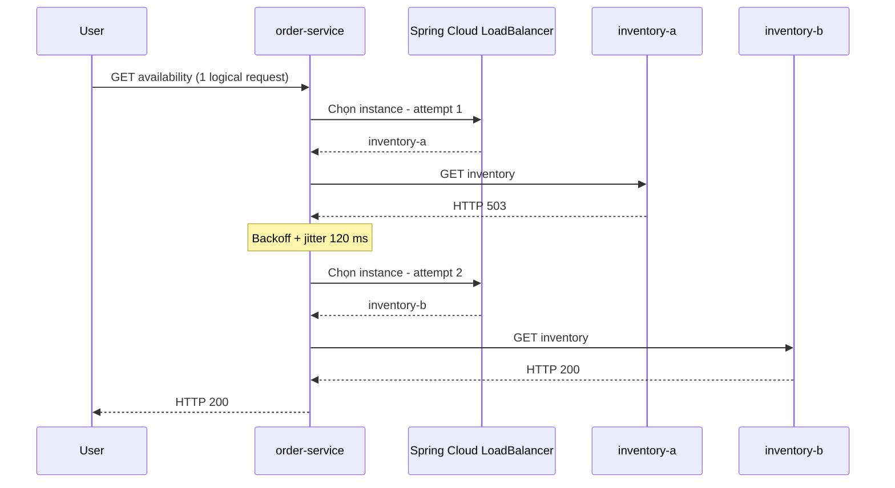

# Backoff, jitter và giới hạn tổng ngân sách thời gian

## 1. Vấn đề: retry có thể cứu request, nhưng cũng có thể tạo bão tải

Trong chương **Gửi lại yêu cầu** của module `SPRING_CLOUD_SERVICE_COMMUNICATION_LOAD_BALANCING`, `order-service` gọi `inventory-service` qua Spring Cloud LoadBalancer. Với một service ID, LoadBalancer lấy danh sách `ServiceInstance` từ discovery, lọc theo health/zone nếu được cấu hình và chọn instance để `RestClient`, `WebClient` hoặc OpenFeign thực hiện HTTP request.

Giả sử `inventory-a` vừa quá tải nên trả HTTP 503. Caller lập tức gửi lại, có thể được chọn sang `inventory-b` và thành công. Tuy nhiên, nếu hàng nghìn caller đều retry **ngay lập tức và cùng thời điểm**, dịch vụ đang phục hồi phải nhận thêm lượng request lớn. Một lỗi ngắn dễ trở thành *retry storm* kéo dài; request của người dùng cũng có thể vượt quá deadline ở API gateway dù từng HTTP attempt có timeout riêng.

Để retry an toàn cần **đồng thời** trả lời bốn câu hỏi:

1. **Có nên retry?** Chỉ retry những lỗi và thao tác đã xác định có khả năng phục hồi và an toàn khi thực hiện lại.
2. **Retry tối đa mấy lần?** Đặt giới hạn attempts và phân biệt lần thử cùng instance với lần thử instance khác.
3. **Chờ bao lâu giữa các lần?** Dùng backoff có giới hạn và jitter để tránh nhiều caller gửi lại đồng bộ.
4. **Dừng hẳn khi nào?** Có deadline cho **toàn bộ logical request**, gồm chọn instance, kết nối, chờ phản hồi, từng retry và cả thời gian backoff.

**Mục tiêu:** giải thích được exponential backoff và jitter, cấu hình retry phù hợp với Spring Cloud LoadBalancer, phân biệt retry reactive với blocking/OpenFeign, thiết kế ngân sách tổng và kiểm chứng bằng số HTTP attempts/latency thực tế.

## 2. Phân biệt một logical request với nhiều HTTP attempts

Một người dùng gọi `GET /orders/ABC-1/availability` tới `order-service`. Đây là **một logical request** ở API bên ngoài. Để hoàn thành nó, `order-service` có thể thực hiện nhiều HTTP attempts tới `inventory-service`.



Tổng hợp:

| Khái niệm | Ví dụ trong sơ đồ | Đơn vị cần đo |
|---|---|---|
| Logical request | Người dùng yêu cầu kiểm tra tồn kho một lần | `logical_request_id` |
| Attempt | Mỗi lần gửi HTTP thật tới một instance | `attempt_number`, `instance_id` |
| Retry | Attempt thứ hai trở đi, sau lỗi hợp lệ | `retry_count = attempts - 1` |
| Retry delay | Thời gian giữa hai attempts | Millisecond theo từng lần |
| Backoff policy | Quy tắc xác định delay | Fixed/exponential/capped |
| Jitter | Ngẫu nhiên hóa delay | Khoảng dao động/hệ số |
| Deadline | Thời điểm phải hoàn tất hoặc dừng logical request | `started_at + budget` |

Khi bật retry ở nhiều lớp, một logical request có thể đi qua **nhiều lần chọn `ServiceInstance`**. Đừng nhầm số `onNext` của một `Flux` với số attempts. Mỗi attempt cũng có thể thất bại **trước khi có HTTP response**, chẳng hạn không tìm được instance hoặc connection timeout.

### 2.1. Same-instance và next-instance retry

Spring Cloud LoadBalancer phân biệt:

- **Retry on same service instance:** thử lại tới instance đã chọn, hữu ích trong một số lỗi tạm thời không liên quan bản sao nhưng dễ gây áp lực lên instance đang hỏng.
- **Retry on next service instance:** yêu cầu chọn lại một `ServiceInstance`, có khả năng chuyển sang instance khác.

Thuộc tính chính (theo metadata Commons 4.3):

```yaml
spring:
  cloud:
    loadbalancer:
      retry:
        max-retries-on-same-service-instance: 0
        max-retries-on-next-service-instance: 1
        avoid-previous-instance: true
```

`avoid-previous-instance` giúp `RetryAwareServiceInstanceListSupplier` ưu tiên tránh instance đã thất bại **nếu còn ứng viên khác**, tùy cấu hình/implementation. Nó **không** bảo đảm retry luôn sang một instance khác: nếu chỉ có một bản sao, discovery/cache stale hoặc bộ lọc đang giới hạn ứng viên, có thể lại chọn bản sao cũ hoặc không còn instance nào.

Số attempts tối đa phụ thuộc cách implementation đếm retry cùng/khác instance và điều kiện lỗi. Không cộng máy móc hai tham số thành SLA cho mọi HTTP client hay Release Train; kiểm chứng bằng log attempts trong chính môi trường chạy.

## 3. Backoff là gì và vì sao cần giới hạn?

**Backoff** là khoảng nghỉ giữa các attempts để dependency có thời gian phục hồi, giảm tốc độ tấn công vào instance đang quá tải và tránh chiếm tài nguyên caller vào những thử lại gần như chắc chắn thất bại.

Nếu `d_k` là delay **trước retry thứ `k`** (k bắt đầu từ 1), với exponential backoff:

\[
d_k = \min(d_{\max}, d_0 \times 2^{k-1}).
\]

Trong đó:

- `d_0`: độ trễ cơ sở của retry thứ nhất.
- `2`: hệ số tăng theo ví dụ; hệ số khác cũng có thể hợp lệ.
- `d_max`: giới hạn chặn trên, tránh chờ vô hạn.
- `k`: thứ tự retry, **không** tính initial attempt là retry.

Ví dụ `d_0=100ms`, `d_max=800ms`:

| Retry thứ | Delay exponential *chưa jitter* | Nhận xét |
|---:|---:|---|
| 1 | 100 ms | Sau attempt đầu lỗi |
| 2 | 200 ms | Tăng gấp đôi |
| 3 | 400 ms | Tăng gấp đôi |
| 4 | 800 ms | Chạm cap |
| 5 | 800 ms | Không tăng thêm vì đã cap |

**Giới hạn attempts và cap delay phải được thiết kế cùng nhau.** Nếu cho phép retry không giới hạn, dù mỗi delay đã cap thì một request vẫn có thể kéo dài quá lâu. Ngược lại, chỉ giới hạn attempts mà đặt các delay quá dài vẫn có thể vượt deadline API.

### 3.1. Fixed delay và exponential delay

- **Retry ngay lập tức:** delay 0; dễ tạo đợt request đồng bộ, thường không phù hợp khi downstream quá tải.
- **Fixed delay:** các retry cùng chờ 100 ms; đơn giản nhưng có thể tạo nhịp retry đồng bộ giữa nhiều caller.
- **Exponential backoff:** delay tăng sau những lần lỗi liên tiếp; giảm áp lực khi service chưa phục hồi.
- **Capped exponential backoff:** exponential có `maxBackoff`; tránh delay quá lớn.
- **Exponential + jitter:** vừa tăng dần thời gian chờ, vừa phân tán thời điểm retry của các caller.

Với service có nhiều replica, backoff không thay thế health check, discovery hay circuit breaker. Nếu tất cả instance đều hỏng hoặc registry không có instance, lặp lại request với delay lớn hơn chưa chắc làm hệ thống khỏe hơn. Có thể cần *fail fast*, circuit breaker hoặc cơ chế xử lý bất đồng bộ tùy nghiệp vụ.

## 4. Jitter ngăn hiện tượng thundering herd như thế nào?

**Jitter** là ngẫu nhiên hóa thời gian chờ trước retry. Giả sử 1.000 caller cùng nhận HTTP 503 vào thời điểm 12:00:00. Nếu tất cả dùng fixed delay 100 ms, một đợt retry mới có thể đồng loạt đến lúc 12:00:00.100. Nếu dùng exponential backoff nhưng **không jitter**, các đợt tiếp theo cũng có thể bị đồng bộ.

Jitter tách các lần retry thành nhiều thời điểm:

```text
Không jitter, delay 100ms:
  Caller A: |---------X
  Caller B: |---------X
  Caller C: |---------X

Có jitter:
  Caller A: |-----X
  Caller B: |----------X
  Caller C: |--------X

  X = thời điểm retry; các sơ đồ chỉ minh họa.
```

### 4.1. Các biến thể jitter phổ biến

| Kiểu | Công thức minh họa với backoff `d_k` | Ưu điểm | Lưu ý |
|---|---|---|---|
| **Không jitter** | `wait_k = d_k` | Dễ dự đoán, dễ test | Nhiều caller có thể đồng bộ |
| **Full jitter** | `wait_k ∼ Uniform(0, d_k)` | Trải rộng các thời điểm retry | Có thể tạo delay rất ngắn, cần cân nhắc min delay |
| **Equal jitter** | `wait_k = d_k/2 + Uniform(0, d_k/2)` | Vừa tránh delay quá ngắn, vừa phân tán | Phải đặt trần |
| **Decorrelated jitter** | `wait_k ∼ Uniform(d_min, 3 × wait_{k-1})` rồi cap | Tạo chuỗi ít đồng bộ | Khó dự đoán thời gian tối đa nếu không cap |

Đây là **mô hình thiết kế phổ biến**, không phải bốn tùy chọn cấu hình được Spring Cloud LoadBalancer cung cấp sẵn dưới những tên đó. Reactor `RetryBackoffSpec.jitter(double)` có cơ chế ngẫu nhiên hóa riêng quanh delay exponential; **`jitter=0.5` không đồng nghĩa full jitter `Uniform(0,d_k)`**. Hãy đối chiếu Javadoc của Reactor version đang dùng để xác định cách tính.

### 4.2. Ý nghĩa thực tế của jitter factor trong Reactor

Theo Javadoc `RetryBackoffSpec`, `jitter(double)` nhận giá trị từ `0` đến `1`; mặc định `0.5`, tức phép ngẫu nhiên hóa tới 50% quanh delay được tính, đồng thời vẫn tôn trọng `minBackoff` và `maxBackoff`.

Ví dụ minh họa cho delay nền 200 ms, jitter factor 0.5: nếu không vướng giới hạn, thời gian chờ có thể được phân tán xấp xỉ trong khoảng 100–300 ms. Đây là **cách diễn giải biên ngẫu nhiên**, không phải bảo đảm một công thức phân phối đồng đều duy nhất cho mọi bản Reactor.

Không dùng jitter để “sửa” một ngân sách thời gian quá lớn. Nếu một retry có thể chờ tới 300 ms, caller phải **dành chỗ cho tối đa delay có thể xảy ra**, không chỉ lấy giá trị trung bình khi thiết kế deadline.

## 5. Tổng ngân sách thời gian cho logical request

**Deadline toàn bộ** là giới hạn thời gian từ lúc ứng dụng bắt đầu xử lý một logical request đến khi có kết quả hoặc lỗi. Nó bao gồm chọn instance, DNS/connect/TLS, server xử lý, đọc body, các khoảng chờ retry, scheduler/queue và overhead.

Một phân rã cho `N` HTTP attempts nối tiếp:

\[
T_{\mathrm{total}} =
\sum_{i=1}^{N} T_{\mathrm{attempt},i}
+\sum_{j=1}^{N-1} T_{\mathrm{backoff},j}
+T_{\mathrm{overhead}}.
\]

Trong `T_attempt` có thể có:

\[
T_{\mathrm{attempt}} =
T_{\mathrm{discovery/list}}+
T_{\mathrm{choose}}+
T_{\mathrm{connect}}+
T_{\mathrm{response}}.
\]

Đây là công thức **mô hình cho các giai đoạn tuần tự**; callback, queue, connection reuse, async pipeline và các bước chồng lấp khiến chi tiết thực tế phức tạp hơn. Các percentile p95 của từng giai đoạn **không** cộng thành p95 tổng.

### 5.1. Vì sao mỗi attempt 900ms vẫn có thể làm API quá hạn?

Giả sử deadline của `order-service` là **2.000 ms**, nhưng thiết kế cho phép 3 attempts; mỗi attempt có thể mất 900 ms và hai delay là 100 ms, 200 ms:

```text
Attempt 1         900 ms
Backoff 1         100 ms
Attempt 2         900 ms
Backoff 2         200 ms
Attempt 3         900 ms
------------------------
Tổng            3000 ms
```

Đây là ví dụ chưa jitter và bỏ qua overhead. Chỉ đặt `responseTimeout=900ms` và `maxRetries=2` **không** bảo đảm request nằm trong 2.000 ms.

Để đạt deadline, caller phải kết thúc sớm khi `remaining budget` không đủ cho retry tiếp theo; hoặc chọn timeout của mỗi attempt, số attempts và delay sao cho phù hợp ngân sách.

### 5.2. Quy tắc quyết định retry dựa trên thời gian còn lại

Đặt:

- `D`: deadline tuyệt đối trong cùng tiến trình hoặc duration budget kể từ khi bắt đầu.
- `now`: thời điểm hiện tại theo monotonic clock.
- `R = D - now`: thời gian còn lại.
- `d_next`: backoff đã tính cho retry tiếp theo.
- `t_min_attempt`: khoảng thời gian tối thiểu dự trù để retry có ý nghĩa.

Chỉ lên lịch retry khi:

\[
R > d_{\mathrm{next}} + t_{\mathrm{min\ attempt}} + t_{\mathrm{safety}}.
\]

Nếu không, kết thúc với lỗi rõ ràng (hoặc fallback được hợp đồng cho phép). Ngay cả khi `R` đủ để bắt đầu, **timeout của attempt mới cần bị chặn bởi phần budget còn lại**, không phải dùng lại cấu hình 900 ms như thể có 900 ms mới.

Ví dụ có 550 ms còn lại, delay dự kiến 250 ms, safety margin 50 ms và yêu cầu tối thiểu 350 ms cho HTTP attempt:

\[
550 < 250 + 50 + 350 = 650\text{ ms}
\]

Nên **không retry**, dù tổng số attempts tối đa vẫn chưa hết.

### 5.3. Deadline bên ngoài vòng retry

Khi ứng dụng WebFlux dùng Reactor retry ở tầng publisher, thứ tự toán tử rất quan trọng:

```java
Mono<InventoryStock> readWithOverallDeadline(String sku) {
    return inventoryWebClient.get()
            .uri("/api/inventory/{sku}", sku)
            .retrieve()
            .bodyToMono(InventoryStock.class)
            .retryWhen(Retry.backoff(2, Duration.ofMillis(100))
                    .maxBackoff(Duration.ofMillis(300))
                    .jitter(0.5)
                    .filter(this::isRetryableFailure))
            .timeout(Duration.ofSeconds(2));
}
```

Ở đây `isRetryableFailure` là predicate của ứng dụng cần định nghĩa chỉ cho lỗi được retry an toàn; `InventoryStock` là DTO tồn kho và `inventoryWebClient` phải được cấu hình gọi service ID qua LoadBalancer.

- `Retry.backoff(2, ...)` cho phép **tối đa hai retry sau initial attempt**, nên có thể có ba attempts.
- `maxBackoff` chặn delay tăng quá 300 ms.
- `jitter(0.5)` ngẫu nhiên hóa thời điểm retry.
- `retryWhen(...)` đặt **trước** `timeout(2s)` theo chuỗi fluent, nên `timeout` ở ngoài bao cả attempts và backoff.
- Nếu đặt `timeout(2s)` **trước** `retryWhen`, deadline có thể bị reset cho mỗi subscription/attempt, khiến logical request vượt quá 2 giây.

Một `Mono.timeout` khiến publisher kết thúc/cancel sau ngân sách, nhưng **không bảo đảm mọi blocking I/O, xử lý trên server hoặc lời gọi registry đang chạy đều dừng tức thời**. Khi HTTP request đã được gửi, timeout không chứng minh downstream chưa thực hiện thay đổi trạng thái.

## 6. Cấu hình backoff và jitter trong Spring Cloud LoadBalancer

Đối với nhánh Spring Cloud Commons 4.3, `spring.cloud.loadbalancer.retry.backoff.*` là các property dùng với **reactive retry** và Reactor `RetryBackoffSpec`. Ví dụ minh họa cho `inventory-service` khi muốn thử tối đa một retry chuyển instance:

```yaml
spring:
  cloud:
    loadbalancer:
      retry:
        enabled: true
        retry-on-all-operations: false
        retry-on-all-exceptions: false
        max-retries-on-same-service-instance: 0
        max-retries-on-next-service-instance: 1
        avoid-previous-instance: true
        retryable-status-codes:
          - 503
        backoff:
          enabled: true
          min-backoff: 100ms
          max-backoff: 500ms
          jitter: 0.5
```

Giải thích theo các property đã được công bố trong Commons 4.3:

| Thuộc tính | Ý nghĩa |
|---|---|
| `retry.enabled` | Cho phép cơ chế retry của LoadBalancer theo client/stack hỗ trợ |
| `max-retries-on-same-service-instance` | Giới hạn retry trên instance đang được chọn |
| `max-retries-on-next-service-instance` | Giới hạn retry với lần chọn instance tiếp theo |
| `retryable-status-codes` | Tập HTTP status được coi là ứng viên retry, ở ví dụ là 503 |
| `retry-on-all-operations` | Mặc định `false`, không tự thử lại mọi HTTP method |
| `retry-on-all-exceptions` | Mặc định `false`, tránh retry mọi ngoại lệ |
| `avoid-previous-instance` | Cố tránh bản sao đã được chọn trước đó nếu khả dụng |
| `backoff.enabled` | **Bật** chính sách backoff Reactor (mặc định `false`) |
| `backoff.min-backoff` | Delay tối thiểu cho chính sách Reactor retry |
| `backoff.max-backoff` | Giới hạn delay tối đa |
| `backoff.jitter` | Hệ số ngẫu nhiên hóa từ `0` đến `1` |

**Điểm cần lưu ý về tài liệu:** một đoạn prose trong trang *Common Abstractions* 4.3 viết nhầm rằng để bật reactive backoff phải đặt `backoff.enabled=false`. Nhưng bảng *Configuration Properties* 4.3 mô tả `false` là **mặc định, backoff không được áp dụng**. Khi muốn bật, dùng `enabled: true` và xác minh qua log/timing của version thực tế. Không copy câu chữ mâu thuẫn mà không đối chiếu metadata.

Giá trị mặc định trong *Configuration Properties* Commons 4.3 gồm `backoff.enabled=false`, `min-backoff=5ms`, `max-backoff=Long.MAX ms`, `jitter=0.5`, `max-retries-on-same-service-instance=0` và `max-retries-on-next-service-instance=1`. Đây **không phải khuyến nghị giữ default trong production**; cần đặt cap nhỏ và deadline theo SLO.

### 6.1. Cấu hình riêng cho service ID

Một ứng dụng gọi cả `inventory-service` và `payment-service` không nên áp mọi retry policy cho mọi nghiệp vụ. Ở các bản hỗ trợ per-client override, dùng tiền tố `spring.cloud.loadbalancer.clients.<clientId>.*` với `clientId` là service ID.

Ví dụ:

```yaml
spring:
  cloud:
    loadbalancer:
      retry:
        enabled: true
        backoff:
          enabled: false
      clients:
        inventory-service:
          retry:
            max-retries-on-same-service-instance: 0
            max-retries-on-next-service-instance: 1
            retryable-status-codes:
              - 503
            backoff:
              enabled: true
              min-backoff: 100ms
              max-backoff: 500ms
              jitter: 0.5
        payment-service:
          retry:
            max-retries-on-same-service-instance: 0
            max-retries-on-next-service-instance: 0
```

Đây là phương án minh họa về sự khác nhau giữa chính sách đọc và thanh toán. Nếu `payment-service` có POST nghiệp vụ, **không** dựa duy nhất vào số retry để bảo đảm đúng một lần; còn phải thiết kế idempotency và kiểm soát các layer khác. Kiểm tra thuộc tính nào là global, thuộc tính nào hỗ trợ override theo client trong Release Train mà ứng dụng đang sử dụng.

### 6.2. Không áp property reactive backoff cho mọi HTTP client

| Tầng/Client | Cách thiết lập | Lưu ý |
|---|---|---|
| `WebClient` qua **reactive LoadBalancer retry** | `retry.backoff.enabled` + `min/max/jitter` | Backoff dùng Reactor Retry; cần xác minh retry filter được gắn đúng và không bật thêm Reactor `retryWhen` ngoài |
| `RestTemplate` qua **Spring Retry** | `LoadBalancedRetryFactory.createBackOffPolicy` | Policy của Spring Retry; không mặc định đọc cùng `backoff.*` như Reactor |
| `RestClient` blocking | Phụ thuộc đường tích hợp LoadBalancer/HTTP transport, Release Train | Kiểm tra có cơ chế retry blocking nào được đăng ký; không suy “thêm starter là tự có backoff” |
| OpenFeign | `Retryer`/`ErrorDecoder`/client transport hoặc cơ chế được tích hợp | Spring Cloud OpenFeign tạo `Retryer.NEVER_RETRY` theo mặc định; không nhầm với default của Feign thuần |
| Gateway/Circuit Breaker | Policy của tầng gateway/resilience library | Nếu retry ở đây, phải tính vào **cùng tổng attempts** |

Nếu ứng dụng gọi qua `WebClient` mà tự thêm `retryWhen` ở service layer, trước hết **tắt retry của Spring Cloud LoadBalancer** trong phép thử này để tránh nhân attempts. Ngược lại, khi muốn đo policy `spring.cloud.loadbalancer.retry.backoff.*`, hãy bỏ `retryWhen` ngoài để chỉ còn một nơi chịu trách nhiệm thử lại.

## 7. Custom backoff cho RestTemplate (blocking) với Spring Retry

Spring Cloud Commons tài liệu hóa việc cấu hình backoff trong đường **blocking RestTemplate + Spring Retry** bằng một bean `LoadBalancedRetryFactory` có `createBackOffPolicy(String service)`.

Ví dụ minh họa:

```java
@Configuration(proxyBeanMethods = false)
class BlockingRetryConfig {

    @Bean
    LoadBalancedRetryFactory retryFactory() {
        return new LoadBalancedRetryFactory() {
            @Override
            public BackOffPolicy createBackOffPolicy(String service) {
                ExponentialRandomBackOffPolicy policy =
                        new ExponentialRandomBackOffPolicy();
                policy.setInitialInterval(100L);  // milliseconds
                policy.setMultiplier(2.0);
                policy.setMaxInterval(500L);
                return policy;
            }
        };
    }
}
```

Các type thuộc Spring Cloud LoadBalancer và Spring Retry, ví dụ `LoadBalancedRetryFactory`, `BackOffPolicy`, `ExponentialRandomBackOffPolicy`; thêm import và dependency đúng phiên bản. `ExponentialRandomBackOffPolicy` ngẫu nhiên hóa backoff theo cách của **Spring Retry**, không phải cùng thuật toán jitter factor của Reactor.

Trong môi trường thực, có thể dùng tham số `service` để trả policy khác nhau theo service ID; không áp cùng cấu hình vào mọi dịch vụ khi nhu cầu khác nhau. Nếu nâng major version, xác minh chữ ký `LoadBalancedRetryFactory` và cơ chế `RestTemplate` tạo retry interceptor. Đoạn này không phải giải pháp deadline tổng; backoff policy vẫn cần giới hạn số attempts và ngân sách toàn request ở tầng caller.

### 7.1. RestClient không đương nhiên giống RestTemplate

`RestClient` là client fluent blocking của Spring Framework. Tuy cũng có thể tích hợp Spring Cloud LoadBalancer qua `@LoadBalanced RestClient.Builder`, việc xử lý retry cụ thể có thể khác theo đường auto-configuration và version. Không giả định bean `LoadBalancedRetryFactory` ở trên tự động áp dụng cho mọi `RestClient` hoặc OpenFeign; kiểm chứng danh sách bean/interceptor và số HTTP attempts thật trước khi công bố kết quả.

Để định vị retry đúng lớp, giữ `RestClient` connect/read timeout rõ ràng, có test lỗi kết nối/503, và chọn **một** nơi chịu trách nhiệm retry cho endpoint idempotent. Nếu ứng dụng có Resilience4j Retry hoặc Spring Retry ở service layer, chính các policy đó cũng cần cap/backoff/jitter và tính vào deadline chung.

## 8. OpenFeign: phân biệt Retryer và LoadBalancer

Spring Cloud OpenFeign dùng một `Retryer.NEVER_RETRY` mặc định, khác với Feign thuần có thể retry các `IOException` theo chính sách riêng. Vì vậy chỉ khai báo `@FeignClient(name="inventory-service")` không có nghĩa Feign sẽ tự áp exponential backoff.

Mô hình khái niệm:

```text
order-service
  -> OpenFeign proxy
     -> Retryer / ErrorDecoder (nếu được cấu hình)
     -> Feign LoadBalancer client (nếu có dependency)
     -> ServiceInstance selection
     -> HTTP transport: connect/read timeout
```

Có thể cấu hình một `Retryer` cho **riêng Feign client** trong cấu hình `@FeignClient`, nhưng mỗi lần retry có thể làm lại một hoặc nhiều bước tùy cách adapter và retry được lắp vào. Chỉ một nơi retry nên sở hữu attempts để tránh hiệu ứng nhân.

Ví dụ bean cấu hình ở cấp Feign client (chỉ minh họa API của Feign):

```java
class InventoryFeignRetryConfig {

    @Bean
    Retryer inventoryRetryer() {
        // period, maxPeriod: millisecond; maxAttempts tính cả lần đầu.
        return new Retryer.Default(100L, 500L, 2);
    }
}
```

Khi dùng cấu hình này qua `@FeignClient(name="inventory-service", configuration=InventoryFeignRetryConfig.class)`, cần xác minh cách Feign `Retryer.Default` xử lý exception từ HTTP response, ví dụ status 503 **không tự trở thành `RetryableException` nếu không có ErrorDecoder phù hợp**. `Retryer.Default` có cơ chế tăng thời gian chờ, nhưng đừng mặc nhiên coi nó có jitter giống Reactor. Nếu muốn jitter có kiểm soát, triển khai retry policy phù hợp với Feign version hoặc dùng một library tập trung; quan trọng nhất vẫn là deadline/attempt limit.

**Không bật đồng thời Feign retry, LoadBalancer retry, gateway retry và service-layer retry mà không đếm số attempts thực.** Với hai lớp mỗi lớp cho phép ba attempts, kịch bản lỗi có thể phát sinh tới khoảng 3 × 3 = 9 requests tới downstream, tùy thứ tự pipeline và điều kiện retry.

## 9. Lỗi nào nên retry, lỗi nào nên dừng?

Không phải mọi exception đều là “thử lại có thể thành công”. Phải xét **tính tạm thời của lỗi**, **khả năng an toàn khi lặp lại thao tác**, và **tình trạng deadline**.

| Lỗi/tình huống | Có thể retry? | Lý do/chính sách |
|---|---|---|
| Connection reset trước khi nhận response | Có thể, với GET/idempotent | Cần kiểm tra request có thể đã tới server hay chưa |
| Connect timeout khi gọi instance đã chọn | Có thể, nếu còn budget và có instance khác | Ưu tiên bảo vệ downstream khỏi bão tải |
| HTTP 502/503/504 | Thường là ứng viên có điều kiện | Giới hạn attempts, backoff+jitter; có thể đổi instance |
| HTTP 429 | Theo hợp đồng và `Retry-After` | Tôn trọng thời gian server yêu cầu, không spam retry |
| HTTP 408 | Có thể theo hợp đồng | Không được suy chắc server chưa xử lý |
| HTTP 400/401/403/404/422 | Thường **không** | Sai request, xác thực/quyền hoặc dữ liệu; retry y nguyên ít có ích |
| HTTP 500 | Tùy endpoint | Có thể là lỗi code không tạm thời, đừng retry mặc định |
| Không có instance cho service ID | Thường dừng nhanh | Retry ngay không làm registry sinh instance; chỉ thử lại nếu có cơ chế chờ/discovery phù hợp |
| DNS/configuration lỗi cố định | Không nên | Cần sửa cấu hình thay vì tăng attempts |
| JSON decode/schema lỗi | Không nên | Retry không sửa hợp đồng dữ liệu |
| Deadline đã hết | **Không** | Phải trả lỗi/cancel theo chính sách |
| POST đặt đơn/thanh toán | **Không mặc định** | Chỉ retry nếu có idempotency key, deduplication và semantics rõ |

### 9.1. Thao tác idempotent và kết quả không xác định

GET thường an toàn để retry về mặt semantics, nhưng phải xét side effects bất thường tại server. PUT/DELETE có thể idempotent theo HTTP semantics, nhưng không suy từ method rằng mọi implementation có tác dụng lặp lại an toàn trong thực tế. POST tạo đơn, thanh toán hoặc giữ chỗ cần khóa idempotency do caller tạo; server phải lưu kết quả theo khóa, trả lại kết quả cũ cho request trùng và xử lý race condition/giao dịch.

**Timeout không chứng minh server chưa commit.** Nếu response bị mất sau khi server ghi DB, retry không có idempotency có thể tạo đơn/thanh toán trùng. Vì vậy retry là kỹ thuật phục hồi mạng, không phải cơ chế bảo đảm “exactly once”.

### 9.2. Retry-After và deadline

Nếu downstream trả HTTP 429 hoặc 503 kèm `Retry-After`, hãy kiểm tra header (có thể là số giây hoặc HTTP-date theo HTTP semantics). Với policy đã biết và deadline, caller có thể chọn delay không sớm hơn mức server yêu cầu, nhưng **nếu thời gian chờ vượt budget còn lại thì nên dừng** thay vì giữ request mở vô hạn.

Không giả định mọi `retryWhen`/Spring Cloud LoadBalancer retry **tự đọc Retry-After**; đây là logic riêng cần xây dựng/kiểm chứng theo library.

## 10. Retry storm: ngân sách ở mỗi caller chưa đủ cho toàn hệ thống

Ví dụ có 100 logical requests/giây. Nếu mỗi logical request thất bại và được phép thêm hai retries, downstream có thể nhận tới 300 attempts/giây — **gấp ba** tải gốc khi lỗi kéo dài, chưa tính gateway, health probes và các tầng retry khác.

Một mô hình gần đúng:

\[
\text{attempt RPS} \approx
\text{logical RPS}\times E[\text{attempts per logical request}].
\]

Hệ thống còn dễ bị *retry amplification* nếu `order-service` → `inventory-service` → `pricing-service` đều có retry riêng. Ví dụ ba tầng cùng nhân ba attempts có thể làm áp lực vào dịch vụ sâu tăng theo tích, tùy luồng gọi.

### 10.1. Các “phanh” bảo vệ

1. **Max attempts nhỏ:** bắt đầu bằng 0–1 retry cho GET phù hợp rồi đo, không bật 5–10 retries mặc định.
2. **Exponential backoff với cap và jitter:** phân tán request khi dịch vụ đang quá tải.
3. **Deadline toàn logical request:** kết thúc khi không đủ thời gian còn lại.
4. **Retry budget theo lưu lượng:** giới hạn số requests retry thêm trên mỗi khoảng thời gian hoặc tỷ lệ so với requests ban đầu.
5. **Circuit breaker và bulkhead:** khi dependency hỏng lâu, giảm attempts và bảo vệ thread/connection pool.
6. **Rate limiting và load shedding:** bảo vệ instance khỏe còn lại khỏi nhận hết retry storm.
7. **Health/discovery hợp lý:** loại instance lỗi và chọn instance khác chỉ khi danh sách đáng tin.
8. **Idempotency và deduplication:** cho phép khôi phục thao tác ghi an toàn khi được thiết kế rõ.

Backoff và jitter **chỉ dịch chuyển/phân tán** attempts theo thời gian, không giảm tổng attempts tối đa. Nếu toàn bộ yêu cầu đều retry ba lần, hệ thống vẫn phải xử lý lượng việc lớn; cần cả retry budget và cơ chế dừng.

## 11. Thiết lập lab có thể tái hiện

### 11.1. Topology

Dùng `order-service` ở cổng 8080 gọi `inventory-service` có hai instance:

| Instance | URI từ caller | Hành vi mô phỏng |
|---|---|---|
| `inventory-a` | `http://localhost:8081` | Có thể trả HTTP 503 hoặc chậm |
| `inventory-b` | `http://localhost:8082` | Trả HTTP 200 trong kịch bản failover |
| `order-service` | `http://localhost:8080` | `@LoadBalanced WebClient.Builder` hoặc HTTP client khác |

Cấu hình discovery cố định ở caller:

```yaml
spring:
  application:
    name: order-service
  cloud:
    discovery:
      client:
        simple:
          instances:
            inventory-service:
              - uri: http://localhost:8081
                instance-id: inventory-a
              - uri: http://localhost:8082
                instance-id: inventory-b
    loadbalancer:
      retry:
        enabled: false
      cache:
        enabled: false
server:
  port: 8080
```

Ở baseline, **tắt retry của LoadBalancer** để kiểm soát attempts bằng code Reactor `retryWhen`. Khi chuyển sang bài đo property retry của Spring Cloud LoadBalancer, bỏ `retryWhen` trong code và bật các property ở mục 6. Không gộp hai policy vào một lượt thí nghiệm.

`localhost` chỉ hợp lý nếu ba tiến trình chạy cùng máy hoặc network namespace; trong Docker/Kubernetes phải dùng địa chỉ mà caller truy cập được.

### 11.2. Endpoint tạo lỗi có kiểm soát

Ví dụ ở `inventory-service` dùng Spring MVC, có một endpoint giả lập trả 503 khi bật chế độ lỗi:

```java
@RestController
@RequestMapping("/api/inventory")
class InventoryTestController {

    private final String instanceId;
    private final AtomicBoolean failMode = new AtomicBoolean();

    InventoryTestController(Environment env) {
        this.instanceId = env.getRequiredProperty("app.instance-id");
    }

    @GetMapping("/{sku}")
    ResponseEntity<Map<String, Object>> read(
            @PathVariable String sku) {
        if (failMode.get()) {
            return ResponseEntity.status(503)
                    .body(Map.of(
                            "instanceId", instanceId,
                            "error", "LAB_UNAVAILABLE"));
        }
        return ResponseEntity.ok(Map.of(
                "sku", sku,
                "available", 12,
                "instanceId", instanceId));
    }

    // Chỉ thêm một endpoint bật/tắt failMode trong môi trường thử nghiệm;
    // không để public endpoint thay đổi lỗi ở production.
}
```

Khi chạy instance A, bật `failMode` qua test harness; để B khỏe. Với `retryable-status-codes=[503]`, thử request ban đầu tới A, sau đó retry và quan sát instance được chọn. Nếu một request bắt đầu ở B và thành công ngay, nó không tạo retry; vì vậy dùng log attempt và nhiều lần chạy chứ không chọn một response rồi kết luận policy không hoạt động.

### 11.3. Ví dụ caller WebClient (một nơi quản lý retry)

```java
@Configuration(proxyBeanMethods = false)
class InventoryClientConfig {
    @Bean
    @LoadBalanced
    WebClient.Builder loadBalancedWebClientBuilder() {
        return WebClient.builder();
    }
}

@Service
class InventoryQuery {
    private final WebClient client;

    InventoryQuery(@LoadBalanced WebClient.Builder builder) {
        this.client = builder.clone()
                .baseUrl("http://inventory-service")
                .build();
    }

    Mono<InventoryStock> get(String sku) {
        return client.get()
                .uri("/api/inventory/{sku}", sku)
                .retrieve()
                .bodyToMono(InventoryStock.class)
                .retryWhen(Retry.backoff(2, Duration.ofMillis(100))
                        .maxBackoff(Duration.ofMillis(500))
                        .jitter(0.5)
                        .filter(error ->
                                error instanceof WebClientRequestException
                                || error instanceof
                                    WebClientResponseException.ServiceUnavailable))
                .timeout(Duration.ofSeconds(2));
    }
}

record InventoryStock(String sku, int available, String instanceId) {}
```

Đoạn trên có **một** retry owner là Reactor trong `InventoryQuery`. Dù đã tắt Spring Cloud LoadBalancer retry, các lần re-subscribe của Reactor vẫn tạo HTTP requests mới qua LoadBalancer; từng attempt có thể chọn instance khác, không bảo đảm khác tuyệt đối. Nếu không còn instance, WebClient reactive có thể tạo 503 tổng hợp; đoạn filter theo 503 có thể vẫn thử lại — đây là lý do trong production nên phân loại **no-instance** và **server 503** bằng dữ liệu LoadBalancer/trace thay vì retry vô điều kiện mọi 503.

### 11.4. Đo khoảng cách giữa các attempts

Tại caller, gắn correlation ID ổn định cho **logical request** và một attempt number/trace span riêng cho mỗi HTTP attempt. Ghi timestamp lúc thực sự gửi request và instance được chọn; ở server ghi cùng correlation ID và trạng thái HTTP.

Để lấy số liệu chuẩn:

1. Giữ chỉ một tầng retry cho toàn lab; tắt retry ngầm ở gateway/HTTP client nếu có.
2. Gửi đủ requests để thấy cả thành công ngay và retry; tránh kết luận từ một lần.
3. Lưu danh sách các timestamp attempts của cùng logical request.
4. Tính `observed_gap` giữa **kết thúc attempt trước** và **bắt đầu attempt sau**, không nhầm với latency giữa hai request khác nhau.
5. Ghi retry reason, HTTP status/exception, số attempts, instance ID, duration của từng attempt và total duration.
6. So sánh khi `jitter=0` và `jitter=0.5` qua nhiều logical requests để nhìn độ phân tán; không mong delay đúng chính xác `100ms` vì scheduler, network và load.

### 11.5. Ma trận thực nghiệm

| Lượt | Cấu hình | Kết quả cần quan sát |
|---|---|---|
| A | Retry tắt, A 503/B 200 | Một HTTP attempt cho mỗi logical request |
| B | Retry bật, fixed delay 100ms | Nếu đầu tiên thất bại, retry sau ~100ms (cộng scheduler overhead) |
| C | Backoff 100/200ms, jitter 0 | Retry đầu/sau có delay gần mức exponential |
| D | Backoff 100/200ms, jitter 0.5 | Delays phân tán giữa các logical requests |
| E | Deadline 200ms, attempt đầu mất 300ms | Timeout trước khi đủ thời gian retry, không cố thực hiện mọi attempts |
| F | Deadline 2s, A lỗi/B khỏe | Có thể thành công nhờ lần chọn khác trong ngân sách |
| G | Cả A/B 503 liên tục | Max attempts đạt giới hạn; không retry vô hạn |
| H | Retry ở hai lớp | Phát hiện attempt amplification, sau đó loại bỏ một lớp |
| I | POST đặt hàng không idempotency | Không bật retry; xác minh chính sách chặn |

Các số thời gian ở đây là mục tiêu cấu hình, không phải số đo đã chạy. Khi thử deadline và cancellation, cần kiểm tra server có tiếp tục xử lý request đã nhận hay không; cancel ở caller không luôn hủy một tác vụ blocking đang chạy tại server.

## 12. Phép đo và báo cáo kết quả

Để đánh giá retry có thực sự giúp tăng thành công hay chỉ tăng áp lực lên downstream, nên có:

| Metric / log | Cách hiểu |
|---|---|
| `logical_requests_total` | Số yêu cầu nghiệp vụ đến caller |
| `http_attempts_total` | Tổng số HTTP exchanges/attempts thực hiện tới downstream |
| `retries_total` | Attempts sau lần đầu, phân theo service, reason |
| `retry_delay_ms` (histogram) | Phân phối backoff thực đo |
| `retry_exhausted_total` | Yêu cầu hết số attempts |
| `retry_deadline_exceeded_total` | Yêu cầu bị cắt vì hết ngân sách |
| `retry_success_after_retry_total` | Logical request thành công sau khi retry |
| `instance_id` trong trace/log | Instance được chọn theo attempt |
| `http_5xx_rate`, `timeout_rate` | Chất lượng downstream trước và sau retry |
| `end_to_end_latency` p50/p95/p99 | Trải nghiệm client cuối, tính cả backoff và attempts |
| `inflight_requests`, CPU/queue | Có tạo quá tải lên instance còn khỏe không? |

Tên trên là **đề xuất metric tự thiết kế**, không phải khẳng định Spring Cloud xuất sẵn đúng các tên đó. Với Actuator/Micrometer, xem các metric LoadBalancer đã có theo version rồi bổ sung metric retry/attempt nếu cần. Không thêm request ID, SKU, user ID hoặc raw URL chứa token vào metric tag có cardinality cao; đặt thông tin chi tiết vào trace/log có kiểm soát.

### 12.1. Báo cáo giả định

Bảng này chỉ để **luyện diễn giải**, không phải benchmark thực tế:

| Chính sách | Attempts trung bình / logical request | Logical success | p95 (ms) | Retry delay p95 (ms) |
|---|---:|---:|---:|---:|
| Không retry | 1,00 | 90% | 150 | — |
| Retry ngay, 2 lần | 1,28 | 97% | 270 | 0 |
| Backoff capped + jitter, 2 lần | 1,25 | 97% | 340 | 220 |
| Backoff + jitter + deadline 250ms | 1,10 | 95% | 248 | 140 |

Trong ví dụ giả định, retry nâng tỷ lệ thành công nhưng tăng p95. Chính sách deadline 250 ms trả lỗi sớm hơn khi không đủ thời gian để retry, giảm attempts và có thể giảm tỷ lệ thành công. Không thể nói chính sách nào “tốt nhất” nếu chưa biết SLO latency, chi phí downstream, tỷ lệ lỗi thực và yêu cầu nghiệp vụ.

**Lưu ý:** p95 của retry delay không cộng trực tiếp với p95 của HTTP duration để suy ra p95 end-to-end. Phải đo total duration của cùng logical request.

## 13. Các bẫy triển khai thường gặp

| Sai lầm | Vì sao sai | Cách khắc phục |
|---|---|---|
| “Cho phép hai retry tức có hai attempts” | Initial attempt là lần đầu, retry là các lần tiếp theo | Đếm initial + retries theo metric |
| Bật backoff nhưng không đặt cap | Delay có thể tăng vô lý khi nhiều retries | Đặt maxBackoff và tổng attempts |
| Cho mọi caller cùng fixed delay | Tạo thundering herd lúc recovery | Dùng jitter |
| Coi jitter 0.5 là full jitter | Reactor jitter factor không phải `Uniform(0,d)` | Đọc Javadoc đúng version |
| Đặt `backoff.enabled=false` và nghĩ là bật | Bảng configprops mô tả false là tắt | Đặt true, kiểm chứng thực tế |
| Áp reactive property vào RestTemplate blocking | Dùng cơ chế Spring Retry khác | Cấu hình `LoadBalancedRetryFactory`/`BackOffPolicy` |
| Nghĩ OpenFeign tự retry vì có @FeignClient | Spring Cloud OpenFeign mặc định có `Retryer.NEVER_RETRY` | Kiểm tra cấu hình Feign Retryer và các tầng khác |
| Bật retry ở cả LB + Reactor + gateway | Attempts có thể nhân lên | Chỉ định một retry owner/đếm tổng |
| Retry timeout nghĩa là server chưa xử lý | Response có thể mất sau commit | Dùng idempotency và dedup |
| Retry HTTP 400/404 như 503 | Lỗi không tạm thời | Chỉ retry lỗi có thể phục hồi |
| Retry liên tục khi không có instance | Chưa có đích HTTP hợp lệ | Fail fast và sửa discovery/health |
| Timeout đặt trước `retryWhen` | Có thể reset mỗi attempt | Đặt deadline cuối/ngoài vòng retry |
| Chỉ đo thời gian từng attempt | Bỏ quên backoff và retries | Đo logical end-to-end |
| Không tôn trọng `Retry-After` | Gửi lại khi server yêu cầu chờ | Kiểm tra header và budget còn lại |
| Chỉ nhìn success rate sau retry | Có thể che lỗi gốc và khuếch đại tải | Đo retry rate, attempts, p95/p99, CPU |
| Coi `avoid-previous-instance=true` là luôn đổi node | Danh sách/health có thể chỉ còn một node | Quan sát instance trên từng attempt |

## 14. Bài tập vận dụng

### Bài 1 — Tính giới hạn thời gian

Với 3 attempts, mỗi attempt timeout 600 ms; hai delay nền 100 ms và 200 ms; jitter factor 0.5; deadline API 2.000 ms. Tính trường hợp xấu có thể xảy ra nếu delay tăng tới 150 ms và 300 ms: `3×600+150+300=2.250ms`, chưa kể overhead. Giải thích phải giảm timeout/attempts hoặc đặt deadline ngoài vòng retry, thay vì tin 2.000 ms là điều tự xảy ra.

### Bài 2 — Quan sát jitter

Chạy 100 logical requests đồng thời tới endpoint lỗi tạm thời. Thử fixed delay, exponential không jitter và exponential jitter 0.5, giữ cùng max attempts. Vẽ histogram khoảng cách giữa attempts, so sánh độ tập trung; dùng dữ liệu đo thay vì giả định jitter luôn cho kết quả lý tưởng.

### Bài 3 — Cùng instance hay instance khác?

Với hai instance, đặt `max-retries-on-same-service-instance=0`, `max-retries-on-next-service-instance=1`, `avoid-previous-instance=true`. Làm A trả 503, B trả 200 và ghi lựa chọn thực tế theo từng attempt. Sau đó loại B khỏi registry để xem khi chỉ còn A sẽ như thế nào. Giải thích vì sao không được cam kết luôn đổi instance.

### Bài 4 — Retry hai lớp

Bật retry một lần ở Spring Cloud LoadBalancer và một lần ở Reactor cho cùng WebClient, làm cả hai instance trả lỗi. Đếm tổng HTTP attempts và so sánh với chạy chỉ một lớp. Sau đó cấu hình lại để có một retry owner. Chỉ thực hành trong lab tránh vô tình tạo tải lên hệ thống production.

### Bài 5 — Idempotency của thao tác ghi

Thiết kế một endpoint `POST /reservations` nhận `Idempotency-Key`. Lưu khóa cùng kết quả xử lý theo giao dịch; khi caller gửi lại sau timeout, server trả lại kết quả cũ thay vì tạo reservation thứ hai. Viết test concurrent requests có cùng khóa và xác minh không tạo bản ghi trùng.

### Bài 6 — Theo dõi ngân sách còn lại

Giả lập request còn 450 ms tới deadline, jitter delay tiếp theo được chọn 200 ms và thời gian tối thiểu cần cho attempt mới là 300 ms. Dự đoán: không nên lên lịch retry vì 200 + 300 > 450. Bổ sung safety margin 50 ms, thử cả trường hợp đủ và thiếu ngân sách.

## 15. Checklist trước khi đưa retry vào production

- [ ] Phân biệt logical request, attempt, retry và instance được chọn.
- [ ] Chỉ retry lỗi tạm thời và thao tác có semantics an toàn; không retry bừa mọi exception/status.
- [ ] Đã xác minh Spring Boot/Spring Cloud Release Train và behavior retry của client thực tế.
- [ ] Có giới hạn số attempts; không bật retry vô hạn.
- [ ] Có exponential/capped backoff và jitter khi phù hợp.
- [ ] Đã phân biệt Reactor `RetryBackoffSpec.jitter` với các kiểu jitter khác.
- [ ] Biết `spring.cloud.loadbalancer.retry.backoff.enabled` cần true để bật backoff reactive.
- [ ] Chỉ một retry owner hoặc đã tính/tổng hợp đúng attempts từ mọi layer.
- [ ] Có end-to-end deadline gồm attempts, backoff, discovery và transport.
- [ ] Timeout/HTTP cancellation không bị hiểu là bảo đảm server chưa commit.
- [ ] POST/write có idempotency key và server-side dedup trước khi cho retry.
- [ ] Tôn trọng `Retry-After` khi endpoint/implementation yêu cầu.
- [ ] Có histogram delay, retry count, deadline exceeded, logical success và p95/p99.
- [ ] Đã kiểm thử khi một instance chết, all-unhealthy, no-instance, HTTP 503 và 429.
- [ ] Có retry budget/rate limit/circuit breaker khi downstream quá tải.

## Tài liệu tham khảo chính thức

- [Spring Cloud Commons 4.3 — Configuration Properties](https://docs.spring.io/spring-cloud-commons/reference/4.3/configprops.html): trạng thái bật/tắt retry, `backoff.enabled`, `min-backoff`, `max-backoff`, `jitter` và giới hạn retries.
- [Spring Cloud Commons 4.3 — Common Abstractions, Retrying Failed Requests](https://docs.spring.io/spring-cloud-commons/reference/4.3/spring-cloud-commons/common-abstractions.html): reactive retry, blocking `LoadBalancedRetryFactory`, `RetryAwareServiceInstanceListSupplier` và per-client overrides.
- [Project Reactor — RetryBackoffSpec](https://projectreactor.io/docs/core/release/api/reactor/util/retry/RetryBackoffSpec.html): exponential backoff, `jitter(double)`, `maxBackoff`, `filter` và xử lý retry exhausted.
- [Spring Cloud OpenFeign — Features](https://docs.spring.io/spring-cloud-openfeign/reference/spring-cloud-openfeign.html): `Retryer.NEVER_RETRY` mặc định và khả năng cấu hình retry cho Feign client.
- [Spring Framework — WebClient retrieve](https://docs.spring.io/spring-framework/reference/web/webflux-webclient/client-retrieve.html): xử lý HTTP status và exception ở client reactive.
- [Spring Cloud — Release Train](https://spring.io/projects/spring-cloud/): đối chiếu các phiên bản Spring Cloud và Spring Boot.

**Kết luận:** backoff làm chậm nhịp retry, jitter phân tán thời điểm retry, max attempts chặn số lần gửi lại; **deadline toàn logical request** quyết định lúc phải dừng. Spring Cloud LoadBalancer chọn `ServiceInstance` cho từng attempt theo policy, nhưng không tự bảo đảm idempotency, dừng mọi xử lý downstream hay giới hạn toàn bộ thời gian ở mọi tầng. Một cấu hình retry tốt phải vừa giúp phục hồi lỗi tạm thời, vừa bảo vệ SLO và không khuếch đại sự cố.
