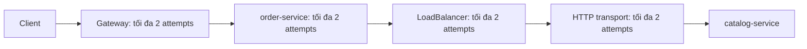

# Tránh retry nhân lên khi nhiều tầng cùng gửi lại

Trong một hệ thống microservices, gửi lại một request sau lỗi tạm thời (*retry*) có thể giúp ứng dụng vượt qua sự cố mạng ngắn hạn hoặc một bản sao vừa ngừng phục vụ. Nhưng cùng một yêu cầu có thể đi qua **API Gateway, mã nghiệp vụ, Spring Cloud LoadBalancer và HTTP client**, mỗi tầng lại có chính sách retry riêng. Nếu các tầng cùng tự gửi lại mà không biết nhau, số lần gọi thực tế đến downstream có thể tăng theo cấp số nhân. Đúng lúc dịch vụ đang quá tải, retry không kiểm soát làm tăng thêm áp lực và kéo dài thời gian phục hồi.

Bài học này thuộc phần **Gửi lại yêu cầu** của module `SPRING_CLOUD_SERVICE_COMMUNICATION_LOAD_BALANCING`. Mục tiêu là hiểu vì sao retry bị nhân lên, thiết kế **một chủ sở hữu chính sách retry** cho mỗi đường gọi, phân biệt retry trên cùng `ServiceInstance` với retry sang bản sao khác, và phối hợp timeout, deadline, backoff, idempotency, quan sát lỗi cho `RestClient`, `WebClient`, OpenFeign cùng Spring Cloud LoadBalancer.

## 1. Retry là một request bổ sung, không phải một thao tác miễn phí

Giả sử `order-service` gửi GET đến `catalog-service` bằng URL logic:

```http
GET /api/products/P42 HTTP/1.1
Host: catalog-service
```

Spring Cloud LoadBalancer chọn một `ServiceInstance`, ví dụ `catalog-b`. Nếu kết nối thất bại, một chính sách retry có thể chọn lại `catalog-a` rồi gửi thêm request. Khi lần thứ hai thành công, caller thấy một lời gọi nghiệp vụ thành công, nhưng downstream/network đã phải xử lý **hai lần thử HTTP**.

Hãy phân biệt:

- **Logical request:** một hành động nghiệp vụ từ góc nhìn caller, ví dụ “lấy sản phẩm P42”.
- **Attempt:** một lần thực sự cố gắng thực hiện HTTP request hoặc kết nối. Một logical request có thể có nhiều attempt.
- **Retry:** một lần thử **sau attempt đầu tiên**. Chính sách “tối đa 2 retry” thường cho phép tối đa **3 attempts**, nhưng tên thuộc tính và cách đếm phải được kiểm tra theo thư viện đang dùng.
- **Retry owner:** tầng chịu trách nhiệm quyết định lỗi nào được gửi lại, gửi lại mấy lần, có đổi instance không và khi nào dừng.

Không phải mọi lần thử đều đến được server. Một attempt có thể thất bại ở DNS, chọn instance, connection pool hoặc lúc mở kết nối. Ngược lại, một attempt có thể **đã được server xử lý** nhưng response bị mất, nên việc retry có nguy cơ tạo tác dụng phụ trùng lặp.

## 2. Retry amplification: nhiều tầng nhân số lần gọi

Giả sử một request qua bốn tầng, mỗi tầng được cấu hình tối đa **2 attempts** (1 attempt ban đầu + 1 retry):



Trong tình huống xấu nhất mà mỗi tầng cứ retry toàn bộ phần việc bên dưới, số attempt HTTP ở tầng cuối có thể đạt:

\[
A_{max} = 2 \times 2 \times 2 \times 2 = 16
\]

Một logical request ở biên hệ thống có thể tạo đến **16 attempts** ở phía trong, dù từng đội chỉ nghĩ mình “retry thêm một lần”. Đây là **giới hạn lý thuyết cho cấu trúc lồng nhau**, không phải khẳng định mọi request đều gửi đúng 16 lần: lỗi xảy ra ở giai đoạn nào, chính sách retry, điều kiện dừng và số nhánh fan-out đều tác động đến số lần thực tế.

| Số tầng độc lập, mỗi tầng tối đa 2 attempts | Số attempts tối đa ở lớp cuối |
|---:|---:|
| 1 | 2 |
| 2 | 4 |
| 3 | 8 |
| 4 | 16 |

Nếu mỗi tầng cho phép **3 attempts** và có ba tầng cùng lồng retry, giới hạn lý thuyết có thể là `3 × 3 × 3 = 27` attempts. Nếu request còn *fan-out* song song đến nhiều dịch vụ, tổng request toàn hệ thống còn tăng vì nhiều nhánh, nhưng cần tính riêng **nhân do retry** và **nhân do fan-out** để không chẩn đoán nhầm.

### Một timeline của retry lồng nhau

```text
Gateway: attempt 1
  order-service: attempt 1
    LoadBalancer: attempt 1 → catalog-a lỗi
    LoadBalancer: attempt 2 → catalog-b lỗi
  order-service: attempt 2
    LoadBalancer: attempt 1 → catalog-a lỗi
    LoadBalancer: attempt 2 → catalog-b lỗi
Gateway: attempt 2
  order-service: attempt 1
    LoadBalancer: attempt 1 → catalog-a lỗi
    LoadBalancer: attempt 2 → catalog-b lỗi
  order-service: attempt 2
    LoadBalancer: attempt 1 → catalog-a lỗi
    LoadBalancer: attempt 2 → catalog-b lỗi
```

Trong ví dụ này đã có 8 attempt tới lớp LoadBalancer dù chỉ Gateway, order-service và LoadBalancer retry. Nếu transport lại tự retry bên trong từng attempt, số request gửi ra có thể còn tăng. Chính sách này đặc biệt nguy hiểm khi lỗi gốc là **downstream quá tải**, không phải sự cố mạng ngắn hạn.

## 3. Những tầng có thể đang retry mà ta không để ý

Trong thực tế, cần lập bản đồ tất cả nơi có thể thử lại request:

| Tầng | Ví dụ cơ chế | Điều cần kiểm tra |
|---|---|---|
| Browser, mobile app hoặc upstream consumer | SDK HTTP, interceptor, mã tự gọi lại | Có retry sau `429`, `503`, timeout hoặc khi mất kết nối? |
| API Gateway / ingress | Retry filter, route policy, upstream retry | Có retry request trước khi chuyển cho service không? |
| Business service | `@Retryable`, Spring Retry, Resilience4j, vòng lặp tự viết | Cả một nghiệp vụ hay chỉ một HTTP call đang được chạy lại? |
| Spring Cloud LoadBalancer | Retry cùng `ServiceInstance` hoặc sang instance tiếp theo | Đã bật retry chưa, stack blocking/reactive có hỗ trợ ra sao? |
| `WebClient`/Reactor | `retry()` hoặc `retryWhen(Retry...)` | Publisher được subscribe lại bao nhiêu lần? |
| OpenFeign | `Retryer`, custom Feign config | Có custom retryer hoặc chính sách do Spring Cloud/HTTP client áp dụng không? |
| HTTP transport | Apache HttpClient, OkHttp, các middleware/proxy | Có automatic retry khi I/O lỗi, redirect hoặc request idempotent không? |
| Service đích / job nội bộ | Tự retry DB, RPC, message processing | Có nhân tiếp các thao tác nằm dưới HTTP request không? |

**Không nên giả định mặc định của các thư viện là giống nhau.** Ví dụ, Spring Cloud OpenFeign thường cấu hình `Retryer.NEVER_RETRY` theo mặc định, khác với một số hành vi của Feign gốc. Tuy vậy, điều đó **không chứng minh** request sẽ không được thử lại ở Gateway, LoadBalancer, custom retryer hoặc transport. Kiểm tra dependency, bản Spring Cloud đang dùng, cấu hình có hiệu lực và log/metric thực tế.

Một service có thể dùng `RestClient` cho một lời gọi, `WebClient` cho lời gọi khác và OpenFeign cho lời gọi thứ ba. Mỗi nhánh có thể có retry ở lớp khác nhau. Vì vậy cần xác định chính sách theo **đường gọi cụ thể**, không chỉ bằng câu “hệ thống đã tắt retry”.

## 4. Nguyên tắc chính: chọn một chủ sở hữu retry

Thay vì để mọi tầng tự quyết định gửi lại, hãy đặt một **retry owner** rõ ràng cho mỗi đường gọi. Tầng này chịu trách nhiệm:

1. Phân loại lỗi được phép retry và lỗi phải trả về ngay.
2. Giới hạn tổng số attempts, không chỉ số lần retry cục bộ.
3. Quyết định retry trên cùng instance hay chuyển sang instance khác.
4. Thiết lập backoff, jitter và tôn trọng `Retry-After` khi phù hợp.
5. Kiểm tra deadline/remaining budget trước mỗi attempt.
6. Bảo đảm retry an toàn về mặt nghiệp vụ, đặc biệt khi request có tác dụng phụ.
7. Ghi nhận số attempts thực tế và lý do dừng.

Ví dụ: một ứng dụng có `Gateway → order-service → catalog-service`. Nếu `order-service` cần hiểu được tính idempotent của `GET /api/products/{id}`, nó có thể là nơi sở hữu retry của lời gọi đến `catalog-service`, trong khi Gateway **không retry toàn bộ request tới `order-service`** và HTTP transport/LoadBalancer không tự thử lại thêm. Trái lại, một gateway chỉ chuyển request đến các bản sao stateless cũng có thể là retry owner hợp lý nếu toàn bộ request được phép retry và tầng ứng dụng đã tắt retry liên quan.

Không có quy tắc “luôn retry tại Gateway” hoặc “luôn retry tại LoadBalancer”. Hãy chọn **tầng có đủ thông tin để quyết định an toàn**, hiểu được deadline và có thể quan sát số attempts. Nhiều tầng vẫn có thể có cơ chế phục hồi riêng, nhưng cần phân ranh giới rõ để không tạo retry lồng nhau. Ví dụ transport có thể xử lý việc tái sử dụng kết nối còn LoadBalancer thực hiện chọn instance, nhưng chỉ **một tầng** có quyền phát thêm HTTP attempt theo chính sách đã thống nhất.

## 5. Cùng instance và instance khác: hai lựa chọn khác nhau

Spring Cloud LoadBalancer có khái niệm retry trên **cùng một `ServiceInstance`** và retry sang **một `ServiceInstance` khác**. Chúng xử lý những loại lỗi khác nhau.

```text
Logical GET http://catalog-service/api/products/P42
  → Discovery: catalog-a, catalog-b, catalog-c
  → Attempt 1: chọn catalog-a → lỗi kết nối
  → Retry same-instance: tiếp tục catalog-a, có thể vẫn lỗi
  → Retry next-instance: chọn catalog-b → có thể thành công
```

| Lựa chọn | Có ích khi | Rủi ro |
|---|---|---|
| Retry cùng instance | Lỗi ngắn hạn, connection cũ/stale, instance vẫn khỏe | Tiếp tục đánh vào bản sao đang quá tải hoặc đã chết |
| Retry instance khác | Một replica riêng bị lỗi, replica khác có thể hoạt động | Tăng tải lên replica còn lại; thao tác ghi có thể bị lặp |
| Không retry | Lỗi không an toàn, budget đã hết, không còn ứng viên | Caller nhận lỗi nhưng hệ thống tránh khuếch đại tải |

Khả năng **chọn instance khác** còn phụ thuộc danh sách discovery, `ServiceInstanceListSupplier`, health filtering, tính sẵn có của bản sao và cấu hình phiên bản Spring Cloud. Nếu chỉ có một instance hợp lệ, chính sách “retry next instance” không tự sinh ra một đích mới; không thể dùng retry để thay thế service discovery hoặc health check.

Một thiết kế tốt phân biệt “không có instance” với “đã chọn instance nhưng lỗi kết nối” và “server trả `503`”. Hai lỗi đầu thường cần chẩn đoán discovery/network; `503` có thể báo downstream đang quá tải và yêu cầu **giảm** lưu lượng chứ không tăng tần suất request.

## 6. Ví dụ cấu hình retry của Spring Cloud LoadBalancer

Các bản Spring Cloud LoadBalancer hỗ trợ cấu hình retry qua các thuộc tính dạng sau:

```yaml
spring:
  cloud:
    loadbalancer:
      retry:
        enabled: true
        max-retries-on-same-service-instance: 0
        max-retries-on-next-service-instance: 1
        retry-on-all-operations: false
        retryable-status-codes:
          - 502
          - 503
          - 504
```

**Đây là ví dụ cho một đường gọi GET có retry do LoadBalancer quản lý, không phải khuyến nghị bật các giá trị này ở mọi ứng dụng.** Kiểm tra tài liệu release train, loại HTTP client blocking/reactive và các dependency cần thiết vì không phải mọi client đều đi qua cùng retry interceptor/filter. Đặc biệt, việc khai báo property không đủ để chứng minh những HTTP attempts thực tế đã được retry theo ý muốn.

Ý nghĩa chính:

- `enabled`: điều khiển việc bật/tắt retry của tích hợp LoadBalancer khi cơ chế đó có hiệu lực.
- `max-retries-on-same-service-instance`: giới hạn số lần thử lại trên instance trước đó.
- `max-retries-on-next-service-instance`: giới hạn số lần thử lại với lần lựa chọn instance tiếp theo.
- `retry-on-all-operations: false`: không mặc nhiên mở rộng retry cho mọi HTTP method; cần kiểm tra policy thực tế khi dùng phương thức có tác dụng phụ.
- `retryable-status-codes`: danh sách các status mà chính sách retry có thể xét lại theo cấu hình và integration. Không nên hiểu mọi `502/503/504` luôn an toàn để retry trong mọi trường hợp.

Với giả định chỉ LoadBalancer là retry owner, giá trị ví dụ cho phép tối đa một lần retry chọn instance tiếp theo ngoài attempt ban đầu trong đường đi được hỗ trợ. Nhưng nếu tầng Gateway hoặc Feign cũng có retry, giới hạn tổng **không còn chỉ là hai attempts**. Vì vậy, sau khi bật các property này, hãy kiểm tra và tắt retry chồng ở các tầng khác, hoặc quyết định ngược lại: tắt LoadBalancer retry để một tầng bên trên quản lý số attempts.

### Khi muốn retry ở tầng ứng dụng thay vì LoadBalancer

Nếu đặt retry owner tại application service, có thể tắt retry tự động của LoadBalancer:

```yaml
spring:
  cloud:
    loadbalancer:
      retry:
        enabled: false
```

Property này không tự tắt `WebClient.retryWhen`, `Retryer` của Feign, Apache HttpClient automatic retry hoặc Gateway retry. Cần kiểm tra **tất cả các tầng của cùng đường gọi** trước khi kết luận tổng attempts đã được kiểm soát.

## 7. OpenFeign: phân biệt `Retryer` và retry của LoadBalancer

OpenFeign chuyển lời gọi Java thành HTTP request bằng Feign proxy. Retry có thể đến từ `Retryer` của Feign, tích hợp LoadBalancer hoặc transport HTTP mà Feign sử dụng.

Ví dụ chỉ định rõ **không retry ở Feign layer** cho một client, trong khi chính sách retry sẽ do tầng khác sở hữu:

```java
package com.example.feignconfig;

import feign.Retryer;
import org.springframework.context.annotation.Bean;

public class CatalogFeignNoRetryConfiguration {

    @Bean
    Retryer catalogRetryer() {
        return Retryer.NEVER_RETRY;
    }
}
```

```java
package com.example.orders.client;

import com.example.feignconfig.CatalogFeignNoRetryConfiguration;
import org.springframework.cloud.openfeign.FeignClient;
import org.springframework.web.bind.annotation.GetMapping;
import org.springframework.web.bind.annotation.PathVariable;

@FeignClient(
        name = "catalog-service",
        configuration = CatalogFeignNoRetryConfiguration.class)
public interface CatalogFeignClient {

    @GetMapping("/api/products/{id}")
    ProductDto getProduct(@PathVariable("id") String id);
}
```

`ProductDto` do ứng dụng khai báo. Đặt class `CatalogFeignNoRetryConfiguration` ngoài vùng component scan của ứng dụng chính nếu đây là chính sách **chỉ dành cho một Feign client**; nếu bean `Retryer` bị đưa vào parent context, nó có thể trở thành cấu hình dùng chung ngoài ý muốn.

Lưu ý: trong nhiều phiên bản Spring Cloud OpenFeign, `Retryer.NEVER_RETRY` vốn đã là mặc định của auto-configuration. Khai báo rõ ở đây nhằm thể hiện **quyền sở hữu retry**, không phải bắt buộc phải thêm bean trong mọi dự án. Nếu LoadBalancer vẫn retry ở tầng dưới, `Retryer.NEVER_RETRY` không loại bỏ mọi attempt bổ sung. Cần đo hành vi thực tế của cả stack.

Trong các phương thức ghi như `createOrder`, `chargePayment` hay `reserveInventory`, không nên tùy tiện thay `NEVER_RETRY` bằng một `Retryer` có số lần lớn chỉ vì một endpoint thỉnh thoảng timeout. Khi cần retry thao tác ghi, phải có hợp đồng idempotency và cơ chế chống thực thi lặp từ phía server.

## 8. WebClient và Reactor: giới hạn retry ở đúng một pipeline

Nếu chọn tầng ứng dụng reactive làm retry owner, có thể dùng `retryWhen` của Reactor. Ví dụ sau chỉ cho phép **tối đa một retry bổ sung** đối với request GET và giới hạn thời gian cho toàn bộ pipeline:

```java
package com.example.orders.client;

import java.time.Duration;
import org.springframework.cloud.client.loadbalancer.LoadBalanced;
import org.springframework.stereotype.Component;
import org.springframework.web.reactive.function.client.WebClient;
import org.springframework.web.reactive.function.client.WebClientResponseException;
import reactor.core.publisher.Mono;
import reactor.util.retry.Retry;

@Component
public class CatalogReadClient {

    private final WebClient webClient;

    public CatalogReadClient(@LoadBalanced WebClient.Builder builder) {
        this.webClient = builder.clone()
                .baseUrl("http://catalog-service")
                .build();
    }

    public Mono<ProductDto> findProduct(String id) {
        return webClient.get()
                .uri("/api/products/{id}", id)
                .retrieve()
                .bodyToMono(ProductDto.class)
                .retryWhen(Retry.backoff(1, Duration.ofMillis(100))
                        .maxBackoff(Duration.ofMillis(300))
                        .jitter(0.5)
                        .filter(this::canRetry))
                .timeout(Duration.ofMillis(900));
    }

    private boolean canRetry(Throwable error) {
        if (error instanceof WebClientResponseException response) {
            int status = response.getStatusCode().value();
            return status == 502 || status == 503 || status == 504;
        }
        return false;
    }
}
```

`ProductDto` là kiểu DTO của ứng dụng. Ví dụ cố ý **không** retry mọi lỗi kết nối không rõ tình trạng server, và chỉ xét một số HTTP status thường liên quan sự cố tạm thời. Trong hệ thống thật, status `429 Too Many Requests` có thể retry sau thời gian `Retry-After` nếu policy cho phép; cần tôn trọng giới hạn từ server và deadline tổng.

`Retry.backoff(1, ...)` nghĩa là tối đa một lần **gửi lại** sau attempt đầu, không phải chỉ có một attempt. `jitter(0.5)` làm biến đổi thời gian chờ giữa những client, giảm khả năng tất cả cùng retry đồng thời. `.timeout(900 ms)` ở **ngoài** `retryWhen` giới hạn thời gian toàn chuỗi reactive, gồm retry/backoff trong publisher; nếu đặt timeout riêng trong từng attempt mà không có deadline ngoài, tổng thời gian vẫn có thể vượt SLO.

**Điều kiện quan trọng:** trước khi dùng ví dụ trên, cấu hình retry của Spring Cloud LoadBalancer, Gateway và transport phù hợp để không tự retry thêm cùng request. `retryWhen` resubscribe publisher; mỗi subscription lại thực hiện đường gọi WebClient và có thể chọn instance theo chính sách hiện hành. Nó không tự bảo đảm lần sau sẽ đến instance khác. Nếu bắt buộc phải tránh instance vừa thất bại, cần kiểm tra tích hợp LoadBalancer và supplier/chính sách chọn instance, không chỉ thêm `retryWhen`.

## 9. HTTP transport cũng có thể tự retry

Ở dưới `RestClient`, `RestTemplate` hoặc Feign, một HTTP transport như Apache HttpClient có thể có logic tự phục hồi/retry I/O. Chính sách này độc lập với business retry và có thể bị bỏ qua trong bản kiểm kê nếu đội phát triển chỉ xem annotation Java.

Ví dụ tạo Apache HttpClient 5 với automatic retry bị tắt:

```java
import org.apache.hc.client5.http.impl.classic.CloseableHttpClient;
import org.apache.hc.client5.http.impl.classic.HttpClients;

CloseableHttpClient httpClient = HttpClients.custom()
        .disableAutomaticRetries()
        .build();
```

Đây là đoạn minh họa cho **một lựa chọn thiết kế**; cần gắn đúng HTTP client này với request factory hoặc Feign client cụ thể và quản lý việc đóng tài nguyên. Chỉ viết `disableAutomaticRetries()` trong một bean không được client thực sự sử dụng thì không thay đổi số attempts. Trong môi trường dùng transport khác như OkHttp hoặc JDK HttpClient, phải kiểm tra cơ chế, API và mặc định của transport đó.

Phân biệt **HTTP redirect** với **retry sau lỗi**: việc client theo redirect có thể tạo thêm request HTTP nhưng có semantics khác; vẫn cần tính nó vào observability/time budget nếu nó ảnh hưởng số request thực tế. Tương tự, HTTP/2 multiplexing và connection pooling không tự giải quyết việc request bị gửi lặp.

## 10. Chỉ retry những lỗi có khả năng phục hồi

Không phải lỗi nào cũng phù hợp retry. Lập bảng chính sách theo **nguyên nhân**, không chỉ theo exception chung:

| Lỗi hoặc tín hiệu | Retry? | Lưu ý |
|---|---|---|
| Mất kết nối ngắn hạn trước khi request tới server | Có thể | Cần biết request có thực sự chưa được server xử lý hay không |
| Timeout khi chờ response | Tùy nghiệp vụ | Server có thể đã xử lý xong, response chỉ bị mất |
| `502 Bad Gateway` | Có thể | Nếu proxy/upstream chỉ lỗi tạm thời và còn budget |
| `503 Service Unavailable` | Có điều kiện | Retry có thể làm service quá tải nặng hơn; dùng backoff/circuit breaker |
| `504 Gateway Timeout` | Có điều kiện | Không khẳng định tác vụ upstream chưa được thực thi |
| `429 Too Many Requests` | Theo `Retry-After` và budget | Tôn trọng điều tiết, không gửi lại ngay hàng loạt |
| `400 Bad Request` | Thường không | Payload/validation sai không được sửa bằng retry |
| `401/403` | Thường không | Lỗi xác thực/phân quyền cần cách xử lý khác |
| `404 Not Found` | Thường không | Có thể là dữ liệu chưa tồn tại; retry chỉ khi API có semantics eventual consistency rõ |
| `409 Conflict` | Tùy hợp đồng | Cần đọc ngữ nghĩa tranh chấp và trạng thái nghiệp vụ |
| `500 Internal Server Error` | Không tự động | Có thể đã gây side effect; không mặc định retry mọi 500 |
| Không có instance trong discovery | Thường fail fast hoặc retry rất hạn chế | Retry không tạo instance mới; kiểm tra registry/health |

**Khả năng retry của HTTP method không phải là bảo đảm tuyệt đối.** `GET` được định nghĩa là safe theo ngữ nghĩa HTTP, nhưng một endpoint triển khai kém vẫn có thể gây side effect. `PUT`/`DELETE` có thể idempotent theo semantics nếu server thực hiện đúng hợp đồng, còn `POST` thường không idempotent mặc định. Hãy dựa vào **hợp đồng API và cách server thực thi**, không chỉ nhìn tên phương thức.

## 11. Idempotency key và chống thực thi trùng cho thao tác ghi

Giả sử `order-service` gửi:

```http
POST /payments HTTP/1.1
Host: payment-service
Idempotency-Key: pay-order-9824
Content-Type: application/json

{"orderId":"9824","amount":120000}
```

Server đã ghi nhận thanh toán nhưng response bị mất. Nếu client retry với key mới, có nguy cơ ghi nhận **hai thanh toán**. Một thiết kế an toàn có thể yêu cầu:

1. Caller gắn **cùng idempotency key** cho tất cả attempts của cùng một hành động nghiệp vụ.
2. Server lưu trạng thái key và kết quả xử lý theo phạm vi người dùng/đơn hàng thích hợp, có TTL và đồng bộ phù hợp.
3. Nếu nhận lại key cùng payload, server trả kết quả đã ghi nhận hoặc trạng thái đang xử lý, không tự thực hiện lại tác dụng phụ.
4. Nếu key được tái sử dụng với payload khác, server từ chối theo hợp đồng API.
5. Những thao tác tạo tác dụng phụ nên có unique constraint/giao dịch phù hợp; chỉ dựa vào cache in-memory ở một replica không đủ khi retry chuyển sang replica khác.

Idempotency key không tự có trong Spring Cloud LoadBalancer hoặc OpenFeign; đây là **hợp đồng nghiệp vụ** cần triển khai ở caller và downstream. Khi retry sang instance khác, hệ thống chống trùng phải hoạt động **xuyên các bản sao**, thường thông qua database hoặc kho trạng thái dùng chung có bảo đảm cần thiết.

Trong hệ thống tài chính hoặc quản lý tồn kho, ngay cả khi HTTP caller đã timeout, không thể kết luận request trước đó thất bại. Phải có khả năng **tra cứu kết quả bằng mã nghiệp vụ/idempotency key** trước khi quyết định retry hoặc bù trừ.

## 12. Retry phải nằm trong deadline chung

Một retry policy chỉ giới hạn attempts vẫn có thể làm vượt SLO nếu mỗi attempt có read timeout dài và còn thêm backoff. Hãy tính ngân sách thời gian cho **toàn bộ logical request**, không cấp lại toàn bộ timeout ở mỗi tầng:

```text
Deadline còn lại khi bắt đầu gọi catalog-service: 900 ms
  - Chọn instance/discovery: 40 ms
  - Attempt 1 chờ phản hồi: 260 ms
  - Backoff có jitter: 130 ms
  - Còn lại trước attempt 2: khoảng 470 ms
  - Chừa 100 ms cho xử lý kết quả tại caller
  → Attempt 2 chỉ nên được cấp tối đa khoảng 370 ms
```

Nếu còn quá ít thời gian để attempt tiếp theo có cơ hội thành công, **dừng retry** và trả lỗi/fallback hợp lệ. Việc tiếp tục thêm attempt chỉ để đủ số lần cấu hình có thể chiếm connection, thread và CPU mà không giúp caller nhận được kết quả kịp thời.

Trong hệ thống nhiều hop, có thể truyền một deadline tuyệt đối qua header nội bộ do gateway đáng tin cậy xác lập. Mỗi service tính lại remaining budget rồi bảo đảm timeout transport, backoff và retry không tự kéo dài deadline. Các header như `X-Request-Deadline-Epoch-Millis` chỉ là quy ước do ứng dụng tự thiết kế; Spring Cloud LoadBalancer **không tự tạo hoặc tự hiểu** header này.

Với WebClient, một operator `timeout(...)` đặt **ngoài** chuỗi `retryWhen(...)` có thể giới hạn vòng đời publisher. Với RestClient/OpenFeign blocking, phải phối hợp connect/read timeout, pool wait, cơ chế ngắt/hủy khả dụng và tầng điều phối deadline; không giả định future timeout luôn dừng được I/O đang chạy ở server.

## 13. Backoff, jitter và retry budget bảo vệ downstream

Khi nhiều client cùng thấy lỗi và retry lập tức, tất cả có thể gửi một đợt request mới cùng thời điểm (*thundering herd*). **Exponential backoff** cho khoảng chờ tăng sau các lần thất bại; **jitter** thêm biến thiên để phân tán các đợt retry.

Ví dụ minh họa với khoảng chờ cơ sở 100 ms:

```text
Attempt 1: gửi ngay
  → lỗi
Backoff dự kiến ~100 ms (thêm jitter)
Attempt 2
  → lỗi
Backoff dự kiến ~200 ms (thêm jitter)
Attempt 3
  → dừng nếu vượt số attempts hoặc deadline
```

Chỉ có backoff chưa đủ nếu số lượng caller quá lớn. Hệ thống có thể dùng **retry budget** để giới hạn tổng lưu lượng retry theo một cửa sổ thời gian hoặc theo tỷ lệ request gốc. Ví dụ, khi hệ thống đã đạt một mức retry budget được xác định bằng đo đạc, những request mới không được thêm retries dù bản thân chúng chưa hết số lần riêng. Đây là cơ chế bảo vệ toàn dịch vụ, khác với `maxAttempts` của từng logical request.

Các cơ chế bổ sung:

- **Circuit breaker:** khi lỗi có hệ thống, tạm ngừng gửi nhiều attempt vào downstream đang không đáp ứng.
- **Concurrency limit / bulkhead:** tránh toàn bộ thread hoặc connection của caller bị các attempt chậm chiếm giữ.
- **Rate limit và load shedding:** từ chối có kiểm soát khi nguồn lực không đủ; không để retry vô hiệu hóa việc giảm tải.
- **Server `Retry-After`:** dùng tín hiệu từ downstream khi có, nhưng vẫn không vượt deadline hoặc hạn mức retries được phép.

Những cơ chế này không thay thế idempotency hoặc việc chọn retry owner. Chúng chỉ hạn chế thiệt hại khi lỗi kéo dài hoặc lượng request tăng đột biến.

## 14. Retry có thể khiến LoadBalancer tạo phân phối tải sai kỳ vọng

Spring Cloud LoadBalancer chọn instance từ danh sách do discovery và `ServiceInstanceListSupplier` cung cấp. Khi request lỗi, retry có thể chọn một bản sao khác nếu chính sách cho phép. Nếu `catalog-b` chậm, các retry chuyển sang `catalog-a` và `catalog-c` có thể **dồn tải** lên những bản sao đang khỏe, khiến chúng cũng chậm theo.

Health check giúp giảm việc chọn bản sao không khỏe, nhưng probe chỉ chạy theo chu kỳ và không bảo đảm một instance không trở nên quá tải ngay sau khi được đánh giá khỏe. Tương tự, zone preference và sticky session có thể ưu tiên một số instance; retry phải cân nhắc ràng buộc này để không gửi mọi attempt vào cùng điểm nghẽn.

Nếu chính sách yêu cầu `same instance` trước rồi `next instance`, cần đo kết quả tách theo hai nhóm. Một request được retry ba lần trên cùng instance không tương đương với ba attempts trên ba instance khác nhau. Khi chỉ còn một bản sao hợp lệ, tăng `max-retries-on-next-service-instance` có thể không đem lại lợi ích mà chỉ kéo dài thời gian lỗi.

Với hoạt động ghi dữ liệu, chuyển instance không làm biến mất rủi ro trùng lặp. Đây là lý do idempotency phải là bảo đảm **toàn dịch vụ**, không được phụ thuộc RAM của một instance.

## 15. Quan sát phải tách logical requests và HTTP attempts

Một dashboard chỉ hiển thị 100 request/s ở Gateway có thể che giấu 800 HTTP attempts/s ở downstream nếu retry bị nhân lên. Để phát hiện amplification, cần instrument cả **logical request** lẫn **attempt** và liên kết bằng tracing.

| Thông tin quan sát | Mục đích |
|---|---|
| `logical_request_id` hoặc `traceId` | Liên kết nhiều attempts của cùng một yêu cầu |
| `attempt_number` và `retry_owner` | Biết lớp nào chủ động gửi thêm request |
| `service_id` và `instance_id` được chọn | Phân biệt retry same-instance với next-instance |
| `retry_reason` | Connect timeout, read timeout, HTTP `503`, exception... |
| `total_attempts` mỗi logical request | Kiểm tra đúng trần attempts đã đặt |
| `retry_rate` / attempts trên mỗi logical request | Phát hiện amplification khi sự cố |
| `backoff_duration` | Đo thời gian đã dùng chờ retry |
| `remaining_deadline` | Biết có retry khi budget quá thấp không |
| `idempotency_key` ở dạng mã định danh an toàn | Điều tra yêu cầu ghi trùng mà không log payload bí mật |
| `final_outcome` | Thành công ngay, thành công sau retry, lỗi, timeout, fallback |

Ví dụ chỉ số hữu ích:

\[
\text{Attempt amplification ratio}
=\frac{\text{Tổng HTTP attempts thực tế}}{\text{Tổng logical requests}}
\]

Tỷ số bằng 1 khi mỗi logical request tạo một attempt tại điểm đang đo. Tỷ số tăng mạnh trong lúc `503` tăng có thể cho thấy retry đang **khuếch đại** sự cố. Cần đo ở cùng ranh giới đường gọi để tránh nhầm với fan-out hợp lệ: một order view cần gọi hai downstream khác nhau vốn đã tạo hai HTTP requests ngay cả khi không retry.

Khi log, tránh ghi token, toàn bộ cookie, thông tin xác thực hoặc nội dung request/response nhạy cảm. Trace ID, service ID, instance, attempt number, status và duration thường đủ để giải thích hành vi retry.

## 16. Bài thực hành: quan sát retry nhân lên

**Mục tiêu:** chứng minh số attempt thực tế, loại bỏ retry lồng nhau và giữ deadline/idempotency đúng nghĩa.

### Chuẩn bị

Tạo một `catalog-service` đơn giản có endpoint `GET /api/products/P42`. Server ghi bộ đếm số request và trả về header `X-Instance-Id`, hoặc body có tên instance. Chạy hai bản sao `catalog-a` và `catalog-b` trên cổng `8081`, `8082` và dùng `SimpleDiscoveryClient` trong `order-service`:

```yaml
spring:
  cloud:
    discovery:
      client:
        simple:
          instances:
            catalog-service:
              - uri: http://localhost:8081
              - uri: http://localhost:8082
```

Trong lab này, cả consumer và hai instance phải chạy trong cùng ngữ cảnh mạng để `localhost` có ý nghĩa. Nếu chạy trong Docker, cần dùng địa chỉ truy cập được từ container consumer.

Cho phép server **cố ý trả `503` cho một số request** hoặc tạo lỗi kết nối mô phỏng. Instrument số request nhận tại mỗi replica và số attempts quan sát tại client. Không thực hiện thí nghiệm amplification trên hệ thống production hoặc endpoint gây tác dụng phụ thật.

### Bốn ca kiểm thử

| Ca | Cấu hình | Kết quả cần quan sát |
|---|---|---|
| A — Không retry | Tắt retry tại các tầng trong đường gọi | Một logical GET tạo tối đa một attempt từ caller tới downstream |
| B — Một retry owner | Chỉ tầng ứng dụng hoặc LoadBalancer cho phép thêm một retry | Logical GET tạo tối đa hai attempts tại ranh giới đó |
| C — Hai retry owners | Tầng ứng dụng và LoadBalancer mỗi tầng cho phép một retry | Có thể lên đến bốn attempts ở lớp dưới nếu mọi attempt đều đủ điều kiện retry |
| D — Deadline ngắn | Cấu hình một owner nhưng deadline sắp hết | Retry dừng sớm, không cố dùng đủ trần attempts |

Đối với ca B và C, dùng một `GET` có thể lặp an toàn. Ghi lại từng attempt, instance được chọn và thời điểm trả `503`. Không chỉ nhìn kết quả cuối cùng “thành công” rồi kết luận chính sách tốt: thành công sau quá nhiều attempts vẫn có thể tiêu tốn tài nguyên quá mức và gây hại khi nhiều caller cùng tải.

### Thử thêm thao tác ghi với idempotency

Tạo endpoint **giả lập** `POST /reservations` lưu một bản ghi theo `Idempotency-Key` với unique constraint. Mô phỏng server đã ghi xong nhưng làm mất response lần đầu. Gửi lại cùng key và xác nhận **chỉ có một reservation**. Sau đó thử gửi lại cùng key nhưng payload khác; server phải xử lý theo hợp đồng từ chối/đối chiếu, không âm thầm ghi đè.

Thí nghiệm này giúp phân biệt hai câu hỏi: “request có được thử lại không?” và “request được thử lại có an toàn không?”. Spring Cloud LoadBalancer chỉ trả lời phần **chọn instance**, không tự bảo đảm chống ghi trùng.

### Bảng ghi kết quả đề xuất

| Logical ID | Retry owner | Instance theo attempt | Số attempts thực tế | Deadline còn lại | Kết quả |
|---|---|---|---:|---|---|
| `req-1` | Không có | `catalog-a` | 1 | Còn nhiều | `503` |
| `req-2` | LoadBalancer | `catalog-a → catalog-b` | 2 | Đủ | `200` |
| `req-3` | App + LoadBalancer | `a → b → a → b` | 4 | Đủ | `503` |
| `req-4` | App | `catalog-a` | 1 | Gần hết | Timeout/fail fast |

Các dòng là **kết quả minh họa** để xác định điều cần đo, không phải đầu ra chắc chắn của mọi phiên bản hoặc mọi thuật toán chọn instance. Số lần gọi còn phụ thuộc chính sách trạng thái HTTP, nguồn discovery và cách tích hợp retry được bật.

## 17. Các anti-pattern cần tránh

| Anti-pattern | Hệ quả | Cách thay thế |
|---|---|---|
| Bật retry ở Gateway, service, LoadBalancer và transport mà không kiểm kê | Attempts nhân lên và khuếch đại lỗi | Chọn một retry owner cho mỗi đường gọi |
| Nhầm `2 retries` với `2 attempts` | Cấu hình giới hạn thấp hơn hoặc cao hơn dự kiến | Quy đổi rõ `max retries + 1 = max attempts` khi thư viện dùng quy tắc này |
| Retry mọi exception/status | Thử lại lỗi validation, auth và lỗi vĩnh viễn | Phân loại lỗi, whitelist có điều kiện |
| Retry ngay lập tức, không backoff/jitter | Thundering herd lúc downstream quá tải | Exponential backoff có jitter và budget |
| Retry cùng instance đang liên tục lỗi | Kéo dài thất bại, tăng tải vào replica xấu | Cân nhắc next-instance, health filtering hoặc fail fast |
| Retry mọi POST sau timeout | Tác dụng phụ có thể bị thực hiện nhiều lần | Idempotency key, deduplication, trạng thái giao dịch |
| Mỗi attempt được cấp lại timeout tổng | Vượt SLO và lãng phí tài nguyên | Deadline chung bao trùm attempts/backoff |
| Thấy Feign `NEVER_RETRY` và kết luận không còn retry | Retry dưới/tầng trên vẫn chạy | Đo attempts và kiểm tra toàn stack |
| Chỉ log logical request | Bỏ sót amplification | Log/metrics attempts và retry owner |
| Tăng retry để chữa lỗi không có instance | Không giải quyết discovery trống | Chẩn đoán registry, supplier, health và network |

## 18. Checklist cho production

1. Đã vẽ rõ đường gọi từ client/gateway đến các service, HTTP adapter và transport chưa?
2. Đã kiểm kê nơi nào có thể phát **attempt bổ sung**, kể cả retry ngầm ở HTTP transport chưa?
3. Mỗi đường gọi có một retry owner chịu trách nhiệm tổng attempts và điều kiện dừng chưa?
4. Đã thống nhất cách đếm **retries** và **attempts** giữa Gateway, LoadBalancer, Reactor và Feign chưa?
5. Có giới hạn attempts nhỏ và có retry budget cho giờ cao điểm/sự cố diện rộng không?
6. Lỗi được phép retry có phân loại theo status, nguyên nhân, idempotency và khả năng hồi phục không?
7. Backoff, jitter và `Retry-After` được tôn trọng trong deadline còn lại chưa?
8. Đã xác minh retry trên cùng instance hay next instance hoạt động theo ý muốn không?
9. Với POST/PATCH hoặc nghiệp vụ ghi dữ liệu, có idempotency key và cơ chế chống ghi trùng xuyên replica chưa?
10. Timeout transport, cancellation, circuit breaker và load shedding có hỗ trợ giảm tải khi downstream lỗi không?
11. Metric đã phân biệt logical requests với attempts và gắn service ID, instance ID, retry owner, lý do retry chưa?
12. Đã chạy fault injection với `503`, timeout, mất kết nối, discovery rỗng, deadline gần hết và request ghi bị mất response chưa?

**Kết luận:** Retry chỉ hữu ích khi có **giới hạn, biết lỗi nào đáng thử lại và không làm nhân tải**. Với Spring Cloud LoadBalancer, chọn lại `ServiceInstance` là một khả năng của retry, không phải giấy phép cho mọi tầng cùng gửi lại. Hãy xác định một retry owner cho mỗi đường gọi, tắt hoặc điều phối các retry khác, tính tổng attempts và thời gian trong deadline chung, dùng backoff/jitter và bảo vệ thao tác ghi bằng idempotency. Khi đo được *logical request → các attempts thực tế → instance và kết quả*, hệ thống mới có thể phục hồi sau lỗi tạm thời mà không biến retry thành nguyên nhân làm sự cố lan rộng.
