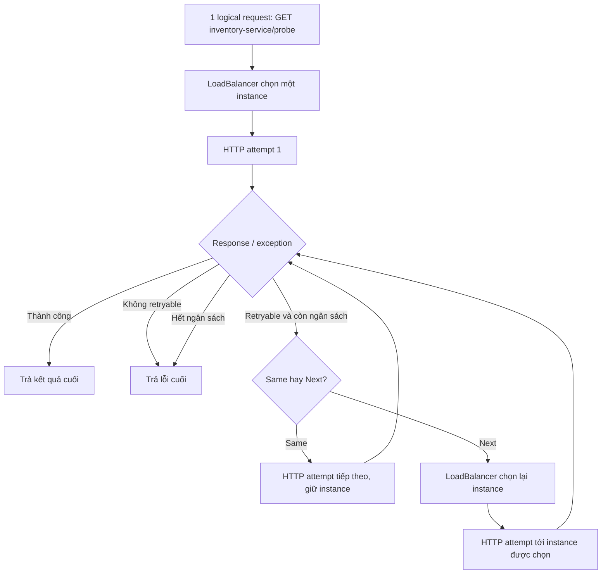

# Kiểm chứng thứ tự bản sao, số lần thử và kết quả cuối

Trong Spring Cloud LoadBalancer, việc một request cuối cùng nhận được `200 OK` **không đủ chứng minh** cơ chế retry đã hoạt động đúng. Request có thể thành công ngay từ lần đầu, có thể đã được gửi hai lần đến **cùng một `ServiceInstance`**, hoặc có thể thất bại ở bản sao A rồi thành công sau khi chuyển sang bản sao B. Để đánh giá chính xác, cần quan sát **thứ tự từng HTTP attempt**, **instance thực nhận request**, **số lần thử** và **kết quả cuối của một lời gọi nghiệp vụ**.

Bài này thuộc chương **Gửi lại yêu cầu** trong module `SPRING_CLOUD_SERVICE_COMMUNICATION_LOAD_BALANCING`. Mục tiêu là xây một kịch bản kiểm chứng được, có thể áp dụng cho client tích hợp Spring Cloud LoadBalancer với discovery, health check và chính sách định tuyến. Thực hành chính dùng `@LoadBalanced RestTemplate` với Spring Retry và hai HTTP server cục bộ; sau đó chỉ ra cách diễn giải khi thay bằng `RestClient`, `WebClient` hoặc OpenFeign, có retry và timeout riêng.

Kết quả mong đợi không phải một con số benchmark đã đo sẵn. Người học sẽ có **bộ quy tắc assertion** để kết luận liệu retry có đúng số lần, đúng thứ tự và dừng ở đúng điều kiện hay không.

## 1. Bốn đại lượng phải tách riêng

Một lời gọi từ `order-service` đến `inventory-service` có thể đi qua các bước:



Bốn đại lượng:

| Đại lượng | Định nghĩa | Ví dụ |
|---|---|---|
| **Logical request** | Một lần nghiệp vụ yêu cầu gọi dependency | `order-service` gọi `getStock("SKU-001")` một lần |
| **Lần chọn instance** | Một quyết định chọn `ServiceInstance` từ tập ứng viên | Chọn A lúc đầu; có thể chọn B khi next-instance retry |
| **HTTP attempt** | Một lần client cố gửi request trên transport | A nhận GET lần 1; B nhận GET lần 2 |
| **Final outcome** | Giá trị hoặc lỗi được caller nhận **sau khi** retry dừng | `200`, lỗi `503` cuối, timeout hoặc no-instance |

Không nên mặc định các đại lượng bằng nhau. Với retry same-instance, client có thể gửi hai HTTP attempts **sau một lần chọn đích ban đầu**. Với retry next-instance, có thể cần thêm một lựa chọn. Nếu chọn đích thất bại, **không có HTTP attempt nào đến server**, dù client đã cố thực hiện logical request.

Cần phân biệt thêm:

- **Client attempt:** lần transport cố gửi, kể cả khi DNS/TCP thất bại trước khi server nhận.
- **Server-observed attempt:** lần server stub **thực sự nhận** HTTP request; đây là tín hiệu ta đo trong thực hành.
- **HTTP response cuối:** status/headers/body của attempt cuối nếu có response.
- **Exception cuối:** khi client không nhận response hợp lệ hoặc `retrieve()`/error handler chuyển HTTP status thành exception.

**Một request timeout không có log tại server** không chứng minh client đã không thử gửi: kết nối có thể thất bại trước khi request đến ứng dụng. Vì vậy, bài test bằng server stub chứng minh số attempt **đã tới server**, còn các lỗi trước khi kết nối cần instrumentation phía client.

## 2. Dữ liệu đầu vào và các giả định của thí nghiệm

Giả sử discovery cung cấp hai bản sao cùng service ID:

| Trường | Instance A | Instance B |
|---|---|---|
| Service ID | `inventory-service` | `inventory-service` |
| Instance ID hiển thị | `inventory-a` | `inventory-b` |
| Host | `127.0.0.1` | `127.0.0.1` |
| Port | Cổng động A | Cổng động B |
| HTTP endpoint | `GET /probe` | `GET /probe` |

Client luôn gọi URI logic:

```text
http://inventory-service/probe
```

Bài test có những điều kiện quan trọng:

1. Cả hai HTTP server chạy thật trên loopback; không chỉ dùng mock response.
2. Hai server có response marker riêng để xác định **instance thực nhận request**.
3. Dùng `SimpleDiscoveryClient` cấp hai URI dưới cùng service ID.
4. Test gửi request **tuần tự**, mỗi logical request có `X-Correlation-ID` duy nhất.
5. Tắt LoadBalancer cache trong thử nghiệm để giảm yếu tố nhiễu, không phải vì cache luôn gây lỗi retry.
6. Không bật thêm retry từ gateway, Resilience4j, `RetryTemplate` tự viết hoặc HTTP transport bên dưới.
7. Chỉ dùng `GET` để tránh tác động ghi trùng khi học cơ chế retry.
8. Dùng Spring Boot và Spring Cloud BOM tương thích, có `spring-cloud-starter-loadbalancer` và `spring-retry` cho đường đi blocking `RestTemplate`.
9. Kiểm tra `RetryAwareServiceInstanceListSupplier` đang được áp dụng nếu muốn **khẳng định next-instance retry tới instance khác**.

Việc gọi `/probe` của hai server **không phụ thuộc trạng thái registry ngoài**, giúp dễ kiểm chứng các lần thử. Khi chuyển sang Eureka/Consul và server nghiệp vụ thật, kết quả chịu thêm ảnh hưởng từ health, cache và propagation của discovery.

## 3. Ghi nhận từng attempt bằng cùng một correlation ID

Để chứng minh một request nghiệp vụ đã được retry, mỗi HTTP attempt của request đó phải được liên kết bằng **cùng một ID**.

Ví dụ client gửi:

```http
GET /probe HTTP/1.1
Host: inventory-service
X-Correlation-ID: case-001
```

Server stub ghi một event cho mỗi request đã nhận:

```text
correlationId=case-001 ordinal=1 instance=inventory-a status=503
correlationId=case-001 ordinal=2 instance=inventory-b status=200
```

Trong bài test, `ordinal` là **số thứ tự chung trên cả A và B** dành riêng cho một correlation ID, không phải số thứ tự chỉ đếm trong từng server. Nhờ đó, ta khôi phục được chuỗi A → B mà không dựa vào thứ tự thread hoặc timestamp có thể bằng nhau.

Một event tối thiểu gồm:

| Field | Ý nghĩa |
|---|---|
| `correlationId` | Khóa nhận diện logical request |
| `ordinal` | Thứ tự request đến một trong các server stub |
| `instanceId` | Bản sao thực nhận request |
| `httpStatus` | Mã HTTP server trả cho attempt đó |
| `receivedAt` | Thời điểm nhận (nếu muốn đo độ trễ) |
| `responseBody` | Nội dung/marker gửi về client (tùy test) |

Đối chiếu **log server** với **response hoặc exception mà client quan sát** để kiểm tra kết quả cuối. Chỉ có client log là chưa đủ nếu cần xác nhận server thật đã nhận request.

## 4. Ma trận kiểm chứng: thứ tự, số lần, kết quả cuối

Trước khi chạy test, định nghĩa tình huống và kết quả kỳ vọng. Các ký hiệu A/B dưới đây chỉ là ví dụ; **không có contract yêu cầu round robin luôn bắt đầu bằng A**.

| Kịch bản | Chính sách | Chuỗi server quan sát (ví dụ) | Số attempt đến server | Kết quả cuối |
|---|---|---|---:|---|
| Không lỗi | Bất kỳ | A:200 | 1 | HTTP 200 |
| Retry cùng bản sao | `same=1, next=0` | A:503 → A:200 | 2 | HTTP 200 |
| Retry sang bản sao khác | `same=0, next=1` | A:503 → B:200 | 2 | HTTP 200 |
| Hết ngân sách same | `same=1, next=0` | A:503 → A:503 | 2 | Lỗi/status 503 cuối |
| Hết ngân sách next | `same=0, next=1` | A:503 → B:503 | 2 | Lỗi/status 503 cuối |
| Lỗi không được retry | `retryable=[503]` | A:400 | 1 | Lỗi/status 400 |
| Không có instance | Nguồn trả rỗng | Không có event server | 0 | Lỗi chọn đích, thường mang ý nghĩa 503 |
| Chỉ một instance hợp lệ | `same=0, next=1` | A:503 → A:200 *có thể* | 2 | Có thể 200 |
| Retry bị tắt | `enabled=false` | A:503 | 1 | Lỗi/status 503 |

Đây là **mẫu kỳ vọng dưới điều kiện giả lập**, không phải số liệu thực tế đã đo. Với next-instance retry, muốn assert A → B cần có ít nhất hai candidate còn hợp lệ và cơ chế tránh instance trước đó hoạt động. Nếu chỉ một ứng viên hoặc còn các bộ lọc khác, **next** không bảo đảm đổi instance ID.

### 4.1. Những assertion mạnh hơn `status == 200`

Với kịch bản thành công sau retry, cần xác nhận **đồng thời**:

- Số server events cùng correlation ID là `2`.
- Status của event đầu là `503` và event hai là `200`.
- Với `same`: `instanceId[0] == instanceId[1]`.
- Với `next`: `instanceId[0] != instanceId[1]` khi hai instance đều đủ điều kiện và retry-aware filtering hoạt động.
- Caller nhận response 200 với body phù hợp instance của **event cuối**.
- Không có attempt thứ ba sau khi request đã thành công.

Nếu cần đo “chọn lại” chứ không chỉ “đã tới B”, bổ sung instrument ở `ReactorServiceInstanceLoadBalancer` hoặc `LoadBalancerLifecycle`. Server chỉ biết **kết quả đường truyền**, không biết toàn bộ quá trình supplier quyết định tập ứng viên.

## 5. Ngữ nghĩa cấu hình Spring Cloud LoadBalancer retry

Các thuộc tính chính:

```yaml
spring:
  cloud:
    loadbalancer:
      retry:
        enabled: true
        max-retries-on-same-service-instance: 1
        max-retries-on-next-service-instance: 0
        retryable-status-codes:
          - 503
        retry-on-all-operations: false
        avoid-previous-instance: true
```

Ý nghĩa:

| Property | Vai trò |
|---|---|
| `retry.enabled` | Cho phép cơ chế retry khi HTTP client/integration tương ứng có mặt |
| `max-retries-on-same-service-instance` | Số lần thử thêm trên instance hiện tại |
| `max-retries-on-next-service-instance` | Số lần thử thêm sau bước chọn instance mới |
| `retryable-status-codes` | Status code có thể kích hoạt retry theo implementation |
| `retry-on-all-operations` | Cho phép retry cả các HTTP method ngoài GET khi bật |
| `avoid-previous-instance` | Cố gắng tránh instance trước trong next-instance selection, nếu có lựa chọn khác |

Theo tài liệu Spring Cloud Commons hiện hành, các giá trị mặc định phổ biến gồm `same=0`, `next=1` và `avoid-previous-instance=true`. Các default đó **không khẳng định request sẽ tự retry** nếu client chưa có integration/dependency retry thích hợp. Cần kiểm chứng trên bản Spring Boot/Spring Cloud BOM của dự án.

### 5.1. Đếm tối đa không có nghĩa lúc nào cũng thử đủ

Với `same=1` và `next=2`, mô hình ngân sách thường được giải thích là:

```text
Chọn A: lần đầu + tối đa 1 retry trên A
Chọn mới: lần đầu + tối đa 1 retry trên instance mới
Chọn mới: lần đầu + tối đa 1 retry trên instance mới

Cận trên theo mô hình: (1 + same) × (1 + next)
                        = 2 × 3
                        = 6 HTTP attempts
```

Đây là **cận trên minh họa**, không phải một lời hứa tất cả implementation đều gửi đúng sáu request. Thực tế phụ thuộc lỗi được phép retry, thứ tự retry, deadline, số instance, connection failure và các lớp retry khác. Ngay khi attempt thành công hoặc gặp lỗi không được retry, quá trình dừng.

### 5.2. Chọn lại không luôn chọn khác

Trong next-instance retry, `RetryAwareServiceInstanceListSupplier` có thể tránh instance vừa thất bại, **nếu còn bản sao khác**. Nó không deregister instance, không tự sửa discovery và không biến một instance thành “bị cấm vĩnh viễn”.

Nếu health check chỉ còn A, một lần chọn lại có thể vẫn chọn A. Nếu gateway chỉ cho phép zone A hoặc tenant A, không nên bỏ điều kiện cứng để ép một request sang B. Bài test cần ghi rõ các điều kiện của candidate list.

## 6. Kiến trúc bộ kiểm thử có thể lặp lại

Phần thực hành gồm bốn file trong `src/test/java` (đây là **ví dụ để người học sao chép vào project test**, không yêu cầu tạo thêm file trong module tài liệu):

```text
src/test/java/com/example/lb/retry/
├── RetryTestApplication.java     # @LoadBalanced RestTemplate
├── RetryProbeCluster.java        # Hai HttpServer và event log
├── RetrySameInstanceTest.java    # same=1, next=0
└── RetryNextInstanceTest.java    # same=0, next=1
```

Chọn `RestTemplate` vì tài liệu Spring Cloud Commons mô tả rõ hỗ trợ retry ở đường đi **blocking** khi có Spring Retry trên classpath. Khi cần xác minh `RestClient` hoặc `WebClient` trong một release train cụ thể, hãy giữ cùng cách ghi event/đếm attempt nhưng thay adapter và các assertion client-side tương ứng.

Dependency Maven minh họa (project đã khai báo Spring Cloud BOM tương thích):

```xml
<dependencies>
    <dependency>
        <groupId>org.springframework.boot</groupId>
        <artifactId>spring-boot-starter-web</artifactId>
    </dependency>
    <dependency>
        <groupId>org.springframework.cloud</groupId>
        <artifactId>spring-cloud-starter-loadbalancer</artifactId>
    </dependency>
    <dependency>
        <groupId>org.springframework.retry</groupId>
        <artifactId>spring-retry</artifactId>
    </dependency>
    <dependency>
        <groupId>org.springframework.boot</groupId>
        <artifactId>spring-boot-starter-test</artifactId>
        <scope>test</scope>
    </dependency>
</dependencies>
```

Trong build thật, dùng Java hỗ trợ `record` và module JDK `jdk.httpserver` (ví dụ Java 17+); nếu ứng dụng dùng Java modules, bảo đảm module có thể truy cập `com.sun.net.httpserver`. Không cần Eureka/Consul vì `SimpleDiscoveryClient` cung cấp danh sách instance tĩnh.

## 7. File 1: tạo RestTemplate đi qua LoadBalancer

```java
package com.example.lb.retry;

import org.springframework.boot.SpringBootConfiguration;
import org.springframework.boot.autoconfigure.EnableAutoConfiguration;
import org.springframework.cloud.client.loadbalancer.LoadBalanced;
import org.springframework.context.annotation.Bean;
import org.springframework.web.client.RestTemplate;

@SpringBootConfiguration
@EnableAutoConfiguration
class RetryTestApplication {

    @Bean("loadBalancedRestTemplate")
    @LoadBalanced
    RestTemplate loadBalancedRestTemplate() {
        return new RestTemplate();
    }
}
```

Những điểm cần nhớ:

- `@LoadBalanced` tạo điều kiện cho Spring Cloud LoadBalancer gắn interceptor và cơ chế retry thích hợp với `RestTemplate`.
- URI `http://inventory-service/probe` sử dụng **service ID**, không phải port của instance A hoặc B.
- Nếu bỏ `spring-cloud-starter-loadbalancer` hoặc inject nhầm `new RestTemplate()` thuần, bài test không còn kiểm tra cơ chế chọn instance của Spring Cloud.
- Có Spring Retry trên classpath và bật `retry.enabled` vẫn cần xác nhận auto-configuration thực sự dùng interceptor retry đúng release train.

## 8. File 2: hai server stub cùng một bộ đếm attempt

Để tránh giả định request đầu luôn tới A, thiết kế server trả `503` cho **attempt đầu tiên của mỗi correlation ID**, bất kể request vào A hay B; attempt thứ hai trả `200`. Bộ đếm được chia sẻ giữa hai server, nên có thể kiểm tra **same instance** hoặc **next instance** chỉ bằng cách so sánh ID của hai event.

Với correlation ID có tiền tố `always503-`, mọi attempt trả `503` để kiểm thử **hết ngân sách**. Với tiền tố `bad400-`, server trả `400` để kiểm tra **không retry lỗi không được phép**.

```java
package com.example.lb.retry;

import java.io.IOException;
import java.io.OutputStream;
import java.io.UncheckedIOException;
import java.net.InetSocketAddress;
import java.nio.charset.StandardCharsets;
import java.util.Comparator;
import java.util.List;
import java.util.concurrent.ConcurrentHashMap;
import java.util.concurrent.CopyOnWriteArrayList;
import java.util.concurrent.atomic.AtomicInteger;

import com.sun.net.httpserver.HttpServer;

final class RetryProbeCluster implements AutoCloseable {

    record Attempt(
            String correlationId,
            String instanceId,
            int ordinal,
            int status) {
    }

    private final ConcurrentHashMap<String, AtomicInteger> counters =
            new ConcurrentHashMap<>();
    private final List<Attempt> events =
            new CopyOnWriteArrayList<>();

    private final HttpServer a;
    private final HttpServer b;

    private RetryProbeCluster() throws IOException {
        a = createServer("inventory-a");

        try {
            b = createServer("inventory-b");
        } catch (IOException error) {
            a.stop(0);
            throw error;
        }
    }

    static RetryProbeCluster start() {
        try {
            return new RetryProbeCluster();
        } catch (IOException error) {
            throw new UncheckedIOException(error);
        }
    }

    String uriA() {
        return "http://127.0.0.1:" + a.getAddress().getPort();
    }

    String uriB() {
        return "http://127.0.0.1:" + b.getAddress().getPort();
    }

    List<Attempt> attempts(String correlationId) {
        return events.stream()
                .filter(e -> e.correlationId().equals(correlationId))
                .sorted(Comparator.comparingInt(Attempt::ordinal))
                .toList();
    }

    private HttpServer createServer(String instanceId)
            throws IOException {

        HttpServer server = HttpServer.create(
                new InetSocketAddress("127.0.0.1", 0),
                0);

        server.createContext("/probe", exchange -> {
            String id = exchange.getRequestHeaders()
                    .getFirst("X-Correlation-ID");

            if (id == null || id.isBlank()) {
                byte[] bytes = "missing correlation id"
                        .getBytes(StandardCharsets.UTF_8);

                exchange.sendResponseHeaders(400, bytes.length);

                try (OutputStream out =
                             exchange.getResponseBody()) {
                    out.write(bytes);
                }
                return;
            }

            int ordinal = counters
                    .computeIfAbsent(
                            id, unused -> new AtomicInteger())
                    .incrementAndGet();

            int status;
            if (id.startsWith("always503-")) {
                status = 503;
            } else if (id.startsWith("bad400-")) {
                status = 400;
            } else {
                status = ordinal == 1 ? 503 : 200;
            }

            events.add(new Attempt(
                    id, instanceId, ordinal, status));

            String payload = instanceId
                    + ":attempt=" + ordinal;

            byte[] bytes = payload.getBytes(
                    StandardCharsets.UTF_8);

            exchange.getResponseHeaders().set(
                    "X-Instance-Id", instanceId);
            exchange.getResponseHeaders().set(
                    "X-Attempt", Integer.toString(ordinal));
            exchange.getResponseHeaders().set(
                    "Content-Type", "text/plain; charset=UTF-8");

            exchange.sendResponseHeaders(status, bytes.length);

            try (OutputStream out =
                         exchange.getResponseBody()) {
                out.write(bytes);
            }
        });

        server.start();
        return server;
    }

    @Override
    public void close() {
        a.stop(0);
        b.stop(0);
    }
}
```

### 8.1. Lý do dùng bộ đếm chung

Giả sử retry same-instance nhận hai request ở A:

```text
correlationId=same-101:
  1, inventory-a, 503
  2, inventory-a, 200
```

Nếu retry next-instance chuyển sang B:

```text
correlationId=next-101:
  1, inventory-a, 503
  2, inventory-b, 200
```

Cả hai kịch bản đều bắt đầu bằng 503 và kết thúc bằng 200. **Đích của attempt thứ hai** là điều phân biệt chiến lược, không phải status cuối.

`CopyOnWriteArrayList` và `ConcurrentHashMap` được dùng vì hai `HttpServer` có thể chạy ở thread khác với thread của test. `ordinal` tạo thứ tự xác định cho từng correlation ID, không dựa vào timestamp. Trong hệ thống thật, request có thể thực hiện song song; khi đó cần thiết kế trace/event store đủ mạnh để xác định thứ tự và nhóm attempt.

### 8.2. Giới hạn của stub

Stub cố tình đơn giản:

- Không mô phỏng service registry thật.
- Không hỗ trợ streaming, HTTP/2 hoặc connection pool đặc thù.
- Không chứng minh transport đã gọi server khi TCP/TLS thất bại trước HTTP.
- Không thay thế distributed tracing của production.
- Không giả lập kết quả xử lý ghi vào database hay idempotency.

Nó phù hợp cho mục tiêu của bài: **kiểm chứng thứ tự bản sao, số lần thử và response cuối** trong môi trường ổn định.

## 9. File 3: kiểm thử retry trên cùng instance

Tạo test class riêng cho `same=1, next=0`. Đây là test client blocking với Spring Retry, dùng `@SpringBootTest` để cho auto-configuration của Spring Cloud tạo tích hợp thực tế.

```java
package com.example.lb.retry;

import java.net.URI;
import java.util.List;
import java.util.UUID;

import org.junit.jupiter.api.AfterAll;
import org.junit.jupiter.api.Test;
import org.springframework.beans.factory.annotation.Autowired;
import org.springframework.beans.factory.annotation.Qualifier;
import org.springframework.boot.test.context.SpringBootTest;
import org.springframework.http.HttpEntity;
import org.springframework.http.HttpHeaders;
import org.springframework.http.HttpMethod;
import org.springframework.http.ResponseEntity;
import org.springframework.test.context.DynamicPropertyRegistry;
import org.springframework.test.context.DynamicPropertySource;
import org.springframework.web.client.HttpClientErrorException;
import org.springframework.web.client.HttpServerErrorException;
import org.springframework.web.client.RestTemplate;

import static org.junit.jupiter.api.Assertions.*;

@SpringBootTest(
        classes = RetryTestApplication.class,
        webEnvironment = SpringBootTest.WebEnvironment.NONE,
        properties = {
                "spring.cloud.loadbalancer.cache.enabled=false",
                "spring.cloud.loadbalancer.retry.enabled=true",
                "spring.cloud.loadbalancer.retry.max-retries-on-same-service-instance=1",
                "spring.cloud.loadbalancer.retry.max-retries-on-next-service-instance=0",
                "spring.cloud.loadbalancer.retry.retryable-status-codes=503"
        }
)
class RetrySameInstanceTest {

    private static final RetryProbeCluster PROBES =
            RetryProbeCluster.start();

    @DynamicPropertySource
    static void registerInstances(DynamicPropertyRegistry registry) {
        registry.add(
                "spring.cloud.discovery.client.simple.instances."
                        + "inventory-service[0].uri",
                PROBES::uriA);

        registry.add(
                "spring.cloud.discovery.client.simple.instances."
                        + "inventory-service[1].uri",
                PROBES::uriB);
    }

    @Autowired
    @Qualifier("loadBalancedRestTemplate")
    RestTemplate restTemplate;

    @Test
    void twoAttemptsReachTheSameInstance() {
        String id = "same-" + UUID.randomUUID();

        ResponseEntity<String> result = call(id);

        assertEquals(200, result.getStatusCode().value());

        List<RetryProbeCluster.Attempt> attempts =
                PROBES.attempts(id);

        assertEquals(2, attempts.size());
        assertEquals(503, attempts.get(0).status());
        assertEquals(200, attempts.get(1).status());

        assertEquals(
                attempts.get(0).instanceId(),
                attempts.get(1).instanceId());

        assertEquals(
                attempts.get(1).instanceId(),
                result.getHeaders().getFirst("X-Instance-Id"));

        assertTrue(result.getBody().contains(
                attempts.get(1).instanceId()));
    }

    @Test
    void exhaustedBudgetReturnsTheLast503() {
        String id = "always503-" + UUID.randomUUID();

        HttpServerErrorException failure = assertThrows(
                HttpServerErrorException.class,
                () -> call(id));

        assertEquals(503, failure.getStatusCode().value());

        List<RetryProbeCluster.Attempt> attempts =
                PROBES.attempts(id);

        assertEquals(2, attempts.size());
        assertEquals(
                attempts.get(0).instanceId(),
                attempts.get(1).instanceId());
        assertTrue(attempts.stream()
                .allMatch(a -> a.status() == 503));
    }

    @Test
    void badRequestIsNotRetried() {
        String id = "bad400-" + UUID.randomUUID();

        HttpClientErrorException failure = assertThrows(
                HttpClientErrorException.class,
                () -> call(id));

        assertEquals(400, failure.getStatusCode().value());
        assertEquals(1, PROBES.attempts(id).size());
    }

    private ResponseEntity<String> call(String id) {
        HttpHeaders headers = new HttpHeaders();
        headers.set("X-Correlation-ID", id);

        return restTemplate.exchange(
                URI.create("http://inventory-service/probe"),
                HttpMethod.GET,
                new HttpEntity<Void>(null, headers),
                String.class);
    }

    @AfterAll
    static void stopServers() {
        PROBES.close();
    }
}
```

### 9.1. Ba assertion quan trọng

Với `twoAttemptsReachTheSameInstance`:

- `attempts.size() == 2` chứng minh server nhận hai request HTTP cho một logical request.
- `503, 200` chứng minh client đã retry **vì** response đầu không thành công, rồi dừng ở response thành công.
- `instanceId[0] == instanceId[1]` chứng minh cả hai attempts tới **cùng một server**, không phải chỉ cùng service ID.

Không cần biết ban đầu round robin chọn A hay B. Cả hai stub đều áp dụng cùng quy tắc “503 trước, 200 sau” dựa trên correlation ID chung.

### 9.2. Lỗi cuối khi đã hết số lần thử

Với `always503-*`, mọi HTTP attempt được server ghi nhận là 503. Sau hai attempts (ban đầu + một retry same), `RestTemplate` với error handler mặc định thường ném `HttpServerErrorException`. Assertion kiểm tra cả **exception status cuối** và **chuỗi server events**, tránh coi “có exception” đồng nghĩa retry đã chạy đúng.

### 9.3. Lỗi 400 không retry

`bad400-*` trả HTTP 400. Trong ví dụ chỉ khai báo 503 là retryable và không bật retry toàn bộ exception. Vì vậy test kỳ vọng đúng một attempt. Nếu test thấy 2 attempts, cần kiểm tra có retry layer khác hoặc custom policy đang bật không.

## 10. File 4: kiểm thử chuyển sang bản sao khác

Đặt cấu hình ở **test context riêng**:

- `max-retries-on-same-service-instance=0`.
- `max-retries-on-next-service-instance=1`.
- `avoid-previous-instance=true`.
- Hai instance đều được công bố qua discovery và không bị filter loại.
- HTTP status 503 là retryable.

```java
package com.example.lb.retry;

import java.net.URI;
import java.util.List;
import java.util.UUID;

import org.junit.jupiter.api.AfterAll;
import org.junit.jupiter.api.Test;
import org.springframework.beans.factory.annotation.Autowired;
import org.springframework.beans.factory.annotation.Qualifier;
import org.springframework.boot.test.context.SpringBootTest;
import org.springframework.http.HttpEntity;
import org.springframework.http.HttpHeaders;
import org.springframework.http.HttpMethod;
import org.springframework.http.ResponseEntity;
import org.springframework.test.context.DynamicPropertyRegistry;
import org.springframework.test.context.DynamicPropertySource;
import org.springframework.web.client.HttpServerErrorException;
import org.springframework.web.client.RestTemplate;

import static org.junit.jupiter.api.Assertions.*;

@SpringBootTest(
        classes = RetryTestApplication.class,
        webEnvironment = SpringBootTest.WebEnvironment.NONE,
        properties = {
                "spring.cloud.loadbalancer.cache.enabled=false",
                "spring.cloud.loadbalancer.retry.enabled=true",
                "spring.cloud.loadbalancer.retry.max-retries-on-same-service-instance=0",
                "spring.cloud.loadbalancer.retry.max-retries-on-next-service-instance=1",
                "spring.cloud.loadbalancer.retry.avoid-previous-instance=true",
                "spring.cloud.loadbalancer.retry.retryable-status-codes=503"
        }
)
class RetryNextInstanceTest {

    private static final RetryProbeCluster PROBES =
            RetryProbeCluster.start();

    @DynamicPropertySource
    static void registerInstances(DynamicPropertyRegistry registry) {
        registry.add(
                "spring.cloud.discovery.client.simple.instances."
                        + "inventory-service[0].uri",
                PROBES::uriA);

        registry.add(
                "spring.cloud.discovery.client.simple.instances."
                        + "inventory-service[1].uri",
                PROBES::uriB);
    }

    @Autowired
    @Qualifier("loadBalancedRestTemplate")
    RestTemplate restTemplate;

    @Test
    void twoAttemptsReachDifferentInstances() {
        String id = "next-" + UUID.randomUUID();

        ResponseEntity<String> result = call(id);

        assertEquals(200, result.getStatusCode().value());

        List<RetryProbeCluster.Attempt> attempts =
                PROBES.attempts(id);

        assertEquals(2, attempts.size());
        assertEquals(503, attempts.get(0).status());
        assertEquals(200, attempts.get(1).status());

        assertNotEquals(
                attempts.get(0).instanceId(),
                attempts.get(1).instanceId());

        assertEquals(
                attempts.get(1).instanceId(),
                result.getHeaders().getFirst("X-Instance-Id"));
    }

    @Test
    void exhaustedBudgetDoesNotProduceAThirdAttempt() {
        String id = "always503-" + UUID.randomUUID();

        HttpServerErrorException failure = assertThrows(
                HttpServerErrorException.class,
                () -> call(id));

        assertEquals(503, failure.getStatusCode().value());

        List<RetryProbeCluster.Attempt> attempts =
                PROBES.attempts(id);

        assertEquals(2, attempts.size());
        assertNotEquals(
                attempts.get(0).instanceId(),
                attempts.get(1).instanceId());
        assertEquals(503, attempts.get(0).status());
        assertEquals(503, attempts.get(1).status());
    }

    private ResponseEntity<String> call(String id) {
        HttpHeaders headers = new HttpHeaders();
        headers.set("X-Correlation-ID", id);

        return restTemplate.exchange(
                URI.create("http://inventory-service/probe"),
                HttpMethod.GET,
                new HttpEntity<Void>(null, headers),
                String.class);
    }

    @AfterAll
    static void stopServers() {
        PROBES.close();
    }
}
```

### 10.1. Điều kiện để test next-instance mang ý nghĩa

Assertion `assertNotEquals(instanceId[0], instanceId[1])` chỉ hợp lý khi:

1. Supplier đưa **ít nhất hai instance hợp lệ** cho `inventory-service`.
2. Retry chọn lại thực sự dùng context của request trước.
3. `RetryAwareServiceInstanceListSupplier` được áp dụng và chính sách `avoid-previous-instance` có hiệu lực.
4. Không có filter cứng loại một trong hai bản sao.
5. Cả hai server nhận được request (không có lỗi mạng trước tầng HTTP).
6. Retry đủ điều kiện theo status 503 và không bị chặn bởi deadline.

Nếu test fail vì hai attempts đều tới A, **đừng sửa assertion thành luôn mong A/B xen kẽ**. Hãy kiểm tra supplier chain và retry-aware wrapper trước. Đây chính là mục tiêu của bài kiểm chứng.

### 10.2. Vì sao dùng hai context khác nhau?

Những property về số retry và supplier wrapper thường được đọc khi tạo bean/khởi động context. Không thay `same=1, next=0` thành `same=0, next=1` bằng cách sửa environment sau khi context đã được tạo rồi mặc định client đổi hành vi. Hai test class có property khác nhau tạo hai cấu hình thử nghiệm độc lập, dễ tái hiện.

## 11. Khi không có response HTTP cuối

Không phải thất bại nào cũng có status 400/503 từ server. Ví dụ:

| Tình huống | Server events | Tín hiệu caller có thể nhận |
|---|---:|---|
| Không có `ServiceInstance` | 0 | Lỗi chọn đích; tùy integration có thể là HTTP 503 nội bộ hoặc exception |
| Không kết nối được TCP tới A | 0 ở A | I/O exception hoặc timeout; có thể retry tới B |
| A nhận request nhưng không kịp trả body | Có event ở A | Read timeout; có thể retry theo policy |
| A trả HTTP 503 và hết retry | Có các event 503 | Status 503 hoặc exception tương ứng |
| B trả 200 sau lỗi ở A | Có event ở A/B | 200 với response body từ B |
| Client bị hủy/deadline hết | Có thể 0 hoặc nhiều | Cancellation/timeout cuối, không nhất thiết có HTTP status |

Không nên dùng `assertEquals(503, exception.getStatusCode())` cho mọi tình huống không có instance, vì đường đi lỗi không có server HTTP có thể được client biểu diễn khác nhau.

**Kết quả cuối phải được phân loại** thành:

- `SUCCESS`: caller nhận dữ liệu hợp lệ.
- `HTTP_ERROR`: response HTTP cuối có status lỗi.
- `TRANSPORT_ERROR`: DNS/TCP/TLS/timeout/connection reset.
- `NO_INSTANCE`: không chọn được candidate.
- `CANCELLED/DEADLINE_EXCEEDED`: caller không tiếp tục chờ.

Một phép đo tốt ghi cả **final outcome** và các attempt server đã nhìn thấy, đồng thời thừa nhận phần dữ liệu thiếu nếu lỗi xảy ra trước HTTP server.

## 12. Kiểm thử một instance và danh sách rỗng

### 12.1. Chỉ có một bản sao A

Nếu discovery chỉ trả A:

```text
candidateList = [inventory-a]
same=0, next=1, avoidPrevious=true
```

Một retry “next” có thể lại chọn A vì không có B hợp lệ. Kết quả thực tế có thể là:

```text
attempt 1: A -> 503
attempt 2: A -> 200
final: 200
```

Trường hợp này **không chứng minh** đang dùng “same-instance retry”. Nó có thể là một lần **reselection** nhưng kết quả reselection vẫn là A. Muốn phân biệt, ngoài server log phải instrument sự kiện chọn của LoadBalancer.

Khi viết test kịch bản một instance, nên assert:

- Không xuất hiện instance ngoài danh sách.
- Số attempt không vượt ngân sách.
- Final outcome đúng với status/lỗi của attempts.
- Không mặc định `nextInstanceId != previousInstanceId`.

### 12.2. Danh sách discovery rỗng

Nếu `ServiceInstanceListSupplier` trả danh sách rỗng ngay lần đầu, LoadBalancer không có đích để gửi request. Kết quả:

```text
logicalRequests = 1
serverObservedAttempts = 0
loadBalancerSelections = có thể có một lựa chọn rỗng
finalOutcome = NO_INSTANCE
```

Không nên cho một retry policy tự động gửi đến IP do code đoán trước hoặc bỏ qua ràng buộc zone/tenant/version. Muốn mô phỏng, gọi service ID không khai báo trong `SimpleDiscoveryClient` và kiểm tra **không HTTP stub nào nhận request**; kiểu exception/status ở caller phải được xác định theo client và release train thực tế.

## 13. Xác minh bằng LoadBalancer lifecycle và metric

Trong test hai server, event log tại server chứng minh **đích thực nhận**. Để biết **LoadBalancer đã chọn instance bao nhiêu lần**, cần điểm đo riêng trong client.

Các hướng quan sát:

- Sử dụng `LoadBalancerLifecycle` (nếu integration và phiên bản hỗ trợ) để nhận sự kiện quanh việc lựa chọn và hoàn tất request.
- Ghi log tại `ServiceInstanceListSupplier` để biết danh sách ứng viên trước/sau health/zone/filter.
- Instrument `ReactorServiceInstanceLoadBalancer.choose(...)` trong kiểm thử thuật toán riêng.
- Dùng Micrometer metrics của Spring Cloud LoadBalancer khi bật thống kê phù hợp, đối chiếu với trace.
- Ghi client HTTP attempt count ở tầng transport/interceptor, không dựa hoàn toàn vào số lần gọi hàm nghiệp vụ.

Bảng so sánh:

| Nguồn quan sát | Biết được | Không thể suy ra chắc chắn |
|---|---|---|
| Log stub A/B | HTTP request đã đến server nào và thứ tự | Lần chọn trước đó có thất bại trước HTTP không |
| Log `choose(...)` | Các lần chọn và instance được trả về | Server có nhận request thành công không |
| Log supplier | Tập candidate và bộ lọc | Caller nhận response cuối gì |
| HTTP client tracing | Logical request, HTTP attempts, lỗi kết nối | Toàn bộ trạng thái registry nếu không instrument |
| HTTP response cuối | Kết quả caller nhận | Từng attempt đã diễn ra |
| Metrics retry | Tỷ lệ retry và lỗi cuối | Trình tự instance cụ thể nếu không có trace |

### 13.1. Phân biệt số lựa chọn với số lần đến server

Trong mô hình lý tưởng:

```text
same-instance:
  1 logical request
  1 lần chọn instance (mô hình)
  2 HTTP attempts tới A
  final 200

next-instance:
  1 logical request
  2 lần chọn instance (mô hình)
  2 HTTP attempts A và B
  final 200
```

Nhưng một client integration có thể gọi supplier hoặc lifecycle nhiều lần vì các bước retry/filters; các con số bên trên là **mô hình khái niệm**, không phải metric contract của mọi phiên bản Spring Cloud. Chỉ xác nhận khi instrument thật.

## 14. Kiểm thử với WebClient và RestClient

Đoạn mã ở mục 9–10 dùng `RestTemplate` để có điểm tựa rõ về blocking retry với Spring Retry. Cùng phương pháp logging có thể áp dụng cho các client khác, nhưng cần phân biệt:

### 14.1. RestClient

`RestClient` là HTTP client đồng bộ mới hơn `RestTemplate`. Để kiểm tra cơ chế chọn instance, phải dùng `RestClient.Builder` được đánh dấu `@LoadBalanced` trong Spring Cloud:

```java
@Bean
@LoadBalanced
RestClient.Builder loadBalancedRestClientBuilder() {
    return RestClient.builder();
}
```

Khi test retry, **không mặc định** behavior giống RestTemplate ở mọi release train chỉ vì cả hai đều blocking. Cần xác nhận version Spring Cloud đang dùng cung cấp retry interceptor/integration cho RestClient và các property `spring.cloud.loadbalancer.retry.*` thực sự điều khiển client đó. Sau đó dùng lại cùng `RetryProbeCluster` để assert instance order và attempt count.

### 14.2. WebClient

Reactive HTTP client nên được dựng từ `@LoadBalanced WebClient.Builder`:

```java
@Bean
@LoadBalanced
WebClient.Builder loadBalancedWebClientBuilder() {
    return WebClient.builder();
}
```

Reactive retry của Spring Cloud LoadBalancer có thể được cấu hình qua `spring.cloud.loadbalancer.retry.enabled` và `max-retries-on-...` trong release train hỗ trợ.

Khi kiểm thử, nhớ rằng publisher là **lazy**: nếu không subscribe (hoặc dùng `StepVerifier`), request có thể chưa được gửi. Ví dụ:

```java
Mono<String> result = loadBalancedWebClientBuilder
        .baseUrl("http://inventory-service")
        .build()
        .get()
        .uri("/probe")
        .header("X-Correlation-ID", "next-001")
        .retrieve()
        .bodyToMono(String.class);

StepVerifier.create(result)
        .expectNextMatches(body ->
                body.contains("inventory-"))
        .verifyComplete();
```

Đừng gắn thêm `retryWhen(Retry.max(3))` một cách vô điều kiện **bên ngoài** pipeline đã có retry LoadBalancer. Các retry layer có thể nhân số attempts và làm assertion “đúng hai lần” thất bại. Reactive timeout cần được kiểm soát để test không treo.

### 14.3. OpenFeign

OpenFeign có khái niệm `Retryer` và tích hợp LoadBalancer khi dùng `@FeignClient(name="inventory-service")` không có URL cố định. Nếu dùng `@FeignClient(url=...)` hoặc URL trong property, client đi theo URL trực tiếp, **không chọn lại `ServiceInstance` qua Spring Cloud LoadBalancer** cho target đó.

Spring Cloud OpenFeign thường cấu hình `Retryer.NEVER_RETRY` mặc định. Khi thêm custom Retryer, cần kiểm tra tổng ngân sách cùng các tầng retry khác, không tự suy rằng `max-retries-on-next-service-instance=1` sẽ khiến mọi Feign client retry qua B.

## 15. Kiểm tra các kết quả cuối thường gặp

### 15.1. Thành công sau một retry

```text
correlationId=next-701
attempt 1: inventory-a -> HTTP 503
attempt 2: inventory-b -> HTTP 200
finalStatus=200
finalBody=inventory-b:attempt=2
attemptCount=2
```

Kết luận: Có ít nhất một retry, server B là đích cuối, caller nhận thành công. Nếu supplier có hai instance và retry-aware selection hoạt động, đây là bằng chứng của **next-instance retry**.

### 15.2. Hết ngân sách và vẫn lỗi

```text
correlationId=always503-702
attempt 1: inventory-a -> 503
attempt 2: inventory-b -> 503
finalStatus=503 (hoặc exception chứa status 503)
attemptCount=2
```

Kết luận: Đã thử đủ ngân sách tương ứng và **không thành công**. Không nên đổi một response cuối 503 thành kết quả giả `200` để test “xanh”. Ở API gateway có thể ánh xạ thành response `503 Service Unavailable` với mã lỗi nội bộ rõ ràng.

### 15.3. Lỗi không được retry

```text
correlationId=bad400-703
attempt 1: inventory-a -> 400
finalStatus=400
attemptCount=1
```

Kết luận: Hệ thống không phát lại input sai, tránh gây tải vô ích. Nếu attemptCount lớn hơn một, cần xem chính sách retry status/exception và các lớp retry khác.

### 15.4. Timeout hoặc lỗi không có instance

```text
logicalRequestId=case-704
serverEvents=[]
finalOutcome=NO_INSTANCE hoặc TRANSPORT_ERROR
```

Cần phân loại ở caller và tại điểm chọn. Không được chỉ dựa vào `serverEvents=[]` để tự kết luận NO_INSTANCE: connection refused, DNS failure hoặc TLS error cũng có thể tạo log rỗng.

## 16. Vì sao không assert A → B tuyệt đối?

Round robin thường chọn lần lượt giữa các instance hợp lệ, nhưng chỉ số ban đầu có thể không cố định. Health/cache/zone/hint cũng có thể làm danh sách ứng viên thay đổi.

Một assertion kiểu:

```java
assertEquals("inventory-a", attempts.get(0).instanceId());
assertEquals("inventory-b", attempts.get(1).instanceId());
```

có thể thất bại không cần thiết dù policy next-instance đúng, nếu lần đầu chọn B và lần sau chọn A.

Cách tốt hơn:

```java
assertEquals(2, attempts.size());
assertNotEquals(
        attempts.get(0).instanceId(),
        attempts.get(1).instanceId());
```

Khi test **same-instance**, dùng `assertEquals` giữa hai ID. Khi cần xác nhận **thuật toán RoundRobinLoadBalancer** độc lập, tạo một test thuật toán với supplier cố định và kiểm soát state, thay vì dựa vào thứ tự của integration test có nhiều bean và request.

Nếu bật random policy, không có bảo đảm mọi instance xuất hiện sau một số lượng nhỏ request. Test nên kiểm tra mỗi lựa chọn thuộc tập hợp lệ, hoặc sử dụng random seed/deterministic test double nếu implementation cho phép.

## 17. Timeout, backoff và deadline có thể làm thay đổi số lần thử

Số lần retry được cấu hình là **mức tối đa**, không phải mục tiêu phải đạt bằng mọi giá. Với deadline tổng 1 giây và mỗi attempt có read timeout 700 ms, attempt thứ hai có thể không kịp bắt đầu hoặc không thể hoàn tất.

Ví dụ:

```text
t=0ms     chọn A, gửi HTTP
t=700ms   timeout A
t=800ms   hết backoff 100ms
t=800ms   chọn B và gửi HTTP
t=1000ms  deadline tổng -> cancel
```

Kết quả có thể là:

- A đã ghi nhận attempt.
- B có thể nhận hoặc chưa nhận request trước cancellation.
- Caller nhận timeout cuối, không có HTTP 200.
- Số server-observed attempts có thể chỉ là 1 mặc dù ngân sách retry cho phép 2.

Với reactive retry, các cấu hình `spring.cloud.loadbalancer.retry.backoff.*` có thể tác động thời gian giữa các attempt; với blocking retry qua Spring Retry, `BackOffPolicy` được thiết lập theo cơ chế tương ứng. Không nên xem backoff là timeout; chúng là hai đại lượng khác nhau.

Khi kiểm thử **chính xác số lần attempt**, hãy dùng server trả status tức thì, timeout đủ lớn và không có deadline làm dừng test giữa chừng. Sau đó tạo **test riêng** cho timeout/cancellation và đo cả sự bất định ở tầng transport.

## 18. An toàn nghiệp vụ: POST có thể bị xử lý nhiều lần

Với `GET /probe`, gửi lại request chỉ để quan sát là phù hợp. Nhưng với `POST /reservations`, không thể chỉ nhìn “attemptCount=2” rồi kết luận đúng.

Ví dụ:

```text
POST đến inventory-a -> DB commit thành công
Response của A bị mất -> client timeout
Retry đến inventory-b -> tiếp tục xử lý POST
```

Nếu server không có cơ chế deduplication/idempotency, cùng một logical operation có thể tạo hai reservation.

Khi thử retry trên thao tác ghi:

1. Tạo một `Idempotency-Key` duy nhất cho logical operation.
2. Giữ nguyên key qua **mọi attempt** cùng operation.
3. Server lưu/kiểm tra key trên dữ liệu dùng chung giữa các instance.
4. Có xử lý đồng thời để hai instance không commit trùng.
5. Assertion phải kiểm tra **một tác động nghiệp vụ cuối cùng**, không chỉ HTTP response cuối.
6. Không tự bật `retry-on-all-operations=true` cho toàn bộ POST chỉ vì test GET thành công.

Một test đúng cho thao tác ghi cần đo cả **HTTP attempt count** lẫn **số bản ghi nghiệp vụ thực sự được tạo**.

## 19. Quan sát và báo cáo kết quả kiểm thử

Một mẫu báo cáo nên ghi đủ:

| Trường | Giá trị minh họa |
|---|---|
| `testCase` | `NEXT_RETRY_SUCCESS` |
| `serviceId` | `inventory-service` |
| `clientType` | `RestTemplate + Spring Retry` |
| `sameRetries` | 0 |
| `nextRetries` | 1 |
| `retryableStatusCodes` | `[503]` |
| `avoidPreviousInstance` | true |
| `candidateInstances` | A, B |
| `logicalRequestCount` | 1 |
| `httpAttemptsObserved` | 2 |
| `instanceSequence` | A → B |
| `statusSequence` | 503 → 200 |
| `finalOutcome` | SUCCESS |
| `finalStatus` | 200 |
| `elapsedMillis` | Đo thực tế, không điền số giả |

Ví dụ log cấu trúc do test tự thiết kế:

```text
testCase=NEXT_RETRY_SUCCESS
correlationId=next-701
serviceId=inventory-service
attempt=1
instanceId=inventory-a
status=503

testCase=NEXT_RETRY_SUCCESS
correlationId=next-701
serviceId=inventory-service
attempt=2
instanceId=inventory-b
status=200

testCase=NEXT_RETRY_SUCCESS
correlationId=next-701
logicalOutcome=SUCCESS
finalStatus=200
serverObservedAttempts=2
```

Những field trên là quy ước test/observability **tự xây**, không phải metric mặc định bắt buộc của Spring Cloud. Tránh đưa correlation ID, URI động, raw header có thông tin nhạy cảm hoặc instance ID số lượng lớn vào nhãn Micrometer để tránh cardinality cao. Trace/log có sampling và phân quyền phù hợp hơn cho việc xem **chuỗi từng attempt**.

### 19.1. Đặt tiêu chí PASS/FAIL cụ thể

| Kiểm chứng | Tiêu chí PASS |
|---|---|
| Thành công không lỗi | 1 HTTP attempt, final 200 |
| Same retry | 2 HTTP attempts, cùng instance, `503→200`, final 200 |
| Next retry | 2 HTTP attempts, khác instance nếu có ít nhất hai ứng viên hợp lệ và retry-aware hoạt động, `503→200`, final 200 |
| Hết ngân sách | Không thêm attempt vượt giới hạn, final 503/exception phù hợp |
| Lỗi không retryable | 1 HTTP attempt, final 400/exception phù hợp |
| Không có instance | Không server nào nhận request; caller không nhận kết quả thành công giả |
| Timeout | Final outcome là timeout/cancellation; số attempt thực được đo, không giả định đủ ngân sách |
| Idempotent write | Có thể nhiều HTTP attempt nhưng chỉ một tác động nghiệp vụ |

## 20. Khi kết quả không đúng dự đoán

| Hiện tượng | Nguyên nhân khả dĩ | Kiểm tra |
|---|---|---|
| `same=1` nhưng chỉ một attempt | Spring Retry thiếu, retry không bật, status 503 chưa được đánh dấu retryable | Dependency, auto-configuration, effective properties |
| `same=1` nhưng hai ID khác nhau | Có retry layer khác hoặc supplier/transport reselect ngoài dự kiến | Client interceptor chain, tracing theo correlation |
| `next=1` nhưng hai ID giống nhau | Chỉ một candidate, filter loại B, không có retry-aware supplier | Candidate count, `avoid-previous-instance`, client context |
| Có ba/four attempts dù cấu hình tối đa hai | Retry chồng tại Feign, gateway, Reactor, circuit breaker | Đếm attempt ở từng tầng, loại bỏ retry ngoài bài test |
| Test thất bại khi đổi thứ tự chạy | Shared state/correlation ID không độc lập, cache hoặc context bị tái sử dụng | Dùng UUID, test contexts riêng, clean up server |
| Final 200 nhưng không có event ở stub | Request bị mock hoặc đi tới URL khác/proxy | Kiểm tra `@LoadBalanced`, URL, test wiring |
| Final 503 nhưng event đầu là 200 | Có nhiều logical requests trộn ID hoặc xử lý log sai thứ tự | Kiểm tra header propagation và sort theo ordinal |
| Một server được chọn quá nhiều | Random/sticky/weighted policy hoặc RoundRobin state | Xác minh thuật toán và danh sách cuối |
| `503` không tạo retry nhưng `IOException` có | Policy retryable status khác policy exceptions | Xác nhận status handler, `retryable-status-codes` |
| Không có event nhưng caller timeout | TCP/TLS/DNS lỗi trước HTTP hoặc client hủy request | Trace client-side, network instrumentation |
| Ngừng B nhưng retry vẫn chọn B | Discovery/cache chưa cập nhật, health chưa phát hiện | Source/caching/health, time-to-converge |
| Sau POST có dữ liệu trùng | Thiếu idempotency ở server | Kiểm tra idempotency key/dedup shared DB |
| Test lúc chạy nhanh, lúc timeout | CI quá tải, server không được đóng, timeout quá ngắn | Dynamic ports, deadline hợp lý, cleanup |

Đừng “sửa” test bằng cách tăng số lần retry cho đến khi thấy HTTP 200. Lỗi retry thường là vấn đề về **loại lỗi**, **đường đi client**, **tập candidate** hoặc **điều kiện test**, không phải đơn giản là thiếu nhiều lần thử.

## 21. Checklist để giao bài và kiểm chứng lại

- [ ] Đã phân biệt logical request, chọn instance, client attempt, server-observed attempt.
- [ ] Hai server A/B thực sự lắng nghe trên cổng riêng.
- [ ] `SimpleDiscoveryClient` chứa đúng service ID `inventory-service` và cả hai URI.
- [ ] Client thực sự được tạo từ bean `@LoadBalanced`, không dùng URL vật lý.
- [ ] Có Spring Retry trên classpath cho thí nghiệm blocking và bật retry phù hợp.
- [ ] Đã kiểm tra effective properties `same/next/avoid-previous/retryable-status-codes`.
- [ ] Mỗi logical request có correlation ID riêng, giữ qua mọi attempt.
- [ ] Có event log ở từng server ghi instance ID, ordinal và status.
- [ ] Test same xác nhận cùng ID, hai attempts, `503→200`.
- [ ] Test next xác nhận khác ID trong điều kiện hai candidate đủ điều kiện.
- [ ] Test exhaustion xác nhận không vượt ngân sách và final 503.
- [ ] Test non-retryable xác nhận chỉ một attempt.
- [ ] Biết cách xử lý no-instance và transport failure không có server event.
- [ ] Không yêu cầu A phải là instance được chọn đầu.
- [ ] Không bật retry ở nhiều tầng mà không tính tổng attempts.
- [ ] Có timeout/deadline và cách dọn `HttpServer` trong test.
- [ ] Với thao tác ghi, có cơ chế idempotency phía server và assertion về tác động nghiệp vụ.
- [ ] Báo cáo tách `statusSequence`, `instanceSequence`, `attemptCount` và `finalOutcome`.

## 22. Kết luận

Để **kiểm chứng thứ tự bản sao, số lần thử và kết quả cuối**, không thể chỉ nhìn kết quả HTTP cuối hoặc log “retry 1 time”. Cần nhận diện một logical request bằng correlation ID, ghi từng HTTP attempt tại server và đối chiếu với kết quả client nhận sau khi retry dừng.

Với `same-instance retry`, hai attempts có thể là `A:503 → A:200`. Với `next-instance retry`, khi supplier có nhiều ứng viên và retry-aware selection hoạt động, chuỗi có thể là `A:503 → B:200`. Nhưng nếu không có B hợp lệ, một lần **chọn lại** vẫn có thể chọn A; khi không có instance hoặc lỗi kết nối trước HTTP, server không ghi nhận attempt dù caller đã cố thực hiện lời gọi.

Một bộ test có giá trị phải chứng minh **đúng chiến lược chọn đích**, **không vượt ngân sách attempt**, **dừng đúng khi thành công hoặc thất bại**, và **không phát lại thao tác ghi thiếu an toàn**. Kết hợp server event log, instrumentation LoadBalancer và final outcome giúp phát hiện lỗi cấu hình, retry chồng, instance stale và các vấn đề độ tin cậy khi tích hợp RestClient, RestTemplate, WebClient hoặc OpenFeign.

### Tài liệu tham khảo

- [Spring Cloud Commons — Retrying Failed Requests](https://docs.spring.io/spring-cloud-commons/reference/spring-cloud-commons/common-abstractions.html) — cấu hình retry blocking/reactive, same/next và `RetryAwareServiceInstanceListSupplier`.
- [Spring Cloud Commons — Configuration Properties](https://docs.spring.io/spring-cloud-commons/reference/configprops.html) — ý nghĩa và giá trị mặc định của `spring.cloud.loadbalancer.retry.*`.
- [Spring Cloud Commons — Spring Cloud LoadBalancer](https://docs.spring.io/spring-cloud-commons/reference/spring-cloud-commons/loadbalancer.html) — supplier chain, health/caching và lựa chọn instance.
- [Spring Framework — REST Clients](https://docs.spring.io/spring-framework/reference/integration/rest-clients.html) — hành vi RestTemplate/RestClient/WebClient và xử lý HTTP status.

