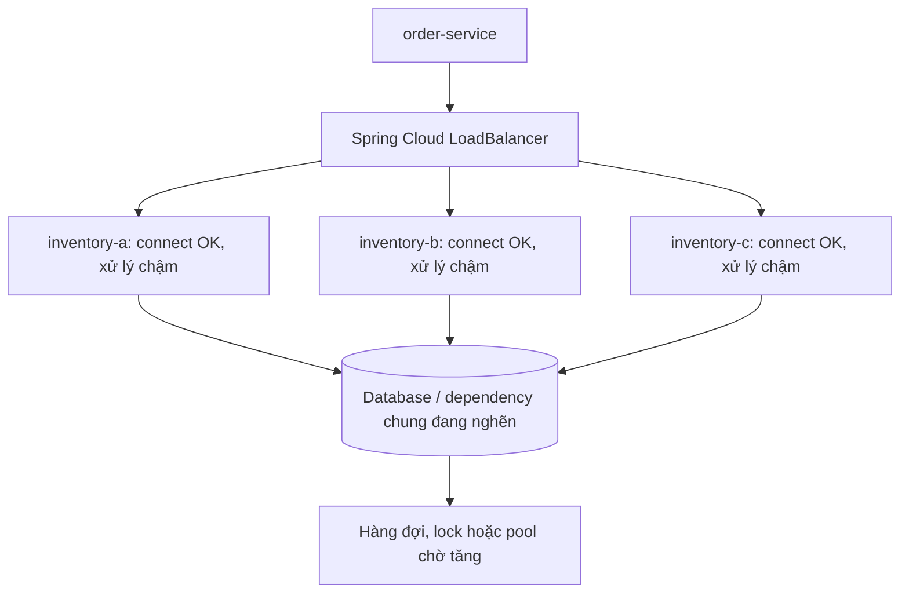
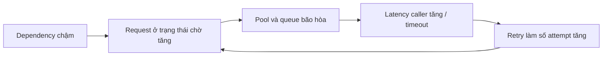
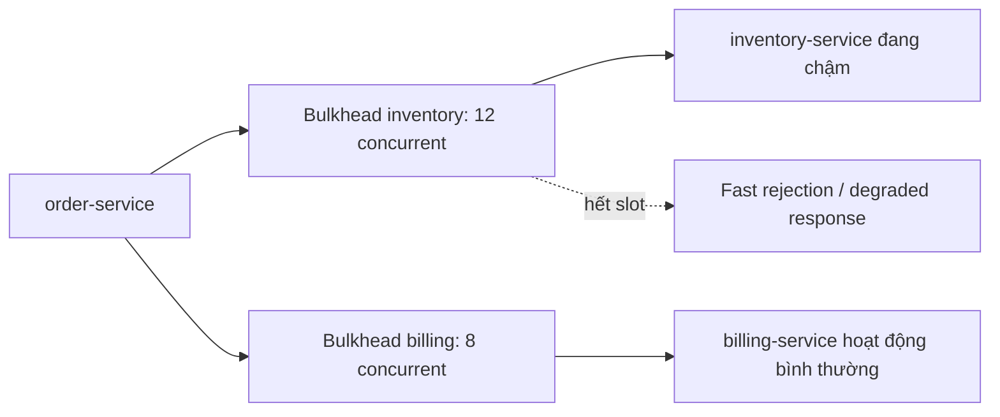
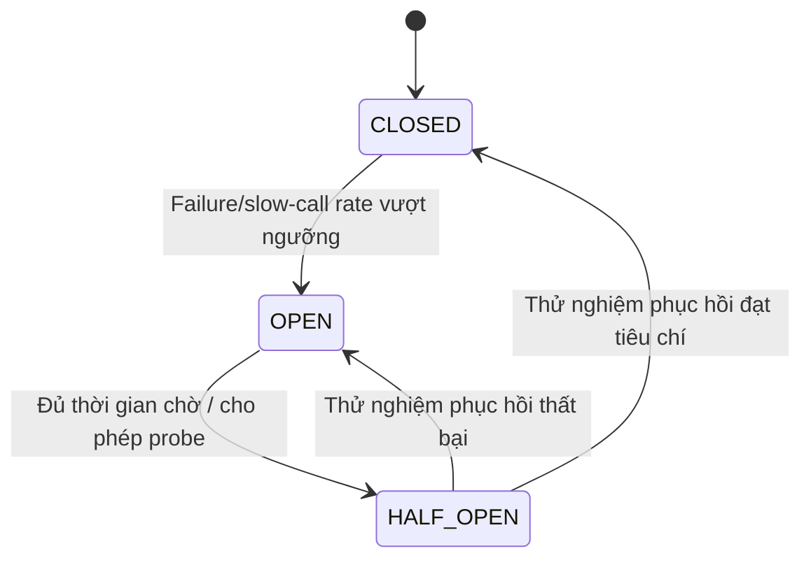
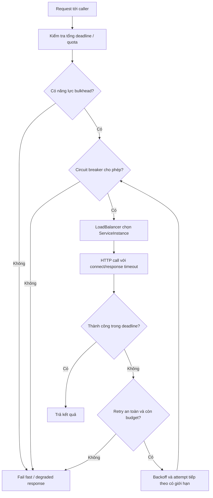

# Khi mọi bản sao chậm dù vẫn có thể kết nối

Trong một hệ thống microservices, lỗi không phải lúc nào cũng biểu hiện thành `Connection refused`, HTTP `503` hay một instance biến mất khỏi service discovery. Tình huống khó chẩn đoán hơn là **tất cả bản sao vẫn mở được kết nối TCP, health check trả thành công, nhưng mọi request đều phản hồi rất chậm**. `RoundRobinLoadBalancer` tiếp tục luân phiên chọn instance, `RandomLoadBalancer` tiếp tục chọn ngẫu nhiên, nhưng người dùng vẫn phải chờ. Đây thường là biểu hiện của **suy giảm một phần (brownout)**, bão hòa tài nguyên hoặc dependency dùng chung đang nghẽn.

Bài học thuộc chương **Cô lập và khôi phục** của module **Spring Cloud Service Communication Load Balancing** phân tích nguyên nhân và cách xử lý khi *mọi bản sao chậm dù vẫn có thể kết nối*. Trọng tâm là phân biệt vai trò của Spring Cloud LoadBalancer với timeout, circuit breaker, bulkhead, load shedding, retry, health check và chiến lược phục hồi cho `RestClient`, `WebClient`, OpenFeign. Mục tiêu không phải tìm thuật toán chọn đích “thông minh” bằng mọi giá, mà là **ngăn một downstream chậm kéo sập caller và các dịch vụ không liên quan**.

## 1. Tình huống: ba instance cùng khỏe trên giấy nhưng chậm trong thực tế

Giả sử `order-service` gọi `inventory-service`, được đăng ký với ba bản sao:

| Instance | TCP connect | `/actuator/health` | p99 của `/api/reservations` | Nhận xét |
|---|---:|---|---:|---|
| `inventory-a` | 8 ms | `200 OK` | 3.8 s | Vẫn kết nối được, nghiệp vụ chậm |
| `inventory-b` | 10 ms | `200 OK` | 4.1 s | Vẫn kết nối được, nghiệp vụ chậm |
| `inventory-c` | 9 ms | `200 OK` | 3.6 s | Vẫn kết nối được, nghiệp vụ chậm |

Các số liệu chỉ để minh họa. Trong ví dụ này, việc đổi từ round-robin sang random khó cải thiện p99: **không có bản sao tốt hơn đáng kể để chuyển sang**. Nếu nguyên nhân là connection pool database dùng chung bị cạn, mọi replica có thể chờ cùng một dependency dù CPU của từng instance còn thấp.



Điểm mấu chốt: **địa chỉ có thể kết nối không đồng nghĩa có năng lực hoàn thành công việc trong thời hạn SLO**. Cũng không được đánh đồng `200 OK` từ một health endpoint nhẹ với tình trạng sẵn sàng cho mọi request nghiệp vụ.

## 2. LoadBalancer giải quyết chọn đích, không tạo thêm năng lực xử lý

Quy trình gọi HTTP bằng service ID thường gồm:

1. `ServiceInstanceListSupplier` lấy danh sách qua discovery, cache, health filter hoặc chính sách metadata.
2. Spring Cloud LoadBalancer chọn một `ServiceInstance` theo round-robin, random hay thuật toán khác.
3. HTTP client mở/tái sử dụng kết nối và gửi request tới host/port đã chọn.
4. Server nhận request, xếp hàng, thực hiện nghiệp vụ và trả phản hồi.

Khi mọi instance đều ở bước 4 quá lâu, thay thuật toán của bước 2 **không làm database nhanh lên**. Health check cũng có giới hạn: `HealthCheckServiceInstanceListSupplier` chủ yếu xác định probe thành công hay không; tài liệu Spring Cloud còn nêu hành vi mặc định có thể **trả lại toàn bộ danh sách nguồn nếu không có instance nào qua kiểm tra**. Vì vậy, đừng kỳ vọng cứ cấu hình health check là hệ thống tự ngừng gọi tất cả backend đã bão hòa.

| Biện pháp | Có ích khi nào? | Không giải quyết được gì nếu toàn bộ replica cùng chậm? |
|---|---|---|
| Round-robin / random | Có nhiều instance tương đối đồng đều, còn khả năng xử lý | Không sửa dependency nghẽn chung |
| Health-check supplier | Instance đã không phản hồi probe hoặc chưa ready | Probe nhẹ thành công dù API nghiệp vụ chậm |
| Retry sang instance khác | Lỗi tạm thời, còn instance khỏe và request an toàn khi thử lại | Có thể khuếch đại tải khi mọi instance cùng quá tải |
| Timeout | Giới hạn thời gian caller chờ | Không tự làm backend phục hồi; server có thể vẫn xử lý |
| Circuit breaker | Phát hiện tỷ lệ lỗi/slow call và từ chối sớm | Không tăng sức chứa của hệ thống |
| Bulkhead / concurrency limit | Cô lập một downstream, tránh dùng hết tài nguyên caller | Không loại bỏ bottleneck gốc |
| Load shedding | Từ chối bớt tải trước khi quá nhiều request xếp hàng | Cần quyết định request nào được từ chối |
| Cache/degraded mode | Giảm số thao tác cần đến backend đang chậm | Có thể dùng dữ liệu cũ; không phù hợp mọi nghiệp vụ |

**Thứ tự ưu tiên:** bảo vệ caller và đặt giới hạn thời gian trước, kiểm tra nguyên nhân gốc, rồi mới cân nhắc cải tiến thuật toán chọn đích. Adaptive routing chỉ hữu ích khi đo được **khác biệt thực sự** giữa các instance và telemetry đủ tin cậy.

## 3. Tại sao TCP và health vẫn OK nhưng request chậm?

Một request có nhiều pha khác nhau. Một mô hình phân rã latency:

\[
T_{end-to-end} \approx T_{queue,caller} + T_{select} + T_{pool-wait}
 + T_{connect/TLS} + T_{network} + T_{queue,server}
 + T_{business} + T_{response}
\]

Đây là mô hình khái niệm, không phải phép đo mà Spring tự xuất đầy đủ. Một kết nối TCP thành công trong 10 ms chỉ loại trừ **một số** lỗi ở pha kết nối, không cho biết `T_queue,server` hay `T_business` có đang tăng tới vài giây.

### 3.1. Bão hòa ở chính backend

- **CPU hoặc GC:** nhiều request tính toán, stop-the-world pause, allocation quá cao.
- **Thread pool / event-loop:** thao tác blocking trong WebFlux, Servlet worker đầy, hàng đợi executor tăng.
- **Database connection pool:** mọi request chờ lấy connection, dù endpoint `/actuator/health` có thể vẫn trả nhanh nếu không kiểm tra đường nghiệp vụ đó.
- **Lock contention:** giao dịch giữ lock lâu, request đợi nhau.
- **Queue / message broker:** thao tác ghi/đọc chờ xử lý bất đồng bộ, lag tăng.
- **Dependency chung:** ba instance khác nhau nhưng cùng gọi một database, search cluster hoặc payment provider đang chậm.

### 3.2. Bão hòa ở phía caller

- HTTP connection pool của `RestClient`, OpenFeign hoặc Reactor Netty có quá ít connection hay quá nhiều pending acquisition.
- Bulkhead/thread pool bị xếp hàng do caller gửi quá nhiều request song song.
- Một `ExchangeFilterFunction` của `WebClient` gọi SDK/JDBC đồng bộ và chặn event-loop.
- Retry nhiều tầng làm outbound attempts tăng nhanh hơn số request nghiệp vụ.
- GC hoặc CPU của `order-service` tăng nên thời gian chờ được gán nhầm cho downstream.

### 3.3. Tín hiệu “mọi instance chậm” có thể là sai lệch quan sát

Nếu đo thời gian ở một lớp chung, ví dụ từ lúc gọi `RestClient` đến lúc nhận response, độ trễ tăng có thể xảy ra **trước khi client chọn instance** hoặc khi đang chờ connection pool. Để kết luận tất cả replica chậm, cần đo ở **phía server từng instance** và tách transport latency khỏi server processing. Tracing và per-instance metrics có giá trị hơn chỉ một biểu đồ latency tổng của service ID.

## 4. Dùng Little's Law để hiểu hiện tượng hàng đợi tăng

Với tốc độ request đến ổn định `λ` (request/giây) và thời gian request lưu trong hệ thống trung bình `W` (giây), số request đang có mặt trung bình:

\[
L = \lambda \times W
\]

Giả sử `order-service` nhận 300 request/giây, mỗi request đang chờ `inventory-service` trung bình 100 ms, số thao tác đồng thời xấp xỉ:

\[
L = 300 \times 0.1 = 30
\]

Nếu vì database nghẽn mà thời gian tăng thành 2 giây, số thao tác đồng thời tăng lên khoảng **600**, nếu tốc độ đến vẫn giữ nguyên. Khi thread pool/connection pool chỉ chứa được một phần trong số đó, phần còn lại bị xếp hàng; thời gian chờ càng dài lại làm concurrency tăng. Đây là cơ chế thường dẫn tới **cascading failure**.

Điều kiện áp dụng Little's Law là một hệ thống tương đối ổn định trong cửa sổ quan sát; khi queue phát triển không giới hạn hoặc workload dao động mạnh, số trên là minh họa xu hướng, **không** phải dự đoán chính xác từng giây.



**Kết luận vận hành:** chỉ tăng số replica hoặc số thread đôi khi đẩy nhiều request hơn vào database đang nghẽn, khiến tình hình xấu đi. Điều cần kiểm soát là **số lời gọi đồng thời đang tác động tới dependency có giới hạn năng lực**.

## 5. Nhận diện brownout bằng dữ liệu đúng lớp

Đo đồng thời ba vị trí: **caller**, **LoadBalancer/HTTP client** và **server/dependency**.

| Lớp | Chỉ số nên xem | Câu hỏi chẩn đoán |
|---|---|---|
| Caller | p50/p95/p99, inflight requests, queue, thread dump | Caller đợi ở đâu? Có bị block trước HTTP không? |
| LB/discovery | Service ID, số ứng viên trước/sau lọc, instance được chọn | Có instance nào thực sự nhanh hơn để chuyển tới không? |
| HTTP client | Connect timeout, connection acquisition, pool pending, response timeout | Chậm do kết nối/pool hay do backend? |
| Backend từng instance | Server processing time, active requests, queue, CPU, GC | Tất cả bản sao thật sự chậm hay chỉ một số? |
| Dependency dùng chung | DB pool wait, query latency, lock, queue lag | Các bản sao có đang chờ cùng một nút thắt? |
| Resilience layer | Circuit breaker state, slow-call rate, bulkhead rejected | Chính sách cô lập đang bảo vệ hay đang chặn quá nhiều? |
| Retry | Logical requests so với outbound attempts | Retry có đang khuếch đại tải không? |

### 5.1. Đọc phân vị thay vì chỉ nhìn average

Một average latency 150 ms có thể che giấu p99 trên 5 giây. Hãy phân tích p50/p95/p99 theo instance và endpoint; không gộp chung các API nhẹ và nặng. Một instance rất nhanh ở `/actuator/health` nhưng chậm ở `/api/reservations` là dấu hiệu health probe không đại diện đủ cho đường nghiệp vụ.

### 5.2. Tách tỷ lệ kết nối thành công khỏi tỷ lệ phục vụ kịp SLO

Xét hai SLI khác nhau:

\[
ConnectSuccessRate = \frac{\text{số kết nối thành công}}
{\text{số lần cố gắng kết nối}}
\]

\[
OnTimeSuccessRate = \frac{\text{request thành công trong deadline}}
{\text{logical requests hợp lệ}}
\]

ConnectSuccessRate có thể gần 100% nhưng OnTimeSuccessRate giảm nghiêm trọng. Nên dùng **deadline nghiệp vụ** và **slow-call rate** bên cạnh error rate, thay vì chỉ coi HTTP 5xx hoặc connection refused là điều kiện phát hiện sự cố.

## 6. Quy trình xử lý ngay khi mọi bản sao đều chậm

Một thứ tự phản ứng an toàn, không đòi thay đổi thuật toán LoadBalancer:

1. **Đo và phân loại:** xác nhận endpoint nào chậm, ở mọi instance hay chỉ một nhóm; tách server processing, DB pool wait và caller connection acquisition.
2. **Hạn chế retry:** tạm tắt retry không thiết yếu hoặc giảm attempt, nhất là `POST` và trạng thái quá tải `503`; tránh retry storm.
3. **Đặt deadline và timeout thực tế:** không giữ request chờ vô hạn; chia ngân sách cho connect, response và tổng logic request.
4. **Giới hạn concurrency / queue:** mỗi downstream có bulkhead riêng, khi hết slot nên trả lỗi sớm thay vì xếp hàng vô hạn.
5. **Circuit breaker nếu phù hợp:** phát hiện slow-call/failure vượt ngưỡng và từ chối trong giai đoạn bảo vệ, thử phục hồi có kiểm soát.
6. **Giảm tải nghiệp vụ:** trả dữ liệu cache có giới hạn tuổi nếu hợp đồng cho phép, tạm bỏ enrichment không thiết yếu, áp dụng rate limit/load shedding.
7. **Sửa bottleneck gốc:** giảm query đắt, xử lý lock, tăng năng lực database có kiểm soát hoặc giảm traffic; không chỉ thêm replica.
8. **Phục hồi dần:** mở lại concurrency theo từng bước, theo dõi p99/error/rejection, rollback khi triệu chứng tái xuất hiện.

**Không nên** tắt toàn bộ health check hoặc cưỡng bức định tuyến sang một vùng bị cấm chỉ để đạt mục tiêu availability. Ràng buộc về tenant, data residency, permission và API version vẫn là **hard constraints**, kể cả khi hệ thống đang suy giảm.

## 7. Bulkhead: cô lập tài nguyên theo downstream

**Bulkhead** giới hạn số lời gọi đồng thời được phép bước vào một downstream. Khi `inventory-service` chậm, những request gọi `billing-service` không nên phải cạnh tranh toàn bộ thread/connection của `order-service` với lượng request đang treo chờ inventory.



### 7.1. Hai loại bulkhead và khác biệt quan trọng

| Cơ chế | Giới hạn bằng cách nào? | Phù hợp với | Chú ý |
|---|---|---|---|
| `SemaphoreBulkhead` | Giới hạn số tác vụ đồng thời bằng permit | Blocking caller có giới hạn, reactive pipeline | Không tự tạo thread mới; với blocking call, caller vẫn chờ HTTP trong permit |
| `FixedThreadPoolBulkhead` | Pool thread riêng và queue hữu hạn | Công việc blocking cần cách ly executor | Có thêm queue/scheduling; timeout/cancel không chắc chấm dứt I/O đang chạy |

Trong Spring Cloud CircuitBreaker tích hợp Resilience4j, tài liệu mô tả hai loại trên; ở cấu hình hiện hành, **blocking CircuitBreaker Resilience4j mặc định có thể dùng `FixedThreadPoolBulkhead`**, còn **reactive bulkhead integration dùng `SemaphoreBulkhead`**. Không suy luận rằng chỉ cần thêm dependency Resilience4j là mọi request WebClient/Feign tự động được bọc đúng ở vị trí bạn mong muốn; cần xem phiên bản, starter và wiring thực tế.

### 7.2. Chọn giới hạn concurrency như thế nào?

Một giới hạn ví dụ có thể là 12 request đang gọi `inventory-service` đồng thời trên **một caller instance**, với `maxWaitDuration=0`: hết permit thì từ chối ngay. Đây **không** phải giới hạn cho toàn cụm. Nếu có 30 caller replica, tổng tải tiềm năng vẫn có thể tới 360 lời gọi đồng thời; cần xét ngân sách downstream và số caller.

Giới hạn quá thấp làm tăng rejection dù backend vẫn còn chỗ. Giới hạn quá cao khiến caller cạn pool và backend xếp hàng. Nên bắt đầu bằng đo `inflight`, p99, số connection tối đa, tỷ lệ từ chối và sức chứa thực tế, sau đó thử nghiệm dưới tải tăng dần.

**Ưu tiên fast-fail hơn xếp hàng vô hạn.** Nếu request đã gần hết deadline, việc chờ permit thêm vài giây rồi mới gửi HTTP hầu như không có giá trị. Nếu bắt buộc có hàng đợi, hãy giới hạn cả độ dài lẫn thời gian chờ.

## 8. Circuit breaker: phát hiện lỗi và cả lời gọi quá chậm

Circuit breaker theo dõi kết quả các lời gọi được bảo vệ. Khi một ngưỡng lỗi hoặc slow call vượt mức quy định và đạt số mẫu tối thiểu, nó có thể chuyển từ **CLOSED** sang **OPEN** để từ chối yêu cầu mới nhanh chóng. Sau khoảng chờ, nó chuyển sang **HALF_OPEN** cho phép một số lượt thử kiểm chứng phục hồi, rồi trở lại CLOSED hoặc OPEN tùy kết quả.



**Lý do cần slow-call threshold:** Khi mọi instance vẫn trả `200 OK` nhưng mất 3 giây, một circuit breaker chỉ theo dõi tỷ lệ exception có thể **không mở**, trừ khi transport/client timeout chuyển các lời gọi thành lỗi. Với Resilience4j, có thể thiết lập `slowCallDurationThreshold` và `slowCallRateThreshold` để phát hiện suy giảm độ trễ ngay cả khi request cuối cùng thành công.

| Thuộc tính Resilience4j | Ý nghĩa | Ví dụ trong bài |
|---|---|---|
| `slidingWindowSize` | Số lần gọi hoặc cửa sổ thời gian lấy mẫu | `50` calls |
| `minimumNumberOfCalls` | Số mẫu tối thiểu trước khi quyết định mở mạch | `20` calls |
| `failureRateThreshold` | Ngưỡng tỷ lệ lỗi để mở mạch | `50%` |
| `slowCallDurationThreshold` | Gọi lâu hơn mốc này được tính chậm | `800ms` |
| `slowCallRateThreshold` | Ngưỡng tỷ lệ gọi chậm để mở mạch | `60%` |
| `waitDurationInOpenState` | Khoảng chờ trước lúc thử HALF_OPEN | `10s` |
| `permittedNumberOfCallsInHalfOpenState` | Số lượt thử giới hạn khi HALF_OPEN | `3` |

Các số liệu là **giá trị thử nghiệm**, không phải ngưỡng mặc định tối ưu. Mọi API khác nhau về SLO; với endpoint bình thường phải mất 2 giây, đặt slow threshold 800 ms sẽ gây mở mạch sai.

### 8.1. Circuit breaker không thay thế health check và LoadBalancer

- **Health** đánh giá instance (thường theo readiness/probe).
- **LoadBalancer** quyết định instance nào nhận request theo danh sách nguồn.
- **Circuit breaker** bảo vệ caller khỏi những kết quả lỗi/chậm của một hoạt động downstream.

Trong tình huống **mọi** instance đều chậm, một breaker ở mức `inventory-read`/service ID có thể hữu ích hơn breaker riêng cho từng instance: nó phản ánh rủi ro chung của dependency. Tuy vậy, nếu một service có hai API với SLA khác nhau (`/inventory/lookup` và `/inventory/reserve`), có thể cần **hai circuit breaker riêng theo operation** để API chậm có chủ đích không làm đóng mạch API khác.

Không tự coi breaker ở mức service ID là cơ chế loại từng instance khỏi registry. `CallNotPermittedException` do mạch OPEN là **từ chối cục bộ**, chưa có attempt nào gửi tới downstream trong trường hợp đó.

### 8.2. Tránh vòng lặp OPEN/HALF_OPEN không ổn định

Nếu ngay sau khi HALF_OPEN chuyển CLOSED, toàn bộ traffic quay trở lại cùng lúc, backend có thể bị bão hòa lần nữa. Nên kết hợp breaker với **bulkhead, rate limit và ramp-up** phục hồi. Không thử nhiều probe đồng thời không giới hạn khi hệ thống chưa có tín hiệu đủ tốt.

## 9. Ví dụ blocking: RestClient + LoadBalancer + bulkhead + circuit breaker

Ví dụ dùng `RestClient` theo service ID để đọc trạng thái tồn kho. Bảo vệ **toàn bộ thao tác downstream** bằng Resilience4j `SemaphoreBulkhead` và `CircuitBreaker`, không cố đổi thuật toán chọn instance khi cả ba bản sao đều chậm.

### 9.1. Tạo chính sách Resilience4j có giới hạn

```java
import java.time.Duration;

import io.github.resilience4j.bulkhead.Bulkhead;
import io.github.resilience4j.bulkhead.BulkheadConfig;
import io.github.resilience4j.circuitbreaker.CircuitBreaker;
import io.github.resilience4j.circuitbreaker.CircuitBreakerConfig;
import org.springframework.context.annotation.Bean;
import org.springframework.context.annotation.Configuration;

@Configuration(proxyBeanMethods = false)
class InventoryProtectionConfiguration {

    @Bean("inventoryReadBulkhead")
    Bulkhead inventoryReadBulkhead() {
        return Bulkhead.of("inventory-read", BulkheadConfig.custom()
                .maxConcurrentCalls(12)
                .maxWaitDuration(Duration.ZERO)
                .build());
    }

    @Bean("inventoryReadCircuitBreaker")
    CircuitBreaker inventoryReadCircuitBreaker() {
        CircuitBreakerConfig config = CircuitBreakerConfig.custom()
                .slidingWindowSize(50)
                .minimumNumberOfCalls(20)
                .failureRateThreshold(50.0f)
                .slowCallDurationThreshold(Duration.ofMillis(800))
                .slowCallRateThreshold(60.0f)
                .waitDurationInOpenState(Duration.ofSeconds(10))
                .permittedNumberOfCallsInHalfOpenState(3)
                .build();
        return CircuitBreaker.of("inventory-read", config);
    }
}
```

Các import trên mô tả API Resilience4j; cần dependency phù hợp như `resilience4j-bulkhead`, `resilience4j-circuitbreaker` hoặc starter Resilience4j tương ứng với Spring Boot. Khi dùng Spring Cloud CircuitBreaker abstraction, có thể cấu hình qua factory/properties thay vì tự tạo bean; **không nên khai báo trùng chính sách ở nhiều nơi mà không hiểu thứ tự ưu tiên**.

### 9.2. Tạo RestClient có LoadBalancer và timeout thật

```java
@Configuration(proxyBeanMethods = false)
class InventoryRestClientConfiguration {

    @Bean
    @LoadBalanced
    RestClient.Builder inventoryLoadBalancedBuilder() {
        SimpleClientHttpRequestFactory factory =
                new SimpleClientHttpRequestFactory();
        factory.setConnectTimeout(300); // ms, minh họa.
        factory.setReadTimeout(1500);   // ms, minh họa.

        return RestClient.builder().requestFactory(factory);
    }
}
```

Trong ví dụ này, `@LoadBalanced` được áp dụng lên builder, `RestClient` sẽ dùng service ID `inventory-service`. Request factory cụ thể có thể được thay bằng JDK/Apache HttpComponents trong production nếu cần connection pool/TLS chuyên biệt. Nếu thay factory, phải cấu hình **connect/read timeout ngay tại transport thực tế**, không chỉ dựa vào circuit breaker. Khi tự tạo builder, cân nhắc Spring Boot `RestClientBuilderConfigurer` để giữ những customizer và observability cần thiết.

### 9.3. Bọc toàn bộ một lời gọi bằng hai chính sách

```java
import java.util.function.Supplier;

@Service
class InventoryReadGateway {

    private final RestClient client;
    private final Bulkhead bulkhead;
    private final CircuitBreaker breaker;

    InventoryReadGateway(
            @LoadBalanced RestClient.Builder builder,
            @Qualifier("inventoryReadBulkhead") Bulkhead bulkhead,
            @Qualifier("inventoryReadCircuitBreaker") CircuitBreaker breaker) {

        this.client = builder.baseUrl("http://inventory-service").build();
        this.bulkhead = bulkhead;
        this.breaker = breaker;
    }

    StockReply read(long itemId) {
        Supplier<StockReply> remote = () -> client.get()
                .uri("/api/items/{id}", itemId)
                .retrieve()
                .body(StockReply.class);

        Supplier<StockReply> withBreaker =
                CircuitBreaker.decorateSupplier(breaker, remote);
        Supplier<StockReply> protectedCall =
                Bulkhead.decorateSupplier(bulkhead, withBreaker);

        return protectedCall.get();
    }
}
```

`StockReply` là DTO giả định. Thứ tự decorator ở đây là **bulkhead bên ngoài breaker**: khi hết slot, bulkhead từ chối trước khi lời gọi đi vào breaker và HTTP client; như vậy lỗi `BulkheadFullException` không bị tính như một kết quả do backend trả về trong breaker này. Khi breaker đã OPEN nhưng bulkhead còn permit, `CallNotPermittedException` xảy ra mà không gửi HTTP request. Các exception nên được ánh xạ thành response phù hợp ở API boundary, không trả stack trace cho người dùng.

Lưu ý: đây là code mẫu để học cách đặt ranh giới bảo vệ, không phải cấu hình duy nhất. Timeout ví dụ `1.5s` có thể khiến slow call >800 ms đồng thời kết thúc bằng lỗi timeout; breaker tùy cấu hình sẽ ghi nhận thời gian và loại lỗi phù hợp. Nếu cần giới hạn **tổng** thời gian gồm queue/retry/fallback, còn phải đặt deadline ở tầng caller/gateway. `@LoadBalanced` không thay cho connection pooling, HTTP timeout hay chính sách retry.

### 9.4. Khi nào sử dụng ThreadPoolBulkhead?

Nếu cần cách ly một blocking library khó kiểm soát khỏi executor xử lý request, `FixedThreadPoolBulkhead` với pool và queue hữu hạn có thể hữu ích. Tuy nhiên nó tăng overhead context-switch và hàng đợi; hoàn thành một `Future` với timeout không nhất thiết dừng socket/JDBC call đang chạy. Với Servlet stack đã có thread pool, **semaphore bulkhead + transport timeout** đôi khi đơn giản hơn. Chọn bằng đo đạc, không dùng một kiểu bulkhead như giải pháp mặc định cho mọi dependency.

## 10. Ví dụ reactive: WebClient với SemaphoreBulkhead và CircuitBreaker

Với `WebClient`, mục tiêu là không chặn event-loop, nhưng vẫn cần giới hạn **số lời gọi đang active** tới `inventory-service`. Nếu dùng Resilience4j Reactor integration (ví dụ dependency `resilience4j-reactor`), có thể áp dụng operator lên publisher:

```java
import java.time.Duration;
import reactor.core.publisher.Mono;
import io.github.resilience4j.reactor.bulkhead.operator.BulkheadOperator;
import io.github.resilience4j.reactor.circuitbreaker.operator.CircuitBreakerOperator;

@Service
class ReactiveInventoryReadGateway {

    private final WebClient client;
    private final Bulkhead bulkhead;
    private final CircuitBreaker breaker;

    ReactiveInventoryReadGateway(
            @LoadBalanced WebClient.Builder builder,
            @Qualifier("inventoryReadBulkhead") Bulkhead bulkhead,
            @Qualifier("inventoryReadCircuitBreaker") CircuitBreaker breaker) {
        this.client = builder.baseUrl("http://inventory-service").build();
        this.bulkhead = bulkhead;
        this.breaker = breaker;
    }

    Mono<StockReply> read(long itemId) {
        return Mono.defer(() -> client.get()
                    .uri("/api/items/{id}", itemId)
                    .retrieve()
                    .bodyToMono(StockReply.class))
                .timeout(Duration.ofMillis(1500))
                .transformDeferred(CircuitBreakerOperator.of(breaker))
                .transformDeferred(BulkheadOperator.of(bulkhead));
    }
}
```

Đây là **phương án reactive** tương ứng, không phải yêu cầu cài đồng thời cùng hai gateway khi dự án chỉ dùng một HTTP client. `Mono.defer(...)` giữ request ở dạng lazy publisher; `BulkheadOperator` giới hạn subscription đồng thời, `CircuitBreakerOperator` theo dõi error/slow-call theo signal. Đặt `.timeout(...)` **bên trong** breaker operator giúp lỗi timeout xuất hiện trong pipeline mà breaker quan sát; đặt timeout bên ngoài có thể làm thay đổi cách breaker ghi nhận kết quả, nên cần kiểm thử operator ordering.

**Quan trọng:** Reactor `.timeout()` chỉ giới hạn thời gian chờ tín hiệu; HTTP connector vẫn cần connect/response timeout và pool giới hạn. Nếu một `ExchangeFilterFunction` hoặc `ServiceInstanceListSupplier` tự gọi JDBC/SDK blocking, pipeline vẫn có thể chặn event-loop dù đã có bulkhead và breaker. Khi bắt buộc dùng blocking API, cần offload riêng có kiểm soát; không gọi `.block()` trong reactive path.

### 10.1. Spring Cloud CircuitBreaker và lựa chọn bulkhead reactive

Nếu dùng `ReactiveCircuitBreakerFactory` của Spring Cloud CircuitBreaker thay vì các operator Resilience4j trực tiếp, có thể lấy một breaker theo ID như `inventoryRead` và bọc publisher qua API `run(...)`. Với Resilience4j reactive integration, Spring Cloud dùng `SemaphoreBulkhead`; mặc định blocking integration có thể dùng thread-pool bulkhead, nên **cách offload và backpressure khác nhau**. Các thuộc tính/factory thay đổi theo release train; hãy kiểm tra đúng tài liệu trước khi áp dụng một ví dụ cấu hình sang phiên bản khác.

## 11. Cấu hình qua YAML: một phương án thay thế cho bean thủ công

Nếu dùng cơ chế auto-configuration Resilience4j/Spring Cloud CircuitBreaker phù hợp, có thể quản lý chính sách theo ID trong `application.yml`:

```yaml
resilience4j:
  circuitbreaker:
    instances:
      inventoryRead:
        slidingWindowType: COUNT_BASED
        slidingWindowSize: 50
        minimumNumberOfCalls: 20
        failureRateThreshold: 50
        slowCallRateThreshold: 60
        slowCallDurationThreshold: 800ms
        waitDurationInOpenState: 10s
        permittedNumberOfCallsInHalfOpenState: 3
  bulkhead:
    instances:
      inventoryRead:
        maxConcurrentCalls: 12
        maxWaitDuration: 0ms
```

**Không được hiểu YAML này tự bọc mọi `RestClient`/`WebClient` call.** Cần đường tích hợp thực sự sử dụng breaker/bulkhead ID `inventoryRead`: Spring Cloud CircuitBreaker factory, annotation/AOP được hỗ trợ hoặc decorator/operator đã nối vào gateway. Hai bean thủ công ở mục 9 không tự đọc YAML này chỉ vì tên gần giống nhau. **Chọn một nơi quản lý chính sách**, tránh cấu hình Java một giá trị, YAML một giá trị rồi không biết cấu hình nào đang có hiệu lực.

Theo tài liệu Spring Cloud CircuitBreaker Resilience4j, khi sử dụng Spring Cloud integration, **property configuration thường có độ ưu tiên cao hơn Java `Customizer`**. Đừng suy luận thứ tự ưu tiên này cho mọi cách khởi tạo Resilience4j trực tiếp; phải kiểm tra wiring của dự án.

### 11.1. Chọn ngưỡng slow-call phù hợp

Nếu một API bình thường phản hồi trong 50–100 ms, ngưỡng 800 ms có thể hợp lý để thử nghiệm. Nhưng với API batch hợp đồng cho phép 5 giây, ngưỡng 800 ms tạo false positive. Nên đặt threshold theo **SLO của operation**, số mẫu tối thiểu và phân bố latency thực tế. Một circuit breaker theo service ID chung chỉ nên dùng khi các operation có đặc điểm tương tự; API khác biệt lớn nên được bảo vệ riêng.

## 12. Timeout, retry, bulkhead và circuit breaker kết hợp ra sao?

Mỗi cơ chế có phạm vi khác nhau. Đừng chỉ bật tất cả rồi trông chờ chúng tự nhất quán:



Sơ đồ là **logic quyết định**, không phải thứ tự bọc decorator bắt buộc. Nếu retry được đặt bên ngoài bulkhead, mỗi attempt có thể xin một permit riêng; nếu retry nằm bên trong bulkhead, một logical request có thể giữ permit qua cả thời gian backoff. Điều này thay đổi tài nguyên bị chiếm và số liệu breaker. Cần chọn chủ đích, ghi rõ ở tài liệu vận hành và kiểm tra bằng test.

### 12.1. Tổng thời gian của một lời gọi có retry

Giả sử cho phép tối đa hai attempts, mỗi attempt có connect+response budget khoảng 1.5 giây và có backoff 200 ms. Tổng thời gian trong trường hợp xấu có thể gần **3.2 giây**, chưa tính queue và overhead. Nếu endpoint phía caller có deadline 2 giây, phải cắt ngắn attempts hoặc không thử lần hai.

\[
T_{logical} \approx \sum_{i=1}^{N}(T_{attempt,i})
 + \sum_{i=1}^{N-1}(T_{backoff,i}) + T_{queue} + T_{other}
\]

`T_attempt` gồm nhiều pha và có thể dừng sớm nếu server trả lỗi ngay. Đây là **ước lượng ngân sách**, không có nghĩa framework tự thực thi tổng deadline đó. Với `POST` tạo đơn/giữ hàng, response timeout không chứng minh backend chưa commit, vì vậy cần idempotency key hoặc cấm retry không an toàn.

### 12.2. Vì sao retry thường là việc đầu tiên cần giảm?

Khi một trong ba instance bị hỏng còn hai instance khỏe, retry một lần sang instance khác có thể cải thiện availability. Nhưng khi **cả ba cùng chậm**, một lần retry làm hệ thống gửi thêm công việc tới chính tập backend đang quá tải. Nếu gateway retry hai lần và HTTP client retry hai lần, một request có thể sinh nhiều attempt hơn dự kiến. Cần theo dõi `logical_requests`, `outbound_attempts`, `backend_received_requests` riêng biệt để tránh retry amplification.

### 12.3. Circuit breaker và retry có thể gây hiểu nhầm số liệu

Khi breaker mở, `CallNotPermittedException` là **từ chối cục bộ**. Nếu retry layer coi mọi exception là retryable, nó có thể liên tục thử vào một breaker vẫn OPEN, gây tốn CPU/queue mà không gửi request nào. Không retry `CallNotPermittedException` hay `BulkheadFullException` một cách vô hạn. Chọn riêng chính sách cho lỗi congestion và lỗi transient của transport.

## 13. Load shedding và degraded mode khi không còn đích nhanh

Khi capacity downstream không đủ cho tất cả requests, hệ thống phải ưu tiên **giữ độ ổn định** thay vì ép mọi yêu cầu chờ đến timeout. Một số lựa chọn:

| Phương án | Có thể dùng khi | Rủi ro cần chấp nhận/kiểm soát |
|---|---|---|
| Từ chối sớm `503`/`429` theo chính sách API | Hết bulkhead slot, vượt quota, backend overload | Client cần biết có thể thử lại sau; không tạo retry storm |
| Cache kết quả đọc có TTL | Trạng thái đọc cho phép chậm cập nhật | Stale data; không dùng cho kiểm tra tồn kho bắt buộc nhất quán nếu chưa thiết kế |
| Bỏ enrichment không quan trọng | Trang có thể thiếu thông tin bổ sung | Response giảm chất lượng nhưng vẫn đúng hợp đồng |
| Hàng đợi async có giới hạn | Nghiệp vụ có thể xử lý sau | Cần idempotency, queue admission, trạng thái theo dõi và DLQ |
| Circuit breaker fail fast | Nhiều lỗi/slow call liên tiếp | Tránh làm cạn caller, nhưng cần cơ chế half-open để phục hồi |
| Giảm concurrency theo service/tenant | Một nhóm gây nhiễu ảnh hưởng nhóm khác | Phải cân bằng fairness và utilization |

**Không được trả dữ liệu giả như thành công.** Ví dụ không thể trả `stockAvailable=true` chỉ vì service tồn kho chậm khi điều đó có thể dẫn đến bán vượt số lượng. Nếu dùng cache cũ, cần thỏa thuận mức stale chấp nhận và biểu diễn trạng thái không chắc chắn rõ ràng.

### 13.1. 503 và 429 không phải mã tùy tiện

`503 Service Unavailable` thường diễn đạt trạng thái service tạm không thể phục vụ; `429 Too Many Requests` thường diễn đạt giới hạn tốc độ/quota đối với caller. Chọn mã dựa theo nguyên nhân và hợp đồng API. Nếu phát `Retry-After`, thời hạn phải hợp lý và client cần tôn trọng nó; đừng gửi hướng dẫn retry ngay khi hệ thống vẫn đang quá tải.

## 14. Health, readiness và scale-out khi các replica đang nghẽn

### 14.1. Liveness khác readiness

Nếu process còn sống nhưng không nhận thêm request an toàn, **readiness** có thể chuyển sang unready theo chính sách hạ tầng; liveness không nhất thiết phải fail. Cấu hình liveness sai có thể làm Kubernetes restart hàng loạt pod đang chậm, khiến capacity giảm thêm và tạo **restart storm**.

Ngược lại, nếu tất cả bản sao cùng đánh dấu unready do một dependency chung bị chậm, service có thể mất hoàn toàn endpoints. Phải xác định tiêu chí readiness thật cẩn thận, đồng thời sử dụng load shedding/circuit breaker khi phù hợp. Không coi readiness là công tắc thay thế mọi chính sách bảo vệ tải.

### 14.2. Scale-out giúp khi nào?

Thêm replica `inventory-service` có thể giúp nếu bottleneck nằm ở CPU/thread/memory của từng instance và database còn dư sức. Nhưng nếu mọi instance đang chờ cùng database pool hoặc lock, scale-out có thể **làm nhiều query hơn đổ vào bottleneck**. Cần xác định thành phần giới hạn trước khi tự động tăng replica.

| Quan sát | Quyết định cần xem xét |
|---|---|
| CPU instance tăng, dependency còn dư capacity | Scale-out có thể có ích |
| DB wait/lock/connection pool đã bão hòa | Giảm workload, sửa query/lock, tăng capacity có kiểm soát |
| Mỗi instance chậm vì event-loop bị block | Sửa blocking code, không chỉ tăng replica |
| Nhiều request giống nhau lặp tới backend | Coalescing/caching hợp lệ, chống retry storm |
| Hệ thống chậm sau rollout mới | Rollback hoặc giảm canary, kiểm tra regression |

## 15. Bài thực hành: tất cả instance còn kết nối được nhưng phản hồi chậm

Chuẩn bị `order-service` gọi `inventory-service` với `RestClient` hoặc `WebClient` load-balanced. Chạy hai hoặc ba stub `inventory-service` có `/actuator/health` trả nhanh và API nghiệp vụ có thể đặt độ trễ. Trong test, dùng `SimpleDiscoveryClient`:

```yaml
spring:
  cloud:
    discovery:
      client:
        simple:
          instances:
            inventory-service:
              - uri: http://127.0.0.1:18081
              - uri: http://127.0.0.1:18082
              - uri: http://127.0.0.1:18083
```

Nếu caller ở container khác, thay `127.0.0.1` bằng địa chỉ được kết nối từ container caller. Đừng lấy địa chỉ ví dụ làm bằng chứng mạng trong production.

### 15.1. Stub API có độ trễ điều chỉnh được

Một controller Spring MVC đơn giản cho **môi trường test**:

```java
@RestController
class SlowInventoryStubController {

    @Value("${stub.name}")
    private String name;

    @Value("${stub.delay-ms:0}")
    private long delayMs;

    @GetMapping("/api/items/{id}")
    Map<String, Object> item(@PathVariable long id)
            throws InterruptedException {

        Thread.sleep(delayMs); // Chỉ mô phỏng backend MVC chậm trong test!
        return Map.of("id", id, "instance", name, "delayMs", delayMs);
    }
}
```

`Thread.sleep` trong controller MVC giả lập sự chờ trên Servlet worker; **không sao chép sang WebFlux event-loop**. Trong môi trường sản xuất phải loại bỏ sleep và xử lý nguyên nhân bottleneck. Mỗi stub đặt `stub.name` và `server.port` riêng; có thể thử cả ba instance `delay-ms=3000` dù health endpoint vẫn trả OK.

### 15.2. Các pha kiểm thử

1. **Baseline:** ba stub phản hồi khoảng 50 ms. Gửi GET ở RPS đã định, thu thập p50/p95/p99, error rate, active requests và response theo instance.
2. **Brownout:** tăng độ trễ endpoint nghiệp vụ cả ba instance lên 3 giây, giữ TCP connect và health OK. Quan sát round-robin không làm p99 cải thiện.
3. **Giảm retry:** tắt retry tạm thời (`spring.cloud.loadbalancer.retry.enabled=false` nếu retry đang do LB quản lý), so sánh outbound attempts/logical requests.
4. **Timeout:** đặt connect timeout 300 ms, response/read timeout 1500 ms và tổng deadline phù hợp; quan sát request lỗi sớm hơn thay vì giữ caller chờ 3 giây. Đảm bảo backend vẫn có thể đang xử lý sau caller timeout.
5. **Bulkhead:** giới hạn tối đa 12 lời gọi concurrent trên mỗi caller; tăng concurrency và xác nhận request vượt giới hạn bị từ chối sớm, không xếp hàng vô hạn.
6. **Circuit breaker:** đặt slow-call threshold phù hợp rồi kiểm tra số mẫu tối thiểu, chuyển CLOSED → OPEN → HALF_OPEN; đếm `CallNotPermittedException`, không nhầm với lỗi HTTP từ backend.
7. **Khôi phục:** giảm delay stub về 50 ms, quan sát breaker cho phép một số HALF_OPEN probes, kiểm soát lưu lượng trở lại và p99 phục hồi.
8. **Kiểm tra tác động phụ:** một endpoint `POST` có idempotency key riêng; bảo đảm test không tạo bản ghi trùng khi caller timeout rồi gửi lại.

### 15.3. Tiêu chí đạt

| Kiểm thử | Kết quả kỳ vọng |
|---|---|
| Tất cả stub chậm | Đủ bằng chứng ở server-side latency, không chỉ từ caller |
| TCP/health vẫn OK | Xác định đây không phải lỗi chọn sai service ID |
| Retry disabled hoặc budget nhỏ | Outbound attempts không nhân mất kiểm soát |
| Bulkhead full | Từ chối sớm, concurrency thực tế không vượt giới hạn trên từng caller |
| Circuit breaker OPEN | Không gửi request đến backend cho những lời gọi bị từ chối cục bộ |
| HALF_OPEN | Chỉ cho số probe hữu hạn, không mở toàn bộ traffic ngay |
| Backend phục hồi | p95/p99 giảm và rejection về mức kỳ vọng sau ramp-up |
| Không có đích hợp lệ | Trả lỗi đúng, không route sang tenant/region bị cấm |

**Quan sát tách biệt:** `logical_requests`, `attempted_outbound_requests`, `backend_received_requests`, `bulkhead_rejected`, `circuit_breaker_not_permitted`, `http_timeout`, `backend_slow_calls`. Nếu chỉ nhìn 5xx tổng, sẽ khó biết bao nhiêu request lỗi ở caller trước khi chạm backend.

## 16. Những lỗi thiết kế thường gặp

| Sai lầm | Hậu quả | Cách sửa |
|---|---|---|
| Cứ thêm replica khi tất cả cùng chậm | Đẩy thêm truy vấn vào dependency chung | Xác định bottleneck trước khi scale-out |
| Coi `/actuator/health=200` là bằng chứng phục vụ tốt | Các API nghiệp vụ vẫn timeout | Đo endpoint thực, readiness và slow-call rate |
| Retry mọi `503` vô hạn | Retry storm và cascading failure | Retry budget nhỏ, jitter, bulkhead, giới hạn deadline |
| Bật breaker chỉ theo error rate | Mọi request chậm trả 200 nhưng mạch không mở | Theo dõi `slowCallRateThreshold` phù hợp |
| Circuit breaker chỉ đặt theo instance | Mọi bản sao chậm do dependency chung, retry chuyển vòng tròn | Bảo vệ thêm theo service/operation |
| Bulkhead dùng chung toàn hệ thống | Một downstream chậm vẫn chiếm slot của dịch vụ khác | Tách bulkhead theo dependency/operation |
| Bulkhead queue vô hạn | Latency tăng vượt SLO dù backend không lỗi | Queue hữu hạn hoặc fast fail |
| Chỉ dùng `Mono.timeout` quanh SDK blocking | Cancellation không chắc ngắt tác vụ/blocking socket | Cấu hình timeout transport, offload và đo active tasks |
| Trong WebFlux gọi `.block()` để kiểm tra health/route | Chặn event-loop và kéo chậm mọi request | Giữ pipeline non-blocking, supplier đọc snapshot nhanh |
| Fallback trả `stockAvailable=true` khi không biết | Sai nghiệp vụ, có thể bán quá tồn | Fallback trung thực, biểu diễn unknown/stale nếu cho phép |
| Dùng 503/429 không có quy ước client | Client retry quá nhanh làm tải tăng | Contract rõ ràng, `Retry-After`, backoff và rate limit |
| Mở lại toàn bộ traffic sau HALF_OPEN | Backend bị dồn tải và chậm lần nữa | Ramp-up, bulkhead và theo dõi điều kiện ổn định |

## 17. Checklist vận hành khi tất cả bản sao đều chậm

- [ ] Có số liệu chứng minh tất cả replica **đều chậm ở API nghiệp vụ**, không chỉ đo tổng thời gian phía caller.
- [ ] Đã tách connect/DNS/TLS, pool wait, server queue và dependency latency.
- [ ] Biết bottleneck nằm ở từng instance hay dependency dùng chung; không tự động scale-out một cách mù quáng.
- [ ] Đã kiểm kê tầng retry ở gateway, LB, HTTP client, Feign, WebClient và service mesh.
- [ ] Connect/response timeout và tổng deadline phù hợp SLO, không để thread/connection chờ vô hạn.
- [ ] Có bulkhead/concurrency limit **riêng** cho dependency chậm với queue hữu hạn hoặc fast-fail.
- [ ] Circuit breaker đo cả failure rate **và slow-call rate**, có minimum calls và HALF_OPEN probes hữu hạn.
- [ ] Không biến `CallNotPermittedException` hoặc `BulkheadFullException` thành vòng retry vô hạn.
- [ ] Khi dùng WebClient, filter và supplier không chặn event-loop; khi dùng blocking client, thread/connection pool đủ và được giới hạn.
- [ ] Hành vi fallback/load shedding trung thực với nghiệp vụ, không bỏ qua ràng buộc dữ liệu và phân quyền.
- [ ] Có metrics/log tách logical request, outbound attempts, backend received và local rejection.
- [ ] Có quy trình phục hồi theo giai đoạn, theo dõi p99 và rollback nếu backend lại bão hòa.

**Kết luận:** khi mọi bản sao vẫn kết nối được nhưng đều chậm, vấn đề chủ yếu là **năng lực xử lý và bảo vệ tài nguyên**, không phải không tìm được `ServiceInstance`. Spring Cloud LoadBalancer chỉ chọn một endpoint trong tập ứng viên; nó không thể làm mọi backend nhanh lên. Giải pháp đáng tin cậy là **đo đúng nút thắt → giới hạn concurrency và deadline → giảm retry storm → dùng circuit breaker theo slow-call/failure rate → phục hồi có kiểm soát**, đồng thời xử lý nguyên nhân gốc. Với `RestClient`, `WebClient` và OpenFeign, cách tích hợp có khác nhau, nhưng nguyên tắc cô lập và khôi phục vẫn giống nhau: **không để một downstream chậm kéo sập những phần còn lại của hệ thống**.

## Tài liệu tham khảo

- [Spring Cloud Commons — Spring Cloud LoadBalancer](https://docs.spring.io/spring-cloud-commons/reference/spring-cloud-commons/loadbalancer.html): service instances, supplier, health check và giới hạn vai trò chọn đích.
- [Spring Cloud CircuitBreaker — Resilience4j Bulkhead support](https://docs.spring.io/spring-cloud-circuitbreaker/reference/spring-cloud-circuitbreaker-resilience4j/bulkhead-pattern-supporting.html): semaphore/thread-pool bulkhead và reactive integration.
- [Spring Cloud CircuitBreaker — Resilience4j configuration](https://docs.spring.io/spring-cloud-circuitbreaker/reference/spring-cloud-circuitbreaker-resilience4j/circuit-breaker-properties-configuration.html): circuit breaker, TimeLimiter, độ ưu tiên properties.
- [Resilience4j — Bulkhead](https://resilience4j.readme.io/docs/bulkhead): `maxConcurrentCalls`, `maxWaitDuration` và tính chất semaphore bulkhead.
- [Spring Boot Actuator — Kubernetes Probes](https://docs.spring.io/spring-boot/reference/actuator/endpoints.html#actuator.endpoints.kubernetes-probes): phân biệt readiness, liveness và tránh cấu hình health gây restart storm.
