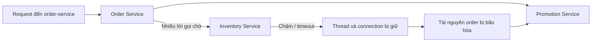
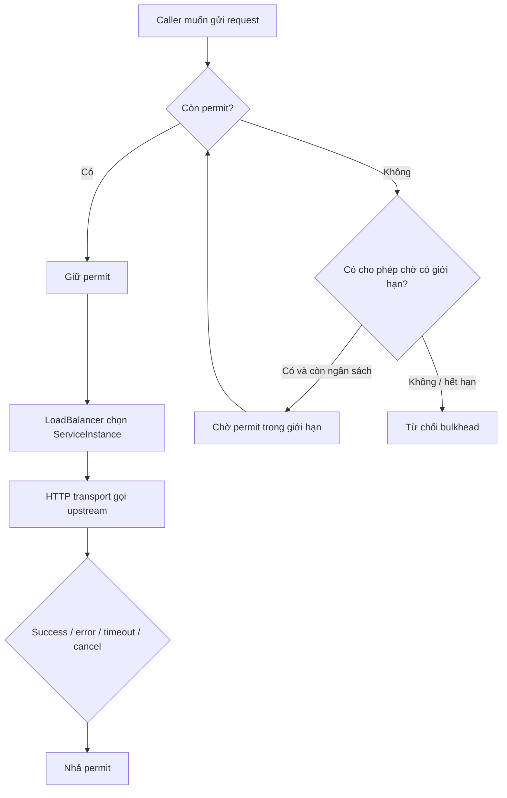
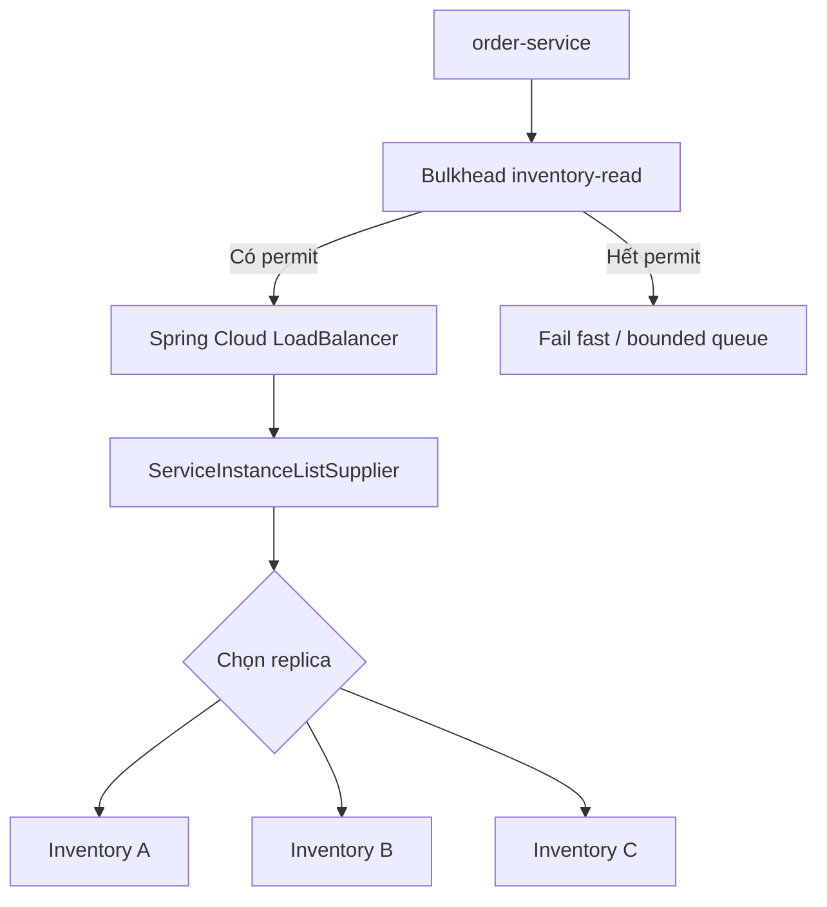

# Bulkhead và giới hạn số lời gọi đồng thời

Trong kiến trúc microservice, một dịch vụ có thể vẫn còn đủ CPU để xử lý request mới nhưng các luồng xử lý và kết nối của nó đang bị giữ lại vì một downstream phản hồi quá chậm. Ví dụ, `order-service` vừa gọi `inventory-service` để kiểm tra tồn kho vừa gọi `promotion-service` để tính khuyến mãi. Nếu mọi lời gọi inventory đều chờ hàng chục giây, chúng có thể chiếm hết thread, connection hoặc bộ nhớ của order; khi đó cả thao tác khuyến mãi lẫn các endpoint không liên quan cũng bị ảnh hưởng.

**Bulkhead** là mẫu thiết kế **cô lập tài nguyên**, lấy ý tưởng từ các khoang kín trên tàu: một khoang gặp sự cố không được làm chìm toàn bộ con tàu. Trong giao tiếp liên dịch vụ, bulkhead giới hạn số công việc được phép cùng lúc sử dụng một nguồn tài nguyên hoặc gọi một dependency. Khi đã hết chỗ, hệ thống **từ chối nhanh** hoặc đưa vào **hàng đợi có giới hạn rõ ràng**, thay vì cho mọi request tích tụ vô hạn.

Bài học thuộc chương **Cô lập và khôi phục** của module `SPRING_CLOUD_SERVICE_COMMUNICATION_LOAD_BALANCING`. Trọng tâm là hiểu bulkhead và **giới hạn số lời gọi đồng thời** trong bối cảnh Spring Cloud LoadBalancer chọn `ServiceInstance` bằng service ID, dựa trên discovery, health check và chính sách định tuyến. Bài học cũng minh họa việc phối hợp bulkhead với `RestClient`, `WebClient`, OpenFeign, timeout, retry và observability.

## 1. Vì sao cân bằng tải không đủ để ngăn quá tải dây chuyền?

Giả sử `order-service` gọi `inventory-service` theo URI logic `http://inventory-service`. Spring Cloud LoadBalancer chọn một replica A, B hoặc C. Điều này giúp phân phối các lượt chọn đích, **không tự giới hạn tổng số lời gọi inventory đang chờ** bên trong order.



Lấy ví dụ định lượng:

- `order-service` nhận đều 150 request/giây; mỗi request thực hiện một lời gọi inventory.
- Khi bình thường, thời gian chờ inventory trung bình là 80 ms.
- Khi downstream có sự cố, thời gian chờ trung bình tăng thành 800 ms.

Theo định luật Little, trong điều kiện dòng request ổn định:

```text
Số lời gọi đang xử lý trung bình ≈ tốc độ nhận lời gọi × thời gian xử lý

Bình thường: 150 lời gọi/s × 0,080 s ≈ 12 lời gọi in-flight
Khi chậm:   150 lời gọi/s × 0,800 s ≈ 120 lời gọi in-flight
```

Không tăng số request đầu vào nhưng mức đồng thời tăng **10 lần**. Nếu giới hạn của thread pool hoặc connection pool thấp hơn số này, caller sẽ bị nghẽn. Round robin vẫn có thể chia request cho ba replica nhưng không giải quyết được việc **caller đang nhận công việc nhanh hơn khả năng hoàn thành công việc**.

Một bulkhead giới hạn, chẳng hạn, **24 lời gọi inventory đồng thời cho mỗi instance order** có thể bảo vệ caller khỏi bị inventory chiếm hết tài nguyên. Tuy nhiên, khi downstream chậm, giới hạn 24 không tạo thêm công suất: với thời gian giữ permit trung bình 0,8 giây, throughput hoàn thành lý tưởng của nhóm này tối đa khoảng `24 / 0,8 = 30 lời gọi/giây`. Phần lưu lượng vượt khả năng phải chờ trong giới hạn nhỏ, bị từ chối hoặc được giảm tải theo chính sách. **Bulkhead ưu tiên cô lập và giữ hệ thống có khả năng phục hồi, không bảo đảm tất cả request đều thành công.**

## 2. “Số lời gọi đồng thời” khác RPS, timeout và số replica

| Thuật ngữ | Câu hỏi nó trả lời | Ví dụ |
|---|---|---|
| **Concurrency / in-flight** | Có bao nhiêu công việc đang thực hiện hoặc đang giữ tài nguyên? | Tối đa 24 lời gọi inventory cùng lúc. |
| **Throughput / RPS** | Có bao nhiêu request bắt đầu hoặc hoàn tất trong mỗi giây? | 150 request/giây đến order. |
| **Queue length** | Có bao nhiêu công việc đang chờ một suất xử lý? | Tối đa 10 tác vụ được chờ. |
| **Timeout / deadline** | Một attempt hoặc logical request được phép chờ bao lâu? | Hạn mức tổng 800 ms cho lookup. |
| **Replica count** | Có bao nhiêu instance của dịch vụ đích được triển khai? | Ba replica inventory. |
| **Bulkhead permit** | Có bao nhiêu lời gọi được phép đi vào vùng bảo vệ? | 24 permit đang chia sẻ trong một caller. |

**Giới hạn đồng thời không phải giới hạn tốc độ.** Với 24 permit và request hoàn thành sau 20 ms, hệ thống có thể xử lý nhiều lời gọi mỗi giây. Với cùng 24 permit nhưng mỗi request mất 2 giây, throughput giảm mạnh. Một **rate limiter** kiểm soát số lần bắt đầu trong một khoảng thời gian; một **bulkhead** kiểm soát số lượng cùng tồn tại tại thời điểm bất kỳ.

Tương tự, **timeout không thay thế bulkhead**. Nếu timeout là 10 giây và có hàng nghìn request cùng dồn vào trong 1 giây, caller vẫn có thể cạn tài nguyên trước khi các timeout kịp xảy ra. Bulkhead cung cấp cơ chế **admission control** từ đầu, còn timeout chặn việc giữ tài nguyên quá lâu sau khi đã được cho phép.

## 3. Cách bulkhead hoạt động: nhận, giữ và trả permit

Với bulkhead kiểu semaphore, trạng thái có thể mô tả bằng một bộ đếm:

```text
maxConcurrentCalls = 3

Request A  -> lấy permit #1 -> gọi upstream -> trả permit
Request B  -> lấy permit #2 -> gọi upstream -> trả permit
Request C  -> lấy permit #3 -> gọi upstream -> trả permit
Request D  -> hết permit    -> từ chối ngay hoặc chờ trong giới hạn
```



Một permit cần được nhả khi công việc kết thúc, kể cả lỗi và hủy. Trong code đồng bộ tự dùng `Semaphore`, điều đó thường đòi hỏi khối `finally`; trong reactive pipeline, permit phải gắn với vòng đời **subscription**, không nhả ngay sau khi tạo `Mono`. Thư viện bulkhead có operator tương thích Reactor giúp quản lý việc này nhưng cần kiểm thử đặc biệt với cancellation và timeout.

Khi không còn permit, một bulkhead có thể:

1. **Fail fast:** từ chối ngay, không giữ thêm thread chờ.
2. **Wait bounded:** chờ tối đa một khoảng ngắn hoặc đưa tác vụ vào hàng đợi có dung lượng hữu hạn.
3. **Không nên wait vô hạn:** hàng đợi lớn có thể che bớt lỗi trước mắt nhưng làm tăng latency, bộ nhớ và tình trạng quá tải dây chuyền.

Không nên mặc định tất cả request “bị từ chối” là lỗi của upstream. Đó có thể là **quyết định bảo vệ tài nguyên ở caller**, diễn ra trước cả bước chọn instance.

## 4. Hai kiểu bulkhead phổ biến

| Thuộc tính | Semaphore bulkhead | Thread-pool bulkhead |
|---|---|---|
| Tài nguyên giới hạn | Số lời gọi đang giữ permit. | Số tác vụ chạy trong executor và hàng đợi đi kèm. |
| Tạo thread riêng? | Không; công việc chạy trên thread/scheduler hiện có. | Có pool thread chuyên biệt cho các tác vụ được đưa vào. |
| Phù hợp | Gọi đồng bộ đã có thread riêng; pipeline reactive có operator không chặn. | Cô lập công việc blocking vào pool riêng và giới hạn hàng đợi. |
| Khi đầy | Có thể từ chối hoặc chờ permit theo cấu hình. | Từ chối khi pool và queue đều đầy. |
| Rủi ro chính | Chờ permit quá lâu làm kẹt caller thread; quên nhả permit. | Queue dài, thread overhead, khó quản lý cancellation của I/O blocking. |
| Có thay thế timeout không? | Không. | Không. |

### Semaphore: giới hạn số cuộc gọi, không tự chuyển luồng

Một semaphore bulkhead có `maxConcurrentCalls = 16` giới hạn tối đa 16 lời gọi cùng lúc **trong phạm vi đối tượng bulkhead đó**. Nếu RestClient đang blocking trên servlet thread, bulkhead không biến lời gọi thành non-blocking. Nếu đặt `maxWaitDuration = 0`, request thứ 17 có thể bị từ chối nhanh thay vì chiếm một thread chờ lâu.

### Thread pool: cô lập tài nguyên blocking

Thread-pool bulkhead thường có số worker thread và dung lượng queue riêng. Nó hữu ích khi cần tách một upstream chậm khỏi nhóm thread xử lý công việc khác, nhưng phải định nghĩa chính sách khi queue đầy, kiểm soát tổng thời gian chờ, việc cancel và giải phóng tài nguyên. Tạo một thread pool khổng lồ hoặc queue vô hạn **không phải bulkhead hiệu quả**.

Với WebClient chạy đúng mô hình reactive non-blocking, không nên tự động đưa mỗi lời gọi HTTP lên thread-pool bulkhead chỉ vì “reactive cũng cần bulkhead”: giới hạn **in-flight subscriptions** bằng semaphore/operator hoặc giới hạn concurrency trong pipeline thường phù hợp hơn. Nếu có adapter sang thư viện blocking, việc dùng scheduler/pool phù hợp là vấn đề khác cần xử lý riêng.

## 5. Chọn phạm vi cô lập: theo downstream, endpoint hay nghiệp vụ?

Giới hạn cần bảo vệ nguồn tài nguyên có thể bị tác động, không chỉ để có một con số trên dashboard.

| Phạm vi bulkhead | Khi có ích | Cẩn trọng |
|---|---|---|
| Một bulkhead cho toàn bộ `inventory-service` | Bảo vệ order khỏi tổng lưu lượng gọi inventory. | API đọc ngắn và API batch dài có thể tranh cùng permit. |
| Một bulkhead cho `inventory-read`, một cho `inventory-batch` | Tránh batch chiếm hết suất xử lý của thao tác người dùng. | Tổng hai giới hạn vẫn phải phù hợp tài nguyên chung. |
| Bulkhead theo tenant/cohort | Ngăn một tenant tải lớn lấn át tenant khác. | Số tenant lớn có thể làm tăng số object, metric và độ phức tạp. |
| Bulkhead theo instance đích | Giới hạn riêng cho một replica đang chậm. | Khó đồng bộ với discovery và thay đổi replica; cần phân biệt với giới hạn toàn service ID. |
| Bulkhead cho downstream có rủi ro cao | Tránh làm cạn pool phục vụ các dependency khác. | Cũng cần giới hạn request đầu vào và tài nguyên chung của caller. |

Nếu `order-service` gọi đồng thời hai dịch vụ, có thể đặt **hai bulkhead độc lập**:

```text
order-service
  ├── inventory-read bulkhead: 16 concurrent calls
  │       └── inventory-service (A / B / C)
  └── promotion bulkhead:     8 concurrent calls
          └── promotion-service (X / Y)
```

Khi inventory chậm, các permit của inventory đầy nhưng luồng xử lý dùng promotion **không cùng bị cạn permit inventory**. Tuy nhiên, nếu cả hai vẫn sử dụng cùng một servlet thread pool hoặc cùng connection pool chưa được giới hạn, bulkhead riêng chỉ giảm một nguyên nhân nghẽn; chưa phải cô lập mọi loại tài nguyên.

### Bulkhead thường có phạm vi cục bộ

Một bean singleton `Bulkhead` trong một instance `order-service` thường giới hạn **chỉ trong JVM/instance đó**. Nếu chạy bốn replica order và mỗi replica có 16 permit, tổng các replica có thể tạo khoảng **64 lời gọi inventory in-flight** trước khi tính retries hoặc nguồn gửi khác.

Do đó, không được hiểu một bulkhead cục bộ là **quota phân tán trên toàn cluster**. Nếu downstream có ngân sách toàn cục, cần phối hợp cấu hình replica, admission control phía downstream, rate limit phân tán hoặc chính sách khác. Hệ thống scale-out caller có thể tăng tải đến downstream dù mỗi caller vẫn tuân thủ giới hạn cục bộ.

## 6. Thiết kế với Spring Cloud LoadBalancer

Spring Cloud LoadBalancer thường thực hiện chuỗi:

```text
RestClient / WebClient / OpenFeign
      -> service ID logic
      -> ServiceInstanceListSupplier (discovery, health, zone/hint...)
      -> thuật toán chọn ServiceInstance
      -> HTTP transport
```

**Bulkhead không phải thuật toán cân bằng tải.** Nó bảo vệ số lời gọi đang diễn ra; LoadBalancer chọn đích từ danh sách ứng viên. Tùy kiến trúc, bulkhead có thể bao quanh toàn bộ lời gọi từ caller hoặc nằm gần bước HTTP attempt. Điều quan trọng là quy định rõ **đơn vị mà permit bảo vệ**.

Giả sử gọi inventory với bulkhead toàn service ID:



Một lời gọi bị từ chối vì bulkhead đầy có thể **chưa hề được LoadBalancer chọn instance**. Ngược lại, nếu bulkhead đặt sau bước chọn đích thì một số request có thể đã đi qua logic chọn nhưng chưa được gửi. Khi thống kê, cần phân biệt số **logical requests**, số **bulkhead admissions/rejections**, số **LoadBalancer selections** và số **HTTP attempts**.

Zone preference và health check giảm khả năng chọn đích không phù hợp nhưng không kiểm soát concurrency. Đặc biệt, một hard constraint như “tenant này chỉ được xử lý trong region EU” vẫn phải được giữ khi hệ thống thiếu permit hoặc khi retry: bulkhead đầy **không** phải lý do cho phép fallback sang instance vi phạm chính sách dữ liệu.

## 7. Ví dụ RestClient: semaphore bulkhead dùng chung

Một cách triển khai là dùng Resilience4j Bulkhead. Ví dụ giả định dự án có Spring Framework hỗ trợ `RestClient`, Spring Cloud LoadBalancer và dependency `resilience4j-bulkhead` tương thích. Resilience4j là thư viện bổ sung, **không mặc nhiên được bật chỉ vì thêm `spring-cloud-starter-loadbalancer`**.

Tạo builder RestClient có tích hợp LoadBalancer:

```java
import org.springframework.cloud.client.loadbalancer.LoadBalanced;
import org.springframework.context.annotation.Bean;
import org.springframework.context.annotation.Configuration;
import org.springframework.web.client.RestClient;

@Configuration
class HttpClientsConfig {

    @Bean
    @LoadBalanced
    RestClient.Builder loadBalancedRestClientBuilder() {
        return RestClient.builder();
    }

    @Bean("inventoryRestClient")
    RestClient inventoryRestClient(
            @LoadBalanced RestClient.Builder builder) {
        return builder.clone()
            .baseUrl("http://inventory-service")
            .build();
    }
}
```

Tạo **một bean bulkhead dùng chung**, không tạo mới mỗi lần gọi:

```java
import io.github.resilience4j.bulkhead.Bulkhead;
import io.github.resilience4j.bulkhead.BulkheadConfig;
import org.springframework.context.annotation.Bean;
import org.springframework.context.annotation.Configuration;
import java.time.Duration;

@Configuration
class InventoryBulkheadConfig {

    @Bean("inventoryReadBulkhead")
    Bulkhead inventoryReadBulkhead() {
        BulkheadConfig config = BulkheadConfig.custom()
            .maxConcurrentCalls(16)
            .maxWaitDuration(Duration.ZERO)
            .build();

        return Bulkhead.of("inventory-read", config);
    }
}
```

Bao quanh phần **thực sự gửi lời gọi HTTP**:

```java
import io.github.resilience4j.bulkhead.Bulkhead;
import org.springframework.beans.factory.annotation.Qualifier;
import org.springframework.stereotype.Service;
import org.springframework.web.client.RestClient;
import java.util.function.Supplier;

@Service
class InventoryGateway {

    private final RestClient client;
    private final Bulkhead bulkhead;

    InventoryGateway(
            @Qualifier("inventoryRestClient") RestClient client,
            @Qualifier("inventoryReadBulkhead") Bulkhead bulkhead) {
        this.client = client;
        this.bulkhead = bulkhead;
    }

    ItemDto getItem(String itemId) {
        Supplier<ItemDto> guarded =
            Bulkhead.decorateSupplier(bulkhead, () ->
                client.get()
                    .uri("/api/items/{id}", itemId)
                    .retrieve()
                    .body(ItemDto.class));

        return guarded.get();
    }
}
```

`ItemDto` là DTO ứng dụng tự định nghĩa. Đây là ví dụ minh họa cấu trúc, chưa gồm cấu hình timeout, xử lý response rỗng và lỗi nghiệp vụ. Luồng logic là: lấy permit → gọi RestClient theo service ID → LoadBalancer chọn instance → HTTP transport chờ response → trả permit khi hoàn tất/lỗi.

Với `maxWaitDuration(Duration.ZERO)`, khi đã có 16 lời gọi đang giữ permit, lời gọi thứ 17 có thể ném `BulkheadFullException` ngay tại caller. Không nên catch exception rồi **vẫn gọi inventory bằng đường vòng**, vì như vậy phá vỡ mục đích của bulkhead.

### Điều cần tránh trong code đồng bộ

Đoạn sau **không giới hạn thực sự** vì bulkhead mới được tạo mỗi request:

```java
// SAI: mỗi lời gọi có một bộ đếm permit riêng.
ItemDto getItemWrong(String id) {
    Bulkhead temporary = Bulkhead.ofDefaults("inventory-read");
    return Bulkhead.decorateSupplier(temporary,
        () -> client.get()
            .uri("/api/items/{id}", id)
            .retrieve()
            .body(ItemDto.class)).get();
}
```

Bulkhead phải được **chia sẻ giữa các request cần tranh cùng ngân sách** — ví dụ singleton bean theo từng dependency/operation. Không thay thế bằng khóa `synchronized` quanh toàn bộ HTTP call: nó thường biến mọi lời gọi thành tuần tự, không diễn đạt rõ giới hạn và gây nghẽn không cần thiết.

## 8. WebClient: giới hạn in-flight, không chặn event loop

WebClient dùng Reactor và có thể thực hiện I/O non-blocking. Khi viết:

```java
Mono<ItemDto> response = inventoryWebClient.get()
    .uri("/api/items/{id}", itemId)
    .retrieve()
    .bodyToMono(ItemDto.class);
```

`response` chỉ mô tả pipeline; HTTP call thường bắt đầu khi có subscription. Do đó, cách làm “lấy permit trước khi tạo `Mono`, nhả ở `finally` sau khi return” **sai về vòng đời**:

```java
// SAI: finally chạy khi Mono vừa được tạo, chưa đợi HTTP response.
Mono<ItemDto> getItemWrong(String id) {
    semaphore.acquireUninterruptibly();
    try {
        return inventoryWebClient.get()
            .uri("/api/items/{id}", id)
            .retrieve()
            .bodyToMono(ItemDto.class);
    } finally {
        semaphore.release(); // Nhả quá sớm.
    }
}
```

Một giải pháp là dùng `BulkheadOperator` của `resilience4j-reactor` tương thích với phiên bản đang chạy:

```java
import io.github.resilience4j.bulkhead.Bulkhead;
import io.github.resilience4j.reactor.bulkhead.operator.BulkheadOperator;
import reactor.core.publisher.Mono;

class ReactiveInventoryGateway {

    private final WebClient client;
    private final Bulkhead bulkhead;

    ReactiveInventoryGateway(
            WebClient inventoryWebClient,
            Bulkhead inventoryReadBulkhead) {
        this.client = inventoryWebClient;
        this.bulkhead = inventoryReadBulkhead;
    }

    Mono<ItemDto> findItem(String id) {
        return Mono.defer(() ->
                client.get()
                    .uri("/api/items/{id}", id)
                    .retrieve()
                    .bodyToMono(ItemDto.class))
            .transformDeferred(BulkheadOperator.of(bulkhead));
    }
}
```

Ở đây `inventoryWebClient` phải là client đã được build từ `@LoadBalanced WebClient.Builder` nếu muốn giải quyết `http://inventory-service` bằng Spring Cloud LoadBalancer. `inventoryReadBulkhead` phải là đối tượng dùng chung, được inject theo qualifier khi có nhiều bulkhead. Import `WebClient` và annotation không cốt yếu được lược bớt.

Với operator reactive, permit được quản lý theo **subscription** và được trả khi pipeline kết thúc/lỗi/hủy theo semantics của implementation. Cần dùng cấu hình **không chờ permit theo kiểu blocking**, ví dụ `maxWaitDuration = Duration.ZERO`, và kiểm thử việc nhả permit khi timeout/cancellation; không được block Reactor Netty event loop để chờ suất.

### Giới hạn concurrency bằng flatMap

Nếu chỉ cần giới hạn số request **trong một luồng xử lý batch**, Reactor có sẵn:

```java
Flux.fromIterable(itemIds)
    .flatMap(id -> inventoryWebClient.get()
        .uri("/api/items/{id}", id)
        .retrieve()
        .bodyToMono(ItemDto.class), 8)
    .collectList();
```

Tham số `8` giới hạn số inner publishers được subscribe đồng thời **trong một subscription của pipeline này**. Nó không phải bulkhead toàn bộ service: nếu 100 request người dùng cùng chạy pipeline đó thì tổng số lời gọi inventory có thể vượt 8 rất xa. Muốn bảo vệ **toàn bộ lưu lượng inventory từ một instance order**, cần một bulkhead được dùng chung giữa các request hoặc cơ chế admission control tương đương.

## 9. OpenFeign: cô lập lời gọi đồng bộ theo client

OpenFeign thường được dùng theo phong cách đồng bộ:

```java
@FeignClient(
    name = "inventory-service",
    contextId = "inventoryRead"
)
interface InventoryReadClient {

    @GetMapping("/api/items/{id}")
    ItemDto findItem(@PathVariable("id") String id);
}
```

Có thể bọc lời gọi Feign bằng bulkhead tại lớp service:

```java
class InventoryFacade {

    private final InventoryReadClient feign;
    private final Bulkhead inventoryReadBulkhead;

    InventoryFacade(InventoryReadClient feign,
                    Bulkhead inventoryReadBulkhead) {
        this.feign = feign;
        this.inventoryReadBulkhead = inventoryReadBulkhead;
    }

    ItemDto findItem(String id) {
        return Bulkhead.decorateSupplier(inventoryReadBulkhead,
            () -> feign.findItem(id)).get();
    }
}
```

Đoạn mã giả định đã inject đúng bulkhead singleton và lược bỏ annotation/import. `@FeignClient` với `name = "inventory-service"` có thể đi qua Spring Cloud LoadBalancer nếu không đặt `url` cố định và có integration phù hợp. Bulkhead trong lớp facade **không tạo replica mới**, không thay đổi cơ chế discovery hay ngầm biến Feign thành asynchronous.

Nếu mỗi Feign client cần một chính sách bulkhead riêng, hãy quản lý bean theo tên/context và tránh để một `@Configuration` chứa các interceptor/retryer đặc thù bị component scan thành cấu hình chung ngoài ý muốn. Bulkhead riêng cho `inventoryRead` không nên tự chia sẻ permit với `inventoryBatch` nếu mục tiêu là cô lập batch khỏi request người dùng.

## 10. Kết hợp bulkhead với timeout, retry và circuit breaker

Bulkhead chủ yếu bảo vệ **số lời gọi in-flight**, nên cần phối hợp các cơ chế khác:

| Cơ chế | Nó bảo vệ điều gì? | Không làm thay bulkhead |
|---|---|---|
| **Timeout/deadline** | Không cho một lời gọi chiếm thời gian vô hạn. | Hàng nghìn request đồng thời có thể làm cạn tài nguyên trước khi timeout. |
| **Retry có giới hạn** | Thử lại lỗi tạm thời theo chính sách. | Retry có thể làm tăng số lời gọi đồng thời. |
| **Circuit breaker** | Ngắt gửi request khi downstream lỗi vượt ngưỡng. | Khi circuit đóng, vẫn có thể quá nhiều lời gọi đang chờ cùng lúc. |
| **Rate limiter** | Điều tiết tốc độ request bắt đầu trong một khoảng thời gian. | Một request chậm có thể giữ tài nguyên rất lâu dù RPS thấp. |
| **LoadBalancer** | Chọn `ServiceInstance` từ danh sách hợp lệ. | Không tự đặt ngân sách permit cho mọi lời gọi nghiệp vụ. |
| **Health check** | Loại/ưu tiên các instance theo tín hiệu sức khỏe. | Một endpoint health `UP` không bảo đảm upstream xử lý nhanh. |

### Vị trí bulkhead so với retry quyết định thời gian giữ permit

Giả sử một logical request tối đa ba HTTP attempts. Có hai kiểu phối hợp khác nhau:

**Bulkhead bao ngoài toàn bộ logical request:**

```text
Bulkhead(
    Retry(
        gọi inventory
    )
)
```

Permit có thể được giữ **suốt quá trình retry, bao gồm cả backoff**. Cách này giới hạn số logical requests đang tranh cùng dependency nhưng có thể giữ permit khi không thực sự có HTTP attempt đang chạy.

**Bulkhead bên trong retry, quanh từng attempt:**

```text
Retry(
    Bulkhead(
        một lần thử gọi inventory
    )
)
```

Permit có thể được nhả giữa các lần thử, bảo vệ số **HTTP attempts đang chạy**. Tuy nhiên, nếu retry policy thử lại ngay trên lỗi “bulkhead full”, nó có thể tạo vòng lặp từ chối rất nhanh hoặc thêm tải vào thời điểm tệ nhất.

Thứ tự thích hợp phụ thuộc mục tiêu: giới hạn **logical requests** hay giới hạn **transport attempts**. Trong hệ thống lớn, có thể cần cả hai ngân sách nhưng phải tránh chồng nhiều lớp không rõ chủ sở hữu. Với Reactor, vị trí `retryWhen(...)` và `transformDeferred(BulkheadOperator.of(...))` trong pipeline ảnh hưởng đơn vị mà permit bao quanh. Kiểm thử thực tế cả retry, lỗi, cancellation và deadline thay vì suy từ vị trí code một cách chủ quan.

### Không retry mù quáng BulkheadFullException

`BulkheadFullException` nói rằng caller đang hết công suất dành cho dependency. Nó **không nhất thiết** có nghĩa replica đã chết. Retry ngay, không backoff và không budget, có thể biến một yêu cầu bị từ chối thành hàng chục lần tranh permit — đúng dạng **retry storm** cần tránh.

Nếu nghiệp vụ cho phép retry sau khi bulkhead đầy, phải có chính sách chờ có giới hạn, jitter, deadline và nguồn lực khác bảo đảm việc thử thêm không gây hại. Trong nhiều API cần latency thấp, **trả lỗi sớm** tốt hơn là ngồi chờ một permit không biết khi nào rảnh.

### Circuit breaker và bulkhead là hai tín hiệu khác nhau

Nếu upstream liên tục trả `500`, circuit breaker có thể mở để giảm request gửi đi. Nếu upstream vẫn trả `200` nhưng mỗi lời gọi mất nhiều giây, bulkhead có thể đầy dù circuit breaker chưa mở. Ngược lại, circuit đã mở có thể từ chối request trước khi bulkhead chiếm permit, tùy thứ tự bọc. Cần phân biệt **rejection do circuit open** và **rejection do bulkhead full** trong metric/log và chính sách phản hồi.

## 11. Sizing: nên đặt maxConcurrentCalls bằng bao nhiêu?

Không có một con số đúng cho mọi dịch vụ. Hãy bắt đầu bằng đo latency, throughput, CPU, connection pool và độ trễ tail của upstream. Một cách ước lượng ban đầu:

```text
concurrency cần khi bình thường ≈ throughput mục tiêu × latency trung bình
```

Ví dụ một endpoint inventory được gọi 80 lần/giây với latency bình thường 120 ms:

```text
80 calls/s × 0,12 s ≈ 9,6 calls in-flight
```

Nếu thử nghiệm cho thấy upstream ổn định khi có tối đa 20 lời gọi đồng thời từ một instance order, ta có thể **thử** đặt bulkhead ở mức khoảng 16–20 permit, rồi đo saturation, reject rate và p95/p99. Con số này chỉ có ý nghĩa khi tính đến số replica order, số caller khác và tài nguyên thực tế của inventory.

Nếu inventory trở nên chậm, latency 1,2 giây:

```text
80 calls/s × 1,2 s ≈ 96 calls in-flight nếu không chặn đầu vào
Với 20 permit: throughput hoàn thành lý tưởng ≈ 20 / 1,2 ≈ 16,7 calls/s
```

Khi caller vẫn nhận 80 yêu cầu/giây, bulkhead phải **từ chối hoặc điều tiết** phần công việc vượt ngân sách; không có phép cấu hình nào tự tạo công suất để xử lý cả 80 lời gọi/giây với 20 permit và mỗi lời gọi giữ permit 1,2 giây.

### Các yếu tố cần xem khi hiệu chỉnh

1. **Độ trễ theo percentile:** không chỉ nhìn latency trung bình. Một số request rất chậm có thể giữ permit lâu và làm tăng reject rate.
2. **Số replica caller:** mỗi instance có bulkhead riêng; tăng replica caller có thể làm tăng số lời gọi in-flight toàn hệ thống.
3. **Concurrency tối đa mà upstream chịu được:** CPU, connection pool, database pool và thread/scheduler của instance đích.
4. **Mức quan trọng của nghiệp vụ:** API thanh toán, đọc sản phẩm và batch export không có cùng deadline hay khả năng chịu lỗi.
5. **Thời gian chờ hàng đợi:** queue lớn có thể làm p99 rất xấu dù reject rate nhỏ.
6. **Retry amplification:** số attempts bổ sung làm tăng tải thực sự vượt logical RPS.
7. **Shared bottlenecks:** hai dịch vụ nhìn như độc lập nhưng cùng dùng DB hoặc HTTP connection pool có thể vẫn ảnh hưởng lẫn nhau.

Đừng “chữa” nhiều rejection bằng cách tăng `maxConcurrentCalls` ngay lập tức. Nếu downstream thật sự đã bão hòa, tăng permit chỉ chuyển trạng thái nghẽn từ caller sang upstream và có thể kéo dài outage.

## 12. Trả kết quả thế nào khi bulkhead đầy?

`BulkheadFullException` là tín hiệu admission control. Cần quyết định cách trả về dựa vào hợp đồng API, không mặc nhiên chuyển thành một response nghiệp vụ thành công:

| Loại thao tác | Phản ứng có thể phù hợp |
|---|---|
| Đọc dữ liệu không thiết yếu, cho phép stale data | Trả cache đã có và đánh dấu độ mới theo hợp đồng. |
| Xem tồn kho yêu cầu dữ liệu mới | Trả lỗi tạm thời rõ ràng; không tự suy rằng “hết hàng”. |
| Tạo đơn, thanh toán hoặc ghi dữ liệu | Không báo “thành công” khi chưa thực hiện; giữ idempotency và trạng thái nhất quán. |
| Batch không khẩn cấp | Hoãn job qua queue có giới hạn riêng hoặc lịch xử lý được kiểm soát. |
| Request có deadline gần hết | Từ chối sớm thay vì đưa vào queue không kịp hoàn thành. |

Ở API HTTP, tình huống thiếu công suất upstream có thể được ánh xạ thành **`503 Service Unavailable`**; **`429 Too Many Requests`** thích hợp hơn cho một số chính sách giới hạn lưu lượng/khách hàng. Chọn status theo contract, không sử dụng `429` cho mọi lỗi nội bộ một cách máy móc. Chỉ trả `Retry-After` khi có chiến lược dự báo/giới hạn hợp lý, không hứa một thời gian phục hồi không có cơ sở.

Khi fallback sang cache hoặc trả kết quả suy giảm, cần ghi rõ giá trị trả về có thể cũ và cơ chế này được phép theo hợp đồng dữ liệu. Bulkhead không thay thế quyền truy cập; nếu nhiều tenant cùng chia một dependency, vẫn phải phân quyền dữ liệu ở downstream và bảo vệ dữ liệu nhạy cảm trong log.

## 13. Quan sát: biết bulkhead đang bảo vệ hay đang chặn quá mức

Các tín hiệu vận hành cần được nhìn cùng nhau:

| Metric / sự kiện | Mục đích |
|---|---|
| **Available permits / active calls** | Bulkhead gần đầy hay còn dư bao nhiêu? |
| **Rejected calls** | Có bao nhiêu request bị từ chối vì hết công suất? |
| **Wait duration / queue depth** (nếu có) | Có đang tích tụ hàng đợi và tăng latency? |
| **Logical requests, HTTP attempts** | Có retry đang khuếch đại tải không? |
| **Latency p50/p95/p99 của downstream** | Có lời gọi chậm giữ permit quá lâu không? |
| **Timeout và cancellation** | Permit có được trả đúng lúc khi request kết thúc/hủy không? |
| **LoadBalancer chosen instance** | Một replica có tập trung lỗi hoặc nhận tải quá cao không? |
| **Connection pool / servlet threads** | Có tài nguyên khác vẫn bị nghẽn dù bulkhead đã được bật? |
| **Circuit breaker open, rate-limit rejection** | Phân biệt nguồn từ chối của các lớp resilience. |

Resilience4j có các metric/event cho bulkhead và tích hợp Micrometer qua dependency/cấu hình thích hợp. Tên metric chính xác và khả năng expose qua Actuator phụ thuộc phiên bản đang chạy; không mặc định một tên metric minh họa là có sẵn.

Không dùng `requestId` hoặc instance hostname thay đổi liên tục làm nhãn metric có cardinality cao; chỉ giữ tập nhãn giới hạn như client/dependency, outcome và nhóm lỗi. Tracing/log có thể nối logical request, phép chọn `ServiceInstance` và các HTTP attempts, nhưng không được đưa access token, cookie hoặc dữ liệu nhạy cảm vào log.

### Tỉ lệ từ chối không phải luôn là điều xấu

Trong một sự cố downstream, có thể thấy reject rate tăng trong khi latency của những API khác **giảm so với trường hợp không có bulkhead**. Đó có thể là bằng chứng bulkhead đang cô lập lỗi hiệu quả. Mục tiêu là bảo toàn chất lượng của hệ thống và áp dụng chính sách từ chối minh bạch, không phải ép reject rate bằng 0 trong mọi điều kiện.

Nếu reject rate cao ngay cả khi upstream khỏe, cần kiểm tra cấu hình quá nhỏ, queue không phù hợp, permit bị giữ quá lâu, bug không nhả permit hoặc bọc bulkhead sai vòng đời.

## 14. Bài thực hành: kiểm chứng cô lập khi một downstream chậm

Chuẩn bị một ứng dụng `order-service` gọi `inventory-service` và `promotion-service`, mỗi downstream có ít nhất một stub/instance trong môi trường test. Có thể dùng `RestClient` hoặc `WebClient` đã tích hợp Spring Cloud LoadBalancer với service ID, và bật metric cho bulkhead. Giới hạn traffic ở môi trường thử nghiệm, không chạy tải phá hủy hệ thống dùng chung.

| Bài thử | Cách mô phỏng | Điều cần chứng minh |
|---|---|---|
| **Không có bulkhead** | Inventory trả chậm 2 giây, tạo các request đồng thời có giới hạn. | Thread/connection in-flight tăng; các endpoint khác có thể chậm. |
| **Semaphore 8 permit** | Bao quanh inventory với fail-fast khi hết permit. | Không có quá 8 lời gọi inventory in-flight **trong một instance order**. |
| **Hai bulkhead riêng** | Inventory chậm, promotion vẫn bình thường. | Permit của inventory đầy không tự làm cạn permit của promotion. |
| **Bọc sai Mono** | Lấy permit trước khi trả `Mono`, nhả ngay trong `finally`. | Bộ đếm không phản ánh subscription đang chạy; xác định bug. |
| **flatMap concurrency = 4** | Cho một pipeline batch nhiều item. | Mỗi subscription batch tối đa 4 inner calls, nhưng nhiều batch song song có thể vượt tổng 4. |
| **Retry khi bị từ chối** | Bật retry ngay trên `BulkheadFullException`. | Số rejections/attempts tăng dù upstream không phục hồi; thêm bộ lọc và budget đúng. |
| **Timeout/cancel** | Cho request vượt deadline và hủy subscription. | Permit được trả, không còn active call treo sau khi xử lý xong. |
| **Scale caller** | Chạy 2 instance order, mỗi instance 8 permit. | Tổng số lời gọi inventory có thể lên đến khoảng 16; không nhầm quota cục bộ với cluster. |
| **Đổi replica qua LB** | Gỡ một replica inventory khỏi discovery. | Bulkhead giới hạn in-flight nhưng không thay thế discovery/health; lỗi vẫn phân biệt theo tầng. |
| **Hard zone restriction** | Chỉ còn instance ở zone bị cấm. | Không fallback vượt chính sách dù bulkhead còn permit hoặc retry đang bật. |

### Cách đo kết quả

Ghi lại mỗi lần thử: service ID, logical request ID, bulkhead name, active/max permits, số lần từ chối, HTTP attempts, instance đích, thời gian response và kết quả cuối. So sánh **p95/p99 của API inventory** và **p95/p99 của endpoint không phụ thuộc inventory** ở cùng mức tải.

Đặt câu hỏi: khi inventory gặp lỗi, hệ thống có giữ đủ tài nguyên để tiếp tục phục vụ promotion và các endpoint độc lập không? Nếu có, bulkhead đang hoàn thành mục tiêu cô lập, kể cả khi một số lời gọi inventory phải bị từ chối sớm.

## 15. Các sai lầm thường gặp

| Sai lầm | Hậu quả | Cách sửa |
|---|---|---|
| Tạo `Bulkhead.of(...)` mới mỗi request | Mỗi request có permit riêng, không giới hạn tổng concurrency. | Tạo bean dùng chung theo dependency/operation. |
| Lấy/nhả semaphore khi chỉ mới xây `Mono` | Permit được nhả trước khi HTTP hoàn tất. | Dùng operator quản lý theo subscription. |
| Dùng một bulkhead cho tất cả downstream | Inventory chậm làm promotion bị từ chối theo cùng bộ đếm. | Chia bulkhead theo ranh giới lỗi và tài nguyên cần cô lập. |
| Đặt `maxWaitDuration` quá dài với RestClient/OpenFeign | Thread chờ permit, latency tăng. | Ưu tiên fail-fast hoặc thời gian chờ ngắn có deadline. |
| Hàng đợi thread pool quá lớn | Tích tụ tác vụ, ngốn bộ nhớ và tăng tail latency. | Giới hạn pool/queue và chính sách từ chối. |
| Retry ngay trên lỗi bulkhead full | Retry storm, nhiều attempts/rejections. | Không retry mặc định; dùng budget, backoff và deadline nếu thực sự cần. |
| Tăng maxConcurrentCalls để xóa rejection | Downstream quá tải hơn, lỗi dây chuyền tăng. | Đo công suất, kiểm soát admission và tối ưu upstream. |
| Nhầm giới hạn cục bộ với quota toàn cluster | Scale caller làm tổng tải tăng vượt dự kiến. | Tính ngân sách theo số replica/caller và các nguồn traffic khác. |
| Cho rằng LoadBalancer tự tạo bulkhead | Không giới hạn lời gọi đang chờ. | Cấu hình bulkhead/resilience riêng. |
| Chỉ nhìn số request thành công | Không biết bulkhead đang bảo vệ API khác hay đang bị cấu hình quá thấp. | Đo in-flight, rejection, tail latency và HTTP attempts. |

## 16. Checklist khi triển khai production

- Xác định rõ **tài nguyên và nhóm lỗi** cần cô lập: một downstream, một operation hay một lớp tenant.
- Chọn semaphore bulkhead hoặc thread-pool bulkhead theo mô hình blocking/reactive và tài nguyên thực tế.
- Đảm bảo bulkhead là **đối tượng chia sẻ**, không tạo lại trên từng lời gọi.
- Với WebClient reactive, buộc thời gian giữ permit đi theo vòng đời subscription, gồm complete/error/cancel.
- Tính giới hạn theo throughput, latency và số replica caller; tránh hiểu nhầm quota cục bộ là giới hạn phân tán.
- Đặt giới hạn queue/`maxWaitDuration` và deadline rõ ràng; không chờ vô hạn khi đã bão hòa.
- Không retry mù quáng `BulkheadFullException`; phối hợp backoff, jitter, retry budget và idempotency.
- Phân biệt lỗi bulkhead, circuit open, LoadBalancer không chọn được instance và HTTP upstream trả lỗi.
- Giữ ràng buộc zone/region/tenant và phân quyền khi retry/failover, không dùng bulkhead làm lý do vượt chính sách.
- Kiểm tra tương tác với connect/read timeout, connection pool, thread pool, circuit breaker và rate limiter.
- Theo dõi available permits, active calls, rejections, p95/p99, HTTP attempts và sức khỏe API không liên quan.
- Kiểm thử graceful shutdown, cancellation, timeouts, mất instance trong discovery và thay đổi quy mô caller.

**Ghi nhớ:** **Spring Cloud LoadBalancer quyết định gọi instance nào, còn bulkhead quyết định có cho phép thêm một lời gọi cùng lúc hay không**. Giới hạn concurrency là cơ chế *bảo vệ* tài nguyên và cô lập lỗi, không phải cách tăng công suất downstream. Để hệ thống phục hồi ổn định, cần kết hợp bulkhead đúng phạm vi với timeout/deadline, retry có kiểm soát, circuit breaker, cấu hình HTTP transport và quan sát được cả request bị từ chối lẫn API vẫn duy trì chất lượng phục vụ.
