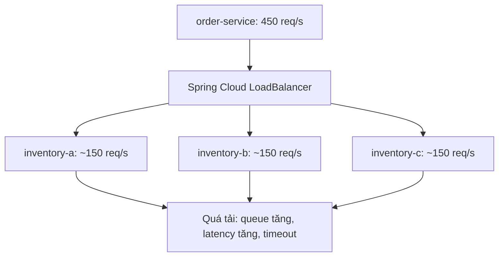
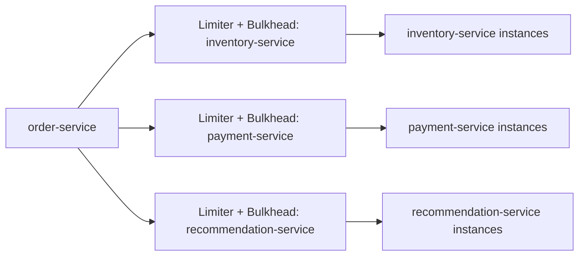

# Rate limit, hàng đợi và kiểm soát áp lực lên dịch vụ đích

## Mục tiêu

Spring Cloud LoadBalancer giúp một ứng dụng chọn `ServiceInstance` để gọi dịch vụ khác bằng service ID. Nhưng **chọn đúng bản sao không đồng nghĩa backend có đủ tài nguyên để nhận thêm request**. Nếu `order-service` gửi hàng nghìn request đồng thời đến `inventory-service`, LoadBalancer vẫn có thể phân phối chúng tới các bản sao đang quá tải. Kết quả thường là tăng độ trễ, cạn connection pool, HTTP 429/503, timeout và retry storm.

Để tránh sự cố lan truyền, hệ thống cần các cơ chế **cô lập và kiểm soát áp lực**:

- **Rate limiting**: kiểm soát số request được phép đi qua trong một đơn vị thời gian.
- **Bulkhead / concurrency limit**: giới hạn số operation được thực thi đồng thời.
- **Bounded queue**: chỉ cho phép một lượng công việc hữu hạn chờ xử lý.
- **Backpressure, load shedding và deadline**: cho bên gửi biết đang quá tải, từ chối sớm thay vì tích lũy công việc vô hạn.
- **Timeout, retry và circuit breaker**: phối hợp để phục hồi có kiểm soát, không khuếch đại áp lực.

Bài học này nằm trong chương **Cô lập và khôi phục** của mô-đun Spring Cloud Service Communication Load Balancing: trọng tâm là bảo vệ **dịch vụ đích** khi caller dùng `RestClient`, `RestTemplate`, `WebClient` hoặc OpenFeign, đồng thời hiểu ranh giới với Spring Cloud Gateway và các thư viện resilience.

Sau bài học, bạn có thể phân biệt các cơ chế trên, thiết kế một ngân sách tải hợp lý, triển khai rate limiter và bulkhead trên caller, thiết lập hàng đợi có giới hạn, kiểm tra hành vi dưới tải đồng thời và xác định khi nào cần từ chối thay vì chờ hoặc retry.

## 1. Vì sao LoadBalancer không tự chống quá tải?

Giả sử `inventory-service` có ba instance:

| ServiceInstance | Khả năng xử lý bình thường (giả định) | Trạng thái |
|---|---:|---|
| `inventory-a` | 50 request/giây | Ready |
| `inventory-b` | 50 request/giây | Ready |
| `inventory-c` | 50 request/giây | Ready |

Khi `order-service` tăng từ 60 lên 450 request/giây, round robin vẫn có thể chia số request tương đối đều. Nhưng tổng năng lực minh họa chỉ khoảng 150 request/giây, nên **mỗi instance vẫn nhận tải lớn hơn năng lực của nó**.



Trong ví dụ này, giả định ba instance có cấu hình và sức mạnh tương tự; số request thực tế còn phụ thuộc thuật toán, hint, zone, cache, retry và lưu lượng từ các caller khác. **Ready** hoặc health check thành công chỉ phản ánh tiêu chí sẵn sàng đã cấu hình; nó không có nghĩa instance còn đủ công suất để xử lý mọi request mới.

Spring Cloud LoadBalancer giải quyết vấn đề **chọn endpoint**. Nó không tự đặt giới hạn chung như “chỉ cho `inventory-service` xử lý 100 request/giây” hoặc “chỉ 20 request đang thực thi”. Những giới hạn đó cần triển khai ở tầng thích hợp.

## 2. Phân biệt sáu cơ chế

| Cơ chế | Câu hỏi trả lời | Đơn vị | Khi vượt giới hạn |
|---|---|---|---|
| **Load balancing** | Request sẽ gọi instance nào? | Danh sách `ServiceInstance` | Có thể chọn instance khác, nhưng không tự giới hạn tải |
| **Rate limiting** | Có được bắt đầu thêm request trong khoảng thời gian này? | Request/giây hoặc token/chu kỳ | Từ chối, chờ permission hoặc trả 429 theo chính sách |
| **Concurrency limit / bulkhead** | Có bao nhiêu lời gọi đang chạy cùng lúc? | Operation in-flight | Từ chối hoặc chờ slot trong thời gian ngắn |
| **Bounded queue** | Có thể để bao nhiêu request chờ? | Số phần tử và thời gian chờ | Từ chối sớm khi đầy/hết hạn |
| **Connection pool** | Có bao nhiêu kết nối có thể được lease tới route? | Connection và pending acquire | Chờ kết nối, hết acquire timeout hoặc từ chối |
| **Circuit breaker** | Downstream đang lỗi nặng đến mức nên tạm ngừng thử không? | Failure/slow-call rate, trạng thái breaker | Fail fast khi OPEN, cho thử có kiểm soát ở HALF_OPEN |

Ba loại giới hạn thường phải phối hợp:

1. **Rate** ngăn một caller bắn quá nhiều operation trong một khoảng thời gian.
2. **Concurrency** ngăn caller giữ quá nhiều HTTP operation chưa hoàn tất.
3. **Queue** hạn chế lượng công việc đang đợi, tránh tăng bộ nhớ và độ trễ không giới hạn.

Ví dụ rate limit 40 request/giây **không đảm bảo** concurrency thấp: nếu mỗi request mất 3 giây, có thể tồn tại rất nhiều request in-flight. Ngược lại, concurrency limit 10 **không nhất thiết** giới hạn số request/giây: nếu mỗi request chỉ mất 10 ms, 10 slot có thể phục vụ rất nhiều request mỗi giây.

## 3. Rate limit: kiểm soát tốc độ gửi yêu cầu

Hai thuật toán phổ biến là:

- **Token bucket**: token được bổ sung theo tốc độ cấu hình; mỗi request tiêu thụ một hoặc nhiều token; cho phép burst đến giới hạn bucket.
- **Fixed/cyclic permissions**: mỗi chu kỳ cấp một số permission; request không có permission có thể chờ đến chu kỳ sau hoặc bị từ chối.

Ví dụ một limiter cho `inventory-service` cho phép trung bình 20 lượt thực thi mới mỗi giây, không chờ nếu hết quyền:

```text
limitForPeriod = 20
limitRefreshPeriod = 1 giây
timeoutDuration = 0 ms

Trong chu kỳ hiện tại:
  20 request đầu -> được permission
  request tiếp theo -> RequestNotPermitted
```

Đây là ví dụ minh họa cho một limiter chạy **trong một JVM**. Không đồng nhất nó với giới hạn chính xác toàn cụm hoặc hợp đồng token bucket ở gateway. Các implementation có cách phân chia chu kỳ, burst và cấp permission khác nhau.

### 3.1. Triển khai với Resilience4j RateLimiter

Resilience4j cung cấp `RateLimiter` hoạt động độc lập với HTTP client. Để dùng cách cấu hình bằng Java API, thêm thư viện `resilience4j-ratelimiter` với phiên bản tương thích được dự án quản lý:

```xml
<dependency>
    <groupId>io.github.resilience4j</groupId>
    <artifactId>resilience4j-ratelimiter</artifactId>
</dependency>
```

Ví dụ bean ở `order-service`:

```java
import java.time.Duration;
import io.github.resilience4j.ratelimiter.RateLimiter;
import io.github.resilience4j.ratelimiter.RateLimiterConfig;
import org.springframework.context.annotation.Bean;
import org.springframework.context.annotation.Configuration;

@Configuration(proxyBeanMethods = false)
class InventoryAdmissionConfiguration {

    @Bean("inventoryOutboundRateLimiter")
    RateLimiter inventoryOutboundRateLimiter() {
        RateLimiterConfig config = RateLimiterConfig.custom()
                .limitForPeriod(20)
                .limitRefreshPeriod(Duration.ofSeconds(1))
                .timeoutDuration(Duration.ZERO)
                .build();

        return RateLimiter.of("inventory-outbound", config);
    }
}
```

Giải thích:

- `limitForPeriod(20)`: số permission được cấp cho mỗi chu kỳ.
- `limitRefreshPeriod(1s)`: thời gian của chu kỳ.
- `timeoutDuration(Duration.ZERO)`: **fail fast** khi không có permission, thay vì để request chờ lâu trong caller.

Resilience4j dùng thời gian chờ permission theo `timeoutDuration` nếu cấu hình lớn hơn không; đó là giới hạn **đợi rate permission**, không phải timeout kết nối TCP hoặc response từ backend.

### 3.2. Áp dụng lên lời gọi RestClient

Giả sử có bean `@LoadBalanced RestClient.Builder`:

```java
import org.springframework.cloud.client.loadbalancer.LoadBalanced;
import org.springframework.context.annotation.Bean;
import org.springframework.context.annotation.Configuration;
import org.springframework.web.client.RestClient;

@Configuration(proxyBeanMethods = false)
class HttpClientConfiguration {

    @Bean
    @LoadBalanced
    RestClient.Builder loadBalancedRestClientBuilder() {
        return RestClient.builder();
    }
}
```

Tại gateway gọi dịch vụ:

```java
import java.util.function.Supplier;
import io.github.resilience4j.ratelimiter.RateLimiter;
import org.springframework.beans.factory.annotation.Qualifier;
import org.springframework.cloud.client.loadbalancer.LoadBalanced;
import org.springframework.stereotype.Component;
import org.springframework.web.client.RestClient;

@Component
class InventoryGateway {

    private final RestClient client;
    private final RateLimiter rateLimiter;

    InventoryGateway(
            @LoadBalanced RestClient.Builder builder,
            @Qualifier("inventoryOutboundRateLimiter")
            RateLimiter rateLimiter) {
        this.client = builder.baseUrl("http://inventory-service").build();
        this.rateLimiter = rateLimiter;
    }

    String getItem(String sku) {
        Supplier<String> remoteCall = () -> client.get()
                .uri("/api/items/{sku}", sku)
                .retrieve()
                .body(String.class);

        return RateLimiter
                .decorateSupplier(rateLimiter, remoteCall)
                .get();
    }
}
```

Khi limiter cấp quyền, request đi tiếp qua Spring Cloud LoadBalancer để chọn một `ServiceInstance`. Khi bị từ chối, Resilience4j có thể ném `RequestNotPermitted` **trước khi có HTTP request tới `inventory-service`**.

**Lưu ý:** rate limiter bọc ngoài method `remoteCall` trong ví dụ này đếm **mỗi lời gọi logic của gateway**. Nếu LoadBalancer hoặc HTTP client bên trong tự retry và gửi nhiều HTTP attempts, từng attempt **không nhất thiết tiêu thụ thêm permission**. Muốn một giới hạn cứng trên số HTTP attempts thực sự đến backend, phải đặt cơ chế kiểm soát ở lớp thực thi từng attempt, gateway trung gian hoặc chính backend.

### 3.3. Đặt rate limit ở ingress hay outbound?

| Vị trí | Mục tiêu | Điểm cần chú ý |
|---|---|---|
| API Gateway (ingress) | Giới hạn request của người dùng/tenant/API key | Có thể dùng limiter phân tán; trả HTTP 429 theo hợp đồng |
| Bên trong `order-service` trước outbound call | Giữ caller không gửi quá nhiều lời gọi đến `inventory-service` | Giới hạn local cho mỗi tiến trình nếu dùng in-memory limiter |
| Sidecar/service mesh/proxy | Giới hạn tải cho một route/backend | Cần xác minh mọi luồng thực sự đi qua proxy |
| Chính `inventory-service` | Bảo vệ năng lực phục vụ thực tế | Backend nên tự bảo vệ ngay cả khi caller cấu hình sai |

Không được xem rate limiter cục bộ là giới hạn toàn cụm. Nếu có **5 bản sao `order-service`, mỗi bản sao giới hạn 20 request/giây**, tổng lưu lượng lý thuyết có thể lên tới 100 request/giây. Muốn quota chung, cần một cơ chế chia sẻ trạng thái hoặc kiểm soát tại điểm tập trung.

## 4. Giới hạn concurrency bằng bulkhead

Rate limit bảo vệ **tốc độ**, nhưng không bảo vệ đầy đủ số operation đang chờ backend. Khi downstream xử lý chậm, concurrency tăng ngay cả khi số request mới mỗi giây không đổi.

Có thể hình dung bằng Little's Law trong trạng thái tương đối ổn định:

```text
Số request in-flight trung bình ≈ throughput (req/s)
                                   × thời gian giữ operation (s)

Ví dụ:
  40 req/s × 0,25 s = ~10 request đồng thời
  40 req/s × 2,00 s = ~80 request đồng thời
```

Vì vậy **một backend chậm đi 8 lần có thể khiến số request in-flight tăng rất mạnh** mà không cần một request/giây nào tăng lên. Nếu không có giới hạn, caller có thể hết thread, connection, heap hoặc slot scheduler.

### 4.1. SemaphoreBulkhead của Resilience4j

Resilience4j `Bulkhead` giới hạn số operation đồng thời bằng semaphore. Thêm module `resilience4j-bulkhead` được quản lý phiên bản:

```xml
<dependency>
    <groupId>io.github.resilience4j</groupId>
    <artifactId>resilience4j-bulkhead</artifactId>
</dependency>
```

Cấu hình một bulkhead chỉ cho phép 8 lời gọi cùng lúc:

```java
import java.time.Duration;
import io.github.resilience4j.bulkhead.Bulkhead;
import io.github.resilience4j.bulkhead.BulkheadConfig;
import org.springframework.context.annotation.Bean;

@Bean("inventoryOutboundBulkhead")
Bulkhead inventoryOutboundBulkhead() {
    BulkheadConfig config = BulkheadConfig.custom()
            .maxConcurrentCalls(8)
            .maxWaitDuration(Duration.ZERO)
            .build();
    return Bulkhead.of("inventory-outbound", config);
}
```

`maxWaitDuration(Duration.ZERO)` nghĩa là khi hết slot thì **không chặn thread để đợi**, mà từ chối sớm bằng `BulkheadFullException`. Cấu hình này hữu ích cho một HTTP API có deadline ngắn và yêu cầu tránh tích lũy pending requests.

Đây là một bean có thể thêm vào `InventoryAdmissionConfiguration` của phần 3. Không đặt nó ngoài lớp Spring-managed configuration nếu muốn Spring thực sự đăng ký thành bean.

### 4.2. Ghép rate limiter và bulkhead cho một lời gọi

Trong `InventoryGateway`, ngoài `RateLimiter`, inject `Bulkhead` bằng qualifier `inventoryOutboundBulkhead`. Phần thực hiện có thể là:

```java
import java.util.function.Supplier;
import io.github.resilience4j.bulkhead.Bulkhead;
import io.github.resilience4j.ratelimiter.RateLimiter;

String getItemProtected(String sku) {
    Supplier<String> remoteCall = () -> client.get()
            .uri("/api/items/{sku}", sku)
            .retrieve()
            .body(String.class);

    Supplier<String> concurrencyGuard =
            Bulkhead.decorateSupplier(bulkhead, remoteCall);
    Supplier<String> rateAndConcurrencyGuard =
            RateLimiter.decorateSupplier(rateLimiter, concurrencyGuard);

    return rateAndConcurrencyGuard.get();
}
```

Trong đoạn trên, `bulkhead` là field kiểu `Bulkhead` vừa được inject; `client` và `rateLimiter` là những field đã có ở phần trước. Đây là **đoạn method bổ sung**, không phải một Java class hoàn chỉnh để copy riêng.

Thứ tự decorator mang ý nghĩa:

1. Rate limiter xét permission trước.
2. Nếu được phép, bulkhead xét slot đồng thời.
3. Nếu còn slot, `RestClient` gửi HTTP qua LoadBalancer.
4. Dù remoteCall trả kết quả hay ném exception, decorator trả slot bulkhead sau khi operation kết thúc.

Do `timeoutDuration` và `maxWaitDuration` đều là `ZERO`, không có hàng đợi chờ dài trong hai lớp trên. Một permission rate có thể đã bị tiêu thụ khi bulkhead sau đó từ chối; đây là đánh đổi chấp nhận được với nhiều hệ thống cần fail fast. Nếu thay đổi thứ tự và cho phép chờ lâu ở rate limiter, có thể giữ slot bulkhead trong khi chưa gửi request — cần quyết định theo thiết kế admission control của hệ thống.

### 4.3. Trả lỗi nào khi bị từ chối?

Trong code nghiệp vụ, có thể bắt `RequestNotPermitted` và `BulkheadFullException` để áp dụng một policy rõ ràng:

- **HTTP 429 Too Many Requests**: phù hợp khi chính caller đang giới hạn theo quota của người dùng/tenant.
- **HTTP 503 Service Unavailable**: thường phù hợp khi tài nguyên nội bộ/downstream tạm quá tải và caller không thể phục vụ.
- **Fallback có dữ liệu cũ đã được kiểm chứng**: phù hợp cho một số endpoint đọc dữ liệu không yêu cầu tính mới tuyệt đối.
- **Đẩy sang xử lý bất đồng bộ**: chỉ khi nghiệp vụ cho phép chấp nhận và xử lý sau.

Không ánh xạ mọi trường hợp bulkhead reject thành 429 một cách máy móc. 429 diễn đạt một giới hạn tốc độ/quota, còn hết slot đồng thời của một dependency có thể là 503. Thống nhất hợp đồng response và cung cấp `Retry-After` khi có thời điểm thử lại có cơ sở; không tự tạo số giây chính xác nếu không biết khi nào dịch vụ hồi phục.

## 5. Hàng đợi: chỉ chờ khi có giới hạn rõ ràng

Hàng đợi là một cách hấp thụ burst **ngắn**, nhưng không làm tăng công suất xử lý thực. Nếu tốc độ đến liên tục cao hơn tốc độ xử lý, hàng đợi sẽ tiếp tục dài ra cho tới khi đầy hoặc không còn tài nguyên.

Giả sử một nhóm worker xử lý 20 request/giây nhưng lưu lượng tới là 60 request/giây. Tốc độ tồn đọng tăng xấp xỉ **40 request/giây**. Hàng đợi 40 phần tử có thể đầy sau khoảng một giây trong mô hình đơn giản; không thể giải quyết vấn đề chỉ bằng cách tăng hàng đợi lên 400.

| Chính sách hàng đợi | Ưu điểm | Rủi ro |
|---|---|---|
| Không queue, fail fast | Độ trễ dễ dự đoán; giải phóng tài nguyên sớm | Từ chối request ngay khi đầy slot |
| Queue nhỏ, có deadline | Hấp thụ burst ngắn | Cần đo queue wait và loại request quá hạn |
| Queue lớn hoặc không giới hạn | Ít bị reject trong giai đoạn đầu | Độ trễ dài, tăng heap, timeout hàng loạt và overload kéo dài |
| Queue bền vững để xử lý bất đồng bộ | Phù hợp tác vụ có thể xử lý sau | Cần ack, retry, idempotency, DLQ và cơ chế báo trạng thái |

### 5.1. ThreadPoolBulkhead với bounded queue

Resilience4j có `ThreadPoolBulkhead` với thread pool riêng và hàng đợi có dung lượng hữu hạn:

```java
import io.github.resilience4j.bulkhead.ThreadPoolBulkhead;
import io.github.resilience4j.bulkhead.ThreadPoolBulkheadConfig;
import java.util.concurrent.CompletionStage;

ThreadPoolBulkheadConfig config = ThreadPoolBulkheadConfig.custom()
        .coreThreadPoolSize(4)
        .maxThreadPoolSize(4)
        .queueCapacity(16)
        .build();

ThreadPoolBulkhead asyncInventory =
        ThreadPoolBulkhead.of("inventory-async", config);

CompletionStage<String> result = asyncInventory.executeSupplier(
        () -> blockingInventoryClient.getItem("SKU-42"));
```

Trong đó `blockingInventoryClient` là gateway blocking do ứng dụng cung cấp. Ví dụ minh họa cách dùng API, không tự đăng ký nó thành Spring bean; khi dùng thật cần quản lý lifecycle và đóng thread pool bulkhead khi shutdown.

Trong cấu hình này:

- Tối đa 4 worker của bulkhead chạy các operation đồng thời.
- Tối đa 16 công việc chờ trong queue.
- Khi worker và queue đều đầy, operation mới bị từ chối theo cơ chế bulkhead.

**Lưu ý:** queue chỉ lưu công việc chưa thực thi, không phải 16 connection tới downstream. Không gửi dữ liệu quá lớn hoặc object graph nặng vào queue nếu chưa ước lượng bộ nhớ. Thời gian queue wait phải nằm trong deadline của operation; khi request đã hết hạn, đừng tiếp tục thực hiện công việc chỉ để “xử lý hết queue”.

### 5.2. ThreadPoolBulkhead không dành để chặn reactive event loop

Với `WebClient`, nên giữ pipeline non-blocking và sử dụng chính sách admission control tương thích reactive. Đừng gọi `block()` hoặc thực thi công việc blocking trực tiếp trên Netty event loop chỉ để dùng một thread pool. Nếu ứng dụng cần chạy blocking I/O thật, chuyển việc đó sang scheduler/worker có giới hạn và giám sát hàng đợi.

Một ví dụ giới hạn concurrency **bên trong một luồng Flux**:

```java
import reactor.core.publisher.Flux;
import reactor.core.publisher.Mono;

Flux<String> fetchBatch(Flux<String> skus) {
    return skus.flatMap(
            sku -> webClient.get()
                    .uri("http://inventory-service/api/items/{sku}", sku)
                    .retrieve()
                    .bodyToMono(String.class),
            8 // Tối đa 8 inner publishers được subscribe đồng thời trong Flux này.
    );
}
```

Đây là **giới hạn theo subscription của pipeline này**, không phải một bulkhead toàn cục cho mọi request trong JVM và càng không phải rate limit phân tán. Để bảo vệ toàn bộ outbound traffic từ nhiều endpoint/reactive pipelines, cần dùng một limiter hoặc bulkhead dùng chung đúng ngữ cảnh.

### 5.3. Queue trong connection pool cũng cần giới hạn

Reactor Netty `ConnectionProvider` cho phép giới hạn số acquire đang chờ connection:

```java
import java.time.Duration;
import reactor.netty.resources.ConnectionProvider;

ConnectionProvider provider =
        ConnectionProvider.builder("inventory-http-pool")
                .maxConnections(8)
                .pendingAcquireMaxCount(16)
                .pendingAcquireTimeout(Duration.ofMillis(200))
                .metrics(true)
                .build();
```

`maxConnections` giới hạn connection của pool/route, `pendingAcquireMaxCount` giới hạn hàng đợi xin connection, còn `pendingAcquireTimeout` giới hạn thời gian một acquire có thể đợi. Nếu queue đầy, request mới có thể bị từ chối ngay; nếu chờ quá 200 ms, request có thể lỗi timeout dù backend vẫn khỏe mạnh.

Giới hạn này **không thay thế rate limiter hoặc concurrency bulkhead**: pool quản lý kết nối HTTP (và có thể có sự khác biệt khi dùng HTTP/2 multiplexing). Nó cũng **không phải LoadBalancer cache**. Khi tích hợp `WebClient`, cần tạo `HttpClient` từ provider và truyền qua `ReactorClientHttpConnector` rồi dùng `@LoadBalanced WebClient.Builder`.

Đừng bật `pendingAcquireMaxCount(-1)` để cho phép queue không giới hạn trừ khi có kiểm soát cực kỳ chặt: queue dài khiến latency và memory trở nên khó dự đoán.

## 6. Rate limiting tại Spring Cloud Gateway

Ngoài việc giới hạn outbound trong từng caller, hệ thống có thể chặn ngay tại **API Gateway**. Với **Spring Cloud Gateway Server WebFlux**, bộ lọc `RequestRateLimiter` có thể sử dụng Redis-backed token bucket để giới hạn request theo một key.

Ví dụ cấu hình tham khảo theo namespace Gateway 5.x WebFlux:

```yaml
spring:
  cloud:
    gateway:
      server:
        webflux:
          routes:
            - id: inventory-route
              uri: lb://inventory-service
              predicates:
                - Path=/inventory/**
              filters:
                - name: RequestRateLimiter
                  args:
                    key-resolver: "#{@authenticatedPrincipalKey}"
                    redis-rate-limiter.replenishRate: 20
                    redis-rate-limiter.burstCapacity: 40
                    redis-rate-limiter.requestedTokens: 1
```

`replenishRate: 20` nạp khoảng 20 token/giây, `burstCapacity: 40` cho phép burst tới số token còn trong bucket, `requestedTokens: 1` tiêu thụ một token mỗi request. Khi vượt quota, Gateway thường trả **HTTP 429** mà không chuyển tiếp request tới downstream.

Ví dụ `KeyResolver` dùng principal đã xác thực:

```java
import java.security.Principal;
import org.springframework.cloud.gateway.filter.ratelimit.KeyResolver;
import org.springframework.context.annotation.Bean;
import reactor.core.publisher.Mono;

@Bean("authenticatedPrincipalKey")
KeyResolver authenticatedPrincipalKey() {
    return exchange -> exchange.getPrincipal()
            .map(Principal::getName);
}
```

Bean này cần khai báo trong một lớp cấu hình được Spring quản lý. Với `KeyResolver` không trả key (ví dụ request chưa được xác thực), Gateway có chính sách từ chối mặc định; xác nhận lại với version và cấu hình hệ thống. Đừng lấy user ID từ header do client tùy ý điền mà coi đó là định danh đã xác thực.

**Điều kiện quan trọng:** đoạn cấu hình trên áp dụng cho **Spring Cloud Gateway WebFlux** với Redis rate limiter và dependency Redis reactive phù hợp; Gateway Server MVC có bộ lọc rate limit/kiểu cấu hình khác. `uri: lb://inventory-service` là cách Gateway riêng sử dụng LoadBalancer, còn Spring Cloud LoadBalancer trong `order-service` không tự bật Redis limiter này.

Ví dụ định tuyến giữ nguyên path `/inventory/**`; backend phải có endpoint tương ứng hoặc Gateway phải có cấu hình rewrite path thích hợp. Không sử dụng một đoạn YAML rate-limit để suy ra rằng mọi lời gọi nội bộ đều đi qua API Gateway — nhiều microservice gọi nhau trực tiếp bằng service ID.

### 6.1. Rate limit theo caller hay theo downstream?

- **Theo user/tenant/API key**: hữu ích để thực thi quota công bằng ở ingress.
- **Theo service đích**: hữu ích khi bảo vệ `inventory-service` khỏi tổng tải từ `order-service`, `catalog-service` và các caller khác.
- **Theo route/operation**: GET tồn kho có thể cho phép mức cao hơn POST đặt giữ hàng.
- **Theo mức độ ưu tiên**: request quan trọng có thể dùng hạn mức riêng; đừng cho request ưu tiên thấp chiếm hết slot.

Nếu mục tiêu là giới hạn toàn bộ request đến một backend trên nhiều caller JVM, rate limiter trong bộ nhớ của từng JVM **không đủ**. Cần gateway/proxy chung, limiter phân tán hoặc bảo vệ trực tiếp tại backend. Nếu mọi luồng không đi qua cùng điểm giới hạn, quota phải được phối hợp theo kiến trúc thực tế.

## 7. Bảo vệ từng service ID: không để một downstream kéo sập caller

Một caller có thể gọi đồng thời `inventory-service`, `payment-service` và `recommendation-service`. Nếu dùng **một pool hoặc một queue chung không có bảo vệ**, một dịch vụ chậm có thể giữ hết tài nguyên khiến các lời gọi tới dịch vụ khác cũng thất bại.



Cách cô lập hợp lý:

1. Tạo **limiter/bulkhead theo dependency hoặc operation class**, ví dụ `inventory-read`, `payment-write`.
2. Không cho một client chậm giữ hết thread/connection/scheduler của các service khác.
3. Dùng timeout và deadline phù hợp với yêu cầu của từng dependency.
4. Đặt `ServiceInstanceListSupplier`/LoadBalancer policies theo service ID khi cần; đừng lẫn chúng với Resilience4j context names.
5. Có metrics riêng cho số lời gọi được phép, bị từ chối, in-flight và thời gian chờ.

**Không phải mọi Resilience4j instance name đều là service ID.** `RateLimiter.of("inventory-outbound", ...)` và `Bulkhead.of("inventory-outbound", ...)` là tên component resilience; LoadBalancer vẫn chọn service ID `inventory-service` từ URL. Cần duy trì mapping rõ trong code/config.

## 8. Phối hợp retry, timeout, breaker và chính sách quá tải

Một thiết kế tốt phải xét toàn bộ đường đi:

```text
Request từ caller
  -> kiểm tra quota / priority
  -> giới hạn concurrency
  -> hàng đợi rất ngắn (nếu cần)
  -> Spring Cloud LoadBalancer chọn ServiceInstance
  -> HTTP client lấy connection từ pool
  -> backend xử lý
  -> kết quả / timeout / exception
```

### 8.1. Retry storm

Giả sử backend chỉ phục vụ được 100 request/giây nhưng nhận 200 request/giây. Nếu tất cả 503 đều bị retry hai lần ngay lập tức, lưu lượng thực tế **có thể tăng thêm** đúng lúc downstream yếu nhất.

Nguyên tắc:

- Retry chỉ cho status/exception tạm thời và operation idempotent.
- Đặt tối đa attempts **cho toàn bộ operation**, không để Feign, LoadBalancer và Gateway nhân retry lẫn nhau.
- Dùng backoff và jitter; tôn trọng `Retry-After` khi có cơ chế xử lý phù hợp.
- Mỗi lần retry tiêu thụ connection, thread và công suất backend.
- Nếu mục tiêu hạn chế **physical HTTP attempts**, rate limit phải xét từng attempt; limiter bọc ngoài một method có retry bên trong chỉ đếm logical call.
- Khi hệ thống đã bão hòa, **load shedding** thường tốt hơn retry tăng thêm.

### 8.2. Timeout và budget

| Giai đoạn | Ví dụ ngân sách (chỉ minh họa) |
|---|---:|
| Chờ rate permission | 0 ms: fail fast |
| Chờ bulkhead slot | 0 ms: fail fast |
| Chờ connection pool | 100 ms |
| Kết nối và nhận response | 500 ms |
| Dự phòng / xử lý response | 100 ms |

Các con số minh họa không phải một cam kết tổng 700 ms: client libraries có thể bắt đầu timer tại các phase khác nhau, và serialization, TLS hoặc retry gây thêm chi phí. Khi SLA yêu cầu tổng thời gian, phải đặt **deadline tổng** và đảm bảo mọi hoạt động tuân thủ deadline đó.

Hàng đợi quá dài thường gây “timeout trên một request đã hết giá trị”: khi đến lượt xử lý, người dùng đã rời trang hoặc upstream đã hủy. Hãy ưu tiên queue nhỏ, giới hạn thời gian chờ và hỗ trợ cancellation khi có thể.

### 8.3. Circuit breaker không thay rate limiter

Circuit breaker phát hiện tỷ lệ lỗi hoặc slow call vượt ngưỡng để tạm thời chặn các lời gọi tiếp theo. Nhưng một backend mới bắt đầu quá tải có thể chưa đủ mẫu lỗi để breaker OPEN. Rate limiter và bulkhead giúp **giới hạn áp lực ngay từ đầu**, còn breaker hỗ trợ **cắt bớt lời gọi khi đã có dấu hiệu hỏng**.

Spring Cloud CircuitBreaker tích hợp Resilience4j hỗ trợ bulkhead dựa trên `SemaphoreBulkhead` hoặc `FixedThreadPoolBulkhead`. Khi module Resilience4j bulkhead có trên classpath, phiên bản tích hợp phù hợp có thể tự bọc các lời gọi circuit breaker bằng bulkhead. Theo tài liệu, loại mặc định của integration này là thread-pool bulkhead; có property chuyển sang semaphore bulkhead. **Không tự tạo thêm nhiều lớp bulkhead chồng nhau** mà chưa kiểm tra auto-configuration và số lượng thread/queue thực tế.

## 9. Đánh giá dung lượng bằng số liệu thực

Một cách tính sơ bộ:

```text
concurrency trung bình ≈ throughput × latency

40 req/s × 0,25 s = khoảng 10 operation đồng thời
40 req/s × 1,50 s = khoảng 60 operation đồng thời
```

Đây là con số trung bình trong điều kiện tương đối ổn định, không phải capacity planning hoàn chỉnh. Nên dùng p95/p99 latency, peak traffic, throughput trên từng instance, CPU, memory, connection pool, tỷ lệ error và độ dài queue để chọn limiter/bulkhead thực tế.

Giả sử `inventory-service` có ba instance, mỗi instance chịu được 30 request/giây ở độ trễ mục tiêu. Năng lực minh họa là 90 request/giây, **nhưng cần trừ headroom** cho traffic nội bộ, retry, instance đang rollout và mất một replica. Nếu kỳ vọng vẫn phục vụ khi mất một instance, không nên dùng toàn bộ 90 request/giây như quota cứng của caller.

### 9.1. Những tín hiệu nên thu thập

| Nhóm chỉ số | Câu hỏi cần trả lời |
|---|---|
| Request rate theo service ID / endpoint | Downstream đang nhận bao nhiêu logical calls và attempts thật? |
| Limiter permitted / rejected | Bao nhiêu request được phép và bao nhiêu bị rate-limit? |
| Bulkhead available permits / rejected | Số operation in-flight có chạm trần không? |
| Queue depth / queue wait p95/p99 | Công việc có bị tồn đọng hoặc chờ quá lâu không? |
| HTTP pool active / idle / pending | Đang thiếu connection hay chỉ thiếu permission? |
| 429, 503, connection timeout | Lỗi đến từ quota, fail-fast hay backend? |
| Retry count / amplification | Một logical call tạo bao nhiêu physical attempts? |
| Backend latency / CPU / saturation | Limiter có thực sự bảo vệ năng lực của instance không? |
| Chênh lệch theo instance | LoadBalancer có dồn traffic bất thường vào một backend không? |

Tránh label có cardinality cao như request ID, token, đường dẫn chứa UUID hoặc toàn bộ địa chỉ động. Các metric nên có nhãn service ID, operation class, loại limiter và nguyên nhân từ chối đã được chuẩn hóa.

## 10. Thực hành: bảo vệ inventory-service trước burst

Mục tiêu: chứng minh cùng một `@LoadBalanced RestClient` có thể chọn instance bình thường, nhưng limiter/bulkhead **từ chối trước khi gửi outbound HTTP** khi request vượt ngân sách.

### Bước 1. Chuẩn bị backend demo

Tạo hai instance `inventory-service` cùng expose:

```java
import java.util.Map;
import java.util.concurrent.atomic.AtomicInteger;
import org.springframework.beans.factory.annotation.Value;
import org.springframework.web.bind.annotation.GetMapping;
import org.springframework.web.bind.annotation.RestController;

@RestController
class InventoryDemoController {

    private final AtomicInteger hits = new AtomicInteger();
    private final String instanceId;

    InventoryDemoController(
            @Value("${demo.instance-id:unknown}") String instanceId) {
        this.instanceId = instanceId;
    }

    @GetMapping("/demo/inventory")
    Map<String, Object> inventory() throws InterruptedException {
        int hit = hits.incrementAndGet();
        Thread.sleep(250); // Chỉ dành cho demo Spring MVC, không dùng trên event loop.
        return Map.of("instanceId", instanceId, "hit", hit);
    }
}
```

Chạy:

```text
Backend A: --server.port=8081 --demo.instance-id=inventory-a
Backend B: --server.port=8082 --demo.instance-id=inventory-b
```

Các backend này cố tình xử lý chậm 250 ms để tạo số operation in-flight có thể quan sát.

### Bước 2. Khai báo danh sách instance trong caller

`application.yml` của `order-service`:

```yaml
server:
  port: 8080

spring:
  application:
    name: order-service
  cloud:
    discovery:
      client:
        simple:
          instances:
            inventory-service:
              - uri: http://localhost:8081
              - uri: http://localhost:8082
```

Thêm `spring-cloud-starter-loadbalancer` và HTTP/MVC starter phù hợp phiên bản Spring Boot. Cấu hình `@LoadBalanced RestClient.Builder` như phần 3.

### Bước 3. Đặt ngưỡng nhỏ để dễ thử nghiệm

Trong `InventoryAdmissionConfiguration`, dùng:

```java
// Điều chỉnh riêng cho bài thực hành:
RateLimiterConfig rateConfig = RateLimiterConfig.custom()
        .limitForPeriod(5)
        .limitRefreshPeriod(Duration.ofSeconds(1))
        .timeoutDuration(Duration.ZERO)
        .build();

BulkheadConfig bulkheadConfig = BulkheadConfig.custom()
        .maxConcurrentCalls(2)
        .maxWaitDuration(Duration.ZERO)
        .build();
```

Nhớ tạo các bean `RateLimiter`, `Bulkhead` từ config này, inject vào gateway và sử dụng method kết hợp hai decorator ở phần 4. Không chỉ tạo hai object config rồi kỳ vọng HTTP client tự nhận các giới hạn.

### Bước 4. Tạo endpoint test ở caller

```java
import io.github.resilience4j.bulkhead.BulkheadFullException;
import io.github.resilience4j.ratelimiter.RequestNotPermitted;
import org.springframework.http.HttpStatus;
import org.springframework.http.ResponseEntity;
import org.springframework.web.bind.annotation.GetMapping;
import org.springframework.web.bind.annotation.RestController;

@RestController
class DemoController {

    private final InventoryGateway gateway;

    DemoController(InventoryGateway gateway) {
        this.gateway = gateway;
    }

    @GetMapping("/demo/protected")
    ResponseEntity<String> call() {
        try {
            return ResponseEntity.ok(
                    gateway.getItemProtected("SKU-42"));
        } catch (RequestNotPermitted rejected) {
            return ResponseEntity.status(HttpStatus.TOO_MANY_REQUESTS)
                    .body("caller rate limit reached");
        } catch (BulkheadFullException rejected) {
            return ResponseEntity.status(HttpStatus.SERVICE_UNAVAILABLE)
                    .body("inventory dependency is busy");
        }
    }
}
```

Ánh xạ 429/503 ở đây chỉ là hợp đồng **demo**. Trong hệ thống thật, cần quy ước tập trung và không tiết lộ chi tiết hạ tầng nội bộ. Các exception HTTP/connection không được bắt ở ví dụ để chúng tiếp tục đi qua error handling chuẩn của ứng dụng.

### Bước 5. Tạo burst ngắn

Từ một công cụ load test hoặc nhiều terminal, gửi 20–30 request gần đồng thời tới:

```bash
curl -i "http://localhost:8080/demo/protected"
```

Lệnh trên chỉ gửi **một request**; để tạo burst thật, sử dụng công cụ tải đồng thời có giới hạn trong môi trường local/test, ví dụ JMeter, k6 hoặc một HTTP load tester của dự án. Không thực hiện stress test này trên production.

Kiểm tra:

- Một số request trả 200 từ `inventory-a` hoặc `inventory-b`.
- Request vượt 5 permission/giây có thể nhận 429.
- Request đã có permission nhưng vượt 2 operation đồng thời có thể nhận 503 từ bulkhead.
- Tổng số hit ở backend **không bằng** tổng request gửi vào caller, vì nhiều request đã bị từ chối trước khi tới backend.
- Độ trễ của request bị từ chối nên nhỏ hơn việc đưa tất cả vào queue dài.

Thứ tự 429 và 503 còn phụ thuộc thời gian request đến và thứ tự decorator; không khẳng định mọi burst 30 request đều trả đúng một số lượng cố định.

### Bước 6. Đổi từng giới hạn

| Thử nghiệm | Kỳ vọng cần kiểm chứng |
|---|---|
| Tăng `limitForPeriod` từ 5 lên 20 | Giảm reject do rate trong một chu kỳ, nhưng concurrency vẫn có thể đầy |
| Tăng `maxConcurrentCalls` từ 2 lên 8 | Nhiều request đồng thời được phép đi tới backend |
| Tăng `timeoutDuration` của RateLimiter | Một số request chờ permission thay vì fail fast; latency tăng |
| Tăng `maxWaitDuration` của Bulkhead | Có thể chờ slot; cần đo tail latency và thread blocking |
| Thay queue 16 bằng queue không giới hạn | Nguy cơ backlog và latency tăng; không khuyến nghị |
| Tắt một backend nhưng giữ discovery tĩnh | Có thể tiếp tục chọn instance đã dừng; rate limit không sửa dữ liệu discovery |
| Bật retry cho 503 ở tầng khác | Có thể tăng physical attempts; cần đếm tại backend |
| Thay số bản sao caller từ 1 lên 3 | Tổng rate cục bộ có thể tăng xấp xỉ 3 lần |

Sau thử nghiệm, đưa ngưỡng về giá trị được đo từ hệ thống, không giữ 5 request/giây hoặc 2 slot như một “best practice” mặc định.

## 11. Quy trình chẩn đoán khi dịch vụ đích quá tải

Khi `inventory-service` chậm hoặc lỗi, lần lượt kiểm tra:

1. **Tải thực tế:** số request/giây vào caller và số physical attempts tới backend là bao nhiêu?
2. **Chọn instance:** LoadBalancer còn instance khỏe không; cache/discovery có lỗi thời không?
3. **Rate limiter:** có giới hạn đúng service/operation không, quota local hay toàn cụm?
4. **Bulkhead:** số slot active/free; reject do thiếu slot hay do quota?
5. **Queue:** chiều dài, thời gian chờ, số request đã quá deadline; có queue vô hạn không?
6. **Connection pool:** active/idle/pending, per-route limit và acquisition timeout.
7. **Timeout/retry:** số tầng retry, số attempts và backoff; có đang tự khuếch đại tải?
8. **Backend:** CPU, database pool, thread pool, GC, latency và status 429/503.
9. **Khôi phục:** giảm tải, đưa instance lỗi ra khỏi tập ứng viên nếu thực sự không khỏe, hoặc scale hợp lý.
10. **Xác minh:** xem p95/p99 latency, error rate và khả năng hoàn thành request quan trọng sau thay đổi.

### 11.1. Bảng lỗi thường gặp

| Triệu chứng | Nguyên nhân có thể | Hướng khắc phục |
|---|---|---|
| LoadBalancer chọn đủ instance nhưng backend vẫn 503 | Tổng tải vượt công suất | Thêm admission control, tối ưu backend hoặc scale có headroom |
| Bật RateLimiter nhưng tổng tải cụm vẫn vượt quota | Mỗi caller JVM có limiter riêng | Dùng quota phân tán hoặc giới hạn tại điểm tập trung |
| Latency tăng dù request ít bị reject | Queue quá dài hoặc chờ permission/slot quá lâu | Giảm queue wait, đặt deadline và fail fast |
| `RequestNotPermitted` | Hết rate permission | Đối chiếu hạn mức, key/quota và tần suất gọi |
| `BulkheadFullException` | Hết slot concurrent | Xem in-flight latency, tăng capacity có kiểm soát hoặc giảm tải |
| HTTP pool pending cao | Pool cạn connection / downstream chậm | Kiểm tra per-route pool, timeouts và việc release connection |
| Retry làm traffic tăng đột biến | Retry storm nhiều tầng | Giảm attempts, thêm backoff/jitter, ngắt khi quá tải |
| RateLimiter không chặn physical retries | Limiter bọc ngoài client có retry bên trong | Tính giới hạn per-attempt ở tầng thích hợp |
| HTTP 429 bị retry ngay | Không tôn trọng rate-limit/backoff | Kiểm tra `Retry-After` và chính sách retry |
| Một downstream chậm làm mọi client chậm | Shared executor/queue bị chiếm hết | Bulkhead riêng theo dependency |
| Gateway limiter không tác động đến Feign nội bộ | Microservice gọi nhau trực tiếp, bỏ qua Gateway | Bảo vệ outbound tại caller hoặc backend |
| Scale-out nhưng không thấy backend mới nhận tải | Discovery/cache chưa cập nhật hoặc filter loại instance | Quan sát `ServiceInstanceListSupplier` và TTL |

## 12. Checklist triển khai production

- [ ] Đã xác định năng lực backend và mục tiêu throughput/latency ở điều kiện tải thật.
- [ ] Không nhầm LoadBalancer với RateLimiter, Bulkhead hoặc connection pool.
- [ ] Có rate limit **theo dependency/operation** và chính sách rõ cho burst.
- [ ] Biết limiter là local trên mỗi JVM hay có quota chung toàn cụm.
- [ ] Có concurrency limit để bảo vệ caller khi downstream chậm.
- [ ] Hàng đợi hữu hạn, có deadline và chính sách xử lý khi đầy.
- [ ] Không chặn reactive event loop bằng semaphore wait hoặc blocking HTTP call.
- [ ] Pool HTTP có giới hạn connections/pending acquire/timeouts hợp lý.
- [ ] Retry được giới hạn ở mọi tầng và tính trên physical attempts nếu cần quota cứng.
- [ ] Có idempotency khi retry POST hoặc thao tác có side effect.
- [ ] Có fallback an toàn cho dữ liệu cho phép dùng cũ; không biến lỗi thanh toán thành thành công giả.
- [ ] Không trả 429/503 tùy tiện; có response contract và `Retry-After` khi phù hợp.
- [ ] Gateway, service mesh và caller không có những queue/retry chồng chéo khó quan sát.
- [ ] Theo dõi rate allowed/rejected, bulkhead active/rejected, queue depth/wait, pool pending và backend p95/p99.
- [ ] Có load test thử burst, sustained overload, một backend chết, rollback và thay đổi số replica caller.
- [ ] Cấu hình và dependency Resilience4j/Gateway được kiểm tra theo đúng Spring Boot/Cloud Release Train đang dùng.

## Kết luận

**Rate limit, bulkhead và bounded queue là các công cụ bảo vệ năng lực downstream, không phải thuật toán thay thế Spring Cloud LoadBalancer.** LoadBalancer quyết định gửi đến `ServiceInstance` nào; rate limit kiểm soát số operation mới, bulkhead kiểm soát số operation đồng thời, còn queue chỉ được phép giữ một lượng công việc hữu hạn trong thời gian chờ phù hợp.

Một hệ thống ổn định cần giới hạn áp lực ở **đúng vị trí**: ingress cho quota người dùng, outbound cho bảo vệ theo dependency, HTTP pool cho connection resource và backend cho năng lực thực tế. Kết hợp fail fast, deadline, retry có ngân sách, circuit breaker, metrics và kiểm thử tải thật sẽ hữu ích hơn nhiều so với việc chỉ tăng queue, tăng timeout hoặc thêm replica mà không hiểu bottleneck.

## Tài liệu tham khảo

- [Resilience4j — RateLimiter, permissions và timeoutDuration](https://resilience4j.readme.io/docs/ratelimiter)
- [Resilience4j — Bulkhead và ThreadPoolBulkhead](https://resilience4j.readme.io/docs/bulkhead)
- [Spring Cloud CircuitBreaker — Bulkhead Pattern Supporting](https://docs.spring.io/spring-cloud-circuitbreaker/reference/spring-cloud-circuitbreaker-resilience4j/bulkhead-pattern-supporting.html)
- [Spring Cloud CircuitBreaker — Bulkhead Properties Configuration](https://docs.spring.io/spring-cloud-circuitbreaker/reference/spring-cloud-circuitbreaker-resilience4j/bulkhead-properties-configuration.html)
- [Spring Cloud Gateway Server WebFlux — RequestRateLimiter Filter](https://docs.spring.io/spring-cloud-gateway/reference/spring-cloud-gateway-server-webflux/gatewayfilter-factories/requestratelimiter-factory.html)
- [Reactor Netty — Connection Pool, pendingAcquireTimeout và pendingAcquireMaxCount](https://projectreactor.io/docs/netty/release/reference/http-client.html)
- [Spring Cloud Commons — LoadBalancer và ServiceInstanceListSupplier](https://docs.spring.io/spring-cloud-commons/reference/spring-cloud-commons/loadbalancer.html)
- [Spring Cloud OpenFeign — Client Configuration](https://docs.spring.io/spring-cloud-openfeign/reference/spring-cloud-openfeign.html)
