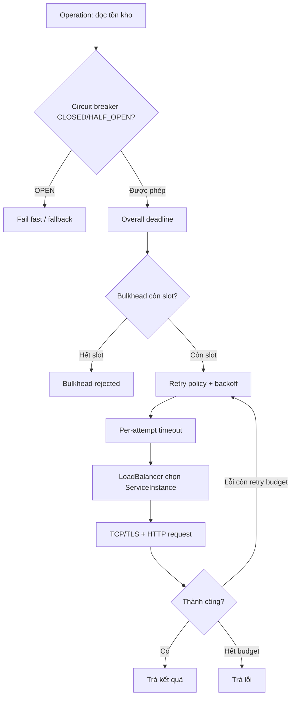
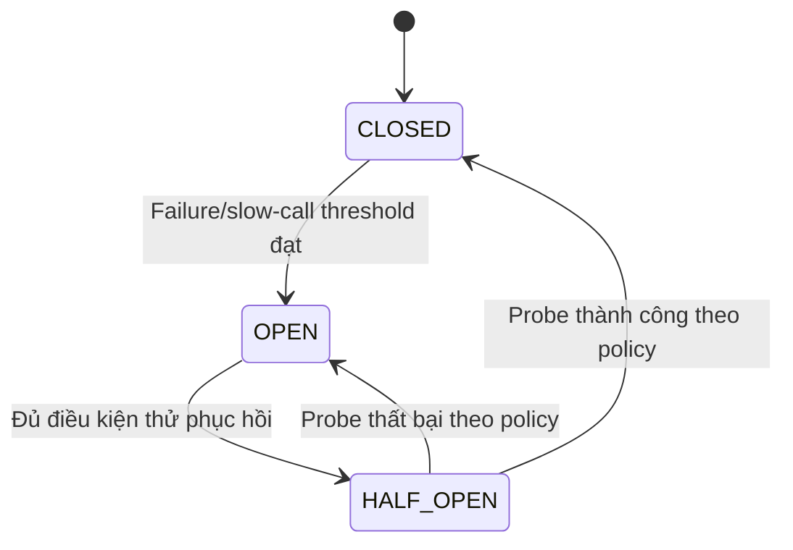
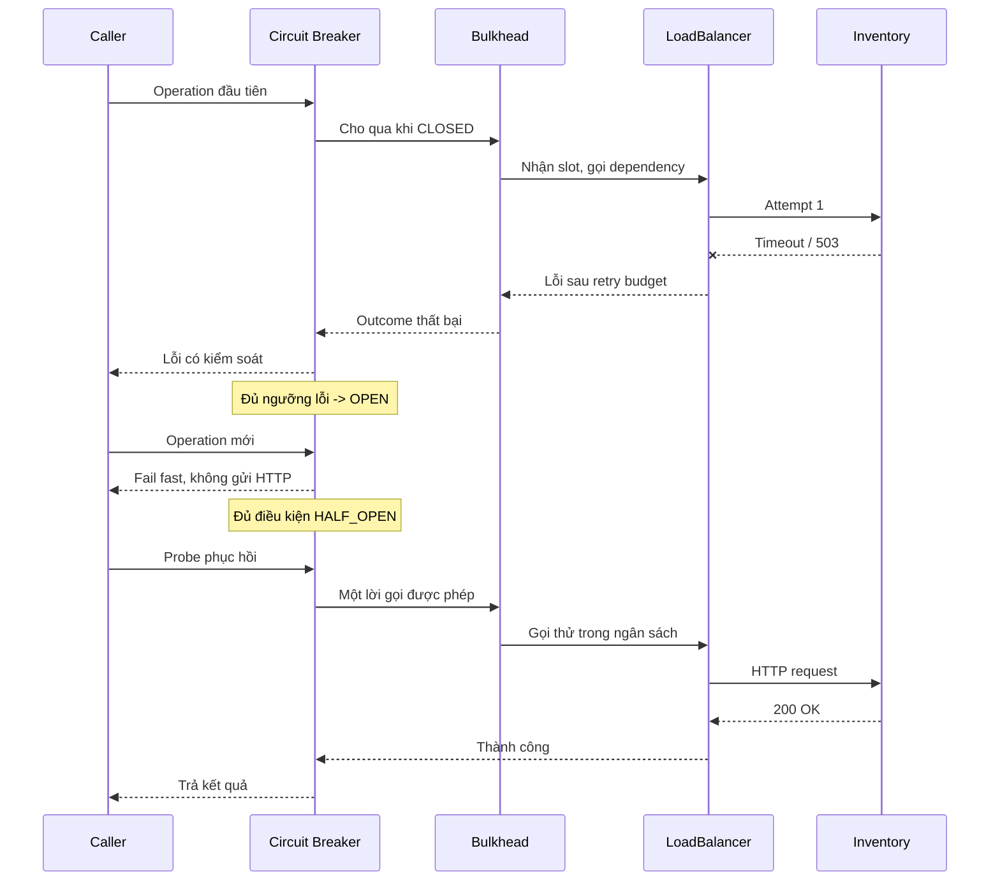

# Thứ tự retry, timeout, circuit breaker và bulkhead

Một hệ thống microservice không trở nên ổn định chỉ vì đã bật đủ bốn cơ chế **retry**, **timeout**, **circuit breaker** và **bulkhead**. **Thứ tự bao bọc và phạm vi áp dụng** của chúng quyết định số request thật sự đến downstream, thời gian một thao tác giữ tài nguyên, số lỗi mà circuit breaker ghi nhận và khả năng phục hồi sau sự cố.

Ví dụ, `order-service` gọi `http://inventory-service/api/products/P-1001` bằng `@LoadBalanced WebClient.Builder`. Spring Cloud LoadBalancer chọn một `ServiceInstance` theo service ID; sau đó HTTP connector mở hoặc lấy connection từ pool. Nếu `inventory-service` phản hồi chậm, chính sách có thể yêu cầu retry, hết deadline, bulkhead từ chối hoặc circuit breaker chuyển trạng thái. **Cùng một lỗi ban đầu nhưng thứ tự các cơ chế khác nhau có thể tạo kết quả hoàn toàn khác.**

Bài thuộc chương **Cô lập và khôi phục** của module Spring Cloud LoadBalancer. Người học sẽ hiểu cách thiết kế thứ tự resilience khi dùng `RestClient`, `WebClient` hoặc `OpenFeign`; phân biệt retry do HTTP transport/LoadBalancer/tầng nghiệp vụ; chọn bộ đếm lỗi hợp lý; bảo vệ connection pool và kiểm chứng bằng log, metric, lỗi giả lập.

## 1. Bốn cơ chế có mục đích khác nhau

| Cơ chế | Câu hỏi cần giải quyết | Nó **không** thay thế được gì? |
|---|---|---|
| **Timeout / deadline** | Một attempt hoặc cả thao tác được phép chờ bao lâu? | Không tự xác định lỗi nào retry an toàn; không tự cách ly concurrency. |
| **Retry** | Khi có lỗi tạm thời, có nên thử lại, sau bao lâu và tối đa mấy lần? | Không chữa được lỗi cấu hình/TLS, dependency lỗi kéo dài hoặc thao tác ghi không idempotent. |
| **Circuit breaker** | Khi một dependency liên tục lỗi/chậm, có nên dừng gửi request mới để tránh lỗi dây chuyền? | Không phải bộ giới hạn số request đồng thời; không hủy transaction đã commit. |
| **Bulkhead** | Một downstream được dùng tối đa bao nhiêu tài nguyên/slot để không kéo sập toàn caller? | Không tự sửa response timeout, không quyết định instance nào khỏe. |

Chúng hoạt động cạnh Spring Cloud LoadBalancer nhưng không phải cùng một thứ:

- **LoadBalancer:** tìm `ServiceInstance` và chọn địa chỉ theo discovery/health/caching/chính sách định tuyến.
- **HTTP transport:** thực hiện TCP/TLS/HTTP, connection pool, connect/read/response timeout.
- **Resilience layer:** có thể bao bọc logical call bằng bulkhead, circuit breaker, retry và deadline.

Tách ba trách nhiệm giúp tránh suy luận sai như “circuit breaker đã mở thì LoadBalancer tự xóa instance khỏi registry” hoặc “tăng pool sẽ làm timeout hết xảy ra”.

## 2. Hiểu thứ tự từ ngoài vào trong

Ký hiệu `A(B(call))` nghĩa là **A bao bọc B**, B bao bọc thao tác HTTP. Khi request được thực hiện, A kiểm tra trước; khi có kết quả hoặc lỗi, B hoàn tất trước rồi kết quả quay ra A.

Ví dụ:

```text
CircuitBreaker(
    OverallTimeout(
        Bulkhead(
            Retry(
                PerAttemptTimeout(
                    LoadBalancedHttpCall
                )
            )
        )
    )
)
```

Đọc từ ngoài vào trong:

1. Circuit breaker kiểm tra có cho phép **logical operation** đi qua không.
2. Overall timeout đặt ngân sách thời gian cho cả thao tác, bao gồm thời gian chờ bulkhead nếu có.
3. Bulkhead kiểm tra còn slot dành cho dependency này không.
4. Retry quyết định thử lại theo loại lỗi, số lần và backoff.
5. Per-attempt timeout bảo vệ từng lần gọi.
6. Spring Cloud LoadBalancer chọn instance và HTTP client gửi request.



**Đây là một lựa chọn kiến trúc có ưu/nhược điểm, không phải thứ tự bắt buộc.** Ví dụ trên giữ một bulkhead slot trong cả thời gian retry và backoff. Overall timeout được đặt **bên ngoài bulkhead** để có thể giới hạn cả thời gian chờ permit; nếu đặt bên trong, thời gian xếp hàng xin permit có thể không nằm trong timeout. Khi cần nhả slot giữa các lần retry, phải đặt bulkhead **bên trong** retry và chấp nhận ý nghĩa đo tải khác. Những khác biệt đó là trọng tâm của bài.

## 3. Trước khi chọn thứ tự: định nghĩa logical operation và attempt

Giả sử caller xử lý một yêu cầu người dùng `GET /orders/42/availability`. Nó gọi inventory:

```text
Logical operation: kiểm tra tồn kho cho order 42
    ├─ HTTP attempt 1 -> inventory-1 -> timeout
    ├─ backoff 100 ms
    └─ HTTP attempt 2 -> inventory-2 -> 200 OK
```

- **Logical operation:** một lần thực hiện mục tiêu nghiệp vụ của caller.
- **HTTP attempt:** một lần cố gắng gửi request tới một endpoint thật. Một số retry có thể thất bại trước khi request tới server, chẳng hạn pool acquisition timeout.
- **Per-attempt timeout:** thời hạn riêng cho mỗi lần thử.
- **Overall deadline:** thời hạn cho toàn bộ logical operation, **bao gồm retry và backoff**.
- **Concurrency slot:** quyền sử dụng một tài nguyên có giới hạn. Slot có thể được giữ cả operation hoặc chỉ một attempt tùy vị trí bulkhead.

Lưu ý một logical operation có thể đi qua nhiều service ID và nhiều gateway. Retry toàn bộ workflow khác hoàn toàn với retry đúng một HTTP call: nếu các bước trước đã ghi dữ liệu, retry từ đầu có nguy cơ side effect trùng.

## 4. Thứ tự timeout và retry quyết định tổng thời gian

Hai biểu thức thường gặp:

```text
// A: deadline bao phủ tất cả attempt + backoff
OverallTimeout(
    Retry(PerAttemptTimeout(HTTP))
)

// B: retry nằm ngoài một lần gọi có timeout
Retry(
    Timeout(HTTP)
)
```

| Thứ tự | Timeout áp vào đâu? | Hệ quả thực tế |
|---|---|---|
| **`Timeout(Retry(call))`** | Toàn bộ retry pipeline. | Có thể cắt ngắn attempt đang chạy khi deadline tổng hết; phù hợp một ngân sách SLA chung. |
| **`Retry(Timeout(call))`** | Mỗi lần subscribe/attempt được timeout riêng. | Tổng operation có thể vượt xa timeout của một attempt vì phải tính các lần thử và backoff. |
| **`Timeout(Retry(Timeout(call)))`** | Có cả timeout theo attempt lẫn tổng deadline. | Cho phép thử lại lỗi tạm thời mà không vượt ngân sách chung; thường là cách dễ kiểm soát hơn. |

Ví dụ: mỗi attempt được phép chờ 500 ms, retry thêm tối đa hai lần, backoff giữa các lượt 100 ms rồi 200 ms.

```text
Attempt 1: 500 ms -> timeout
Backoff 1: 100 ms
Attempt 2: 500 ms -> timeout
Backoff 2: 200 ms
Attempt 3: 500 ms -> timeout
--------------------------------
Tổng lý thuyết gần 1.800 ms, chưa tính các overhead khác
```

Nếu caller chỉ còn 1.000 ms trước deadline, cho toàn bộ ba attempt chạy hết là vô ích. Với **overall deadline 1.000 ms**, pipeline cần dừng khi hết ngân sách ngay cả khi chưa dùng hết retry count. Việc hủy chờ tại client **không bảo đảm** công việc backend đã bị dừng hoặc rollback.

### Timeout nào cần đặt theo attempt?

Một HTTP attempt có thể trải qua các giai đoạn riêng:

| Giai đoạn | Cơ chế giới hạn |
|---|---|
| Lấy instance từ discovery | Deadline/timeout của provider, supplier hoặc orchestration. |
| Chờ HTTP connection pool | Pending acquire / connection request timeout. |
| Mở TCP socket | Connect timeout. |
| TLS handshake | TLS/SSL handshake timeout hoặc deadline theo transport. |
| Chờ response, nhận body | Read timeout hoặc response timeout của HTTP engine. |

**Connect timeout không phải overall deadline.** Cũng không nên mặc định `responseTimeout` của Reactor Netty hay `readTimeout` của Feign là giới hạn tuyệt đối cho toàn bộ body. Một response stream có thể gửi chunk đều đặn và tồn tại lâu hơn inactivity timeout.

## 5. Circuit breaker đặt ngoài hay trong retry?

Một circuit breaker như trong Resilience4j thường đo trạng thái **CLOSED → OPEN → HALF_OPEN** theo số lần gọi, tỷ lệ lỗi/chậm trong sliding window và cấu hình của breaker. Nhưng **“một lần gọi” là một lần bao bọc ở vị trí nào?**

### Phương án A: circuit breaker bao ngoài retry

```text
CircuitBreaker(
    Retry(HTTP)
)
```

Circuit breaker thường nhận **một outcome cho một logical call** mà nó bao bọc. Ví dụ attempt đầu trả `503`, attempt thứ hai trả `200`: nếu retry xử lý thành công và chỉ trả kết quả cuối, breaker có thể ghi nhận **một success**. Nó không nhất thiết biết attempt đầu đã thất bại, trừ khi có instrumentation cho retry riêng.

Ưu điểm: breaker phản ánh xác suất **operation cuối cùng thành công đối với caller**; dễ điều khiển fail-fast ở biên dependency. Hạn chế: lỗi attempt ban đầu và số tải thực tới backend có thể bị che nếu chỉ xem breaker metrics.

### Phương án B: retry bao ngoài circuit breaker

```text
Retry(
    CircuitBreaker(HTTP)
)
```

Mỗi attempt đi qua circuit breaker có thể được đếm riêng. Trong cùng ví dụ `503 → 200`, breaker có thể ghi nhận **một failure và một success**. Nếu dependency đang lỗi mạnh, breaker có thể mở ngay trong quá trình retry. Retry rộng quá còn có thể cố lặp `CallNotPermittedException` khi breaker OPEN, tạo một vòng lặp vô ích.

Ưu điểm: breaker thấy sát hơn chất lượng của từng attempt. Hạn chế: breaker có thể phản ứng nhanh với spike retry và người đọc metrics phải phân biệt attempt-level failure với operation-level failure.

| Mục tiêu đo và điều khiển | Thứ tự thường dễ hiểu |
|---|---|
| Breaker phản ánh **kết quả cuối cùng** của thao tác gọi dependency | `CircuitBreaker(Retry(call))` |
| Breaker phản ánh **từng lần thử** và ngắt nhanh khi attempts thất bại | `Retry(CircuitBreaker(call))`, kèm classifier chặt và chính sách cho `CallNotPermittedException` |
| Vừa đo operation-level vừa nhìn thấy attempt failures | Breaker theo mục tiêu phù hợp **và** metric retry/transport riêng; không dựa độc nhất vào breaker |

**Không có quy tắc một chiều cho mọi hệ thống.** Khi circuit breaker bao ngoài retry, cần đặc biệt giám sát số attempt thật và tổng latency: logical operation cuối cùng thành công có thể vẫn nhân đôi tải xuống downstream. Khi breaker nằm trong retry, cần loại trừ exception fail-fast khỏi retry classifier.

### Phân loại outcome cho breaker

Không nên mặc định mọi exception đều là “downstream hỏng”:

- `503`, timeout hoặc lỗi mạng đến instance có thể là thất bại cần breaker ghi nhận.
- `400` do caller gửi payload sai thường không nói lên sức khỏe downstream.
- `401`/`403` do token sai có thể là lỗi auth/configuration, retry cùng request không giúp ích.
- `BulkheadFullException` phản ánh caller hết capacity được cấp; nếu breaker bao ngoài bulkhead, thường cần cân nhắc **ignore** để không kết luận downstream hỏng chỉ vì local saturation.
- `CallNotPermittedException` là kết quả breaker đang OPEN; không nên retry nó bằng một policy “retry all exceptions”.

Từng tổ hợp phải định nghĩa `recordException`, `ignoreException` hoặc predicate tương ứng theo API Resilience4j đang sử dụng.

## 6. Bulkhead đặt ngoài hay trong retry?

Bulkhead giới hạn mức tiêu thụ tài nguyên riêng cho một downstream/nhóm công việc. Có hai mô hình phổ biến:

- **Semaphore bulkhead:** giới hạn số lời gọi được phép đi vào đồng thời, không tự chuyển toàn bộ xử lý sang thread pool khác.
- **Thread-pool bulkhead:** cách ly bằng executor/queue riêng trong các mô hình phù hợp; có overhead và ngữ nghĩa timeout/cancellation khác.

**Bulkhead không đồng nghĩa HTTP connection pool.** Một semaphore permit giới hạn operation/attempt theo vị trí bao bọc; một HTTP connection có thể được reuse, còn HTTP/2 còn hỗ trợ nhiều stream trên cùng socket.

### Phương án A: bulkhead bao ngoài retry

```text
Bulkhead(
    Retry(HTTP)
)
```

Caller chiếm một slot trong **cả chuỗi attempt và backoff**. Ví dụ bulkhead max 20 và operation chờ backoff 500 ms: slot có thể bị giữ suốt lúc chờ, dù không có TCP connection đang hoạt động.

Ưu điểm: giới hạn **số logical operations** đồng thời đang sử dụng dependency, tránh một operation retry bùng ra ngoài quota. Hạn chế: giữ permit khi backoff làm giảm throughput và tăng số request bị từ chối lúc tải lớn.

### Phương án B: retry bao ngoài bulkhead

```text
Retry(
    Bulkhead(HTTP)
)
```

Mỗi attempt lấy slot trước khi gọi và trả slot sau attempt. **Trong lúc backoff không giữ slot**, giúp các operation khác có cơ hội đi qua. Nhưng mỗi logical operation có thể quay lại nhiều lần, khiến backend phải xử lý thêm attempts trong một cửa sổ tải cao.

Nếu bulkhead từ chối một attempt, cần quyết định có retry `BulkheadFullException` hay không. **Mặc định khuyến nghị không retry tức thì** vì đây là tín hiệu local saturation; nếu có queue/backoff tại tầng trên, phải hạn chế và tôn trọng deadline.

| Vị trí bulkhead | Tài nguyên được giới hạn | Rủi ro chính |
|---|---|---|
| `Bulkhead(Retry(call))` | Logical operations đang chạy, kể cả thời gian backoff | Giữ slot lâu trong lúc ngủ giữa attempts. |
| `Retry(Bulkhead(call))` | Concurrent attempts đang thực thi | Các operation có thể luân phiên retry nhiều lần, tăng tổng tải. |

Một hệ thống có thể dùng **hai hạn mức khác nhau**: bulkhead ngoài giới hạn operations in-flight và một concurrency limit ở tầng HTTP/transport để bảo vệ số attempts thật. Cần định lượng rõ, không thêm nhiều semaphore không thể quan sát.

## 7. Một thứ tự khởi đầu có chủ đích

Đối với một request đọc tương đối ngắn, một thiết kế dễ giải thích là:

```text
CircuitBreaker(
    OverallTimeout(
        Bulkhead(
            Retry(
                PerAttemptTimeout(
                    @LoadBalanced HTTP client
                )
            )
        )
    )
)
```

Mục tiêu của thứ tự này:

1. **Breaker ở ngoài**: fail-fast trước khi giữ bulkhead slot; thống kê kết quả operation cuối cùng.
2. **Overall timeout ở ngoài bulkhead và retry**: tính cả thời gian xin permit, attempts/backoff khi hết deadline.
3. **Bulkhead ở ngoài retry**: giới hạn số operations in-flight; *đổi lại* slot vẫn bị giữ trong backoff.
4. **Per-attempt timeout ở trong retry**: không để một lần thử chiếm hết thời gian hợp lý.
5. **Load-balanced HTTP client nằm trong vùng được bảo vệ**: từng attempt có thể chọn instance theo cơ chế retry được cấu hình.

Không áp dụng mù quáng trong production. Với backend cần slot được nhả giữa các backoff, cân nhắc `CircuitBreaker(OverallTimeout(Retry(Bulkhead(PerAttemptTimeout(call)))))` và đo tổng số operations/attempts. Với streaming lâu dài, cần mô hình riêng cho concurrency, timeout và breaker outcome.

### Fallback nên ở đâu?

Fallback là **chính sách trả kết quả thay thế**, ví dụ cache stale được chấp nhận hoặc phản hồi “tồn kho tạm thời chưa xác định”. Nếu fallback nằm **bên trong breaker** và biến mọi lỗi thành thành công, breaker có thể chỉ thấy success và không mở khi backend thực sự lỗi.

Một lựa chọn dễ quan sát là:

```text
Fallback(
    CircuitBreaker(
        OverallTimeout(
            Bulkhead(
                Retry(HTTP)
            )
        )
    )
)
```

Khi đó breaker ghi nhận lỗi thật trước khi fallback chuyển sang kết quả thay thế, nhưng caller vẫn nhận được phản hồi có kiểm soát. Fallback phải **đúng ngữ nghĩa nghiệp vụ**: trả dữ liệu tồn kho không chắc chắn như thể tồn kho chính xác có thể nguy hiểm hơn trả lỗi.

## 8. Spring Cloud LoadBalancer và retry nằm ở vị trí nào?

Spring Cloud LoadBalancer chọn instance dựa trên `service ID`, discovery và chuỗi `ServiceInstanceListSupplier`. Khi một caller dùng `@LoadBalanced RestClient.Builder` hoặc `@LoadBalanced WebClient.Builder`, bước chọn instance nằm trong interceptor/filter của HTTP client. Với `OpenFeign`, một wrapper như `FeignBlockingLoadBalancerClient` có thể thực hiện vai trò tương ứng.

**Bật LoadBalancer không có nghĩa mọi request đều có retry.** Cơ chế retry phụ thuộc dependency, auto-configuration, HTTP client cụ thể, release train và chính sách đã đặt. Nếu retry-aware LoadBalancer được bật, nó có thể thử lại cùng hoặc khác instance:

```yaml
spring:
  cloud:
    loadbalancer:
      retry:
        enabled: true
        max-retries-on-same-service-instance: 0
        max-retries-on-next-service-instance: 1
```

Đây là **ví dụ định hướng có điều kiện**: cần đối chiếu tài liệu và configuration metadata của phiên bản Spring Cloud đang dùng. Các giá trị không thay thế cấu hình Spring Retry/Reactor, cũng không bảo đảm mọi client đều đi qua cùng một cơ chế. Một số blocking integration có thể cần Spring Retry trên classpath và cách xử lý reactive khác blocking.

### Khi đã có retry ở LoadBalancer, thêm retry ở gateway có tác dụng gì?

Giả sử retry của LoadBalancer tối đa hai attempts, còn tầng WebClient/Feign gateway retry thêm một lượt cả call. Với mọi điều kiện cho phép, **hai lượt ở gateway × hai attempts ở LoadBalancer = tối đa bốn attempts tầng thấp**, chưa tính retry ẩn ở transport. Nếu failure xảy ra trước khi HTTP được gửi, số HTTP requests thực đến backend có thể thấp hơn.

Việc đặt thêm circuit breaker và bulkhead sẽ bao quanh **tầng nào** tùy nơi gắn:

- Gắn breaker vào method nghiệp vụ bên ngoài gateway: thường quan sát kết quả **sau khi** LoadBalancer retry hoàn tất.
- Gắn breaker vào từng HTTP attempt: có thể ghi nhận các thất bại mà retry tầng trên đã khắc phục.
- Gắn bulkhead quanh method gateway: giữ slot cho toàn logical call, có thể bao gồm retries, backoff và thời gian chờ pool.
- Gắn bulkhead thấp hơn vào một attempt: nhả slot giữa các attempts, nhưng một logical operation có thể đi vào bulkhead nhiều lần.

**Không giả định** `@Retry`, `@CircuitBreaker`, `@Bulkhead` và `@TimeLimiter` sẽ thực thi theo thứ tự mà annotation được viết trong source code. Khi dùng Resilience4j Spring aspects, thứ tự phụ thuộc cơ chế AOP, aspect order và cấu hình phiên bản; self-invocation hoặc gọi method không đi qua Spring proxy còn có thể khiến advice bị bỏ qua. Nếu muốn kiểm soát thứ tự tuyệt đối để học, hãy dùng composition hoặc Reactor operator có vị trí rõ ràng và kiểm thử.

### Service ID, instance và breaker scope

Một breaker gắn cho `inventory-service` có thể coi toàn bộ instance là một dependency logic. Nếu chỉ một instance bị lỗi, breaker cấp service ID có thể mở và chặn cả các instance còn khỏe. Ngược lại, breaker theo **instance ID** có độ chi tiết cao nhưng phải xử lý instance autoscaling, churn và số lượng metric labels lớn.

Một cách cân bằng thường gặp là:

- Service-level breaker để bảo vệ caller khỏi **một dependency** đang lỗi diện rộng.
- Health check/discovery và LoadBalancer retry để tránh instance lỗi cục bộ.
- Các policy chi tiết theo operation hoặc nhóm endpoint khi workload/rủi ro khác nhau.

Phạm vi chính xác phải được chọn theo kiến trúc, không có quy tắc “mỗi instance luôn có một breaker”.

## 9. Ví dụ WebClient: thể hiện thứ tự bằng Reactor operators

Ví dụ sau xây một policy có chủ đích cho **GET đọc dữ liệu**. Giả sử ứng dụng đã có Spring WebFlux, Spring Cloud LoadBalancer, Resilience4j core và module `resilience4j-reactor` với phiên bản tương thích. Hai bean breaker/bulkhead sau là minh họa, không phải một bộ ngưỡng chuẩn production:

```java
import java.time.Duration;
import io.github.resilience4j.bulkhead.Bulkhead;
import io.github.resilience4j.bulkhead.BulkheadConfig;
import io.github.resilience4j.bulkhead.BulkheadFullException;
import io.github.resilience4j.circuitbreaker.CircuitBreaker;
import io.github.resilience4j.circuitbreaker.CircuitBreakerConfig;
import org.springframework.context.annotation.Bean;
import org.springframework.context.annotation.Configuration;

@Configuration(proxyBeanMethods = false)
class InventoryResilienceConfiguration {

    @Bean
    Bulkhead inventoryBulkhead() {
        return Bulkhead.of("inventory-read",
                BulkheadConfig.custom()
                        .maxConcurrentCalls(20)
                        .maxWaitDuration(Duration.ZERO)
                        .build());
    }

    @Bean
    CircuitBreaker inventoryCircuitBreaker() {
        CircuitBreakerConfig config = CircuitBreakerConfig.custom()
                .slidingWindowSize(20)
                .minimumNumberOfCalls(10)
                .failureRateThreshold(50.0f)
                .waitDurationInOpenState(Duration.ofSeconds(10))
                .ignoreExceptions(BulkheadFullException.class)
                .build();

        return CircuitBreaker.of("inventory-read", config);
    }
}
```

Trong một số phiên bản/configuration, việc OPEN rồi HALF_OPEN còn liên quan đến tự động chuyển trạng thái, số permitted calls HALF_OPEN và event handling. Không coi đoạn trên là thiết lập đầy đủ mọi chi tiết recovery của circuit breaker.

Một gateway minh họa:

```java
import java.time.Duration;
import java.util.concurrent.TimeoutException;
import io.github.resilience4j.bulkhead.Bulkhead;
import io.github.resilience4j.circuitbreaker.CircuitBreaker;
import io.github.resilience4j.reactor.bulkhead.operator.BulkheadOperator;
import io.github.resilience4j.reactor.circuitbreaker.operator.CircuitBreakerOperator;
import org.springframework.cloud.client.loadbalancer.LoadBalanced;
import org.springframework.stereotype.Service;
import org.springframework.web.reactive.function.client.WebClient;
import org.springframework.web.reactive.function.client.WebClientRequestException;
import org.springframework.web.reactive.function.client.WebClientResponseException;
import reactor.core.publisher.Mono;
import reactor.util.retry.Retry;

@Service
class InventoryReactiveGateway {

    private final WebClient client;
    private final Bulkhead bulkhead;
    private final CircuitBreaker breaker;

    InventoryReactiveGateway(
            @LoadBalanced WebClient.Builder builder,
            Bulkhead inventoryBulkhead,
            CircuitBreaker inventoryCircuitBreaker) {
        this.client = builder.baseUrl("http://inventory-service").build();
        this.bulkhead = inventoryBulkhead;
        this.breaker = inventoryCircuitBreaker;
    }

    Mono<ProductView> findProduct(String id) {
        return Mono.defer(() -> client.get()
                        .uri("/api/products/{id}", id)
                        .retrieve()
                        .bodyToMono(ProductView.class))
                .timeout(Duration.ofMillis(500)) // per attempt
                .retryWhen(Retry.backoff(1, Duration.ofMillis(100))
                        .jitter(0.4)
                        .filter(this::retryableReadError))
                .transformDeferred(BulkheadOperator.of(bulkhead))
                .timeout(Duration.ofMillis(1100)) // cả operation, gồm chờ permit
                .transformDeferred(CircuitBreakerOperator.of(breaker));
    }

    private boolean retryableReadError(Throwable error) {
        if (error instanceof TimeoutException) {
            return true;
        }
        if (error instanceof WebClientResponseException response) {
            return response.getStatusCode().value() == 503;
        }
        return error instanceof WebClientRequestException;
    }
}
```

`ProductView` là DTO ví dụ. Cần đăng ký một `@LoadBalanced WebClient.Builder` và nguồn `ServiceInstance` phù hợp; code này không tự tạo registry. `Retry.backoff(1, ...)` cho phép **tối đa một lần retry** ở Reactor pipeline (hai lần subscribe cấp này), không phải một retry tổng cộng của mọi tầng.

### Vì sao thứ tự operator lại như vậy?

Vì operator được áp dụng theo chuỗi và `transformDeferred` bọc publisher trước nó, luồng được quan sát theo thứ tự:

```text
CircuitBreakerOperator(
    OverallTimeout(
        BulkheadOperator(
            RetryWhen(
                PerAttemptTimeout(
                    HTTP request
                )
            )
        )
    )
)
```

Breaker chỉ thấy outcome cuối cùng của publisher có retry và overall timeout; bulkhead giữ slot trong thời gian retry/backoff. Vì overall timeout bao ngoài bulkhead, nó cũng bảo vệ thời gian xin permit nếu cấu hình bulkhead cho phép chờ. `BulkheadFullException` được cấu hình ignore ở breaker để local saturation không mặc định được tính như lỗi backend. Nếu cần nhả permit giữa attempts, chuyển `BulkheadOperator` **vào trước** `retryWhen` và đo lại hành vi.

**Hạn chế của ví dụ:** classifier `WebClientRequestException` còn khá rộng, có thể bao gồm lỗi DNS/TLS không thể khôi phục nếu cấu hình không đổi. Trong production nên bóc tách root cause và giới hạn theo nguyên nhân lỗi; xử lý `Retry-After` cho `429`/`503` nếu có; không lặp GET vô nghĩa khi chứng chỉ sai. Các timeout ở Reactor chỉ giới hạn subscription tương ứng; cancellation chưa chắc dừng công việc đã được backend nhận.

### Đừng lầm thời hạn response của HTTP connector với tổng deadline

Nếu dùng Reactor Netty, có thể đặt riêng `CONNECT_TIMEOUT_MILLIS`, `responseTimeout(...)` và `pendingAcquireTimeout(...)`. Ví dụ ở trên dùng Reactor `timeout` để minh họa **vị trí lồng thời hạn**, không thay thế tuning cho socket/TLS/connection pool của connector.

## 10. Ví dụ blocking với RestClient/Feign: composition rõ ràng

Với `RestClient` hoặc `OpenFeign` đồng bộ, có thể dùng API lập trình của Resilience4j để thể hiện chính xác wrapper mà không phụ thuộc thứ tự AOP annotation. Ví dụ:

```java
import java.time.Duration;
import java.util.function.Supplier;
import io.github.resilience4j.bulkhead.Bulkhead;
import io.github.resilience4j.circuitbreaker.CircuitBreaker;
import io.github.resilience4j.retry.Retry;
import io.github.resilience4j.retry.RetryConfig;
import org.springframework.web.client.ResourceAccessException;

// Giả sử client là RestClient đã tích hợp @LoadBalanced
// hoặc một Feign proxy gọi inventory-service qua LoadBalancer.
Supplier<ProductView> httpAttempt = () ->
        inventoryGateway.getProduct("P-1001");

RetryConfig retryConfig = RetryConfig.custom()
        .maxAttempts(2) // tổng hai attempts, không phải hai retry
        .waitDuration(Duration.ofMillis(100))
        .retryExceptions(ResourceAccessException.class)
        .build();

Retry retryPolicy = Retry.of("inventory-read", retryConfig);

Supplier<ProductView> retried =
        Retry.decorateSupplier(retryPolicy, httpAttempt);

Supplier<ProductView> isolated =
        Bulkhead.decorateSupplier(inventoryBulkhead, retried);

Supplier<ProductView> guarded =
        CircuitBreaker.decorateSupplier(inventoryCircuitBreaker, isolated);

ProductView result = guarded.get();
```

`inventoryGateway`, `inventoryBulkhead` và `inventoryCircuitBreaker` là những đối tượng **được cung cấp sẵn từ cấu hình ứng dụng**, không phải biến được framework tự tạo chỉ vì đoạn code trên xuất hiện. Với OpenFeign, loại exception của Feign thường không phải `ResourceAccessException`; phải cấu hình classifier theo transport/Feign thực tế. Ví dụ này minh họa **thứ tự `CircuitBreaker(Bulkhead(Retry(call)))`**, chưa có overall deadline.

### Điểm khó của timeout trên client đồng bộ

Không thể tự động tạo **hard deadline** cho một lời gọi blocking chỉ bằng cách bao quanh `Supplier.get()` với một đồng hồ logic. Cần các timeout đúng của HTTP transport và, nếu dùng cơ chế bất đồng bộ như Resilience4j TimeLimiter/`CompletionStage`, phải hiểu rõ việc timeout/cancel/interrupt **không bảo đảm chấm dứt I/O đang blocking**.

Nếu chạy nhiều HTTP calls đồng bộ trong executor, thread-pool bulkhead có thể giới hạn threads/queue. Nhưng khi timeout chỉ kết thúc phần chờ của caller còn worker thread vẫn chạy, tài nguyên vẫn có thể bị chiếm. Phải đo threads active, queue, cancellation behavior và khả năng đóng socket của transport.

### Cấu hình Spring Boot và OpenFeign chỉ là một lớp

Một `@FeignClient(name = "inventory-service")` không đặt URL cố định có thể được bọc bởi LoadBalancer. Khi muốn dùng circuit breaker qua Spring Cloud OpenFeign, một số release train cung cấp tích hợp thông qua Spring Cloud CircuitBreaker và property tương ứng, nhưng cần starter và version phù hợp. Không mặc định rằng viết `@FeignClient` đã bật Resilience4j hoặc thứ tự `Retry → CircuitBreaker → Bulkhead` như mong muốn.

Với RestClient, `@LoadBalanced RestClient.Builder` không tự tạo breaker/bulkhead; nó chỉ hỗ trợ phân giải service ID nếu các auto-configuration liên quan hoạt động. Giữ trách nhiệm resilience ở một tầng rõ ràng, tránh đồng thời cấu hình retry trong Feign, LoadBalancer, HTTP transport và Resilience4j mà không kiểm soát attempts.

## 11. Khi breaker OPEN, HALF_OPEN rồi hồi phục

Một circuit breaker điển hình có ba trạng thái:

| Trạng thái | Hành vi | Điều cần quan sát |
|---|---|---|
| **CLOSED** | Cho request qua và ghi nhận outcome để đánh giá tỷ lệ lỗi/chậm. | Số cuộc gọi đã ghi, failure/slow-call rate, latency. |
| **OPEN** | Từ chối nhanh các request mới, thường tạo `CallNotPermittedException` hoặc tín hiệu tương đương. | Rejected/not-permitted count; downstream có được giảm tải không? |
| **HALF_OPEN** | Cho phép một số cuộc gọi kiểm tra, rồi quyết định đóng lại hay mở tiếp. | Số permitted probes, success/failure thực và thời gian chuyển trạng thái. |



**Không đồng nhất recovery của circuit breaker với recovery của discovery.** Breaker đóng lại không tự cập nhật danh sách instance; danh sách mới của service ID có thể vẫn stale. Ngược lại, khi registry đã thay instance khỏe mới, breaker ở trạng thái OPEN có thể vẫn từ chối request cho đến khi policy cho phép HALF_OPEN.

### Nguy cơ HALF_OPEN + retry

Nếu một cuộc gọi HALF_OPEN được phép đi qua breaker ngoài retry nhưng bên trong lại thực hiện nhiều HTTP attempts, “một probe” của breaker có thể gây vài request thật. Nếu breaker ở trong retry, có thể từng attempt lại xin một HALF_OPEN permit và bị từ chối khi permit hết.

Do đó HALF_OPEN thường nên có **ngân sách retry rất chặt hoặc tắt retry** cho probe, đặc biệt khi dependency vừa được phục hồi và đang chịu cold start, connection warm-up hoặc database recovery. Đánh giá thời gian hồi phục trên metric, không chỉ nhìn trạng thái CLOSED.

## 12. Không gộp mọi lỗi vào một cơ chế

Một ma trận phân loại lỗi giúp thiết kế thứ tự resilience:

| Tín hiệu | Retry? | Circuit breaker? | Bulkhead/timeout xử lý gì? |
|---|---|---|---|
| `ConnectException`/connect timeout từ một instance | Có thể retry GET với giới hạn, cân nhắc đích khác. | Có thể ghi nhận như dependency failure nếu policy phù hợp. | Deadline per-attempt ngắn; không giữ slot quá lâu. |
| Read timeout sau khi backend nhận request | Cẩn trọng: request ghi có thể đã commit. | Có thể xem là timeout/slow call. | Deadline tổng để tránh mọi attempts kéo dài. |
| HTTP `503` hoặc `502` tạm thời | Có thể retry với backoff/budget; xét nguồn status. | Có thể tính failure. | Giới hạn concurrency để không dồn thêm tải. |
| HTTP `429` | Chỉ retry khi tôn trọng rate limit/`Retry-After` và deadline. | Không mặc định xem là server hỏng; tùy hợp đồng. | Bulkhead/rate limiter giúp tránh áp lực mới. |
| HTTP `400`/`401`/`403` | Thường không retry cùng request. | Thường không nên tính như sự cố availability của downstream. | Timeout và pool không sửa lỗi payload/auth. |
| TLS hostname/certificate error | Không retry nếu cấu hình không đổi. | Có thể xem là lỗi cấu hình; không tạo thêm connection vô ích. | Fail fast, sửa trust/SAN/service metadata. |
| Không có `ServiceInstance` | Thường không retry ngay; cần kiểm tra discovery/health. | Nếu nhiều lỗi kéo dài có thể kích hoạt breaker theo policy. | Không có socket nào để bulkhead/transport “sửa”. |
| `BulkheadFullException` | Tránh retry ngay; caller đã quá quota. | Cân nhắc ignore, không tính như remote failure. | Giảm concurrency/queue hoặc load shedding. |
| `CallNotPermittedException` | Không retry ngay trên cùng breaker đang OPEN. | Là cơ chế fail-fast hiện tại, không phải một HTTP attempt lỗi. | Trả fallback/error có kiểm soát. |

Chính sách phải dựa trên **ngữ nghĩa endpoint**, không chỉ HTTP method. `GET` được coi là safe/idempotent theo HTTP semantics, nhưng một endpoint GET có side effect không đúng chuẩn cũng có thể gây hậu quả khi retry. Với `POST`/`PATCH`, cần idempotency key/operation ID và deduplication atomic ở server trước khi cho phép phát lại sau timeout không chắc kết quả.

## 13. Nếu các tầng retry đều bật, giới hạn thực tế tăng bao nhiêu?

Giả sử một logical call có:

- Business/Resilience4j retry: tối đa **2 attempts**.
- LoadBalancer retry: tối đa **2 attempts** cho một lần gọi HTTP logic.
- HTTP transport: có thể thử lại tối đa **2 attempts** trong trường hợp được phép.

Nếu các vòng lặp thực sự lồng nhau, một operation có **biên trên lý thuyết**:

```text
2 × 2 × 2 = 8 low-level attempts
```

Tại tải 100 operations/giây, nếu tất cả chạm biên lý thuyết và đều tới backend, có thể tạo ra tới khoảng 800 HTTP attempts/giây từ cùng caller. Kết quả thực có thể thấp hơn vì nhiều lỗi xảy ra trước khi gửi HTTP, retry classifier từ chối, deadline cắt ngắn hoặc các lớp không lồng nhau đúng như giả định.

**Retry budget phải tính theo attempts cuối cùng mà downstream nhận**, không chỉ theo một property `maxAttempts` ở tầng business. Với một service đang bão hòa, bảy attempts bổ sung có thể làm tình trạng tệ hơn thay vì tăng tỷ lệ thành công.

### Tránh retry storm

Khi nhiều caller nhận timeout cùng lúc, retry ngay có thể đồng bộ và tạo đợt tải mới:

```text
Downstream chậm
     ↓
Read timeout tăng
     ↓
Nhiều caller retry đồng thời
     ↓
Pool pending và backend concurrency tăng
     ↓
Latency p99 tăng tiếp, thêm timeout
```

Các cơ chế cần phối hợp: số attempt nhỏ, exponential backoff có jitter, deadline chung, concurrency limit/bulkhead, rate limiting và circuit breaker. Khi server gửi `Retry-After` trên `429` hoặc `503`, cần quyết định có thể chờ trong deadline còn lại hay nên dừng.

## 14. Mô hình phục hồi đúng: fail fast, giảm tải, rồi thăm dò

Khi một instance hoặc dependency lỗi kéo dài, bốn cơ chế phối hợp theo một chuỗi quyết định, không phải theo hướng “retry mãi cho đến khi hết lỗi”.

### Giai đoạn 1 — Lỗi ngắn và còn khả năng khôi phục

Timeout theo attempt ngăn việc chờ vô hạn; retry có giới hạn có thể thử lại một lỗi kết nối tạm thời hoặc `503` trên một GET idempotent. LoadBalancer có thể chọn instance khác nếu retry-aware supplier/policy cho phép.

### Giai đoạn 2 — Tải tăng và pool bắt đầu nghẽn

Bulkhead từ chối bớt operations mới để bảo vệ caller; quá nhiều request đang xếp hàng hoặc retry sẽ khiến tail latency tăng. Retry classifier không nên biến `BulkheadFullException` thành yêu cầu HTTP mới ngay lập tức.

### Giai đoạn 3 — Dependency liên tục thất bại

Circuit breaker nhận đủ dữ liệu lỗi/slow calls theo sliding window, chuyển OPEN và trả lỗi nhanh thay vì gửi thêm lưu lượng. Nó **không tự sửa service discovery**, không kill backend và không giải phóng mọi HTTP socket idle ngay lập tức.

### Giai đoạn 4 — Thử phục hồi

Sau khoảng thời gian theo cấu hình, breaker cho phép HALF_OPEN probes. Những request này cần ít concurrency và retries hạn chế để đánh giá recovery mà không gây bão tải. Nếu thành công theo policy, breaker CLOSED; nếu không, quay OPEN.



Biểu đồ chỉ minh họa tiến trình một breaker. Trạng thái chuyển tiếp thực tế phụ thuộc số lượng calls tối thiểu, sliding window, tỷ lệ lỗi/chậm, số HALF_OPEN permits và các ngưỡng khác. Không kết luận một request `200` duy nhất luôn đủ để breaker CLOSED.

## 15. Bài thực hành: thay đổi thứ tự để nhìn thấy hậu quả

Chuẩn bị ứng dụng `order-service` có `@LoadBalanced WebClient.Builder` và hai instance `inventory-service` tại `localhost:8081`, `localhost:8082`. Nếu chưa có registry động, dùng `SimpleDiscoveryClient`:

```yaml
spring:
  cloud:
    discovery:
      client:
        simple:
          instances:
            inventory-service:
              - uri: http://localhost:8081
              - uri: http://localhost:8082
```

Ở backend thử nghiệm, tạo hai endpoint:

```java
import java.time.Duration;
import java.util.concurrent.atomic.AtomicInteger;
import org.springframework.http.ResponseEntity;
import org.springframework.web.bind.annotation.GetMapping;
import org.springframework.web.bind.annotation.RestController;
import reactor.core.publisher.Mono;

@RestController
class InventoryLabController {

    private final AtomicInteger counter = new AtomicInteger();

    @GetMapping("/lab/flaky")
    Mono<ResponseEntity<String>> flaky() {
        int current = counter.incrementAndGet();
        if (current % 3 != 0) {
            return Mono.just(ResponseEntity.status(503).body("temporary"));
        }
        return Mono.just(ResponseEntity.ok("recovered"));
    }

    @GetMapping("/lab/slow")
    Mono<String> slow() {
        return Mono.just("slow")
                .delayElement(Duration.ofSeconds(2));
    }
}
```

Đây là backend mô phỏng tối giản, **không phải một dịch vụ production**. Counter hoạt động độc lập trên từng replica và việc load balance giữa hai instance có thể làm chuỗi `503/200` khác dự đoán. Khi kiểm chứng exact attempt sequence, hãy cố định một instance trước, sau đó bật hai instance để quan sát đổi đích.

### Kịch bản A — Baseline chỉ có HTTP call

1. Tắt retry/circuit breaker/bulkhead bổ sung cho bài lab hoặc đặt các ngưỡng không tác động đến baseline.
2. Gọi `/lab/flaky` và ghi response status, số request thực tế tại backend.
3. Gọi `/lab/slow` và đo latency của một request thành công.
4. Xác minh đường gọi đi qua đúng service ID và LoadBalancer đang chọn instance thực.

Mục tiêu là có số liệu so sánh khi thêm từng cơ chế, không bắt đầu bằng cách bật cả bốn.

### Kịch bản B — Đổi vị trí timeout và retry

Với endpoint chậm, thử:

```text
Sơ đồ 1: Timeout( Retry( PerAttemptTimeout(HTTP) ) )
Sơ đồ 2: Retry( Timeout(HTTP) )
```

Chọn per-attempt timeout ngắn hơn thời gian phản hồi thật và số retry cố định. Quan sát tổng latency, số lần request đã tới backend và error cuối. `Sơ đồ 2` có thể vượt quá ngưỡng của một lần timeout vì lặp lại sau mỗi attempt; `Sơ đồ 1` cắt sớm hơn khi hết ngân sách tổng. Nên giữ thêm một giới hạn test-run chung để tránh pipeline thử nghiệm treo.

### Kịch bản C — Circuit breaker ngoài và trong retry

1. Cố ý tạo một chuỗi thất bại rồi thành công ở mức HTTP attempt.
2. Thử `CircuitBreaker(Retry(call))` và `Retry(CircuitBreaker(call))` với các ngưỡng/số attempts tương ứng.
3. Theo dõi `calls recorded` và failure rate của breaker **cùng** số HTTP attempts thực.
4. Quan sát khi breaker OPEN, lần retry tiếp theo có bị `CallNotPermittedException` hay không và classifier có dừng.

Phải làm lại trạng thái breaker giữa các phép thử, hoặc dùng instance breaker mới, nếu không các counts tích lũy sẽ làm kết quả không so sánh được.

### Kịch bản D — Bulkhead giữ slot khi backoff

Giữ concurrency của caller lớn hơn max permits trong lab, ví dụ 50 logical operations và bulkhead tối đa 5 phép gọi đồng thời. So sánh:

```text
Bulkhead(Retry(call))    // giữ slot cả backoff
Retry(Bulkhead(call))    // nhả slot giữa các attempts
```

Đo available permits, rejected calls, thời gian chờ, số attempts và tổng thành công. Không kết luận thiết kế nào “nhanh hơn” từ một lần chạy duy nhất: tăng throughput có thể đổi lấy backend load lớn hơn hoặc fairness kém hơn.

### Kịch bản E — Overall deadline tính cả thời gian xin permit

Giả sử bulkhead cho phép chờ tối đa 300 ms. So sánh:

```text
Bulkhead(Timeout(Retry(call)))
Timeout(Bulkhead(Retry(call)))
```

Ở biểu thức thứ nhất, deadline bên trong **có thể chỉ bắt đầu sau khi lấy được permit**. Ở biểu thức thứ hai, deadline ngoài có thể giới hạn cả thời gian xếp hàng chờ permit; tùy implementation, cancellation cần được kiểm chứng để chắc chắn slot/queue được giải phóng.

### Kịch bản F — Khi breaker OPEN và phục hồi

Tạo đủ số lỗi theo ngưỡng để breaker OPEN, tiếp tục gọi và xác minh backend **không nhận thêm requests** từ những cuộc gọi bị từ chối. Sau khoảng chờ và HALF_OPEN, phục hồi backend rồi đo tỷ lệ probe thành công và thời gian breaker CLOSED. Không dùng một test chỉ quan sát `CallNotPermittedException` để kết luận discovery hay pool bị lỗi.

### Kịch bản G — Retry với POST có side effect

Chỉ dùng backend giả lập có thể lưu operation ID/idempotency key và deduplicate. Tạo tình huống backend ghi thành công nhưng response đến caller bị mất; sau đó thử retry theo cùng operation ID và chứng minh backend không tạo side effect thứ hai. **Không chạy thử lỗi này trên dữ liệu thật hoặc hệ thống thanh toán production.**

### Bảng kết quả thực nghiệm

| Thử nghiệm | Thứ tự wrapper | Logical operations | HTTP attempts thực | Breaker recorded failures | Bulkhead rejected | p95 logical latency |
|---|---|---|---|---|---|---|
| Baseline | Không wrapper bổ sung | Đo | Đo | Đo | Đo | Đo |
| Deadline tổng | `CB(Timeout(BH(Retry(HTTP))))` | Đo | Đo | Đo | Đo | Đo |
| Breaker trong retry | `Retry(CB(Timeout(HTTP)))` | Đo | Đo | Đo | Đo | Đo |
| Bulkhead trong retry | `CB(Timeout(Retry(BH(HTTP))))` | Đo | Đo | Đo | Đo | Đo |

Không tự điền số liệu chưa được đo. Ghi rõ phiên bản Spring Boot, Spring Cloud, Resilience4j, HTTP transport, instance count, retry count và concurrency để các kết quả có thể so sánh.

## 16. Quan sát đúng tầng để tránh che giấu lỗi

Theo dõi các chỉ số **đồng thời**, thay vì chỉ xem response cuối:

| Chỉ số/sự kiện | Giúp trả lời câu hỏi |
|---|---|
| `serviceId`, `instanceId`, route và attempt | LoadBalancer đã chọn đích nào? Retry có đổi instance không? |
| Logical call success/failure | Caller thực sự nhận kết quả gì? |
| Actual HTTP attempts per operation | Có bao nhiêu request đã tới backend? Có bị nhân attempt? |
| Retry attempts, delay và exhausted count | Retry có đang cứu lỗi tạm thời hay đang bão tải? |
| Circuit breaker state, recorded calls, failures/slow calls | Breaker đang đánh giá attempts hay operations? |
| Circuit breaker not-permitted calls | Có thật sự fail-fast khi OPEN? |
| Bulkhead available/max permits, concurrent calls, rejected count | Caller có bị cô lập khi một downstream chậm không? |
| HTTP pool active/idle/pending acquisition | Có nghẽn socket sau khi retry tăng không? |
| Connect/read/response timeout và total deadline exceeded | Thời gian hết ở tầng nào? |
| Backend p95/p99, CPU/threads, readiness | Dependency có quá tải hay chưa sẵn sàng? |

Resilience4j, Spring Boot Actuator, Micrometer, Reactor Netty hoặc Feign Micrometer có thể cung cấp metric/event cho từng thành phần khi được tích hợp và bật phù hợp. **Không giả định** mọi chỉ số trên luôn có sẵn hoặc có tên giống nhau ở mọi phiên bản; hãy kiểm chứng meter thật và mức độ chi tiết instrumentation.

Ví dụ log chẩn đoán có cấu trúc:

```text
traceId=ab71
operation=inventory-read
serviceId=inventory-service
instanceId=inventory-2
layer=loadbalancer-attempt
attempt=2
failure=READ_TIMEOUT
retryable=true
remainingDeadlineMs=420
breakerState=CLOSED
bulkheadInFlight=9
```

Đây là **format minh họa**: log không tự xuất hiện chỉ vì bật LoadBalancer. Khi có nhiều attempts, gắn correlation/operation ID để phân biệt một thao tác nghiệp vụ với những HTTP calls con. Không ghi Bearer token, cookie, private key, dữ liệu định danh người dùng hoặc toàn bộ request body vào log/metric.

Một dashboard hữu ích đặt **first-attempt success rate**, **success-after-retry**, **retry-exhausted**, **breaker OPEN/not-permitted**, **bulkhead rejection**, **pool pending** và **logical p99 latency** cạnh nhau. Nếu retry rate tăng trong khi success-after-retry giảm, breaker liên tục OPEN và backend CPU tăng, chính sách có thể đang gây thêm áp lực thay vì giúp phục hồi.

## 17. Bảng chẩn đoán các lỗi do thứ tự cấu hình

| Triệu chứng | Nguyên nhân có thể | Cách kiểm tra / sửa |
|---|---|---|
| Một timeout 500 ms nhưng request kéo dài vài giây | `Retry(Timeout(call))` cấp timeout mới cho mỗi attempt hoặc có nhiều lớp retry. | Đặt overall deadline ngoài toàn retry pipeline và đo số attempts. |
| Circuit breaker không OPEN dù HTTP retry lỗi rất nhiều | Breaker nằm ngoài retry và chỉ thấy outcome thành công cuối; ngưỡng cũng có thể chưa đủ mẫu. | Đo attempt metrics riêng, xem breaker config và mục tiêu thống kê. |
| Breaker OPEN quá nhanh khi bật retry | Breaker có thể đếm mỗi attempt do đặt bên trong retry. | Đối chiếu call count vs HTTP attempts, cân nhắc đổi vị trí. |
| Retry cố gọi khi breaker OPEN | Classifier retry `CallNotPermittedException` hoặc retry bao ngoài breaker không có rule dừng. | Exclude not-permitted exception và bảo vệ tổng deadline. |
| Backend khỏe nhưng circuit breaker báo lỗi liên tục | `BulkheadFullException` bị tính như remote failure. | Xem bulkhead rejection, cấu hình breaker ignore local saturation theo policy. |
| Bulkhead từ chối nhiều dù CPU/backend rảnh | Slot bị giữ trong backoff hoặc thread blocking, mức concurrency quá thấp. | Kiểm tra `Bulkhead(Retry(...))`, thời gian giữ permit, thay đổi thứ tự có kiểm soát. |
| Bulkhead bị vượt kỳ vọng khi retry tăng | Bulkhead đặt theo attempt nhưng nhiều logical operations retry luân phiên. | Đo số attempts, quota theo operation và per-dependency budget. |
| Overall timeout không bao gồm chờ bulkhead | `Timeout` nằm bên trong bulkhead có thời gian chờ permit. | Đặt deadline ngoài bulkhead hoặc giảm queue/maxWaitDuration. |
| Timeout trả lỗi nhưng backend vẫn tạo order | Cancellation client không hủy transaction server. | Dùng idempotency key/operation state; không retry lệnh ghi mù quáng. |
| Breaker đã CLOSED nhưng request vẫn fail | Discovery cache stale, health endpoint lỗi, certificate/transport chưa phục hồi. | Soát instance list, TLS, pool và readiness độc lập. |
| LoadBalancer retry chuyển sang instance khác mà sai kết quả | Session affinity, sharding hoặc eventual consistency bị vi phạm. | Chỉ retry vào tập instance phù hợp; thiết kế state chia sẻ/consistency. |
| Thêm annotation nhưng thứ tự không đổi | AOP aspect order khác dự kiến hoặc self-invocation bỏ qua proxy. | Kiểm tra effective aspects, bean/proxy và thực nghiệm actual attempts. |
| Bulkhead chặn request của mọi service | Dùng chung một bulkhead cho các dependency không liên quan. | Tách hạn mức theo service ID/workload; đo available permits riêng. |
| CB OPEN khiến fallback có vẻ luôn “thành công” | Fallback biến lỗi thành success **trước** breaker ghi nhận outcome. | Đưa fallback ra ngoài breaker hoặc cấu hình observation đúng ý định. |

## 18. Checklist trước khi đưa cấu hình vào production

- [ ] Xác định từng **logical operation** và vị trí mỗi HTTP attempt thật sự phát sinh.
- [ ] Kiểm kê retry ở transport, Spring Cloud LoadBalancer, Reactor/Feign/Spring Retry, Resilience4j và cả proxy/gateway.
- [ ] Xác định chính xác **thứ tự ngoài–trong**, không suy ra từ thứ tự annotation trên method.
- [ ] Cấu hình connect/read/response timeout theo HTTP transport thật, có per-attempt limit hợp lý.
- [ ] Đặt overall deadline bao gồm retries/backoff; cân nhắc đặt **ngoài bulkhead** để bảo vệ cả thời gian chờ permit.
- [ ] Phân biệt bulkhead theo logical operation hay per-attempt; đo permit giữ trong backoff.
- [ ] Chọn breaker theo mục tiêu đo operation-level hay attempt-level và ghi nhận đúng lỗi.
- [ ] Loại lỗi local rejection hoặc lỗi caller khỏi failure classifier khi không phản ánh sự cố downstream.
- [ ] Không retry `CallNotPermittedException` hay `BulkheadFullException` ngay lập tức.
- [ ] Phân loại `429`, `503`, timeout, TLS và lỗi không có instance theo policy phù hợp.
- [ ] Có attempt budget nhỏ, backoff có jitter và tôn trọng `Retry-After` khi cần.
- [ ] Dùng idempotency/operation ID cho request có side effect; hiểu client cancel không đồng nghĩa server rollback.
- [ ] Cấu hình circuit breaker CLOSED/OPEN/HALF_OPEN, minimum calls, window và số probe phục hồi có chủ đích.
- [ ] Không mặc định HALF_OPEN probes được retry nhiều lần; giới hạn tải khi dependency mới phục hồi.
- [ ] Bulkhead tách theo downstream/nhóm công việc quan trọng, tránh dùng một quota toàn ứng dụng.
- [ ] Kiểm tra ServiceInstance discovery, health filtering, cache và instance metadata khi autoscaling.
- [ ] Đã quan sát retry attempts, breaker state, bulkhead rejected, pool pending và p95/p99 latency trên lab.
- [ ] Có kiểm thử khi một instance lỗi, toàn bộ dependency lỗi, timeout trước/sau commit và recovery.
- [ ] Fallback giữ đúng hợp đồng nghiệp vụ, không che giấu remote failures hoặc trả dữ liệu không chính xác.
- [ ] Không mở debug logging chứa token/body nhạy cảm; kiểm soát metric cardinality và tracing.

**Kết luận:** **Không có một thứ tự retry–timeout–circuit breaker–bulkhead đúng cho mọi loại request.** Điểm xuất phát dễ giải thích cho HTTP GET ngắn là `CircuitBreaker(OverallTimeout(Bulkhead(Retry(PerAttemptTimeout(@LoadBalanced HTTP call)))))`: breaker thống kê kết quả cuối, deadline giới hạn toàn thao tác (cả chờ bulkhead), bulkhead cô lập số operations và retry thử lại lỗi tạm thời trong ngân sách. Khi workload hoặc mục tiêu đo khác, hãy thay đổi vị trí một cách có chủ đích, đặc biệt là **breaker đếm attempt hay operation** và **bulkhead có giữ slot trong backoff hay không**, rồi chứng minh hành vi bằng số HTTP attempts thật và các metric khi tải lỗi.
