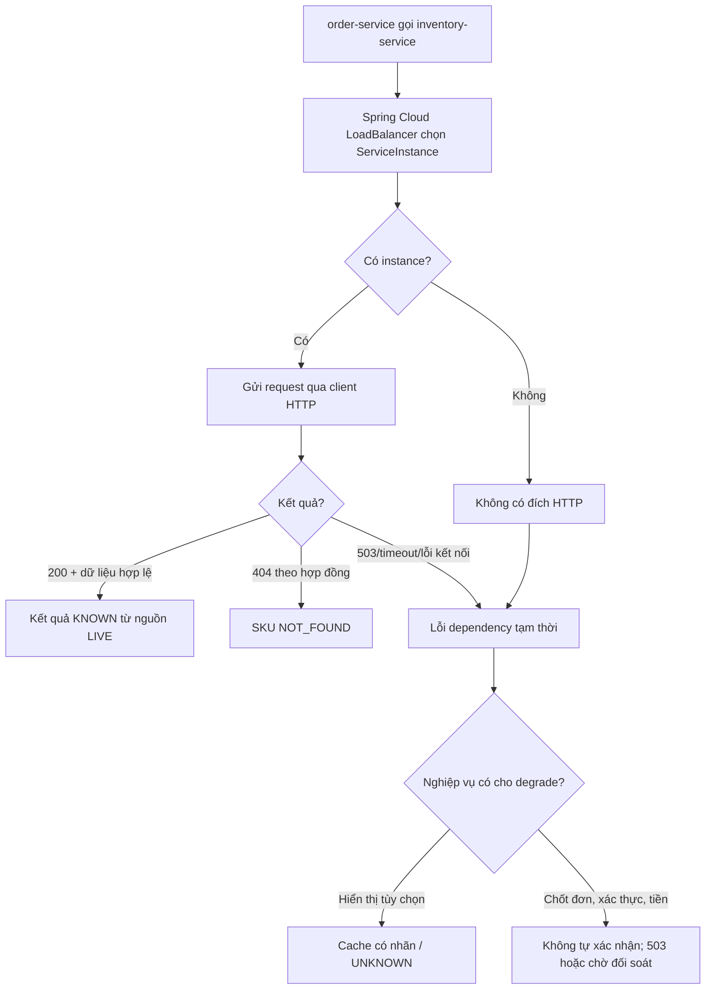
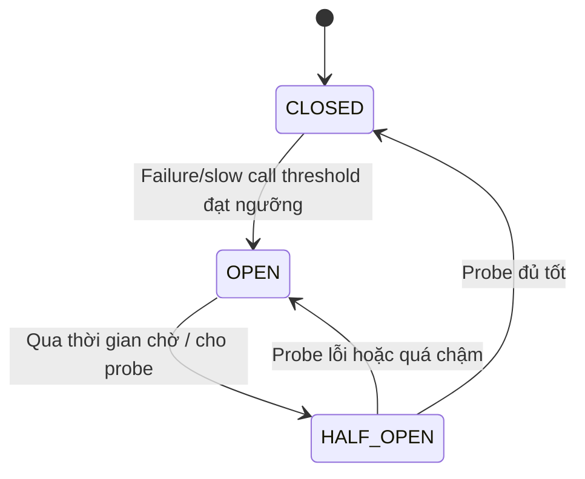

# Fallback phù hợp nghiệp vụ và tránh trả dữ liệu gây hiểu nhầm

## 1. Tình huống: “hết hàng” không giống “không kiểm tra được hàng”

Trong chương **Cô lập và khôi phục** của module `SPRING_CLOUD_SERVICE_COMMUNICATION_LOAD_BALANCING`, `order-service` gọi `inventory-service` qua Spring Cloud LoadBalancer. Caller sử dụng service ID `inventory-service`; LoadBalancer lấy danh sách `ServiceInstance` từ discovery, có thể lọc theo health/zone rồi chọn một bản sao để `RestClient`, `WebClient` hoặc OpenFeign gửi HTTP request.

Một ngày, `inventory-service` trả HTTP 503 hoặc không còn instance đủ điều kiện. Nhóm phát triển viết fallback:

```java
// KHÔNG NÊN DÙNG: không gọi được inventory không có nghĩa tồn kho bằng 0.
return inventoryClient.getAvailability(sku)
        .onErrorReturn(new InventorySnapshot(sku, 0));
```

Ứng dụng không còn báo lỗi, nhưng người dùng nhìn thấy **“hết hàng”** dù thực tế tồn kho có thể còn 200 sản phẩm. Nếu thay `0` bằng `999`, ứng dụng có thể cho đặt hàng quá mức. Cả hai đều là **dữ liệu nghiệp vụ giả**, dễ gây hậu quả hơn việc trả lỗi minh bạch.

**Fallback** là hành vi có chủ đích khi đường gọi chính thất bại, chẳng hạn trả trạng thái “chưa xác định”, đọc cache được đánh dấu cũ, ẩn một khối giao diện không thiết yếu hoặc chặn một thao tác cần xác minh. Fallback **không phải** cơ chế “bắt mọi exception rồi trả 200”.

Sau bài này, bạn sẽ:

1. Phân biệt kết quả nghiệp vụ `AVAILABLE` / `OUT_OF_STOCK` / `NOT_FOUND` với trạng thái `UNKNOWN` do dependency không khả dụng.
2. Chọn **fail-open** hoặc **fail-closed** theo hậu quả nghiệp vụ, không theo mong muốn giảm tỷ lệ lỗi trên dashboard.
3. Thiết kế hợp đồng fallback cho dữ liệu cache: nguồn, thời điểm quan sát, TTL, độ tin cậy và giới hạn sử dụng.
4. Kết hợp Spring Cloud LoadBalancer với timeout, retry có giới hạn, circuit breaker và bulkhead **mà không nhầm trách nhiệm của từng lớp**.
5. Viết API minh họa cho màn hình tra cứu **được phép suy giảm** và bước chốt đơn **phải kiểm tra dữ liệu mới**.
6. Đo tình trạng dùng fallback, dữ liệu cũ, lỗi được che giấu và thời gian phục hồi bằng phép thử có kiểm soát.

## 2. Phân biệt ba câu hỏi trước khi thiết kế fallback



Ba câu hỏi cần trả lời **độc lập**:

| Câu hỏi | Ví dụ | Trách nhiệm |
|---|---|---|
| Đã biết kết quả nghiệp vụ chưa? | SKU thật sự hết hàng, SKU không tồn tại | `inventory-service` và hợp đồng HTTP |
| Có gọi được một instance hay không? | Không có `ServiceInstance`, instance lỗi kết nối, HTTP 503 | Discovery, LoadBalancer và HTTP client |
| Nếu không biết kết quả thì được làm gì? | Hiển thị “chưa xác định”, dừng chốt đơn, dùng snapshot cũ có cảnh báo | **Quy tắc nghiệp vụ của caller** |

Spring Cloud LoadBalancer **không** tạo giá trị fallback từ domain. Nó chỉ quyết định đích và cung cấp khả năng phối hợp với discovery/health/retry. Circuit breaker cũng chỉ quyết định có nên cho một lời gọi đi qua và ghi nhận thất bại; **nội dung trả về khi lỗi phải do ứng dụng tự thiết kế**.

### 2.1. Ma trận trạng thái thường bị đánh đồng

| Sự kiện | Ta thực sự biết gì? | Không được khẳng định |
|---|---|---|
| HTTP 200, `available=0` và schema hợp lệ | Tồn kho bằng 0 tại thời điểm server trả lời | “Lỗi dependency” |
| HTTP 200, `available=20` | Tồn kho quan sát được là 20; trước khi giữ/chốt vẫn cần hợp đồng nhất quán | “Chắc chắn còn 20 cho tới lúc thanh toán” |
| HTTP 404 cho SKU, theo contract | SKU không tồn tại trong ngữ cảnh API đó | “Dịch vụ không tồn tại” |
| HTTP 503 từ inventory | Server báo không khả dụng | “Hết hàng” |
| Không chọn được instance | Caller chưa có đích đủ điều kiện để gửi HTTP | “Không tồn tại SKU” |
| Connect/read timeout | Caller không nhận được kết quả đúng hạn | “Server chắc chắn chưa thực hiện thao tác” |
| Circuit breaker đang OPEN | Caller chủ động không gửi request do chính sách bảo vệ | “Tồn kho bằng 0” |
| Cache trả giá trị từ 20 giây trước | Có một **snapshot lịch sử** | “Đó là tồn kho hiện tại” |
| HTTP 200 với body rỗng bất thường | Hợp đồng có thể bị vi phạm | “Tự điền giá trị mặc định” |

Khi xảy ra lỗi giải mã JSON, dữ liệu âm, SKU phản hồi khác SKU yêu cầu hoặc authentication/authorization thất bại, đừng tự áp fallback giống lỗi 503. Những lỗi đó cần phân loại và sửa hoặc xử lý theo hợp đồng riêng.

## 3. Fail-open và fail-closed là chính sách nghiệp vụ

**Fail-open** trong ngữ cảnh này nghĩa là cho **một phần chức năng** tiếp tục khi một dependency không hoạt động, với các điều kiện chặt chẽ. **Fail-closed** nghĩa là dừng hoặc từ chối chức năng yêu cầu bằng chứng từ dependency trước khi tiếp tục. Không nên dùng hai thuật ngữ này để thay thế nhau giữa các lĩnh vực bảo mật và hiển thị UX.

| Nghiệp vụ | Dependency gặp lỗi | Phương án an toàn thường gặp | Vì sao |
|---|---|---|---|
| Khối gợi ý sản phẩm (không thiết yếu) | Recommendation service không phản hồi | Ẩn khối, hoặc hiển thị “Gợi ý tạm thời không khả dụng” | Không làm sai dữ liệu đơn hàng |
| Danh sách sản phẩm để tham khảo | Inventory không phản hồi | Cho xem snapshot cũ có `asOf`/`stale=true` hoặc `UNKNOWN` | Người dùng vẫn duyệt được nhưng không nhầm là dữ liệu trực tiếp |
| Xác nhận tồn kho trước khi chốt | Inventory không phản hồi | **Không chấp thuận đặt giữ** cho tới khi xác minh; trả 503 hoặc xếp quy trình có trạng thái | Không cam kết hàng chưa kiểm tra |
| Thanh toán | Payment provider timeout | Trạng thái **chờ xác minh/đối soát**, không tự gắn `PAID` hay `FAILED` | Payment có thể đã được thực hiện nhưng response bị mất |
| Phân quyền truy cập | Authorization service lỗi | Không cấp quyền khi chưa xác minh; có thể trả 503 thay vì 403 | Tránh truy cập trái phép, 403 có thể gây hiểu nhầm về kết quả kiểm tra |
| Tỷ giá/giá bán để thanh toán | Pricing service lỗi | Chặn giao dịch hoặc áp chính sách giá đã được phê duyệt rõ ràng | Giá cũ có thể làm thiệt hại tài chính |
| Phân tích/telemetry không quan trọng | Analytics sink lỗi | Giảm chất lượng/buffer sự kiện có giới hạn, không chặn chức năng chính | Phải có giới hạn lưu đệm, bảo mật và mất dữ liệu chấp nhận được |
| Feature flag cho chức năng nhạy cảm | Flag service lỗi | Dùng **safe default** đã được quy định cho từng flag | “Mặc định bật mọi thứ” có thể vi phạm chính sách |

**Nguyên tắc:** chỉ fail-open đối với hành vi đã được product/security/operations phê duyệt. Chỉ vì một endpoint là GET không có nghĩa dữ liệu fallback tùy ý là vô hại.

### 3.1. “Không biết” cần là một trạng thái hạng nhất

Một mô hình sai:

```json
{
  "sku": "ABC-1",
  "available": 0
}
```

Client không thể phân biệt `0` thật với số `0` bị gán sau timeout. Mô hình tốt hơn cho **màn hình tham khảo**:

```json
{
  "sku": "ABC-1",
  "status": "UNKNOWN",
  "available": null,
  "source": "NONE",
  "observedAt": null,
  "stale": false,
  "noticeCode": "INVENTORY_UNAVAILABLE"
}
```

Ở đây `available=null` có nghĩa **không có giá trị được xác minh**, không phải không còn hàng. Cần định nghĩa quy tắc ở UI: hiển thị “Chưa thể kiểm tra tồn kho”, vô hiệu hóa nút mua nếu quy trình yêu cầu kiểm tra, không tự đổi `UNKNOWN` thành `OUT_OF_STOCK`.

Tùy hệ thống, có thể dùng một kiểu phân biệt kết quả như `Known(value)` / `Unknown(reason)` / `Stale(value, observedAt)` thay vì nhiều trường nullable. Quan trọng là **schema buộc client nhận ra trạng thái chất lượng dữ liệu**.

## 4. Cache fallback: khi nào được dùng dữ liệu cũ?

Một cache có thể giúp người dùng xem thông tin tham khảo khi dependency không hoạt động. Nhưng cache không tự biến dữ liệu thành đúng ở hiện tại.

Chính sách cache cần trả lời:

1. **Dữ liệu gì được cache?** Ví dụ mô tả sản phẩm thường ổn định hơn số lượng tồn kho; phiên đăng nhập/giá thanh toán có rủi ro khác.
2. **Ai tạo snapshot?** Chỉ lưu response thành công, hợp lệ từ nguồn tin cậy; không cache giá trị fallback hoặc lỗi 503 như dữ liệu thật.
3. **Được dùng để làm gì?** Có thể hiển thị tham khảo; không được tự cấp quyền, giữ hàng hoặc thu tiền nếu chính sách không cho.
4. **Bao nhiêu tuổi là chấp nhận được?** Quy định TTL theo nghiệp vụ, chẳng hạn 30 giây cho một demo; không dùng TTL này làm mặc định cho production.
5. **Nguồn và thời điểm nào?** Trả `source=CACHE`, `stale=true`, `observedAt` và, khi cần, phiên bản/region của dữ liệu.
6. **Có nhầm tenant/user/zone không?** Cache key cần phân vùng phù hợp theo tenant, location, quyền truy cập và version schema.
7. **Khi cache cũng lỗi?** Trả `UNKNOWN` hoặc lỗi minh bạch, không tự tạo một giá trị giả để “fallback tiếp”.

### 4.1. Ba mức độ dữ liệu cho giao diện

| Loại | Ví dụ response | Người dùng nên thấy | Có được dùng chốt đơn? |
|---|---|---|---|
| `LIVE` | `available=12`, `status=AVAILABLE` | “Còn hàng” theo thông tin vừa kiểm tra | Vẫn cần tuân thủ cơ chế giữ hàng/giao dịch |
| `CACHE` | `available=12`, `status=STALE_ADVISORY`, `observedAt=...` | “Thông tin từ 15 giây trước, cần kiểm tra lại” | **Không**, nếu chưa có cam kết freshness riêng |
| `NONE` | `available=null`, `status=UNKNOWN` | “Chưa thể kiểm tra tồn kho” | **Không** |

`STALE_ADVISORY` là **trạng thái hiển thị**, không đồng nghĩa còn hàng. Giữ trạng thái này riêng với `AVAILABLE` để client khó vô tình cho checkout dựa trên dữ liệu cache.

### 4.2. TTL và độ bền cache

TTL là ngưỡng cho phép dùng snapshot cũ; ví dụ `maxAge=30s` nghĩa là chỉ cân nhắc snapshot **không quá 30 giây** tại thời điểm đọc. Khi dữ liệu vượt ngưỡng, fallback trả `UNKNOWN` thay vì lén tăng tuổi dữ liệu được chấp nhận.

Cache trong RAM của từng replica `order-service` phù hợp demo, nhưng không đồng bộ giữa replica và mất khi restart. Production có thể cần shared cache, TTL thật, invalidation, chống cache stampede, cơ chế phân vùng tenant và quan sát độ tuổi dữ liệu. Không xem shared cache như source of truth của giao dịch.

## 5. Phân biệt LoadBalancer, circuit breaker, bulkhead và fallback

| Cơ chế | Trách nhiệm chính | Điều nó **không** làm |
|---|---|---|
| `ServiceInstanceListSupplier` / discovery | Cung cấp tập instance hiện biết | Không hiểu quy tắc “hết hàng” |
| `RoundRobinLoadBalancer` hoặc thuật toán khác | Chọn `ServiceInstance` | Không biến lỗi thành dữ liệu domain |
| Health check | Thăm dò trạng thái của các instance đã biết | Không bảo đảm mọi request tránh instance chết; phụ thuộc thời điểm cập nhật |
| Retry | Thực hiện lại attempt trong điều kiện đã chọn | Không bảo đảm exactly-once hay luôn chọn instance khỏe |
| Timeout/deadline | Giới hạn thời gian chờ | Không chứng minh downstream chưa xử lý |
| Circuit breaker | Cho phép/chặn lời gọi theo thống kê lỗi/chậm | Không tự suy ra kết quả nghiệp vụ |
| Bulkhead | Giới hạn cạnh tranh/tài nguyên của dependency | Không chọn fallback đúng nghiệp vụ |
| **Fallback của ứng dụng** | Quyết định dữ liệu/hành động hợp lệ khi đường chính thất bại | Không khôi phục dữ liệu thật đã mất hoặc thay thế giao dịch |

### 5.1. Circuit breaker hoạt động theo trạng thái



Trong Resilience4j, các trạng thái thông thường là `CLOSED`, `OPEN` và `HALF_OPEN`. Khi OPEN, các lời gọi phù hợp có thể bị từ chối bằng `CallNotPermittedException` **trước khi gửi HTTP**. Lúc đó, fallback nếu được phép có thể chạy mà không gọi `inventory-service`, giúp giảm tải trong sự cố.

Circuit breaker có ngưỡng dựa trên số lỗi hoặc số lần gọi chậm. Nó **không** đồng nghĩa giới hạn số request đồng thời: nếu cần cách ly pool/thread/connection, dùng bulkhead và giới hạn concurrency riêng. Cần phân loại lỗi: 404 do SKU không tồn tại thường là **kết quả nghiệp vụ**, không nhất thiết nên làm tăng tỷ lệ circuit breaker failure.

### 5.2. LoadBalancer và circuit breaker có scope khác nhau

`inventory-service` có hai replica, nhưng một circuit breaker đặt tên `inventory-read` ở caller thường theo dõi **operation/service dependency**, không tự tạo một breaker độc lập cho mỗi `ServiceInstance`. Nếu một replica lỗi nhiều, breaker có thể mở cho toàn thao tác, kể cả khi replica khác khỏe. Muốn policy theo replica cần thiết kế riêng, theo dõi instance ID và cân nhắc nguy cơ tăng cardinality/trạng thái.

Ngược lại, discovery/health filtering có thể loại một instance đã chết ra khỏi tập ứng viên; nó **không** thay thế breaker khi cả dependency quá tải hay mọi request đều chậm.

Đặc biệt, Spring Cloud Commons có `HealthCheckServiceInstanceListSupplier`; theo tài liệu, khi **không có instance healthy nào**, implementation mặc định có thể trả về **toàn bộ instance đã truy vấn** thay vì danh sách rỗng. Vì vậy health check không phải bảo đảm fail-closed tuyệt đối; caller vẫn cần timeout và xử lý lỗi.

## 6. Xây một hợp đồng response tránh lừa người dùng

Bài lab dùng hai endpoint khác nhau:

- `GET /demo/products/{sku}/availability`: **thông tin hiển thị**, cho phép degration rõ ràng bằng `STALE_ADVISORY` hoặc `UNKNOWN`.
- `POST /demo/checkout/verify/{sku}`: **bước cần xác minh tồn kho mới**, không được dùng snapshot fallback để cho phép chốt đơn; khi dependency lỗi thì trả 503 hoặc một trạng thái xử lý được đảm bảo riêng.

Ví dụ Java record/enum:

```java
enum InventoryStatus {
    AVAILABLE,
    OUT_OF_STOCK,
    STALE_ADVISORY,
    UNKNOWN
}

enum DataSource {
    LIVE, CACHE, NONE
}

record InventorySnapshot(
        String sku, Integer available, String instanceId) {}

record CachedInventory(
        InventorySnapshot snapshot, Instant observedAt) {}

record InventoryView(
        String sku,
        InventoryStatus status,
        Integer available,
        DataSource source,
        Instant observedAt,
        boolean stale,
        String noticeCode) {

    static InventoryView live(InventorySnapshot value, Instant time) {
        InventoryStatus status = value.available() > 0
                ? InventoryStatus.AVAILABLE
                : InventoryStatus.OUT_OF_STOCK;
        return new InventoryView(
                value.sku(), status, value.available(),
                DataSource.LIVE, time, false, null);
    }

    static InventoryView cached(CachedInventory cached) {
        InventorySnapshot value = cached.snapshot();
        return new InventoryView(
                value.sku(), InventoryStatus.STALE_ADVISORY,
                value.available(), DataSource.CACHE,
                cached.observedAt(), true, "RECHECK_BEFORE_PURCHASE");
    }

    static InventoryView unknown(String sku) {
        return new InventoryView(
                sku, InventoryStatus.UNKNOWN, null, DataSource.NONE,
                null, false, "INVENTORY_UNAVAILABLE");
    }
}
```

**Điểm quan trọng:** DTO dùng `Integer` thay vì `int` để phát hiện thiếu giá trị `available`. Nếu dùng `int`, JSON thiếu trường có thể được deserializer gán mặc định `0`, làm sai ranh giới giữa “không có dữ liệu” và “hết hàng”. Sau khi decode, vẫn phải validate các giá trị âm, SKU không khớp và schema của upstream.

Các enum/code là ví dụ cho hệ thống học tập, không phải property hay kiểu dữ liệu Spring Cloud tự cung cấp. Khi triển khai, đặt API contract có version, kiểm tra client mobile/web xử lý đầy đủ các trạng thái và không bỏ qua `stale`/`noticeCode`.

## 7. Tạo WebClient gọi inventory-service theo service ID

Để demo phản ứng với lỗi bất đồng bộ, sử dụng `@LoadBalanced WebClient.Builder`. Có thể dùng cùng nguyên tắc với `RestClient` hoặc OpenFeign, nhưng exception/return type và API fallback có thể khác.

```java
@Configuration(proxyBeanMethods = false)
class InventoryClientConfiguration {

    @Bean
    @LoadBalanced
    WebClient.Builder loadBalancedWebClientBuilder() {
        return WebClient.builder();
    }

    @Bean
    WebClient inventoryWebClient(
            @LoadBalanced WebClient.Builder builder) {
        return builder.clone()
                .baseUrl("http://inventory-service")
                .build();
    }
}
```

Ứng dụng cần Spring WebFlux, Spring Cloud LoadBalancer, discovery adapter thích hợp và Spring Cloud BOM tương thích Spring Boot. Host `inventory-service` là **service ID**; nếu tạo `WebClient.create("http://inventory-service")` mà không có filter LoadBalancer thì có thể xảy ra lỗi DNS vì thiếu tích hợp.

Adapter cho inventory:

```java
@Service
class InventoryGateway {
    private final WebClient client;

    InventoryGateway(WebClient inventoryWebClient) {
        this.client = inventoryWebClient;
    }

    Mono<InventorySnapshot> fetchLive(String sku) {
        return client.get()
                .uri("/api/inventory/{sku}", sku)
                .retrieve()
                .bodyToMono(InventorySnapshot.class)
                .switchIfEmpty(Mono.error(
                        new InvalidInventoryResponse("Body rỗng")))
                .map(snapshot -> validate(snapshot, sku));
    }

    private InventorySnapshot validate(
            InventorySnapshot snapshot, String requestedSku) {

        if (!requestedSku.equals(snapshot.sku())
                || snapshot.available() == null
                || snapshot.available() < 0) {
            throw new InvalidInventoryResponse(
                    "Inventory response sai hợp đồng");
        }
        return snapshot;
    }
}

final class InvalidInventoryResponse extends RuntimeException {
    InvalidInventoryResponse(String message) {
        super(message);
    }
}
```

Tại sao **không** đặt `onErrorReturn(available=0)` ở adapter?

- Adapter cần phân biệt HTTP 404/503, timeout, lỗi decode và lỗi contract.
- Nghiệp vụ chốt đơn có thể dùng cùng adapter nhưng **không được phép fallback**.
- Chỉ khi để error đi tới tầng application service, caller mới quyết định đường nào được suy giảm và đường nào bắt buộc fail-closed.

Trong `retrieve()`, HTTP 4xx/5xx mặc định trở thành `WebClientResponseException` hoặc subclass. Với một số reactive LoadBalancer version, **không tìm được instance** có thể tạo response 503 tổng hợp; status này chưa chứng minh có request tới inventory. Kiểm tra event selection và log server để phân biệt.

## 8. Cài cache minh họa có kiểm soát độ tuổi

Để giữ nội dung đơn giản, dùng interface cache đồng bộ cho lab; production có thể thay bằng Redis/Reactive Redis và phải thay cách gọi cho đúng non-blocking.

```java
interface InventorySnapshotCache {

    void save(InventorySnapshot snapshot, Instant observedAt);

    Optional<CachedInventory> findRecent(
            String sku, Duration maxAge);
}
```

Một implementation in-memory cho demo:

```java
@Component
class InMemoryInventorySnapshotCache
        implements InventorySnapshotCache {

    private final Map<String, CachedInventory> snapshots =
            new ConcurrentHashMap<>();

    private final Clock clock;

    InMemoryInventorySnapshotCache() {
        this.clock = Clock.systemUTC();
    }

    @Override
    public void save(InventorySnapshot value, Instant observedAt) {
        snapshots.put(value.sku(),
                new CachedInventory(value, observedAt));
    }

    @Override
    public Optional<CachedInventory> findRecent(
            String sku, Duration maxAge) {

        CachedInventory entry = snapshots.get(sku);
        if (entry == null) {
            return Optional.empty();
        }
        Duration age = Duration.between(
                entry.observedAt(), clock.instant());

        if (age.isNegative() || age.compareTo(maxAge) > 0) {
            return Optional.empty();
        }
        return Optional.of(entry);
    }
}
```

Cache này **chỉ phù hợp lab một tenant, một tiến trình**. Nó không có TTL eviction chủ động, không chia sẻ giữa các caller replica, không chống cache stampede và chưa phân vùng theo tenant/warehouse. Nếu dùng production, lựa chọn cache key, storage, encryption, invalidation, retention và access control phải dựa trên miền nghiệp vụ.

**Lưu ý:** dữ liệu được lưu tại thời điểm **nhận response thành công và đã validate**, không phải thời điểm bắt đầu request. Cache miss hoặc snapshot quá tuổi luôn tạo `UNKNOWN`; không “gia hạn tuổi” bản ghi chỉ vì đã được đọc trong một lần fallback.

## 9. Fallback có điều kiện ở đường đọc để hiển thị

Spring Cloud CircuitBreaker có API `ReactiveCircuitBreakerFactory`. Với implementation Resilience4j, ứng dụng reactive thường thêm starter `spring-cloud-starter-circuitbreaker-reactor-resilience4j` tương thích Spring Cloud Release Train. Không nhầm dependency CircuitBreaker với `spring-cloud-starter-loadbalancer`: đây là hai thành phần riêng.

Trong service sau:

- Chỉ có **response hợp lệ từ live inventory** mới được cache.
- Cache ≤30 giây chỉ dùng hiển thị **`STALE_ADVISORY`**.
- Không có cache hợp lệ thì trả **`UNKNOWN`** và `available=null`.
- Chỉ fallback với lỗi dependency tạm thời hoặc breaker OPEN.
- HTTP 404, lỗi JSON/contract và exception lập trình **không** bị che thành dữ liệu fallback.

```java
@Service
class InventoryDisplayService {

    private final InventoryGateway gateway;
    private final InventorySnapshotCache cache;
    private final ReactiveCircuitBreakerFactory<?, ?> breakers;
    private final Clock clock = Clock.systemUTC();

    InventoryDisplayService(
            InventoryGateway gateway,
            InventorySnapshotCache cache,
            ReactiveCircuitBreakerFactory<?, ?> breakers) {
        this.gateway = gateway;
        this.cache = cache;
        this.breakers = breakers;
    }

    Mono<InventoryView> readForDisplay(String sku) {

        Mono<InventoryView> live = gateway.fetchLive(sku)
                .map(snapshot -> {
                    Instant now = clock.instant();
                    cache.save(snapshot, now);
                    return InventoryView.live(snapshot, now);
                })
                .timeout(Duration.ofMillis(800));

        return breakers.create("inventory-read")
                .run(live)
                .onErrorResume(this::eligibleForFallback, error ->
                        Mono.fromSupplier(() ->
                                cache.findRecent(
                                        sku, Duration.ofSeconds(30))
                                .map(InventoryView::cached)
                                .orElseGet(() ->
                                        InventoryView.unknown(sku))));
    }

    private boolean eligibleForFallback(Throwable error) {
        if (error instanceof CallNotPermittedException
                || error instanceof WebClientRequestException
                || error instanceof TimeoutException) {
            return true;
        }

        if (error instanceof WebClientResponseException httpError) {
            int status = httpError.getStatusCode().value();
            return status == 502 || status == 503 || status == 504;
        }
        return false;
    }
}
```

Các import phụ thuộc Spring Cloud CircuitBreaker, Reactor, Spring WebClient, Resilience4j và `java.time`/`java.util.concurrent`. `TimeoutException` ở đây là `java.util.concurrent.TimeoutException` do Reactor timeout phát ra. Ví dụ giả định Spring Boot/Spring Cloud Release Train có các API tương ứng; kiểm tra BOM và package thực tế.

### 9.1. Vì sao không dùng fallback nhận mọi Throwable?

Ví dụ không an toàn:

```java
// SAI: che cả HTTP 404, lỗi hợp đồng, lỗi code và lỗi xác thực.
.onErrorResume(error -> Mono.just(InventoryView.unknown(sku)))
```

Nếu `inventory-service` trả HTTP 404 cho SKU không tồn tại, việc đổi thành `UNKNOWN` làm client hiểu sai ý nghĩa. Nếu server trả JSON thiếu `available` hoặc SKU không khớp, đó là lỗi dữ liệu cần phát hiện; không nên âm thầm biến mất khỏi giám sát.

**Lọc lỗi càng hẹp càng tốt.** `eligibleForFallback` ở đây chỉ là baseline; cần bổ sung cách phân loại lỗi thực tế của LoadBalancer, connector, circuit breaker và hệ thống theo đúng phiên bản. Không giả định chỉ từ `WebClientResponseException.ServiceUnavailable` có thể biết 503 là do inventory server hay do LoadBalancer tạo.

### 9.2. Vì sao phải để ý circuit breaker classification?

`ReactiveCircuitBreakerFactory#create("inventory-read").run(live)` bọc đường gọi chính. Circuit breaker **ghi nhận kết quả của publisher** theo quy tắc cấu hình; nếu không phân loại, 404 hoặc lỗi contract có thể bị xem là failure của dependency và làm breaker mở sai.

Cấu hình Resilience4j cần xác định nhóm exception được record, ignore hoặc xem như kết quả hợp lệ, **không** chỉ kiểm tra ở `onErrorResume` sau breaker. Ở luồng đọc, 404 là “SKU không tồn tại” theo hợp đồng thì nên chuyển thành kết quả domain phù hợp hoặc ignore trong breaker, thay vì làm tăng tỷ lệ hỏng kỹ thuật.

### 9.3. Vì sao cache cũ vẫn phải ghi là stale?

Một kết quả cache ở thời điểm `observedAt` thuộc quá khứ. Khi dùng nó do lỗi live, không được sửa `observedAt` thành thời gian hiện tại hay đổi `source` thành `LIVE`. Đây là bằng chứng duy nhất để UI và telemetry biết dữ liệu đang bị suy giảm.

Ví dụ JSON khi service lỗi nhưng cache còn trong ngưỡng:

```json
{
  "sku": "ABC-1",
  "status": "STALE_ADVISORY",
  "available": 12,
  "source": "CACHE",
  "observedAt": "2026-11-17T10:00:00Z",
  "stale": true,
  "noticeCode": "RECHECK_BEFORE_PURCHASE"
}
```

Giá trị timestamp chỉ mang tính ví dụ. Trạng thái phải được hiển thị rõ ở UI, không chỉ nằm trong JSON mà người dùng không thể thấy.

## 10. Đường chốt đơn phải fail-closed khi chưa xác minh

Cùng `InventoryGateway`, nhưng endpoint dùng để quyết định giữ/chốt đơn phải yêu cầu **kết quả live hợp lệ**. Không cho phép cache `STALE_ADVISORY` hay `UNKNOWN` trở thành quyết định “còn hàng”.

```java
final class DownstreamUnavailableException extends RuntimeException {
    DownstreamUnavailableException(Throwable cause) {
        super("Inventory verification is unavailable", cause);
    }
}

@Service
class CheckoutInventoryVerifier {

    private final InventoryGateway gateway;
    private final ReactiveCircuitBreakerFactory<?, ?> breakers;

    CheckoutInventoryVerifier(
            InventoryGateway gateway,
            ReactiveCircuitBreakerFactory<?, ?> breakers) {
        this.gateway = gateway;
        this.breakers = breakers;
    }

    Mono<InventorySnapshot> verifyFresh(String sku) {
        Mono<InventorySnapshot> upstream = gateway.fetchLive(sku)
                .timeout(Duration.ofMillis(800));

        return breakers.create("inventory-checkout")
                .run(upstream)
                .onErrorMap(this::temporaryUnavailable,
                        error -> new DownstreamUnavailableException(error));
    }

    private boolean temporaryUnavailable(Throwable error) {
        if (error instanceof CallNotPermittedException
                || error instanceof WebClientRequestException
                || error instanceof TimeoutException) {
            return true;
        }
        if (error instanceof WebClientResponseException http) {
            int code = http.getStatusCode().value();
            return code == 502 || code == 503 || code == 504;
        }
        return false;
    }
}
```

Không có `onErrorReturn`: lời gọi không thành công vẫn là lỗi. `inventory-checkout` là breaker riêng với operation display để không nhất thiết dùng cùng chính sách độ trễ/tỷ lệ lỗi. Điều này chỉ tách **policy**, không đồng nghĩa checker tự tạo giao dịch giữ hàng nguyên tử.

Khi thực hiện đặt hàng thật, đọc tồn kho rồi mới tạo đơn có thể có race condition: giữa hai bước, số lượng hàng thay đổi. Cần endpoint đặt giữ có kiểm soát đồng thời hoặc giao dịch phù hợp. **Fallback không thể thay thế cơ chế reservation/consistency**.

### 10.1. Biểu diễn HTTP lỗi bằng ProblemDetail

Ở API biên Spring WebFlux hoặc Spring MVC, có thể đưa exception domain về HTTP 503 với `ProblemDetail`:

```java
@RestControllerAdvice
class DependencyProblemAdvice {

    @ExceptionHandler(DownstreamUnavailableException.class)
    ResponseEntity<ProblemDetail> unavailable(
            DownstreamUnavailableException error) {

        ProblemDetail detail = ProblemDetail.forStatusAndDetail(
                HttpStatus.SERVICE_UNAVAILABLE,
                "Chưa thể xác minh tồn kho. Vui lòng thử lại sau.");
        detail.setTitle("Dịch vụ kiểm tra tồn kho tạm thời không khả dụng");
        detail.setProperty("code", "INVENTORY_VERIFICATION_UNAVAILABLE");

        return ResponseEntity.status(HttpStatus.SERVICE_UNAVAILABLE)
                .body(detail);
    }
}
```

HTTP 503 xuất hiện **ở `order-service`**, không có nghĩa downstream `inventory-service` đã trả 503: khi circuit breaker OPEN hoặc LoadBalancer không chọn được instance, request có thể chưa hề được gửi đi. Ghi log/metric riêng theo giai đoạn lỗi để điều tra.

**Tránh ánh xạ nhầm 404 sang 503:** nếu `inventory-service` xác nhận SKU không tồn tại bằng 404, hãy chuyển thành API 404 hoặc kết quả domain phù hợp theo contract. Không biến lỗi 404 thành “dependency unavailable” chỉ để có một status code thống nhất.

### 10.2. Tránh HTTP 200 “thành công giả”

Có thể trả HTTP 200 cho **endpoint hiển thị tùy chọn** với body `status=UNKNOWN` nếu contract nói rõ đây là **trạng thái của phép tra cứu**, không phải xác nhận tồn kho. Nhưng không dùng HTTP 200 + `available=0` cho endpoint checkout để che sự cố.

Cũng không dùng HTTP 206 Partial Content để biểu thị “API trả dữ liệu thiếu do upstream lỗi” nếu không thực hiện HTTP range semantics; `206` dành cho phản hồi theo range. Với dữ liệu tổng hợp, hãy dùng response schema có trạng thái từng phần rõ ràng, hoặc trả 503 nếu thành phần bắt buộc không có.

## 11. Fallback trong các miền nhạy cảm khác

### 11.1. Payment: timeout không chứng minh giao dịch thất bại

Khi `payment-service` timeout sau thao tác tạo charge, hai khả năng đều tồn tại: server chưa xử lý hoặc server đã ghi thành công nhưng response bị mất.

Không được:

```java
// NGUY HIỂM: không có phản hồi payment != thanh toán thất bại.
return PaymentStatus.FAILED;

// NGUY HIỂM hơn: không có phản hồi payment != thanh toán thành công.
return PaymentStatus.PAID;
```

Thay vào đó, dùng trạng thái có khả năng đối soát, ví dụ `PENDING_VERIFICATION`/`UNKNOWN_OUTCOME` và đưa giao dịch vào quy trình xác nhận qua idempotency key, query trạng thái từ payment provider hoặc webhook có bảo đảm. Chỉ trả HTTP 202 Accepted nếu hệ thống **đã thực sự nhận và lưu bền vững yêu cầu xử lý bất đồng bộ**; không dùng 202 để che một lỗi ngẫu nhiên mà chưa có job được quản lý.

Nếu cần retry charge, bắt buộc hợp đồng idempotency và chống ghi trùng ở phía server/provider. Ngân sách retry phải giới hạn; không retry vô hạn và không công bố payment thành công khi chưa xác minh.

### 11.2. Authorization: fail-closed nhưng trả lỗi trung thực

Nếu service phân quyền không trả kết quả, không cấp quyền mặc định. Tuy nhiên `403 Forbidden` có nghĩa server đã hiểu request và từ chối quyền; khi **không thể kiểm tra quyền**, tùy hợp đồng có thể trả `503` để phân biệt hạ tầng không khả dụng với kết luận người dùng không có quyền. Dù status nào được trả, hành động nhạy cảm **không được thực thi** khi chưa có quyết định ủy quyền hợp lệ.

Không để cache quyền hết hạn tiếp tục được dùng nếu chính sách yêu cầu thu hồi tức thời. Phải xác định TTL, sự kiện revoke, scope, tenant và chiến lược invalidation riêng.

### 11.3. Pricing: “giá gần nhất” không mặc nhiên là “giá được bán”

Có thể hiển thị giá cũ với nhãn rõ ràng ở trang thông tin nếu sản phẩm cho phép. Nhưng bước thanh toán cần giá được xác nhận bởi hệ thống pricing hoặc một chính sách giá đã được chấp thuận và ghi rõ. Không tự giảm giá về 0 hoặc dùng tỷ giá cũ mà chưa có giới hạn rủi ro.

### 11.4. Recommendation: suy giảm ít nguy hiểm hơn

Nếu `recommendation-service` lỗi, có thể bỏ hẳn khối gợi ý, hiện thông báo, hoặc sử dụng tập gợi ý phổ biến được gắn nguồn. Không cần đánh dấu “không có sản phẩm nào phù hợp” nếu thực tế công cụ gợi ý không chạy. Với dữ liệu cá nhân hóa, tránh dùng cache nhầm người dùng hay tenant.

## 12. Retry, fallback và deadline phải phối hợp có thứ tự

Với một phép GET chỉ đọc:

```text
Logical request
  -> bảo vệ concurrency (bulkhead nếu có)
  -> timeout/deadline toàn logical request
  -> circuit breaker / policy cho phép gọi
  -> tối đa một vài retry có backoff+jitter (nếu an toàn)
  -> Spring Cloud LoadBalancer chọn instance cho từng attempt
  -> WebClient/RestClient/OpenFeign gửi HTTP
  -> thành công: validate, cập nhật cache
  -> lỗi cuối: fallback có điều kiện hoặc lỗi 503
```

Đây là luồng logic, **không phải thứ tự bắt buộc của tất cả operator hoặc filter trong mọi version**. Thứ tự thực thi phụ thuộc cách bọc publisher/interceptor: đặt `timeout` bên trong vòng retry có thể reset thời gian cho mỗi attempt; đặt deadline ngoài vòng retry giúp giới hạn tổng. Circuit breaker tính một lần gọi hay từng attempt cũng phụ thuộc vị trí nó bọc retry.

### 12.1. Ngân sách tổng

Giả sử caller có 1.200 ms cho phép đọc tồn kho. Một attempt chờ 600 ms, backoff 150 ms, attempt tiếp theo 600 ms sẽ mất ít nhất 1.350 ms, chưa kể discovery và overhead. Vì vậy cần quyết định **không thử lại** khi thời gian còn lại không đủ.

\[
T_{\mathrm{logical}} =
\sum T_{\mathrm{attempt}}
+\sum T_{\mathrm{backoff}}
+T_{\mathrm{overhead}}.
\]

Các tham số timeout của HTTP connector áp cho phần kết nối/response, không tự bao mọi giai đoạn discovery, queue và retry. Khi dùng reactive publisher, có thể đặt `timeout(Duration)` ở vị trí ngoài retry để giới hạn tổng pipeline, đồng thời vẫn cần transport timeout và cancellation phù hợp.

### 12.2. Tránh retry storm và fallback storm

Khi circuit breaker mở, hàng nghìn request có thể đồng loạt chuyển sang cache hoặc cơ chế fallback. Nếu fallback lại gọi một dependency khác mà không có giới hạn, sự cố chỉ bị **chuyển tải** sang service dự phòng.

- Giới hạn concurrency của đường fallback và số lần gọi Redis/cache.
- Tránh để fallback phụ thuộc cùng service ID đang lỗi.
- Dùng cache snapshot đã được cập nhật từ lúc khỏe, không tạo cache miss storm bằng cách gọi live lại không giới hạn.
- Có circuit breaker/rate limit riêng cho fallback dependency nếu cần.
- Không chain `fallback A → fallback B → fallback C` vô hạn.
- Đặt deadline cho cả fallback; nếu không đủ thời gian, trả `UNKNOWN` hoặc lỗi chính xác.

**Circuit breaker khác bulkhead:** breaker hạn chế gọi khi thống kê lỗi/chậm đạt ngưỡng, bulkhead giới hạn số lời gọi cạnh tranh/tài nguyên. Chúng thường bổ trợ nhau chứ không thay thế.

## 13. Ma trận thí nghiệm với hai instance

### 13.1. Cấu hình lab

Chạy `order-service` tại `8080`; hai `inventory-service` tại `8081` và `8082`. Caller dùng `SimpleDiscoveryClient`:

```yaml
spring:
  application:
    name: order-service
  cloud:
    discovery:
      client:
        simple:
          instances:
            inventory-service:
              - uri: http://localhost:8081
                instance-id: inventory-a
              - uri: http://localhost:8082
                instance-id: inventory-b
    loadbalancer:
      retry:
        enabled: false
      cache:
        enabled: false

server:
  port: 8080
```

Các cổng `localhost` chỉ đúng khi caller và hai instance chạy cùng máy/network namespace. Trong Docker/Kubernetes phải dùng địa chỉ mà caller truy cập được. Tắt retry ở baseline để một logical read dễ đối chiếu với một attempt.

Nếu dùng Spring Cloud CircuitBreaker + Resilience4j reactive, thêm dependency phù hợp version:

```xml
<dependency>
    <groupId>org.springframework.cloud</groupId>
    <artifactId>spring-cloud-starter-circuitbreaker-reactor-resilience4j</artifactId>
</dependency>
```

Ví dụ cấu hình breaker riêng theo mục đích, chỉ phục vụ lab:

```yaml
resilience4j:
  circuitbreaker:
    instances:
      inventory-read:
        slidingWindowSize: 20
        minimumNumberOfCalls: 10
        failureRateThreshold: 50
        waitDurationInOpenState: 10s
        permittedNumberOfCallsInHalfOpenState: 3
      inventory-checkout:
        slidingWindowSize: 20
        minimumNumberOfCalls: 10
        failureRateThreshold: 50
        waitDurationInOpenState: 10s
        permittedNumberOfCallsInHalfOpenState: 3
```

Hai đoạn YAML **là các phần cấu hình có thể ghép vào một file**, không thêm trùng các key gốc `spring:` nếu project đã có chúng. Cấu hình Resilience4j phải đối chiếu Starter/BOM và behavior của Spring Cloud CircuitBreaker version thực tế. Trong production, tune threshold, minimum calls và exception recording theo dữ liệu đo; không copy nguyên số lab như khuyến nghị mặc định.

### 13.2. Server demo để chủ động tạo lỗi

Ví dụ controller trong `inventory-service` (Spring MVC):

```java
@RestController
class InventoryController {
    private final String instanceId;

    InventoryController(Environment env) {
        this.instanceId = env.getRequiredProperty("app.instance-id");
    }

    @GetMapping("/api/inventory/{sku}")
    InventorySnapshot get(@PathVariable String sku) {
        return new InventorySnapshot(sku, 12, instanceId);
    }
}
```

Để mô phỏng failure, trong môi trường test thêm một chế độ trả HTTP 503 hoặc delay response, **không** đặt endpoint toggle fault public trên production. Cấu hình `app.instance-id` khác nhau cho A/B. Khi thử no-instance, loại cả hai URI khỏi cấu hình discovery và khởi động lại caller, hoặc dùng registry động và đợi danh sách được cập nhật.

### 13.3. Các phép thử cần chạy

| Trường hợp | Trạng thái dependency/cache | Endpoint hiển thị | Endpoint chốt đơn |
|---|---|---|---|
| A. Live khỏe, `available=12` | Cache ban đầu rỗng | `AVAILABLE`, `source=LIVE`, số 12 | Xác minh live, không dùng cache |
| B. Live khỏe, `available=0` | Cache có thể có dữ liệu cũ khác | `OUT_OF_STOCK`, số 0 từ live | Xác minh số 0 là kết quả thật |
| C. Live 503, cache mới 10s | Snapshot hợp lệ | `STALE_ADVISORY`, `source=CACHE`, `observedAt` cũ | HTTP 503; không dùng cache để chấp thuận |
| D. Live 503, cache mới 40s | Vượt TTL 30s | `UNKNOWN`, `available=null` | HTTP 503 |
| E. No-instance, cache rỗng | Không gửi được HTTP | `UNKNOWN` nếu phân loại là lỗi tạm thời | HTTP 503 |
| F. Instance chết, replica khác khỏe | Discovery còn địa chỉ chết | Theo attempt/lỗi/circuit; nếu fallback thì phải có nhãn | Chỉ thành công khi nhận live hợp lệ |
| G. HTTP 404 do SKU không tồn tại | Không phải lỗi availability tạm thời | Theo contract: giữ 404/NOT_FOUND | Giữ 404/NOT_FOUND |
| H. JSON thiếu `available` | Vi phạm hợp đồng | Lỗi contract; không trả cache giả | Lỗi contract; không tự cho checkout |
| I. Breaker OPEN | Request bị chặn trước HTTP | `STALE_ADVISORY` hoặc `UNKNOWN` theo cache | HTTP 503, không xác nhận tồn kho |
| J. Cache cũng không đọc được | Không còn snapshot đáng tin | `UNKNOWN` hoặc lỗi rõ ràng, có metric riêng | HTTP 503 |
| K. Auth/permission 401 hoặc 403 | Thiếu quyền hoặc lỗi auth | **Không** fallback sang dữ liệu người khác | Không cấp quyền |

Đây là các kết quả **kỳ vọng theo hợp đồng ví dụ**, không phải benchmark đã chạy. Nếu một request trong tình huống C được LoadBalancer chọn vào replica còn khỏe và trả 200, đó là kết quả live thành công thay vì fallback; phải ghi instance/attempt trước khi diễn giải.

### 13.4. Cách tạo và đọc trạng thái từ caller

Có thể cung cấp controller:

```java
@RestController
@RequestMapping("/demo")
class InventoryDemoController {

    private final InventoryDisplayService displayService;
    private final CheckoutInventoryVerifier checkoutVerifier;

    InventoryDemoController(
            InventoryDisplayService displayService,
            CheckoutInventoryVerifier checkoutVerifier) {
        this.displayService = displayService;
        this.checkoutVerifier = checkoutVerifier;
    }

    @GetMapping("/products/{sku}/availability")
    Mono<InventoryView> display(@PathVariable String sku) {
        return displayService.readForDisplay(sku);
    }

    @PostMapping("/checkout/verify/{sku}")
    Mono<InventorySnapshot> verify(@PathVariable String sku) {
        return checkoutVerifier.verifyFresh(sku);
    }
}
```

Lệnh thử trong lab:

```bash
curl -i http://localhost:8080/demo/products/ABC-1/availability
curl -i -X POST http://localhost:8080/demo/checkout/verify/ABC-1
```

Endpoint POST ở đây chỉ **minh họa điểm kiểm tra bắt buộc**, chưa tạo đơn và không thay thế nghiệp vụ giữ hàng an toàn; ứng dụng thật cần quyền truy cập, CSRF/cross-origin policy và tính nhất quán giao dịch phù hợp. Sau khi có cache từ live 200, thử làm inventory lỗi và so sánh body của hai endpoint.

## 14. Đo đúng: fallback rate thấp chưa chắc an toàn

Một bảng vận hành nên phân biệt:

| Metric hoặc log | Mục đích | Điều phải tránh |
|---|---|---|
| `primary_calls_total` | Bao nhiêu logical calls cố gọi dependency | Không cộng retries như logical requests |
| `primary_failures_total` theo cause | Lỗi nào dẫn tới degrade | Không gom 404 với timeout/503 |
| `no_instance_total` | LoadBalancer không chọn được đích | Không nhầm server 503 |
| `circuit_breaker_state` và `not_permitted_total` | Breaker OPEN/HALF_OPEN, bao nhiêu request bị chặn | Không xem breaker OPEN là inventory hết hàng |
| `fallback_used_total` theo mode | Bao nhiêu lần trả CACHE/UNKNOWN | Không chỉ đếm HTTP 200 |
| `fallback_cache_age_seconds` | Độ tuổi dữ liệu ở fallback | Không dùng giá trị trung bình che snapshot quá hạn |
| `fallback_errors_total` | Fallback/cache cũng thất bại | Không để fallback im lặng che tiếp |
| `checkout_blocked_total` | Số lần chốt đơn được ngăn vì không xác minh được | Không gộp với out-of-stock thật |
| `http_client_duration` p50/p95/p99 | Độ trễ toàn caller và downstream | Không loại request timeout khỏi tỷ lệ lỗi |
| `retry_attempts_total` | Tải thực gửi xuống instance | Không nhầm với logical request |
| `stale_response_ratio` | Tỷ lệ response có nguồn CACHE | Không công bố là live success |

Các tên trong bảng là **gợi ý metric tự instrument**, không phải metric mặc định của Spring Cloud. Micrometer/Actuator, tracing và `LoadBalancerLifecycle` có thể cung cấp nhiều thông tin để nối request/instance/fallback. Luôn kiểm tra metric sẵn có theo Release Train và phần nào phải tự bổ sung.

**Không lấy tỷ lệ HTTP 200 làm chỉ số duy nhất.** Nếu trước sự cố API trả 503 cho 10% request nhưng sau khi thêm fallback API trả 200 cho tất cả với `available=0` giả, dashboard trông đẹp hơn nhưng chất lượng quyết định nghiệp vụ đã xấu đi. Đo riêng tỷ lệ **verified-live**, **stale-advisory**, **unknown** và **critical-operation-blocked**.

### 14.1. Audit tính đúng đắn và bảo mật dữ liệu

Ở mỗi fallback, nên ghi `traceId`, service ID, operation, fallback mode, cache age bucket, error category, thời điểm bắt đầu/kết thúc và outcome. Không ghi raw session token, thông tin thanh toán, số tài khoản hoặc dữ liệu cá nhân vào metric labels. Với cache theo tenant/user, bắt buộc kiểm tra key isolation; fallback sang dữ liệu tenant khác là lỗi nghiêm trọng hơn một HTTP 503.

## 15. Kế hoạch khôi phục sau sự cố

Fallback tốt chỉ là **phương án suy giảm tạm thời**, không phải chế độ chạy vĩnh viễn.

1. **Phát hiện sự cố:** log nguyên nhân no-instance/503/timeout, xác định registry, cache, health check, filter zone và HTTP connector; đo sự kiện breaker OPEN.
2. **Cô lập:** giới hạn retries/connection pool, tránh dồn tải sang instance còn khỏe; cho phép degraded UX nếu được phê duyệt, chặn nghiệp vụ quan trọng khi không có bằng chứng.
3. **Phục hồi dependency:** xác nhận registry đã thấy instance, readiness xanh, kết nối/response thành công; kiểm tra dữ liệu nguồn vẫn đúng.
4. **Breaker chuyển qua HALF_OPEN:** chỉ cho một số request thử nghiệm theo policy rồi đóng lại nếu kết quả đạt ngưỡng; không ép đóng breaker chỉ vì đã thấy một HTTP 200.
5. **Rời khỏi fallback:** tăng tỷ lệ `source=LIVE`, giảm `UNKNOWN`/`STALE_ADVISORY`; không giả sửa `observedAt` của snapshot cũ.
6. **Đối soát tác vụ dở:** với payment/order/reservation, kiểm tra trạng thái thật bằng idempotency key và dữ liệu nguồn; không suy từ việc dependency trở lại khỏe rằng các tác vụ trước đó tự thành công.
7. **Hậu kiểm:** đánh giá SLO, độ tuổi cache, tỷ lệ false success, retry amplification, tải tăng ở fallback dependency và trải nghiệm người dùng.

Để tránh cache lỗi tiếp tục ảnh hưởng, cân nhắc policy invalidation khi có sự kiện thay đổi tồn kho/giá hoặc khi chuyển tenant/region. Nếu cần đảm bảo snapshot đọc không quá cũ cho một nghiệp vụ nhạy cảm, **không dùng cache fallback** ở bước quyết định.

## 16. Những sai lầm cần tránh

| Sai lầm | Hậu quả | Cách sửa |
|---|---|---|
| Dùng `onErrorReturn(available=0)` | Không xác định bị hiểu là hết hàng | Trả `UNKNOWN`/null hoặc lỗi 503 |
| Dùng số rất lớn để “cho qua” | Bán vượt tồn kho | Chặn chốt đơn nếu chưa có dữ liệu live |
| Coi HTTP 404 là timeout | SKU không tồn tại bị che | Xử lý theo hợp đồng, không fallback bừa |
| Trả `200 OK` cho checkout khi verification lỗi | Tạo giao dịch “thành công giả” | `503 ProblemDetail` hoặc workflow có trạng thái |
| Coi cache ≤30s là tồn kho live | Người dùng nhầm tính mới | `STALE_ADVISORY`, `source=CACHE`, `observedAt` |
| Cache response lỗi/giá trị fallback | Fallback ngày càng ô nhiễm | Chỉ cache response live đã validate |
| Không giới hạn tuổi cache | Dữ liệu quá cũ được xem là hiện tại | TTL theo nghiệp vụ và expiry rõ |
| Cache nhầm tenant hoặc kho | Rò rỉ dữ liệu/quyết định sai | Cache key đầy đủ, kiểm soát quyền |
| Circuit breaker OPEN mà trả 0 | Không gửi request nhưng bịa dữ liệu | Trạng thái UNKNOWN hoặc lỗi |
| Xem breaker như bulkhead | Vẫn quá nhiều request đồng thời | Giới hạn concurrency/pool riêng |
| Dùng retry + fallback ở mọi tầng | Retry storm, khó chẩn đoán | Một retry owner và deadline tổng |
| Fallback lại gọi dependency đang hỏng | Tạo vòng lỗi lặp | Không phụ thuộc vòng, giới hạn depth/time |
| Timeout payment mà đặt `FAILED` | Có thể thu tiền rồi báo thất bại | Đối soát bằng idempotency/status |
| Timeout payment mà đặt `PAID` | Có thể giao hàng chưa thu tiền | Chỉ cập nhật khi đã xác minh |
| Authorization không phản hồi mà cho qua | Lộ dữ liệu hoặc nâng quyền | Fail-closed |
| Dùng HTTP 206 cho JSON thiếu thành phần | Sai semantics HTTP range | Schema trạng thái từng phần/503 |
| Đếm HTTP 200 làm “tỷ lệ thành công” | Che tỷ lệ degraded/unknown | Metric semantic success riêng |
| Mở breaker vì mọi HTTP 404 | Loại nhầm dependency khỏe | Classify record/ignore exceptions |

## 17. Bài tập vận dụng và checklist

### Bài 1 — Chuyển fallback sai thành hợp đồng đúng

Từ mã `onErrorReturn(new InventorySnapshot(sku,0))`, viết lại `InventoryView` có các trạng thái `AVAILABLE`, `OUT_OF_STOCK`, `STALE_ADVISORY` và `UNKNOWN`. Với một HTTP 503, không còn cache thì `available` phải là `null`; giải thích UI không được hiện “hết hàng”.

### Bài 2 — Dữ liệu stale có giới hạn

Lưu một snapshot live tại `T0`, lần lượt mô phỏng outage ở `T0+10s` và `T0+40s` với TTL 30s. Kiểm chứng lần đầu trả `STALE_ADVISORY` với `observedAt=T0`, lần sau trả `UNKNOWN`. Không gia hạn `observedAt` khi cache được dùng.

### Bài 3 — Đường hiển thị khác đường chốt đơn

Với cùng `inventory-service` đang lỗi và cùng cache mới, gọi hai endpoint ở mục 13.4. Kỳ vọng màn hình hiển thị thông tin cache có nhãn, còn checkout trả 503. Nêu vì sao đây **không** phải kết quả mâu thuẫn.

### Bài 4 — Circuit breaker OPEN và HALF_OPEN

Làm nhiều request timeout để breaker đạt ngưỡng. Quan sát số request còn thực sự tới server khi OPEN, phản hồi fallback, sau đó HALF_OPEN và CLOSED nếu server hồi phục. Tách metric “caller trả response có dữ liệu fallback” khỏi “downstream đã được gọi”.

### Bài 5 — Lỗi 404 và contract

Cho inventory trả 404 với SKU không tồn tại, rồi cho trả JSON thiếu `available`. Kiểm chứng không trường hợp nào bị chuyển thành `STALE_ADVISORY`/`UNKNOWN` theo predicate fallback đã thiết kế; xác định cách báo lỗi phù hợp.

### Bài 6 — Payment outcome unknown

Mô phỏng payment provider nhận POST rồi trả timeout. Thiết kế state machine có `PENDING_VERIFICATION` và tác vụ đối soát, dùng idempotency key. Viết test gọi lại cùng khóa sau timeout và xác minh không sinh hai charge.

### Bài 7 — Bảo vệ fallback dependency

Mô phỏng cache store bị chậm hoặc mất kết nối khi inventory cũng lỗi. Đề xuất timeout, bulkhead, circuit breaker của cache và hành vi khi cache miss. Chứng minh fallback không được giữ request treo vô thời hạn hoặc tự sinh dữ liệu giả.

### Checklist cuối bài

- [ ] Tách **kết quả nghiệp vụ đã biết** và **không có bằng chứng**.
- [ ] Mỗi endpoint có chính sách fail-open/fail-closed được phê duyệt theo rủi ro.
- [ ] Không dùng `0`, `false`, empty list hoặc `200 OK` để che một lỗi dependency quan trọng.
- [ ] Fallback cache có `source`, `observedAt`, `stale`, TTL, tenant key và giới hạn sử dụng.
- [ ] Không dùng stale inventory để tự xác nhận checkout; không dùng stale auth để cấp quyền.
- [ ] Chỉ fallback lỗi tạm thời đã được phân loại; 404/contract/authorization được xử lý riêng.
- [ ] Circuit breaker ghi nhận đúng nhóm exception, không mở sai vì lỗi domain bình thường.
- [ ] Retry và timeout có budget tổng, tránh nhân attempts ở nhiều tầng.
- [ ] Có metric degraded/unknown/stale, cache age, breaker state và fallback error.
- [ ] Đã test no-instance, 503, timeout, cache miss/expired, contract invalid và recovery.
- [ ] Có quy trình đối soát tác vụ stateful khi downstream timeout.
- [ ] API consumer/UI hiển thị rõ trạng thái suy giảm; không ngầm hiểu `UNKNOWN` là `OUT_OF_STOCK`.

## Tài liệu tham khảo

- [Spring Cloud Commons — Spring Cloud LoadBalancer](https://docs.spring.io/spring-cloud-commons/reference/spring-cloud-commons/loadbalancer.html): service ID, `ServiceInstanceListSupplier`, health check, retry, lifecycle và cơ chế chọn instance.
- [Spring Cloud Commons — Spring Cloud Circuit Breaker](https://docs.spring.io/spring-cloud-commons/reference/spring-cloud-circuitbreaker.html): `CircuitBreakerFactory` và `ReactiveCircuitBreakerFactory`, API `run(..., fallback)`.
- [Spring Cloud CircuitBreaker — Resilience4j](https://docs.spring.io/spring-cloud-circuitbreaker/docs/current/reference/html/spring-cloud-circuitbreaker-resilience4j.html): starter blocking/reactive, cấu hình theo breaker và time limiter.
- [Resilience4j — CircuitBreaker](https://resilience4j.readme.io/docs/circuitbreaker): `CLOSED`/`OPEN`/`HALF_OPEN`, sliding window, thống kê failure/slow call và giới hạn của breaker so với bulkhead.
- [Spring Framework — Error Responses](https://docs.spring.io/spring-framework/reference/web/webflux/ann-rest-exceptions.html): `ProblemDetail` và HTTP error body.
- [Spring Framework — WebClient retrieve](https://docs.spring.io/spring-framework/reference/web/webflux-webclient/client-retrieve.html): response status, `bodyToMono` và xử lý 4xx/5xx.
- [Spring Cloud project — Release Train](https://spring.io/projects/spring-cloud/): đối chiếu Spring Cloud, Spring Boot và version API trước khi áp dụng mã ví dụ.

**Kết luận:** LoadBalancer chọn **nơi** gửi request; timeout, retry, circuit breaker và bulkhead bảo vệ **cách** thực hiện; fallback là quyết định về **ý nghĩa dữ liệu và hành động nghiệp vụ**. Khi không xác minh được tồn kho, thanh toán hoặc quyền truy cập, lựa chọn đúng thường là **chưa xác định/chưa thể xử lý**, không phải một giá trị “thành công” do ứng dụng tự tưởng tượng. Suy giảm có trách nhiệm phải giữ nguyên sự thật về nguồn dữ liệu, độ mới và mức bảo đảm.
