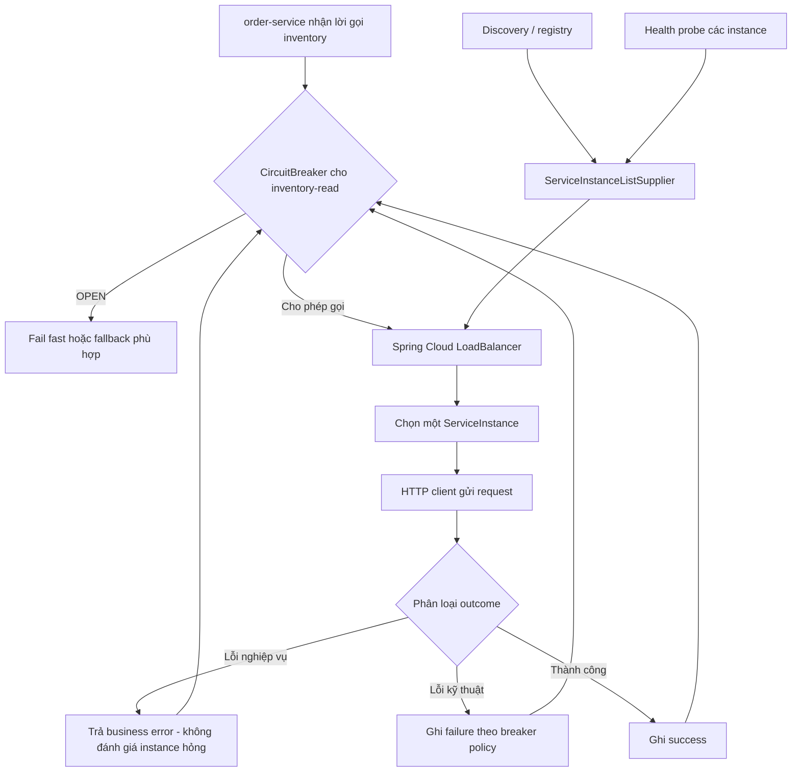
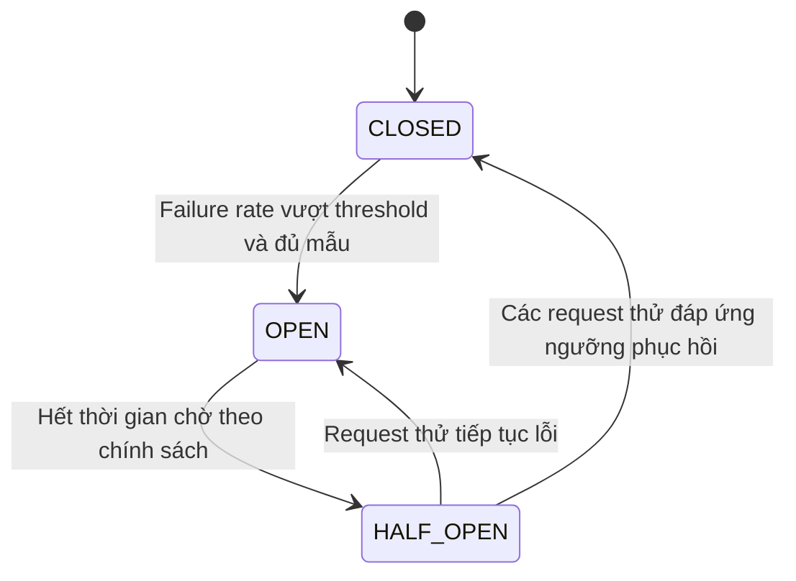

# Phân biệt lỗi nghiệp vụ với lỗi dùng để đánh giá sức khỏe

Trong hệ thống microservices, một lời gọi tới `inventory-service` qua Spring Cloud LoadBalancer có thể trả HTTP `404`, `409`, `429` hoặc `503`, cũng có thể thất bại vì timeout, kết nối bị từ chối hay không còn `ServiceInstance` khả dụng. Nhưng **không phải lỗi nào cũng có nghĩa bản sao đích không khỏe**.

Ví dụ, yêu cầu tìm một mặt hàng không tồn tại trả `404 Not Found` là **kết quả nghiệp vụ hợp lệ** nếu API được thiết kế như vậy. Nếu coi 404 là lỗi hạ tầng, circuit breaker có thể mở sau một đợt người dùng truy vấn mã hàng sai, dù tất cả bản sao vẫn phục vụ tốt. Ngược lại, nếu bỏ qua mọi HTTP 5xx với lý do “cũng chỉ là response”, hệ thống có thể tiếp tục gửi lưu lượng vào một dịch vụ đang liên tục thất bại.

Mục tiêu của bài học thuộc chương **Cô lập và khôi phục** là xây dựng một **chính sách phân loại tín hiệu**: lỗi nào trả thẳng cho caller, lỗi nào được tính vào circuit breaker, lỗi nào cho phép retry, khi nào health check phải rút một instance khỏi danh sách, và những tình huống nào cần quan sát thêm trước khi kết luận.

## 1. Ba câu hỏi khác nhau khi lời gọi thất bại

Giả sử `order-service` gọi:

```http
GET /api/v1/items/missing HTTP/1.1
Host: inventory-service
```

Để đánh giá đúng, không nên gom tất cả thất bại vào một biến `healthy=false`. Ít nhất phải tách ba câu hỏi:

1. **Kết quả nghiệp vụ có hợp lệ không?** Item không tồn tại, đơn hàng đang bị khóa, kho không đủ số lượng hay người dùng không có quyền là những kết quả mà API có thể chủ động mô tả.
2. **Bản sao có sẵn sàng nhận lưu lượng không?** Health/readiness probe cho biết instance tại một thời điểm có đáp ứng tiêu chí phục vụ chung hay không.
3. **Lời gọi từ client này có đang gặp lỗi liên tục không?** Circuit breaker và thống kê timeout/error theo `service ID` hoặc operation đánh giá xác suất thành công của một nhóm lời gọi trong khoảng thời gian.

| Ví dụ | Kết quả nghiệp vụ | Readiness của instance | Có nên ghi nhận là lỗi availability? |
|---|---|---|---|
| GET item không tồn tại → 404 | Hợp lệ nếu đúng contract | Có thể vẫn UP | Thường không |
| Đặt số lượng âm → 400 | Input sai | Có thể vẫn UP | Không |
| Đặt hàng khi hết tồn kho → 409 | Conflict nghiệp vụ | Có thể vẫn UP | Không |
| Provider quá tải → 429 | Tín hiệu hạn chế công suất | Có thể vẫn UP | Theo chính sách riêng, không tự đồng nhất với instance chết |
| TCP connect timeout | Không có HTTP response | Chưa biết | Thường có, sau khi xác định nguồn lỗi |
| Provider liên tục trả 503 | Không phục vụ request hiện tại | Có thể đang suy giảm | Thường có |
| Discovery không tìm thấy instance | Không chọn được đích | Không có probe cho một instance đã chọn | Lỗi availability ở cấp dịch vụ/discovery, không gán cho một bản sao cụ thể |

**Business failure** không có nghĩa request mạng thành công về mặt người dùng; nó có nghĩa hệ thống đã đưa ra một **quyết định nghiệp vụ dự kiến**. **Availability failure** chỉ ra việc không thể phục vụ theo hợp đồng kỹ thuật, chứ không đơn thuần là HTTP status không thuộc nhóm 2xx.

## 2. Phân loại HTTP status theo ngữ cảnh API

Một bảng status có thể giúp định hướng, nhưng **hợp đồng từng endpoint mới quyết định ngữ nghĩa thực**:

| Status/nhóm | Ngữ nghĩa thường gặp | Gợi ý cho health/circuit breaker |
|---|---|---|
| `200/201/204` | Xử lý thành công | Không ghi lỗi availability |
| `400/422` | Input không hợp lệ hoặc vi phạm quy tắc dữ liệu | Thường loại khỏi thống kê lỗi circuit breaker |
| `401/403` | Thiếu xác thực/ủy quyền | Thường không coi instance hỏng; nếu hàng loạt xuất hiện sau deploy, điều tra auth/config |
| `404` | Resource không tồn tại; đôi khi sai route/API version | Với 404 đúng contract: không ghi lỗi hạ tầng; 404 sai tuyến cần điều tra |
| `409/412` | Conflict hoặc điều kiện cập nhật không thỏa | Thường là lỗi nghiệp vụ/concurrency, không phải availability |
| `408` | Request Timeout từ một HTTP hop | Cần điều tra tầng tạo response; có thể là sự cố thời gian chờ |
| `429` | Rate limit / quá tải / giới hạn theo caller | Tín hiệu capacity; theo dõi riêng, không tự kết luận “instance đã chết” |
| `500` | Lỗi không mong đợi tại server | Thường được tính vào lỗi kỹ thuật/circuit breaker |
| `502/503/504` | Gateway, backend không phục vụ hoặc timeout upstream | Thường là lỗi availability, nhưng phải xác định nguồn |

### Vì sao không đếm mọi 4xx làm lỗi hạ tầng?

Một khách hàng nhập 100 mã hàng không tồn tại, provider xử lý đúng và trả 100 response `404`. Nếu breaker tính 100 lần này là failure, nó có thể mở và từ chối cả những request tìm mã hàng **có thật**. Đây là cơ chế tự gây gián đoạn vì chọn sai tín hiệu.

Tương tự, `409 Conflict` ở API cập nhật tồn kho có optimistic locking thường phản ánh **xung đột cập nhật hợp lệ**; tăng timeout hoặc rút instance khỏi danh sách không giải quyết được conflict.

### Vì sao cũng không loại mọi 4xx khỏi quan sát?

HTTP `404` tăng đột biến sau khi triển khai phiên bản API mới có thể là **sai route, đổi path hoặc version mismatch**. HTTP `401/403` hàng loạt có thể do token/clock/config bị sai. Chúng thường **không phải tín hiệu instance chết để rút khỏi pool**, nhưng vẫn cần cảnh báo theo tỷ lệ, operation và phiên bản.

HTTP `429` đặc biệt cần tách khỏi nhóm “input sai”: provider có thể còn sống nhưng đang bị quá tải, hoặc rate limit được áp dụng cho một tenant. Tùy hệ thống, ta có thể dùng metric riêng, backoff và tôn trọng `Retry-After`, hay ghi nhận 429 trong policy circuit breaker dành cho **capacity**. Không áp một quy tắc 429 toàn cục lên mọi dịch vụ.

## 3. Health check, LoadBalancer và circuit breaker là các lớp khác nhau

Trong Spring Cloud, ba lớp có trách nhiệm liên quan nhưng không giống nhau:

**Discovery / LoadBalancer:** `DiscoveryClient` và chuỗi `ServiceInstanceListSupplier` cung cấp danh sách instance cho một `service ID`. `RoundRobinLoadBalancer`, `RandomLoadBalancer` hoặc chiến lược khác chọn một `ServiceInstance` trong danh sách đang được client nhìn thấy.

**Health check:** `HealthCheckServiceInstanceListSupplier` là một nguồn danh sách instance tùy chọn, định kỳ probe endpoint health và giúp ưu tiên các instance được xem là khỏe. Số lượng instance có thể khác nhau giữa discovery, cache và kết quả health.

**Circuit breaker:** một thành phần như Resilience4j theo dõi kết quả các lời gọi trong **một phạm vi được cấu hình**, ví dụ tất cả lệnh `inventory-read`. Khi xác suất lỗi vượt ngưỡng, breaker có thể mở để **từ chối gọi mới** trong một khoảng thời gian, rồi cho phép một số request thử phục hồi. Nó không nhất thiết đánh dấu riêng từng instance `inventory-A` hoặc `inventory-B`.



Sơ đồ thể hiện quan hệ trách nhiệm. Một lời gọi có thể đi qua các lớp theo thứ tự khác tùy tích hợp `RestClient`, `WebClient`, OpenFeign và vị trí đặt resilience wrapper. Không suy ra thứ tự chính xác của mọi decorator chỉ từ sơ đồ.

### Sức khỏe instance không đồng nhất với sức khỏe một operation

Giả sử `inventory-A` phục vụ được `GET /items` nhưng `POST /reservations` đang lỗi do dependency ghi dữ liệu. Health tổng quát có thể vẫn UP, trong khi circuit breaker cho `reserve-stock` phát hiện lỗi cao và mở. Ngược lại, breaker của `inventory-read` không cần mở khi phần ghi gặp sự cố.

Nếu breaker được tạo theo `service ID`, nó thường quan sát **nhiều instance gộp lại**. Một instance A hỏng giữa A/B/C có thể làm breaker mở cho **cả dịch vụ** nếu tỷ lệ lỗi vượt ngưỡng. Vì vậy cần đo theo instance để phát hiện lỗi cục bộ và xem xét health/discovery filtering; không mặc định một breaker theo service ID có khả năng cách ly chính xác một bản sao cụ thể.

### Tình huống tất cả instance bị đánh dấu không khỏe

Với `HealthCheckServiceInstanceListSupplier` thông dụng, khi **không còn instance healthy** nhưng danh sách nguồn vẫn có phần tử, supplier có hành vi **fallback về danh sách instance từ delegate** thay vì luôn trả rỗng. Đây là lựa chọn thiên về availability khi các probe có thể âm tính giả.

Vì thế, “đã bật health check” **không đảm bảo** LoadBalancer sẽ không bao giờ chọn một instance từng thất bại probe. Nếu yêu cầu an toàn là fail-closed, cần thiết kế chính sách riêng; không nhầm fallback này với tính năng circuit breaker. Nếu danh sách nguồn vốn rỗng, không có instance nào để fallback.

## 4. Chọn health endpoint đúng mục đích

**Liveness** thường cho biết tiến trình có còn hoạt động và có cần được khởi động lại không. **Readiness** trả lời instance đã sẵn sàng nhận lưu lượng hay chưa. Đối với lựa chọn đích, readiness thường phù hợp hơn việc xem từng business request 404/409 như một health probe.

Ví dụ trên provider Spring Boot Actuator:

```yaml
management:
  endpoint:
    health:
      probes:
        enabled: true
```

Khi Spring Boot cung cấp readiness probe, có thể kiểm tra đường:

```bash
curl -i http://localhost:8091/actuator/health/readiness
```

Provider chưa sẵn sàng thường phản hồi theo status mapping của health indicator, ví dụ `503`; khi sẵn sàng thường phản hồi 2xx. Đường dẫn và quyền truy cập thực tế phải được cấu hình phù hợp với deployment. Không công khai thông tin nội bộ hoặc credentials chỉ để health checker gọi được.

Một số nguyên tắc cho endpoint readiness:

1. Chỉ kiểm tra những dependency **thực sự cần thiết** để instance phục vụ đúng loại lưu lượng mà readiness bảo vệ.
2. Probe phải đủ nhẹ để nhiều client/LoadBalancer không tạo thêm tải đáng kể.
3. Có thời gian phát hiện lỗi và phục hồi rõ ràng; một lần timeout ngẫu nhiên không nhất thiết phải rút ngay instance.
4. Khi instance chuẩn bị shutdown, readiness nên ngừng nhận traffic **trước khi** tiến trình dừng; kết hợp graceful shutdown.
5. Không biến các response nghiệp vụ 404/409 thành lý do làm `/actuator/health/readiness` trả DOWN.

**Cẩn trọng khi ghép dependency:** nếu readiness phụ thuộc một dịch vụ dùng chung, khi dịch vụ đó lỗi, mọi instance có thể bị đánh dấu DOWN cùng lúc. Đôi khi đó là lựa chọn đúng, nhưng đôi khi lại tạo ra hiệu ứng dây chuyền; phải quyết định dựa trên khả năng phục vụ và mức suy giảm chấp nhận được của hệ thống.

## 5. Quy tắc phân loại lỗi nên nằm gần hợp đồng API

Với một client gọi `inventory-service`, ta có thể chia kết quả theo ý định:

| Nhóm | Mục đích xử lý | Ví dụ |
|---|---|---|
| **BUSINESS** | Trả lỗi/đáp án nghiệp vụ, không làm circuit breaker mở | `ITEM_NOT_FOUND`, `STOCK_CONFLICT`, validation |
| **CAPACITY** | Backoff, rate limit, theo dõi giới hạn công suất | HTTP 429, `Retry-After` |
| **AVAILABILITY** | Đánh giá circuit breaker, timeout, retry có điều kiện | Connect failure, HTTP 502/503/504, một số 500 |
| **UNKNOWN** | Giữ thông tin lỗi và điều tra, tránh biến thành kết quả thành công giả | Lỗi decode, unexpected exception, không rõ provenance |

Nhóm `UNKNOWN` không mặc nhiên có nghĩa “bỏ qua”. Tùy contract, một lỗi không thể giải mã response 200 vẫn làm lời gọi **không thể sử dụng**, và có thể cần tính vào circuit breaker của operation. Nhưng đừng đồng nhất nó với *instance không lắng nghe TCP* hay trả DOWN trong readiness.

### Ví dụ ánh xạ mã lỗi thành exception nghiệp vụ

Khi dùng Spring Cloud OpenFeign, một `ErrorDecoder` có thể chuyển 404/409 thành exception **riêng** của domain, còn 5xx giữ lại exception hạ tầng:

```java
import feign.Response;
import feign.codec.ErrorDecoder;

final class ItemNotFoundException extends RuntimeException {
    ItemNotFoundException() {
        super("Item does not exist");
    }
}

final class StockConflictException extends RuntimeException {
    StockConflictException() {
        super("Inventory conflict");
    }
}

final class InventoryErrorDecoder implements ErrorDecoder {
    private final ErrorDecoder fallback = new ErrorDecoder.Default();

    @Override
    public Exception decode(String methodKey, Response response) {
        return switch (response.status()) {
            case 404 -> new ItemNotFoundException();
            case 409 -> new StockConflictException();
            default -> fallback.decode(methodKey, response);
        };
    }
}
```

Đoạn mã giả định **API đã quy định 404 là item không tồn tại và 409 là stock conflict** cho Feign client này. Một client chứa nhiều endpoint cần kiểm tra `methodKey` và/hoặc error code trong body để không ánh xạ sai; 404 cũng có thể do sai route hoặc API version. Tương tự, nếu bật `dismiss404` thì 404 có thể đi qua decoder bình thường thay vì ErrorDecoder.

Ưu điểm của exception domain riêng là circuit breaker có thể **ignore** chúng mà vẫn truyền cho tầng service xử lý. Không cần đánh dấu provider unhealthy chỉ vì server từ chối một thao tác không hợp lệ.

## 6. Cấu hình circuit breaker không coi lỗi nghiệp vụ là instance failure

Với Resilience4j, `CircuitBreakerConfig` cho phép xác định những exception **được ghi nhận là failure** và những exception **bị bỏ qua khỏi thống kê breaker**. Điều này rất quan trọng khi một endpoint có thể trả 404/409 thường xuyên.

Giả sử ứng dụng dùng Spring Cloud OpenFeign kết hợp Resilience4j CircuitBreaker, có thể viết lớp phân loại lỗi dùng chung cho chính sách của `inventory-read`:

```java
import feign.FeignException;

final class InventoryFailurePolicy {

    private InventoryFailurePolicy() {
    }

    static boolean shouldIgnoreForCircuitBreaker(Throwable error) {
        if (error instanceof ItemNotFoundException
                || error instanceof StockConflictException) {
            return true;
        }

        if (error instanceof FeignException feignError) {
            int status = feignError.status();
            return status == 400
                    || status == 401
                    || status == 403
                    || status == 404
                    || status == 409
                    || status == 412
                    || status == 422
                    || status == 429;
        }

        return false;
    }
}
```

Đây là **chính sách minh họa của operation đọc tồn kho**:

- Lỗi 404/409 đúng contract được loại khỏi **mẫu thống kê** của breaker, không được xem là request thành công.
- 429 được tách ra cho chính sách rate-limit/capacity, nhưng một hệ thống khác có thể muốn ghi 429 vào breaker riêng khi đạt ngưỡng quá tải. Quyết định này cần có số liệu và phù hợp hành vi API.
- 401/403/400/422 thường phản ánh caller hoặc contract, nhưng nếu chúng tăng bất thường sau deploy, vẫn phải có metric/cảnh báo độc lập.
- Các exception không thuộc nhóm ignore (HTTP 5xx, lỗi transport, timeout, lỗi decode bất ngờ...) được coi là failure trong cấu hình bên dưới. Đây là lựa chọn **thận trọng cho breaker operation**, không tuyên bố tất cả chúng có nghĩa một instance cụ thể đã chết.

### 6.1. Tạo breaker theo phạm vi operation

Ví dụ dùng thư viện `resilience4j-circuitbreaker` phù hợp với hệ sinh thái Spring Boot/Spring Cloud của dự án:

```java
import io.github.resilience4j.circuitbreaker.CircuitBreaker;
import io.github.resilience4j.circuitbreaker.CircuitBreakerConfig;

import java.time.Duration;
import org.springframework.context.annotation.Bean;
import org.springframework.context.annotation.Configuration;

@Configuration
class InventoryResilienceConfiguration {

    @Bean
    CircuitBreaker inventoryReadCircuitBreaker() {
        CircuitBreakerConfig config = CircuitBreakerConfig.custom()
                .slidingWindowSize(20)
                .minimumNumberOfCalls(10)
                .failureRateThreshold(50.0f)
                .waitDurationInOpenState(Duration.ofSeconds(15))
                .ignoreException(
                        InventoryFailurePolicy::shouldIgnoreForCircuitBreaker)
                .build();

        return CircuitBreaker.of("inventory-read", config);
    }
}
```

`slidingWindowSize(20)` nghĩa là thống kê trên cửa sổ theo số lần gọi mặc định của Resilience4j, `minimumNumberOfCalls(10)` yêu cầu đủ số mẫu trước khi đánh giá threshold, và `failureRateThreshold(50%)` định nghĩa ngưỡng ví dụ. Các con số này **chỉ để học**, không phải khuyến nghị cho production.

Trong chính sách này, `ignoreException` giúp một ngoại lệ nghiệp vụ không tăng số mẫu thành công hoặc thất bại của breaker, **nhưng exception vẫn được ném tới caller**. Nó không có nghĩa response 404 được đổi thành 200, hoặc breaker đã xử lý nghiệp vụ thay ứng dụng.

Chú ý: khi chỉ định `recordException` với một predicate tùy biến, các exception **không khớp** có thể được xem như thành công trong thống kê breaker, trừ khi cũng được cấu hình `ignoreException`. Vì vậy cần thiết kế cả quy tắc **record** và **ignore** rõ ràng; đừng vô tình coi 404/409 là success rồi kết luận tỷ lệ availability của dịch vụ đạt 100%.

### 6.2. Bọc đúng lời gọi bằng circuit breaker

Ví dụ gateway dùng Feign client đã được inject, được bảo vệ bởi một breaker riêng:

```java
import io.github.resilience4j.circuitbreaker.CircuitBreaker;
import org.springframework.beans.factory.annotation.Qualifier;
import org.springframework.stereotype.Service;

import java.util.function.Supplier;

@Service
class InventoryGateway {

    private final InventoryClient client;
    private final CircuitBreaker breaker;

    InventoryGateway(
            InventoryClient client,
            @Qualifier("inventoryReadCircuitBreaker") CircuitBreaker breaker) {
        this.client = client;
        this.breaker = breaker;
    }

    ItemDto getItem(String itemId) {
        Supplier<ItemDto> protectedCall =
                CircuitBreaker.decorateSupplier(
                        breaker, () -> client.findById(itemId));
        return protectedCall.get();
    }
}
```

Ở đây, breaker tên `inventory-read` bảo vệ **operation đọc**. Nếu cả `inventory-A` và `inventory-B` cùng nằm dưới service ID này, breaker không tự nhớ mỗi lần đã chọn instance nào: failure rate của nó là tỷ lệ trên **các lượt gọi được breaker quan sát**, không phải tỷ lệ thất bại của riêng A hoặc B.

Khi breaker đang `OPEN`, Resilience4j có thể ném `CallNotPermittedException` để từ chối lời gọi mới. Đây là **quyết định cô lập của client**, không phải HTTP 503 do provider thực sự trả về. Nếu retry layer cứ retry `CallNotPermittedException` ngay lập tức, hệ thống sẽ tạo thêm vòng lặp không hữu ích; cần phân biệt nó với lỗi HTTP tạm thời.

### 6.3. Open, half-open và closed: một vòng đời riêng



Đây là mô hình ba trạng thái phổ biến, được đơn giản hóa; Resilience4j còn có các trạng thái đặc biệt như disabled/forced-open tùy cơ chế quản trị. Circuit breaker **không phải health probe chủ động**: nếu không có request được phép thử trong `HALF_OPEN` thì nó không tự chứng minh provider đã phục hồi.

Khi có nhiều operation khác nhau, cân nhắc breaker theo **downstream + operation** hoặc nhóm operation đồng nhất về SLO. Một breaker duy nhất cho mọi GET/POST của một service ID dễ khiến 404 nghiệp vụ hoặc lỗi riêng của một endpoint ảnh hưởng không đúng đến endpoint khác.

## 7. Những giới hạn của ErrorDecoder và cách phân loại trên các HTTP client

`ErrorDecoder` của OpenFeign xử lý **HTTP response lỗi đã được đưa tới Feign**. Nó không phải nơi duy nhất xuất hiện lỗi:

- TCP connect refused, DNS/TLS và read timeout có thể phát exception tại transport **trước khi ErrorDecoder được gọi**.
- HTTP 200 với JSON sai schema thường làm **decoder dữ liệu** ném lỗi, không phải `ErrorDecoder`.
- Một số tích hợp LoadBalancer tạo **HTTP 503 tổng hợp** khi không tìm thấy instance; custom `ErrorDecoder` có thể thấy 503 mà không có provider request thực tế.
- Feign có thể bọc lỗi transport trong `RetryableException`, nhưng **retry thực sự** còn phụ thuộc `Retryer` đang cấu hình; Spring Cloud OpenFeign thường dùng `Retryer.NEVER_RETRY` mặc định.

Với Spring WebFlux `WebClient`, handler `retrieve().onStatus(...)` hoặc `exchangeToMono(...)` có thể chuyển response HTTP thành lỗi nghiệp vụ. Ví dụ chuyển 404 thành một exception riêng, giữ 5xx theo cơ chế mặc định:

```java
import org.springframework.web.reactive.function.client.WebClient;
import reactor.core.publisher.Mono;

Mono<ItemDto> getItem(WebClient client, String id) {
    return client.get()
            .uri("/api/v1/items/{id}", id)
            .retrieve()
            .onStatus(status -> status.value() == 404,
                    response -> response.releaseBody()
                            .thenReturn(new ItemNotFoundException()))
            .bodyToMono(ItemDto.class);
}
```

Với `@LoadBalanced WebClient.Builder`, client có thể dùng `baseUrl("http://inventory-service")` và chọn instance qua LoadBalancer. `onStatus` chỉ tác động đến **response HTTP**; nó không ngăn lỗi kết nối hay decode. Khi dùng resilience wrapper cho pipeline reactive, hãy phân loại cả exception được phát từ transport và lỗi đã được ánh xạ.

Với `RestClient`/`RestTemplate`, tương tự cần dùng error handler/`onStatus` phù hợp hoặc bắt loại `RestClientResponseException` để nhận status và tránh đồng nhất lỗi business với lỗi mạng. Nếu application catch mọi exception rồi đổi thành `InventoryUnavailableException`, circuit breaker sẽ mất tín hiệu gốc và có thể đếm 404 như lỗi availability.

### Không ẩn lỗi hạ tầng thành kết quả nghiệp vụ

Ví dụ nguy hiểm:

```java
// SAI: mất mạng hoặc HTTP 503 cũng bị coi là "không có item".
try {
    return client.findById(id);
} catch (RuntimeException ignored) {
    throw new ItemNotFoundException();
}
```

Đường đúng là chỉ ánh xạ `404` hoặc error code đã xác thực thành `ItemNotFoundException`. Những lỗi còn lại cần giữ status/cause để circuit breaker, retry policy và hệ thống quan sát có thể xử lý đúng.

## 8. Retry, fallback và health check không được tạo hiệu ứng dây chuyền

Một policy hợp lý không chỉ quyết định “lỗi nào tăng failure rate”, mà còn quyết định hành động tiếp theo:

| Loại lỗi | Retry | Fallback | Circuit breaker | Health |
|---|---|---|---|---|
| `404` đúng contract | Không retry y nguyên | Trả not-found rõ ràng | Ignore/exclude | Không rút instance |
| `409` stock conflict | Chờ nghiệp vụ sửa trạng thái | Trả conflict | Ignore/exclude | Không rút instance |
| `429` rate limit | Có thể backoff theo `Retry-After`, có giới hạn | Degrade theo policy | Có thể tách breaker/capacity metric | Không mặc định instance chết |
| HTTP `503` do provider | Có thể retry idempotent với deadline | Cache dữ liệu đọc hợp lệ nếu contract cho phép | Thường record failure | Readiness có thể báo DOWN nhưng cần probe độc lập |
| Connect timeout/refused | Cân nhắc retry sang instance khác | Trả degraded/fail fast | Thường record failure | Kiểm tra probe và discovery |
| Open breaker | Không retry ngay vòng lặp | Fail fast hoặc fallback | Đang cô lập | Không tự rút instance khỏi discovery |
| Không còn instance | Không có đích ngay lúc đó | Fail có kiểm soát | Đánh giá availability ở cấp service | Kiểm tra registry/supplier |

**Không retry một lỗi nghiệp vụ như 404/409 chỉ vì response không phải 2xx.** Việc làm đó tiêu thụ ngân sách, tăng tải và có thể đổi instance dù tất cả replica đều xử lý yêu cầu hợp lệ giống nhau.

**Không fallback bằng cách giả dữ liệu thành công** khi thao tác ghi thất bại. Đối với API đọc, cached response có TTL và mức độ tin cậy phù hợp đôi khi chấp nhận được; đối với thanh toán/đặt chỗ, fake success có thể khiến caller nghĩ giao dịch hoàn thành trong khi chưa có dữ liệu xác nhận.

### Timeout và retry budget

Nếu caller có tổng deadline 800 ms, mỗi retry phải sử dụng **phần còn lại** chứ không được cấp lại 800 ms. Một cấu hình có hai lần thử 500 ms cộng backoff 100 ms dễ vượt deadline.

Một nguyên tắc bảo thủ:

\[
\sum_i T_{\text{attempt},i}
 +\sum_j T_{\text{backoff},j}
 +T_{\text{overhead}}
\le T_{\text{deadline}}
\]

Với HTTP GET thực sự idempotent, retry giới hạn trên một nhóm lỗi tạm thời có thể hữu ích. Với POST/PATCH hoặc một số thao tác PUT/DELETE có side effect phụ, cần idempotency key và kiểm soát ghi trùng trước khi thử lại. Timeout của client **không chứng minh** provider chưa commit nghiệp vụ.

Circuit breaker, retry và timeout cần một **thứ tự bọc có chủ đích**: nếu retry nằm bên trong breaker, breaker có thể nhìn thấy kết quả cuối của toàn chuỗi; nếu breaker nằm bên trong retry, mỗi attempt có thể được đếm riêng. Không thể suy ra chính xác từ annotation mà chưa kiểm tra thứ tự decorator/aspect và phiên bản thư viện.

## 9. Thực hành: tạo các response nghiệp vụ và response lỗi kỹ thuật

Bài lab sử dụng `order-service` (client) gọi hai bản sao `inventory-service` trên port `8091` và `8092`. Provider có endpoint kiểm thử nghiệp vụ và **một endpoint readiness tách riêng**. Khi thử các status 404/409, readiness vẫn trả thành công; khi cố ý chuyển readiness thành DOWN, ta quan sát hành vi supplier và LoadBalancer mà không cần tạo 404 giả.

### 9.1. Provider Spring Boot

Trong ứng dụng `inventory-service` dùng `spring-boot-starter-web`, controller phục vụ bài lab:

```java
import java.util.Map;
import java.util.concurrent.atomic.AtomicBoolean;

import org.springframework.beans.factory.annotation.Value;
import org.springframework.http.HttpStatus;
import org.springframework.http.ResponseEntity;
import org.springframework.web.bind.annotation.GetMapping;
import org.springframework.web.bind.annotation.PathVariable;
import org.springframework.web.bind.annotation.PostMapping;
import org.springframework.web.bind.annotation.RestController;

record ItemDto(String id, String name, String servedBy) {
}

@RestController
class InventoryDemoController {

    private final AtomicBoolean ready = new AtomicBoolean(true);
    private final int port;

    InventoryDemoController(@Value("${server.port}") int port) {
        this.port = port;
    }

    @GetMapping("/api/v1/items/{id}")
    ResponseEntity<?> find(@PathVariable String id) {
        return switch (id) {
            case "missing" -> ResponseEntity.status(404)
                    .body(Map.of("code", "ITEM_NOT_FOUND"));
            case "conflict" -> ResponseEntity.status(409)
                    .body(Map.of("code", "STOCK_CONFLICT"));
            case "limited" -> ResponseEntity.status(429)
                    .header("Retry-After", "2")
                    .body(Map.of("code", "RATE_LIMITED"));
            case "fault" -> ResponseEntity.status(500)
                    .body(Map.of("code", "INTERNAL_FAILURE"));
            case "down" -> ResponseEntity.status(503)
                    .body(Map.of("code", "TEMPORARILY_UNAVAILABLE"));
            default -> ResponseEntity.ok(
                    new ItemDto(id, "Item " + id, "inventory-" + port));
        };
    }

    @GetMapping("/internal/ready")
    ResponseEntity<Map<String, String>> readiness() {
        if (ready.get()) {
            return ResponseEntity.ok(Map.of("status", "UP"));
        }
        return ResponseEntity.status(HttpStatus.SERVICE_UNAVAILABLE)
                .body(Map.of("status", "DOWN"));
    }

    @PostMapping("/internal/lab/ready/{value}")
    ResponseEntity<Void> changeReadiness(@PathVariable boolean value) {
        ready.set(value);
        return ResponseEntity.noContent().build();
    }
}
```

**Chỉ dùng controller này trong môi trường lab.** Endpoint `POST /internal/lab/ready/{value}` không có authentication và cho phép người gọi tác động đến readiness giả lập; tuyệt đối không đưa nguyên mẫu vào production. Health thật thường dựa trên Actuator readiness và tín hiệu ứng dụng đáng tin cậy, không dựa trên một biến toggled từ Internet.

Chạy hai tiến trình:

```bash
# Terminal A
java -jar inventory-service.jar --server.port=8091

# Terminal B
java -jar inventory-service.jar --server.port=8092
```

Xác nhận **ngay tại provider**:

```bash
curl -i http://localhost:8091/internal/ready
curl -i http://localhost:8091/api/v1/items/missing
curl -i http://localhost:8091/api/v1/items/conflict
curl -i http://localhost:8092/api/v1/items/limited
curl -i http://localhost:8092/api/v1/items/fault
curl -i http://localhost:8092/api/v1/items/down
```

Kỳ vọng readiness trả 200 dù các endpoint nghiệp vụ cố ý trả 404/409/429/500/503. Điều này minh họa rằng **một HTTP response lỗi của endpoint nghiệp vụ không tự động là kết quả của health probe**.

### 9.2. Nguồn instance và health probe của client

Trong `application-lab.yml` ở `order-service`:

```yaml
spring:
  application:
    name: order-service
  cloud:
    discovery:
      client:
        simple:
          instances:
            inventory-service:
              - uri: http://localhost:8091
              - uri: http://localhost:8092
    loadbalancer:
      health-check:
        path:
          inventory-service: /internal/ready
        initial-delay: 2s
        interval: 10s
```

Với môi trường cùng máy, `localhost` phù hợp; trong Docker/Kubernetes, `localhost` của client không phải hostname provider. Các giá trị 2s/10s chỉ để quan sát trong lab. Tùy release train, cần kiểm tra thuộc tính và lifecycle chính xác của `HealthCheckServiceInstanceListSupplier`.

**Chỉ khai báo properties không đủ để bảo đảm supplier health được kích hoạt.** Trong một phiên bản Spring Cloud hỗ trợ builder API, có thể đăng ký supplier riêng cho `inventory-service`:

```java
import org.springframework.cloud.loadbalancer.core.ServiceInstanceListSupplier;
import org.springframework.context.ConfigurableApplicationContext;
import org.springframework.context.annotation.Bean;
import org.springframework.context.annotation.Configuration;

@Configuration(proxyBeanMethods = false)
public class InventoryLoadBalancerConfiguration {

    @Bean
    ServiceInstanceListSupplier instanceSupplier(
            ConfigurableApplicationContext context) {
        return ServiceInstanceListSupplier.builder()
                .withDiscoveryClient()
                .withBlockingHealthChecks()
                .build(context);
    }
}
```

Và gắn vào client context theo service ID:

```java
import org.springframework.boot.autoconfigure.SpringBootApplication;
import org.springframework.cloud.loadbalancer.annotation.LoadBalancerClient;
import org.springframework.cloud.openfeign.EnableFeignClients;

@SpringBootApplication
@EnableFeignClients
@LoadBalancerClient(
        name = "inventory-service",
        configuration = InventoryLoadBalancerConfiguration.class)
public class OrderApplication {
}
```

Đặt `InventoryLoadBalancerConfiguration` **ngoài vùng component scan thông thường** của application chính để cấu hình đặc thù không vô tình áp dụng cho service ID khác. Đây là ví dụ **blocking health check** cho một ứng dụng gọi Feign/RestTemplate; ứng dụng reactive WebClient có thể dùng supplier/extension point tương ứng theo phiên bản Spring Cloud.

Để chạy client Feign, cần dependency `spring-cloud-starter-openfeign`, `spring-cloud-starter-loadbalancer`, `spring-boot-starter-web` và BOM Spring Cloud tương thích với Spring Boot. Có thể bật `@EnableFeignClients` trên application và đặt `InventoryClient`, `InventoryErrorDecoder` vào cấu hình Feign client thích hợp.

### 9.3. Kết nối Feign client với policy và breaker

Trong ứng dụng `order-service`, sử dụng những loại exception domain và `InventoryErrorDecoder` ở mục 5. Đặt interface và cấu hình trong những file Java tương ứng:

```java
import org.springframework.cloud.openfeign.FeignClient;
import org.springframework.web.bind.annotation.GetMapping;
import org.springframework.web.bind.annotation.PathVariable;

@FeignClient(
        name = "inventory-service",
        configuration = InventoryFeignConfiguration.class)
public interface InventoryClient {

    @GetMapping("/api/v1/items/{id}")
    ItemDto findById(@PathVariable("id") String id);
}
```

```java
import feign.codec.ErrorDecoder;
import org.springframework.context.annotation.Bean;
import org.springframework.context.annotation.Configuration;

@Configuration(proxyBeanMethods = false)
public class InventoryFeignConfiguration {

    @Bean
    ErrorDecoder errorDecoder() {
        return new InventoryErrorDecoder();
    }
}
```

`ItemDto` ở phía client cần có cấu trúc tương thích với response của provider, ví dụ `record ItemDto(String id, String name, String servedBy) {}`. Đặt `InventoryFeignConfiguration` ngoài component scan thông thường để policy riêng của `inventory-service` không rò sang các Feign client khác. Ví dụ gateway `InventoryGateway` ở mục 6 đã gọi `InventoryClient` và bọc bằng breaker `inventory-read`.

Để gọi qua HTTP endpoint trên client, có thể thêm một controller:

```java
import org.springframework.web.bind.annotation.GetMapping;
import org.springframework.web.bind.annotation.PathVariable;
import org.springframework.web.bind.annotation.RestController;

@RestController
class InventoryProxyController {

    private final InventoryGateway gateway;

    InventoryProxyController(InventoryGateway gateway) {
        this.gateway = gateway;
    }

    @GetMapping("/test/items/{id}")
    ItemDto getItem(@PathVariable String id) {
        return gateway.getItem(id);
    }
}
```

Nếu muốn kết quả HTTP của proxy phản ánh đúng lỗi nghiệp vụ, cần thêm `@RestControllerAdvice` ánh xạ `ItemNotFoundException` thành 404 và `StockConflictException` thành 409. Nếu không có handler, các exception tùy biến có thể xuất hiện dưới dạng HTTP 500 mặc định tại `order-service` dù Feign đã phân loại đúng. **Không** ánh xạ lỗi transport/503 sang 404 chỉ để làm gọn response cho caller.

### 9.4. Không dùng lỗi nghiệp vụ để điều khiển readiness

Thử các bước sau:

1. Để A/B ready, gọi `GET /api/v1/items/missing` và `GET /api/v1/items/conflict` qua Feign ở `order-service`; xác minh exception domain được tạo nhưng `/internal/ready` của A/B vẫn là 200.
2. Gọi `GET /api/v1/items/fault` nhiều lần; xác minh circuit breaker `inventory-read` ghi failure và có thể mở sau khi đủ mẫu/ngưỡng.
3. Tại provider A, thực hiện `POST /internal/lab/ready/false` để giả lập not-ready. Chờ chu kỳ health và quan sát A bị loại khỏi danh sách health-filtered khi B vẫn healthy.
4. Đưa B về not-ready. Với health-check supplier có fallback mặc định khi **không còn healthy**, danh sách nguồn A/B có thể lại được dùng để chọn; điều này **không chứng minh** cả hai đã phục hồi.
5. Khôi phục cả hai bằng `POST /internal/lab/ready/true`, quan sát sau chu kỳ health và trạng thái breaker theo từng chính sách phục hồi.

Các bước thay đổi readiness chỉ thực hiện trong **lab kiểm soát**, không trên dịch vụ thật. Nếu muốn kiểm chứng chính xác danh sách đi vào LoadBalancer, cần instrument `ServiceInstanceListSupplier` hoặc ghi metric về instance được chọn; chỉ dựa trên HTTP response đôi khi không đủ.

## 10. Kiểm thử circuit breaker không mở vì business errors

Ở mức unit test, ta có thể kiểm tra đúng **cơ chế phân loại**, không cần chạy cả registry hoặc provider. Ví dụ dùng JUnit Jupiter và Resilience4j:

```java
import static org.junit.jupiter.api.Assertions.assertEquals;
import static org.junit.jupiter.api.Assertions.assertThrows;

import io.github.resilience4j.circuitbreaker.CircuitBreaker;
import io.github.resilience4j.circuitbreaker.CircuitBreakerConfig;
import org.junit.jupiter.api.Test;

import java.util.function.Supplier;

class InventoryCircuitBreakerTest {

    private CircuitBreaker newBreaker() {
        CircuitBreakerConfig config = CircuitBreakerConfig.custom()
                .slidingWindowSize(4)
                .minimumNumberOfCalls(2)
                .failureRateThreshold(50.0f)
                .ignoreException(
                        InventoryFailurePolicy::shouldIgnoreForCircuitBreaker)
                .build();
        return CircuitBreaker.of("inventory-test", config);
    }

    @Test
    void notFoundDoesNotTripCircuitBreaker() {
        CircuitBreaker breaker = newBreaker();

        Supplier<ItemDto> call = CircuitBreaker.decorateSupplier(
                breaker, () -> {
                    throw new ItemNotFoundException();
                });

        for (int i = 0; i < 10; i++) {
            assertThrows(ItemNotFoundException.class, call::get);
        }

        assertEquals(CircuitBreaker.State.CLOSED, breaker.getState());
        assertEquals(0, breaker.getMetrics().getNumberOfBufferedCalls());
    }

    @Test
    void unexpectedFailuresCanOpenCircuitBreaker() {
        CircuitBreaker breaker = newBreaker();

        Supplier<ItemDto> call = CircuitBreaker.decorateSupplier(
                breaker, () -> {
                    throw new IllegalStateException("Unexpected provider failure");
                });

        assertThrows(IllegalStateException.class, call::get);
        assertThrows(IllegalStateException.class, call::get);

        assertEquals(CircuitBreaker.State.OPEN, breaker.getState());
    }
}
```

Test xác minh:

- Mười lần `ItemNotFoundException` vẫn được ném tới caller, nhưng bị **bỏ khỏi thống kê** nên breaker không mở.
- Hai failure không bị ignore đủ đạt `minimumNumberOfCalls(2)` và vượt ngưỡng 50% trong fixture test, khiến breaker mở.

Đây chỉ là **unit test policy Resilience4j**. Nó không chứng minh ErrorDecoder của Feign đã được gắn đúng, cũng không chứng minh LoadBalancer đang chọn giữa hai instance. Cần có integration test dùng HTTP/stub thực và kiểm tra trace để xác nhận end-to-end.

### Ma trận integration test đề xuất

| Kịch bản | HTTP/transport result | Readiness | Breaker outcome kỳ vọng |
|---|---|---|---|
| Item không tồn tại | 404 → `ItemNotFoundException` | UP | Ignore; breaker không mở chỉ vì 404 |
| Stock conflict | 409 → `StockConflictException` | UP | Ignore |
| Rate limited | 429 | UP (tùy policy) | Phân nhóm capacity; không retry ngay liên tục |
| Provider trả 500 liên tục | 500 | Có thể UP | Ghi failure, breaker có thể OPEN |
| Provider trả 503 | 503 | Có thể DOWN hoặc UP | Ghi availability failure, xác định nguồn |
| Connect refused | Không có response HTTP | Có thể stale UP | Ghi failure/timeout, chẩn đoán network |
| Readiness A DOWN, B UP | A probe 503 | A DOWN, B UP | Health-filter ưu tiên B, không tự mở breaker cho cả service |
| A/B đều DOWN | Cả hai probe lỗi | DOWN | Kiểm tra fallback mặc định của health supplier |
| Không có instance | LoadBalancer không chọn được đích | Không có đích | Lỗi ở cấp discovery/service, không gán cho A/B |
| Breaker OPEN | Không gọi provider | Không suy ra readiness | Fail fast; đo `CallNotPermittedException` riêng |

Đối với breaker, đừng dùng “có xuất hiện HTTP 404” làm tiêu chí test fail. Hãy đo **exception đã phân loại**, số mẫu được ghi và trạng thái breaker; với health supplier, đo danh sách instance sau probe **độc lập** với kết quả business request.

## 11. Quan sát đúng tỷ lệ lỗi và quá trình phục hồi

Cần phân tách ít nhất bốn nhóm metric:

1. **Business outcomes:** `not_found`, `validation_failed`, `stock_conflict`, `unauthorized`; chúng giải thích hành vi API nhưng không nhất thiết là infrastructure failures.
2. **Client-call availability:** số lần gọi thành công, lỗi 5xx, lỗi transport/timeout, số retry và việc có chọn được instance hay không.
3. **Instance health:** tổng instance discovery nhìn thấy, số instance pass probe, kết quả readiness và thời gian từ khi DOWN tới UP.
4. **Circuit-breaker state:** `CLOSED/OPEN/HALF_OPEN`, recorded failures, ignored exceptions, slow calls, `CallNotPermittedException` và thời gian phục hồi.

| Tín hiệu cần ghi | Câu hỏi giúp trả lời |
|---|---|
| `serviceId`, `operation` | Đang gọi dịch vụ và loại thao tác nào? |
| `selectedInstance`, `zone` | Lỗi tập trung vào một bản sao/vùng hay toàn bộ dịch vụ? |
| `httpStatus` và `domainErrorCode` | Đây là kết quả nghiệp vụ hay lỗi kỹ thuật? |
| `errorOrigin` | Provider, gateway, LoadBalancer, transport hay local circuit breaker? |
| `timeoutPhase` | Lỗi tại connect, pool acquire, response hay overall deadline? |
| `breakerName` và `breakerState` | Operation nào đang bị cô lập? |
| `recordedFailureCount` và `ignoredOutcomeCount` | Có phân loại lỗi đúng không? |
| `discoveredInstanceCount` và `healthyInstanceCount` | Health supplier đã có ứng viên nào? |
| `retryCount`, `attemptCount` | Mỗi logical request đã sinh bao nhiêu lần thử? |
| `traceId` / `correlationId` | Có thể lần theo A → B → C và đối chiếu log không? |

Tên metric/trường ở bảng là **đề xuất instrumentation**; không phải tất cả đều được Spring Cloud LoadBalancer hoặc Resilience4j tự động phát với đúng tên đó. Khi dùng Micrometer/Observation hoặc OpenTelemetry, hãy cấu hình label hợp lý và đo tại vị trí có thông tin đầy đủ.

Đặc biệt, **đừng dùng ID người dùng, mã đơn hàng, URI đầy đủ chứa tham số hay traceId làm nhãn metric không giới hạn cardinality**. Những dữ liệu đó nên ở trace/log được kiểm soát; metric chỉ cần nhãn như service ID, operation template, loại lỗi, instance/zone trong mức cardinality được đánh giá.

### Dấu hiệu nhận diện policy sai

| Triệu chứng | Chẩn đoán ưu tiên |
|---|---|
| Breaker OPEN sau một đợt tìm item không tồn tại | 404 đang bị ghi nhận là failure hoặc domain exception đã bị wrap |
| Readiness DOWN mỗi khi có request 409 | Health endpoint đang dùng logic nghiệp vụ hoặc dependency check quá rộng |
| Tỷ lệ business errors giảm nhưng request bị từ chối tăng | Breaker có thể đã OPEN, caller không còn gọi provider |
| Nhiều 429 nhưng breaker vẫn CLOSED | Có thể đúng vì capacity được tách riêng; cần metric/cảnh báo rate-limit |
| 503 tăng nhưng health vẫn UP | Backend có thể lỗi operation cụ thể, chưa tới ngưỡng readiness hoặc 503 do proxy |
| Cả A/B unhealthy nhưng vẫn có request tới chúng | Health-check supplier có fallback danh sách nguồn hoặc discovery/cache cũ |
| Breaker mở cho cả A và B dù chỉ A lỗi | Breaker đang ở phạm vi service/operation gộp, không per-instance |
| Không thấy lỗi Feign trong ErrorDecoder | Lỗi phát ở network/discovery, không có HTTP response để decode |

### Theo dõi recovery thay vì chỉ theo dõi lỗi

Phục hồi cần được kiểm chứng ở **hai phía**:

- **Provider:** readiness trở lại UP, lỗi 5xx giảm, dependency hoạt động, instance có thể xử lý request thật.
- **Client:** danh sách instance được làm mới, breaker chuyển từ OPEN → HALF_OPEN → CLOSED khi các request thử thành công và chính sách cho phép, backlog/retry trở về mức bình thường.

Một provider đã healthy không có nghĩa breaker của client lập tức CLOSED; breaker có vòng đời riêng. Ngược lại, breaker CLOSED không chứng minh tất cả instances đều khỏe, vì có thể client mới chỉ thử một subset. Cần kiểm chứng riêng từng cơ chế.

## 12. Những sai lầm thiết kế thường gặp

| Sai lầm | Hậu quả | Cách sửa |
|---|---|---|
| Đếm mọi HTTP 4xx là instance failure | 404/409 làm breaker mở sai | Phân loại theo contract, ignore domain exceptions |
| Coi 404 luôn là nghiệp vụ | Che lỗi sai URL/gateway hoặc version mismatch | Kiểm tra endpoint, method, error code và trace |
| Coi mọi 503 là backend unhealthy | Có thể là 503 tổng hợp từ LoadBalancer hoặc gateway | Xác minh request có tới provider và instance đã chọn |
| Coi 429 như mất kết nối | Retry liên tục và gây thêm quá tải | Tách capacity policy, tôn trọng `Retry-After` |
| Dùng breaker theo cả service cho mọi operation | Một endpoint hỏng ảnh hưởng những endpoint vẫn khỏe | Phân nhóm operation và xác định breaker scope |
| Dùng health readiness thay cho xử lý 404/409 | Không giải quyết được nghiệp vụ | Trả lỗi miền đúng, giữ health độc lập |
| Catch mọi RuntimeException rồi chuyển sang NotFound | Che timeout/503, làm metric sai | Chỉ ánh xạ lỗi domain rõ ràng |
| Catch mọi RuntimeException rồi chuyển sang Unavailable | Lỗi business cũng bị ghi nhận là lỗi hạ tầng | Giữ nguyên exception nghiệp vụ và root cause |
| Retry cả `CallNotPermittedException` | Bỏ qua ý định cô lập của breaker | Fail fast hoặc fallback an toàn, đợi theo policy |
| Bật health check nhưng không đăng ký supplier | Không có health filtering thực tế | Kiểm tra bean và service-specific configuration |
| Assume mọi unhealthy ⇒ không đích | Có thể fallback về danh sách nguồn | Kiểm thử behavior thực, thiết kế fail-closed riêng nếu bắt buộc |
| Fallback lỗi ghi thành “thành công” | Caller nghĩ đơn hàng/thanh toán đã được xác nhận | Không fake success với side effect chưa xác minh |
| Dựa vào số request thành công để đánh giá instance | Bỏ qua lỗi bị retry và request đã bị breaker từ chối | Ghi attempts, source of failure và outcome riêng |

## 13. Checklist và tổng kết

- [ ] Có bản mô tả rõ **business errors**, **capacity signals** và **availability failures** theo từng endpoint.
- [ ] 404/409/4xx được ánh xạ theo hợp đồng API, không chỉ dựa vào status một cách máy móc.
- [ ] Health/readiness endpoint đo khả năng phục vụ, không bị điều khiển bởi tần suất user nhập dữ liệu sai.
- [ ] Biết chuỗi `ServiceInstanceListSupplier` và bộ lọc health nào đang cung cấp danh sách cho LoadBalancer.
- [ ] Biết giới hạn fallback của `HealthCheckServiceInstanceListSupplier` khi tất cả instance bị đánh dấu unhealthy.
- [ ] Circuit breaker có phạm vi operation hợp lý và **ignore** lỗi nghiệp vụ dự kiến.
- [ ] Các lỗi transport/5xx chưa phân loại không bị đổi thành “not found” hoặc “success” giả.
- [ ] Retry chỉ dành cho lỗi có thể phục hồi và thao tác an toàn, với deadline/budget có giới hạn.
- [ ] Không retry mù quáng các lỗi conflict/rate limit; thao tác ghi cần idempotency.
- [ ] Có test kiểm chứng **404/409 không mở breaker**, còn lỗi kỹ thuật liên tục có thể mở.
- [ ] Có test tách **instance health** khỏi **breaker state** và xác định nguồn 503 thực sự.
- [ ] Quan sát theo service ID, operation, instance, exception, status, attempt count và breaker state.
- [ ] Đánh giá recovery cả ở provider và client, thay vì chỉ nhìn một chỉ số UP/CLOSED.

**Kết luận:** Cô lập và khôi phục chỉ hữu ích khi ta chọn đúng tín hiệu thất bại. HTTP `404` cho item không tồn tại và `409` cho conflict có thể là những kết quả nghiệp vụ hoàn toàn hợp lệ; chúng không nên khiến circuit breaker mở hay instance bị rút khỏi danh sách chỉ vì status khác 2xx. Ngược lại, lỗi transport, timeout và 5xx lặp lại cần được quan sát và xử lý theo resilience policy. Khi phân biệt rõ **hợp đồng API**, **readiness của instance**, **khả năng thành công của lời gọi** và **vòng đời circuit breaker**, Spring Cloud LoadBalancer có thể chọn đích ổn định mà không tạo hiệu ứng dây chuyền do phân loại lỗi sai.

### Tài liệu tham khảo

- [Spring Cloud Commons — Spring Cloud LoadBalancer](https://docs.spring.io/spring-cloud-commons/reference/spring-cloud-commons/loadbalancer.html): supplier, health check và lựa chọn `ServiceInstance`.
- [Resilience4j — CircuitBreaker](https://resilience4j.readme.io/docs/circuitbreaker): cửa sổ thống kê, cách ghi nhận/bỏ qua exception và trạng thái breaker.
- [Spring Cloud OpenFeign](https://docs.spring.io/spring-cloud-openfeign/reference/spring-cloud-openfeign.html): cấu hình Feign client, ErrorDecoder và retry.
- [Spring Boot Actuator — Health Indicators](https://docs.spring.io/spring-boot/reference/actuator/endpoints.html#actuator.endpoints.health): health endpoint và availability.
