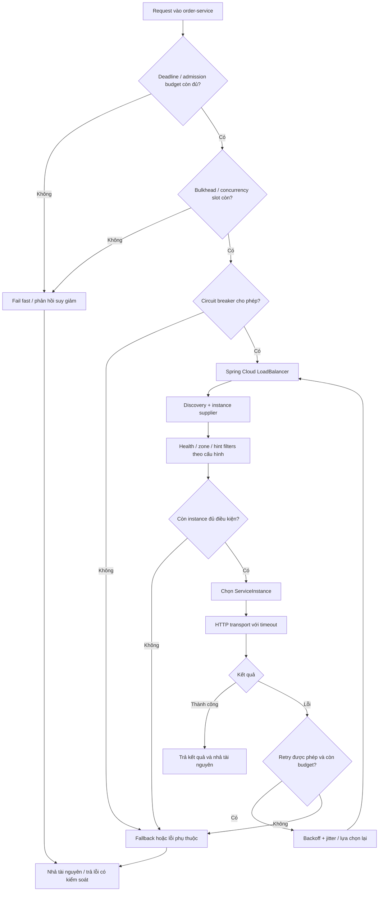
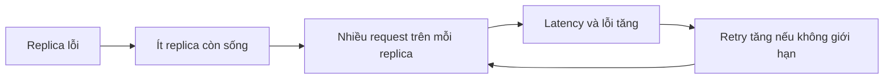

# Khôi phục từng phần và tránh dồn tải vào bản sao còn sống

Khi một vài bản sao của `inventory-service` bị lỗi, phản xạ phổ biến là “loại instance lỗi và để Spring Cloud LoadBalancer chuyển request sang các instance còn sống”. Điều đó có thể giúp một số request tiếp tục thành công, nhưng **không bảo đảm hệ thống còn đủ năng lực xử lý tổng lượng traffic ban đầu**. Nếu mọi request — kể cả các request retry — cùng dồn vào số replica ít hơn, những replica khỏe cũng có thể lần lượt quá tải và thất bại.

Để phục hồi ổn định, cần phối hợp **chọn đúng instance**, **giới hạn tải đi vào**, **cô lập tài nguyên**, **giảm mức phục vụ khi cần** và **đưa replica mới hồi phục vào nhận traffic có kiểm soát**. Đây là ý nghĩa của *khôi phục từng phần* (partial recovery) trong giao tiếp giữa dịch vụ: duy trì phần năng lực còn hữu ích mà không biến sự cố cục bộ thành sự cố dây chuyền.

Bài thuộc chương **Cô lập và khôi phục** của module `SPRING_CLOUD_SERVICE_COMMUNICATION_LOAD_BALANCING`. Các ví dụ sử dụng `order-service` gọi `inventory-service` qua Spring Cloud LoadBalancer, kết hợp các ý tưởng từ discovery, `ServiceInstanceListSupplier`, health check, timeout, retry, RestClient, WebClient và OpenFeign. Cần nhớ: **LoadBalancer chỉ hỗ trợ chọn bản sao; giới hạn concurrency, rate limiting, circuit breaker và graceful degradation là các chính sách bổ sung**, không tự xuất hiện chỉ nhờ dependency LoadBalancer.

## 1. Một sự cố replica làm thay đổi bài toán công suất

Giả sử `inventory-service` có bốn replica giống nhau, mỗi replica có thể phục vụ khoảng **300 request/giây (RPS)** trong điều kiện đo thử. Để giữ dư địa cho biến động và tail latency, nhóm vận hành đặt mục tiêu chỉ dùng tối đa **80% công suất đo được**, tương đương 240 RPS mỗi replica.

Trước sự cố, `order-service` phát sinh khoảng **800 RPS**.

| Trạng thái | Số replica còn khả dụng | Công suất mục tiêu tại 240 RPS/replica | 800 RPS tương ứng với mỗi replica nếu chia đều |
| --- | ---: | ---: | ---: |
| Bình thường | 4 | 960 RPS | 200 RPS |
| Một replica lỗi | 3 | 720 RPS | Khoảng 267 RPS |
| Hai replica lỗi | 2 | 480 RPS | 400 RPS |
| Ba replica lỗi | 1 | 240 RPS | 800 RPS |

Ngay khi chỉ còn hai replica, tổng công suất mục tiêu là **480 RPS**, nhưng nhu cầu vẫn 800 RPS. Thiếu khoảng **320 RPS**, tương đương **40%** nhu cầu ban đầu. Nếu tiếp tục nhận và chuyển toàn bộ request, hai replica khỏe có thể vượt vùng vận hành an toàn.

Các con số trên chỉ là **mô hình công suất minh họa**: RPS thực tế phụ thuộc độ phức tạp từng request, cache hit, database, connection pool, CPU, memory và tải của dependency. Việc “sống” theo health check không chứng minh replica còn 240 RPS năng lực trống.

**Kết luận quan trọng:** *chọn đúng bản sao* và *bảo vệ bản sao còn sống* là hai bài toán khác nhau. Spring Cloud LoadBalancer hỗ trợ bài toán thứ nhất; bài toán thứ hai phải có chính sách kiểm soát tải.

## 2. Hai mục tiêu của khôi phục từng phần

Khôi phục từng phần có thể xuất hiện ở hai mức:

1. **Một phần topology hồi phục:** chỉ một số `ServiceInstance` còn sống hoặc mới khởi động lại. Hệ thống phải tiếp tục dùng được nhóm đủ khỏe mà không chờ mọi replica quay lại.
2. **Một phần chức năng tiếp tục phục vụ:** trong lúc thiếu công suất, hệ thống ưu tiên chức năng cốt lõi và có thể từ chối, trì hoãn hoặc cung cấp kết quả giảm chất lượng cho chức năng ít quan trọng hơn.

Ví dụ ứng dụng bán hàng:

| Nghiệp vụ | Mức ưu tiên | Cách suy giảm có thể cân nhắc |
| --- | --- | --- |
| Xác nhận số lượng hàng trước khi đặt | Cao, yêu cầu dữ liệu đúng | Giới hạn concurrency; trả lỗi có thể thử lại nếu không kiểm tra được |
| Xem danh mục phổ biến | Trung bình | Có thể dùng cache được xác định độ cũ nếu nghiệp vụ chấp nhận |
| Thống kê realtime trên dashboard | Thấp hơn | Dùng dữ liệu chậm hoặc tạm dừng cập nhật |
| Xuất báo cáo lớn | Thấp hơn | Đưa vào hàng đợi xử lý bất đồng bộ |

**Không được dùng fallback “còn hàng” khi chưa kiểm tra được tồn kho** chỉ để giữ tỷ lệ HTTP 200. Fallback phải bảo toàn tính đúng đắn của nghiệp vụ và công bố rõ dữ liệu có thể chậm hoặc không xác định.

## 3. Sơ đồ các lớp bảo vệ trên đường gọi



Sơ đồ là **một mô hình thiết kế**, không phải thứ tự interceptor mặc định mà Spring Cloud tự tạo. Trong code thật, vị trí bulkhead, rate limiter, circuit breaker, retry và timeout có thể khác nhau; thứ tự đó ảnh hưởng số lượt gọi, thời gian chờ và phạm vi đo lỗi.

Đặc biệt, nếu retry nằm **bên ngoài** bulkhead, mỗi attempt có thể phải lấy slot riêng. Nếu retry nằm **bên trong** bulkhead, một request có thể chiếm slot qua cả khoảng backoff. Cần chọn và kiểm thử hành vi phù hợp; không có một thứ tự duy nhất đúng cho mọi hệ thống.

## 4. Bước đầu tiên: chỉ chọn instance thực sự có khả năng phục vụ

Ở phía caller, danh sách instance được lấy từ discovery hoặc một supplier tương đương. Có thể có các lớp lọc theo health, zone hoặc hint trước khi thuật toán như `RoundRobinLoadBalancer` chọn một replica.

```text
Discovery nhìn thấy:    [A, B, C, D]
Health/filter cho phép: [B, C]
LoadBalancer nhận:      [B, C]
LoadBalancer chọn:      B
HTTP client gửi tới:    host:port của B
```

Mục tiêu là **không tiếp tục chủ động gửi traffic vào replica đã biết là không khả dụng**. Những việc cần phân biệt:

- **Deregistration:** replica đã được xóa khỏi service registry khi dừng hoặc hết hạn đăng ký.
- **Discovery/cache refresh:** caller có thể vẫn giữ danh sách cũ trong một thời gian.
- **Health-check supplier:** nếu được cấu hình, có thể thăm dò và lọc các replica không đạt kiểm tra sức khỏe.
- **Readiness của server:** instance mới chỉ nên được quảng bá là sẵn sàng khi đã hoàn tất các điều kiện khởi động cần thiết.
- **Kết quả request thật:** health probe thành công không chứng minh mọi API và dependency của replica đang chạy tốt.

Spring Cloud LoadBalancer có `HealthCheckServiceInstanceListSupplier` và các lớp `ServiceInstanceListSupplier` khác để cung cấp ứng viên, nhưng các lớp này cần **cấu hình đúng và có dữ liệu sức khỏe đáng tin cậy**. Không nên giả định cứ thêm Spring Cloud LoadBalancer là health check tự chạy cho toàn bộ replica.

## 5. Vì sao bỏ instance lỗi vẫn có thể gây cascading failure?

Giả sử bốn instance A, B, C, D đang nhận traffic đều. A và B cùng ngừng hoạt động, chỉ còn C và D. Có ba vòng phản hồi tiêu cực có thể xuất hiện:

1. **Tập ứng viên nhỏ đi:** cùng 800 RPS giờ được chia cho hai replica, mỗi replica khoảng 400 RPS thay vì 200.
2. **Latency tăng:** CPU/connection pool/database trên C, D quá tải, request chờ lâu hơn.
3. **Retry tăng:** các request timeout lại được gửi thêm lần nữa tới C hoặc D, làm tải đến các instance còn sống tăng thêm.



Nếu 800 request/giây ban đầu có **20% request bị retry thêm đúng một lần**, lượng attempt được phát đi có thể lên tới khoảng:

```text
800 request/giây × (1 + 0,20) = 960 attempt/giây
960 attempt/giây ÷ 2 replica = 480 attempt/giây/replica
```

Đây là mức cao hơn nhiều so với mục tiêu 240 RPS/replica. Nếu các retry tiếp tục thất bại rồi retry nhiều lần hoặc gateway cũng retry, tải có thể còn lớn hơn.

**Retry không tạo thêm công suất.** Nó chỉ tăng cơ hội thành công khi lỗi thoáng qua và còn một nơi có khả năng phục vụ. Khi nguyên nhân là thiếu công suất toàn hệ thống, retry dày đặc có thể làm giảm tỷ lệ thành công.

## 6. Admission control và load shedding: biết lúc nào phải từ chối

**Admission control** quyết định một yêu cầu mới có được phép sử dụng tài nguyên downstream hay không. **Load shedding** từ chối hoặc trì hoãn một phần công việc khi năng lực phục vụ không đủ, nhằm giữ phần còn lại ổn định.

Ví dụ khi hai replica còn sống chỉ có công suất mục tiêu 480 RPS mà nhu cầu 800 RPS:

- Không nên giả định hệ thống phải cố chuyển toàn bộ 800 RPS.
- Có thể ưu tiên tới 480 RPS yêu cầu quan trọng trong phạm vi chính sách.
- Phần vượt giới hạn có thể được từ chối sớm, đặt vào queue hữu hạn hoặc cung cấp fallback hợp lệ.
- Nên trả kết quả có ý nghĩa rõ ràng để upstream tránh retry lập tức cùng kiểu.

Rate limiting có thể được áp dụng tại gateway, ngay trước HTTP client hoặc tại mỗi downstream instance. Tuy nhiên, **giới hạn của từng process caller không phải giới hạn toàn cụm**. Nếu có 10 bản sao `order-service` và mỗi caller tự cho phép 100 RPS, tổng lượng phát sinh có thể là 1.000 RPS; cần tổng hợp hoặc phối hợp cấp hạn mức khi mục tiêu là bảo vệ một downstream chung.

### 6.1. Cách chọn phản hồi khi từ chối tải

Tùy hợp đồng API, lớp gateway hoặc server có thể trả HTTP `429 Too Many Requests` hay `503 Service Unavailable`, kèm `Retry-After` nếu phù hợp. Nhưng một bulkhead ở caller có thể trước hết chỉ ném **exception nội bộ**; tầng API cần tự quyết định ánh xạ exception thành HTTP status và thông điệp.

Không dùng `404` để báo “không đủ công suất”. Không trả dữ liệu giả thành công khi thật ra không xác định được kết quả nghiệp vụ.

## 7. Bulkhead: cô lập lượng request đồng thời đang chờ downstream

**Bulkhead** là biện pháp giới hạn tài nguyên mà một dependency có thể chiếm dụng. Với HTTP client đồng bộ, có thể giới hạn số lời gọi đồng thời tới `inventory-service` để tránh request chậm chiếm hết thread và connection của `order-service`.

Một phép ước lượng hữu ích từ Little’s Law ở trạng thái tương đối ổn định:

```text
Số request đồng thời trung bình ≈ throughput (request/giây) × latency (giây)
```

Nếu 240 RPS với latency trung bình 200 ms:

```text
240 × 0,2 = khoảng 48 request đồng thời
```

Nếu downstream quá tải và latency trung bình tăng lên 1 giây trong khi vẫn chấp nhận 240 RPS:

```text
240 × 1,0 = khoảng 240 request đồng thời
```

Nhu cầu concurrency tăng khoảng năm lần dù RPS không tăng. Đó là lý do một hệ thống có vẻ “không tăng traffic” vẫn có thể cạn thread, socket, pool hoặc memory sau khi downstream chậm đi.

Đây là ước lượng từ số liệu trung bình, **không** thay thế việc phân tích p95/p99, phân bố kích thước request hoặc giới hạn connection pool. Cần đo trong điều kiện tải thực tế.

### 7.1. Ví dụ bulkhead đơn giản cho RestClient đồng bộ

Ví dụ dùng `Semaphore` để giới hạn tối đa 32 lời gọi tới `inventory-service` đang diễn ra đồng thời **trong một process `order-service`**:

```java
import java.util.concurrent.Semaphore;

import org.springframework.cloud.client.loadbalancer.LoadBalanced;
import org.springframework.stereotype.Component;
import org.springframework.web.client.RestClient;

@Component
class InventoryGateway {

    private final RestClient client;
    private final Semaphore inFlight = new Semaphore(32);

    InventoryGateway(@LoadBalanced RestClient.Builder builder) {
        this.client = builder
                .baseUrl("http://inventory-service")
                .build();
    }

    StockResponse getStock(String sku) {
        if (!inFlight.tryAcquire()) {
            throw new InventoryCapacityExceededException(
                    "Inventory client concurrency budget exhausted");
        }

        try {
            return client.get()
                    .uri("/api/stocks/{sku}", sku)
                    .retrieve()
                    .body(StockResponse.class);
        } finally {
            inFlight.release();
        }
    }
}
```

Trong đoạn code:

- `StockResponse` là DTO và `InventoryCapacityExceededException` là exception do ứng dụng định nghĩa.
- `tryAcquire()` không chờ; khi hết slot, caller **fail fast** thay vì mở thêm nhiều request đang chờ.
- `finally` bảo đảm nhả slot ngay cả khi HTTP client ném lỗi.
- Giới hạn 32 là **một ví dụ**, cần hiệu chỉnh theo độ trễ, traffic, pool và số process caller.
- Semaphore này giới hạn theo **service ID tại một caller**, không phải theo từng replica C/D và cũng không phải giới hạn toàn cụm.
- HTTP transport vẫn cần connect/read timeout; bulkhead không chấm dứt một request đang bị treo vô thời hạn.

Với WebClient/reactive, không dùng semaphore đồng bộ theo cách có thể chặn event-loop hoặc nhả permit quá sớm trước khi publisher hoàn tất. Nên dùng bulkhead/limiter có vòng đời reactive, áp dụng acquire/release tương ứng với subscription, completion, error và cancellation.

### 7.2. Chờ trong queue hay từ chối ngay?

Một queue nhỏ có thể hấp thụ burst ngắn, nhưng queue không tạo thêm công suất. Khi queue dài, request có thể **hết deadline trước khi được gửi**; lúc đó retry hoặc tiếp tục chờ chỉ làm lãng phí tài nguyên.

Vì vậy nên xác định:

1. Số request in-flight tối đa.
2. Kích thước queue tối đa, nếu có.
3. Thời gian chờ tối đa để lấy slot.
4. Cách xử lý khi không còn chỗ.
5. Chỉ số theo dõi queue depth, rejected requests và thời gian chờ.

## 8. Rate limiter khác gì bulkhead và circuit breaker?

Ba cơ chế đều có thể từ chối request, nhưng dựa trên những tín hiệu khác nhau:

| Cơ chế | Bảo vệ theo điều gì? | Ví dụ |
| --- | --- | --- |
| **Rate limiter** | Lượng request trong một đơn vị thời gian | Tối đa 400 RPS gọi inventory |
| **Bulkhead** | Số request đồng thời hoặc tài nguyên được giữ | Tối đa 32 lời gọi đang chờ inventory |
| **Circuit breaker** | Mẫu lỗi/độ chậm gần đây của dependency | Mở mạch khi tỷ lệ lỗi vượt ngưỡng của chính sách |
| **LoadBalancer health filtering** | Tập instance ứng viên có đạt tiêu chí sức khỏe hay không | Loại A, B khỏi danh sách khi không khỏe |
| **Retry-aware supplier** | Tránh instance được chọn ở attempt trước nếu có thay thế | Sau khi A lỗi, ưu tiên chọn B hoặc C |

Rate limiter không cho biết server có đang khỏe. Circuit breaker không bảo đảm giới hạn chính xác RPS. Bulkhead không phát hiện instance đã chết. Các thành phần cần phối hợp thay vì thay thế nhau.

Khi dùng thư viện resilience như Resilience4j, cần chú ý phạm vi cấu hình: circuit breaker/bulkhead đặt theo **tên dependency** sẽ bảo vệ cả lời gọi tới `inventory-service`, không tự tạo breaker riêng cho từng `ServiceInstance`. Nếu muốn phân biệt replica, cần thiết kế key và lifecycle tương ứng, đồng thời tránh tạo vô hạn state khi topology thay đổi.

## 9. Khôi phục từng phần theo pha: không trả toàn bộ traffic ngay

Một instance vừa khởi động lại có thể báo readiness thành công nhưng vẫn cần thời gian để làm nóng JIT, connection pool, cache, thread pool hoặc tải dữ liệu. Nếu ngay lập tức nhận phần traffic lớn như các replica ổn định, nó có thể quá tải rồi lại thất bại.

Có thể chia phục hồi thành các pha:

| Pha | Trạng thái | Chính sách minh họa |
| --- | --- | --- |
| 0 – Bảo vệ | A/B lỗi, C/D sống | Giảm retry, giới hạn in-flight và từ chối lượng vượt công suất |
| 1 – Kiểm tra | A khởi động lại | Readiness và probe trên đường phụ thuộc quan trọng phải đạt |
| 2 – Warm-up | A đã sẵn sàng nhưng còn lạnh | Chuyển một phần nhỏ traffic có kiểm soát |
| 3 – Ramp-up | A ổn định qua một cửa sổ quan sát | Tăng dần traffic vào A, đánh giá latency và error rate |
| 4 – Ổn định | A/C/D phục vụ ổn định | Điều chỉnh giới hạn nhận tải, cân nhắc phục hồi đầy đủ |
| 5 – Phục hồi hoàn toàn | B cũng trở lại đủ điều kiện | Trả về chính sách cân bằng tải mục tiêu và gỡ giảm cấp khi an toàn |

Không được xem việc instance chuyển sang `UP` trong registry là tín hiệu đủ để mở 100% traffic ngay lập tức.

### 9.1. Phân phối lưu lượng trong quá trình warm-up

Một ví dụ chính sách thử nghiệm cho instance A vừa phục hồi:

```text
Mốc 1: cấp khoảng  5% phần traffic đủ điều kiện
Mốc 2: cấp khoảng 15% nếu lỗi/latency trong ngưỡng
Mốc 3: cấp khoảng 30% nếu tiếp tục ổn định
Mốc 4: tăng tới tỷ lệ vận hành mục tiêu
```

Các tỷ lệ là **kịch bản vận hành**, không phải default của Spring Cloud LoadBalancer. Cần thực hiện thông qua weight-aware routing, cấu hình upstream, canary, hoặc một chiến lược lựa chọn/supplier riêng phù hợp hệ thống.

Nếu chỉ dùng `RoundRobinLoadBalancer` với danh sách [A, C, D] và các instance được xem là ngang nhau, nó có thể phân phối gần như đều theo số lần chọn; **không tự đảm bảo A chỉ nhận 5%**. Có thể dùng cơ chế weighted routing khi đã hỗ trợ và cấu hình đúng, nhưng cần kiểm tra implementation và tương tác với cache/zone/health.

## 10. Điều kiện tăng tải và điều kiện rollback

Một đợt ramp-up nên dựa trên **số liệu**, không chỉ dựa trên thời gian trôi qua.

Các tín hiệu nên đo:

- HTTP error rate, timeout rate và connection errors của instance vừa phục hồi.
- p95/p99 latency, số request đang xử lý, độ dài queue và connection pool saturation.
- CPU, memory, garbage collection, thread pool, database pool và các dependency chung.
- Số request bị bulkhead/rate limiter từ chối.
- Tỷ lệ retry, số attempt trung bình cho một business request.
- Tỷ lệ thành công nghiệp vụ, không chỉ HTTP 200.

Ví dụ tiêu chí vận hành có thể là: chỉ tăng thêm traffic khi error rate thấp và p95 latency nằm trong phạm vi đã thống nhất qua một cửa sổ quan sát đủ dài. Nếu các tín hiệu xấu đi, **giữ nguyên hoặc giảm tỷ lệ traffic** và kiểm tra nguyên nhân.

Tránh tăng tải quá nhanh khi sample size còn nhỏ: vài request thành công không đủ chứng minh instance có thể chịu tải mục tiêu. Với instance phục hồi rồi lỗi liên tục (*flapping*), cần có khoảng thời gian ổn định, hysteresis hoặc cooldown trước khi thử đưa vào lại.

## 11. Recovery không đồng nghĩa circuit breaker lập tức đóng

Một circuit breaker theo service ID có thể ở các trạng thái khái niệm **CLOSED**, **OPEN**, **HALF_OPEN**:

- **CLOSED:** các lời gọi được phép đi qua và được thống kê theo chính sách.
- **OPEN:** phần lớn lời gọi bị từ chối nhanh để giảm thêm tải lên dependency.
- **HALF_OPEN:** chỉ cho phép một số request thăm dò có giới hạn; nếu đạt tiêu chí, circuit có thể đóng lại.

Khi một vài replica đã phục hồi, không nên cho hàng nghìn caller cùng thăm dò đồng thời. Các probe và transition phải được thiết kế thận trọng để tránh “thác lũ hồi phục” (*recovery stampede*).

**Giới hạn cần nhớ:** circuit breaker bao quanh cả `inventory-service` có thể OPEN do các instance lỗi, dù một instance khỏe vẫn còn. Ngược lại, circuit breaker theo từng replica cần theo dõi identity và dọn state khi instance biến mất. Không mặc định một kiểu breaker nào sẽ tự hiểu topology của Spring Cloud LoadBalancer.

## 12. Zone preference và failover xuyên vùng

Giả sử caller chạy tại `zone-a` với các instance:

| Instance | Zone | Tình trạng |
| --- | --- | --- |
| A | zone-a | Lỗi |
| B | zone-a | Lỗi |
| C | zone-b | Khỏe |
| D | zone-b | Khỏe |

Khi không còn replica cùng zone, một supplier kiểu `ZonePreferenceServiceInstanceListSupplier` có thể fallback sang danh sách ứng viên khác vùng theo chính sách thông thường. Điều này giúp tránh lỗi hoàn toàn, nhưng đồng thời **dồn traffic vốn của zone-a sang zone-b**.

Nếu nhiều caller ở zone-a cùng failover, zone-b có thể phải gánh cả tải vốn có của nó lẫn tải từ zone-a. Cần tính toán **capacity liên vùng**, chi phí mạng, độ trễ, giới hạn dữ liệu và tính nhất quán.

Với yêu cầu bắt buộc dữ liệu không rời zone/region, một soft preference có fallback không đủ để thực thi chính sách. Cần hard isolation tại lớp định tuyến/ủy quyền và chấp nhận từ chối hoặc giảm chức năng khi vùng bắt buộc không còn khả dụng.

## 13. Retry trong giai đoạn thiếu công suất: càng ít càng tốt

Khi hệ thống còn hai replica khỏe và đang gần đầy tải, retry không kiểm soát thường làm tình hình tệ hơn. Nên phân biệt:

| Tình huống | Định hướng |
| --- | --- |
| Connection refused từ replica A đã lỗi; còn B/C đủ công suất | Có thể retry rất ít lần sang instance khác |
| C/D trả `503` vì quá tải | Backoff, tôn trọng tín hiệu overload, cân nhắc không retry để tránh tăng tải |
| Downstream trả `429` kèm `Retry-After` | Tôn trọng hạn mức và deadline; không “đổi instance để né rate limit” |
| `404` vì tài nguyên không tồn tại | Không retry chỉ vì muốn chọn instance khác |
| `POST` bị read timeout | Không retry mù quáng; cần idempotency và biết khả năng server đã xử lý |

Có thể dùng `RetryAwareServiceInstanceListSupplier` để tránh chọn lại replica vừa lỗi **khi còn lựa chọn khác**, nhưng nó không tự xác nhận replica mới còn công suất trống. Nếu chỉ còn C và D đang quá tải, “tránh A” không tạo ra thêm năng lực phục vụ.

Thiết kế retry cần giới hạn số attempt, deadline tổng, backoff có jitter và một **retry budget** ở cấp hệ thống nếu cần. Trong chế độ suy giảm, có thể **giảm hoặc tắt retry** cho nhóm request không quan trọng để dành công suất cho các lời gọi chính.

## 14. Timeout và deadline giúp cắt hàng đợi vô ích

Một request có thể trải qua những khoảng thời gian khác nhau:

```text
Admission / waiting for slot
    -> lấy instance từ supplier
    -> chọn ServiceInstance
    -> lấy connection từ pool
    -> connect/TLS
    -> gửi request / đợi response
    -> retry + backoff nếu cần
```

Nếu chỉ đặt connect/read timeout mà không có **end-to-end deadline**, request có thể dành quá nhiều thời gian trong queue, discovery, retry hoặc backoff. Ngược lại, deadline quá ngắn tạo ra các timeout giả, làm tăng retry nếu policy không phối hợp.

Một chính sách tốt thường xác định:

1. Ngân sách tổng của business request.
2. Thời gian tối đa chờ admission/bulkhead slot.
3. Timeout cho từng HTTP attempt.
4. Số retry tối đa và delay giữa attempt.
5. Phần thời gian dự phòng cho caller xử lý response.

Khi deadline đã hết, **không tiếp tục thêm request tới replica còn sống** chỉ để hoàn tất số attempt cấu hình. Với thao tác có side effect, cancel phía caller cũng không bảo đảm server dừng xử lý ngay.

## 15. Fallback và graceful degradation phải trung thực về dữ liệu

Khi dịch vụ tồn kho không đủ công suất, fallback có thể phù hợp cho một số thông tin chỉ mang tính hiển thị, nhưng nguy hiểm với quyết định nghiệp vụ cần độ chính xác cao.

| Chức năng | Fallback có thể chấp nhận? | Điều kiện |
| --- | --- | --- |
| Hiển thị “sản phẩm phổ biến” | Có thể | Cache có TTL và thông báo dữ liệu có thể chậm |
| Gợi ý sản phẩm tương tự | Có thể | Trả danh sách ngắn hơn hoặc rỗng theo contract |
| Xem số lượng tồn kho tham khảo | Chỉ khi API cho phép | Đánh dấu dữ liệu chưa được xác nhận/đã cũ |
| Xác nhận đặt hàng | Không thay bằng “thành công” giả | Nếu không xác minh được tồn kho, trả trạng thái chưa thể xác nhận |
| Thanh toán hoặc trừ hàng | Không bỏ qua kiểm tra bắt buộc | Cần giao dịch/idempotency và báo lỗi rõ |

**Degraded response không phải silent success.** Hợp đồng API nên phân biệt kết quả hoàn chỉnh, kết quả tạm thời, dữ liệu cache và trạng thái không thể thực hiện. Với giao dịch bất đồng bộ, có thể chuyển công việc vào queue bền vững và trả trạng thái “đã tiếp nhận, đang xử lý”, nhưng chỉ khi kiến trúc thực sự có cơ chế đảm bảo xử lý và theo dõi.

## 16. Hệ thống không có sẵn load-aware routing chỉ nhờ Round Robin

`RoundRobinLoadBalancer` mặc định phân phối **lượt lựa chọn** theo danh sách ứng viên; nó không đo tự động CPU, latency hoặc số request in-flight để quyết định một instance có còn năng lực trống.

Chẳng hạn C có CPU 95%, D CPU 35%, nhưng cả hai vẫn nằm trong danh sách `[C, D]`. Với Round Robin, chúng có thể vẫn được lựa chọn luân phiên, làm C tiếp tục quá tải.

Muốn định tuyến theo khả năng xử lý cần có chính sách bổ sung:

- Weighted routing dựa trên trọng số đáng tin cậy.
- Nguồn health/readiness phản ánh đúng trạng thái chấp nhận traffic.
- Giới hạn concurrency tại từng replica hoặc ở tầng proxy phù hợp.
- Load-aware/adaptive balancing nếu hệ thống có cơ chế cung cấp tín hiệu ổn định.
- Autoscaling và kiểm soát thời gian warm-up.

Spring Cloud LoadBalancer cung cấp điểm mở rộng để tùy biến supplier và chiến lược lựa chọn. Tuy nhiên, **không nên tự nhận mặc định có least-connections, adaptive concurrency hay warm-up weighting** nếu chưa triển khai hoặc cấu hình chúng.

## 17. Chiến lược bổ sung công suất: không chỉ thêm replica là xong

Khi autoscaler tạo replica E mới, có thêm một tiến trình nhưng chưa chắc có thêm công suất ngay lập tức. E còn có thể phải:

- Tải class, JIT warm-up và kết nối database.
- Khởi tạo pool/connection, cache và các thành phần bảo mật.
- Chờ readiness và đăng ký discovery.
- Được các caller cập nhật danh sách qua cache/registry refresh.
- Được đưa vào danh sách ứng viên sau zone/health filtering.
- Tăng dần tải đến mức vận hành ổn định.

Những mốc này có thể diễn ra cách nhau đáng kể. Nếu LoadBalancer cache giữ topology cũ, E đã sẵn sàng nhưng vẫn chưa được chọn. Nếu readiness báo sẵn quá sớm, E có thể bị dồn traffic khi chưa có kết nối hoặc dữ liệu cần thiết.

### 17.1. Tránh “thấy replica mới nên tăng retry”

Autoscaling cần thời gian và có thể phát sinh dao động. Trong khi chờ replica mới, giữ admission limit, backoff và graceful degradation để bảo vệ C/D. Sau khi E đạt readiness và warm-up, mới tăng tải dần; **không nên tăng retry trước khi có bằng chứng tổng capacity đã tăng**.

## 18. Quan sát phải phản ánh tình trạng suy giảm thực sự

Nếu chỉ nhìn số request thành công trên service còn sống, dashboard có thể bị đánh lừa: số request thành công vẫn cao nhưng **số request bị từ chối tại caller hoặc số attempt phát sinh** đã tăng mạnh.

Các nhóm số liệu cần liên kết bằng service ID và thời gian:

| Nhóm | Các chỉ số nên đo |
| --- | --- |
| Topology | Số instance discovery thấy, số instance qua health filter, instance được chọn |
| Traffic | Incoming RPS, attempted outbound RPS, retries/request |
| Cô lập | In-flight calls, bulkhead saturation, queue depth, rejected requests |
| Downstream | p50/p95/p99 latency, error rate, 429/503, CPU, pool saturation |
| Phục hồi | Số replica đã sẵn sàng, traffic share của replica mới, thời gian ramp-up, flapping |
| Nghiệp vụ | Tỷ lệ đơn hàng hoàn tất, tỷ lệ chưa thể kiểm tra tồn kho, số fallback |
| Thời gian | Deadline exceeded, connect/read timeout, backoff delay, tổng duration |

Một dạng log minh họa:

```text
traceId=bf91... serviceId=inventory-service eligible=[C,D]
selectedInstance=C attempt=1 durationMs=520 httpStatus=503
traceId=bf91... retryAllowed=false reason=overload
traceId=bf91... outcome=DEPENDENCY_UNAVAILABLE
bulkheadInFlight=32 bulkheadCapacity=32
```

Đây là **format gợi ý**, không phải log mặc định của Spring Cloud. Không ghi token, toàn bộ body hoặc ID nhạy cảm; tránh tạo metric label chứa SKU, user ID, URI động hoặc một chuỗi instance tùy ý có cardinality rất cao.

Nếu ứng dụng dùng Micrometer/Observability và `LoadBalancerLifecycle` thích hợp, có thể nối các mốc trước/chọn instance/sau lời gọi. Tuy nhiên, metric trên caller và metric server có thể phân biệt **business request** với **HTTP attempt**; không cộng chúng mà không ghi rõ định nghĩa.

## 19. Một kịch bản khôi phục từng phần từ đầu đến cuối

Giả sử ban đầu A/B/C/D nhận 800 RPS. Bị sự cố khiến A/B không khả dụng, C/D còn chạy nhưng gần ngưỡng an toàn.

**Tại thời điểm lỗi:**

1. Discovery và health filter dần loại A/B khỏi danh sách.
2. Caller theo dõi số instance và error rate tăng.
3. Chính sách admission giảm outbound traffic vào inventory xuống mức ước tính mà C/D có thể chịu.
4. Các request ưu tiên thấp bị shed/fallback hợp lệ; retry bị giới hạn mạnh.
5. Hệ thống quan sát C/D ổn định thay vì ép xử lý mọi request.

**Khi A phục hồi:**

6. A đạt readiness và được đăng ký trong discovery.
7. Supplier nhìn thấy A sau khi cache/refresh cập nhật.
8. Thử traffic nhỏ tới A trong warm-up, quan sát lỗi, latency và saturation.
9. Nếu ổn định, tăng dần tỷ lệ nhận tải và điều chỉnh admission budget phù hợp.
10. Nếu A flapping, giảm traffic hoặc loại khỏi tập đủ điều kiện, áp dụng cooldown.

**Khi B phục hồi và công suất đủ:**

11. Đưa B trở lại theo cùng quy trình warm-up.
12. Chỉ gỡ giảm cấp khi tổng capacity, latency và tỷ lệ lỗi ổn định qua cửa sổ quan sát đã xác định.
13. Đánh giá post-incident: thời gian hội tụ discovery, retry amplification, request bị shed và độ chính xác của readiness.

Thành công không phải là “mọi request được retry cho tới khi thành công”, mà là **phục vụ tối đa phần công việc có thể làm đúng trong công suất hiện có và trở về trạng thái bình thường có kiểm soát**.

## 20. Kiểm thử trước khi xảy ra sự cố

Một bài chaos/load test có thể bắt đầu với bốn mock instance hoặc môi trường staging có giám sát đầy đủ:

| Tình huống | Điều cần xác minh |
| --- | --- |
| Tắt A, giữ B/C/D | A dần biến mất khỏi tập ứng viên theo chính sách; error rate được theo dõi |
| Tắt A và B, giữ nhu cầu 800 RPS | C/D không bị sập dây chuyền; admission/shedding hoạt động |
| Một replica phản hồi chậm thay vì chết | Latency tăng được bulkhead/timeout khống chế; không làm nghẽn toàn caller |
| Retry khi còn ít instance | Không phát sinh storm, có giới hạn số attempt/deadline |
| Chỉ còn một instance | Retry-aware supplier không tự tạo capacity; chính sách fail-fast hợp lý |
| Đưa A trở lại | Readiness, discovery refresh và warm-up bảo đảm traffic tăng dần |
| A liên tục lên/xuống | Cooldown/hysteresis chống flapping và bão chọn lại |
| Caller ở nhiều zone | Failover sang zone khác không vượt công suất vùng đích |
| API đọc dùng cache fallback | Dữ liệu chậm được gắn nhãn phù hợp, không giả tạo kết quả xác nhận |
| API ghi gặp read timeout | Idempotency ngăn duplicate và kết quả được kiểm chứng |

Với test tải, cần xác định **đầu vào, công suất và ngưỡng từ chối** trước khi chạy, tránh kỳ vọng tỷ lệ HTTP 200 100% trong điều kiện hệ thống cố tình chỉ còn một nửa capacity. Mục tiêu hợp lý hơn là giới hạn tail latency, bảo vệ core flow và đảm bảo số request bị từ chối được phản hồi có kiểm soát.

## 21. Quy trình điều tra khi replica khỏe bị quá tải

Giả sử dashboard cho thấy chỉ còn C và D, CPU cả hai tăng, p99 latency cao, HTTP 503 nhiều. Hãy kiểm tra theo thứ tự:

1. **Topology thực tế:** A/B đã bị loại khỏi discovery và supplier chưa? C/D có đúng là hai instance đủ điều kiện?
2. **Traffic vào:** incoming RPS có còn như trước, hay có burst/traffic mới?
3. **Amplification:** mỗi business request đang tạo bao nhiêu HTTP attempt; có retry chồng ở gateway, ứng dụng và client không?
4. **Admission:** caller/gateway có rate limit và bulkhead không; giới hạn còn phù hợp với 2 replica?
5. **Concurrency:** in-flight và queue của C/D đã chạm ngưỡng chưa; thời gian lấy connection từ pool có tăng?
6. **Timeout:** deadline tổng đã thực thi chưa, hay những request hết thời gian vẫn nằm trong queue?
7. **LoadBalancer:** Round Robin có đang chọn từ danh sách đúng nhưng không biết C đang saturated hơn D?
8. **Zone:** có traffic của zone khác failover vào cùng C/D không?
9. **Capacity của dependency chung:** database/cache phía sau C/D có đang là bottleneck, khiến thêm replica cũng không giúp?
10. **Phục hồi:** replica mới đã đạt readiness, discovery cập nhật và warm-up đúng chưa?

Nếu C/D đang quá tải, giải pháp thường là phối hợp **giảm lượng request đi vào** và **khôi phục/bổ sung công suất**, chứ không chỉ tăng số lần retry hoặc giảm cache TTL.

## 22. Những lỗi thiết kế cần tránh

1. **Chỉ bật health check và coi đó là đủ:** còn hai replica khỏe không có nghĩa còn đủ công suất phục vụ nhu cầu ban đầu.
2. **Nhìn Round Robin như bộ điều khiển tải thích nghi:** thuật toán không mặc định biết CPU, in-flight hay latency.
3. **Giữ retry nhiều lần khi downstream quá tải:** chuyển instance không tạo thêm capacity.
4. **Bật fallback “thành công” cho nghiệp vụ bắt buộc chính xác:** tạo kết quả sai nhưng che mất sự cố.
5. **Đặt queue vô hạn:** chuyển quá tải thành latency, memory pressure và timeout dây chuyền.
6. **Giới hạn concurrency chỉ trên một caller nhưng tưởng là quota toàn hệ thống:** nhiều caller cộng dồn traffic.
7. **Tạo circuit breaker toàn service rồi giả định nó tự chọn replica khỏe:** breaker và LoadBalancer có phạm vi quan sát khác nhau.
8. **Đưa replica mới nhận toàn bộ tỷ lệ Round Robin ngay khi UP:** replica có thể chưa warm-up.
9. **Không có rollback khi ramp-up:** một instance flapping có thể lặp chu kỳ lỗi–khôi phục–lỗi.
10. **Không đo số request bị shed:** chỉ báo cáo success rate trên request đã được chấp nhận có thể tạo ảo giác khỏe mạnh.
11. **Bỏ qua shared bottleneck:** bốn replica cùng dùng database cạn connection không được chữa chỉ bằng thêm replica.
12. **Đo mọi request như nhau:** số lần chọn instance, HTTP attempt và business request phải được phân biệt.
13. **Retry POST sau read timeout mà không có idempotency:** có nguy cơ ghi trùng, kể cả khi sang replica khác.

## 23. Tự kiểm tra kiến thức

1. Vì sao giảm từ bốn replica xuống hai replica có thể gây overload ngay cả khi LoadBalancer chỉ chọn các instance khỏe?
2. Với 800 RPS đầu vào và hai replica có mục tiêu 240 RPS mỗi replica, phần demand vượt công suất mục tiêu là bao nhiêu?
3. Bulkhead, rate limiter, circuit breaker và health-check supplier có trách nhiệm khác nhau như thế nào?
4. Tại sao việc chọn replica khác khi retry không đồng nghĩa đã phục hồi công suất?
5. Nếu WebClient dùng reactive, vì sao không nên áp dụng một semaphore đồng bộ rồi release permit trước khi publisher hoàn tất?
6. Khi một replica mới đạt readiness, vì sao vẫn nên warm-up và tăng traffic dần?
7. Zone preference fallback có thể gây dồn tải sang vùng khác như thế nào?
8. Vì sao không nên trả dữ liệu cache “còn hàng” để thay thế một phép kiểm tra tồn kho bắt buộc?
9. Khi p99 tăng nhưng incoming RPS không tăng, concurrency có thể thay đổi thế nào?
10. Số liệu nào giúp phát hiện retry storm và phân biệt request nghiệp vụ với HTTP attempt?
11. Điều gì có thể khiến một circuit breaker toàn service OPEN trong khi vẫn còn một instance khỏe?
12. Vì sao cần đưa tiêu chí rollback/hysteresis vào quá trình phục hồi replica?

**Kết luận:** khôi phục từng phần không chỉ là lọc replica lỗi khỏi danh sách `ServiceInstance`. Khi công suất thực tế giảm, hệ thống phải kiểm soát **số request được nhận**, **lượng request đồng thời**, **retry và deadline**, đồng thời có phương án **giảm cấp nghiệp vụ an toàn**. Khi replica hồi phục, phải xác minh readiness, độ mới discovery và năng lực xử lý rồi **tăng traffic từng bước**. Spring Cloud LoadBalancer giúp chọn đích phù hợp; khả năng chống cascading failure đến từ việc phối hợp cân bằng tải với backpressure, bulkhead, load shedding, quan sát và kế hoạch recovery có kiểm soát.
