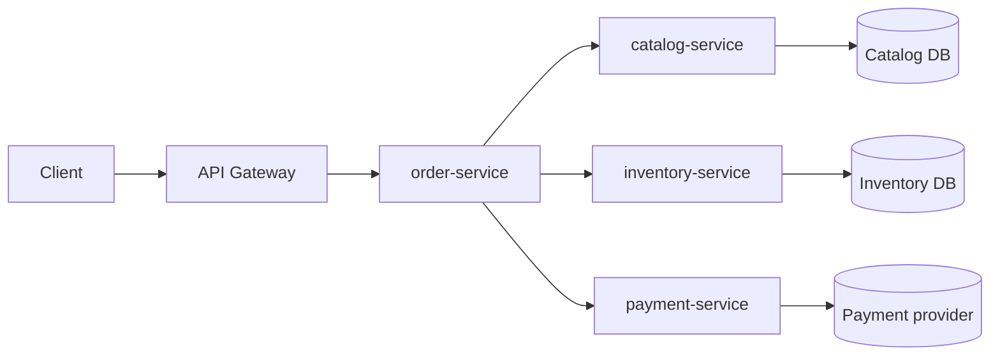
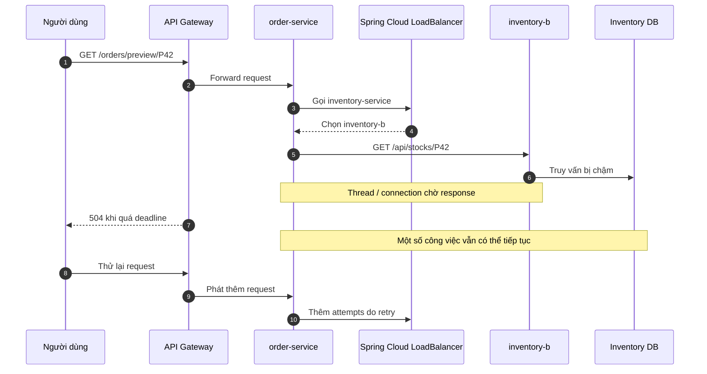
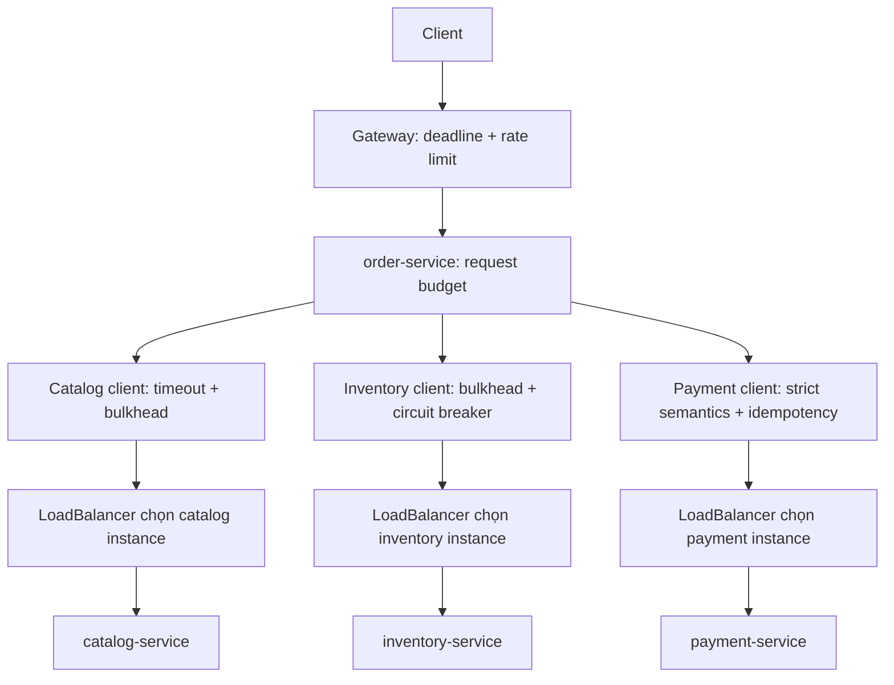
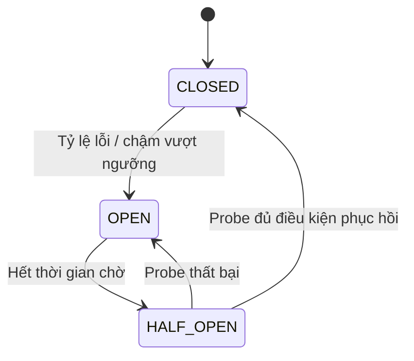

# Kịch bản lỗi lan truyền trong chuỗi giao tiếp dịch vụ

Một bản sao của `inventory-service` bị chậm có thể khiến `order-service` hết thread, API Gateway trả `504`, `catalog-service` bị tăng lưu lượng retry và cuối cùng cả hệ thống không nhận nổi những request vốn không cần dữ liệu tồn kho. Đây là **lỗi lan truyền** (*cascading failure*): một sự cố cục bộ vượt ra khỏi phạm vi thành phần bị lỗi vì các dịch vụ phụ thuộc tiếp tục chờ, gửi lại hoặc chiếm tài nguyên dùng chung.

Trong module `SPRING_CLOUD_SERVICE_COMMUNICATION_LOAD_BALANCING`, Spring Cloud LoadBalancer giúp chọn `ServiceInstance` theo service ID và phối hợp với discovery, health check, zone hoặc chính sách định tuyến. Nhưng **chọn được một bản sao không đồng nghĩa cuộc gọi sẽ thành công**, và LoadBalancer không tự áp đặt giới hạn đồng thời, deadline toàn request, circuit breaker hay quy tắc fallback nghiệp vụ. Bài học này theo dõi một kịch bản thực tế từ triệu chứng ban đầu đến sự cố diện rộng, rồi thiết kế cách **cô lập lỗi và phục hồi có kiểm soát** bằng `RestClient`, `WebClient`, OpenFeign và các cơ chế resilience phù hợp.

## 1. Mô hình một chuỗi gọi có khả năng lan truyền lỗi

Giả sử một hệ thống đặt hàng gồm:

- **API Gateway:** điểm nhận HTTP request từ ứng dụng khách.
- **`order-service`:** điều phối thông tin sản phẩm, tồn kho và thanh toán.
- **`catalog-service`:** tra cứu thông tin sản phẩm, có nhiều `ServiceInstance`.
- **`inventory-service`:** tra cứu tồn kho, đặt giữ hàng và kết nối database.
- **`payment-service`:** xử lý thanh toán, yêu cầu tránh ghi trùng.



Trong một trang **xem trước đơn hàng**, `order-service` có thể gọi `catalog-service` và `inventory-service` để hiển thị tên sản phẩm, giá và lượng hàng còn lại. Trong thao tác **xác nhận đặt hàng**, hệ thống còn đặt giữ hàng, tạo đơn và có thể thanh toán. Hai nghiệp vụ có độ quan trọng khác nhau: trang xem trước đôi khi chấp nhận thông tin tồn kho tạm thời chưa biết, còn xác nhận đơn hàng **không được tự cho rằng còn hàng** khi `inventory-service` không trả lời.

Khi hệ thống khỏe mạnh:

| Bước | Lời gọi | Thời gian minh họa | Kết quả |
|---|---|---:|---|
| 1 | Gateway → `order-service` | 15 ms | Tiếp nhận request |
| 2 | `order-service` → `catalog-service` | 50 ms | Nhận thông tin sản phẩm |
| 3 | `order-service` → `inventory-service` | 80 ms | Nhận tồn kho |
| 4 | Tổng hợp và trả response | 25 ms | Người dùng thấy dữ liệu |

Các con số chỉ là **dữ liệu giả định cho bài học**, không phải mặc định của Spring Cloud. Nếu các lời gọi độc lập được thực hiện song song, thời gian tổng có thể gần với nhánh chậm nhất cộng overhead, thay vì bằng tổng của từng bước.

## 2. Kịch bản sự cố: một bản sao tồn kho trả lời chậm

`inventory-service` có hai bản sao:

```text
inventory-service
  ├─ inventory-a = 10.20.1.21:8080  (khỏe)
  └─ inventory-b = 10.20.1.22:8080  (DB truy vấn chậm)
```

Do một vấn đề ở connection pool database, `inventory-b` bắt đầu mất 4 giây để trả endpoint `/api/stocks/{sku}`, thay vì khoảng 80 ms. Discovery vẫn nhìn thấy bản sao này vì tiến trình còn chạy và vẫn đăng ký service ID `inventory-service`.

Một chuỗi diễn biến có thể xảy ra:

1. `RoundRobinLoadBalancer` tiếp tục chọn `inventory-b` cho một phần request vì instance vẫn nằm trong danh sách ứng viên.
2. `order-service` dùng HTTP client blocking với `readTimeout` lớn; mỗi request đến B giữ một thread trong lúc đợi kết quả.
3. Nhiều request mới dồn vào cùng route; connection pool cho `inventory-service` đạt giới hạn. Những request kế tiếp phải **chờ lấy connection từ pool**.
4. Gateway hết thời gian chờ và trả `504`, nhưng một số lời gọi tại `order-service` vẫn đang chờ, hoặc tác vụ ở `inventory-b` vẫn tiếp tục chạy.
5. Gateway và `order-service` đều có retry, khiến số HTTP attempts đến inventory tăng thêm.
6. Thread và connection dùng chung trong `order-service` bị chiếm giữ; ngay cả request chỉ đọc `catalog-service` cũng có thể bị xếp hàng hoặc lỗi.
7. Người dùng thử lại thủ công, tăng thêm lưu lượng. Sự cố ở một bản sao trở thành sự cố tại Gateway và nhiều endpoint khác.



**Lưu ý:** gateway timeout không tự bảo đảm downstream đã dừng, và health check không tự phát hiện mọi kiểu chậm nếu endpoint health vẫn trả thành công. Cần instrument từng lớp để biết request đã dừng ở đâu.

## 3. Vì sao lỗi cục bộ có thể làm cạn tài nguyên dùng chung?

Khi downstream chậm, thời gian mỗi request giữ tài nguyên tăng. Một cách ước lượng độ đồng thời tại trạng thái ổn định là:

\[
\text{Số request đang xử lý} \approx
\text{Tốc độ nhận request} \times \text{Thời gian xử lý trung bình}
\]

Giả sử `order-service` nhận 200 request/giây. Nếu một lời gọi tồn kho mất trung bình 100 ms, số request đồng thời đang đợi lời gọi đó xấp xỉ `200 × 0,1 = 20`. Khi độ trễ tăng lên 3 giây, con số có thể đạt `200 × 3 = 600`, **nếu lưu lượng và thời gian chờ duy trì ở mức này**.

Đây là ước lượng minh họa dựa trên quan hệ throughput–latency, không phải dự đoán chính xác cho mọi queue/thread pool. Tuy nhiên, nó cho thấy nguy cơ cốt lõi: cùng một lưu lượng nhưng thời gian chờ tăng nhiều lần sẽ làm tăng lượng công việc chưa hoàn thành.

| Tài nguyên | Cách bị ảnh hưởng | Hậu quả lan truyền |
|---|---|---|
| Thread xử lý HTTP blocking | Chờ response của `inventory-service` | Những endpoint không liên quan cũng thiếu thread |
| HTTP connection pool | Các connection đến inventory bị giữ lâu | Request mới phải chờ slot hoặc timeout |
| Queue/executor | Công việc chờ thread hoặc connection | Latency tăng, vượt deadline |
| Memory | Request context, buffer và trạng thái chờ tích lũy | Tăng GC, nguy cơ cạn bộ nhớ |
| Database pool của inventory | Query chậm giữ connection | Bản sao khỏe khác cũng có thể bị ảnh hưởng nếu dùng DB chung |
| Gateway connections | Chờ response từ order | Gateway chịu áp lực dù mạng không lỗi |

Một nguyên tắc nền tảng của **cô lập** là không để một dependency chậm sử dụng hết tài nguyên cần cho các dependency khác. Điều đó yêu cầu giới hạn **theo dependency/nhóm nghiệp vụ**, không chỉ một giới hạn lớn cho toàn ứng dụng.

## 4. Retry nhân lên làm sự cố nặng hơn

Giả sử Gateway, `order-service` và Spring Cloud LoadBalancer mỗi tầng cho phép tối đa **2 attempts** (attempt đầu + 1 retry). Nếu chúng retry lồng nhau và mỗi lần thử đều thất bại theo điều kiện retry, một logical request có thể tạo tới:

\[
2 \times 2 \times 2 = 8 \text{ attempts}
\]

Với 200 logical requests/giây, giới hạn lý thuyết trong trường hợp xấu có thể là **1.600 attempts/giây** tại tầng dưới, chưa kể người dùng tự thử lại. Thực tế phụ thuộc điều kiện retry, lỗi xảy ra ở đâu, số instance, deadline và cách các tầng phối hợp; không phải mọi request đều tạo đúng tám attempts.

```text
Gateway: attempt 1
  order-service: attempt 1
    LoadBalancer: attempt 1 → inventory-b timeout
    LoadBalancer: attempt 2 → inventory-a lỗi quá tải
  order-service: attempt 2
    LoadBalancer: attempt 1 → inventory-b timeout
    LoadBalancer: attempt 2 → inventory-a lỗi quá tải
Gateway: attempt 2
  ... lặp lại các attempts ở hai tầng dưới ...
```

**Retry là một dạng tăng tải**, không phải chỉ một công tắc sửa lỗi. Khi downstream đang quá tải, nhiều attempts mới có thể làm pool database càng khó phục hồi. Cần chọn một **retry owner** rõ ràng cho đường gọi, hạn chế số attempts, dùng backoff/jitter, tôn trọng deadline và chỉ retry những lỗi có khả năng phục hồi.

Với thao tác ghi như `POST /orders`, `reserveInventory` hoặc `chargePayment`, retry sau read timeout còn có nguy cơ **thực thi trùng**: server có thể đã ghi dữ liệu thành công nhưng response bị mất. Cần idempotency key, unique constraint và cơ chế đối soát; chọn replica khác không khiến request trở nên an toàn một cách tự động.

## 5. Vai trò thật sự của Spring Cloud LoadBalancer

Spring Cloud LoadBalancer giải quyết bài toán **chọn instance**. Khi `order-service` gọi `http://inventory-service/api/stocks/P42`, client được tích hợp LoadBalancer sẽ:

1. Xác định service ID là `inventory-service`.
2. Lấy danh sách `ServiceInstance` từ discovery thông qua `ServiceInstanceListSupplier`.
3. Có thể lọc/ưu tiên theo health check, zone, metadata, sticky session hoặc chính sách riêng.
4. Chọn một instance bằng thuật toán, ví dụ round robin hoặc random.
5. Chuyển request tới host/port đã chọn qua HTTP transport.

LoadBalancer **không mặc nhiên**:

- Đo thời gian truy vấn database của bản sao đích.
- Loại ngay instance có endpoint nghiệp vụ chậm nếu health endpoint vẫn trả `200`.
- Giới hạn tổng concurrency hoặc số connection của toàn ứng dụng.
- Thiết lập một deadline end-to-end cho Gateway → order → inventory.
- Mở circuit breaker hoặc thay caller bằng fallback khi lỗi lặp.
- Hủy tác dụng phụ nghiệp vụ đã diễn ra ở downstream.

`HealthCheckServiceInstanceListSupplier` có thể cải thiện danh sách ứng viên khi một instance không đáp ứng health probe. Tuy nhiên, health check là phép đo định kỳ, có độ trễ, và endpoint health không nhất thiết phản ánh độ trễ của mọi API. Ngoài ra, theo hành vi được mô tả của supplier, khi không có instance nào vượt qua health check, nó có thể **trả lại toàn bộ danh sách delegate** thay vì luôn trả rỗng. Do đó, đừng coi health filtering là bảo đảm không bao giờ chọn bản sao lỗi.

Nếu cần tránh instance xấu trong một giai đoạn, hãy phối hợp discovery/readiness thực tế, timeout, retry có giới hạn, circuit breaker và quản lý connection. Không chỉ đổi thuật toán round robin sang random để chữa một sự cố mà nguồn gốc là DB hoặc pool đang nghẽn.

## 6. Cắt đường lan truyền ở đâu trong kiến trúc?

Một thiết kế có kiểm soát đặt biện pháp bảo vệ ở nhiều **ranh giới trách nhiệm**:



| Ranh giới | Biện pháp | Mục tiêu |
|---|---|---|
| Ingress/Gateway | Deadline, rate limit, load shedding | Không nhận thêm lượng công việc vượt khả năng |
| Mỗi downstream dependency | Timeout và pool riêng/giới hạn theo route | Một dịch vụ chậm không giữ tài nguyên của tất cả dịch vụ |
| Trước HTTP call | Bulkhead/concurrency limit | Chặn lượng request đồng thời vào dependency đang lỗi |
| Sau chuỗi lỗi | Circuit breaker | Ngừng gửi các lời gọi mới vô ích trong một khoảng thời gian |
| Khi có lỗi tạm thời | Retry owner, attempts giới hạn, jitter | Chỉ thử lại khi có cơ hội phục hồi và còn deadline |
| Tầng nghiệp vụ | Fallback có chủ đích | Tiếp tục phần chức năng được phép suy giảm |
| Bản sao đích | Readiness, query timeout, backpressure | Dừng nhận hoặc giảm xử lý khi không đủ khả năng |

Mỗi thành phần giải quyết một vấn đề riêng. **Bulkhead giới hạn số công việc cùng lúc; circuit breaker quyết định có nên gọi mới; timeout giới hạn thời gian đợi; retry phát thêm attempts; fallback quyết định kết quả thay thế.** Không có thành phần nào tự giải quyết tất cả lỗi lan truyền.

## 7. Dùng timeout và deadline để dừng chờ đúng lúc

Trong một request tổng thể có SLO 1.200 ms, `order-service` không nên cấp cho `inventory-service` read timeout 5 giây rồi kỳ vọng Gateway sẽ xử lý mọi thứ. Deadline tổng phải bao trùm discovery, chọn instance, đợi pool, kết nối, response, backoff/retry và thời gian tổng hợp kết quả.

Ví dụ ngân sách:

| Giai đoạn | Thời gian tối đa minh họa |
|---|---:|
| Gateway xác thực và định tuyến | 100 ms |
| `order-service` chuẩn bị dữ liệu | 100 ms |
| Lời gọi inventory và catalog | 750 ms |
| Kết hợp dữ liệu, ghi response | 150 ms |
| Dự phòng biến động mạng | 100 ms |
| **Tổng** | **1.200 ms** |

Con số này chỉ là minh họa cách phân bổ budget. Nếu lời gọi catalog và inventory chạy song song, không được cộng thời gian của hai nhánh như thể luôn tuần tự; cần dùng thời gian nhánh chậm nhất cùng overhead. Trước mỗi outbound call, tính **remaining deadline**, không mở một timeout mới nguyên vẹn ở từng hop.

```text
Deadline = thời điểm cuối request phải kết thúc
Remaining = deadline - now

Nếu remaining <= phần dự phòng cần giữ:
    không bắt đầu lời gọi downstream mới
Ngược lại:
    giới hạn HTTP call bằng min(remaining - dự phòng, per-call cap)
```

Header truyền deadline giữa dịch vụ có thể là quy ước nội bộ, ví dụ `X-Request-Deadline-Epoch-Millis`, nhưng đây **không phải** header được Spring Cloud LoadBalancer tự phát và tự áp dụng. Gateway phải kiểm soát nguồn header; mỗi service giới hạn deadline nhận được theo chính sách local và không tin giá trị quá xa do client bên ngoài cung cấp.

Với WebClient, `Mono.timeout(...)` có thể phát cancellation tới subscription upstream khi hết hạn. Điều đó giúp dừng việc chờ ở client nhưng **không bảo đảm** tác vụ tại server hoặc database đã bị hủy. Với `RestClient` và OpenFeign blocking, timeout của transport giới hạn kết nối/chờ response; timeout của một `Future` không tự bảo đảm I/O nền chấm dứt. Server cần kiểm tra deadline ở những bước tốn kém và có query timeout/idempotency phù hợp.

## 8. Bulkhead: không để inventory chiếm hết concurrency

**Bulkhead** lấy ý tưởng từ các khoang kín trên tàu: một khoang bị ngập không làm toàn bộ tàu chìm. Trong ứng dụng, bulkhead giới hạn số lời gọi đồng thời hoặc số thread/connection mà **một dependency** được phép sử dụng.

Ví dụ:

- Cho phép tối đa **20** lời gọi inventory đang thực thi tại `order-service`.
- Khi đã đủ 20, lời gọi mới bị từ chối nhanh hoặc chờ trong **hàng đợi có giới hạn**.
- Phần tài nguyên dành cho `catalog-service` và các endpoint không phụ thuộc inventory vẫn còn khả dụng.

| Kiểu bulkhead | Cách hoạt động | Điều cần cân nhắc |
|---|---|---|
| Semaphore/concurrency bulkhead | Giới hạn số lời gọi đồng thời | Phù hợp khi muốn chặn nhanh, không tách thread |
| Thread-pool bulkhead | Dùng executor và queue riêng cho một nhóm việc | Giới hạn rõ thread và queue; có overhead scheduling |
| Connection-pool partition | Tách pool hoặc hạn mức per-route | Một destination không chiếm hết connection |

Ví dụ cấu hình khái niệm với Resilience4j Bulkhead:

```yaml
resilience4j:
  bulkhead:
    instances:
      inventoryRead:
        maxConcurrentCalls: 20
        maxWaitDuration: 0ms
```

**Chú ý:** các thuộc tính này chỉ có tác dụng khi ứng dụng thực sự đưa lời gọi `inventoryRead` qua một Resilience4j Bulkhead có tên tương ứng (bằng annotation/aspect, operator hoặc decorator cấu hình đúng). Khai báo YAML **không tự động bọc tất cả** `RestClient`, `WebClient` hay OpenFeign calls. Tên property và hỗ trợ auto-configuration cũng cần khớp dependency/phiên bản Resilience4j đang dùng.

Nếu có thread-pool bulkhead, cần tính cả **queue capacity**. Một queue không giới hạn có thể chỉ chuyển điểm nghẽn từ thread sang bộ nhớ và làm tăng độ trễ đến sau deadline. Nếu bulkhead đã đầy, trả lỗi từ chối có kiểm soát hoặc fallback phù hợp thường tốt hơn việc tạo thêm hàng trăm request đang đợi.

## 9. Circuit breaker: ngừng gọi khi lỗi lặp lại

**Circuit breaker** theo dõi kết quả của các lời gọi rồi chuyển trạng thái để giảm request mới tới dependency đang lỗi:

- **CLOSED:** cho phép lời gọi đi qua và thu thập kết quả/thống kê.
- **OPEN:** từ chối nhanh lời gọi mới trong khoảng thời gian được cấu hình.
- **HALF_OPEN:** cho phép một số lời gọi thăm dò có giới hạn; nếu tình trạng cải thiện thì đóng lại, nếu không thì mở tiếp.



Circuit breaker có thể ngăn `order-service` liên tục mở thêm connection tới `inventory-service` trong lúc dependency không ổn định. Nhưng trạng thái của breaker được tính theo **lời gọi mà nó quan sát**, không tự đồng nghĩa với trạng thái của từng `ServiceInstance` trong discovery. Một breaker gắn với service ID có thể mở ngay cả khi chỉ một replica bị lỗi nhưng đủ nhiều request trúng replica đó; vì vậy phải chọn phạm vi và ngưỡng có chủ đích.

Ví dụ cấu hình Resilience4j minh họa:

```yaml
resilience4j:
  circuitbreaker:
    instances:
      inventoryRead:
        slidingWindowType: COUNT_BASED
        slidingWindowSize: 20
        minimumNumberOfCalls: 10
        failureRateThreshold: 50
        waitDurationInOpenState: 10s
        permittedNumberOfCallsInHalfOpenState: 3
```

Khi dùng Spring Cloud CircuitBreaker với backend Resilience4j, tên breaker được tạo trong ứng dụng và khóa cấu hình phải được ánh xạ đúng theo phiên bản tích hợp; ngưỡng minh họa trên **không phải thông số production mặc định**. Ngoài tỷ lệ lỗi, có thể cấu hình slow-call threshold/rate khi cần phát hiện dependency rất chậm nhưng vẫn trả `200`. Phải kiểm tra slow call có được tính và timeout có khiến lời gọi kết thúc để breaker nhận thống kê hay không.

Nếu breaker đang OPEN, một lời gọi có thể thất bại ngay mà **không có bất kỳ HTTP request nào** đến downstream. Đây là hành vi bảo vệ chủ động, khác với lỗi discovery rỗng hoặc lỗi kết nối TCP. Trong observability cần phân biệt `short-circuited` với `attempt failed`.

## 10. Ví dụ tích hợp RestClient, LoadBalancer và CircuitBreaker

Ví dụ ứng dụng Spring Boot 3.2+/Spring Framework 6.1+ dùng `RestClient`. Client gọi `inventory-service` theo service ID, còn circuit breaker cung cấp fallback **chỉ cho trường hợp đọc tồn kho để hiển thị**.

Dependencies Maven chính có thể gồm:

```xml
<dependencies>
    <dependency>
        <groupId>org.springframework.boot</groupId>
        <artifactId>spring-boot-starter-web</artifactId>
    </dependency>
    <dependency>
        <groupId>org.springframework.cloud</groupId>
        <artifactId>spring-cloud-starter-loadbalancer</artifactId>
    </dependency>
    <dependency>
        <groupId>org.springframework.cloud</groupId>
        <artifactId>spring-cloud-starter-circuitbreaker-resilience4j</artifactId>
    </dependency>
</dependencies>
```

Phải chọn Spring Cloud BOM tương thích với Spring Boot đang dùng. Đối với các bản release khác hoặc ứng dụng reactive, dùng starter/API thích hợp; không giả định cùng cấu hình chạy nguyên vẹn trên mọi thế hệ framework.

Tạo `RestClient.Builder` được đánh dấu `@LoadBalanced` cùng một request factory có timeout minh họa:

```java
package com.example.orders.config;

import org.springframework.cloud.client.loadbalancer.LoadBalanced;
import org.springframework.context.annotation.Bean;
import org.springframework.context.annotation.Configuration;
import org.springframework.http.client.SimpleClientHttpRequestFactory;
import org.springframework.web.client.RestClient;

@Configuration(proxyBeanMethods = false)
public class InventoryHttpConfiguration {

    @Bean
    @LoadBalanced
    RestClient.Builder loadBalancedRestClientBuilder() {
        SimpleClientHttpRequestFactory requestFactory =
                new SimpleClientHttpRequestFactory();
        requestFactory.setConnectTimeout(300);
        requestFactory.setReadTimeout(700);

        return RestClient.builder()
                .requestFactory(requestFactory);
    }
}
```

`SimpleClientHttpRequestFactory` trong ví dụ giúp minh họa timeout; **không cung cấp connection pool Apache HttpClient**. Với tải production, có thể dùng `HttpComponentsClientHttpRequestFactory` với Apache HttpClient 5 và pool theo route/giới hạn tổng, nhưng vẫn phải quản lý timeout chờ lấy connection từ pool và vòng đời HTTP client.

Tạo client đọc tồn kho có fallback thể hiện rõ **trạng thái chưa biết**:

```java
package com.example.orders.inventory;

import org.springframework.cloud.client.circuitbreaker.CircuitBreaker;
import org.springframework.cloud.client.circuitbreaker.CircuitBreakerFactory;
import org.springframework.cloud.client.loadbalancer.LoadBalanced;
import org.springframework.stereotype.Component;
import org.springframework.web.client.RestClient;

@Component
public class InventoryReadClient {

    private final RestClient restClient;
    private final CircuitBreaker circuitBreaker;

    public InventoryReadClient(
            @LoadBalanced RestClient.Builder builder,
            CircuitBreakerFactory<?, ?> circuitBreakerFactory) {
        this.restClient = builder.clone()
                .baseUrl("http://inventory-service")
                .build();
        this.circuitBreaker = circuitBreakerFactory.create("inventoryRead");
    }

    public StockView getStockForPreview(String sku) {
        return circuitBreaker.run(
                () -> restClient.get()
                        .uri("/api/stocks/{sku}", sku)
                        .retrieve()
                        .body(StockView.class),
                failure -> new StockView(sku, null, true));
    }
}
```

```java
package com.example.orders.inventory;

public record StockView(
        String sku,
        Integer available,
        boolean unknown) {
}
```

Trong `StockView`, `unknown=true` nghĩa là **chưa xác nhận được tồn kho**, không phải `available=0` và càng không phải còn đủ hàng. `CircuitBreakerFactory` cần có implementation từ starter Spring Cloud CircuitBreaker. Cấu hình circuit breaker/bulkhead thực tế phải được gắn đúng vào lời gọi; ví dụ Java ở trên **chỉ minh họa circuit breaker**, không tự kích hoạt bulkhead hay một deadline end-to-end.

Ngoài ra, fallback không nên nuốt mọi exception một cách mù quáng. Ở production, cần phân biệt lỗi hạ tầng được phép suy giảm với lỗi nghiệp vụ, lỗi xác thực/ủy quyền và lỗi parse dữ liệu. Nếu một lỗi nghĩa là request không hợp lệ hoặc người dùng không có quyền, phải trả đúng lỗi đó thay vì biến thành `unknown`.

### Không dùng fallback đọc tồn kho để xác nhận đơn hàng

Một thao tác `reserveInventory` có tác dụng phụ cần **thất bại có kiểm soát hoặc chờ khôi phục theo chính sách rõ ràng** khi không thể xác nhận còn hàng. Không được tái sử dụng fallback `unknown=true` rồi diễn giải như `available > 0`.

Nếu cần retry thao tác giữ hàng hoặc thanh toán, hãy dùng idempotency key ổn định qua mọi attempts và cơ chế chống ghi trùng ở server. Client timeout không chứng minh yêu cầu trước chưa được thực thi. Circuit breaker cũng không tự rollback transaction hoặc hoàn tác các side effect đã xảy ra.

## 11. WebClient reactive: cancellation, concurrency và lỗi lan truyền

Nếu `order-service` dùng WebFlux, `WebClient` không chiếm một thread riêng trong toàn bộ thời gian chờ HTTP theo cách blocking. Điều đó **giảm nguy cơ cạn thread do chờ I/O**, nhưng không loại bỏ các tài nguyên hữu hạn khác như connection pool, pending acquire queue, memory hoặc khả năng tiếp nhận request của downstream.

Một pipeline có thể áp deadline và giới hạn concurrency có kiểm soát:

```java
Mono<StockView> getStockForPreview(
        String sku,
        Duration remaining) {

    if (remaining.isZero() || remaining.isNegative()) {
        return Mono.just(new StockView(sku, null, true));
    }

    return inventoryWebClient.get()
            .uri("http://inventory-service/api/stocks/{sku}", sku)
            .retrieve()
            .bodyToMono(StockView.class)
            .timeout(remaining)
            .onErrorResume(error -> {
                if (isTransientInfrastructureFailure(error)) {
                    return Mono.just(new StockView(sku, null, true));
                }
                return Mono.error(error);
            });
}
```

`inventoryWebClient` phải được tạo từ `@LoadBalanced WebClient.Builder` hoặc cấu hình tương đương; `isTransientInfrastructureFailure` là hàm phân loại lỗi của ứng dụng, không phải API có sẵn trong đoạn code. Đây là ví dụ biểu diễn cách **chỉ fallback cho lỗi hạ tầng được phép**. Phép tính `remaining` tốt nhất được thực hiện khi subscribe hoặc trước mỗi attempt bằng `Mono.defer`, tránh sử dụng ngân sách đã cũ nếu publisher nằm chờ trong pipeline.

`timeout(...)` phát cancellation tới subscription upstream khi quá hạn, nhưng server đã nhận request có thể vẫn tiếp tục truy vấn database. Với nhiều `Mono` ghép bằng `zip`, lỗi ở một nhánh có thể hủy nhánh còn lại; cần chấp nhận một phần kết quả chỉ khi hợp đồng nghiệp vụ cho phép.

Khi dùng Reactor `retryWhen`, nhớ rằng mỗi lần resubscribe có thể tạo HTTP attempt mới; nếu Spring Cloud LoadBalancer và Gateway cũng retry, tổng attempts có thể tăng theo cấp số nhân. Một deadline tổng và giới hạn số retries cần bao toàn bộ pipeline, không cấp lại thời gian từ đầu sau mỗi lần retry.

## 12. Fallback và graceful degradation: cứu chức năng nào?

Fallback không nên hiểu là “bất kỳ lỗi nào cũng trả dữ liệu mặc định cho xong”. Phải phân loại theo **tính đúng đắn nghiệp vụ** và **độ tươi dữ liệu**:

| Chức năng | Fallback có thể phù hợp | Fallback nguy hiểm |
|---|---|---|
| Trang xem chi tiết sản phẩm | Hiển thị thông tin catalog kèm `stockStatus=UNKNOWN` | Hiển thị chắc chắn còn hàng khi chưa kiểm tra |
| Danh sách gợi ý sản phẩm | Bỏ qua gợi ý, dùng danh sách cache có gắn nhãn | Dùng dữ liệu cache như giá/tồn kho cam kết hiện tại |
| Xem trước đơn hàng | Hiển thị bản xem trước thiếu tồn kho, chưa cho xác nhận | Đánh dấu đơn đã sẵn sàng thanh toán |
| Đặt giữ tồn kho | Trả trạng thái chưa xác nhận, yêu cầu thử lại/đối soát | Tự ghi nhận đã giữ hàng |
| Thanh toán | Trả trạng thái `PENDING/UNKNOWN`, tra cứu giao dịch bằng idempotency key | Tự kết luận thanh toán thất bại hoặc tự trừ tiền lần nữa |

Cần định nghĩa trong API response phần nào là **đã xác nhận**, phần nào **chưa biết** hoặc **có thể cũ**. Không trả HTTP `200 OK` kèm dữ liệu giả trông như kết quả chắc chắn nếu người dùng sẽ dựa vào đó để thực hiện hành động quan trọng.

Một fallback không được sinh thêm chuỗi gọi dài và dễ lỗi hơn thao tác chính. Nếu fallback phải gọi một service thứ ba để lấy dữ liệu thay thế, nó cũng cần deadline, bulkhead và chính sách cô lập riêng; nếu không, fallback có thể trở thành **đường lan truyền lỗi mới**.

## 13. Phục hồi: từ OPEN trở lại ổn định

Giả sử nhóm vận hành sửa được query hoặc database pool của `inventory-b`. Hệ thống không nhất thiết phục hồi ngay nếu các tầng đã bị quá tải:

1. Database có thể đã ổn nhưng còn nhiều request cũ đang chờ.
2. Caller tiếp tục retry, làm tăng lưu lượng trở lại trước khi service có khả năng hấp thụ.
3. Circuit breaker vẫn OPEN đến hết thời gian chờ.
4. Khi HALF_OPEN, chỉ một số probe được phép chạy; nếu hàng loạt caller đồng thời mở lại, lỗi dễ tái xuất hiện.
5. Cache, discovery hoặc health-check supplier có thể cần một chu kỳ để cập nhật danh sách instance khỏe.

Một quy trình khôi phục có kiểm soát:

- **Khôi phục nguyên nhân:** sửa dependency, query, pool hoặc route lỗi, kiểm tra readiness của từng replica.
- **Giảm backlog:** để request hết hạn được loại bỏ; tránh duy trì queue vô hạn từ thời điểm sự cố.
- **Thăm dò từng bước:** circuit breaker HALF_OPEN cho phép lượng thử nhỏ; không lập tức gửi toàn tải.
- **Khôi phục discovery/health:** xác minh bản sao khỏe trở lại danh sách ứng viên và endpoint nghiệp vụ thực sự đáp ứng.
- **Giữ retry budget:** không nới số attempts chỉ vì thấy có replica đã hồi phục.
- **Theo dõi p95/p99 latency, error rate và pool saturation:** chỉ coi là phục hồi khi các chỉ số ổn định, không chỉ vì có một request thành công.

Phục hồi quá nhanh có thể tạo **dao động** (*flapping*): breaker đóng → tải dồn vào service → lỗi tăng → breaker mở lại. Thời gian chờ, số probe HALF_OPEN, autoscaling, giới hạn concurrency và cơ chế load shedding cần được đánh giá cùng nhau.

## 14. Quan sát lỗi lan truyền bằng tracing và metrics

Một dashboard chỉ nhìn tỷ lệ `5xx` ở Gateway thường không chỉ ra nơi lỗi bắt đầu. Cần liên kết **logical request**, từng HTTP attempt và instance đã được chọn qua trace/span:

```text
trace=abc123  GET /orders/preview/P42  Gateway        504  1200ms
  span=1       order-service             deadline exceeded
    span=2     catalog-service           catalog-a 200 65ms
    span=3     inventory-service         inventory-b timeout 700ms
    span=4     inventory-service retry   inventory-a 503 300ms
```

Các dòng là ví dụ minh họa, không phải log format mặc định của Spring. Những trường cần quan sát:

| Metric/attribute | Câu hỏi cần trả lời |
|---|---|
| `serviceId`, `instanceId`, zone | Request lỗi tập trung ở replica/zone nào? |
| Error rate theo dependency | Lỗi bắt nguồn từ inventory hay các service khác? |
| p50/p95/p99 latency | Dịch vụ chậm trước khi trả lỗi hay đột ngột ngừng hoạt động? |
| In-flight calls / bulkhead rejections | Có giới hạn concurrency để cô lập lỗi không? |
| HTTP pool `leased`, `available`, `pending` | Đang cạn slot kết nối hay bị giữ connection? |
| Circuit breaker state/transitions | Breaker OPEN/HALF_OPEN vì điều kiện nào? |
| Logical requests vs attempts | Retry có nhân tải không? |
| Remaining deadline | Caller có đang retry sau khi gần hết budget không? |
| Fallback count/quality | Bao nhiêu request trả dữ liệu suy giảm? |
| Cancellation outcome | Client dừng chờ nhưng downstream còn làm việc không? |

Đừng lạm dụng `instanceId`, trace ID hoặc URL có tham số người dùng làm label cho metric có cardinality cao; chúng có thể gây quá tải hệ thống giám sát. Dùng trace/log để điều tra chi tiết từng request và metric tổng hợp có nhãn giới hạn. Không log token, cookie, payload thanh toán hoặc dữ liệu bí mật để chẩn đoán sự cố.

Spring Boot Actuator/Micrometer có thể cung cấp quan sát HTTP client/server; khả năng có thêm metric cho LoadBalancer, circuit breaker và bulkhead phụ thuộc dependency và cấu hình instrumentation. Hãy xác minh số lần request **thật sự được gửi** ở server đích, thay vì chỉ đếm số lần gọi API ở service điều phối.

## 15. Bài thực hành fault injection: tạo và chặn lỗi lan truyền

**Mục tiêu:** chứng minh rằng một replica chậm có thể gây cạn tài nguyên, và xác minh mỗi biện pháp cô lập thực sự giảm ảnh hưởng lên endpoint khác. Chỉ thực hiện trong môi trường thử nghiệm có giới hạn tải, không gây lỗi cho hệ thống production.

### Bước 1 — Tạo hai replica và discovery tĩnh

Chạy `inventory-service` ở cổng 8081 và 8082, mỗi bản sao có `/api/stocks/{sku}` trả dữ liệu tồn kho, cùng endpoint `/whoami` cho biết cổng/instance ID. Khai báo danh sách ở `order-service`:

```yaml
spring:
  cloud:
    discovery:
      client:
        simple:
          instances:
            inventory-service:
              - uri: http://localhost:8081
              - uri: http://localhost:8082
```

Địa chỉ `localhost` chỉ đúng khi consumer và các replica chạy trong cùng môi trường mạng của máy. Nếu consumer ở Docker/Kubernetes, dùng địa chỉ thật sự truy cập được từ consumer; tăng timeout không sửa lỗi DNS hay cổng container.

### Bước 2 — Đo baseline không có lỗi

Cho cả hai replica phản hồi trong 50–100 ms. Gửi lượng request nhỏ có kiểm soát đến `/orders/preview/{sku}` và ghi nhận p95 latency, instance được chọn, số in-flight calls, thread/connection pool và số retry. Cũng gọi một endpoint `/orders/ping` **không phụ thuộc inventory** để đo tác động chéo khi sự cố xảy ra.

### Bước 3 — Tiêm lỗi vào một replica

Cho `inventory-b` trễ 3–4 giây hoặc trả `503` theo tỷ lệ kiểm soát. Ban đầu giữ cấu hình client có timeout tương đối dài và không có bulkhead riêng; theo dõi:

- Những requests đến `inventory-b` chậm bao lâu?
- Các request mới có chờ connection pool hoặc thread không?
- Gateway có trả timeout trong khi downstream vẫn chạy không?
- `/orders/ping` có bị chậm dù không gọi inventory không?

Tránh đặt tải lớn ngay lập tức hoặc để thí nghiệm giữ vô hạn connection; bắt đầu với concurrency nhỏ và luôn có cách khôi phục replica.

### Bước 4 — Bật lần lượt các cơ chế bảo vệ

| Thử nghiệm | Thay đổi duy nhất cần đánh giá | Dấu hiệu mong muốn |
|---|---|---|
| A — Timeout | Giới hạn connect/read/pool wait hợp lý | Thời gian giữ thread/connection giảm |
| B — Bulkhead | Giới hạn ví dụ 20 calls vào inventory | `/orders/ping` không bị ảnh hưởng đáng kể bởi inventory chậm |
| C — Circuit breaker | Mở breaker khi lỗi/chậm vượt ngưỡng | Requests mới được fail fast khi breaker OPEN |
| D — Fallback đọc | Trả `stockStatus=UNKNOWN` khi lỗi hạ tầng | Preview vẫn có thông tin trung thực, không tự xác nhận còn hàng |
| E — Retry owner | Chỉ một tầng retry với số attempts nhỏ | Server thấy số attempts nằm trong giới hạn đã định |
| F — Deadline chung | Truyền budget đến mỗi hop và dừng sớm | Không kéo dài request vượt SLO do retry chồng |
| G — Phục hồi | Cho B khỏe lại, quan sát HALF_OPEN và discovery | Lưu lượng quay lại có kiểm soát, không flapping |

Mỗi lần chỉ thay một hoặc một nhóm cấu hình có chủ đích để biết cơ chế nào tạo ra cải thiện. Nếu bật tất cả cùng lúc, rất khó chứng minh bulkhead hay circuit breaker đã thật sự chặn lỗi lan truyền.

### Bước 5 — Kiểm tra retry nhân lên

Cho Gateway và `order-service` mỗi bên retry thêm một lần đối với lỗi mô phỏng, đồng thời đo số request thực tế nhận tại inventory. Sau khi thấy amplification, chuyển về **một retry owner**, bật backoff/jitter và giới hạn deadline. Kiểm tra rằng số attempts thực tế giảm mà tỷ lệ thành công của các lỗi thoáng qua vẫn nằm trong mức chấp nhận.

### Bước 6 — Kiểm thử tình huống không được fallback

Tạo thao tác giả lập `POST /reservations` với `Idempotency-Key`. Cho server xử lý xong rồi làm mất response để mô phỏng timeout khi trạng thái giao dịch không chắc chắn. Xác nhận rằng hệ thống **không tự tạo reservation thứ hai**, không coi stock unknown là còn hàng và có đường tra cứu/đối soát theo key.

## 16. Cách phân loại kết quả kiểm thử

| Tín hiệu quan sát | Diễn giải đúng | Hành động tiếp theo |
|---|---|---|
| Gateway trả `504`, inventory vẫn đang query | Deadline ở Gateway không tự hủy công việc server | Truyền deadline, query timeout, cancellation hợp tác |
| Một replica chậm, instance khác vẫn khỏe | Discovery/LB có thể tiếp tục chọn cả hai | Điều chỉnh readiness, health policy hoặc loại instance lỗi |
| Pool inventory cạn, endpoint catalog cũng chậm | Tài nguyên caller có thể dùng chung | Tách hạn mức/bulkhead, kiểm tra thread pool |
| Breaker OPEN nhưng không còn request đến inventory | Fail fast có chủ đích | Theo dõi fallback, HALF_OPEN và phục hồi |
| Nhiều request thành công sau 4–8 attempts | Retry đang tiêu tốn tài nguyên lớn | Chọn retry owner, giảm attempts, đo amplification |
| Preview trả `UNKNOWN`, checkout từ chối | Graceful degradation được phân loại theo nghiệp vụ | Xác nhận API contract và UX |
| B hồi phục nhưng latency lại tăng ngay | Phục hồi quá nhanh, backlog/retry dồn tải | Half-open probe, giới hạn concurrency, load shedding |

Một bộ kiểm thử đạt mục tiêu không nhất thiết có **0 lỗi HTTP**. Khi dependency thật sự không phục vụ được, hệ thống vẫn có thể trả `503` hoặc lỗi nghiệp vụ phù hợp. Thành công của cô lập là **giữ lỗi trong phạm vi nhỏ, giới hạn tài nguyên tiêu thụ, trả lỗi rõ ràng và cho phép phần còn lại tiếp tục phục vụ**.

## 17. Anti-pattern làm lỗi tiếp tục lan rộng

| Sai lầm | Vì sao nguy hiểm | Cách thay thế |
|---|---|---|
| Cứ tăng read timeout khi downstream chậm | Thread và connection bị giữ lâu hơn | Deadline tổng, timeout theo giai đoạn và chẩn đoán nguyên nhân |
| Bật retry ở mọi tầng | Attempts nhân lên đúng lúc sự cố | Một retry owner, attempts nhỏ, backoff/jitter |
| Có LoadBalancer nên nghĩ đã chịu lỗi | LB chỉ chọn instance, không cô lập tài nguyên | Bulkhead, breaker, health, timeout, fallback |
| Dùng cùng một pool/thread cho mọi downstream không có hạn mức | Một dependency xấu chiếm hết tài nguyên | Giới hạn theo route/dependency hoặc tách pool |
| Health endpoint UP nên tin toàn bộ nghiệp vụ khỏe | API/DB cụ thể vẫn có thể rất chậm | Readiness sát khả năng phục vụ và quan sát latency |
| Breaker OPEN thì tăng retry | Gửi thêm attempt vào dependency đang bảo vệ | Fail fast, giữ budget, đợi phục hồi có kiểm soát |
| Mọi lỗi đều fallback thành dữ liệu rỗng | Che lỗi và gây quyết định nghiệp vụ sai | Phân loại critical/degradable, đánh dấu UNKNOWN |
| Timeout ở client nghĩa server chưa ghi dữ liệu | Có thể ghi xong nhưng mất response | Idempotency key, transaction/đối soát |
| Queue không giới hạn để khỏi từ chối request | Trễ, tốn bộ nhớ và vượt deadline | Hàng đợi nhỏ, load shedding, backpressure |
| Khôi phục toàn tải ngay khi một probe thành công | Tải dồn, breaker flapping | HALF_OPEN có giới hạn, canary và đo p95/p99 |

## 18. Checklist trước khi chạy production

1. Đã vẽ chuỗi phụ thuộc và phân loại endpoint nào **critical** hay **có thể suy giảm** chưa?
2. Có biết service ID, danh sách `ServiceInstance` và instance nào gây lỗi trong thực tế không?
3. Đã giới hạn connect/read/pool wait và deadline tổng thay vì chỉ một timeout tùy tiện chưa?
4. Có bulkhead hoặc concurrency limit **theo dependency** để inventory lỗi không chiếm hết tài nguyên catalog không?
5. Circuit breaker có tên/phạm vi, ngưỡng, HALF_OPEN và cách ánh xạ cấu hình rõ ràng không?
6. Đã chọn một retry owner, giới hạn attempts, backoff/jitter và kiểm tra việc retry sang instance khác chưa?
7. Health check/readiness có phản ánh khả năng phục vụ nghiệp vụ; có hiểu độ trễ cập nhật và hành vi fallback không?
8. Fallback có trả thông tin trung thực, không biến `UNKNOWN` thành “còn hàng” hoặc “đã thanh toán” không?
9. Các thao tác ghi có idempotency key, unique constraint và quy trình đối soát khi response bị mất không?
10. Khi request hết hạn, caller và downstream có cách dừng phần việc không cần thiết, gồm DB query và background job phù hợp không?
11. Metric/tracing có phân biệt logical request, HTTP attempts, breaker OPEN, bulkhead reject, selected instance và resource saturation không?
12. Đã thử lỗi một replica, lỗi toàn service, pool cạn, timeout, retry amplification, recovery và sự cố trong quá trình rollout chưa?

**Kết luận:** Lỗi lan truyền xảy ra khi **một dependency không khỏe được phép giữ quá nhiều tài nguyên hoặc khiến các tầng phụ thuộc phát thêm công việc**. Spring Cloud LoadBalancer giúp định tuyến đến các `ServiceInstance`, nhưng chỉ là một phần trong khả năng chịu lỗi. Cô lập đúng nghĩa cần timeout/deadline, hạn mức concurrency, circuit breaker, retry có chủ sở hữu, health filtering và fallback đúng ngữ nghĩa nghiệp vụ. Phục hồi bền vững còn yêu cầu đo được tác động từng tầng và đưa lưu lượng quay lại dần dần, thay vì ngay lập tức dồn tải lên dịch vụ vừa hồi phục.
