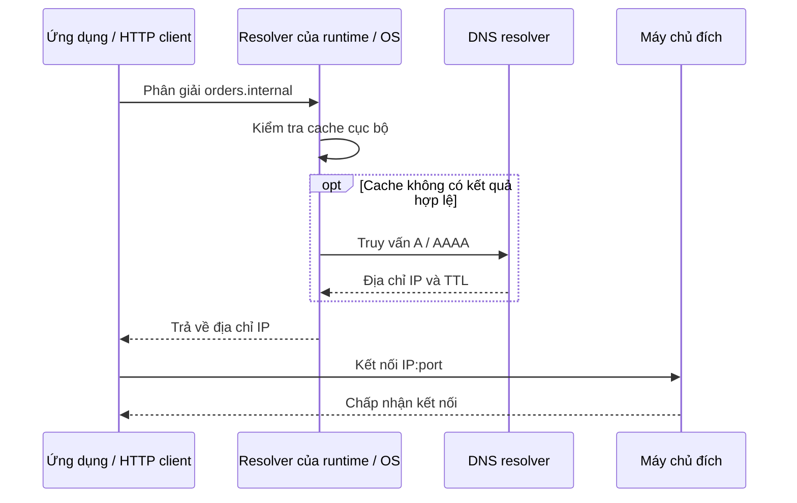
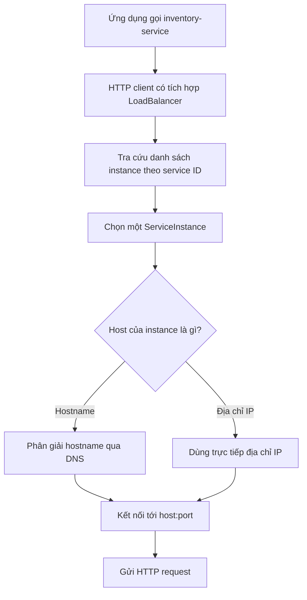

# URL, URI, tên máy chủ và phân giải DNS trong lời gọi dịch vụ

Khi một dịch vụ gọi dịch vụ khác qua HTTP, ứng dụng cần xác định tài nguyên đích, tìm địa chỉ mạng của máy chủ và kết nối đến đúng cổng. Những việc này liên quan với nhau nhưng thuộc các lớp khái niệm khác nhau: URI mô tả định danh tài nguyên, hostname là tên máy chủ trong URI, DNS ánh xạ tên đó sang địa chỉ IP, còn cơ chế discovery và load balancing có thể chọn một instance cụ thể trong số nhiều instance đang chạy.

Trong Spring Cloud LoadBalancer, ứng dụng thường gọi một dịch vụ bằng **service ID** như `inventory-service`. Service ID là tên logic để tìm các instance trong hệ thống discovery. Nó chỉ được phân giải bằng DNS khi thành phần xử lý lời gọi thực sự dùng tên đó như hostname; với tích hợp load balancing, Spring Cloud có thể tra cứu service ID, chọn một `ServiceInstance`, rồi gửi request đến host và port của instance đã chọn.

## 1. URI và URL mô tả đích của request

**URI (Uniform Resource Identifier)** là chuỗi định danh một tài nguyên. URI có thể cho biết cách truy cập và vị trí của tài nguyên, hoặc chỉ cung cấp một định danh theo một không gian tên. **URL (Uniform Resource Locator)** là loại URI chỉ ra vị trí và cách truy cập tài nguyên. Trong thực tế phát triển HTTP, hai từ này đôi khi được dùng thay thế nhau; khi đọc tài liệu hoặc API, hãy dựa vào ngữ cảnh cụ thể.

Ví dụ một URL HTTP:

```text
https://orders.internal:8443/api/v1/orders?status=PAID#summary
```

Cấu trúc tổng quát của URI thường được biểu diễn như sau:

```text
scheme:[//authority]path[?query][#fragment]
```

| Thành phần | Ví dụ | Ý nghĩa |
|---|---|---|
| `scheme` | `https` | Giao thức hoặc cách diễn giải URI; với lời gọi HTTP thường là `http` hoặc `https`. |
| `authority` | `orders.internal:8443` | Phần xác định máy chủ, có thể kèm thông tin người dùng và cổng. |
| `host` | `orders.internal` | Tên máy chủ hoặc địa chỉ IP nằm trong authority. |
| `port` | `8443` | Cổng đích. Nếu bỏ qua, client dùng cổng mặc định theo scheme, thường là 80 cho HTTP và 443 cho HTTPS. |
| `path` | `/api/v1/orders` | Đường dẫn tài nguyên trên máy chủ. |
| `query` | `status=PAID` | Tham số truy vấn, thường dùng để lọc hoặc điều khiển cách xử lý tài nguyên. |
| `fragment` | `summary` | Phần tham chiếu bên trong tài nguyên, thường được xử lý ở phía client. |

Authority có thể có dạng `userinfo@host:port`; phần user information ít được dùng trong URL ứng dụng hiện đại và không nên nhúng mật khẩu vào URL. Host có thể là tên miền, IPv4 hoặc địa chỉ IPv6. Khi viết IPv6 trong authority, cần đặt địa chỉ trong dấu ngoặc vuông, ví dụ `http://[2001:db8::10]:8080/health`.

### Path, query và fragment có vai trò khác nhau

- **Path** xác định đường dẫn tài nguyên hoặc endpoint, ví dụ `/api/v1/orders/42`.
- **Query** truyền các tham số như `?page=2&size=20`. Khi tạo URL bằng thư viện HTTP, nên dùng API xây dựng URI và mã hóa giá trị tham số đúng cách thay vì nối chuỗi tùy tiện.
- **Fragment** bắt đầu bằng `#`, ví dụ `#summary`. Fragment thường chỉ có ý nghĩa với client; trình duyệt và HTTP client không gửi phần fragment trong request HTTP đến server. Vì vậy server không thể dựa vào fragment để định tuyến endpoint.

Một URI tuyệt đối có scheme và thường có authority, trong khi URI tham chiếu tương đối có thể chỉ là `/api/v1/orders` hoặc `../health`. Client ghép tham chiếu tương đối với URI cơ sở để tạo đích đầy đủ. Điều này thường xuất hiện khi cấu hình `baseUrl` cho `RestClient` hoặc `WebClient`.

```java
URI baseUri = URI.create("https://orders.internal:8443");
URI requestUri = baseUri.resolve("/api/v1/orders?status=PAID");

System.out.println(requestUri);
// https://orders.internal:8443/api/v1/orders?status=PAID
```

Trong ứng dụng, hãy phân biệt lỗi tạo hoặc phân tích URI với lỗi kết nối. Một URI sai cú pháp có thể bị từ chối trước khi client thực hiện DNS lookup hoặc mở kết nối mạng.

## 2. Hostname, địa chỉ IP và cổng

**Hostname** là tên máy chủ mà client dùng để chỉ đích mạng, chẳng hạn `orders.internal` hoặc `inventory-service`. **Địa chỉ IP** là địa chỉ mà ngăn xếp mạng dùng để định tuyến gói tin, chẳng hạn `10.20.4.15` hoặc `2001:db8::15`. **Port** xác định dịch vụ hoặc tiến trình nhận kết nối trên máy chủ đó.

Một endpoint mạng thường được xác định bởi bộ ba:

```text
scheme + host + port
https  + orders.internal + 8443
```

Hostname và địa chỉ IP không phải cùng một khái niệm. Hostname là tên dễ quản lý và có thể ánh xạ tới một hoặc nhiều địa chỉ IP. Địa chỉ IP là kết quả cần có để thiết lập kết nối mạng. Một hostname có thể trỏ tới nhiều IP; ngược lại, nhiều hostname cũng có thể cùng trỏ tới một IP.

Với HTTP/1.1, client thường gửi hostname trong header `Host`, ví dụ:

```http
GET /api/v1/orders HTTP/1.1
Host: orders.internal:8443
Accept: application/json
```

HTTP/2 và HTTP/3 dùng pseudo-header `:authority` để biểu diễn authority của request. Header này cho server biết request nhắm đến host nào, nhưng bản thân nó không thực hiện DNS lookup. DNS lookup là bước phân giải tên trước khi client kết nối; thông tin authority được truyền trong giao thức HTTP sau khi kết nối đã được thiết lập.

Với HTTPS, hostname còn tham gia vào quá trình TLS. Client thường gửi hostname qua phần mở rộng SNI (Server Name Indication) trong TLS ClientHello để máy chủ hoặc proxy chọn chứng thư phù hợp. Client cũng kiểm tra hostname của URL có khớp với tên trong chứng thư, thường nằm ở Subject Alternative Name (SAN), hay không. Vì vậy, thay hostname bằng IP có thể làm xác minh chứng thư thất bại dù IP đó vẫn truy cập được.

Không nên dùng `localhost` để gọi một dịch vụ ở container hoặc máy khác. `localhost` luôn chỉ chính môi trường mạng của tiến trình đang thực hiện lời gọi. Trong container, `localhost` thường là container hiện tại, không phải container hàng xóm hoặc máy host.

## 3. DNS phân giải hostname thành địa chỉ IP

**DNS (Domain Name System)** là hệ thống phân tán dùng để tra cứu thông tin tên miền. Trong lời gọi dịch vụ, tác vụ thường gặp nhất là tìm bản ghi địa chỉ cho hostname để client biết cần kết nối đến IP nào.

Các loại bản ghi thường gặp:

| Loại bản ghi | Công dụng |
|---|---|
| `A` | Ánh xạ hostname sang địa chỉ IPv4. |
| `AAAA` | Ánh xạ hostname sang địa chỉ IPv6. |
| `CNAME` | Tạo bí danh trỏ tới một hostname khác; resolver tiếp tục tra cứu tên đích. |
| `SRV` | Công bố hostname và port của một dịch vụ theo quy ước DNS SRV; ứng dụng phải hỗ trợ loại tra cứu này mới sử dụng được. |

### Một lần phân giải DNS diễn ra như thế nào?

Khi ứng dụng cần kết nối tới `orders.internal`, luồng khái quát thường như sau:

1. HTTP client lấy hostname từ URI.
2. Thư viện mạng gọi resolver của hệ điều hành hoặc runtime để phân giải hostname. Cache của ứng dụng, runtime, hệ điều hành hoặc DNS resolver có thể trả lời ngay nếu còn dữ liệu hợp lệ.
3. Nếu chưa có kết quả trong cache, stub resolver gửi truy vấn tới DNS resolver đã cấu hình cho máy hoặc container.
4. DNS resolver có thể dùng cache của nó hoặc truy vấn tiếp các máy chủ DNS cần thiết, rồi trả về bản ghi phù hợp.
5. Client nhận một hoặc nhiều địa chỉ IP và thử thiết lập kết nối tới địa chỉ, cổng đã chọn.

Sơ đồ đơn giản hóa:



Đây là mô hình khái quát. Một số môi trường có DNS proxy, service mesh, cache riêng hoặc cơ chế phân giải nội bộ nên các bước thực tế có thể khác. Không phải mỗi HTTP request đều tạo một truy vấn DNS mới: cache DNS và connection pool có thể giúp tái sử dụng kết quả phân giải hoặc kết nối đã mở.

### TTL và cache DNS

Bản ghi DNS thường có **TTL (Time To Live)**, cho biết resolver có thể cache câu trả lời trong bao lâu. Khi địa chỉ IP của dịch vụ thay đổi, resolver vẫn có thể trả về địa chỉ cũ trong thời gian dữ liệu còn được cache. Ngoài TTL của bản ghi, runtime như JVM và hệ điều hành cũng có chính sách cache riêng; vì vậy không nên giả định mọi tiến trình sẽ thấy thay đổi DNS ngay lập tức.

Trong hệ thống nhiều instance, một hostname có thể trả về nhiều địa chỉ IP. Resolver hoặc client có thể lựa chọn địa chỉ theo thứ tự và chính sách riêng. Việc DNS trả về nhiều IP không đồng nghĩa ứng dụng đã có cơ chế cân bằng tải theo từng request: cache, thứ tự địa chỉ, connection pool và hạ tầng mạng đều ảnh hưởng đến kết quả thực tế.

### DNS nội bộ trong môi trường triển khai

Trong môi trường doanh nghiệp, hostname nội bộ thường chỉ phân giải được từ mạng công ty, VPN hoặc cụm triển khai. Một hostname hoạt động trên máy phát triển chưa chắc hoạt động bên trong container, pod hoặc máy chạy production. Mỗi môi trường có thể dùng resolver, search domain và vùng DNS khác nhau.

Trong Kubernetes, tên Service như `inventory.default.svc.cluster.local` thường được DNS trong cluster phân giải thành ClusterIP của Service. Data plane của Kubernetes tiếp tục chuyển kết nối tới một Pod phù hợp. Với headless Service, DNS có thể trả về địa chỉ các Pod. Do đó cần xác định hostname đang trỏ tới ClusterIP, Pod IP hay một endpoint khác trước khi kết luận thành phần nào đang thực hiện cân bằng tải.

## 4. Phân biệt hostname DNS với service ID

Trong kiến trúc microservices, một dịch vụ thường có nhiều instance chạy trên các máy hoặc container khác nhau. Gọi trực tiếp một IP cụ thể khiến client phụ thuộc vào địa chỉ triển khai. Thay vào đó, ứng dụng có thể gọi dịch vụ bằng một **service ID** ổn định, ví dụ `inventory-service`.

Service ID là tên logic được dùng để tra cứu các instance trong service discovery. Nó có thể giống hostname, nhưng hai khái niệm không mặc nhiên đồng nhất:

| Khái niệm | Câu hỏi được trả lời | Ví dụ |
|---|---|---|
| Service ID | Ứng dụng muốn gọi dịch vụ logic nào? | `inventory-service` |
| Service instance | Instance cụ thể nào đang sẵn sàng nhận request? | Instance có host `10.20.1.12`, port `8080` |
| Hostname của instance | Instance được mô tả bằng tên máy nào? | `inventory-2.internal` |
| Địa chỉ IP | Client cần kết nối tới địa chỉ mạng nào? | `10.20.1.12` |
| Port | Dịch vụ lắng nghe ở cổng nào? | `8080` |

Spring Cloud LoadBalancer cung cấp cơ chế chọn một `ServiceInstance` từ danh sách instance của service ID. Danh sách này thường đến từ một implementation của Spring Cloud `DiscoveryClient` hoặc `ServiceInstanceListSupplier`. Tùy hệ thống discovery, trường host của instance có thể là hostname hoặc IP.

Luồng gọi dịch vụ ở mức khái quát:



DNS và service discovery giải quyết hai câu hỏi khác nhau:

- Service discovery tìm các instance thuộc một dịch vụ logic, thường kèm host, port và metadata.
- DNS phân giải một hostname thành địa chỉ mạng. DNS có thể tham gia sau bước discovery nếu instance được trả về bằng hostname, hoặc ngay từ đầu nếu ứng dụng gọi một hostname DNS thông thường.

Nếu discovery trả về IP, client có thể kết nối trực tiếp mà không cần tra cứu hostname cho instance đó. Nếu discovery trả về hostname, client cần phân giải hostname ấy. Cũng có hệ thống dùng DNS làm cơ chế khám phá dịch vụ; khi đó ứng dụng và hạ tầng phải thống nhất quy ước DNS được sử dụng.

## 5. Ví dụ gọi dịch vụ bằng Spring Cloud LoadBalancer

Giả sử dịch vụ `inventory-service` có nhiều instance. Ứng dụng gọi API tra cứu mặt hàng bằng service ID thay vì cố định host của một instance.

Với `RestClient`, có thể đăng ký builder có `@LoadBalanced`:

```java
import org.springframework.cloud.client.loadbalancer.LoadBalanced;
import org.springframework.context.annotation.Bean;
import org.springframework.context.annotation.Configuration;
import org.springframework.web.client.RestClient;

@Configuration
class HttpClientConfiguration {

    @Bean
    @LoadBalanced
    RestClient.Builder loadBalancedRestClientBuilder() {
        return RestClient.builder();
    }
}
```

Sau đó dùng service ID làm host trong URL:

```java
import org.springframework.stereotype.Service;
import org.springframework.web.client.RestClient;

@Service
class InventoryGateway {
    private final RestClient restClient;

    InventoryGateway(RestClient.Builder loadBalancedRestClientBuilder) {
        this.restClient = loadBalancedRestClientBuilder
                .baseUrl("http://inventory-service")
                .build();
    }

    String getItem(String itemId) {
        return restClient.get()
                .uri("/api/v1/items/{id}", itemId)
                .retrieve()
                .body(String.class);
    }
}
```

Trong cấu hình này, `inventory-service` là service ID mà cơ chế load balancing dùng để tìm instance. Khi request đi qua builder đã được đánh dấu `@LoadBalanced`, tích hợp Spring Cloud LoadBalancer có thể chọn instance và định tuyến request tới host, port thực tế của instance đó. Để việc tra cứu hoạt động, ứng dụng cần có dependency và cấu hình discovery phù hợp với môi trường triển khai.

Nếu dùng một `RestClient` thông thường không có tích hợp load balancing, chuỗi `http://inventory-service` được hiểu như URL có hostname `inventory-service`. Khi đó HTTP client sẽ yêu cầu resolver phân giải hostname này bằng DNS. Nếu DNS không có bản ghi tương ứng, lời gọi có thể thất bại với lỗi phân giải tên. Chỉ đặt service ID vào URL không tự động kích hoạt Spring Cloud LoadBalancer.

Điều này cũng giải thích vì sao cần phân biệt hai trường hợp:

1. **Gọi hostname DNS:** resolver tìm IP cho hostname, sau đó client kết nối tới IP và port.
2. **Gọi service ID qua LoadBalancer:** LoadBalancer tìm danh sách instance, chọn một instance, rồi client kết nối tới host và port của instance. DNS chỉ cần thiết nếu host của instance là hostname hoặc cơ chế discovery được thiết kế dựa trên DNS.

## 6. Đọc lỗi theo đúng giai đoạn của lời gọi

Một request đi qua nhiều giai đoạn: tạo URI, tìm instance (nếu có load balancing), phân giải hostname (nếu cần), mở kết nối TCP, bắt tay TLS (nếu dùng HTTPS), rồi mới trao đổi HTTP. Xác định request dừng ở giai đoạn nào giúp khoanh vùng lỗi nhanh hơn.

| Dấu hiệu | Giai đoạn có thể gặp lỗi | Hướng kiểm tra |
|---|---|---|
| URI sai cú pháp hoặc thiếu scheme | Phân tích URL/URI | Kiểm tra scheme, authority, dấu phân cách, encoding và cách ghép base URL với path. |
| `UnknownHostException` hoặc lỗi tương đương | Phân giải hostname | Kiểm tra hostname, DNS resolver, search domain và khả năng phân giải từ đúng container hoặc pod chạy ứng dụng. |
| Không tìm thấy instance cho service ID | Service discovery / LoadBalancer | Kiểm tra service ID, đăng ký instance, trạng thái instance và cấu hình discovery. |
| `Connection refused` | Thiết lập kết nối TCP | IP đã có thể được xác định nhưng cổng không nhận kết nối; kiểm tra port, tiến trình lắng nghe và chính sách mạng. |
| Connect timeout | Thiết lập kết nối TCP | Kiểm tra route, firewall, network policy, địa chỉ đích và tình trạng máy chủ. |
| Lỗi handshake TLS hoặc hostname không khớp chứng thư | TLS | Kiểm tra scheme `https`, SNI, truststore và SAN của chứng thư so với hostname đang gọi. |
| HTTP `404` | Xử lý request HTTP | Kết nối đã tới một HTTP server; kiểm tra path, method, context path và routing. |
| HTTP `503` | Xử lý request hoặc gateway | Kiểm tra khả năng phục vụ của instance, gateway, health status và chính sách retry. |

HTTP status cho biết một thành phần HTTP đã trả lời request, nhưng chưa chắc đó là ứng dụng đích: proxy hoặc gateway cũng có thể tạo response. Ngược lại, lỗi DNS xảy ra trước khi client có thể gửi HTTP request tới server đích.

### Các lệnh kiểm tra cơ bản

Chạy lệnh từ đúng máy, container hoặc pod nơi ứng dụng thực hiện lời gọi. Kết quả từ laptop không chứng minh rằng runtime production có cùng cấu hình DNS hoặc route mạng.

```bash
# Tra cứu hostname; công cụ có sẵn tùy image/container.
nslookup inventory-2.internal

# Trên Linux, xem địa chỉ mà hệ thống phân giải được.
getent hosts inventory-2.internal

# Quan sát quá trình kết nối HTTP và thông tin TLS.
curl -v https://inventory-2.internal:8443/actuator/health
```

Nếu cần kiểm tra một IP cụ thể nhưng vẫn giữ hostname cho HTTP Host và TLS SNI, `curl --resolve` có thể ép ánh xạ hostname trong đúng lần chạy:

```bash
curl -v --resolve inventory-2.internal:8443:10.20.1.12 \
  https://inventory-2.internal:8443/actuator/health
```

Lệnh này hữu ích để tách vấn đề DNS khỏi vấn đề kết nối hoặc TLS. Nó không thay đổi DNS của hệ thống và không phải cách cấu hình lâu dài cho service discovery.

## 7. Những nguyên tắc cần giữ khi thiết kế lời gọi dịch vụ

1. **Dùng URI rõ ràng và có cấu trúc.** Tách scheme, host, port, path và query; dùng API tạo URI để mã hóa tham số đúng cách.
2. **Dùng service ID ổn định ở tầng ứng dụng.** Để discovery và LoadBalancer tìm instance thay vì gắn cứng IP của một máy đang chạy.
3. **Biết hostname đang được phân giải ở đâu.** Kiểm tra từ đúng runtime; DNS trên máy phát triển có thể khác DNS trong container hoặc cluster.
4. **Không xem DNS là cơ chế cân bằng tải theo từng request.** DNS có cache và TTL; connection pool có thể tiếp tục dùng kết nối cũ. Cần hiểu chính sách discovery và LoadBalancer đang dùng.
5. **Giữ hostname nhất quán với TLS.** Hostname trong URL cần phù hợp với SNI và tên trong chứng thư; tránh đổi sang IP nếu chứng thư không bao phủ IP đó.
6. **Cấu hình timeout và quan sát từng giai đoạn.** Theo dõi lỗi discovery, DNS, connect, TLS và HTTP riêng để biết request thất bại trước hay sau khi tới server.

Khi nắm rõ quan hệ giữa URI, hostname, DNS và service ID, ta có thể đọc chính xác URL của một lời gọi, hiểu địa chỉ đích được tìm ra như thế nào và xác định Spring Cloud LoadBalancer tham gia ở bước nào. Đây là nền tảng để cấu hình discovery, lựa chọn instance, retry và timeout một cách có chủ đích trong hệ thống nhiều dịch vụ.
