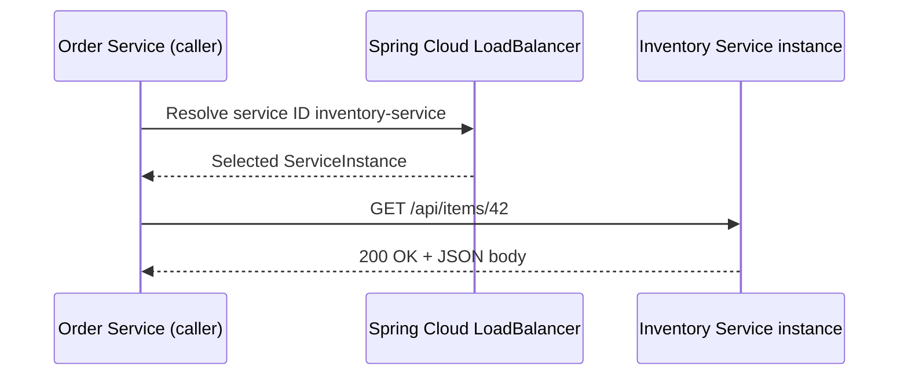

# HTTP method, mã trạng thái và ý nghĩa đối với bên gọi

Khi một dịch vụ gọi dịch vụ khác qua HTTP, bên gọi cần hiểu hai phần của hợp đồng: **HTTP method** cho biết nó đang yêu cầu thao tác gì, còn **mã trạng thái** cho biết máy chủ đã xử lý yêu cầu đến đâu. Hiểu đúng hai phần này giúp ứng dụng diễn giải kết quả, trả lỗi phù hợp và quyết định có nên thử lại hay không.

Trong kiến trúc Spring Cloud, Spring Cloud LoadBalancer có thể chọn một `ServiceInstance` cho lời gọi đến service ID. Việc chọn instance không thay đổi ý nghĩa của HTTP method hay mã trạng thái. Dịch vụ đích, gateway hoặc proxy tạo phản hồi; bên gọi vẫn phải xử lý phản hồi theo hợp đồng HTTP và hợp đồng API.

## 1. Method và status code là hai phần khác nhau của một hợp đồng

Một HTTP request thường có method, URI, header và có thể có body. HTTP response có status code, header và có thể có body.

Ví dụ, bên gọi gửi:

```http
GET /api/products/42 HTTP/1.1
Host: catalog-service
Accept: application/json
```

Máy chủ có thể trả về:

```http
HTTP/1.1 200 OK
Content-Type: application/json

{
  "id": 42,
  "name": "Mechanical Keyboard"
}
```

`GET` thể hiện ý định đọc tài nguyên. `200 OK` cho biết yêu cầu đã được xử lý thành công và response body chứa biểu diễn tài nguyên. Cùng một method có thể nhận nhiều status khác nhau: `200` nếu tìm thấy sản phẩm, `404` nếu không có sản phẩm tương ứng, hoặc `503` nếu dịch vụ tạm thời không thể phục vụ.

Vì vậy, bên gọi không nên suy ra kết quả chỉ từ method hoặc chỉ từ việc kết nối HTTP đã được thiết lập. Nó cần đọc status code, các header liên quan và body theo hợp đồng của API.

## 2. Các HTTP method thường dùng

Method mô tả ngữ nghĩa của thao tác. Hai thuộc tính quan trọng khi thiết kế lời gọi liên dịch vụ là **safe** và **idempotent**:

- *Safe*: thao tác được định nghĩa là chỉ đọc, không yêu cầu máy chủ thay đổi trạng thái tài nguyên.
- *Idempotent*: thực hiện cùng một request một hay nhiều lần có cùng hiệu quả dự kiến lên trạng thái máy chủ.

Idempotent không có nghĩa mọi lần gọi phải trả về cùng status code hoặc cùng response body. Ví dụ, lần `DELETE` đầu tiên có thể trả `204`, lần tiếp theo trả `404`, nhưng tài nguyên vẫn ở trạng thái đã bị xóa.

| Method | Mục đích | Safe | Idempotent | Lưu ý cho bên gọi |
|---|---|---:|---:|---|
| `GET` | Đọc biểu diễn tài nguyên | Có | Có | Không dùng để thực hiện nghiệp vụ làm thay đổi trạng thái. |
| `HEAD` | Lấy metadata như `GET`, nhưng không nhận response body | Có | Có | Hữu ích khi chỉ cần kiểm tra tài nguyên hoặc header. |
| `POST` | Gửi dữ liệu để máy chủ xử lý, thường dùng để tạo tài nguyên hoặc kích hoạt nghiệp vụ | Không | Không mặc định | Gửi lại có thể tạo bản ghi hoặc thực hiện nghiệp vụ lần thứ hai. |
| `PUT` | Tạo hoặc thay thế biểu diễn tại URI đích theo hợp đồng API | Không | Có | Gửi lại cùng nội dung đến cùng URI phải có cùng hiệu quả dự kiến. |
| `PATCH` | Cập nhật một phần tài nguyên | Không | Không được bảo đảm | Tính idempotent phụ thuộc cách định nghĩa thao tác cập nhật. |
| `DELETE` | Yêu cầu xóa tài nguyên tại URI đích | Không | Có | Gửi lại không được tạo thêm hiệu quả xóa ngoài kết quả dự kiến. |
| `OPTIONS` | Hỏi máy chủ về các tùy chọn hoặc khả năng giao tiếp | Có | Có | Có thể dùng để tìm hiểu method được hỗ trợ; thường xuất hiện trong CORS preflight. |

Một vài ví dụ giúp phân biệt:

```http
GET /api/orders/1001
```

Đọc đơn hàng `1001`. Bên gọi có thể thực hiện lại request khi gặp lỗi tạm thời mà không làm phát sinh một đơn hàng mới.

```http
POST /api/orders
Content-Type: application/json

{
  "customerId": 27,
  "productId": 42,
  "quantity": 1
}
```

Tạo đơn hàng. Nếu máy chủ đã tạo đơn hàng nhưng response bị mất trên đường truyền, bên gọi không thể biết chắc thao tác đã hoàn tất hay chưa. Gửi lại request có thể tạo đơn hàng thứ hai.

```http
PUT /api/customers/27/preferences
Content-Type: application/json

{
  "language": "vi",
  "currency": "VND"
}
```

Thay thế cấu hình tại URI đã xác định. Gửi lại cùng request vẫn đưa tài nguyên về cùng trạng thái mong muốn.

```http
PATCH /api/accounts/27
Content-Type: application/merge-patch+json

{
  "displayName": "An Nguyen"
}
```

Cập nhật một phần tài khoản. Thao tác đặt `displayName` thành một giá trị cụ thể thường có thể lặp lại an toàn theo hợp đồng API. Ngược lại, một thao tác kiểu “tăng số dư thêm 100” không idempotent nếu được gửi lại.

Với `POST` hoặc `PATCH`, API có thể cung cấp cơ chế chống xử lý trùng, chẳng hạn header `Idempotency-Key`. Bên gọi chỉ nên dựa vào cơ chế này khi API đích đã công bố và triển khai rõ hành vi của khóa đó.

## 3. Các nhóm mã trạng thái HTTP

Status code là số có ba chữ số. Chữ số đầu tiên cho biết nhóm kết quả:

| Nhóm | Ý nghĩa | Cách hiểu ban đầu của bên gọi |
|---|---|---|
| `1xx` | Informational | Máy chủ đang trao đổi thông tin tiếp theo; thường được HTTP client xử lý ở tầng giao thức. |
| `2xx` | Success | Yêu cầu được xử lý hoặc tiếp nhận thành công theo ngữ nghĩa của status cụ thể. |
| `3xx` | Redirection | Cần tham chiếu đến vị trí khác hoặc dùng lại dữ liệu cache theo chỉ dẫn. |
| `4xx` | Client Error | Request có vấn đề, thiếu quyền, không tìm thấy tài nguyên hoặc bị giới hạn; cần xem từng mã trước khi quyết định thử lại. |
| `5xx` | Server Error | Máy chủ hoặc thành phần trung gian không thể hoàn thành request; một số trường hợp có thể tạm thời. |

### 3.1. Các mã thành công thường gặp

| Mã | Ý nghĩa | Bên gọi nên làm gì |
|---|---|---|
| `200 OK` | Request thành công. | Đọc body nếu API quy định có dữ liệu trả về. |
| `201 Created` | Một hoặc nhiều tài nguyên đã được tạo. | Đọc body và header `Location` nếu API cung cấp URI của tài nguyên mới. |
| `202 Accepted` | Máy chủ đã chấp nhận request để xử lý, nhưng công việc chưa chắc đã hoàn tất. | Theo dõi trạng thái tác vụ bằng URI hoặc cơ chế callback mà API quy định. Không coi đây là kết quả nghiệp vụ cuối cùng. |
| `204 No Content` | Request thành công và không có response body. | Không cố giải mã body thành JSON. |

Ví dụ, API tạo đơn hàng có thể trả `201 Created` cùng `Location: /api/orders/1002`. Nếu API chỉ tiếp nhận yêu cầu để xử lý bất đồng bộ, `202 Accepted` phù hợp hơn; bên gọi cần tiếp tục theo dõi tác vụ thay vì giả định đơn hàng đã hoàn tất.

### 3.2. Chuyển hướng

Các mã như `301`, `302`, `303`, `307` và `308` hướng client đến một URI khác. Một số HTTP client tự động theo redirect; hành vi có thể ảnh hưởng đến method và body. `307` và `308` yêu cầu giữ nguyên method khi chuyển hướng, trong khi `303` hướng client thực hiện `GET` cho tài nguyên đích. `304 Not Modified` cũng thuộc nhóm `3xx`, nhưng dùng cho conditional request: client có thể dùng lại biểu diễn đã cache vì tài nguyên chưa thay đổi. Khi gọi API nội bộ, redirect ngoài dự kiến thường là dấu hiệu cần kiểm tra lại base URL, cấu hình gateway hoặc đường dẫn API.

### 3.3. Các lỗi phía request hoặc nghiệp vụ

| Mã | Ý nghĩa thường gặp | Hướng xử lý của bên gọi |
|---|---|---|
| `400 Bad Request` | Request sai cú pháp hoặc không hợp lệ theo quy tắc API. | Kiểm tra dữ liệu, query parameter, header và định dạng body. |
| `401 Unauthorized` | Thiếu thông tin xác thực hoặc thông tin xác thực không hợp lệ. | Kiểm tra token/credential; chỉ làm mới thông tin xác thực theo cơ chế đã thiết kế. |
| `403 Forbidden` | Máy chủ hiểu request nhưng từ chối quyền thực hiện. | Kiểm tra quyền hoặc phạm vi truy cập; đăng nhập lại thường không giải quyết được lỗi thiếu quyền. |
| `404 Not Found` | Không tìm thấy tài nguyên hoặc endpoint được yêu cầu. | Kiểm tra ID, URI, service route và việc tài nguyên có tồn tại hay không. |
| `405 Method Not Allowed` | Tài nguyên không hỗ trợ method đã gửi. | Kiểm tra method; header `Allow` có thể cho biết method được hỗ trợ. |
| `406 Not Acceptable` | Máy chủ không thể tạo biểu diễn phù hợp với header `Accept`. | Điều chỉnh định dạng mà client chấp nhận. |
| `408 Request Timeout` | Máy chủ không nhận đủ request trong thời gian cho phép. | Có thể thử lại nếu request có thể gửi lại an toàn và còn ngân sách thời gian. |
| `409 Conflict` | Request xung đột với trạng thái hiện tại của tài nguyên. | Đọc chi tiết lỗi, làm mới trạng thái hoặc xử lý xung đột nghiệp vụ. |
| `412 Precondition Failed` | Điều kiện trong header như `If-Match` không thỏa mãn. | Đọc lại phiên bản tài nguyên và tạo request mới với điều kiện phù hợp. |
| `415 Unsupported Media Type` | Máy chủ không hỗ trợ định dạng body được gửi. | Kiểm tra `Content-Type` và định dạng payload. |
| `422 Unprocessable Content` | Nội dung có thể phân tích cú pháp nhưng không thỏa quy tắc xử lý của API. | Hiển thị hoặc ánh xạ lỗi xác thực dữ liệu theo từng trường. |
| `429 Too Many Requests` | Client gửi quá nhiều request trong một khoảng thời gian. | Giảm tốc độ gọi và tôn trọng `Retry-After` nếu có. |

Không phải mọi mã `4xx` đều có cùng cách xử lý. `400`, `401`, `403`, `404` thường cần sửa request hoặc quyền truy cập. `408` và `429` có thể cho phép thử lại theo điều kiện. `409` và `412` thường cần đọc trạng thái mới rồi tạo request khác, thay vì gửi lại nguyên request cũ.

### 3.4. Các lỗi phía máy chủ hoặc thành phần trung gian

| Mã | Ý nghĩa thường gặp | Hướng xử lý của bên gọi |
|---|---|---|
| `500 Internal Server Error` | Máy chủ gặp lỗi không dự kiến khi xử lý request. | Ghi nhận lỗi và correlation/trace ID; chỉ thử lại khi chính sách xác định đây là trường hợp phù hợp. |
| `501 Not Implemented` | Máy chủ không hỗ trợ chức năng hoặc method được yêu cầu. | Kiểm tra khả năng tương thích API; thử lại thường không giúp ích. |
| `502 Bad Gateway` | Gateway hoặc proxy nhận phản hồi không hợp lệ từ upstream. | Kiểm tra dịch vụ upstream; có thể thử lại có giới hạn nếu thao tác an toàn. |
| `503 Service Unavailable` | Dịch vụ tạm thời không sẵn sàng hoặc quá tải. | Tôn trọng `Retry-After` nếu có và áp dụng backoff. |
| `504 Gateway Timeout` | Gateway hoặc proxy không nhận được phản hồi kịp thời từ upstream. | Xem xét timeout, tình trạng upstream và khả năng request đã được xử lý trước khi thử lại. |

`5xx` không đồng nghĩa mọi request đều nên được gửi lại. Ví dụ, `501` thường là lỗi cấu hình hoặc khả năng tương thích. `500` có thể bắt nguồn từ dữ liệu đầu vào gây lỗi hoặc lỗi lập trình ổn định. `503` có khả năng là tình trạng tạm thời, nhưng vẫn cần giới hạn số lần thử lại.

## 4. Đọc response body và header cùng với status code

Status code cho biết loại kết quả; header và body cung cấp thông tin để bên gọi xử lý đúng. Một số header thường có ý nghĩa trực tiếp:

- `Content-Type`: định dạng của response body, ví dụ `application/json`.
- `Location`: URI của tài nguyên được tạo hoặc URI chuyển hướng.
- `Retry-After`: thời điểm hoặc khoảng thời gian client nên chờ trước khi thử lại.
- `WWW-Authenticate`: thông tin về cơ chế xác thực được yêu cầu.
- `Allow`: các method được tài nguyên hỗ trợ, thường đi cùng `405`.
- `ETag` và `Last-Modified`: hỗ trợ cache và kiểm tra phiên bản tài nguyên.

Với API JSON, lỗi nên có cấu trúc ổn định để client có thể ánh xạ thành lỗi miền nghiệp vụ. Ví dụ theo định dạng Problem Details:

```http
HTTP/1.1 409 Conflict
Content-Type: application/problem+json

{
  "type": "https://api.example.com/problems/insufficient-stock",
  "title": "Insufficient stock",
  "status": 409,
  "detail": "The requested quantity is not available.",
  "instance": "/api/orders",
  "code": "INSUFFICIENT_STOCK"
}
```

Bên gọi có thể dùng status `409` để phân loại xung đột và trường `code` để chọn cách xử lý cụ thể. Không nên phụ thuộc vào việc so khớp nguyên văn `detail`, vì nội dung này có thể thay đổi hoặc được bản địa hóa. Nếu API trả body rỗng hoặc body không đúng định dạng, client vẫn phải xử lý status code và giữ lại thông tin lỗi cơ bản.

## 5. Quyết định có thử lại request hay không

Retry giúp vượt qua một số lỗi tạm thời, nhưng cũng có thể nhân đôi thao tác hoặc làm hệ thống quá tải. Bên gọi nên quyết định dựa trên ba yếu tố: loại lỗi, ngữ nghĩa method và khả năng request trước đó đã được xử lý.

Một quy trình thực tế:

1. Nếu nhận `2xx`, xử lý kết quả theo status cụ thể. Với `202`, tiếp tục theo dõi tác vụ; với `204`, không chờ body.
2. Nếu nhận `3xx`, tuân theo chính sách redirect của client và kiểm tra URI đích khi redirect không được dự kiến.
3. Nếu nhận `4xx`, đọc status và error body để sửa request, xác thực, quyền hoặc trạng thái nghiệp vụ. Chỉ retry các trường hợp có chính sách rõ ràng, chẳng hạn `408` hoặc `429`.
4. Nếu nhận `5xx`, xác định lỗi có khả năng tạm thời hay không. `502`, `503`, `504` có thể phù hợp với retry có giới hạn; `500` cần cân nhắc theo nguyên nhân và hợp đồng API.
5. Nếu không nhận được HTTP response do DNS, lỗi kết nối hoặc timeout, không có status code để phân loại. Với timeout, máy chủ có thể đã thực hiện thao tác nhưng response chưa đến được bên gọi.

Trước khi retry, hãy kiểm tra tính idempotent. `GET`, `HEAD`, `PUT` và `DELETE` có ngữ nghĩa idempotent theo HTTP. Với `POST` hoặc `PATCH`, chỉ retry tự động khi API cung cấp bảo đảm chống xử lý trùng hoặc nghiệp vụ có cơ chế đối soát phù hợp. Một `Idempotency-Key` chỉ có tác dụng khi máy chủ lưu và thực thi khóa theo đúng hợp đồng.

Chính sách retry nên có số lần thử tối đa, tổng thời gian tối đa, exponential backoff và jitter. Khi response có `Retry-After`, client nên tôn trọng giá trị đó trong giới hạn deadline của lời gọi. Tránh để retry ở nhiều tầng cùng lúc mà không tính tổng số lần gọi: retry ở HTTP client, Spring Cloud LoadBalancer và tầng nghiệp vụ có thể nhân số request lên nhiều lần.

Đặc biệt, timeout không chứng minh rằng thao tác thất bại. Nếu bên gọi gửi `POST /api/orders`, máy chủ tạo đơn hàng thành công nhưng response bị mất, retry mù quáng có thể tạo đơn hàng thứ hai. Đây là lý do cần thiết kế idempotency và xử lý kết quả không xác định ngay từ hợp đồng API.

## 6. Ý nghĩa trong lời gọi qua Spring Cloud LoadBalancer

Với client-side load balancing, bên gọi thường dùng service ID trong URI, ví dụ `http://inventory-service`. Spring Cloud LoadBalancer chọn một instance phù hợp của service đó; HTTP client gửi request đến instance được chọn. Method, header, body và status code vẫn tuân theo HTTP:



LoadBalancer giải quyết việc chọn instance theo service ID và cấu hình của ứng dụng. Nó không tự biến `POST` thành `PUT`, không diễn giải `409` thành thành công và không thể kết luận một request timeout chắc chắn chưa được xử lý. Retry hoặc xử lý status phải được thiết kế ở HTTP client, tầng resilience hoặc logic nghiệp vụ.

Ví dụ dùng `WebClient` đã được cấu hình với `@LoadBalanced`:

```java
@Configuration
class HttpClientConfiguration {
    @Bean
    @LoadBalanced
    WebClient.Builder loadBalancedWebClientBuilder() {
        return WebClient.builder();
    }
}

@Service
class InventoryClient {
    private final WebClient webClient;

    InventoryClient(@LoadBalanced WebClient.Builder builder) {
        this.webClient = builder.build();
    }

    Mono<Item> findItem(String itemId) {
        return webClient.get()
            .uri("http://inventory-service/api/items/{id}", itemId)
            .retrieve()
            .onStatus(
                status -> status.value() == 404,
                response -> response.createException()
                    .map(ItemNotFoundException::new)
            )
            .onStatus(
                HttpStatusCode::is5xxServerError,
                ClientResponse::createException
            )
            .bodyToMono(Item.class);
    }
}
```

Trong ví dụ, `WebClient.Builder` được inject vào client và đã mang cấu hình `@LoadBalanced`. `404` được ánh xạ thành lỗi miền `ItemNotFoundException`; nhóm `5xx` được chuyển thành exception HTTP để tầng gọi phía trên quyết định cách ghi log, retry hoặc trả lỗi cho caller tiếp theo. `ItemNotFoundException` là exception do ứng dụng định nghĩa, có thể nhận `WebClientResponseException` làm nguyên nhân. Khi dùng `retrieve()`, các response `4xx` và `5xx` chưa được tùy chỉnh cũng mặc định trở thành `WebClientResponseException`.

Nếu không có instance phù hợp, lỗi có thể phát sinh trước khi nhận được HTTP response hoặc được một thành phần trong hệ thống biểu diễn thành status như `503`, tùy cấu hình và phiên bản tích hợp. Vì vậy, hãy phân biệt exception kết nối/LoadBalancer với một HTTP response thực sự từ dịch vụ đích.

## 7. Checklist khi thiết kế API và viết caller

- Chọn method đúng với ý định: đọc bằng `GET`, tạo hoặc kích hoạt nghiệp vụ bằng `POST`, thay thế bằng `PUT`, cập nhật một phần bằng `PATCH`, xóa bằng `DELETE`.
- Trả status thể hiện rõ kết quả: `201` khi tạo tài nguyên, `202` khi mới tiếp nhận xử lý bất đồng bộ, `204` khi thành công không có body.
- Dùng `4xx` cho vấn đề của request/quyền/trạng thái nghiệp vụ và `5xx` cho lỗi máy chủ hoặc thành phần trung gian; cung cấp error body có cấu trúc ổn định.
- Đọc `Retry-After`, `Location`, `Allow` và các header liên quan khi API sử dụng chúng.
- Chỉ retry khi lỗi có khả năng tạm thời, request có thể gửi lại an toàn và còn thời gian trong deadline.
- Bảo vệ thao tác không idempotent bằng idempotency key hoặc cơ chế nghiệp vụ tương đương trước khi bật retry tự động.
- Ghi log status, service ID, URI, thời gian phản hồi và trace/correlation ID; tránh ghi token hoặc dữ liệu nhạy cảm trong header/body.

Khi hiểu đúng method và status code, bên gọi có thể phân biệt lỗi request, lỗi nghiệp vụ, lỗi tạm thời và lỗi kết nối. Đây là nền tảng để cấu hình retry, timeout và quan sát giao tiếp giữa các dịch vụ một cách có kiểm soát trong hệ thống dùng Spring Cloud LoadBalancer.
