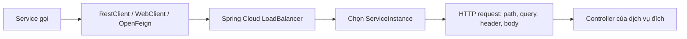

# Header, query parameter, path variable và request body

Khi một dịch vụ gọi API HTTP của dịch vụ khác, request thường mang bốn loại thông tin: **path variable** xác định tài nguyên, **query parameter** bổ sung điều kiện truy vấn, **header** truyền metadata và **request body** mang dữ liệu nghiệp vụ. Phân chia đúng vai trò giúp API dễ đọc, dễ kiểm thử và ổn định khi giao tiếp qua Spring Cloud LoadBalancer.

Trong mô hình cân bằng tải phía client, ứng dụng gọi thường dùng một **service ID** làm host logic, chẳng hạn `http://inventory-service`. Spring Cloud LoadBalancer chọn một `ServiceInstance` phù hợp rồi chuyển request đến instance đó. Việc chọn instance không thay đổi ý nghĩa của path, query parameter, header hay body: các thành phần này vẫn phải tuân theo hợp đồng HTTP mà dịch vụ đích công bố.

## 1. Nhìn một HTTP request như thế nào?

Một HTTP request gồm request line, các header, một dòng trống và phần body tùy chọn. Với HTTP/1.1, ví dụ dưới đây biểu diễn một request tạo mặt hàng trong một đơn hàng:

```http
POST /api/orders/ORD-2026-001/items?include=product,price HTTP/1.1
Host: order-service
Accept: application/json
Content-Type: application/json
Authorization: Bearer <access-token>
X-Correlation-ID: 8f3c2a1d
Idempotency-Key: create-item-ORD-2026-001-01

{
  "productId": "P-1001",
  "quantity": 2,
  "note": "Giao cùng đơn hàng"
}
```

Trong ví dụ:

| Thành phần | Giá trị | Vai trò |
|---|---|---|
| Path variable | `ORD-2026-001` trong `/api/orders/{orderId}/items` | Xác định đơn hàng cần thêm mặt hàng. |
| Query parameter | `include=product,price` | Yêu cầu API trả thêm thông tin sản phẩm và giá. |
| Header | `Accept`, `Content-Type`, `Authorization`, `X-Correlation-ID` | Truyền định dạng mong muốn, định dạng dữ liệu gửi lên, thông tin xác thực và mã theo dõi request. |
| Request body | `productId`, `quantity`, `note` | Mang dữ liệu cần thiết để tạo mặt hàng. |

`Host: order-service` ở đây minh họa host logic mà ứng dụng sử dụng trước khi phân giải service ID. Khi request đi qua HTTP client được cấu hình Spring Cloud LoadBalancer, host đích trên kết nối thực tế sẽ là địa chỉ của instance được chọn.

## 2. Path variable: xác định tài nguyên trong đường dẫn

Path variable là một phần của đường dẫn URL, thường đại diện cho định danh của tài nguyên hoặc một phần tử trong cấu trúc tài nguyên. Ví dụ:

```http
GET /api/products/P-1001
GET /api/orders/ORD-2026-001/items/ITEM-07
```

Đường dẫn đầu tiên yêu cầu sản phẩm `P-1001`; đường dẫn thứ hai chỉ đến mặt hàng `ITEM-07` thuộc đơn hàng `ORD-2026-001`. Người đọc có thể hiểu tài nguyên đang được truy cập ngay từ URL.

Trong Spring MVC, khai báo biến đường dẫn bằng `@PathVariable`:

```java
@RestController
@RequestMapping("/api/products")
class ProductController {

    @GetMapping("/{productId}")
    ProductResponse getProduct(
            @PathVariable("productId") String productId) {
        return productService.findById(productId);
    }
}
```

Khi gọi endpoint này, giá trị `P-1001` trong URL được ánh xạ vào tham số `productId`.

Nên dùng path variable khi:

- Giá trị là định danh cần thiết để xác định tài nguyên.
- Tài nguyên có quan hệ phân cấp rõ ràng, ví dụ `/orders/{orderId}/items/{itemId}`.
- Endpoint biểu diễn một thao tác trên tài nguyên cụ thể, ví dụ `GET /products/{id}`, `PUT /products/{id}` hoặc `DELETE /products/{id}`.

Không nên đưa bộ lọc tùy chọn, từ khóa tìm kiếm hay một tập dữ liệu dài vào path. Những thông tin đó phù hợp hơn với query parameter hoặc body. Cũng cần mã hóa các ký tự đặc biệt đúng quy tắc URL; không tự nối chuỗi tùy ý nếu giá trị có thể chứa dấu `/`, khoảng trắng hoặc ký tự dành riêng.

## 3. Query parameter: bổ sung điều kiện truy vấn

Query parameter nằm sau dấu `?` trong URL. Nhiều tham số được phân tách bằng dấu `&`. Chúng thường dùng cho bộ lọc, tìm kiếm, phân trang, sắp xếp hoặc yêu cầu mở rộng dữ liệu.

```http
GET /api/products?category=book&active=true&page=0&size=20&sort=name,asc
GET /api/products/P-1001?include=stock,price
```

Ví dụ đầu tiên lấy danh sách sản phẩm thuộc nhóm `book`, đang hoạt động, ở trang đầu tiên, mỗi trang 20 phần tử và sắp xếp theo tên tăng dần. Ví dụ thứ hai lấy một sản phẩm cụ thể và yêu cầu trả thêm tồn kho cùng giá.

Trong Spring MVC, dùng `@RequestParam`:

```java
@GetMapping
List<ProductResponse> searchProducts(
        @RequestParam(required = false) String category,
        @RequestParam(defaultValue = "0") int page,
        @RequestParam(defaultValue = "20") int size,
        @RequestParam(defaultValue = "name,asc") String sort) {
    return productService.search(category, page, size, sort);
}
```

Với `required = false`, tham số có thể vắng mặt. Với `defaultValue`, Spring sử dụng giá trị mặc định khi tham số không được gửi hoặc có giá trị rỗng. Ứng dụng vẫn cần kiểm tra giới hạn hợp lệ, chẳng hạn không cho `size` vượt quá mức tối đa hoặc `page` là số âm.

Một tham số có thể xuất hiện nhiều lần, ví dụ `?tag=java&tag=spring`. Có thể nhận các giá trị này bằng `List<String>` hoặc `MultiValueMap<String, String>` tùy nhu cầu. Nếu API dùng quy ước danh sách phân tách bằng dấu phẩy như `?sort=name,asc`, quy ước đó cần được mô tả rõ trong hợp đồng API.

Nên dùng query parameter khi:

- Thông tin chỉ làm thay đổi cách tìm hoặc trình bày kết quả, không thay đổi định danh tài nguyên.
- Tham số có thể tùy chọn, có giá trị mặc định hoặc kết hợp với nhiều bộ lọc khác.
- Client cần chia trang, sắp xếp hoặc yêu cầu một phần dữ liệu liên quan.

Giá trị query phải được URL-encode. Không đưa mật khẩu, access token hoặc dữ liệu bí mật vào query string: URL thường xuất hiện trong access log, lịch sử trình duyệt, hệ thống theo dõi và một số header tham chiếu.

## 4. Header: truyền metadata của request

Header là các cặp tên và giá trị nằm trước dòng trống phân cách body. Header mô tả request hoặc ngữ cảnh xử lý, ví dụ định dạng dữ liệu, xác thực, cache, điều kiện cập nhật và thông tin quan sát hệ thống.

Các header thường gặp:

| Header | Ý nghĩa |
|---|---|
| `Accept` | Các định dạng response mà client chấp nhận, ví dụ `application/json`. |
| `Content-Type` | Định dạng của request body, ví dụ `application/json`. |
| `Authorization` | Thông tin xác thực, thường mang Bearer token trong hệ thống dùng OAuth 2.0. |
| `X-Correlation-ID` | Mã tương quan do ứng dụng quy ước để nối log của một request qua nhiều dịch vụ. |
| `traceparent` | Header theo W3C Trace Context, dùng để truyền ngữ cảnh distributed tracing. |
| `Idempotency-Key` | Khóa do ứng dụng quy ước để nhận diện các lần gửi lại cùng một yêu cầu có tính lặp an toàn. |

Hai header dễ nhầm nhất là `Accept` và `Content-Type`:

- `Accept` nói với server client muốn **nhận** response ở định dạng nào.
- `Content-Type` nói với server body mà client **đang gửi** có định dạng nào.

Ví dụ, client gửi JSON và muốn nhận JSON:

```http
Content-Type: application/json
Accept: application/json
```

Trong Spring MVC, dùng `@RequestHeader` để lấy một header:

```java
@GetMapping("/{productId}")
ProductResponse getProduct(
        @PathVariable String productId,
        @RequestHeader("X-Correlation-ID") String correlationId) {
    return productService.findById(productId, correlationId);
}
```

Nếu header là tùy chọn, đặt `required = false` hoặc khai báo giá trị mặc định. Spring cũng hỗ trợ nhận nhiều header dưới dạng `HttpHeaders` hoặc `Map<String, String>` khi endpoint cần xử lý linh hoạt.

Tên header không phân biệt chữ hoa và chữ thường theo quy tắc HTTP. Tuy vậy, không nên tự đặt header tùy chỉnh nếu đã có header chuẩn phù hợp. Header tùy chỉnh như `X-Correlation-ID` cần có quy ước thống nhất giữa các dịch vụ.

Header đến từ client vẫn là dữ liệu đầu vào không đáng tin cậy. Server phải xác thực token, kiểm tra quyền và kiểm tra các giá trị như tenant ID trước khi dùng chúng để quyết định dữ liệu được truy cập. Không ghi access token, cookie hoặc thông tin nhạy cảm vào log.

## 5. Request body: gửi dữ liệu nghiệp vụ

Request body nằm sau dòng trống trong HTTP message. Nó thường mang dữ liệu cần tạo mới hoặc cập nhật. Body có thể dùng JSON, XML, form data, multipart hoặc định dạng khác tùy hợp đồng API. Với API REST trong ứng dụng Spring, JSON là lựa chọn phổ biến.

Ví dụ request tạo sản phẩm:

```http
POST /api/products HTTP/1.1
Content-Type: application/json
Accept: application/json

{
  "sku": "BOOK-001",
  "name": "Spring Cloud in Practice",
  "initialQuantity": 25
}
```

Trong Spring MVC, dùng `@RequestBody` để ánh xạ nội dung body thành DTO. Kết hợp `@Valid` với Bean Validation để kiểm tra dữ liệu trước khi xử lý nghiệp vụ:

```java
public record CreateProductRequest(
        @NotBlank String sku,
        @NotBlank String name,
        @PositiveOrZero int initialQuantity) {
}

@PostMapping(consumes = MediaType.APPLICATION_JSON_VALUE)
ProductResponse createProduct(
        @Valid @RequestBody CreateProductRequest request) {
    return productService.create(request);
}
```

`Content-Type` phải khớp với định dạng body mà endpoint hỗ trợ. Nếu server không hỗ trợ định dạng được gửi, request có thể nhận `415 Unsupported Media Type`. Nếu JSON không hợp lệ hoặc vi phạm validation, ứng dụng thường trả `400 Bad Request` với thông tin lỗi phù hợp.

Các phương thức HTTP thường được dùng như sau:

- `POST`: gửi dữ liệu để tạo tài nguyên hoặc thực hiện một thao tác.
- `PUT`: gửi biểu diễn đầy đủ để thay thế trạng thái của tài nguyên được xác định bởi URL.
- `PATCH`: gửi phần thay đổi cần áp dụng cho tài nguyên.
- `GET` và `HEAD`: không nên phụ thuộc vào request body. Ngữ nghĩa body của các phương thức này không được định nghĩa thống nhất và một số proxy hoặc server có thể bỏ qua hay từ chối body.

Khi cập nhật tài nguyên đã có định danh, thường đặt định danh trong path, ví dụ `PUT /api/products/P-1001`, còn body chứa các thuộc tính cần cập nhật. Tránh để path và body cùng mang một định danh nhưng có thể khác nhau; nếu hợp đồng buộc phải có cả hai, server phải kiểm tra chúng nhất quán.

## 6. Kết hợp bốn thành phần trong một controller

Ví dụ dưới đây minh họa một API sản phẩm. Endpoint đọc sản phẩm nhận định danh từ path, tùy chọn nhận trường mở rộng qua query và lấy mã tương quan từ header. Endpoint tạo sản phẩm nhận dữ liệu nghiệp vụ từ body.

```java
@RestController
@RequestMapping("/api/products")
class ProductController {

    private final ProductService productService;

    ProductController(ProductService productService) {
        this.productService = productService;
    }

    @GetMapping("/{productId}")
    ProductResponse getProduct(
            @PathVariable String productId,
            @RequestParam(name = "include", required = false) String include,
            @RequestHeader(name = "X-Correlation-ID", required = false)
                    String correlationId) {
        return productService.find(productId, include, correlationId);
    }

    @PostMapping(consumes = MediaType.APPLICATION_JSON_VALUE)
    ProductResponse createProduct(
            @Valid @RequestBody CreateProductRequest request,
            @RequestHeader(name = "X-Correlation-ID", required = false)
                    String correlationId) {
        return productService.create(request, correlationId);
    }
}
```

Mỗi tham số có một nguồn rõ ràng. Người đọc API có thể phân biệt định danh tài nguyên, tùy chọn truy vấn, metadata của request và dữ liệu nghiệp vụ mà không cần suy luận từ tên biến.

## 7. Gửi request qua Spring Cloud LoadBalancer

Khi một dịch vụ gọi dịch vụ khác, client có thể dùng service ID thay cho hostname của một instance cụ thể. Ví dụ `inventory-service` là tên logic của dịch vụ quản lý tồn kho. HTTP client được gắn với Spring Cloud LoadBalancer sẽ phân giải service ID thành một `ServiceInstance` trước khi gửi request.

Với `RestClient`, có thể khai báo builder được cân bằng tải:

```java
@Configuration
class InventoryHttpClientConfiguration {

    @Bean
    @LoadBalanced
    RestClient.Builder loadBalancedRestClientBuilder() {
        return RestClient.builder();
    }
}
```

Sau đó dùng builder này để tạo client. Ví dụ GET dưới đây truyền `productId` ở path, `include` ở query và `X-Correlation-ID` ở header:

```java
@Service
class InventoryGateway {

    private final RestClient restClient;

    InventoryGateway(@LoadBalanced RestClient.Builder builder) {
        this.restClient = builder.build();
    }

    ProductResponse getProduct(
            String productId, String include, String correlationId) {
        return restClient.get()
                .uri(uriBuilder -> uriBuilder
                        .scheme("http")
                        .host("inventory-service")
                        .path("/api/products/{productId}")
                        .queryParamIfPresent(
                                "include", Optional.ofNullable(include))
                        .build(productId))
                .accept(MediaType.APPLICATION_JSON)
                .header("X-Correlation-ID", correlationId)
                .retrieve()
                .body(ProductResponse.class);
    }

    ProductResponse createProduct(
            CreateProductRequest request,
            String correlationId,
            String idempotencyKey) {
        return restClient.post()
                .uri("http://inventory-service/api/products")
                .contentType(MediaType.APPLICATION_JSON)
                .accept(MediaType.APPLICATION_JSON)
                .header("X-Correlation-ID", correlationId)
                .header("Idempotency-Key", idempotencyKey)
                .body(request)
                .retrieve()
                .body(ProductResponse.class);
    }
}
```

Các kiểu `ProductResponse` và `CreateProductRequest` là DTO của ứng dụng. Ví dụ giả định ứng dụng đã có Jackson và các cấu hình HTTP client cần thiết. Với `RestClient`, request body được chuyển đổi theo message converter phù hợp với `Content-Type`.

Với `WebClient`, cần dùng `WebClient.Builder` được đánh dấu `@LoadBalanced`, sau đó có thể giữ nguyên cách phân chia path, query, header và body:

```java
@Bean
@LoadBalanced
WebClient.Builder loadBalancedWebClientBuilder() {
    return WebClient.builder();
}
```

```java
@Service
class InventoryReactiveGateway {

    private final WebClient webClient;

    InventoryReactiveGateway(@LoadBalanced WebClient.Builder builder) {
        this.webClient = builder.build();
    }

    Mono<ProductResponse> getProduct(
            String productId, String include, String correlationId) {
        return webClient.get()
                .uri("http://inventory-service/api/products/{id}?include={include}",
                        productId, include)
                .accept(MediaType.APPLICATION_JSON)
                .header("X-Correlation-ID", correlationId)
                .retrieve()
                .bodyToMono(ProductResponse.class);
    }
}
```

Với OpenFeign, tên service ID được khai báo ở `@FeignClient`. Các annotation của Spring MVC tiếp tục thể hiện vị trí của từng giá trị trong request:

```java
@FeignClient(name = "inventory-service")
interface InventoryFeignClient {

    @GetMapping("/api/products/{productId}")
    ProductResponse getProduct(
            @PathVariable("productId") String productId,
            @RequestParam("include") String include,
            @RequestHeader("X-Correlation-ID") String correlationId);

    @PostMapping(
            value = "/api/products",
            consumes = MediaType.APPLICATION_JSON_VALUE)
    ProductResponse createProduct(
            @RequestBody CreateProductRequest request,
            @RequestHeader("X-Correlation-ID") String correlationId);
}
```

Khi OpenFeign được tích hợp Spring Cloud LoadBalancer, client có thể phân giải `inventory-service` và chọn instance tương ứng. Dù dùng `RestClient`, `WebClient` hay OpenFeign, hợp đồng HTTP của endpoint vẫn quyết định dữ liệu nào thuộc path, query, header và body.

Luồng xử lý tổng quát:



LoadBalancer giải quyết địa chỉ instance theo service ID. Nó không tự sửa một path sai, bổ sung query parameter còn thiếu, tạo header xác thực hay biến đổi body để phù hợp với API. Những phần đó thuộc trách nhiệm của client và hợp đồng giữa các dịch vụ.

## 8. Ảnh hưởng đến retry, bảo mật và quan sát hệ thống

Các thành phần HTTP cũng ảnh hưởng đến cách xử lý lỗi khi giao tiếp qua nhiều instance:

- **Retry:** request GET thường có thể gửi lại an toàn nếu API tuân thủ ngữ nghĩa đọc. Với POST tạo dữ liệu, gửi lại có thể tạo bản ghi trùng. Nếu cần retry một thao tác tạo, hai bên nên thống nhất cơ chế idempotency, chẳng hạn nhận `Idempotency-Key` và lưu kết quả gắn với khóa đó.
- **Timeout:** timeout áp dụng cho toàn bộ lần gọi hoặc từng giai đoạn tùy cấu hình client. Query quá rộng, body quá lớn hoặc endpoint xử lý lâu đều có thể làm request vượt timeout; cần đặt giới hạn và thiết kế API phù hợp.
- **Bảo mật:** truyền thông tin xác thực qua header theo cơ chế đã thống nhất, dùng TLS khi phù hợp và xác minh quyền ở dịch vụ đích. Không xem service ID nội bộ hay header do client tự gửi là bằng chứng xác thực.
- **Tracing và logging:** truyền trace context hoặc correlation ID xuyên suốt các lần gọi để liên kết log giữa caller và callee. Log nên ưu tiên method, path template, service ID, instance được chọn, status code và thời gian xử lý; tránh ghi token hoặc body chứa dữ liệu nhạy cảm.

Khi một request qua LoadBalancer thất bại, hãy phân biệt lỗi phân giải service ID hoặc không tìm được instance với lỗi HTTP do dịch vụ đích trả về. Một request đến đúng instance nhưng sai path vẫn có thể nhận `404 Not Found`; LoadBalancer không thể sửa lỗi hợp đồng API.

## 9. Đọc lỗi HTTP để tìm đúng thành phần cần kiểm tra

| Mã trạng thái | Nguyên nhân thường gặp | Thành phần nên kiểm tra |
|---|---|---|
| `400 Bad Request` | Path/query không hợp lệ, JSON sai cấu trúc hoặc dữ liệu không qua validation. | Path variable, query parameter và body. |
| `401 Unauthorized` | Thiếu hoặc sai thông tin xác thực. | `Authorization` và cấu hình xác thực. |
| `403 Forbidden` | Danh tính đã được xác thực nhưng không có quyền thực hiện thao tác. | Quyền truy cập và chính sách bảo mật. |
| `404 Not Found` | Sai endpoint, sai path variable hoặc tài nguyên không tồn tại. | Path và tài nguyên đích. |
| `406 Not Acceptable` | Server không tạo được response theo định dạng client yêu cầu. | `Accept`. |
| `415 Unsupported Media Type` | Server không hỗ trợ định dạng body được gửi lên. | `Content-Type` và cấu hình converter. |
| `429 Too Many Requests` | Client gửi quá nhiều request trong một khoảng thời gian. | Chính sách giới hạn request và nhịp retry. |
| `5xx` | Dịch vụ đích hoặc hạ tầng xử lý request gặp lỗi. | Log của instance được chọn, timeout và tình trạng dịch vụ. |

Khi điều tra lỗi, nên ghi nhận service ID và instance thực tế được chọn cùng correlation ID. Điều đó giúp xác định request đã dừng ở bước chọn instance, trên đường truyền hay bên trong controller của dịch vụ đích.

## 10. Quy tắc chọn đúng vị trí cho dữ liệu

| Câu hỏi | Nên đặt ở đâu? | Ví dụ |
|---|---|---|
| Tài nguyên nào đang được truy cập? | Path variable | `/products/{productId}` |
| Muốn lọc, phân trang hoặc mở rộng kết quả ra sao? | Query parameter | `?page=0&size=20&include=stock` |
| Request cần metadata hoặc ngữ cảnh xử lý nào? | Header | `Authorization`, `Accept`, `X-Correlation-ID` |
| Dữ liệu nào cần tạo hoặc cập nhật? | Request body | JSON chứa `sku`, `name`, `quantity` |

Trước khi hoàn thiện một endpoint giữa các dịch vụ, hãy kiểm tra các điểm sau:

1. Path thể hiện tài nguyên và định danh ổn định; query chỉ chứa tùy chọn truy vấn.
2. Header có mục đích rõ ràng, dùng chuẩn HTTP khi có thể và không chứa dữ liệu bí mật trong URL.
3. Body có schema được xác định, `Content-Type` phù hợp và được kiểm tra đầu vào.
4. Client gửi đúng service ID khi dùng Spring Cloud LoadBalancer, đồng thời giữ nguyên hợp đồng HTTP của dịch vụ đích.
5. Retry chỉ được bật khi thao tác có thể gửi lại an toàn hoặc đã có cơ chế idempotency; correlation ID/trace context được truyền để theo dõi xuyên dịch vụ.

Khi bốn thành phần được dùng đúng vai trò, API trở nên dễ hiểu và client có thể gọi dịch vụ qua nhiều instance mà không làm thay đổi ý nghĩa của request.
