# Tuần tự hóa JSON, kiểu dữ liệu và hợp đồng trao đổi

Trong giao tiếp giữa các dịch vụ, hai phía cần thống nhất cách biểu diễn dữ liệu trên HTTP. Ứng dụng gửi một đối tượng Java, client chuyển đối tượng đó thành các byte JSON, dịch vụ nhận giải mã JSON thành kiểu dữ liệu của nó rồi xử lý và trả về kết quả. Nếu hai phía hiểu khác nhau về tên trường, kiểu dữ liệu, giá trị rỗng hoặc định dạng thời gian, request có thể thất bại dù cả hai dịch vụ đều đang hoạt động.

Bài học này thuộc chương **Nền tảng HTTP** của module `SPRING_CLOUD_SERVICE_COMMUNICATION_LOAD_BALANCING`. Trong module, bạn tìm hiểu cơ chế cân bằng tải phía client của Spring Cloud LoadBalancer: chọn `ServiceInstance` theo service ID, service discovery, health check và chính sách định tuyến; đồng thời thực hành tích hợp `RestClient`, `WebClient`, `OpenFeign`, cấu hình retry/timeout và quan sát lỗi để giao tiếp giữa các dịch vụ ổn định. Các cơ chế đó quyết định request được gửi tới instance nào. Hợp đồng JSON quyết định instance nhận và trả dữ liệu theo cách nào. Mọi instance cùng phục vụ một service ID cần hiểu hợp đồng này tương thích với nhau.

Sau bài học, bạn có thể:

- Giải thích luồng tuần tự hóa và giải tuần tự hóa JSON trong một HTTP request/response.
- Chọn kiểu Java phù hợp với kiểu dữ liệu JSON và xác định rõ ý nghĩa của giá trị thiếu, `null` và giá trị mặc định.
- Thiết kế DTO và hợp đồng request/response ổn định giữa các dịch vụ.
- Nhận biết lỗi tương thích dữ liệu có thể xuất hiện khi LoadBalancer phân phối request tới nhiều phiên bản service.
- Kiểm tra header, payload và cấu hình Jackson khi một client không đọc được phản hồi.

## 1. JSON nằm ở đâu trong luồng giao tiếp giữa các service?

JSON là định dạng biểu diễn dữ liệu. Nó không chọn địa chỉ đích và cũng không thực hiện cân bằng tải. Trong Spring, các thành phần HTTP client và message converter/codec đảm nhiệm việc chuyển đổi đối tượng Java thành JSON và ngược lại. Spring Cloud LoadBalancer tham gia phân giải service ID thành một instance cụ thể.

Luồng tổng quát khi một service gọi service khác:

```mermaid
flowchart LR
    A["Đối tượng DTO ở client"] --> B["HTTP client"]
    B --> C["Jackson tuần tự hóa"]
    C --> D["HTTP request chứa JSON"]
    D --> E["Spring Cloud LoadBalancer"]
    E --> F["ServiceInstance được chọn"]
    F --> G["Jackson giải tuần tự hóa"]
    G --> H["Đối tượng DTO ở server"]
    H --> I["Xử lý nghiệp vụ"]
    I --> J["JSON response"]
    J --> K["Client giải tuần tự hóa response"]
```



Ví dụ, client gọi địa chỉ logic `http://reservation-service/api/reservations`. LoadBalancer chọn một instance đang khả dụng của `reservation-service`, chẳng hạn `10.0.2.15:8080`. Body JSON vẫn phải tuân theo cùng hợp đồng API dù request được gửi tới instance nào.

Điều này có một hệ quả quan trọng: nếu ba instance cùng đăng ký dưới service ID `reservation-service` nhưng mỗi instance lại dùng một cấu trúc response khác nhau, lỗi có thể xuất hiện không ổn định. Request này thành công, request tiếp theo thất bại vì LoadBalancer đã chọn instance có phiên bản không tương thích. Cần giữ hợp đồng trao đổi tương thích giữa các instance trong suốt quá trình triển khai.

## 2. Hợp đồng trao đổi JSON gồm những gì?

Hợp đồng API mô tả cách hai phía trao đổi dữ liệu. Một hợp đồng đủ rõ cần xác định:

- HTTP method và endpoint, ví dụ `POST /api/reservations`.
- Header được chấp nhận và header được trả về, đặc biệt là `Content-Type` và `Accept`.
- Tên trường JSON, kiểu dữ liệu, trường bắt buộc và trường tùy chọn.
- Ý nghĩa của `null`, trường bị bỏ qua và giá trị mặc định.
- Định dạng ngày giờ, múi giờ, đơn vị đo và quy ước mã trạng thái.
- Cấu trúc response thành công và cấu trúc lỗi.
- Quy tắc tương thích khi thêm, đổi hoặc loại bỏ trường.

Giả sử một dịch vụ nhận yêu cầu tạo reservation. Client gửi:

```json
{
  "sku": "SKU-RED-01",
  "quantity": 2,
  "requestedAt": "2026-11-17T10:15:30Z",
  "note": "Giao vào buổi sáng"
}
```

Dịch vụ có thể trả về:

```json
{
  "id": "res-8421",
  "sku": "SKU-RED-01",
  "quantity": 2,
  "status": "ACCEPTED",
  "createdAt": "2026-11-17T10:15:31Z"
}
```

Hai payload này là một phần của hợp đồng. Các bên cần thống nhất rằng `quantity` là số nguyên dương, `requestedAt` là thời điểm theo ISO 8601 ở UTC, `status` là một mã trạng thái đã được quy ước và `id` được truyền dưới dạng chuỗi.

Tên trường cũng là một phần của hợp đồng. Nếu server đổi `createdAt` thành `created_at` mà không giữ tương thích hoặc không thông báo cho client, client có thể không đọc được giá trị như mong đợi. Việc hai tên trường cùng mang ý nghĩa “thời điểm tạo” không khiến chúng tự động tương đương trong quá trình giải tuần tự hóa.

## 3. Kiểu dữ liệu JSON và kiểu Java

JSON chỉ có một số kiểu dữ liệu cơ bản: string, number, boolean, object, array và null. JSON không có kiểu ngày giờ, enum, UUID hay decimal chuyên biệt. Những giá trị này thường được biểu diễn bằng string hoặc number theo quy ước của API.

| Kiểu JSON | Kiểu Java thường dùng | Lưu ý khi thiết kế |
|---|---|---|
| string | `String`, `UUID`, enum | UUID, mã trạng thái và ngày giờ cần quy ước biểu diễn ổn định. |
| number | `int`, `long`, `BigDecimal` | Chọn miền giá trị và độ chính xác phù hợp; tránh dùng `double` cho tiền. |
| boolean | `boolean`, `Boolean` | `Boolean` có thể biểu diễn thêm trạng thái chưa có giá trị. |
| object | DTO hoặc record lồng nhau | Nên định nghĩa cấu trúc rõ ràng thay vì nhận dữ liệu tùy ý. |
| array | `List<T>`, `Set<T>` | Thống nhất thứ tự phần tử và cách xử lý phần tử trùng. |
| null | kiểu tham chiếu có thể null | Cần xác định null có ý nghĩa gì trong hợp đồng. |

### Số nguyên, số thập phân và mã định danh

JSON biểu diễn số bằng dạng number, không phân biệt rõ kiểu `int`, `long` hay `BigDecimal`. Vì vậy, server và client phải thống nhất miền giá trị và độ chính xác.

- Dùng `int` cho số lượng có giới hạn phù hợp với miền 32-bit.
- Dùng `long` khi giá trị nguyên có thể lớn hơn miền của `int`.
- Dùng `BigDecimal` cho tiền hoặc số thập phân cần giữ độ chính xác.
- Tránh dùng `float` hoặc `double` cho phép tính tiền tệ vì chúng biểu diễn số thực theo dạng dấu phẩy động nhị phân.

Một lưu ý khi tích hợp với JavaScript: kiểu `Number` chỉ biểu diễn chính xác mọi số nguyên trong khoảng an toàn từ `-(2^53 - 1)` đến `2^53 - 1`. Nếu API trao đổi ID dạng số nguyên 64-bit có thể vượt giới hạn này, hãy cân nhắc biểu diễn ID dưới dạng chuỗi để tránh client làm tròn giá trị.

Tiền cũng cần quy ước rõ ràng. Chỉ gửi `amount: 120000` là chưa đủ nếu các bên không biết đơn vị tiền tệ và quy tắc phần thập phân. Có thể dùng cấu trúc như:

```json
{
  "amount": "120000.50",
  "currency": "VND"
}
```

Nếu chọn chuỗi cho số tiền, API cần quy định định dạng thập phân và cách parse. Nếu chọn JSON number, phía Java nên dùng `BigDecimal` và các client khác phải giữ được độ chính xác.

### Ngày giờ và múi giờ

JSON không có kiểu date/time. Ngày giờ thường được truyền dưới dạng string theo ISO 8601:

```json
{
  "createdAt": "2026-11-17T10:15:31Z",
  "deliveryDate": "2026-11-18"
}
```

Trong Java:

- `Instant` phù hợp để biểu diễn một thời điểm tuyệt đối trên dòng thời gian; giá trị thường được trao đổi ở UTC với hậu tố `Z`.
- `OffsetDateTime` giữ cả thời điểm và độ lệch múi giờ.
- `LocalDate` phù hợp với ngày lịch không gắn với thời điểm trong ngày, chẳng hạn ngày giao hàng.
- `LocalDateTime` không chứa múi giờ hoặc độ lệch. Chỉ dùng khi hợp đồng đã xác định rõ ngữ cảnh múi giờ bên ngoài.

Ví dụ, `2026-11-17T10:15:30Z` và `2026-11-17T17:15:30+07:00` biểu diễn cùng một thời điểm. Nếu hai service hiểu chuỗi thời gian theo múi giờ mặc định của máy chủ, kết quả có thể lệch nhau khi triển khai ở các môi trường khác nhau. Với thời điểm sự kiện, ưu tiên quy ước UTC hoặc truyền rõ offset.

Không nên dùng định dạng ngày giờ phụ thuộc locale như `17/11/2026 10:15` cho API máy-máy. Chuỗi này có thể được hiểu theo nhiều thứ tự ngày/tháng và không cho biết múi giờ.

### Enum và mã trạng thái

Enum Java thường được tuần tự hóa thành tên hằng, ví dụ `ACCEPTED`. Nếu đổi tên hằng trong code, payload JSON có thể thay đổi theo và làm hỏng client cũ.

Với giá trị công khai của API, hãy xem mã trạng thái là một phần của hợp đồng. Chọn mã ổn định, có tài liệu mô tả và tránh đổi mã chỉ vì tên biến nội bộ được refactor. Nếu cần tên hiển thị cho người dùng, truyền nó ở một trường riêng; không dùng nhãn hiển thị làm mã nghiệp vụ.

Khi bổ sung một giá trị enum mới, kiểm tra cách client cũ xử lý giá trị chưa biết. Một client giải tuần tự hóa enum theo chế độ nghiêm ngặt có thể ném lỗi nếu nhận được giá trị mới. Có thể thiết kế client với giá trị dự phòng như `UNKNOWN` khi nghiệp vụ cho phép, hoặc triển khai theo thứ tự bảo đảm server chưa phát giá trị mới trước khi client đã hỗ trợ nó.

### Trường thiếu, null và rỗng

Ba trường hợp sau không nhất thiết có cùng ý nghĩa:

```json
{}
```

```json
{ "note": null }
```

```json
{ "note": "" }
```

- Trường bị thiếu: bên gửi không cung cấp trường đó.
- `null`: bên gửi chủ động biểu diễn rằng trường không có giá trị.
- Chuỗi rỗng: trường có mặt và có giá trị là chuỗi rỗng.
- Mảng rỗng `[]`: có danh sách nhưng hiện không có phần tử.

Với một số DTO, Jackson có thể ánh xạ trường thiếu và trường null vào cùng giá trị Java `null`. Nếu nghiệp vụ cần phân biệt hai trường hợp, ví dụ API cập nhật một phần, phải thiết kế DTO hoặc cách đọc payload để giữ được sự khác biệt đó. Không nên dựa vào hành vi mặc định mà chưa kiểm tra.

Kiểu nguyên thủy như `int` và `boolean` không thể chứa null. Khi trường có thể vắng mặt, kiểu bọc `Integer` hoặc `Boolean` có thể phù hợp hơn. Ngược lại, với trường bắt buộc, hãy dùng validation để từ chối dữ liệu thiếu hoặc không hợp lệ thay vì âm thầm chấp nhận giá trị mặc định như `0` hay `false`.

## 4. Dùng DTO và Jackson để giữ hợp đồng rõ ràng

DTO (Data Transfer Object) là kiểu dữ liệu dành riêng cho việc trao đổi qua biên HTTP. DTO giúp API kiểm soát chính xác trường nào được gửi và nhận, trong khi entity có thể chứa quan hệ, trường nội bộ hoặc cấu trúc phụ thuộc vào cơ sở dữ liệu.

Ví dụ với Java record:

```java
public record CreateReservationRequest(
    @NotBlank String sku,
    @Positive int quantity,
    Instant requestedAt,
    String note
) {}

public record ReservationResponse(
    String id,
    String sku,
    int quantity,
    ReservationStatus status,
    Instant createdAt
) {}

public enum ReservationStatus {
    ACCEPTED,
    REJECTED
}
```

Các annotation `@NotBlank` và `@Positive` biểu diễn ràng buộc đầu vào. Controller cần kích hoạt validation, thường bằng `@Valid`, để các ràng buộc được kiểm tra trước khi xử lý nghiệp vụ.

```java
@RestController
@RequestMapping("/api/reservations")
class ReservationController {

    @PostMapping(
        consumes = MediaType.APPLICATION_JSON_VALUE,
        produces = MediaType.APPLICATION_JSON_VALUE
    )
    ResponseEntity<ReservationResponse> create(
            @Valid @RequestBody CreateReservationRequest request) {
        ReservationResponse response = reservationService.create(request);
        return ResponseEntity.status(HttpStatus.CREATED).body(response);
    }
}
```

Trong ứng dụng Spring Boot, Jackson thường được tích hợp qua HTTP message converters để đọc `@RequestBody` và ghi response object. Với `RestClient`, `WebClient` và OpenFeign, cơ chế chuyển đổi được thực hiện qua converter hoặc codec tương ứng. Hãy dùng cấu hình mapper do ứng dụng quản lý để các client và server tuân theo cùng quy ước.

Nếu tên thuộc tính Java khác tên trường JSON, có thể khai báo rõ bằng `@JsonProperty`:

```java
public record ReservationResponse(
    @JsonProperty("reservation_id") String id,
    String sku,
    int quantity
) {}
```

Khi đó JSON có trường `reservation_id`, dù component trong Java tên là `id`. Hãy áp dụng quy tắc đặt tên nhất quán cho toàn bộ API và ghi rõ trong tài liệu hợp đồng.

Không nên trả entity trực tiếp từ controller. Việc thay đổi entity hoặc quan hệ ORM khi đó có thể vô tình thay đổi payload công khai. Hãy ánh xạ entity sang response DTO để kiểm soát dữ liệu được tiết lộ và giữ API ổn định khi mô hình lưu trữ thay đổi.

## 5. Header HTTP và tích hợp với client cân bằng tải

Header cho biết cách diễn giải body và định dạng mà client mong muốn nhận:

- `Content-Type: application/json`: body request đang được gửi dưới dạng JSON.
- `Accept: application/json`: client muốn nhận response dạng JSON.
- `Content-Type: application/problem+json`: response lỗi theo định dạng Problem Details.

Ví dụ một request có thể được biểu diễn như sau:

```http
POST /api/reservations HTTP/1.1
Host: reservation-service
Content-Type: application/json
Accept: application/json

{
  "sku": "SKU-RED-01",
  "quantity": 2,
  "requestedAt": "2026-11-17T10:15:30Z"
}
```

Khi dùng tên service ID với Spring Cloud LoadBalancer, ứng dụng thường khai báo client được đánh dấu `@LoadBalanced`. Ví dụ với `RestClient`:

```java
@Configuration
class HttpClientConfiguration {

    @Bean
    @LoadBalanced
    RestClient.Builder loadBalancedRestClientBuilder() {
        return RestClient.builder();
    }
}
```

Sau đó client gửi DTO tới hostname logic của service:

```java
ReservationResponse response = restClient.post()
    .uri("http://reservation-service/api/reservations")
    .contentType(MediaType.APPLICATION_JSON)
    .accept(MediaType.APPLICATION_JSON)
    .body(request)
    .retrieve()
    .body(ReservationResponse.class);
```

Với `WebClient`, DTO có thể được gửi bằng `bodyValue(request)`; với OpenFeign, DTO thường được khai báo bằng `@RequestBody` trên method có `@PostMapping`. Cả ba cách đều cần hợp đồng JSON thống nhất. Việc đổi từ `RestClient` sang `WebClient` hoặc OpenFeign không tự sửa được sai khác về tên trường, kiểu dữ liệu hay định dạng thời gian.

Khi debug lỗi chuyển đổi, kiểm tra cả header và body thực tế. Một server có thể trả JSON nhưng khai báo sai `Content-Type`; một client có thể chỉ chấp nhận media type khác; hoặc payload có trường mà kiểu Java phía nhận không giải mã được. Hãy kiểm tra response từ instance thực sự được chọn, nhất là khi lỗi chỉ xảy ra ở một phần request.

## 6. Chuẩn hóa response lỗi

Response lỗi cũng là một phần của hợp đồng. Nếu mỗi service trả lỗi theo một cấu trúc khác nhau, client phải viết nhiều nhánh xử lý và khó phân biệt lỗi nghiệp vụ với lỗi hạ tầng.

Spring Framework 6 trở lên hỗ trợ `ProblemDetail` cho định dạng Problem Details. Ví dụ payload lỗi:

```json
{
  "type": "about:blank",
  "title": "Reservation rejected",
  "status": 409,
  "detail": "The requested quantity is not available.",
  "instance": "/api/reservations",
  "code": "INSUFFICIENT_STOCK"
}
```

Response này thường dùng `Content-Type: application/problem+json`. Trường `status` mô tả HTTP status, còn `code` là mã lỗi ổn định để client xử lý theo nghiệp vụ. Nội dung `detail` giúp chẩn đoán nhưng không nên chứa stack trace, thông tin xác thực hoặc dữ liệu nội bộ nhạy cảm.

Client cần xử lý cả hai nhóm kết quả:

- Thành công: giải mã body theo response DTO đã công bố.
- Thất bại: đọc HTTP status và body lỗi theo hợp đồng, sau đó quyết định có thể hiển thị, thử lại hoặc chuyển lỗi lên tầng gọi hay không.

Không nên coi mọi lỗi HTTP là lỗi JSON. Timeout, lỗi kết nối, service không có instance khả dụng và lỗi giải tuần tự hóa là các tình huống khác nhau, cần được quan sát riêng. Retry chỉ phù hợp với một số lỗi tạm thời và phải xét đến tính idempotent của thao tác. Retry không thể sửa một hợp đồng JSON không tương thích.

## 7. Giữ hợp đồng tương thích khi có nhiều instance

Spring Cloud LoadBalancer có thể phân phối các request liên tiếp tới các instance khác nhau. Trong rolling deployment, có thể tồn tại đồng thời phiên bản cũ và mới của cùng một service ID. Vì vậy, thay đổi payload phải tính đến cả client và server đang chạy.

Ví dụ phiên bản mới thêm trường `warehouseCode` vào response. Nếu trường này là tùy chọn và client cũ bỏ qua được trường chưa biết, thay đổi thường dễ triển khai hơn. Ngược lại, đổi `quantity` từ number sang string hoặc đổi tên `createdAt` mà không hỗ trợ tên cũ có thể làm client hiện tại lỗi ngay sau khi request được định tuyến tới instance mới.

Các quy tắc thực tế:

1. **Ưu tiên thay đổi bổ sung.** Thêm trường tùy chọn thường tương thích hơn xóa trường hoặc đổi kiểu trường hiện có.
2. **Giữ nguyên ý nghĩa dữ liệu.** Không thay đổi đơn vị, múi giờ, quy tắc làm tròn hoặc ý nghĩa của trường mà không có kế hoạch chuyển đổi.
3. **Quản lý enum cẩn thận.** Client cần có chiến lược với giá trị mới; server cần phát giá trị mới theo trình tự triển khai đã thống nhất.
4. **Không giả định mọi client bỏ qua trường lạ.** Hành vi khi gặp thuộc tính JSON không được khai báo phụ thuộc cấu hình giải tuần tự hóa. Kiểm tra cấu hình Jackson thực tế của ứng dụng.
5. **Duy trì khả năng tương thích trong rolling deployment.** Các instance cùng service ID cần hỗ trợ payload mà những client đang hoạt động có thể gửi và nhận.
6. **Dành phiên bản API cho thay đổi phá vỡ tương thích.** Có thể dùng version trong URL hoặc cơ chế versioning đã thống nhất, đồng thời duy trì khoảng thời gian chuyển đổi giữa client và server.

Một lỗi chỉ xuất hiện theo tỷ lệ có thể là dấu hiệu các instance đang chạy khác phiên bản hoặc khác cấu hình Jackson. Hãy đối chiếu phiên bản triển khai, response body và cấu hình của từng instance. Nếu retry khiến lần gọi sau thành công, điều đó có thể chỉ cho thấy request đã tới một instance khác; chưa chứng minh hợp đồng đã được sửa.

## 8. Kiểm tra việc tuần tự hóa và giải tuần tự hóa

Có thể kiểm tra hợp đồng ở nhiều lớp:

- **Kiểm tra DTO:** xác nhận validation cho trường bắt buộc, giới hạn số lượng, định dạng mã và giá trị hợp lệ.
- **Kiểm tra JSON:** dùng `ObjectMapper` do Spring cấu hình để tuần tự hóa DTO, rồi giải tuần tự hóa lại và so sánh các giá trị quan trọng.
- **Kiểm tra HTTP:** gọi endpoint với đúng `Content-Type`, `Accept`, payload hợp lệ và payload không hợp lệ; xác nhận status cùng response body.
- **Kiểm tra tương thích:** dùng payload mẫu của phiên bản trước để xác nhận phiên bản mới vẫn đọc được dữ liệu cần hỗ trợ.
- **Kiểm tra qua LoadBalancer:** gửi nhiều request qua service ID và xác minh mọi instance trả cùng cấu trúc hợp đồng.

Một bài kiểm tra tuần tự hóa đơn giản có thể dùng mapper được Spring Boot cấu hình:

```java
String json = objectMapper.writeValueAsString(request);
CreateReservationRequest restored =
    objectMapper.readValue(json, CreateReservationRequest.class);
```

Trong ứng dụng có kiểu ngày giờ như `Instant`, hãy kiểm tra cả định dạng JSON được sinh ra và khả năng đọc lại. Tránh tự tạo một `ObjectMapper` riêng với cấu hình khác mapper đang được HTTP client/server sử dụng; nếu hai mapper khác nhau, kiểm tra đơn vị có thể pass trong khi request thực tế vẫn lỗi.

Khi điều tra một lỗi trao đổi dữ liệu, lần lượt kiểm tra:

1. Client gọi đúng service ID và endpoint chưa?
2. Request có đúng `Content-Type` và response có đúng `Accept` không?
3. Tên trường, kiểu dữ liệu và định dạng ngày giờ có đúng hợp đồng không?
4. Trường bắt buộc có bị thiếu, null hoặc mang giá trị ngoài miền cho phép không?
5. Response lỗi có được client xử lý như một payload lỗi không?
6. Các instance cùng service ID có đang chạy cùng hợp đồng và cấu hình tương thích không?

Log nên có correlation ID, service ID, instance hoặc phiên bản đã xử lý request, HTTP status và thông tin lỗi chuyển đổi cần thiết. Không ghi toàn bộ payload nếu payload có dữ liệu cá nhân, token hoặc bí mật nghiệp vụ.

## 9. Những điểm cần nhớ

- JSON là định dạng trao đổi; Jackson chuyển đổi giữa JSON và kiểu Java.
- Hợp đồng API bao gồm method, endpoint, header, tên trường, kiểu dữ liệu, nullability, định dạng thời gian và cấu trúc lỗi.
- Dùng DTO để kiểm soát payload; tránh để thay đổi entity làm thay đổi API ngoài dự kiến.
- Chọn `BigDecimal` cho số thập phân cần độ chính xác, kiểu thời gian có quy ước múi giờ và mã định danh có thể cần biểu diễn bằng string.
- Phân biệt trường thiếu, null và rỗng khi chúng có ý nghĩa nghiệp vụ khác nhau.
- Spring Cloud LoadBalancer chọn instance theo service ID; mọi instance được chọn cần tuân theo hợp đồng tương thích.
- Kiểm tra payload thực tế và cấu hình Jackson khi lỗi chỉ xuất hiện ở một số request hoặc một số instance.

Khi đã thống nhất hợp đồng JSON, các client như `RestClient`, `WebClient` và OpenFeign có thể giao tiếp với service ID một cách nhất quán, còn Spring Cloud LoadBalancer tập trung vào việc chọn instance phù hợp để chuyển request tới đích.

