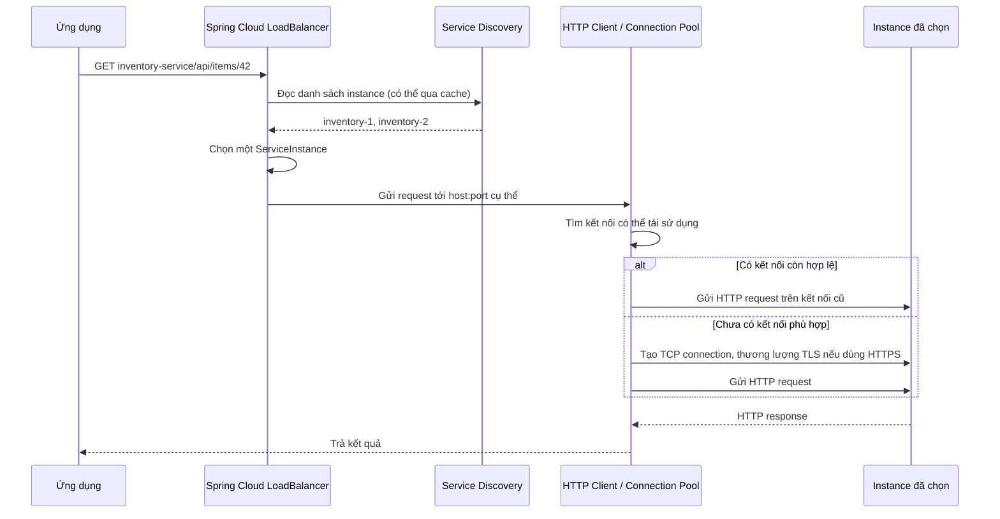
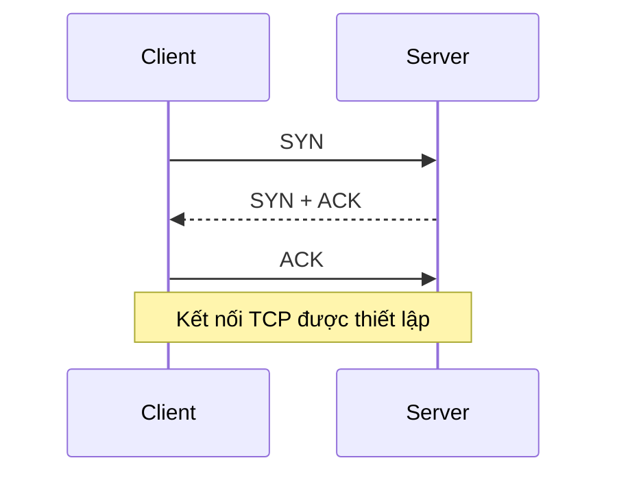
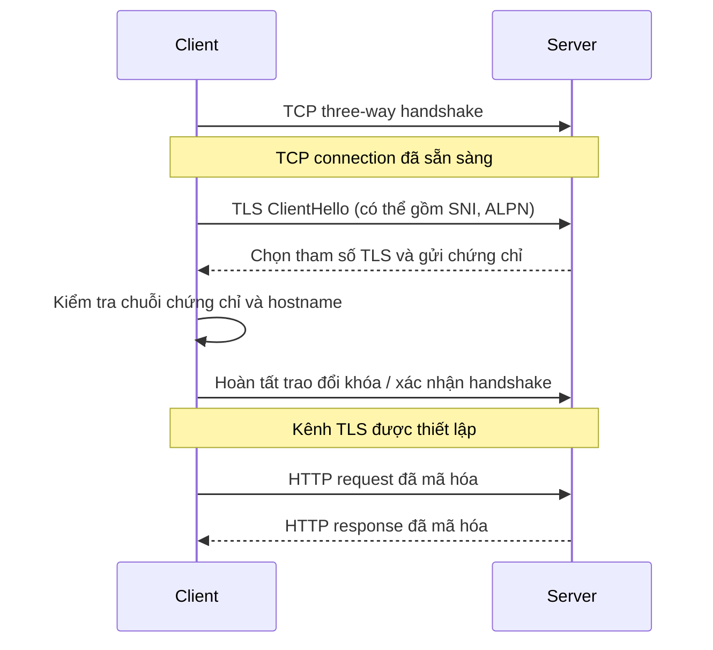
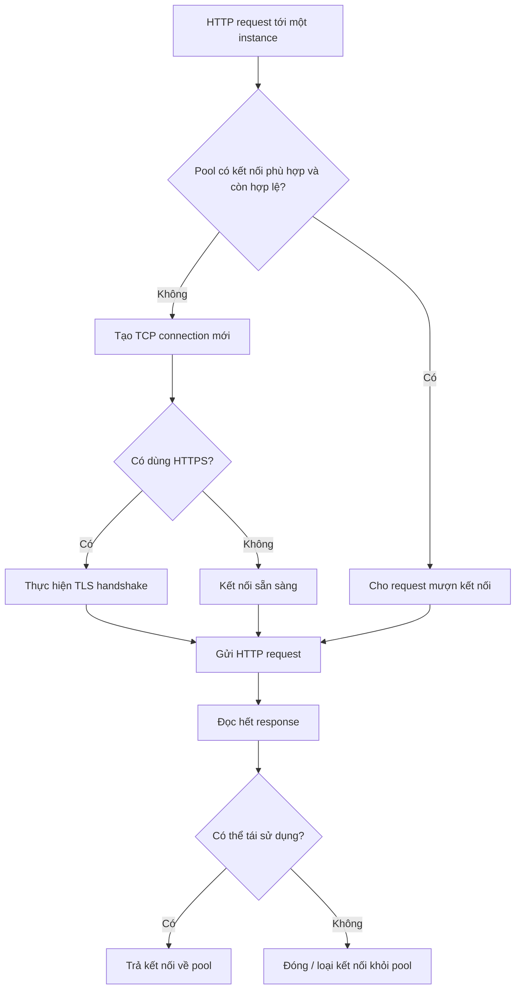

# Kết nối TCP, TLS, keep-alive và tái sử dụng kết nối

Khi một dịch vụ gọi dịch vụ khác qua HTTP, ứng dụng thường chỉ nhìn thấy một lời gọi như `GET http://inventory-service/api/items/42`. Phía dưới lời gọi đó là nhiều bước: Spring Cloud LoadBalancer chọn một instance, HTTP client tìm hoặc tạo kết nối mạng, TCP thiết lập luồng truyền dữ liệu, TLS bảo vệ luồng dữ liệu và HTTP trao đổi request/response.

Hiểu vòng đời kết nối giúp ta giải thích được vì sao request đầu tiên thường chậm hơn, vì sao một instance vẫn nhận dữ liệu sau khi bị loại khỏi danh sách discovery, vì sao timeout khi lấy kết nối khác timeout khi chờ response và vì sao cấu hình connection pool ảnh hưởng đến khả năng phân phối tải.

## 1. Kết nối nằm ở đâu trong một lời gọi service-to-service?

Trong Spring Cloud LoadBalancer, ứng dụng thường gọi một service bằng **service ID** thay vì ghi cứng địa chỉ của một instance. Ví dụ:

```java
String item = restClient.get()
        .uri("http://inventory-service/api/items/{id}", 42)
        .retrieve()
        .body(String.class);
```

`inventory-service` là tên logic. Discovery client cung cấp danh sách instance đang được đăng ký, chẳng hạn:

| Service ID | Instance | Địa chỉ |
|---|---|---|
| `inventory-service` | `inventory-1` | `10.0.1.10:8080` |
| `inventory-service` | `inventory-2` | `10.0.1.11:8080` |

Luồng xử lý khái quát:

1. Ứng dụng gửi request tới URL chứa service ID.
2. Spring Cloud LoadBalancer chọn một `ServiceInstance` từ danh sách discovery theo chính sách đang cấu hình.
3. URL logic được chuyển thành địa chỉ cụ thể của instance đã chọn.
4. HTTP client tìm kết nối phù hợp trong connection pool. Nếu không có kết nối có thể dùng, client mở kết nối mới.
5. Kết nối được sử dụng để gửi request và nhận response. Nếu giao thức và trạng thái kết nối cho phép, client giữ lại kết nối để dùng cho request sau.



Các thành phần giải quyết những vấn đề khác nhau:

| Thành phần | Trách nhiệm |
|---|---|
| Service discovery | Tìm các instance đang được đăng ký cho một service ID |
| Spring Cloud LoadBalancer | Chọn instance cho request |
| DNS | Phân giải hostname thành địa chỉ IP khi cần |
| TCP | Tạo luồng truyền byte tin cậy giữa hai endpoint |
| TLS | Xác thực đầu bên kia và mã hóa dữ liệu truyền qua kết nối |
| HTTP client và connection pool | Gửi HTTP request, quản lý và tái sử dụng kết nối |

LoadBalancer quyết định **request hướng tới instance nào**. TCP/TLS và connection pool quyết định **kết nối tới instance đó được thiết lập và sử dụng ra sao**.

## 2. TCP thiết lập một kết nối như thế nào?

TCP là giao thức truyền tải hướng kết nối. Nó cung cấp luồng byte có thứ tự, phát hiện mất mát và truyền lại dữ liệu khi cần. TCP không hiểu khái niệm HTTP request, service ID hay tên của một microservice; nó chỉ làm việc với hai endpoint mạng.

Một kết nối TCP được nhận diện bởi thông tin hai đầu, thường được mô tả bằng bộ bốn:

- IP nguồn và port nguồn.
- IP đích và port đích.

Với ví dụ trên, một kết nối có thể đi từ `10.0.2.20:53124` tới `10.0.1.10:8080`. Nếu LoadBalancer chọn instance thứ hai, client cần một kết nối tới `10.0.1.11:8080` hoặc một kết nối sẵn có tới endpoint đó.

### 2.1. TCP three-way handshake

Trước khi trao đổi dữ liệu ứng dụng, hai đầu thiết lập kết nối bằng three-way handshake:



- **SYN:** client yêu cầu mở kết nối và gửi thông tin khởi tạo.
- **SYN-ACK:** server chấp nhận yêu cầu và phản hồi.
- **ACK:** client xác nhận; hai bên có thể truyền dữ liệu.

Handshake cần thời gian truyền qua mạng. Nếu client phải mở một kết nối TCP mới cho từng request, chi phí thiết lập sẽ lặp lại và làm tăng độ trễ. Tái sử dụng kết nối giúp nhiều request dùng chung một kết nối đã thiết lập.

TCP là luồng byte, không bảo toàn ranh giới message. HTTP client và server phải tự phân tích framing của HTTP để biết phần nào thuộc request hoặc response nào.

### 2.2. Đóng kết nối TCP

Khi một bên chủ động đóng kết nối một cách bình thường, TCP thường dùng các gói FIN và ACK để hai chiều truyền dữ liệu kết thúc độc lập. Vì vậy, quá trình đóng thường được mô tả bằng four-way handshake. Kết nối cũng có thể bị kết thúc bất thường bằng RST, ví dụ khi một đầu không còn chấp nhận kết nối.

Một số hệ quả vận hành cần nhớ:

- Kết nối mới có thể thất bại với `connection refused` nếu không có tiến trình lắng nghe ở endpoint hoặc đường mạng từ chối kết nối.
- Kết nối đang dùng có thể bị reset khi server, proxy hoặc mạng đóng nó bất ngờ.
- Máy khách tạo quá nhiều kết nối ngắn hạn có thể tăng tải cho cả hai đầu và làm tăng số socket ở các trạng thái chờ đóng như `TIME_WAIT`.
- TCP giữ thứ tự byte trong một kết nối; nó không bảo đảm request sẽ được xử lý thành công ở tầng ứng dụng.

### 2.3. TCP keepalive khác HTTP keep-alive

Hai khái niệm có tên gần giống nhau nhưng phục vụ mục đích khác nhau:

| Cơ chế | Hoạt động | Mục đích |
|---|---|---|
| HTTP persistent connection (thường gọi HTTP keep-alive) | Giữ kết nối để gửi thêm HTTP request sau khi response trước hoàn tất | Tái sử dụng kết nối, giảm số lần thiết lập TCP/TLS |
| TCP keepalive probe | Hệ điều hành gửi probe trên một TCP connection đang idle theo chu kỳ cấu hình | Phát hiện peer hoặc đường truyền có thể đã mất mà không đóng kết nối đúng cách |

TCP keepalive probe không tạo thêm HTTP request, không thay thế connection pool và cũng không bảo đảm phát hiện lỗi ngay lập tức. Khoảng probe và số lần thử phụ thuộc cấu hình hệ điều hành/socket. Khi thiết kế timeout cho ứng dụng, vẫn cần timeout ở tầng HTTP client và chính sách loại bỏ kết nối idle.

## 3. TLS bảo vệ kết nối HTTPS

Với HTTPS, HTTP được truyền bên trong TLS, còn TLS thường chạy trên TCP đối với HTTP/1.1 và HTTP/2. Sau khi TCP kết nối thành công, client và server thực hiện TLS handshake trước khi trao đổi HTTP request được mã hóa.

TLS cung cấp ba khả năng chính:

1. **Mã hóa:** người quan sát trên đường truyền không đọc được nội dung HTTP.
2. **Toàn vẹn:** dữ liệu bị sửa đổi trên đường truyền sẽ bị phát hiện.
3. **Xác thực:** client kiểm tra chứng chỉ của server để xác minh mình đang kết nối tới đúng danh tính dự kiến. Tùy cấu hình, TLS cũng có thể xác thực client bằng chứng chỉ.

Trong handshake, hai bên thống nhất phiên bản và bộ thuật toán mã hóa, trao đổi thông tin khóa và thực hiện xác thực chứng chỉ. Với HTTPS tới hostname, client thường gửi SNI để server biết tên máy chủ được yêu cầu; client cũng kiểm tra hostname có khớp với chứng chỉ hay không. ALPN có thể được dùng để thống nhất giao thức ứng dụng như HTTP/1.1 hoặc HTTP/2.



TLS handshake bổ sung chi phí cho kết nối mới. Tái sử dụng một kết nối TLS đang hoạt động thường tránh được việc phải thực hiện lại toàn bộ handshake cho mỗi request. TLS session resumption cũng có thể giảm chi phí khi tạo kết nối mới, nhưng đó là cơ chế tiếp tục một phiên TLS; nó **không đồng nghĩa** với việc tái sử dụng chính kết nối TCP cũ.

Không nên tắt kiểm tra chứng chỉ hoặc hostname để xử lý lỗi TLS. Khi gặp lỗi xác thực, hãy kiểm tra trust store, chuỗi chứng chỉ, thời hạn chứng chỉ, hostname/SNI và cấu hình TLS giữa client với server.

## 4. HTTP keep-alive và persistent connection

Sau khi TCP và TLS sẵn sàng, HTTP client có thể gửi request. Với HTTP/1.1, kết nối persistent là hành vi mặc định: sau khi một response hoàn tất, hai bên có thể tiếp tục sử dụng cùng kết nối cho request tiếp theo nếu không có chỉ thị đóng và framing của message cho phép xác định điểm kết thúc.

Ví dụ, client có thể gửi hai request tuần tự trên cùng một kết nối:

```text
TCP connection #1
  ├── HTTP request: GET /api/items/1
  ├── HTTP response: 200 OK
  ├── HTTP request: GET /api/items/2
  └── HTTP response: 200 OK
```

Trong HTTP/1.1:

- Kết nối được duy trì theo mặc định sau khi request/response hoàn tất.
- `Connection: close` yêu cầu đóng kết nối sau message hiện tại.
- `Connection: keep-alive` thường gặp trong hệ thống cũ hoặc HTTP/1.0; không nên dựa vào header này như công tắc duy nhất để quản lý connection pool trong HTTP/1.1.
- Message phải có framing rõ ràng, chẳng hạn `Content-Length` hoặc cơ chế truyền chunk phù hợp, để bên nhận xác định được response đã kết thúc.

Keep-alive không có nghĩa kết nối tồn tại mãi mãi. Server, reverse proxy, load balancer mạng hoặc client có thể đóng kết nối sau một khoảng idle, sau một tuổi thọ tối đa hoặc khi cần giải phóng tài nguyên. Client phải chấp nhận khả năng một kết nối trong pool đã bị đầu bên kia đóng.

### 4.1. HTTP/2 và HTTP/3

HTTP/2 vẫn thường chạy trên một kết nối TCP/TLS nhưng hỗ trợ multiplexing: nhiều stream HTTP có thể hoạt động đồng thời trên cùng kết nối. Điều này giảm nhu cầu mở nhiều kết nối chỉ để chạy nhiều request đồng thời. Tuy vậy, mất gói TCP có thể làm chậm việc giao dữ liệu của các stream đang dùng chung kết nối.

HTTP/3 chạy HTTP trên QUIC, sử dụng UDP làm nền tảng truyền tải và tích hợp TLS 1.3 trong QUIC. Vì vậy, mô hình handshake và quản lý kết nối của HTTP/3 khác TCP/TLS truyền thống. Các khái niệm về kết nối sống lâu và tái sử dụng vẫn quan trọng, nhưng cấu hình chi tiết phụ thuộc giao thức và HTTP client.

## 5. Connection pool và tái sử dụng kết nối

Connection pool là nơi HTTP client quản lý các kết nối đã mở để dùng lại. Thay vì mỗi request đều thực hiện TCP handshake và TLS handshake, client có thể lấy một kết nối đang rảnh, gửi request, đọc response rồi trả kết nối về pool.



Một pool thường quản lý các giới hạn và thời gian sau:

| Thuộc tính | Ý nghĩa | Khi cấu hình không phù hợp |
|---|---|---|
| Maximum connections | Số kết nối đồng thời tối đa, toàn pool hoặc theo route | Quá thấp gây chờ lấy kết nối; quá cao làm tăng socket, bộ nhớ và tải server |
| Pending acquire timeout | Thời gian request được phép chờ lấy kết nối từ pool | Request có thể timeout trước khi bắt đầu gửi HTTP |
| Max idle time | Thời gian tối đa một kết nối được để rảnh trong pool | Quá dài có thể giữ kết nối đã bị server/proxy đóng |
| Max life time | Tuổi thọ tối đa của một kết nối | Quá dài có thể giữ kết nối tới instance đã ngừng phục vụ lâu hơn dự kiến |
| Idle eviction | Cơ chế quét và loại kết nối rảnh quá hạn | Thiếu eviction có thể để kết nối cũ nằm trong pool lâu |

Pool thường phân biệt kết nối theo route hoặc origin, chẳng hạn scheme, host và port. Do đó, kết nối tới `10.0.1.10:8080` không thể được dùng như kết nối tới `10.0.1.11:8080`. Các chi tiết phân loại cụ thể phụ thuộc HTTP client và cấu hình proxy.

### 5.1. Tái sử dụng kết nối phối hợp với LoadBalancer

Giả sử LoadBalancer chọn `inventory-1` cho request thứ nhất. HTTP client có thể mở kết nối tới `10.0.1.10:8080`, sau đó giữ kết nối trong pool. Với request tiếp theo, LoadBalancer vẫn thực hiện việc chọn instance theo cơ chế tích hợp; nếu kết quả lại là `inventory-1`, HTTP client có thể dùng lại kết nối đã có. Nếu kết quả là `inventory-2`, client cần một kết nối phù hợp với endpoint của instance thứ hai.

Điều này dẫn tới ba điểm quan trọng:

1. **Keep-alive không tự chọn instance.** Việc chọn instance thuộc trách nhiệm của Spring Cloud LoadBalancer hoặc thành phần định tuyến tương ứng.
2. **Một kết nối đang mở gắn với endpoint cụ thể.** Request chạy trên kết nối đó tiếp tục tới cùng endpoint, trừ khi có cơ chế proxy hoặc định tuyến ở tầng khác.
3. **Discovery thay đổi không tự đóng mọi kết nối cũ.** Khi một instance bị loại khỏi danh sách discovery, LoadBalancer có thể ngừng chọn nó cho request mới; kết nối đã mở tới instance đó vẫn có thể nằm trong pool cho đến khi được đóng, hết hạn hoặc phát sinh lỗi.

Vì thế, cần phối hợp thời gian sống của kết nối với vòng đời instance và hạ tầng mạng. Ví dụ, khi triển khai phiên bản mới, hệ thống có thể ngừng cấp request mới cho instance cũ, chờ request đang chạy hoàn tất, rồi đóng kết nối sau giai đoạn drain. Client cũng nên có idle timeout và max life time hợp lý để kết nối không tồn tại lâu hơn chính sách vận hành.

### 5.2. Chọn timeout theo từng giai đoạn

Một lời gọi có thể phải chờ ở nhiều giai đoạn khác nhau. Không nên gom mọi tình huống vào một khái niệm “connection timeout”.

| Timeout | Giai đoạn được giới hạn | Ví dụ lỗi hoặc biểu hiện |
|---|---|---|
| Connection timeout | Thiết lập TCP connection mới | Không kết nối được tới host/port trong thời hạn |
| TLS handshake timeout | Thương lượng TLS sau khi TCP đã kết nối | Chứng chỉ, handshake hoặc peer phản hồi quá chậm |
| Pool acquire timeout | Chờ lấy một kết nối từ pool | Pool hết kết nối khả dụng và request phải xếp hàng |
| Response/read timeout | Chờ dữ liệu response sau khi gửi request | Server xử lý chậm hoặc đường truyền ngừng phản hồi |
| Overall/call timeout | Tổng thời gian cho toàn bộ lời gọi | Tổng thời gian vượt ngân sách của nghiệp vụ |

Các HTTP client có cách đặt tên và phạm vi timeout khác nhau. Khi cấu hình, hãy xác định rõ timeout nào áp dụng cho giai đoạn nào và kiểm tra xem timeout tổng có bao trùm thời gian chờ pool, TCP, TLS và response hay không.

## 6. Tích hợp với các HTTP client trong Spring

Spring Cloud LoadBalancer cung cấp tích hợp cho nhiều HTTP client. Ví dụ dưới đây minh họa cách khai báo URL theo service ID; việc cấu hình connection pool và timeout vẫn thuộc HTTP client được sử dụng bên dưới.

### 6.1. RestClient

Với `RestClient`, có thể cung cấp một builder được đánh dấu `@LoadBalanced`:

```java
@Configuration
class HttpClientConfiguration {

    @Bean
    @LoadBalanced
    RestClient.Builder loadBalancedRestClientBuilder() {
        return RestClient.builder();
    }
}
```

Sau đó inject builder để tạo client và gọi bằng service ID:

```java
@Service
class InventoryGateway {
    private final RestClient restClient;

    InventoryGateway(@LoadBalanced RestClient.Builder builder) {
        this.restClient = builder.build();
    }

    Item findById(long id) {
        return restClient.get()
                .uri("http://inventory-service/api/items/{id}", id)
                .retrieve()
                .body(Item.class);
    }
}
```

Builder `@LoadBalanced` cho phép tích hợp LoadBalancer xử lý service ID. Connection pooling, TLS và timeout phụ thuộc request factory hoặc HTTP client mà `RestClient` đang sử dụng; cần kiểm tra cấu hình thực tế của ứng dụng thay vì giả định mọi builder đều dùng cùng một pool.

### 6.2. WebClient

Với `WebClient`, builder cũng có thể được đánh dấu `@LoadBalanced`:

```java
@Configuration
class WebClientConfiguration {

    @Bean
    @LoadBalanced
    WebClient.Builder loadBalancedWebClientBuilder() {
        return WebClient.builder();
    }
}
```

Sử dụng client:

```java
@Service
class InventoryWebClient {
    private final WebClient webClient;

    InventoryWebClient(@LoadBalanced WebClient.Builder builder) {
        this.webClient = builder.build();
    }

    Mono<Item> findById(long id) {
        return webClient.get()
                .uri("http://inventory-service/api/items/{id}", id)
                .retrieve()
                .bodyToMono(Item.class);
    }
}
```

Nếu ứng dụng dùng Reactor Netty, có thể cấu hình `ConnectionProvider` để quản lý pool. Khi cần tùy chỉnh pool, dùng bean cấu hình dưới đây thay cho bean builder cơ bản ở trên. Ví dụ minh họa một số giới hạn thường gặp; giá trị thực tế phải được chọn theo lưu lượng, năng lực server và timeout của proxy:

```java
@Configuration
class LoadBalancedWebClientConfiguration {

    @Bean
    @LoadBalanced
    WebClient.Builder loadBalancedWebClientBuilder() {
        ConnectionProvider provider = ConnectionProvider.builder("inventory-pool")
                .maxConnections(100)
                .pendingAcquireTimeout(Duration.ofSeconds(2))
                .maxIdleTime(Duration.ofSeconds(30))
                .maxLifeTime(Duration.ofMinutes(5))
                .evictInBackground(Duration.ofSeconds(30))
                .build();

        HttpClient httpClient = HttpClient.create(provider)
                .option(ChannelOption.CONNECT_TIMEOUT_MILLIS, 2_000)
                .responseTimeout(Duration.ofSeconds(3));

        return WebClient.builder()
                .clientConnector(new ReactorClientHttpConnector(httpClient));
    }
}
```

Builder vừa được đánh dấu `@LoadBalanced`, vừa dùng connector Reactor Netty có pool và timeout tùy chỉnh. Các giá trị trong ví dụ chỉ để minh họa; hãy chọn theo lưu lượng, năng lực server và timeout của proxy. Kiểm tra phiên bản Spring Boot/Reactor Netty để bảo đảm API và cách cấu hình tương thích.

### 6.3. OpenFeign

Với OpenFeign, tên trong `@FeignClient` thường là service ID:

```java
@FeignClient(name = "inventory-service")
interface InventoryClient {
    @GetMapping("/api/items/{id}")
    Item findById(@PathVariable long id);
}
```

Spring Cloud OpenFeign có thể tích hợp Spring Cloud LoadBalancer để chọn instance. Connection pooling và timeout thực tế phụ thuộc HTTP client mà Feign đang sử dụng, chẳng hạn client mặc định hoặc Apache HttpClient/OkHttp nếu ứng dụng đã cấu hình. Vì vậy, hãy xác định client đang chạy trước khi điều chỉnh pool.

## 7. Các tình huống lỗi thường gặp

| Triệu chứng | Nguyên nhân có thể | Hướng kiểm tra |
|---|---|---|
| Request đầu tiên chậm, các request sau nhanh hơn | Lần đầu phải tạo TCP/TLS connection; các lần sau tái sử dụng pool | So sánh thời gian connect, TLS handshake và thời gian xử lý server |
| `Connection refused` | Không có tiến trình lắng nghe, sai port hoặc endpoint không còn hoạt động | Kiểm tra địa chỉ instance được chọn, port và trạng thái service |
| `Connection reset` khi tái sử dụng | Server, proxy hoặc mạng đã đóng kết nối rảnh mà client vẫn giữ trong pool | Đối chiếu idle timeout; kiểm tra eviction, max idle time và log hai đầu |
| Pool acquire timeout | Số kết nối tối đa quá thấp, request đồng thời cao hoặc response giữ kết nối quá lâu | Theo dõi active/idle/pending connections và thời gian giữ response body |
| TLS handshake failure | Chứng chỉ không tin cậy, hostname không khớp, hết hạn hoặc cấu hình TLS không tương thích | Kiểm tra trust store, certificate chain, SNI, hostname và phiên bản TLS |
| Instance đã bị loại khỏi discovery nhưng vẫn thấy request tới đó | Kết nối cũ còn hoạt động, proxy có định tuyến riêng hoặc request đã được gửi trước khi cập nhật discovery | Kiểm tra thời điểm chọn instance, remote address, pool và quy trình drain |
| Tải phân phối không như mong đợi | Chính sách chọn instance, tần suất request, pool, proxy hoặc lưu lượng không đồng đều | Ghi nhận instance được chọn trên từng request và so sánh với số request thực nhận |

Khi retry một request sau lỗi kết nối hoặc timeout, cần xác định request đã tới server hay chưa. Một timeout ở client không chứng minh server chưa thực hiện nghiệp vụ. Retry tự động phù hợp hơn với thao tác idempotent; với thao tác tạo hoặc thanh toán, cần thiết kế idempotency key hoặc cơ chế chống thực thi trùng.

## 8. Quan sát và kiểm chứng trong môi trường chạy

Để biết kết nối đang được tái sử dụng đúng cách, nên quan sát cả tầng LoadBalancer lẫn tầng HTTP client:

- **Instance được chọn:** ghi nhận service ID, host, port hoặc instance ID cho mỗi request ở mức log phù hợp.
- **Pool:** theo dõi số kết nối active, idle, pending, tổng số kết nối, thời gian chờ acquire và số lần tạo/đóng kết nối.
- **TCP:** kiểm tra remote address, số socket, kết nối bị reset và trạng thái đóng kết nối khi cần điều tra sâu.
- **TLS:** theo dõi lỗi handshake, xác thực chứng chỉ và thời gian thiết lập kết nối bảo mật.
- **HTTP:** đo thời gian chờ response, kích thước response và số request lỗi theo instance.

Một bài thực hành có thể triển khai hai instance `inventory-service` ở hai port khác nhau, sau đó gửi một lượng request ổn định qua `RestClient` hoặc `WebClient`:

1. Ghi lại instance được chọn và số kết nối TCP được tạo.
2. Gửi nhiều request tuần tự để quan sát kết nối được tái sử dụng.
3. Tăng mức đồng thời để quan sát giới hạn pool và thời gian chờ acquire.
4. Dừng một instance hoặc loại nó khỏi discovery, rồi quan sát request mới và các kết nối đã mở.
5. Thay đổi idle timeout/max life time và đối chiếu số lần kết nối mới, lỗi stale connection và độ trễ.

Khi đọc kết quả, cần tách biệt số request với số kết nối. Một kết nối HTTP/1.1 persistent có thể phục vụ nhiều request tuần tự; một kết nối HTTP/2 có thể phục vụ nhiều stream đồng thời. Vì vậy, số kết nối TCP không nhất thiết bằng số request hoặc số luồng nghiệp vụ.

## 9. Nguyên tắc cấu hình thực tế

- Dùng service ID với client đã tích hợp Spring Cloud LoadBalancer để việc chọn instance diễn ra theo cơ chế mong muốn.
- Bật và sử dụng connection pool phù hợp với loại HTTP client; tránh tạo client hoặc pool mới cho từng request.
- Đặt giới hạn kết nối theo lưu lượng đồng thời và khả năng xử lý của từng instance. Theo dõi hàng đợi chờ lấy kết nối để phát hiện pool bị nghẽn.
- Đặt max idle time thấp hơn idle timeout của server/proxy một khoảng an toàn nếu hạ tầng có thể chủ động đóng kết nối rảnh.
- Đặt max life time hữu hạn khi instance có thể được thay thế hoặc drain trong quá trình triển khai.
- Phân biệt connect timeout, TLS handshake timeout, pool acquire timeout, response timeout và timeout tổng.
- Giữ kiểm tra chứng chỉ TLS và hostname; xử lý nguyên nhân cấu hình khi handshake thất bại.
- Thiết kế retry dựa trên tính idempotent và trạng thái thực thi của request.
- Quan sát instance được chọn cùng với số liệu pool để giải thích đúng hành vi phân phối tải.

Khi nắm được vòng đời TCP/TLS và cách HTTP client tái sử dụng kết nối, ta có thể đọc đúng độ trễ của request, thiết lập timeout hợp lý và phối hợp connection pool với Spring Cloud LoadBalancer để giao tiếp giữa các dịch vụ ổn định hơn.
