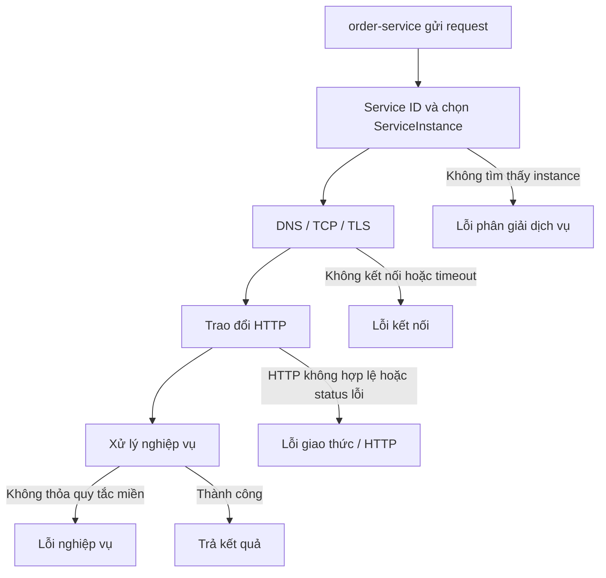

# Phân biệt lỗi kết nối, lỗi giao thức và lỗi nghiệp vụ

Khi một dịch vụ gọi API của dịch vụ khác, request có thể thất bại ở nhiều lớp. Có lúc client không kết nối được tới instance; có lúc hai bên đã kết nối nhưng trao đổi HTTP gặp lỗi; cũng có lúc request được gửi và xử lý thành công về mặt kỹ thuật nhưng nghiệp vụ bị từ chối, chẳng hạn sản phẩm không đủ tồn kho.

Phân biệt đúng ba nhóm lỗi giúp chọn cách xử lý phù hợp. Lỗi kết nối thường cần kiểm tra mạng, discovery và trạng thái instance. Lỗi giao thức cần kiểm tra HTTP request, response và cách client diễn giải chúng. Lỗi nghiệp vụ cần được xử lý theo quy tắc của miền nghiệp vụ. Nếu gộp tất cả thành một lỗi chung, hệ thống dễ retry sai, che khuất nguyên nhân và tạo ra tác động trùng lặp.

## 1. Nhìn lỗi theo lớp xử lý

Một request từ `order-service` tới `inventory-service` thường đi qua các lớp sau:

1. **Phân giải dịch vụ và địa chỉ:** client tìm service ID, lấy danh sách instance và chọn một instance.
2. **Kết nối mạng và bảo mật:** client phân giải host, mở kết nối TCP và có thể thực hiện TLS handshake.
3. **Trao đổi HTTP:** client gửi method, path, header và body; server trả status, header và body.
4. **Xử lý nghiệp vụ:** dịch vụ đích kiểm tra quy tắc miền và quyết định kết quả nghiệp vụ.



Sơ đồ cho thấy lỗi có thể xuất hiện trước khi request tới được code nghiệp vụ. Vì vậy, trước tiên hãy xác định client có nhận được một HTTP response hợp lệ hay không. Nếu không có response, hãy điều tra service discovery, kết nối hoặc quá trình trao đổi giao thức. Nếu có response, hãy đọc status và nội dung theo hợp đồng API để xác định đó là lỗi HTTP ở tầng ứng dụng hay kết quả nghiệp vụ bị từ chối.

## 2. Lỗi kết nối: không thiết lập hoặc duy trì được đường truyền

Lỗi kết nối xảy ra khi client không thể tạo hoặc duy trì đường truyền tới instance được chọn. Thông thường, client không nhận được HTTP response hợp lệ từ dịch vụ đích.

Các tình huống thường gặp:

| Biểu hiện | Nguyên nhân có thể có | Nơi cần kiểm tra |
| --- | --- | --- |
| Không tìm thấy host hoặc không phân giải được tên | DNS sai, hostname không tồn tại, cấu hình mạng hoặc discovery trả địa chỉ không hợp lệ | DNS, cấu hình discovery, service ID và địa chỉ instance |
| Connection refused | Host có thể truy cập nhưng không có tiến trình lắng nghe tại port đó, hoặc firewall chủ động từ chối | Trạng thái replica, port, binding và firewall |
| Connect timeout | Không hoàn tất được kết nối trong thời hạn cấu hình | Network route, firewall, tải hệ thống và connect timeout |
| Read/response timeout | Kết nối đã mở nhưng client không nhận được response kịp thời | Thời gian xử lý phía server, phụ thuộc downstream, hàng đợi và response timeout |
| Connection reset hoặc broken pipe | Kết nối bị đóng đột ngột trong lúc trao đổi | Server restart, proxy, network, idle connection và giới hạn kết nối |
| TLS handshake thất bại | Không thống nhất được phiên bản/cipher hoặc chứng chỉ không hợp lệ | Truststore, certificate, hostname verification và cấu hình TLS |

Lỗi TLS xuất hiện trước khi có trao đổi HTTP hoàn chỉnh. Khi phân loại ở mức vận hành, nên theo dõi nó như lỗi thiết lập kết nối bảo mật và ghi rõ nguyên nhân TLS, thay vì coi nó là HTTP status error.

### 2.1. Liên hệ với Spring Cloud LoadBalancer

Trong giao tiếp qua service ID, một số vấn đề có thể xảy ra trước cả khi client mở kết nối:

- Discovery không trả về instance nào cho service ID.
- Danh sách instance đã cũ và vẫn chứa replica vừa dừng hoạt động.
- Instance được chọn có host hoặc port sai.
- Replica còn đăng ký trong registry nhưng tiến trình không còn lắng nghe.

LoadBalancer chọn instance từ danh sách mà nguồn cung cấp instance trả về. Việc chọn được một `ServiceInstance` không đồng nghĩa kết nối TCP tới instance đó chắc chắn thành công. Discovery, cache, health check, mạng và trạng thái tiến trình đều ảnh hưởng tới kết quả cuối cùng.

### 2.2. Timeout không cho biết chắc server đã làm gì

Connect timeout thường cho biết client chưa thiết lập được kết nối. Read timeout phức tạp hơn: client có thể đã gửi toàn bộ request, server có thể đã thực hiện nghiệp vụ, nhưng response không về kịp thời.

Ví dụ, `order-service` gửi yêu cầu tạo đơn hàng. `inventory-service` đã ghi nhận thao tác nhưng response bị mất trên đường truyền. Client thấy timeout nên không biết chắc thao tác đã hoàn tất hay chưa. Nếu gửi lại request một cách mù quáng, hệ thống có thể tạo hai đơn hàng hoặc trừ tồn kho hai lần.

Với thao tác ghi dữ liệu, cần thiết kế idempotency key hoặc cơ chế tra cứu trạng thái thao tác trước khi retry. Timeout là trạng thái không chắc chắn về kết quả, không phải bằng chứng rằng server chưa xử lý request.

## 3. Lỗi giao thức và lỗi HTTP

Lỗi giao thức xuất hiện khi hai phía không trao đổi hoặc diễn giải dữ liệu theo đúng giao thức đã thống nhất. Với HTTP, cần phân biệt hai trường hợp.

**Vi phạm định dạng hoặc quy tắc HTTP:** response có thể không đọc được hoặc không hợp lệ, chẳng hạn status line sai định dạng, header lỗi, framing của message không hợp lệ, chunked body sai cấu trúc hoặc kết nối bị đóng giữa chừng khiến response không hoàn chỉnh. Client có thể báo lỗi parse hoặc protocol exception và không tạo được một HTTP response đầy đủ.

**HTTP response có status thể hiện request không thành công:** server hoặc proxy đã trả về một response HTTP hợp lệ với status như `400`, `404`, `429`, `500` hay `503`. Đây là một response có thể đọc được; client cần diễn giải status, header và body theo hợp đồng API. Nhiều thư viện gọi trường hợp này là HTTP error hoặc response error.

Một số status thường gặp:

| Status | Ý nghĩa chung | Ví dụ trong giao tiếp dịch vụ |
| --- | --- | --- |
| `400 Bad Request` | Request không hợp lệ theo yêu cầu của API | Thiếu tham số bắt buộc hoặc dữ liệu không đúng định dạng |
| `401 Unauthorized` | Chưa xác thực hoặc thông tin xác thực không hợp lệ | Token hết hạn hoặc thiếu thông tin xác thực |
| `403 Forbidden` | Đã nhận diện caller nhưng không được phép thực hiện | Service account thiếu quyền truy cập tài nguyên |
| `404 Not Found` | Không tìm thấy tài nguyên hoặc endpoint | Sai path API hoặc mã sản phẩm không tồn tại |
| `405 Method Not Allowed` | Endpoint không hỗ trợ HTTP method được gửi | Gọi `POST` vào endpoint chỉ cho phép `GET` |
| `406 Not Acceptable` | Không có representation phù hợp với header `Accept` | Client yêu cầu định dạng server không hỗ trợ |
| `415 Unsupported Media Type` | Server không hỗ trợ định dạng request body | Gửi JSON nhưng thiếu hoặc khai báo sai `Content-Type` |
| `409 Conflict` | Request xung đột với trạng thái hiện tại | Đơn hàng đã được xác nhận hoặc phiên bản dữ liệu đã thay đổi |
| `422 Unprocessable Content` | Nội dung hiểu được nhưng không thể xử lý theo quy tắc áp dụng | Dữ liệu hợp lệ về cú pháp nhưng không thỏa điều kiện nghiệp vụ |
| `429 Too Many Requests` | Caller gửi quá nhiều request trong một khoảng thời gian | Rate limit tại API hoặc gateway |
| `500 Internal Server Error` | Server gặp lỗi không xử lý được | Exception không được xử lý trong dịch vụ đích |
| `502 Bad Gateway` | Gateway/proxy nhận response không hợp lệ từ upstream | Proxy không giao tiếp đúng với replica phía sau |
| `503 Service Unavailable` | Dịch vụ tạm thời không thể nhận request | Không còn replica khả dụng hoặc dịch vụ đang bảo trì |
| `504 Gateway Timeout` | Gateway không nhận được response upstream kịp thời | Dịch vụ đích hoặc một dependency xử lý quá lâu |

Không nên suy luận nguyên nhân chỉ từ status. Ví dụ, `404` có thể là sai endpoint do lập trình, cũng có thể là sản phẩm không tồn tại theo nghiệp vụ. `409` có thể là xung đột trạng thái nghiệp vụ được API mô tả rõ. Cần xem error code và tài liệu API để biết status đó đại diện cho điều gì trong hệ thống.

## 4. Lỗi nghiệp vụ: request đã tới được logic ứng dụng nhưng không thỏa quy tắc miền

Lỗi nghiệp vụ xuất hiện khi dữ liệu và request có thể được tiếp nhận, nhưng hành động được yêu cầu không được phép hoặc không thể hoàn thành theo quy tắc của hệ thống.

Ví dụ:

- Sản phẩm không đủ tồn kho để đáp ứng số lượng đặt.
- Tài khoản không đủ số dư để thanh toán.
- Đơn hàng đã hủy nên không thể chuyển sang trạng thái giao hàng.
- Người dùng đã sử dụng mã giảm giá và không được dùng lại.
- Một yêu cầu cập nhật vi phạm quy tắc về giới hạn hoặc trạng thái hiện tại.

Lỗi nghiệp vụ có thể được biểu diễn theo nhiều cách, tùy hợp đồng API:

**Cách 1: dùng HTTP status phù hợp.** API có thể trả `409 Conflict` khi trạng thái tài nguyên xung đột hoặc `422 Unprocessable Content` khi nội dung không thỏa điều kiện nghiệp vụ. Response body cung cấp mã lỗi miền để caller xử lý.

```http
HTTP/1.1 409 Conflict
Content-Type: application/json

{
  "code": "ORDER_ALREADY_CONFIRMED",
  "message": "Đơn hàng đã được xác nhận trước đó"
}
```

**Cách 2: dùng response thành công về HTTP nhưng kết quả nghiệp vụ thất bại.** Một số API luôn trả `200 OK` cho request đã được xử lý và đặt kết quả nghiệp vụ trong body:

```http
HTTP/1.1 200 OK
Content-Type: application/json

{
  "success": false,
  "code": "INSUFFICIENT_STOCK",
  "message": "Không đủ số lượng tồn kho",
  "availableQuantity": 2
}
```

Trong trường hợp thứ hai, `retrieve()` có thể xem response là thành công ở tầng HTTP. Caller vẫn phải đọc `success` hoặc `code` và chuyển thành kết quả nghiệp vụ phù hợp. Không được kết luận nghiệp vụ thành công chỉ vì status là `2xx`.

Một API tốt cần quy định rõ status, cấu trúc error body, mã lỗi ổn định và cách caller xử lý từng loại lỗi. Caller không nên phân loại nghiệp vụ bằng cách so sánh chuỗi `message`, vì nội dung thông báo có thể thay đổi hoặc được bản địa hóa.

## 5. Bảng so sánh ba nhóm lỗi

| Tiêu chí | Lỗi kết nối | Lỗi giao thức / HTTP | Lỗi nghiệp vụ |
| --- | --- | --- | --- |
| Thời điểm | Trước hoặc trong lúc thiết lập/duy trì đường truyền | Khi trao đổi hoặc diễn giải HTTP | Sau khi request tới logic nghiệp vụ |
| Có HTTP response hợp lệ? | Thường không | Có thể không nếu message sai định dạng; có nếu server trả status lỗi | Thường có, nhưng phụ thuộc cách API biểu diễn |
| Ví dụ | Connection refused, DNS failure, timeout | HTTP `415`, `503`, malformed response | `INSUFFICIENT_STOCK`, `ORDER_ALREADY_CONFIRMED` |
| Nơi điều tra | DNS, discovery, replica, network, TLS, timeout | URL, method, header, content type, status, gateway, response format | Quy tắc miền, dữ liệu, trạng thái tài nguyên, error code |
| Retry | Có điều kiện, có giới hạn và xét idempotency | Tùy status và nguyên nhân; không retry mọi `4xx`/`5xx` | Thường không retry nếu điều kiện nghiệp vụ chưa thay đổi |
| Hành động caller | Có thể chọn instance khác hoặc báo lỗi phụ thuộc | Sửa request, xác thực/quyền, điều chỉnh backoff hoặc báo lỗi upstream | Trả kết quả nghiệp vụ hoặc hướng dẫn bước tiếp theo |

Điểm phân biệt quan trọng nhất: **không có response** thường hướng điều tra về kết nối; **có HTTP response** thì cần đọc status và body; **có mã lỗi miền** thì xử lý theo quy tắc nghiệp vụ được API công bố.

## 6. Nhận diện lỗi trong Spring HTTP clients

Tên exception phụ thuộc HTTP client bên dưới và phiên bản framework, vì vậy cần xem cả exception gốc (`cause`) thay vì chỉ dựa vào lớp ngoài cùng. Các ví dụ sau mô tả những loại thường gặp khi dùng Spring.

### 6.1. Với RestClient

Khi dùng `retrieve()`, response có status `4xx` hoặc `5xx` mặc định được chuyển thành exception thuộc nhóm `RestClientResponseException`. Lỗi I/O khi thực hiện request thường được bọc trong `ResourceAccessException`.

```java
import org.springframework.web.client.ResourceAccessException;
import org.springframework.web.client.RestClient;
import org.springframework.web.client.RestClientResponseException;

class InventoryGateway {

    private final RestClient restClient;

    InventoryGateway(RestClient restClient) {
        this.restClient = restClient;
    }

    StockResponse getStock(String sku) {
        try {
            StockResponse response = restClient.get()
                    .uri("http://inventory-service/api/stocks/{sku}", sku)
                    .retrieve()
                    .body(StockResponse.class);

            if (response == null) {
                throw new IllegalStateException("Inventory API returned an empty body");
            }

            if (!response.success()) {
                throw new InventoryBusinessException(
                        response.code(), response.message());
            }

            return response;
        } catch (ResourceAccessException ex) {
            // Kiểm tra cause: DNS, connect timeout, read timeout, reset...
            throw new InventoryConnectionException("Cannot reach inventory-service", ex);
        } catch (RestClientResponseException ex) {
            // Có HTTP response: ghi nhận status và error code/body theo hợp đồng API.
            throw new InventoryHttpException(
                    ex.getStatusCode().value(), ex.getResponseBodyAsString(), ex);
        }
    }
}
```

`StockResponse`, `InventoryBusinessException`, `InventoryConnectionException` và `InventoryHttpException` là các kiểu minh họa của ứng dụng. Cần định nghĩa chúng theo hợp đồng API và cách quản lý lỗi của dự án. Trong code thực tế, nên chuyển response body lỗi sang DTO có cấu trúc thay vì chỉ lưu chuỗi thô.

Thứ tự xử lý giúp caller giữ được khác biệt giữa lỗi I/O và response HTTP. Các exception parse body hoặc lỗi mapping dữ liệu có thể thuộc nhóm khác; cần ghi nhận riêng để tránh nhầm chúng với lỗi kết nối.

### 6.2. Với WebClient

Với `WebClient`, lỗi khi thực hiện request ở tầng kết nối thường xuất hiện dưới dạng `WebClientRequestException`. Khi dùng `retrieve()`, status lỗi HTTP mặc định được chuyển thành `WebClientResponseException`.

```java
import org.springframework.web.reactive.function.client.WebClient;
import org.springframework.web.reactive.function.client.WebClientRequestException;
import org.springframework.web.reactive.function.client.WebClientResponseException;
import reactor.core.publisher.Mono;

Mono<StockResponse> getStock(WebClient client, String sku) {
    return client.get()
            .uri("http://inventory-service/api/stocks/{sku}", sku)
            .retrieve()
            .bodyToMono(StockResponse.class)
            .flatMap(response -> {
                if (!response.success()) {
                    return Mono.error(new InventoryBusinessException(
                            response.code(), response.message()));
                }
                return Mono.just(response);
            })
            .onErrorMap(WebClientRequestException.class,
                    ex -> new InventoryConnectionException(
                            "Cannot reach inventory-service", ex))
            .onErrorMap(WebClientResponseException.class,
                    ex -> new InventoryHttpException(
                            ex.getStatusCode().value(),
                            ex.getResponseBodyAsString(), ex));
}
```

Đây là ví dụ minh họa cách phân loại; các lớp exception tùy chỉnh cần được định nghĩa trong ứng dụng. Nếu dùng `onStatus(...)`, caller có thể đọc body và ánh xạ status sang loại lỗi cụ thể ngay trong phần xử lý response.

### 6.3. Với OpenFeign

Khi dùng OpenFeign, lỗi nhận được response HTTP thường được biểu diễn bởi `FeignException` và có thể đọc status từ exception. Một số lỗi I/O hoặc tình huống được đánh dấu retryable có thể xuất hiện dưới dạng `RetryableException`. Cần xem cause và cấu hình Feign thực tế để phân biệt lỗi mạng với lỗi response.

Không nên bắt mọi `FeignException` rồi retry. Ví dụ, `400 Bad Request`, `401 Unauthorized` hoặc `422 Unprocessable Content` thường yêu cầu sửa request, xác thực hoặc xử lý nghiệp vụ. Retry chỉ có ý nghĩa khi nguyên nhân có khả năng tự hết và thao tác được phép thực hiện lại.

## 7. Quyết định retry theo nguyên nhân

Retry là gửi lại một request sau khi lần trước thất bại hoặc chưa có kết quả rõ ràng. Đây là cơ chế phục hồi hữu ích nhưng có thể khuếch đại sự cố nếu mọi caller đồng loạt retry hoặc nếu request có tác động không idempotent.

| Nhóm tình huống | Hướng xử lý thường phù hợp |
| --- | --- |
| Không có instance khả dụng | Kiểm tra discovery và sức khỏe replica; có thể trả lỗi phụ thuộc tạm thời. Retry ngắn chỉ hữu ích khi có khả năng instance vừa đăng ký lại |
| Connect timeout/refused | Có thể thử instance khác nếu danh sách còn instance khỏe; giới hạn số lần và tổng thời gian |
| Read timeout sau khi gửi request | Xem kết quả là chưa chắc chắn; với thao tác ghi, kiểm tra idempotency hoặc trạng thái trước khi gửi lại |
| HTTP `400`, `401`, `403`, `404`, `405`, `415`, `422` | Thường không retry nguyên request; sửa dữ liệu, token, quyền, path, method hoặc xử lý kết quả nghiệp vụ |
| HTTP `409` | Đọc mã lỗi và trạng thái tài nguyên; chỉ thử lại khi nghiệp vụ cho phép sau khi làm mới trạng thái |
| HTTP `429` | Tôn trọng `Retry-After` nếu có; dùng backoff và giới hạn tốc độ |
| HTTP `502`, `503`, `504` | Có thể retry có giới hạn nếu thao tác an toàn và thời gian tổng thể còn đủ |
| HTTP `500` | Điều tra lỗi server trước; chỉ retry khi có lý do cho thấy lỗi tạm thời và request an toàn |
| Lỗi nghiệp vụ như thiếu tồn kho | Thường trả kết quả nghiệp vụ cho caller; chỉ thử lại khi điều kiện nghiệp vụ thay đổi |

Một chính sách retry cần giới hạn số lần, thời gian chờ và tổng thời gian request. Exponential backoff cùng jitter giúp giảm việc nhiều caller retry cùng thời điểm. Với API ghi dữ liệu, idempotency key hoặc cơ chế chống xử lý trùng lặp cần được thiết kế ở phía server; chỉ retry ở client không đủ để bảo đảm an toàn.

Spring Cloud LoadBalancer có thể kết hợp với retry ở tầng client theo cấu hình tương ứng. Khi bật retry, hãy xác định rõ request nào được retry, exception/status nào được retry, có thử instance khác hay không và tổng deadline của nghiệp vụ. Không nên để retry ở nhiều tầng nhân lên ngoài dự kiến, ví dụ gateway retry ba lần, service gọi retry ba lần và client bên dưới cũng retry ba lần.

## 8. Quan sát và ghi log để tìm đúng nguyên nhân

Khi điều tra lỗi liên dịch vụ, log nên cung cấp đủ ngữ cảnh để nối request từ caller tới instance đích. Các trường hữu ích gồm:

- Trace ID hoặc correlation ID để tìm cùng một request qua nhiều dịch vụ.
- Service ID và địa chỉ instance thực tế đã được chọn.
- HTTP method, path đã loại bỏ thông tin nhạy cảm, thời điểm và thời lượng request.
- Số lần thử, timeout đã cấu hình và thời điểm retry.
- Loại exception, root cause và HTTP status nếu có response.
- Mã lỗi nghiệp vụ ổn định nếu response có error code.

Không ghi access token, mật khẩu, dữ liệu cá nhân hoặc toàn bộ request/response body nhạy cảm vào log. Nếu cần lưu body để chẩn đoán, hãy lọc trường, giới hạn kích thước và tuân theo chính sách dữ liệu của hệ thống.

Ví dụ cách đọc log:

```text
traceId=8af2... serviceId=inventory-service instance=10.0.1.12:8080
method=GET path=/api/stocks/BOOK-001 durationMs=1200
exception=WebClientRequestException cause=ReadTimeoutException
```

Log này cho biết caller đã chọn một instance cụ thể nhưng không nhận response trong thời hạn chờ. Cần kiểm tra thời gian xử lý ở instance B, các dependency của nó và cấu hình response timeout. Không có HTTP status trong log vì client chưa nhận được response hợp lệ.

Ví dụ khác:

```text
traceId=9bc1... serviceId=inventory-service instance=10.0.1.13:8080
method=GET path=/api/stocks/BOOK-001 durationMs=35
httpStatus=200 businessCode=INSUFFICIENT_STOCK
```

Request đã hoàn tất trao đổi HTTP nhanh chóng. Kết quả nghiệp vụ cho biết không đủ tồn kho; việc retry ngay tới replica khác không giải quyết được điều kiện này nếu các replica cùng dùng một nguồn dữ liệu nhất quán.

## 9. Quy trình chẩn đoán một request thất bại

Khi một lời gọi liên dịch vụ thất bại, có thể đi theo thứ tự sau:

1. **Xác định service ID và instance:** caller có lấy được danh sách instance không? Instance nào được chọn? Địa chỉ host/port có đúng không?
2. **Kiểm tra kết nối:** có phân giải được host, mở được TCP connection và hoàn tất TLS handshake không? Nếu timeout, đó là connect timeout hay read timeout?
3. **Tìm HTTP response:** client có nhận được status và header hợp lệ không? Nếu không, xem exception gốc và log của proxy/server.
4. **Đọc status và response body:** status là gì? Error code có thuộc hợp đồng API không? Có dấu hiệu sai method, path, header hoặc content type không?
5. **Kiểm tra kết quả nghiệp vụ:** response `2xx` có `success=false` hoặc mã lỗi miền không? Status `409`/`422` có đại diện cho một điều kiện nghiệp vụ được công bố không?
6. **Chọn cách phục hồi:** sửa request, xác thực lại, chọn instance khác, backoff, trả lỗi phụ thuộc hoặc trả kết quả nghiệp vụ tùy nguyên nhân.
7. **Đánh giá tính an toàn của retry:** request đã có thể được server xử lý chưa? Thao tác có idempotent không? Có idempotency key hoặc cách tra cứu kết quả không?

## 10. Tình huống thực tế: kiểm tra tồn kho khi tạo đơn hàng

Giả sử `order-service` gọi `inventory-service` để kiểm tra sản phẩm `BOOK-001` trước khi xác nhận đơn hàng. Ba lần thất bại sau đây có biểu hiện khác nhau:

**Tình huống A — Connection refused:** LoadBalancer chọn `10.0.1.12:8080`, nhưng replica đã dừng và port không còn lắng nghe. Caller không nhận được HTTP response. Cần kiểm tra registry/health check và trạng thái replica; có thể thử instance khác theo chính sách retry an toàn.

**Tình huống B — HTTP 503:** Caller kết nối được tới một gateway hoặc server và nhận response `503 Service Unavailable`. Đây là HTTP response hợp lệ báo dịch vụ tạm thời không phục vụ. Cần đọc header như `Retry-After` nếu có, kiểm tra tình trạng upstream và áp dụng retry có giới hạn nếu request an toàn.

**Tình huống C — Insufficient stock:** Caller nhận response `200 OK` với `success=false` và `code=INSUFFICIENT_STOCK`, hoặc API dùng `409`/`422` theo hợp đồng. Kết nối và HTTP đã hoạt động; nghiệp vụ không thể tiếp tục với số lượng hiện có. Caller cần trả kết quả phù hợp cho luồng đặt hàng, không retry liên tục vào các replica khác.

Ba tình huống có thể cùng khiến thao tác tạo đơn hàng chưa hoàn thành, nhưng nguyên nhân và hướng xử lý hoàn toàn khác nhau. Việc phân loại theo lớp giúp tránh dùng retry để che lỗi cấu hình hoặc biến một kết quả nghiệp vụ rõ ràng thành tải không cần thiết.

## 11. Tự kiểm tra kiến thức

1. Client gặp `Connection refused` và không có HTTP status. Bạn nên kiểm tra những thành phần nào trước?
2. Vì sao `ReadTimeoutException` không chứng minh rằng dịch vụ đích chưa thực hiện nghiệp vụ?
3. Phân biệt một response `503 Service Unavailable` với lỗi không thể mở TCP connection.
4. Một API trả `200 OK` cùng `success=false` và `code=INSUFFICIENT_STOCK`. Vì sao caller vẫn phải xem đây là thất bại nghiệp vụ?
5. Những status nào thường không nên retry nguyên request nếu caller chưa sửa dữ liệu hoặc xác thực?
6. Khi retry thao tác tạo đơn hàng, idempotency key giúp ngăn vấn đề gì?

Khi có thể xác định request dừng ở lớp kết nối, HTTP hay nghiệp vụ, bạn sẽ chọn được nơi điều tra và cách phục hồi phù hợp. Đây là nền tảng để cấu hình timeout, retry và quan sát Spring Cloud LoadBalancer một cách có kiểm soát.
