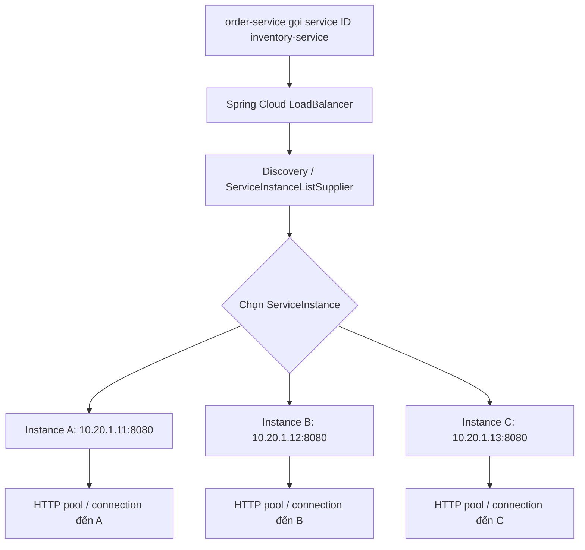
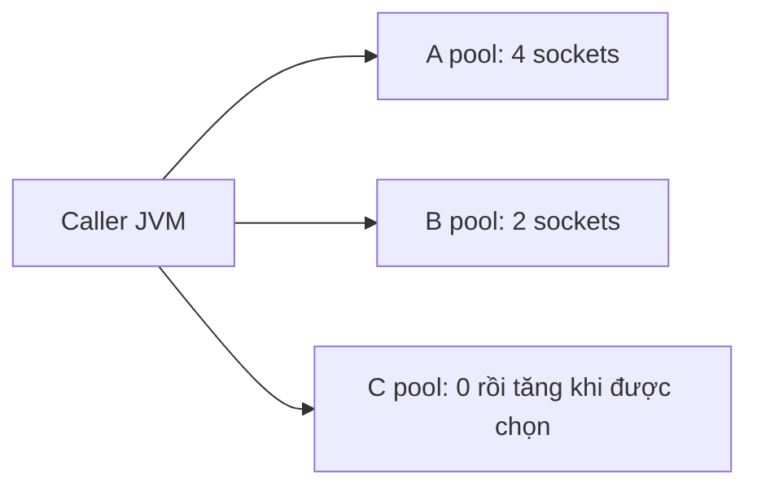
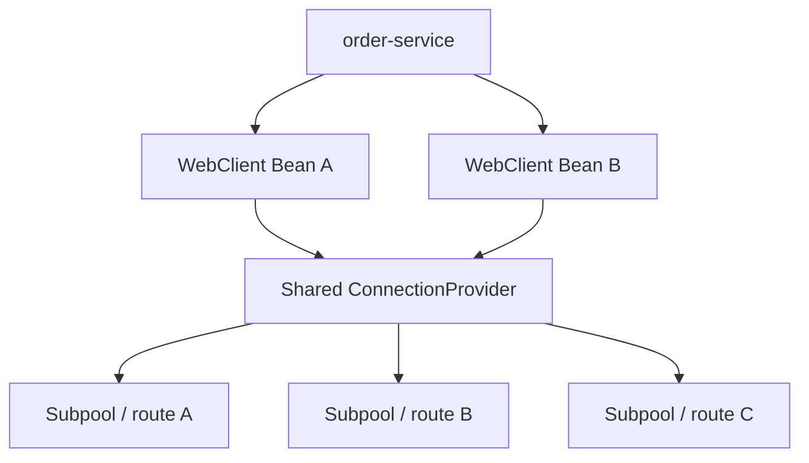
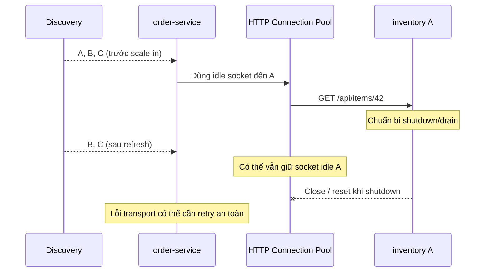
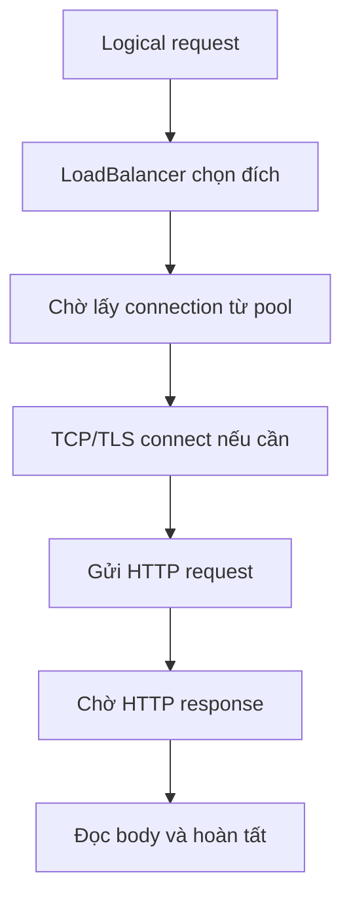

# Ảnh hưởng của số bản sao đến số kết nối cần duy trì

Khi mở rộng một microservice từ 2 lên 20 replica, ta thường kỳ vọng tải được chia nhỏ và thời gian phản hồi tốt hơn. Nhưng một hệ quả ít được chú ý là **bên gọi có nhiều đích mạng hơn để kết nối và duy trì kết nối**. Trong hệ thống sử dụng Spring Cloud LoadBalancer, `order-service` có thể gọi `inventory-service` qua service ID; LoadBalancer chọn một `ServiceInstance` với host/port cụ thể, còn HTTP transport quyết định mở, tái sử dụng và đóng các kết nối đến instance đó.

Tăng số replica có thể làm **tăng số nhóm kết nối/pool theo địa chỉ đích**, tăng số socket nhàn rỗi, chi phí TLS handshake, file descriptor và áp lực lên connection tracking/NAT. Tuy nhiên, **không có quy luật “thêm một replica là mở ngay N kết nối mới”**: lượng kết nối thực tế phụ thuộc số caller, tải đồng thời, thuật toán chọn instance, HTTP/1.1 hay HTTP/2, cơ chế pooling và cách discovery cập nhật.

Bài học thuộc chương **Kết nối và hiệu năng** của module `SPRING_CLOUD_SERVICE_COMMUNICATION_LOAD_BALANCING`. Mục tiêu là xây dựng mô hình định lượng đúng để thiết kế connection pool cho `RestClient`, `WebClient`, OpenFeign, hiểu vai trò riêng của Spring Cloud LoadBalancer, và nhận ra các vấn đề phát sinh khi scale, rollout hoặc đổi danh sách `ServiceInstance`.

## 1. Phân biệt service ID, ServiceInstance và kết nối TCP

Giả sử bên gọi có URI logic:

```http
GET http://inventory-service/api/items/42
```

Trong môi trường discovery, `inventory-service` có thể ánh xạ đến:

| Service ID | Instance | Host | Port |
|---|---|---|---:|
| `inventory-service` | A | `10.20.1.11` | 8080 |
| `inventory-service` | B | `10.20.1.12` | 8080 |
| `inventory-service` | C | `10.20.1.13` | 8080 |

Spring Cloud LoadBalancer lấy danh sách instance từ `ServiceInstanceListSupplier` (có thể qua discovery, cache, health checks, zone/hint filters) và chọn một đích cho request. HTTP client sau đó mới sử dụng HTTP transport để thực hiện kết nối đến đích đã chọn.



Sơ đồ thể hiện logic. **Connection pool nằm trong HTTP client/transport**, không phải trong bản thân thuật toán `RoundRobinLoadBalancer`. Một request được chọn vào A chỉ có thể tái sử dụng kết nối phù hợp với đích A; thông thường không thể lấy socket TCP đã nối với A rồi dùng nó để gửi request trực tiếp đến B.

Trong các HTTP engine thông dụng, pool phân tách connection theo một dạng **địa chỉ đích/route** (thường liên quan host, port, scheme và đôi khi proxy, TLS configuration). Phải xác định cách engine cụ thể định nghĩa route. Nếu traffic đi qua **một gateway/VIP/proxy ổn định**, pool của caller có thể chỉ thấy một địa chỉ trung gian, dù phía sau có nhiều replica. Đây là kiến trúc khác với client-side LB chọn từng host/port.

### Không nhầm “kết nối logic” với socket

| Thành phần | Là gì? | Có tăng ngay khi thêm replica không? |
|---|---|---|
| Service ID | Tên logic, ví dụ `inventory-service`. | Không cần đổi. |
| `ServiceInstance` | Bản ghi một endpoint được discovery cung cấp. | Danh sách có thể tăng. |
| HTTP route/pool key | Nhóm kết nối có thể tái sử dụng cho đích phù hợp. | Có thể tăng khi caller bắt đầu gọi các endpoint mới. |
| TCP connection/socket | Kết nối mạng thực tế đang hoạt động hoặc giữ idle. | Phụ thuộc request, giới hạn pool và idle policy. |
| HTTP/2 stream | Một request/response logic được multiplex trên kết nối HTTP/2. | Có thể tăng mà **không cần** mở thêm socket theo tỷ lệ 1:1. |

## 2. Vì sao nhiều replica tạo nhiều nhóm kết nối hơn?

Với HTTP/1.1 keep-alive, một socket thường xử lý các request tuần tự theo cơ chế tái sử dụng; để gửi nhiều request cùng lúc tới **cùng host/port**, client có thể cần nhiều socket. Sau khi hoàn tất, socket có thể được giữ idle để phục vụ request tiếp theo.

Giả sử `order-service` có một pool đến A với 4 kết nối, trong khi pool đến B có 2 kết nối. Khi C được đưa vào discovery, LoadBalancer có thể bắt đầu chọn C; HTTP client lần đầu gọi C phải thiết lập kết nối mới (DNS nếu cần, TCP, TLS nếu là HTTPS), sau đó có thể giữ lại socket idle cho những request sau.



Vì vậy, số replica càng lớn thì **số route có thể được sử dụng** càng lớn. Nếu client có cơ chế giữ kết nối nhàn rỗi theo route, tổng idle connections có thể tăng dù **throughput toàn hệ thống không tăng**.

Các yếu tố làm con số thực tế thay đổi:

- **Tải tới mỗi instance:** giữ nguyên tổng RPS nhưng tăng replica có thể giảm số request đồng thời đến từng instance.
- **Thuật toán chọn:** round robin có thể lần lượt “chạm” nhiều route; sticky affinity hoặc weight/routing policy có thể chỉ dùng một tập con.
- **Connection reuse:** keep-alive tốt giúp tái sử dụng socket; nếu server/proxy đóng sớm, socket phải liên tục mở lại.
- **Idle eviction:** kết nối đến instance ít được chọn có thể bị đóng sau một khoảng rảnh.
- **Pool bounds:** giới hạn theo route và tổng pool khiến số kết nối đang mở không nhất thiết tăng tuyến tính.
- **Giao thức:** HTTP/2 multiplex có thể phục vụ nhiều request đồng thời trên ít socket hơn HTTP/1.1.
- **Topology:** direct-to-Pod khác với gọi qua một proxy/VIP; cache DNS và cách LoadBalancer viết lại host cũng ảnh hưởng route identity.

**Kết luận cục bộ:** tăng replica làm tăng **không gian đích kết nối**, chứ không trực tiếp ấn định số socket mà mọi caller phải luôn duy trì.

## 3. Công thức ước lượng: caller × replica × giới hạn mỗi route

Gọi:

- `C`: số process/instance **bên gọi** có pool HTTP độc lập.
- `R`: số instance đích thực tế **có thể được mỗi caller chọn**.
- `P`: giới hạn số kết nối tới **một route/đích** trên một pool của caller, nếu HTTP engine sử dụng giới hạn đó.

Khi các caller đều có thể truy cập mọi replica và không có giới hạn tổng chặt hơn, một **giới hạn trên lý thuyết** của số kết nối HTTP/1.1 có thể đạt:

```text
connections_upper_bound ≈ C × R × P
```

Ví dụ có 6 instance `order-service`, 12 instance `inventory-service` và pool cho phép tối đa 20 kết nối trên mỗi route:

```text
6 callers × 12 replicas × 20 connections/route
= tối đa 1.440 connections theo các giới hạn per-route
```

Nếu inventory scale lên 24 replica và giữ nguyên các giới hạn:

```text
6 × 24 × 20 = 2.880 connections theo giới hạn per-route
```

**1.440 và 2.880 không phải dự đoán số kết nối sẽ được mở!** Đó chỉ là phép cộng các hạn mức nếu mỗi route đều bị sử dụng đến mức tối đa. Số thực có thể thấp hơn rất nhiều vì request phân bố đều, pool được tạo lười, kết nối idle bị thu hồi và engine có `maxTotalConnections` hoặc ràng buộc tổng riêng. Một số HTTP client dùng pool tổng, một số dùng giới hạn theo remote address, và cách đếm có thể khác theo phiên bản.

### Một ước lượng thứ hai: nhu cầu in-flight thực

Nếu hệ thống có 500 HTTP requests/giây và thời gian chiếm kết nối trung bình khoảng 100 ms:

```text
active_requests_trung_bình ≈ 500 calls/s × 0,1 s = 50
```

Với HTTP/1.1 không multiplex, số kết nối đang bận ở thời điểm trung bình thường cần đủ để phục vụ khoảng 50 request **trên toàn bộ caller**, tùy phân bố, burst và thời gian giữ kết nối. Không có lý do mỗi một trong 24 instance phải giữ 20 socket bận khi tổng số request đang thực thi trung bình chỉ khoảng 50.

Tuy nhiên, **idle sockets vẫn có thể nhiều hơn active sockets**: sau khi LoadBalancer lần lượt chọn các replica khác nhau, client có thể giữ socket nhàn rỗi tới nhiều đích. Cần đo riêng:

```text
active connections ≠ idle connections
configured max connections ≠ actual open connections
HTTP attempts ≠ TCP connections created
```

Lưu ý: định luật Little mô tả mức trung bình khi hệ thống ổn định; burst, queue, timeout và retry làm số in-flight cao hơn trong những khoảng ngắn.

## 4. HTTP/1.1 và HTTP/2 làm thay đổi mô hình

| Yếu tố | HTTP/1.1 keep-alive | HTTP/2 |
|---|---|---|
| Tái sử dụng socket | Có, nhiều request tuần tự trên cùng socket. | Có, nhiều stream có thể đồng thời trên một kết nối. |
| Request đồng thời trên một socket | Thông thường một request đang chờ response trên mỗi socket, không dựa vào HTTP/1.1 pipelining. | Nhiều stream, bị giới hạn bởi peer SETTINGS, flow control và HTTP engine. |
| Ảnh hưởng của tăng replica | Có thể tăng số route và socket idle; cùng route tải cao có thể cần nhiều socket. | Có thể tăng số kết nối tới các origin mới, nhưng số socket trên mỗi route thường nhỏ hơn với multiplex phù hợp. |
| Chi phí thiết lập | TCP và TLS nếu HTTPS. | TCP/TLS, thương lượng ALPN/h2 hoặc cấu hình tương ứng. |
| Có thể dùng một socket cho mọi replica? | Không khi các replica là các TCP destination riêng biệt. | Không mặc nhiên; multiplex không đồng nghĩa một socket dùng cho nhiều Pod/IP bất kỳ. |

HTTP/2 **không loại bỏ hoàn toàn pooling**. Khi một connection đạt giới hạn stream, gặp flow-control bottleneck hoặc phải reconnect, HTTP client có thể mở thêm kết nối tùy implementation. Một số trường hợp có HTTP/2 connection coalescing giữa các origin đủ điều kiện, nhưng **không được giả định** điều đó cho các IP/port ServiceInstance khác nhau.

Đừng kết luận WebClient “luôn dùng HTTP/2”: giao thức thực tế phụ thuộc Reactor Netty, TLS/ALPN, cấu hình HTTP client và server. Tương tự, `RestClient` hay OpenFeign có thể dùng những HTTP engine với khả năng HTTP/2 khác nhau. Hãy quan sát protocol negotiated trong hệ thống đang chạy.

## 5. Khi scale cả caller lẫn downstream, số kết nối tăng theo hai chiều

Trong microservice thường có hai hành động scale độc lập:

1. Tăng `inventory-service` từ 8 lên 16 replica làm mỗi caller có thể chạm nhiều route hơn.
2. Tăng `order-service` từ 4 lên 12 replica tạo thêm **các HTTP pool độc lập** tại những process caller mới.

Nếu mỗi caller có thể giữ trung bình một idle connection đến mỗi replica inventory, mô hình đơn giản cho biết:

```text
4 callers × 8 replicas × 1 idle socket/route   ≈ 32 sockets
12 callers × 16 replicas × 1 idle socket/route ≈ 192 sockets
```

Số 1 socket idle/route là **giả định học tập**, không phải cấu hình mặc định của bất kỳ thư viện nào. Pool có thể không tạo kết nối tới route chưa từng gọi, có thể đóng idle sau timeout, và có thể tái sử dụng/nhóm route theo cách khác. Nhưng phép tính nhấn mạnh một điều: **mỗi process caller độc lập có ngân sách FD/socket riêng**, và tổng trên cluster có thể tăng ngay cả khi mỗi instance đã được tuning tốt.

### Nhiều service cùng gọi một upstream

Ngoài `order-service`, inventory còn có thể được gọi từ `cart-service`, `checkout-service`, gateway hoặc background jobs. Lượng kết nối vào inventory vì vậy không chỉ do một nhóm caller tạo:

```text
Total connections to inventory
≈ tổng connections của mọi caller process / service
+ kết nối từ health probes, admin tools, jobs, proxy... nếu có
```

Mỗi nhóm caller có phiên bản, pool config và mức tải riêng. Hãy tính ngân sách từ **tất cả nguồn**, không chỉ từ một microservice đang được phát triển.

## 6. Chi phí của nhiều socket và nhiều route

Số socket lớn có thể tạo áp lực ở nhiều nơi:

| Tài nguyên | Vì sao bị tác động |
|---|---|
| **File descriptors** | Mỗi TCP socket mở chiếm FD ở tiến trình caller và thường ở server tương ứng. |
| **Bộ nhớ kernel và user space** | Socket buffers, connection metadata và state của HTTP/TLS engine tiêu thụ tài nguyên. |
| **TLS CPU/latency** | Kết nối mới cần handshake; keep-alive/resumption có thể giảm nhưng không xóa chi phí. |
| **NAT/conntrack** | Nhiều kết nối qua NAT hoặc proxy tạo thêm entries/state, có thể làm cạn giới hạn trung gian. |
| **Ephemeral ports** | Mỗi kết nối TCP mới cần tổ hợp địa chỉ/port hợp lệ, đặc biệt đáng chú ý khi qua SNAT. |
| **DNS và resolver** | Đích mới hoặc địa chỉ thay đổi có thể làm tăng lookups/cập nhật cache tùy transport. |
| **Server accept/load** | Replica phải xử lý accept, handshake, keep-alive và idle sockets từ nhiều caller. |
| **Bộ nhớ/queue của pool** | Khi pool bão hòa, pending acquires và request waiting có thể tích tụ. |

Không phải tất cả connection đều gây tải CPU liên tục. **Idle socket** vẫn có chi phí tài nguyên; **active connection** còn có traffic và công việc đang chạy. **Kết nối liên tục được tạo rồi đóng** lại gây nhiều handshake và `TIME_WAIT`/churn, ngay cả khi tổng số socket đang mở tại một thời điểm không cao.

Đặc biệt, khi caller dùng HTTPS trực tiếp đến replica, cần quan sát TLS certificate validation và SNI/hostname. Việc thay đổi đích theo discovery phải giữ tính đúng đắn của bảo mật: không nên tắt kiểm tra certificate chỉ để thử kết nối với IP mới.

## 7. Pool riêng cho từng origin hay dùng chung một pool?

Cụm từ “một connection pool” có thể gây nhầm:

- Có thể có **một đối tượng pool manager** được chia sẻ giữa nhiều `WebClient`.
- Bên trong manager, kết nối vẫn thường được phân nhóm theo **remote address/route**.
- Một HTTP client khác có thể dùng pool riêng; hai bean `RestClient`/Feign không nhất thiết chia sẻ cùng pool.
- Nếu mỗi request lại tạo mới HTTP client/pool, lợi ích tái sử dụng kết nối suy giảm đáng kể và chi phí tăng mạnh.

Thiết kế đúng thường là **tái sử dụng HTTP client/connection provider** cho nhiều request có chung nhu cầu tài nguyên, thay vì tạo socket hoặc pool manager tùy tiện ở mỗi lời gọi.



Chia sẻ pool có thể tiết kiệm tài nguyên, nhưng cũng tạo **tranh chấp hạn mức** nếu nhiều downstream quan trọng sử dụng cùng một giới hạn tổng. Ngược lại, tách pool riêng giúp cô lập sự cố nhưng tăng socket/FD và chi phí vận hành. Cần chọn ranh giới chia sẻ theo SLA, loại lưu lượng và cách HTTP engine định nghĩa giới hạn.

### Pool và Bulkhead không giống nhau

Pool limit thường giới hạn **connection/route hoặc tổng connection**. Bulkhead giới hạn **số lời gọi nghiệp vụ đồng thời**. Trong HTTP/2, nhiều request có thể chia sẻ một socket, nên số socket không phản ánh chính xác số logical requests in-flight. Với HTTP/1.1, chờ connection pool cũng giữ request/queue ở caller. Vì vậy có thể cần cả:

- Pool limit để bảo vệ socket và connection resources.
- Bulkhead/admission control để bảo vệ tổng số lời gọi đang diễn ra.
- Timeout và bounded queue để tránh giữ request quá lâu.

Tăng `maxConnections` không thay thế bulkhead khi downstream đang chậm, cũng không tạo thêm công suất phía server.

## 8. WebClient với Reactor Netty: một cấu hình pool minh họa

Trong môi trường WebFlux/WebClient có Reactor Netty và Spring Cloud LoadBalancer, có thể chủ động cấu hình `ConnectionProvider`. Ví dụ Java dưới đây minh họa **một pool manager dùng lại**, giới hạn số kết nối theo đích và số request đang chờ lấy connection.

```java
import java.time.Duration;
import io.netty.channel.ChannelOption;
import org.springframework.cloud.client.loadbalancer.LoadBalanced;
import org.springframework.context.annotation.Bean;
import org.springframework.context.annotation.Configuration;
import org.springframework.http.client.reactive.ReactorClientHttpConnector;
import org.springframework.web.reactive.function.client.WebClient;
import reactor.netty.http.client.HttpClient;
import reactor.netty.resources.ConnectionProvider;

@Configuration
class InventoryWebClientConfig {

    @Bean(destroyMethod = "dispose")
    ConnectionProvider inventoryConnectionProvider() {
        return ConnectionProvider.builder("inventory-http-pool")
            .maxConnections(32)
            .pendingAcquireMaxCount(64)
            .pendingAcquireTimeout(Duration.ofMillis(400))
            .maxIdleTime(Duration.ofSeconds(30))
            .maxLifeTime(Duration.ofMinutes(5))
            .evictInBackground(Duration.ofSeconds(60))
            .build();
    }

    @Bean
    @LoadBalanced
    WebClient.Builder loadBalancedWebClientBuilder() {
        return WebClient.builder();
    }

    @Bean
    WebClient inventoryWebClient(
            @LoadBalanced WebClient.Builder builder,
            ConnectionProvider inventoryConnectionProvider) {

        HttpClient httpClient =
            HttpClient.create(inventoryConnectionProvider)
                .option(ChannelOption.CONNECT_TIMEOUT_MILLIS, 1_000)
                .responseTimeout(Duration.ofSeconds(3));

        return builder.clone()
            .baseUrl("http://inventory-service")
            .clientConnector(
                new ReactorClientHttpConnector(httpClient))
            .build();
    }
}
```

Các giá trị `32`, `64`, 400 ms, 30 giây và 5 phút chỉ là **minh họa**, không phải khuyến nghị chung. Cần kiểm tra các API được hỗ trợ và thay đổi mặc định theo phiên bản Reactor Netty/Spring Boot đang chạy.

Ý nghĩa các lựa chọn:

| Tùy chọn | Tác dụng thông thường |
|---|---|
| `maxConnections(32)` | Giới hạn kết nối trong pool cho **mỗi remote host/địa chỉ đích** theo cách provider của Reactor Netty định nghĩa; không nên hiểu là luôn tối đa 32 cho mọi service trên cluster. |
| `pendingAcquireMaxCount(64)` | Giới hạn số yêu cầu chờ lấy connection khi pool tương ứng hết suất. |
| `pendingAcquireTimeout(400ms)` | Hạn chờ một connection rảnh; quá hạn có thể lỗi acquire trước khi HTTP request thật sự tới server. |
| `maxIdleTime(30s)` | Kết nối idle quá lâu đủ điều kiện bị đóng. |
| `maxLifeTime(5m)` | Giới hạn tuổi kết nối để tránh sống quá lâu qua topology changes; hiệu lực khi pool kiểm tra/evict theo implementation. |
| `evictInBackground(60s)` | Chủ động quét và thu hồi các kết nối đủ điều kiện theo chu kỳ. |
| Connect/response timeout | Giới hạn những giai đoạn kết nối/response theo HTTP engine, **không phải tổng deadline** cho logical request gồm retry. |

Với client-side LoadBalancer, HTTP connector thường thấy endpoint thực sau khi chọn `ServiceInstance`. Nếu có 20 remote addresses mà mỗi route đều bị đẩy tới `maxConnections=32`, tổng giới hạn per-route có thể tương đương hàng trăm socket trên **một caller process**. Đừng cộng nhầm `32` như thể là ngân sách toàn cluster.

### Không tạo ConnectionProvider mới trong mỗi request

Sai lầm phổ biến:

```java
// KHÔNG NÊN: tạo mới client/pool cho từng lời gọi.
Mono<ItemDto> findItemWrong(String id) {
    ConnectionProvider provider =
        ConnectionProvider.create("temporary-pool");
    HttpClient http = HttpClient.create(provider);
    WebClient client = WebClient.builder()
        .clientConnector(new ReactorClientHttpConnector(http))
        .baseUrl("http://inventory-service")
        .build();
    return client.get()
        .uri("/api/items/{id}", id)
        .retrieve()
        .bodyToMono(ItemDto.class);
}
```

Đoạn code trên còn **thiếu tích hợp `@LoadBalanced`** và không quản lý vòng đời `ConnectionProvider`. Nó minh họa anti-pattern: liên tục tạo pool và connector làm giảm reuse, có thể gây rò rỉ tài nguyên, trong khi hostname service ID có thể bị gửi thẳng cho DNS thay vì LoadBalancer. Dùng client cấu hình đúng, tái sử dụng bean qua các request và để Spring quản lý shutdown/dispose pool.

### Pending acquire không giống HTTP response timeout

Khi request đợi quá lâu mới lấy được connection từ pool, nó có thể thất bại **trước khi bắt đầu HTTP I/O**. Sự cố này khác với read/response timeout của server. Nếu chỉ nhìn log `WebClientRequestException` hoặc lỗi timeout chung, khó biết đang nghẽn ở:

1. Lấy connection từ pool.
2. DNS hoặc thiết lập TCP/TLS.
3. Gửi request đến HTTP server.
4. Đợi response của upstream.
5. Retry/backoff và deadline tổng.

Nên bật metric và ghi trace theo giai đoạn với mức chi tiết phù hợp để phân biệt, tránh tăng nhầm `responseTimeout` khi vấn đề nằm ở hàng đợi acquire.

## 9. RestClient với Apache HttpClient: total và per-route khác nhau

`RestClient` là API gọi HTTP đồng bộ. Nó **không tự quy định một connection pool thống nhất**; khả năng pooling và giới hạn tùy `ClientHttpRequestFactory` và engine HTTP phía dưới.

Nếu dùng Apache HttpClient 5 và dependency phù hợp, có thể cấu hình pool như sau:

```java
import org.apache.hc.client5.http.impl.classic.CloseableHttpClient;
import org.apache.hc.client5.http.impl.classic.HttpClients;
import org.apache.hc.client5.http.impl.io.PoolingHttpClientConnectionManagerBuilder;
import org.springframework.cloud.client.loadbalancer.LoadBalanced;
import org.springframework.context.annotation.Bean;
import org.springframework.context.annotation.Configuration;
import org.springframework.http.client.HttpComponentsClientHttpRequestFactory;
import org.springframework.web.client.RestClient;

@Configuration
class InventoryRestClientConfig {

    @Bean(destroyMethod = "close")
    CloseableHttpClient inventoryApacheClient() {
        var manager =
            PoolingHttpClientConnectionManagerBuilder.create()
                .setMaxConnTotal(200)
                .setMaxConnPerRoute(25)
                .build();

        return HttpClients.custom()
            .setConnectionManager(manager)
            .evictExpiredConnections()
            .build();
    }

    @Bean
    @LoadBalanced
    RestClient.Builder loadBalancedRestClientBuilder() {
        return RestClient.builder();
    }

    @Bean
    RestClient inventoryRestClient(
            @LoadBalanced RestClient.Builder builder,
            CloseableHttpClient inventoryApacheClient) {

        return builder.clone()
            .baseUrl("http://inventory-service")
            .requestFactory(
                new HttpComponentsClientHttpRequestFactory(
                    inventoryApacheClient))
            .build();
    }
}
```

Trong ví dụ:

- `setMaxConnTotal(200)` đặt **giới hạn tổng** connection được quản lý bởi Apache pool manager này.
- `setMaxConnPerRoute(25)` đặt **giới hạn trên mỗi route**.
- Số route có thể tăng khi `inventory-service` có nhiều replica, nhưng tổng socket của **manager này** vẫn bị giới hạn bởi `200` (theo semantics pool đang dùng).
- `CloseableHttpClient` được chia sẻ và đóng khi Spring context shutdown; không tạo một client mới cho mỗi HTTP request.

Ví dụ chưa cấu hình connect timeout, response timeout, TLS và pool-acquire timeout; trong ứng dụng thật phải khai báo chúng theo API Apache HttpClient/`HttpComponentsClientHttpRequestFactory` của phiên bản tương ứng. Chọn một `maxConnPerRoute` lớn mà `maxConnTotal` quá thấp có thể khiến nhiều route tranh cùng giới hạn tổng; ngược lại tăng tổng quá cao có thể gây áp lực FD, TLS và downstream.

**RestClient đồng bộ giữ luồng trong lúc chờ** theo mô hình gọi thông thường. Nếu nhiều request cùng đợi lấy connection từ pool, thread pool của servlet/caller vẫn có thể bị bão hòa. Vì thế cần phối hợp pool với bulkhead và deadline tổng, không chỉ tăng cả hai giới hạn đến khi hết lỗi acquire.

## 10. OpenFeign và các HTTP engine khác

Với OpenFeign:

```java
@FeignClient(name = "inventory-service", contextId = "inventoryRead")
interface InventoryReadClient {
    @GetMapping("/api/items/{id}")
    ItemDto getItem(@PathVariable("id") String id);
}
```

Feign interface chỉ định hợp đồng và service ID. Connection pooling thực tế phụ thuộc HTTP engine được tích hợp: Apache HttpClient 5, OkHttp hoặc client tương ứng mà dự án cấu hình. Các engine có quy tắc pool route, idle eviction, max connections và timeout khác nhau. `@FeignClient` hay `contextId` **không tự tạo một socket pool cho mỗi service replica**, cũng không bảo đảm mọi Feign client dùng chung cùng một manager.

Khi đặt Feign client-specific configuration, cần kiểm tra:

- HTTP `Client` implementation đang được sử dụng và có pooling thực sự không.
- Kết nối được phân vùng theo host/port/proxy ra sao và có được chia sẻ giữa các Feign clients không.
- `connectTimeout`, `readTimeout` thuộc Feign request hay HTTP engine; phân biệt với thời gian lấy connection từ pool và deadline tổng.
- `Retryer` của Feign, retry của LoadBalancer hoặc gateway có đang tạo thêm attempts/sockets không.
- `contextId` và bean configuration có bị rò từ parent context, vô tình áp cùng pool/timeout chính sách cho client khác không.

Không copy thuộc tính pool của Reactor Netty sang OkHttp/Apache rồi trông đợi cùng tên hay cùng ngữ nghĩa. Hãy xác minh bằng HTTP-engine metrics trong đúng ứng dụng và BOM Spring Cloud đang dùng.

## 11. Scale out, scale in và rolling deployment

### Scale out: replica mới có “cold connection”

Khi inventory có replica D vừa xuất hiện trong discovery:

1. Các caller nhận danh sách `ServiceInstance` mới sau thời gian refresh/cache.
2. LoadBalancer bắt đầu chọn D theo policy.
3. HTTP engine có thể chưa có socket idle đến D, nên request đầu tiên phải mở kết nối mới.
4. Nếu HTTPS, TCP/TLS handshake làm tăng latency request đầu tiên; cùng lúc nhiều caller có thể mở connection đến D.
5. Sau một thời gian, pool có thể giữ socket idle tới D và giảm chi phí cho request tiếp theo.

Hiện tượng này đôi khi tạo **cold-start latency** và đợt tăng connection establishment dù số RPS không đổi. Nếu scale hàng loạt, hãy theo dõi tốc độ tạo kết nối mới, TLS handshake, pool pending acquire và p99 latency.

### Scale in: instance rời discovery nhưng socket cũ có thể còn

Khi A bị gỡ khỏi registry hoặc chuyển NotReady:

- Các caller có thể vẫn còn **cache danh sách instance cũ**, nên một số request tiếp tục chọn A cho đến khi cache/health được làm mới.
- HTTP pool có thể còn **idle connection đến A**, nhưng việc A không còn trong discovery **không tự bảo đảm socket sẽ được đóng ngay lập tức**.
- Server có thể đóng kết nối khi shutdown/drain; client có thể gặp `connection reset` hoặc lỗi I/O khi cố tái sử dụng socket.
- Nếu request đã được gửi trước khi A dừng, cần graceful shutdown, readiness và ngân sách hoàn tất in-flight hợp lý.

**Discovery refresh và connection eviction là hai cơ chế riêng.** Một cái quản lý tập ứng viên; cái kia quản lý socket. Đừng kỳ vọng thay `ServiceInstanceListSupplier` sẽ lập tức quét sạch mọi kết nối tới instance đã rời.



### Rolling deployments và connection churn

Nếu rollout thay phần lớn replica trong thời gian ngắn, các caller có thể phải xây nhiều connection pools/route mới và đóng route cũ. Đây là bài toán **connection churn**. Tốc độ thay thế instance, readiness/drain và tuổi/idle eviction của pool cần được xem xét cùng nhau. Retry không giới hạn lúc đang rollout chỉ làm tăng số attempts và handshake trong thời điểm topology chưa ổn định.

## 12. Vai trò của health check, retry và routing policy

Những cơ chế trong Spring Cloud LoadBalancer có thể ảnh hưởng **đến tập destination được gọi**:

| Cơ chế | Ảnh hưởng đến connection |
|---|---|
| Discovery | Thêm/bớt host/port ứng viên; mở ra hoặc loại bỏ các route có thể được chọn. |
| `HealthCheckServiceInstanceListSupplier` (nếu bật) | Có thể giảm tập instance eligible; các health probes có thể tạo network requests riêng và chi phí connection bổ sung. |
| Zone preference | Thường giảm số replica được sử dụng từ mỗi caller hoặc ưu tiên một subset; có thể tập trung traffic/pool lên cùng zone. |
| Weighted/affinity routing | Một số replica nhận nhiều requests/connections hơn; số route thực sự được sử dụng có thể khác R tổng. |
| Retry cùng instance | Có thể tiếp tục dùng route cũ; nếu connection hỏng có thể phải tạo socket mới. |
| Retry instance khác | Có thể “chạm” route khác và tăng số socket được warm; tăng tổng attempts. |
| Hard isolation theo tenant/region | Chặn gọi tới instance không hợp lệ; không được phá rào cản này chỉ để tận dụng socket sẵn có. |

Caller-side health check không mặc nhiên giống readiness probe của Kubernetes. Nếu có `C` caller và `R` replica, mỗi caller probe từng replica với chu kỳ `T` giây, số health requests/giây trung bình theo **giả định** đơn giản có thể là:

```text
health_probes_per_second ≈ C × R / T
```

Ví dụ 20 callers × 30 replicas / 10 giây ≈ 60 health requests/giây, trước các cơ chế cache/dedup và sự phân bố theo thời gian. Health probes có thể dùng HTTP client hoặc đường mạng khác với request nghiệp vụ và **không chắc chia sẻ cùng pool**. Khi số replica tăng, chi phí kiểm tra sức khỏe từ nhiều caller có thể tăng dù traffic nghiệp vụ giữ nguyên.

## 13. Pool saturation có thể bị nhầm với upstream chậm

Khi client báo timeout, nguồn gây chậm có thể ở nhiều lớp:



| Hiện tượng | Dấu hiệu | Cách điều tra |
|---|---|---|
| Pool chạm giới hạn | Pending acquires/queue cao, active connections sát giới hạn. | Đo per-route/total limits và thời gian chờ acquire. |
| Server xử lý chậm | Socket đã có nhưng response time tăng. | Trace upstream, CPU/DB và p95/p99 endpoint. |
| Tạo kết nối mới chậm | Connect/TLS handshake time cao, connection creation rate tăng. | Kiểm tra network, TLS, DNS, cold routes và NAT. |
| Stale connection sau rollout | Reset/closed socket tăng khi instance rời. | Kiểm tra readiness/drain, idle/TTL eviction và discovery cache. |
| Retry amplification | HTTP attempts nhiều hơn logical requests. | Kiểm tra retry tầng HTTP, LB, Feign/WebClient, gateway. |
| Một route bị hotspot | Một instance có active/pending cao bất thường. | Kiểm tra weight, affinity, zone routing và tình trạng replica. |

Tăng `maxConnections` có thể giảm pool-acquire waiting **nếu** downstream thực sự còn công suất và hệ thống không bị giới hạn khác. Nếu upstream đã quá tải, tăng socket chỉ tạo thêm request in-flight, tăng tail latency và nguy cơ quá tải dây chuyền. Nên phối hợp pool limit với bulkhead/concurrency budget, connect/read timeout và retry budget.

## 14. Observability: đo đúng connection lifecycle

Không nên suy đoán số socket từ số replica hay RPS. Trong môi trường test/staging và production, quan sát tối thiểu:

| Metric hoặc tín hiệu | Ý nghĩa |
|---|---|
| **Active connections / leased** | Kết nối đang phục vụ request theo HTTP engine. |
| **Idle connections / available** | Socket còn mở nhưng hiện không phục vụ request. |
| **Pending acquires** | Request đang chờ mượn kết nối từ pool. |
| **Connection created / closed** | Tốc độ tạo và đóng socket; phát hiện churn sau rollout. |
| **Acquire latency / timeout** | Chậm khi lấy connection trước khi thực sự gửi request. |
| **Connect và TLS handshake latency** | Chi phí route mới hoặc mạng bảo mật. |
| **HTTP request latency p50/p95/p99** | Mức độ trễ cảm nhận theo service/route, tách với pool waiting nếu có thể. |
| **FD count / TCP states** | Quan sát giới hạn OS, ESTABLISHED, TIME_WAIT, CLOSE_WAIT ở quy mô process/node. |
| **Conntrack/NAT pressure** | Cạn bảng kết nối hoặc ephemeral ports ở network path trung gian. |
| **Instance selection distribution** | Phân bố chọn đích có đều hay do affinity/zone gây hotspot. |
| **Retry và no-instance errors** | Retry có đang làm tăng nhu cầu socket và requests không. |

Tên metric phụ thuộc Reactor Netty, Apache/OkHttp, Micrometer, Spring Boot và phiên bản tích hợp. Ví dụ Reactor Netty có các nhóm metric connection provider về số active/idle/pending khi instrumentation được bật, nhưng **không mặc định mọi metric đều xuất hiện** và không dùng tên nhãn của một release cho mọi phiên bản. Hãy xem metric thực tế và tài liệu của BOM đang chạy.

Nên phân biệt theo service ID/route template ở mức cardinality hợp lý, tránh gắn IP/port của hàng nghìn ephemeral Pods làm metric tag không giới hạn. Với chẩn đoán sâu, có thể sử dụng log/trace có giới hạn thời gian để nối `ServiceInstance` được chọn và connection error; không ghi credential, cookie, query token hoặc dữ liệu cá nhân.

## 15. Bài thực hành: scale replica và quan sát connection

Chuẩn bị `inventory-service` có thể chạy 2, 4, 8 replica sau cùng một service ID; `order-service` dùng `@LoadBalanced WebClient.Builder` hoặc RestClient/Feign tích hợp LoadBalancer. Mỗi replica trả về instance ID cho endpoint `GET /api/items/{id}`. Thử nghiệm chỉ thực hiện ở môi trường test với giới hạn tải.

### Kịch bản A — Giữ nguyên RPS, tăng số replica

1. Chạy 2 replica inventory và 3 caller order. Gửi một tải ổn định, chẳng hạn 100 GET/s tổng, trong thời gian đủ để pool tái sử dụng kết nối.
2. Ghi active/idle connections, connection-created rate, pending acquires, chosen instance distribution và p95.
3. Tăng inventory lên 4 rồi 8 replica nhưng giữ nguyên **100 GET/s tổng**.
4. So sánh số route thực sự được chạm, idle sockets và số kết nối mới trên mỗi lần scale.

**Câu hỏi:** tổng active requests có nhất thiết tăng theo số replica không? Vì sao idle connections vẫn có thể tăng? Nếu traffic thấp và idle eviction ngắn, có thể số socket thực tế không tăng đáng kể không?

### Kịch bản B — Tăng cả caller và replica

1. Giữ pool limit theo route như nhau cho mọi caller.
2. Tăng `order-service` từ 3 lên 6 instance; đồng thời tăng inventory từ 4 lên 8.
3. So sánh connection count trên **mỗi caller** và **toàn cluster**.
4. Xác minh vì sao một pool max 20/route không có nghĩa toàn hệ thống chỉ có 20 connections.

### Kịch bản C — Đổi cấu hình pool

| Thử nghiệm | Dự đoán cần kiểm tra |
|---|---|
| Giảm max connections/route | Pending acquire có thể tăng nếu tải đồng thời không đổi. |
| Đặt max idle quá ngắn | Tăng create/close rate, connect/TLS overhead. |
| Đặt max idle rất dài | Giữ nhiều idle sockets, tăng FD và chi phí khi topology thay đổi. |
| Dùng HTTP/2 (nếu cả client/server hỗ trợ) | Nhiều request có thể dùng ít sockets hơn, nhưng vẫn có limit streams/route. |
| Tạo WebClient/pool mới mỗi request | Reuse suy giảm, connection churn tăng và rủi ro rò tài nguyên. |
| Dùng chung pool cho hai downstream | Có thể giảm overhead nhưng cần kiểm tra tranh chấp giới hạn tổng, cách ly lỗi. |

### Kịch bản D — Rollout và stale connections

1. Thay một nửa replica inventory trong khi vẫn duy trì request tải nhỏ.
2. Quan sát `ServiceInstance` được chọn, kết nối mới, socket cũ, reset/timeout và retry.
3. Bật readiness/drain phù hợp rồi so sánh số connection reset.
4. Nếu dùng caller-side health checks, đo thêm số probe theo số caller/replica và xem nó có dùng chung HTTP pool hay không.

Không cố ý kéo dài sự cố hoặc tăng RPS đến mức phá vỡ hạ tầng; mục tiêu là **đo xu hướng và nguyên nhân**, không phải tìm ra giới hạn bằng thử nghiệm phá hủy.

## 16. Checklist khi thiết kế connection pool theo quy mô replica

- **Xác định topology:** caller kết nối thẳng vào từng `ServiceInstance` hay chỉ vào một gateway/VIP/proxy?
- **Đếm cả hai chiều scale:** số instance caller và số replica đích đều ảnh hưởng số route/socket có thể duy trì.
- **Không nhầm hạn mức với thực tế:** max connections/route là trần, không phải số kết nối luôn mở.
- **Đo concurrency:** dùng RPS × latency để ước lượng in-flight, rồi kiểm tra burst, p95/p99 và phân bố traffic.
- **Tách active và idle:** idle socket có thể tăng theo số route dù active requests giữ nguyên.
- **Hiểu HTTP protocol:** HTTP/2 multiplex streams khác HTTP/1.1; không giả định một socket phục vụ mọi replica.
- **Quản lý pool lifecycle:** tái sử dụng HTTP client/provider và dispose khi shutdown; không tạo mới theo request.
- **Cấu hình hợp lý:** per-route, total pool limits, bounded pending queue/acquire timeout, max idle/lifetime và eviction.
- **Giữ an toàn khi scale-in:** discovery/cache, graceful shutdown/readiness và socket eviction đều cần xem xét.
- **Tránh retry amplification:** số HTTP attempts tăng có thể làm pool bão hòa; retry phải có budget/backoff/deadline.
- **Phối hợp bulkhead/rate limit:** bảo vệ số lời gọi đồng thời và công suất upstream, không chỉ tăng số connections.
- **Quan sát tài nguyên OS/network:** FD, TCP states, ephemeral ports, NAT/conntrack và TLS handshake.
- **Giữ chính sách định tuyến:** không fallback sang zone/tenant bị cấm chỉ vì pool có sẵn kết nối tới đó.
- **Kiểm thử với phiên bản thực:** Reactor Netty, Apache HttpClient, OkHttp/Feign có semantics pool và default khác nhau.

**Ghi nhớ:** tăng replica không tự động yêu cầu một số TCP connection cố định trên mỗi replica. Trong mô hình client-side load balancing, nhiều `ServiceInstance` tạo ra nhiều **đích/route có thể có pool riêng**, và nhiều caller tạo thêm **các pool độc lập**. Số socket thực tế phụ thuộc đồng thời request, connection reuse, HTTP/1.1 hay HTTP/2, giới hạn pool và chính sách idle/eviction. **Spring Cloud LoadBalancer chọn instance; HTTP engine duy trì connection.** Để scale ổn định, hãy đo active/idle/pending, tính tổng tài nguyên trên toàn cluster và phối hợp pooling với timeout, retry, bulkhead, health/discovery và graceful shutdown.
