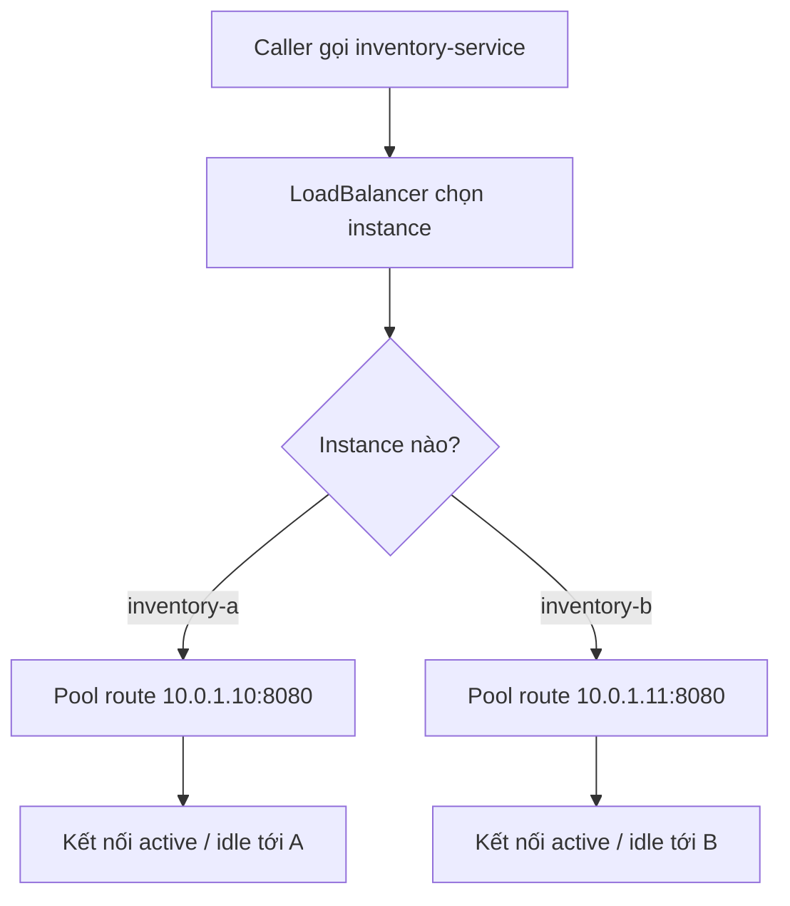

# Keep-alive, idle timeout và dọn kết nối không còn hợp lệ

Trong Spring Cloud LoadBalancer, `order-service` có thể gọi `inventory-service` hàng nghìn lần bằng một URL logic như `http://inventory-service/api/items/42`. LoadBalancer chọn `ServiceInstance` theo service ID, còn HTTP client mở hoặc tái sử dụng kết nối TCP/TLS tới host và port thực tế của instance. **Giữ kết nối (keep-alive)** thường giúp giảm độ trễ và chi phí tạo kết nối mới; nhưng nếu kết nối không còn hợp lệ vì backend, proxy hoặc thiết bị mạng đã đóng nó, lần tái sử dụng tiếp theo có thể bị `Connection reset`, `PrematureCloseException`, `NoHttpResponseException` hoặc timeout.

Bài học thuộc chương **Kết nối và hiệu năng** giải thích HTTP keep-alive, TCP keepalive, **idle timeout**, vòng đời connection pool và cách **loại bỏ kết nối idle/stale** trong `WebClient` (Reactor Netty), `RestClient` (Apache HttpClient 5) cũng như những lưu ý với OpenFeign. Phần thực hành kết hợp Spring Cloud LoadBalancer, discovery, health check, timeout và quan sát lỗi để xây dựng giao tiếp giữa dịch vụ có khả năng phục hồi mà không đánh đổi hiệu năng một cách mù quáng.

## 1. Bối cảnh: instance vẫn khỏe nhưng request đầu sau thời gian rảnh lại lỗi

Giả sử `order-service` gọi `inventory-service` mỗi vài giây. Khi lưu lượng giảm trong 90 giây rồi tăng trở lại, request đầu tiên gặp lỗi kết nối mặc dù:

- `inventory-service` vẫn có hai instance trong discovery.
- `/actuator/health/readiness` của cả hai trả `200 OK`.
- Request gửi ngay sau đó có thể thành công.
- Log có các dấu hiệu như `Connection reset by peer` hoặc `PrematureCloseException`.

Một kịch bản có thể là client giữ một connection idle, nhưng proxy ở giữa hoặc backend đã đóng kết nối sau 30 giây không hoạt động. Nếu phía client chưa phát hiện đóng kết nối (hoặc đóng và tái sử dụng xảy ra cạnh tranh), connection cũ được cấp lại cho request mới và thất bại.

```mermaid
sequenceDiagram
    participant Caller as order-service
    participant Pool as HTTP connection pool
    participant Proxy as Ingress / proxy
    participant Backend as inventory-a
    Caller->>Pool: GET request đầu
    Pool->>Proxy: Tạo TCP/TLS connection
    Proxy->>Backend: Chuyển request
    Backend-->>Proxy: 200 OK
    Proxy-->>Pool: Response
    Note over Pool,Proxy: Kết nối được trả về pool và idle
    Note over Proxy: Hết idle timeout; proxy đóng kết nối
    Caller->>Pool: GET sau một thời gian rảnh
    Pool--xProxy: Thử dùng connection đã stale (race / chưa thấy close)
    Pool-->>Caller: Reset hoặc premature close
    Note over Pool: Loại kết nối lỗi; request sau có thể tạo socket mới
```

**Sơ đồ mô tả một tình huống có thể xảy ra**, không phải mọi lần server đóng idle socket đều gây lỗi: khi FIN/RST đã được client xử lý đúng, pool thường biết connection đã đóng và không cấp lại. Lỗi tái sử dụng thường liên quan tới race, kết nối bị cắt âm thầm bởi mạng trung gian hoặc trạng thái stale chưa được kiểm tra đầy đủ.

## 2. Phân biệt bốn lớp dễ bị gọi chung là “keep-alive”

| Cơ chế | Tầng | Mục đích | Có giúp bảo đảm endpoint vẫn khỏe không? |
|---|---|---|---|
| **HTTP persistent connection** (HTTP/1.1 keep-alive) | HTTP | Tái sử dụng một socket cho nhiều HTTP request tuần tự | Không |
| **HTTP/2 connection và streams** | HTTP/2 | Nhiều HTTP streams có thể cùng chia sẻ một connection | Không |
| **TCP `SO_KEEPALIVE`** | TCP/OS | Probe kết nối không hoạt động theo cấu hình của hệ điều hành | Không bảo đảm ứng dụng xử lý được request |
| **Connection pool** | HTTP client | Quản lý connection active, idle, cấp lại và đóng connection | Không thay thế health check/service discovery |

### 2.1. HTTP/1.1 keep-alive

Với HTTP/1.1, kết nối persistent thường là mặc định trừ khi giao thức/đầu bên kia chỉ định đóng, ví dụ `Connection: close`. Client có thể gửi request A, nhận response rồi dùng lại TCP/TLS connection cho request B tới cùng route. Điều này tiết kiệm bắt tay TCP, TLS và phân bổ socket.

```text
Không tái sử dụng:
  request A: TCP connect -> TLS handshake -> HTTP -> close
  request B: TCP connect -> TLS handshake -> HTTP -> close

Có tái sử dụng:
  TCP connect -> TLS handshake -> request A -> response A
                       cùng connection -> request B -> response B
```

HTTP keep-alive **không đồng nghĩa phải thêm header `Connection: keep-alive` vào mọi request**. Việc ép header không sửa được một pool bị lỗi, và với HTTP/2 còn có những quy tắc khác về connection-specific headers. Muốn biết request đang dùng HTTP/1.1 hay HTTP/2, hãy kiểm tra negotiation và cấu hình HTTP client/server thực tế.

### 2.2. TCP SO_KEEPALIVE là cơ chế khác

`SO_KEEPALIVE` yêu cầu hệ điều hành có thể gửi probe ở tầng TCP để kiểm tra đường truyền sau khoảng idle. Khoảng thời gian mặc định của OS ở nhiều môi trường rất dài (có thể tính bằng giờ) nên không thể mặc định nó phát hiện socket lỗi trước HTTP idle timeout 20–60 giây. Các tham số TCP keepalive cũng khác nhau giữa Linux, Windows, container và môi trường cloud.

Với Reactor Netty, có thể bật TCP keepalive qua `ChannelOption.SO_KEEPALIVE`, nhưng bật cờ này **không thay thế `ConnectionProvider.maxIdleTime`**. TCP probe chỉ xem xét kết nối ở tầng mạng; một backend có thể trả TCP ACK nhưng bị nghẽn database, vẫn làm API chậm.

### 2.3. HTTP/2 không dùng pool giống hệt HTTP/1.1

HTTP/2 có thể multiplex nhiều streams đồng thời trên cùng TCP/TLS connection. Lỗi một stream, GOAWAY, keepalive PING và connection idle timeout có semantics khác HTTP/1.1. Cấu hình `maxConnections` không trực tiếp bằng giới hạn số request đồng thời, vì còn giới hạn streams per connection và policy của proxy/server.

Khi điều tra hiệu năng, đừng suy từ mô hình “một request mượn một connection HTTP/1.1” để kết luận số connections cần cho HTTP/2. Với Envoy/service mesh hoặc ingress, kiểm tra phiên bản giao thức tại **từng hop**: client → proxy có thể là HTTP/2, còn proxy → backend vẫn là HTTP/1.1.

## 3. Các kiểu timeout liên quan đến kết nối

Không có một thuộc tính `timeout` duy nhất điều khiển toàn bộ đường đi. Cần tách ít nhất:

| Timeout / giới hạn | Bắt đầu tính từ đâu? | Tác động |
|---|---|---|
| **Connect timeout** | Khi thiết lập TCP connection mới | Không kết nối kịp thì thất bại; không tính thời gian server xử lý request đã gửi |
| **TLS handshake timeout** | Khi đàm phán TLS | Giới hạn thời gian bắt tay bảo mật |
| **Pool pending-acquire timeout** | Khi request chờ có connection rảnh/được cấp | Giới hạn thời gian chờ pool, kể cả chưa bắt đầu kết nối server |
| **Response/read timeout** | Theo semantics transport khi chờ phản hồi hoặc dữ liệu | Tránh request chờ quá lâu sau khi gửi |
| **Client max idle time** | Từ lúc connection được trả về pool và không dùng | Quy định khi connection idle đủ lâu thì nên bị đóng/loại |
| **Client max lifetime / TTL connection** | Từ lúc connection được tạo | Luân chuyển connection già, kể cả từng được sử dụng liên tục |
| **Server/proxy idle timeout** | Khi không có hoạt động theo cách server/proxy định nghĩa | Có thể đóng connection do phía server/mạng, dù client còn giữ trong pool |
| **Overall deadline** | Từ lúc logical request bắt đầu | Ngân sách tổng của pool wait, connect, request, retry và backoff |

**Điểm dễ nhầm:** `maxIdleTime` không phải response timeout. Một request đang chờ server trả dữ liệu không tự bị hủy chỉ vì connection không rảnh. Ngược lại, một connection đã nằm idle trong pool không phải request đang xử lý, nên các timeout ứng dụng không nhất thiết kiểm tra nó.

## 4. Vì sao socket trong pool có thể không còn hợp lệ?

### 4.1. Backend chủ động đóng idle connection

Server thường giới hạn số connection idle nhằm tiết kiệm file descriptor, RAM và tài nguyên. Sau khoảng idle, nó có thể đóng bằng TCP FIN; một số trường hợp dùng RST. Nếu client nhận sự kiện đóng kịp thời, pool sẽ loại socket. Nếu tồn tại race giữa lúc server đóng và client bắt đầu tái sử dụng, một attempt có thể thất bại.

### 4.2. Load balancer, proxy, NAT hoặc firewall cắt trạng thái

Một reverse proxy hoặc NAT có thể có idle timeout **ngắn hơn** backend. Có thiết bị cắt đường truyền mà không gửi FIN tới client. Khi caller tái sử dụng connection, nó có thể chờ rồi timeout, thay vì lỗi ngay lập tức. Vì vậy phải biết topology mạng thực tế, không chỉ đọc `server.connection-timeout` của một ứng dụng Spring Boot.

### 4.3. Rolling deployment hoặc scale-in

Một `ServiceInstance` được rút khỏi registry không có nghĩa mọi connection TCP đang tồn tại tới host/port đó được HTTP client đóng tức thì. Cần phân biệt hai trạng thái:

```text
ServiceInstanceListSupplier / registry:
    inventory-a đã bị loại khỏi danh sách ứng viên mới

HTTP connection pool:
    có thể vẫn giữ socket idle tới inventory-a
```

Nếu LoadBalancer **không còn chọn** `inventory-a`, các connection idle tới endpoint đó sẽ không được dùng cho request theo service ID qua thuật toán đã cập nhật, nhưng vẫn có thể chiếm tài nguyên cho tới khi bị eviction/đóng. Nếu discovery/cache **còn trả** `inventory-a`, LoadBalancer vẫn có thể chọn nó và gây lỗi kết nối. Đây là **hai vấn đề độc lập**: cache của `ServiceInstanceListSupplier` khác với connection pool.

### 4.4. Kết nối nửa đóng (half-closed) và stale validation

Một socket có thể từng hợp lệ nhưng không còn dùng được do peer đã đóng một chiều hoặc trạng thái mạng trung gian đã biến mất. Các HTTP client/pool có thể kiểm tra trạng thái connection trước khi cấp lại, song không có cách kiểm tra nào bảo đảm request tiếp theo thành công nếu peer đóng ngay **sau** lần kiểm tra. Cần cấu hình idle eviction và timeout hợp lý, đồng thời chấp nhận một tỷ lệ lỗi race nhỏ có thể xảy ra.

## 5. Phối hợp client maxIdleTime với server/proxy idle timeout

Một nguyên tắc thực dụng là **để client chủ động loại connection idle trước khi thành phần mạng có idle timeout ngắn nhất đóng nó**. Ví dụ ở môi trường test:

| Thành phần | Idle timeout minh họa |
|---|---:|
| Backend server | 45 giây |
| Ingress/proxy | 30 giây |
| NAT trung gian | 60 giây |
| HTTP client pool (`maxIdleTime`) | **20 giây** |

Ở đây, ngưỡng ngắn nhất bên ngoài client là 30 giây; đặt client 20 giây tạo một khoảng đệm. Nếu connection idle tới 25 giây, client nên loại nó trước lần tái sử dụng. **Đây không phải bảo đảm tuyệt đối**: các tầng có thể đo idle khác nhau, scheduler có độ lệch, network close có race và HTTP/2 có hành vi riêng.

### 5.1. Công thức định hướng, không phải một hằng số mặc định

Nếu biết các idle timeout của những hop liên quan:

\[
T_{clientIdle} < \min(T_{serverIdle},\;T_{proxyIdle},\;T_{NATIdle})
\]

Nên dành biên an toàn tùy môi trường. Nếu không biết timeout của mạng trung gian, dùng thử nghiệm trong môi trường staging/production có giám sát hoặc hỏi đội hạ tầng; không mặc định mọi proxy có cùng giá trị.

**TTL càng ngắn không phải lúc nào càng tốt.** Nếu client đóng connection sau 1 giây trong khi request cách nhau 2 giây, số lần TCP/TLS handshake sẽ tăng mạnh, gây thêm CPU, latency, lưu lượng và `TIME_WAIT` ở hệ điều hành. Ngược lại, idle quá dài khiến pool giữ connection không còn hợp lệ hoặc tốn file descriptor.

### 5.2. maxIdleTime khác maxLifeTime

- **`maxIdleTime`**: khi connection không được sử dụng trong một khoảng đủ dài, nó đủ điều kiện bị loại. Connection được dùng thường xuyên có thể sống lâu hơn nhiều lần maxIdleTime.
- **`maxLifeTime`**: giới hạn tuổi tổng thể kể từ khi tạo connection, giúp luân chuyển các connection quá cũ ngay cả khi lưu lượng đều.
- **Background eviction**: lịch quét pool định kỳ để chủ động đóng các connection đủ điều kiện loại bỏ; không biến idle timeout thành timeout của HTTP request đang active.

Một connection vừa tạo và dùng liên tục không cần bị đóng chỉ vì đã rảnh 0 giây; một connection già khi trả lại pool có thể bị loại vì max lifetime. Trong tài liệu Reactor Netty, các ngưỡng idle/lifetime thường được đánh giá khi **acquire/release**, còn `evictInBackground` cho phép quét định kỳ. Vì vậy, không có background eviction không đồng nghĩa maxIdleTime vô hiệu; nó vẫn có thể được áp dụng ở lần mượn/trả tiếp theo.

## 6. Reactor Netty: connection pool và cơ chế loại kết nối

`WebClient` thường dùng Reactor Netty trong Spring WebFlux khi cấu hình tương ứng. Reactor Netty `ConnectionProvider` quản lý pool kết nối theo remote endpoint (host/port và cấu hình transport liên quan). Khi WebClient đã tích hợp Spring Cloud LoadBalancer, endpoint này thường là **host/port của `ServiceInstance` đã chọn**, không phải một pool duy nhất chỉ dựa trên service ID logic.

Các tùy chọn quan trọng của `ConnectionProvider.builder(...)`:

| Thuộc tính | Ý nghĩa | Cẩn thận |
|---|---|---|
| `.maxConnections(n)` | Giới hạn connection active **trên mỗi pool** | Tổng số socket có thể lớn hơn `n` khi có nhiều remote endpoint/pool |
| `.pendingAcquireMaxCount(n)` | Giới hạn số yêu cầu đang đợi connection | Queue vô hạn có thể che giấu quá tải và tăng latency |
| `.pendingAcquireTimeout(duration)` | Chờ tối đa bao lâu để được cấp connection | Khác connect timeout và response timeout |
| `.maxIdleTime(duration)` | Connection idle quá lâu đủ điều kiện đóng | Nên cân nhắc timeout của proxy/server |
| `.maxLifeTime(duration)` | Loại connection đã quá tuổi khi thích hợp | Không phải timeout tổng của request |
| `.evictInBackground(duration)` | Lịch chủ động quét và loại connection | Mặc định không bật; thời gian quét không phải idle timeout |
| `.metrics(true)` | Xuất metrics pool qua Micrometer khi có cấu hình phù hợp | Có thể có nhiều nhãn theo remote address; kiểm soát cardinality |

### 6.1. Ví dụ WebClient load-balanced dùng pool riêng

```java
import java.time.Duration;
import io.netty.channel.ChannelOption;
import org.springframework.cloud.client.loadbalancer.LoadBalanced;
import org.springframework.context.annotation.Bean;
import org.springframework.context.annotation.Configuration;
import org.springframework.http.client.reactive.ReactorClientHttpConnector;
import org.springframework.web.reactive.function.client.WebClient;
import reactor.netty.http.client.HttpClient;
import reactor.netty.resources.ConnectionProvider;

@Configuration(proxyBeanMethods = false)
public class InventoryWebClientConfiguration {

    @Bean(destroyMethod = "dispose")
    ConnectionProvider inventoryConnectionProvider() {
        return ConnectionProvider.builder("inventory-http-pool")
                .maxConnections(80)
                .pendingAcquireMaxCount(160)
                .pendingAcquireTimeout(Duration.ofSeconds(2))
                .maxIdleTime(Duration.ofSeconds(20))
                .maxLifeTime(Duration.ofMinutes(5))
                .evictInBackground(Duration.ofSeconds(10))
                .metrics(true)
                .build();
    }

    @Bean
    @LoadBalanced
    WebClient.Builder loadBalancedInventoryBuilder(
            ConnectionProvider inventoryConnectionProvider) {

        HttpClient httpClient = HttpClient
                .create(inventoryConnectionProvider)
                .option(ChannelOption.CONNECT_TIMEOUT_MILLIS, 1000)
                .responseTimeout(Duration.ofSeconds(3));

        return WebClient.builder()
                .clientConnector(new ReactorClientHttpConnector(httpClient));
    }

    @Bean
    WebClient inventoryWebClient(
            @LoadBalanced WebClient.Builder builder) {
        return builder.baseUrl("http://inventory-service").build();
    }
}
```

Các giá trị `20s` idle, `5m` lifetime, `10s` eviction và 80 connections chỉ để **thử nghiệm**; cần đo SLO, cấu hình server/proxy, số instance và số caller. `@LoadBalanced` giúp hostname `inventory-service` được hiểu là service ID. `ReactorClientHttpConnector` quyết định transport/pool thực thi sau khi LoadBalancer đã chọn instance.

`@Bean(destroyMethod = "dispose")` giúp pool riêng được đóng khi Spring application context hủy. Nếu nhiều `WebClient` cùng dùng **một** `ConnectionProvider`, không dispose pool đó khi một client đơn lẻ hoàn tất; hãy để resource owner chung quản lý vòng đời. `ConnectionProvider.dispose()` sẽ ảnh hưởng tất cả client dùng pool ấy. Tạo builder bằng `WebClient.builder()` có thể bỏ qua một số auto-configuration/customizer của Spring Boot; nếu ứng dụng cần observation/codecs/proxy mặc định của Boot, hãy áp dụng lại các customizer tương ứng hoặc tích hợp qua builder do Boot cung cấp trước khi clone/tùy chỉnh.

### 6.2. `evictInBackground` có xóa mọi connection đúng mốc 20 giây?

**Không.** `maxIdleTime(20s)` xác định khi nào connection đủ điều kiện loại. `evictInBackground(10s)` lên lịch pool kiểm tra các connection đủ điều kiện. Một connection có thể được loại ở lần acquire/release hoặc một lượt quét tiếp theo; không có bảo đảm nó biến mất chính xác tại mili giây 20. Đồng thời, eviction thường xử lý các connection **idle**, không được dùng để hủy request active chỉ vì đã chạy lâu.

Nếu không bật quét nền, pool vẫn có thể đánh giá kết nối hết idle/lifetime ở lúc mượn/trả. Quét nền hữu ích khi cần giảm số socket idle không còn hợp lệ ngay cả trong thời gian không có traffic, đổi lại có overhead quét và quản lý scheduler.

### 6.3. LIFO, FIFO và các trade-off

Reactor Netty có leasing strategy `fifo()` và `lifo()` trên connection pool. `fifo()` ưu tiên connection rảnh lâu hơn (least recently used), giúp phân bố sử dụng đều nhưng có thể mượn connection gần idle deadline; `lifo()` ưu tiên connection vừa sử dụng (most recently used), có thể tăng khả năng tái dùng connection “ấm” nhưng để một số connection khác idle lâu. Không chọn strategy để **thay thế** `maxIdleTime` và stale eviction. Đo kết quả trên workload thực tế trước khi tùy biến.

### 6.4. TCP keepalive là tùy chọn bổ sung

Trong code trên, muốn bật OS-level TCP keepalive cho connection có thể thêm:

```java
HttpClient httpClient = HttpClient.create(inventoryConnectionProvider)
        .option(ChannelOption.SO_KEEPALIVE, true)
        .option(ChannelOption.CONNECT_TIMEOUT_MILLIS, 1000)
        .responseTimeout(Duration.ofSeconds(3));
```

Chỉ bật `SO_KEEPALIVE` không kiểm soát các tham số thời gian probe của OS; nhiều hệ thống sẽ không gửi probe đủ nhanh để phát hiện một connection đã bị proxy cắt ở mốc 30 giây. Vẫn cần idle eviction, timeout ở HTTP layer và xác minh kết quả thực tế.

## 7. RestClient + Apache HttpClient 5: dọn kết nối idle và stale

`RestClient` là blocking HTTP client. Spring Framework dùng `ClientHttpRequestFactory` để nối với transport thật: có thể là Apache HttpComponents, JDK HttpClient hoặc implementation khác. Do vậy, **không có một thuộc tính `RestClient.keepAlive` chung** cho tất cả transport. Nếu muốn chủ động quản lý pooled connections, Apache HttpClient 5 là một lựa chọn phổ biến.

### 7.1. Tạo Apache connection manager và eviction

```java
import org.apache.hc.client5.http.config.ConnectionConfig;
import org.apache.hc.client5.http.impl.classic.CloseableHttpClient;
import org.apache.hc.client5.http.impl.classic.HttpClients;
import org.apache.hc.client5.http.impl.io.PoolingHttpClientConnectionManager;
import org.apache.hc.client5.http.impl.io.PoolingHttpClientConnectionManagerBuilder;
import org.apache.hc.core5.util.TimeValue;
import org.springframework.cloud.client.loadbalancer.LoadBalanced;
import org.springframework.context.annotation.Bean;
import org.springframework.context.annotation.Configuration;
import org.springframework.http.client.HttpComponentsClientHttpRequestFactory;
import org.springframework.web.client.RestClient;

@Configuration(proxyBeanMethods = false)
public class InventoryRestClientConfiguration {

    @Bean(destroyMethod = "close")
    CloseableHttpClient inventoryApacheClient() {
        ConnectionConfig connectionConfig = ConnectionConfig.custom()
                .setTimeToLive(TimeValue.ofMinutes(5))
                .setValidateAfterInactivity(TimeValue.ofSeconds(2))
                .build();

        PoolingHttpClientConnectionManager pool =
                PoolingHttpClientConnectionManagerBuilder.create()
                        .setDefaultConnectionConfig(connectionConfig)
                        .setMaxConnTotal(100)
                        .setMaxConnPerRoute(30)
                        .build();

        return HttpClients.custom()
                .setConnectionManager(pool)
                .evictExpiredConnections()
                .evictIdleConnections(TimeValue.ofSeconds(20))
                .build();
    }

    @Bean
    @LoadBalanced
    RestClient.Builder loadBalancedInventoryRestClientBuilder(
            CloseableHttpClient inventoryApacheClient) {
        return RestClient.builder().requestFactory(
                new HttpComponentsClientHttpRequestFactory(inventoryApacheClient));
    }

    @Bean
    RestClient inventoryRestClient(
            @LoadBalanced RestClient.Builder builder) {
        return builder.baseUrl("http://inventory-service").build();
    }
}
```

Đoạn code dùng các API Apache HttpClient **5.x**: `ConnectionConfig`, `PoolingHttpClientConnectionManagerBuilder`, `evictIdleConnections(TimeValue)` và `HttpComponentsClientHttpRequestFactory`. Cần thêm dependency Apache HttpClient 5 phù hợp BOM/phiên bản Spring Framework của dự án. Đừng dùng import Apache HttpClient 4.x vì API và package khác.

Ý nghĩa:

1. `setMaxConnTotal(100)` giới hạn tổng connections trong pool Apache này; `setMaxConnPerRoute(30)` giới hạn theo route. Nhiều instance LoadBalancer ở host/port khác nhau có thể tạo nhiều route.
2. `setTimeToLive(5m)` giới hạn tuổi connection do manager quản lý.
3. `setValidateAfterInactivity(2s)` cấu hình kiểm tra connection đủ lâu không hoạt động trước khi lease lại. Nó giúp giảm khả năng cấp connection stale, **không bảo đảm chống mọi race hoặc network blackhole**.
4. `.evictIdleConnections(20s)` và `.evictExpiredConnections()` làm sạch pool bằng cơ chế eviction của Apache. Với manager được chia sẻ (`setConnectionManagerShared(true)`), các eviction method của `HttpClientBuilder` có thể **không có hiệu lực**; cần giao việc quản lý/cleanup cho chủ sở hữu pool.
5. `CloseableHttpClient` do Spring bean quản lý và đóng khi context kết thúc, tránh để background eviction thread tiếp tục sống sau shutdown.

Theo tài liệu Apache, các eviction method dùng background thread; phải đóng `CloseableHttpClient` đúng lúc. Nếu connection manager được quản lý riêng và dùng chung ở nhiều nơi, phải xác định rõ **ai sở hữu** lifecycle thay vì đóng một manager còn các client khác đang sử dụng. Cần cấu hình thêm connect/socket/response timeout của Apache HTTP client theo phiên bản đang dùng; idle eviction không thay thế các timeout này.

### 7.2. Validate-after-inactivity có khác idle eviction?

Có. `validateAfterInactivity(2s)` yêu cầu xem xét kiểm tra connection nếu nó đã idle hơn 2 giây **trước khi được cấp lại**, còn `evictIdleConnections(20s)` chủ động đóng connection idle vượt 20 giây theo cơ chế eviction. Một connection idle 5 giây có thể còn trong pool nhưng được kiểm tra trước khi dùng; một connection idle 25 giây nên bị loại theo eviction, kể cả khi không có request mới.

Validation không thay cho timeout và idempotency khi attempt thất bại trong lúc gửi. Trong một vài môi trường, có thể cần kiểm soát chính sách validate và timeout với chi phí kiểm tra sức khỏe socket; không đặt ngưỡng quá thấp chỉ vì muốn “an toàn tuyệt đối”.

### 7.3. Vẫn cần tách builder load-balanced với builder direct

Với `RestClient`, backend nội bộ nên dùng builder `@LoadBalanced` để chọn `ServiceInstance`. API đối tác dùng hostname thật hoặc URL trực tiếp nên sử dụng **builder riêng không có `@LoadBalanced`**, tránh Spring Cloud hiểu hostname đối tác thành service ID. Nếu hai client cần TLS credentials, proxy hoặc idle timeout khác nhau, nên dùng các request factory/pool riêng theo policy. Cẩn thận với `RestClient.Builder` mutable: cấu hình một client không được vô tình thay đổi client khác.

## 8. OpenFeign: keep-alive phụ thuộc HTTP transport thực tế

`@FeignClient(name = "inventory-service")` thường chạy trong luồng blocking. Khi có Spring Cloud LoadBalancer, một `FeignBlockingLoadBalancerClient` có thể chọn instance rồi chuyển request cho transport Feign. **Connection pool nằm ở transport** đó, không phải bên trong `@FeignClient` annotation.

Các lựa chọn có thể gồm Apache HttpClient 5, OkHttp hoặc transport khác tùy dependencies và Spring Cloud release train. Một số cấu hình Spring Cloud OpenFeign sử dụng Apache HttpClient 5 khi thích hợp; các thuộc tính pool/keep-alive phụ thuộc client được bật thực sự. Vì vậy trước khi đổi timeout phải xác minh **Feign đang dùng transport nào** và pool nào.

Ví dụ sử dụng Feign theo service ID:

```java
@FeignClient(name = "inventory-service")
interface InventoryFeignClient {
    @GetMapping("/api/items/{id}")
    ItemReply getItem(@PathVariable("id") long id);
}
```

Trong bài này `ItemReply` là DTO giả định. Các điểm cần kiểm tra khi gặp connection reset sau idle:

- Feign có thực sự dùng connection pool như Apache HttpClient 5 hay transport mặc định khác?
- `@FeignClient` có đặt `url` cố định khiến request **không đi qua LoadBalancer** không?
- Cấu hình pool idle eviction/validation và timeout thuộc transport đó đã có hiệu lực chưa?
- Server/proxy idle timeout của route Feign có khác route `RestClient`/`WebClient` không?
- Retry được bật ở lớp Feign, LoadBalancer, transport hay gateway? Spring Cloud OpenFeign mặc định có `Retryer.NEVER_RETRY` ở lớp Feign, nhưng lớp khác có thể retry.

**Không giả định:** chỉ cần thêm `spring.cloud.loadbalancer.cache.ttl` là giải quyết stale connection của Feign. Thuộc tính đó tác động đến cache **danh sách instance**, không dọn pooled TCP socket. Muốn thay connection pool của Feign, hãy cấu hình đúng HTTP transport được sử dụng.

## 9. Pool theo endpoint thực khác cache theo service ID

LoadBalancer có thể chọn instance theo service ID trong mỗi logical request, nhưng HTTP connection pool nhìn thấy địa chỉ mạng thực tế. Chẳng hạn:



**Điều quan trọng khi scale:** tăng số instance có thể tăng số route/connection pools mà một client dùng, ngay cả khi bạn giữ nguyên `maxConnections` **trên mỗi pool** ở Reactor Netty. Ngược lại, với Apache classic pool ví dụ ở trên, `setMaxConnTotal` là giới hạn tổng của manager, còn `setMaxConnPerRoute` là giới hạn theo route. Hai API đặt tên khác nhau và không nên so sánh số 80 với 100 như thể cùng phạm vi.

| Dữ liệu được giữ | Ai quản lý? | Thời hạn / cơ chế làm mới | Khi cũ hoặc lỗi |
|---|---|---|---|
| Danh sách `[inventory-a, inventory-b]` | `ServiceInstanceListSupplier` + discovery/cache | Registry refresh, LB cache TTL, health/refetch | Có thể chọn instance đã thu hồi nếu chưa hội tụ |
| Socket tới `10.0.1.10:8080` | HTTP client connection pool | Idle timeout, lifetime, transport validation, server/proxy close | Có thể gặp reset hoặc pending timeout khi dùng lại |
| Thông tin DNS | DNS resolver/cache | DNS TTL, resolver policy | Có thể dùng địa chỉ không còn đúng sau thay đổi DNS |
| TLS session/ticket | TLS stack | Session lifecycle/config | Ảnh hưởng chi phí handshake, không thay thế service discovery |

Một request có thể lỗi vì **danh sách instance stale** hoặc vì **socket stale**; đôi khi cả hai cùng xảy ra. Phân tách metrics/logs theo giai đoạn là cách tìm đúng nguyên nhân.

## 10. Hành vi khi scale-in, rolling deploy và graceful shutdown

Để giảm lỗi khi rút instance, cần phối hợp **readiness → ngừng cấp request mới → drain kết nối/request đang xử lý → đóng process**.

```text
T0: inventory-a đang ready, nhận traffic
T1: chuyển readiness sang unready / ngừng quảng bá từ discovery
T2: các caller/supplier hội tụ, không chọn A cho request mới
T3: các request đang xử lý có cơ hội hoàn tất; proxy/server drain
T4: backend chủ động đóng các idle connections và shutdown
```

Các mốc có thể chồng lấp tùy hạ tầng; không có một con số `terminationGracePeriodSeconds` đủ đúng cho mọi ứng dụng. Cần xem cả độ trễ registry/discovery, LB cache TTL, lịch health, idle timeout proxy, request deadline và thời gian giao dịch đang active.

### 10.1. Server chủ động đóng idle connection có hữu ích không?

Có, nếu server gửi tín hiệu đóng phù hợp và client nhận diện đúng, pool sẽ không cấp lại socket đó. Với HTTP/1.1 server có thể trả `Connection: close` trước khi kết thúc connection; với HTTP/2 có thể sử dụng GOAWAY để ngừng nhận streams mới theo giao thức. Tuy vậy, vẫn có race giữa request mới và shutdown; không thể cam kết không lỗi bằng cấu hình keep-alive đơn thuần.

### 10.2. DNS/service mesh làm phức tạp khái niệm “đích cuối”

Khi có proxy/sidecar, socket mà client mở có thể kết nối tới proxy cục bộ, còn proxy mới quyết định backend. Pool của HTTP client có thể gắn với một route/địa chỉ khác với `ServiceInstance` ở tầng application. Đừng khẳng định `ServiceInstance.getHost()` luôn trùng địa chỉ socket cuối cùng trong mọi mesh topology. Khi debug, đối chiếu client trace, proxy access log và server access log.

## 11. Tương quan giữa idle cleanup, timeout và retry

Đóng sớm kết nối idle làm giảm xác suất tái sử dụng socket stale nhưng không loại bỏ mọi lỗi. Một connection có thể lỗi **đang lúc request được gửi** hoặc backend chết sau khi nhận request. Vì vậy:

1. **Connect timeout** giới hạn thử kết nối mới.
2. **Response/read timeout** giới hạn chờ phản hồi.
3. **Pool acquire timeout** giới hạn xếp hàng để lấy connection.
4. **Idle eviction/validation** giảm số socket rảnh cũ được tái dùng.
5. **Retry có điều kiện** có thể phục hồi một lỗi transient nếu request an toàn để gửi lại.

### 11.1. Retry sau reset không mặc định an toàn

Với GET chỉ đọc và có deadline, thử lại một lần có thể hợp lý. Nhưng với `POST /api/payments`, việc thấy `Connection reset` **không chứng minh backend chưa thực hiện giao dịch**. Nếu response bị mất sau khi backend commit, retry có thể tạo giao dịch trùng. Hãy dùng idempotency key và server-side deduplication, hoặc không retry tự động các thao tác không idempotent.

Nếu HTTP client retry hoặc Spring Cloud LoadBalancer retry, cần kiểm tra **số outbound attempts thực**. Retry nhiều tầng có thể khuếch đại tải khi backend đang restart hoặc không đủ capacity. Khi có next-instance retry, không được bỏ qua ràng buộc tenant/zone/region chỉ để tìm đích khác.

### 11.2. Một connection bị reset không có nghĩa service đã unhealthy

Trường hợp request đầu sau idle reset rồi request sau thành công là dấu hiệu đáng kiểm tra connection reuse. Nếu cả request mới tạo socket cũng timeout và server readiness thất bại, nguyên nhân có thể là instance thực sự hỏng hoặc mạng không tới được. Khi đó cấu hình `maxIdleTime` đơn thuần không sửa được vấn đề; cần health check, discovery, circuit breaker và route/network diagnostics.

## 12. Theo dõi connection pool và hiệu năng

Trong Reactor Netty, `ConnectionProvider` có thể xuất metrics khi bật `.metrics(true)` và có Micrometer integration tương ứng. Một số meter pool được tài liệu công bố:

| Metric | Điều cần quan sát |
|---|---|
| `reactor.netty.connection.provider.active.connections` | Connections đang được mượn/sử dụng |
| `reactor.netty.connection.provider.idle.connections` | Connections rảnh đang được giữ để tái sử dụng |
| `reactor.netty.connection.provider.pending.connections` | Số yêu cầu đang đợi pool cấp connection |
| `reactor.netty.connection.provider.pending.connections.time` | Thời gian đợi được cấp connection |
| `reactor.netty.connection.provider.total.connections` | Tổng connections active + idle |
| `reactor.netty.http.client.response.time` | Thời gian phản hồi HTTP được HTTP client quan sát |

**Phân biệt cách bật metrics:** `.metrics(true)` trên `ConnectionProvider` bật nhóm **pool metrics** khi có Micrometer phù hợp. Riêng `reactor.netty.http.client.response.time` thuộc **HTTP client metrics/observability** và cần cấu hình bật ở `HttpClient` hoặc cơ chế instrumentation tương ứng; không mặc định xuất hiện chỉ nhờ bật pool metrics. Tên/nhãn metric còn phụ thuộc phiên bản và hệ thống quan sát.

Với Apache HttpClient 5, có thể đọc `PoolingHttpClientConnectionManager.getTotalStats()` và thống kê theo route để biết `leased`, `available`, `pending`, `max` khi có quyền truy cập manager. Không mặc định các chỉ số này được tự động xuất thành Micrometer meters trong mọi dự án; nếu cần, bổ sung instrumentation có giới hạn cardinality.

### 12.1. Các tín hiệu nên đo cùng lúc

- **Tỉ lệ connection reuse/new connections** và số TCP/TLS handshake (cần transport metrics/tracing phù hợp).
- **Tỷ lệ reset/EOF/premature close sau idle**, phân nhóm theo thời gian rảnh gần nhất.
- **Connection active/idle/pending, pool acquire latency**, số lỗi quá giới hạn pending.
- **p50/p95/p99 latency** và tỷ lệ lỗi ở cấp logical request, cùng số retry attempts.
- **Số instance/route thực tế**, số connection sau rollout/scale-in.
- **Thông số idle timeout của backend/proxy** và event drain/shutdown.
- **Bộ nhớ/file descriptors/số socket `TIME_WAIT`**, CPU tiêu thụ cho TCP/TLS handshake.

**Đừng dùng URI đầy đủ chứa ID người dùng hoặc token làm metric label.** Các nhãn theo remote address có thể tăng cardinality khi replica churn mạnh; cân nhắc service ID và nhóm route đã chuẩn hóa, giữ log chi tiết theo cơ chế lấy mẫu an toàn.

### 12.2. Tại sao tăng maxConnections không chắc chữa được lỗi?

Nếu `pending.connections` và pending-acquire time tăng trong khi active gần max, pool có thể là nút thắt. Nhưng tăng max quá cao có thể làm backend nhận quá nhiều connection, gây bão hòa CPU/memory, connection storm, TLS handshake nhiều và cả `PrematureCloseException` do connect timeout. Ngược lại, khi active thấp và chỉ request đầu sau idle lỗi, tăng `maxConnections` thường không xử lý vấn đề connection stale.

**Cần phân biệt giới hạn theo pool và theo toàn ứng dụng.** Ví dụ Reactor Netty `maxConnections(80)` trên mỗi pool không đồng nghĩa toàn bộ 10 instance chỉ được mở 80 socket. Với các route khác nhau, tổng connection có thể lớn hơn đáng kể; phải tính số caller replica và endpoint thực tế.

## 13. Phân tích trade-off của tái sử dụng kết nối

Giả sử một client gửi nhiều request liên tục tới một backend. Tái sử dụng giữ số TCP/TLS handshakes thấp hơn so với mở connection cho từng request:

\[
T_{request}\ \approx\ T_{acquire}\ +\ T_{connect/TLS\;if\;new}\ +\ T_{server}\ +\ T_{transfer}
\]

Với connection đã có, phần `connect/TLS` thường nhỏ hoặc bằng 0 trong request đó. Với connection mới, phải trả thêm chi phí handshake (dù TLS session resumption có thể giảm một phần). Nhưng nếu connection idle quá lâu và stale, lỗi hoặc retry làm tổng latency tăng mạnh. Vậy mục tiêu không phải **giữ mọi connection mãi mãi**, mà là **tái sử dụng connection còn hợp lệ với lượng pool vừa đủ**.

| Cách điều chỉnh | Lợi ích có thể có | Chi phí/rủi ro |
|---|---|---|
| Giảm max idle quá thấp | Ít reuse stale | Tăng handshake, CPU và `TIME_WAIT` |
| Tăng max idle quá cao | Tận dụng reuse ở traffic thưa | Tăng socket idle, nguy cơ gặp proxy timeout/stale |
| Bật periodic eviction | Giảm socket idle cũ khi ít traffic | Chi phí quét pool, cần quản lý lifecycle |
| Đặt max lifetime | Luân chuyển connection cũ | Nhiều connection được tạo lại nếu lifetime quá ngắn |
| Tăng max connections | Giảm pending ở pool thật sự bão hòa | Tăng tải downstream và tài nguyên socket |
| Thêm retry cho reset | Có thể phục hồi lỗi transient với request an toàn | Tăng attempts, latency và rủi ro duplicate side effect |

## 14. Bài thực hành: mô phỏng connection stale sau idle

Môi trường test đề xuất:

```text
order-service
  -> @LoadBalanced WebClient hoặc RestClient
  -> inventory-service (SimpleDiscoveryClient)
       -> inventory-a :18081
       -> inventory-b :18082

Giữa client và backend có thể đặt một reverse proxy test
có idle timeout cấu hình được để mô phỏng đóng idle connection.
```

Với `SimpleDiscoveryClient` trên caller:

```yaml
spring:
  cloud:
    discovery:
      client:
        simple:
          instances:
            inventory-service:
              - uri: http://127.0.0.1:18081
              - uri: http://127.0.0.1:18082
```

Hai backend cần thật sự chạy, trả về ID bản sao và có access log. Nếu caller nằm trong container khác, `127.0.0.1` phải thay bằng địa chỉ liên lạc được giữa các container. Nếu đi qua proxy, hãy cấu hình endpoint đăng ký trỏ đúng vào topology test và lưu sơ đồ route; không giả định mọi socket đều đến thẳng backend.

### 14.1. Vòng A — Thiết lập baseline keep-alive

1. Bật HTTP/1.1 persistent connections và connection pooling như mặc định phù hợp transport.
2. Gửi GET liên tục trong 30 giây, ghi `active`, `idle`, số kết nối mới và p95 latency.
3. Ghi nhận số lượng TCP/TLS handshakes (nếu dùng HTTPS); xác nhận có reuse qua dấu hiệu socket/connection ID ở server/proxy khi khả thi.
4. Đặt proxy idle timeout, ví dụ 30 giây, còn client maxIdleTime đủ dài để không tự đóng trước proxy.

### 14.2. Vòng B — Để connection idle qua ngưỡng proxy

1. Gửi một số request để pool tạo connection và trả về idle.
2. Tạm dừng traffic trên route trong 40 giây (lâu hơn proxy idle timeout ví dụ).
3. Gửi lại GET và quan sát: client có mở connection mới, dùng lại connection cũ hay gặp reset/timeout không?
4. Lặp lại nhiều lần, vì race không xảy ra trên mọi lượt; đừng ép test kỳ vọng chính xác một `Connection reset` nếu proxy đóng connection sạch và client đã phát hiện.
5. Đối chiếu thời điểm proxy đóng socket, metric pool và server access log.

### 14.3. Vòng C — Đặt client idle ngắn hơn proxy

1. Đặt `maxIdleTime=20s` và `evictInBackground=10s` cho Reactor Netty, hoặc `evictIdleConnections(20s)` cho Apache client.
2. Lặp lại khoảng nghỉ 40 giây như vòng B; ghi số connection idle được dọn và số request lỗi khi traffic trở lại.
3. Đo chi phí tạo connection mới, p95/p99 sau idle và tổng số socket. Không tuyên bố “zero reset” chỉ từ một test thành công.
4. Thử các giá trị idle ngắn hơn/dài hơn và so sánh tổng latency, handshake, bộ nhớ và lỗi.

### 14.4. Vòng D — Scale-in và phân biệt stale instance với stale socket

1. Cho `inventory-a` rời readiness/discovery nhưng giữ `inventory-b` hoạt động.
2. Quan sát `ServiceInstanceListSupplier`: khi nào danh sách không còn A?
3. Quan sát connection pool: socket idle tới A còn tồn tại bao lâu sau khi danh sách đã bỏ A?
4. Gọi request mới: nếu LB không còn chọn A, việc pool vẫn giữ socket idle A **không tự chứng minh** request bị gửi sai đích; cần access log hoặc lifecycle metric.
5. Thử tăng LB cache TTL để thấy stale danh sách, sau đó thay idle timeout của HTTP pool để thấy đây là hai biến khác nhau.

### 14.5. Bảng kết quả cần ghi

| Cấu hình test | Client idle | Proxy idle | Lỗi sau thời gian nghỉ | New connection rate | p99 | Nhận xét |
|---|---:|---:|---|---|---|---|
| A — baseline | Chưa giới hạn rõ | 30s | Đo thực tế | Đo thực tế | Đo thực tế | Có reuse hay không? |
| B — idle dài | >30s | 30s | Đo thực tế | Đo thực tế | Đo thực tế | Có socket stale/race không? |
| C — idle 20s | 20s | 30s | Đo thực tế | Đo thực tế | Đo thực tế | Có cải thiện mà không tăng handshake quá mức? |
| D — scale-in | Tùy thử nghiệm | 30s | Đo thực tế | Đo thực tế | Đo thực tế | Phân biệt discovery và pool |

**Chỉ đánh giá kết quả khi có số liệu thực.** Kết nối bị proxy cắt sạch có thể được pool nhận biết, không gây reset; một reverse proxy khác có thể mô phỏng đường truyền bị drop âm thầm. Cần mô tả rõ cách gây lỗi để so sánh giữa các lần chạy.

## 15. Bảng chẩn đoán nhanh

| Triệu chứng | Giả thuyết ưu tiên | Cách kiểm chứng/khắc phục |
|---|---|---|
| Request đầu sau idle lỗi, lần sau thành công | Socket stale do server/proxy đóng khi rảnh | Kiểm tra idle timeout từng hop; đo và giảm client maxIdle, bật eviction phù hợp |
| `PrematureCloseException` khi tăng tải | Pool/transport, quá nhiều concurrent connects hoặc peer đóng sớm | Xem active/pending, connect timeout, pool cap và server log |
| Connection pending lâu nhưng backend nhanh | Pool thiếu capacity hoặc connection leak | Xem pending acquire, response body consumption và maxConnections theo pool |
| Đóng idle quá nhanh, TLS handshakes tăng | Client idle thấp hơn traffic interval | Tăng idle có kiểm soát, đo CPU/latency và mạng trung gian |
| Sau scale-in vẫn chọn instance đã chết | Discovery/cache/health stale | Kiểm tra `ServiceInstanceListSupplier`, registry TTL/refetch, readiness và rollout |
| Instance đã bị loại nhưng socket idle còn tồn tại | Pool chưa eviction route cũ | Bật idle/maxLife cleanup, xác định lifecycle/pool owner |
| `UnknownHostException` trước khi kết nối | Sai service ID, builder direct hoặc DNS | Kiểm tra `@LoadBalanced` và cách route URI logic |
| TCP connect nhanh nhưng response rất chậm | Backend/DB chậm, không phải idle reuse | Đo server p99, queue, DB wait; dùng timeout/bulkhead/circuit breaker |
| Sau retry tạo trùng bản ghi | Request không idempotent, retry sau response loss | Idempotency key và dedup phía server; giới hạn retry |
| Metrics pool tăng sau deploy nhiều replica | Pool per remote route, nhiều endpoint hoặc pool không dispose | Đếm remote pools/instances và lifecycle cleanup |
| Bật `SO_KEEPALIVE` nhưng vẫn lỗi ở 30s idle | OS probe mặc định quá thưa hoặc lỗi ở HTTP/proxy layer | Dùng maxIdle eviction/timeout theo topology; không dựa vào TCP keepalive |
| Không có metrics pool dù đã gọi HTTP | Chưa bật metrics hoặc thiếu Micrometer/provider phù hợp | Bật `.metrics(true)`/instrumentation và kiểm tra naming phiên bản |

## 16. Checklist vận hành

- [ ] Phân biệt **HTTP keep-alive**, TCP `SO_KEEPALIVE`, HTTP/2 và pooled connections.
- [ ] Biết HTTP client thực tế là Reactor Netty, Apache HttpClient 5, JDK HttpClient, OkHttp hay transport khác.
- [ ] Xác định idle timeout ngắn nhất của server, ingress, proxy, NAT và các hop liên quan.
- [ ] Đặt client maxIdleTime thấp hơn ngưỡng mạng phù hợp, có biên an toàn và đo chi phí handshake.
- [ ] Có maxLifeTime/TTL connection khi cần; hiểu eviction diễn ra khi acquire/release hoặc background scan.
- [ ] Quản lý resource owner của `ConnectionProvider`/`CloseableHttpClient`, không làm rò socket hoặc background threads.
- [ ] Phân biệt cache `ServiceInstance` theo service ID với pool TCP theo endpoint thực tế.
- [ ] Khi rolling deploy, phối hợp readiness, discovery convergence, drain và graceful shutdown.
- [ ] Giới hạn maxConnections và pending-acquire queue theo sức chứa downstream, không chỉ tăng vô hạn.
- [ ] Có connect, TLS, pool-acquire, response timeout và tổng deadline phù hợp request.
- [ ] Retry chỉ khi request an toàn hoặc có idempotency, giới hạn attempt và tránh retry storm.
- [ ] Quan sát active/idle/pending, connection reuse, số lần reset, handshake, p95/p99 và lỗi theo instance.
- [ ] Kiểm thử tình huống sau khoảng idle dài, proxy reset/drop, scale-in và traffic burst.
- [ ] Không đưa token, cookie, request ID hoặc URL động chưa kiểm soát vào metrics label/log nhạy cảm.

**Kết luận:** keep-alive giúp `RestClient`, `WebClient` và OpenFeign tiết kiệm chi phí TCP/TLS khi gọi dịch vụ qua Spring Cloud LoadBalancer, nhưng **kết nối idle không còn hợp lệ** có thể gây lỗi ở request tiếp theo. Giải pháp là hiểu đúng **các tầng timeout**, dọn connection stale bằng **maxIdleTime/maxLifeTime/validation/background eviction** của transport thực tế, phối hợp timeout với server/proxy và quản lý graceful shutdown. Quan trọng nhất, **danh sách `ServiceInstance` trong discovery và kết nối TCP trong pool là hai tài nguyên độc lập**: phải quan sát cả hai mới chẩn đoán đúng vấn đề và điều chỉnh hiệu năng an toàn.

## Tài liệu tham khảo

- [Reactor Netty — HTTP Client Reference](https://projectreactor.io/docs/netty/release/reference/http-client.html): connection pool, `maxIdleTime`, `maxLifeTime`, `evictInBackground`, timeout, metrics và lifecycle.
- [Reactor Netty — ConnectionProvider API](https://projectreactor.io/docs/netty/release/api/reactor/netty/resources/ConnectionProvider.ConnectionPoolSpec.html): max connections, pending acquire, idle/lifetime và eviction.
- [Apache HttpComponents 5 — Connection management](https://hc.apache.org/httpcomponents-client-5.6.x/connection-management.html): idle/TTL, validate-after-inactivity, stale connections và cleanup.
- [Apache HttpClient 5 — HttpClientBuilder API](https://hc.apache.org/httpcomponents-client-5.6.x/current/httpclient5/apidocs/org/apache/hc/client5/http/impl/classic/HttpClientBuilder.html): `evictIdleConnections`, `evictExpiredConnections` và quản lý background thread.
- [Spring Framework — REST Clients](https://docs.spring.io/spring-framework/reference/integration/rest-clients.html): `RestClient`, request factories và `WebClient`.
- [Spring Cloud Commons — Spring Cloud LoadBalancer](https://docs.spring.io/spring-cloud-commons/reference/spring-cloud-commons/loadbalancer.html): chọn `ServiceInstance`, chuỗi supplier, cache, health check và client integration.
