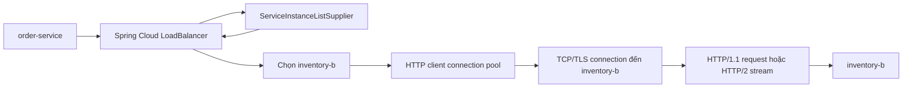
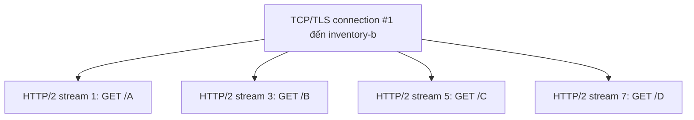
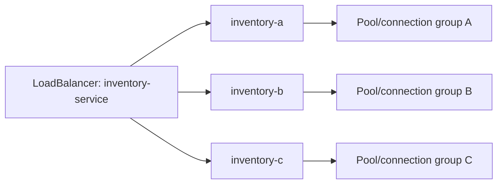

# HTTP/1.1, HTTP/2 và tác động tới cách sử dụng kết nối

## Mục tiêu

Trong một hệ thống microservices, `order-service` có thể gọi `inventory-service` hàng trăm lần mỗi giây qua `RestClient`, `WebClient` hoặc OpenFeign. Spring Cloud LoadBalancer giúp chọn bản sao của `inventory-service`, nhưng **cách HTTP client thực sự sử dụng TCP connection** lại phụ thuộc vào HTTP/1.1, HTTP/2 và thư viện HTTP bên dưới.

Một HTTP client dùng HTTP/1.1 thường phải mở nhiều kết nối nếu muốn xử lý nhiều request đồng thời tới cùng một instance. Trong HTTP/2, **nhiều request/response có thể chạy trên nhiều stream thuộc cùng một TCP connection**, giúp tái sử dụng tài nguyên hiệu quả hơn. Điều này ảnh hưởng trực tiếp đến connection pool, số request đang chờ, TLS handshake, latency, giới hạn tải và cách đọc metrics.

Sau bài học, bạn có thể:

- Phân biệt **connection**, **HTTP request**, **HTTP/2 stream**, **service ID** và `ServiceInstance`.
- Giải thích keep-alive của HTTP/1.1 và multiplexing của HTTP/2.
- Nhận diện HTTP/2 stream limit, flow control, TCP head-of-line blocking và các trường hợp HTTP/2 không cải thiện hiệu năng.
- Hiểu cách negotiated protocol hoạt động qua TLS/ALPN hoặc cleartext h2c.
- Cấu hình WebClient/Reactor Netty với HTTP/1.1, HTTP/2 và connection provider.
- Biết giới hạn hỗ trợ HTTP/2 khi dùng RestClient, RestTemplate hoặc OpenFeign: **tùy HTTP transport**.
- Kiểm thử protocol thực tế, quan sát số connection/stream và điều chỉnh pool cùng concurrency một cách có cơ sở.

## 1. Đừng nhầm ServiceInstance với HTTP connection

Giả sử ứng dụng gọi:

```text
GET http://inventory-service/api/items/SKU-42
```

Spring Cloud LoadBalancer lấy `inventory-service` làm **service ID**, dùng discovery/supplier lấy các instance và chọn một đích vật lý:

| Service ID | Instance ID | URI của bản sao |
|---|---|---|
| `inventory-service` | `inventory-a` | `http://10.20.1.11:8080` |
| `inventory-service` | `inventory-b` | `http://10.20.1.12:8080` |
| `inventory-service` | `inventory-c` | `http://10.20.1.13:8080` |

Sau khi LoadBalancer chọn `inventory-b`, HTTP client phải gửi request đến `10.20.1.12:8080`. **Lúc này transport mới quyết định nên tái sử dụng connection cũ, mở TCP connection mới, hoặc mở một HTTP/2 stream trên connection hiện có.**



Các khái niệm có phạm vi khác nhau:

| Khái niệm | Định nghĩa | Có thể dùng chung cho nhiều request? |
|---|---|---|
| **Service ID** | Tên logic, ví dụ `inventory-service` | Có: nhiều request cùng gọi tên dịch vụ |
| **ServiceInstance** | Bản sao với host/port/metadata riêng | Có: nhiều request cùng chọn một bản sao |
| **TCP/TLS connection** | Kết nối giữa HTTP client và một đích mạng/proxy | Có: giữ sống và tái sử dụng |
| **HTTP/1.1 request** | Một lần trao đổi HTTP qua kết nối đã chọn | Kết nối thường phục vụ từng request tuần tự |
| **HTTP/2 stream** | Một trao đổi HTTP độc lập về mặt luồng frame trên một connection HTTP/2 | Một connection có thể có nhiều stream đồng thời |
| **LoadBalancer cache** | Danh sách instance từ discovery được lưu tạm | Không phải nơi lưu TCP connection |

Một service ID có ba instance **không có nghĩa** HTTP client có đúng ba TCP connection. Mỗi instance có thể có nhiều connection, chưa có connection nào, hoặc các request dùng proxy trung gian tùy triển khai.

## 2. HTTP/1.1: keep-alive nhưng ít khả năng multiplex

HTTP/1.1 hỗ trợ **persistent connection (keep-alive)**: sau khi response hoàn thành, TCP connection có thể được giữ lại và sử dụng cho request tiếp theo tới route phù hợp. Điều này tránh lặp lại chi phí thiết lập TCP và TLS trên từng request.

```text
HTTP/1.1, một connection:

TCP connection #1
  GET /items/A  --------> 200 OK
  GET /items/B  --------> 200 OK
  GET /items/C  --------> 200 OK
```

HTTP/1.1 có định nghĩa request pipelining, nhưng không có cơ chế multiplexing frame độc lập như HTTP/2. Trong phần lớn HTTP clients hiện đại, **một TCP connection HTTP/1.1 đang phục vụ một request/response tại một thời điểm**, rồi được trả về pool để tái sử dụng. Pipelining hiếm khi là lựa chọn thực tế cho nhiều request đồng thời vì những giới hạn về thứ tự response và head-of-line blocking.

### 2.1. Khi nhiều request đồng thời tới cùng một instance

Giả sử `inventory-b` cần xử lý bốn request cùng lúc, mỗi request mất khoảng 200 ms:

```text
HTTP/1.1, 4 connection (minh họa):

connection #1: GET /items/A  [0---200 ms]
connection #2: GET /items/B  [0---200 ms]
connection #3: GET /items/C  [0---200 ms]
connection #4: GET /items/D  [0---200 ms]
```

Nếu pool chỉ cho phép một connection cho route này, những request còn lại có thể phải đợi:

```text
HTTP/1.1, maxPerRoute=1:
  connection #1: A [0-200] -> B [200-400] -> C [400-600] -> D [600-800]
  request B/C/D: có thể phải đợi acquire từ pool
```

Đây là mô hình giản lược, không phải cam kết thời gian thực thi. Kết quả còn phụ thuộc HTTP client, proxy, connection reuse, TCP, server và chính sách timeout.

### 2.2. Ưu điểm và giới hạn

HTTP/1.1 dễ tương thích với server, reverse proxy và nhiều HTTP client. Keep-alive đã giảm đáng kể số lần handshake so với việc mở connection mới cho mọi request.

Tuy vậy:

- Tăng request đồng thời thường đòi hỏi **thêm connection** trên cùng route.
- Mỗi connection tiêu thụ socket, bộ nhớ, TLS state và tài nguyên phía server.
- Pool quá nhỏ làm tăng thời gian **connection acquisition**.
- Pool quá lớn có thể gây bão connection, tăng chi phí TLS và quá tải backend.
- Một response chậm có thể giữ connection lâu, khiến request khác phải chờ slot.

**Đừng nhầm thời gian đợi connection từ pool với connect timeout.** Request bị kẹt trong pool có thể chưa hề thử kết nối TCP tới backend.

## 3. HTTP/2: nhiều stream trên một connection

HTTP/2 tiếp tục sử dụng ngữ nghĩa HTTP (method, status, header, path), nhưng thay cách biểu diễn dữ liệu trên kết nối bằng **binary frames**. Mỗi request/response dùng một **stream** với định danh riêng; các frame thuộc nhiều stream có thể đan xen trên cùng một TCP connection.

```text
HTTP/2, cùng một TCP/TLS connection:

Stream 1: HEADERS(A) ---- DATA(A) ------- END_STREAM
Stream 3: -- HEADERS(B) -- DATA(B) ------ END_STREAM
Stream 5: ---- HEADERS(C) ---- DATA(C) -- END_STREAM
Stream 7: ------ HEADERS(D) -- DATA(D) - END_STREAM
```

Các stream có thể tiến triển đồng thời mà không buộc response A hoàn thành trước B ở tầng HTTP như một chuỗi HTTP/1.1 pipelining. HTTP/2 còn dùng **HPACK** để nén phần header, giúp giảm dữ liệu lặp lại khi nhiều request dùng cùng các header.

### 3.1. Một connection có thể có nhiều request đồng thời

Ví dụ server chấp nhận tối đa 100 HTTP/2 stream đang mở trên một connection. Về nguyên tắc, 40 request đồng thời có thể sử dụng 40 stream trên **một connection TCP** tới cùng instance.



Nhờ multiplexing, ứng dụng **có thể cần ít TCP connection hơn** so với HTTP/1.1 khi gửi nhiều request nhỏ song song. Nhưng không được kết luận “HTTP/2 chỉ sử dụng một connection cho mọi service”:

- Mỗi instance/đích mạng có thể có pool riêng.
- Server giới hạn số stream đồng thời.
- Client có thể chủ động mở nhiều HTTP/2 connection để phân tán tải.
- Proxy/load balancer mạng có thể chia lại kết nối giữa các hop.
- Kết nối có thể bị đóng do idle timeout, tuổi thọ, lỗi hoặc rollout.

### 3.2. Stream limit: SETTINGS_MAX_CONCURRENT_STREAMS

HTTP/2 có tham số `SETTINGS_MAX_CONCURRENT_STREAMS` do peer thông báo. Nó giới hạn số stream **đồng thời** có thể mở, không phải tổng số request một connection được phục vụ trong suốt vòng đời.

Ví dụ:

```text
Server: SETTINGS_MAX_CONCURRENT_STREAMS = 50
Caller: 120 request đồng thời tới cùng instance

Tại một thời điểm, một HTTP/2 connection có thể phục vụ tối đa
50 stream theo giới hạn peer.
Những request còn lại có thể phải chờ slot stream hoặc dùng connection
khác, tùy connection pool và HTTP client implementation.
```

Việc client cấu hình `maxConcurrentStreams(100)` **không vượt qua** giới hạn 50 mà server thông báo. Thực tế dùng giới hạn hiệu lực phù hợp với cả hai phía.

### 3.3. Flow control: không phải stream nào cũng có băng thông vô hạn

HTTP/2 dùng **flow-control windows** cho stream và connection; phía nhận cấp thêm quyền truyền dữ liệu bằng frame `WINDOW_UPDATE`. Điều này ngăn sender làm tràn bộ đệm phía nhận, nhưng cũng có thể làm một stream bị chậm khi receiver đọc chậm hoặc window quá nhỏ.

Nếu một request trả response hàng trăm MB và một request khác chỉ trả JSON nhỏ, hai stream cùng chia sẻ **băng thông và TCP connection**. Multiplexing không tự làm tăng băng thông mạng hay công suất CPU của backend.

### 3.4. Head-of-line blocking chưa biến mất hoàn toàn

HTTP/2 giảm **head-of-line blocking ở tầng HTTP** của HTTP/1.1 pipelining, vì frame của các stream có thể đan xen. Tuy nhiên, HTTP/2 truyền trên **TCP**: khi mất một TCP segment, TCP phải bảo đảm dữ liệu được khôi phục đúng thứ tự trước khi tầng HTTP tiếp tục nhận dữ liệu theo luồng byte. Một connection có nhiều stream có thể cùng bị ảnh hưởng bởi packet loss.

Vì vậy, không nên khẳng định “HTTP/2 loại bỏ toàn bộ head-of-line blocking”. Trên mạng có packet loss, đặc biệt với rất nhiều stream cùng một connection, lợi ích multiplexing có thể giảm.

## 4. Bảng so sánh trực tiếp HTTP/1.1 và HTTP/2

| Tiêu chí | HTTP/1.1 | HTTP/2 |
|---|---|---|
| Ngữ nghĩa method/status/URL | HTTP | Vẫn là HTTP |
| Biểu diễn trên wire | Dạng văn bản HTTP message | Binary frames, streams |
| Tái sử dụng TCP connection | Có, nhờ keep-alive | Có, dùng chung qua multiplexing |
| Nhiều request đồng thời trên một connection | Thông thường không multiplex; pipelining có hạn chế | Có, qua nhiều stream |
| Header compression | Không có HPACK | Có HPACK |
| Đơn vị concurrency quan trọng | Connection đang phục vụ request | Stream **và** connection |
| Giới hạn liên quan | Pool size, max per route, queue | Max streams/connection, connection pool, pending streams |
| Flow control trên HTTP stream | Không giống cơ chế HTTP/2 | Có window riêng cho stream/connection |
| HOL blocking | Pipelining bị ảnh hưởng ở HTTP layer | Giảm HOL ở HTTP layer; còn ảnh hưởng do TCP |
| Chi phí handshake | Giảm nhờ keep-alive; nhiều connection có thể tốn thêm | Có thể giảm số connection/handshake khi multiplexing tốt |
| TLS bắt buộc theo đặc tả? | Không | HTTP/2 có h2 qua TLS **hoặc** h2c cleartext |
| Hỗ trợ thực tế | Rất rộng | Phụ thuộc HTTP client, server, TLS/ALPN và proxy |

**Cả HTTP/1.1 và HTTP/2 đều có thể phục vụ request blocking hoặc non-blocking**, tùy API HTTP client. `RestClient`/`RestTemplate` là API đồng bộ, `WebClient` là API reactive; **HTTP version không tự quyết định mô hình lập trình**.

## 5. Kết nối HTTP/2 được thương lượng như thế nào?

### 5.1. h2 qua TLS và ALPN

Với HTTP/2 qua TLS, client và server thường thương lượng protocol bằng **ALPN (Application-Layer Protocol Negotiation)** trong quá trình TLS handshake. Một client hỗ trợ HTTP/1.1 và HTTP/2 có thể đề xuất cả hai; kết quả phụ thuộc những protocol mà server và HTTP client hỗ trợ.

```text
Client -> Server: TLS handshake; ALPN offers ["h2", "http/1.1"]
Server -> Client: ALPN selects "h2" (nếu có hỗ trợ)
Client <-> Server: HTTP/2 frames over TLS
```

Nếu cấu hình HTTP client **chỉ chấp nhận HTTP/2** và server không hỗ trợ, request có thể thất bại thay vì fallback. Nếu client được cấu hình hỗ trợ cả HTTP/1.1 và HTTP/2, nó có thể fallback theo kết quả thương lượng.

Đừng ép protocol HTTP/2 chỉ bằng cách thêm header `Upgrade` thủ công vào `RestClient` hoặc `FeignClient`; HTTP transport cần thực sự hiểu HTTP/2 framing, multiplexing và ALPN.

### 5.2. h2c trên kết nối không TLS

HTTP/2 cũng có chế độ **h2c** cho kết nối cleartext. Tùy cách client/server cấu hình, h2c có thể dùng:

- **Prior knowledge:** client gửi HTTP/2 ngay từ đầu, không cần HTTP/1.1 Upgrade.
- **HTTP/1.1 Upgrade:** client bắt đầu với HTTP/1.1 và yêu cầu nâng cấp lên h2c nếu peer chấp nhận.

h2c hữu ích trong môi trường local/test hoặc đường truyền nội bộ đã được bảo vệ phù hợp. **Không coi h2c là tương đương bảo mật với HTTPS.** Trên mạng không đáng tin cậy, ưu tiên HTTP/2 qua TLS và xác thực certificate đúng cách.

### 5.3. Bật HTTP/2 trên Spring Boot server

Ví dụ server với Spring Boot 4.x:

```yaml
server:
  port: 8443
  http2:
    enabled: true
  ssl:
    enabled: true
    # Cấu hình certificate/SSL bundle hợp lệ cho môi trường của bạn.
```

Đoạn YAML cố ý **không cung cấp keystore giả**: ứng dụng phải được cấu hình chứng chỉ thực tế (keystore hoặc SSL bundle) mới khởi động HTTPS thành công. Với Spring Boot, `server.http2.enabled=true` bật HTTP/2 ở server nhúng có hỗ trợ; h2 dùng TLS, còn khi không bật SSL có thể dùng h2c tùy web server/đường đi triển khai.

**Bật HTTP/2 ở backend không tự làm caller dùng HTTP/2.** HTTP client phải được cấu hình hỗ trợ protocol và peer trung gian cũng phải tương thích.

### 5.4. HTTP/2 là đặc tính từng hop

Đường đi microservice thường có gateway/proxy/service mesh:

```text
order-service -- HTTP/2 --> sidecar/proxy
sidecar/proxy -- HTTP/1.1 --> inventory-service
```

Hoặc ngược lại:

```text
order-service -- HTTP/1.1 --> Gateway
Gateway -- HTTP/2 --> inventory-service
```

Kết luận: dùng HTTP/2 ở **một hop** không có nghĩa mọi hop phía sau đều dùng HTTP/2. Khi đo hiệu năng, phải xác minh protocol và connection pool **trên đúng đường đi đang có vấn đề**.

## 6. Tác động của LoadBalancer đến connection reuse

Giả sử `order-service` được cấu hình gọi `http://inventory-service` và LoadBalancer dùng round robin qua ba instance. Mỗi request có thể chọn một đích khác nhau:

```text
Request 1 -> inventory-a (10.20.1.11:8080)
Request 2 -> inventory-b (10.20.1.12:8080)
Request 3 -> inventory-c (10.20.1.13:8080)
Request 4 -> inventory-a (10.20.1.11:8080)
```

Trong nhiều HTTP client, connection pool được phân theo **route/remote address** (hoặc pool key tương ứng), nên connection tới `inventory-a` không đơn giản được đem dùng thay cho connection tới `inventory-b`.



Với HTTP/2, mỗi nhóm kết nối đến một instance có thể mang **nhiều stream đồng thời**. Do đó:

- Số backend instance khác số TCP connection.
- Tăng số replica có thể làm tăng số nhóm kết nối và tổng chi phí keep-alive.
- Nếu request phân bố quá rộng trên nhiều instance ít nhận traffic, lợi ích tái sử dụng connection có thể giảm.
- Nếu route chỉ có một instance chịu tải cao, stream limit và pool saturation vẫn có thể xảy ra dù LoadBalancer trả được instance.
- HTTP/2 connection coalescing giữa nhiều origin có những điều kiện riêng về TLS, địa chỉ, chứng chỉ và implementation; **không dựa vào coalescing** như một tính năng mặc định của Spring Cloud LoadBalancer.

### 6.1. Không nhầm weighted routing với stream capacity

`WeightedServiceInstanceListSupplier` có thể dùng metadata `weight` để thay đổi tỷ lệ chọn instance. Nhưng giá trị weight **không tự đọc số HTTP/2 stream còn trống**, cũng không bảo đảm instance khỏe hơn.

Tương tự, `ZonePreferenceServiceInstanceListSupplier` và hint supplier lọc theo thông tin định tuyến, **không phải bộ điều khiển số stream đang mở**. Nếu backend/HTTP client cần admission control động, hãy bổ sung concurrency limits, rate limits và quan sát metrics phù hợp.

### 6.2. Sticky session và connection reuse là hai vấn đề khác nhau

HTTP/2 có thể tái sử dụng kết nối nhiều request tới **một đích vật lý** sau khi đã được chọn. Điều này **không đồng nghĩa** LoadBalancer bảo đảm sticky session cho người dùng. Sticky routing cần cookie/request context hoặc chính sách riêng; connection reuse là quyết định của tầng HTTP transport.

Ngược lại, một chính sách sticky chọn cùng instance trong nhiều request có thể cải thiện khả năng tái sử dụng connection, nhưng có nguy cơ làm tải lệch. Không bật sticky chỉ với mục đích “tận dụng HTTP/2”.

## 7. Connection pool và HTTP/2: đếm cả stream

Với HTTP/1.1, nếu một instance nhận 100 request đồng thời và mỗi connection chỉ xử lý một request ở thời điểm đó, pool có thể cần nhiều connection hoặc phải xếp hàng acquire.

Với HTTP/2, nếu server cho tối đa 50 stream/connection, **về mặt lý thuyết** hai connection có thể cho phép 100 stream đồng thời. Nhưng đây chưa phải cấu hình pool thực tế: client có thể mở nhiều hơn hoặc ít hơn, phải tuân thủ flow control và cấu hình remote peer.

| Tham số | HTTP/1.1 | HTTP/2 |
|---|---|---|
| `maxConnections` | Giới hạn số socket/connection có thể phục vụ request | Giới hạn số connection, nhưng mỗi connection có nhiều stream |
| `maxConcurrentStreams` | Không phải khái niệm multiplexing của HTTP/1.1 | Giới hạn số stream đồng thời trên mỗi connection |
| `pendingAcquireMaxCount` | Giới hạn số request đang chờ connection | Có thể dùng cho acquire connection; còn có trạng thái chờ stream tùy provider |
| Connection idle timeout | Đóng connection không dùng tới | Đóng connection không còn stream/không hoạt động theo policy |
| Metrics active connections | Gần với số HTTP/1.1 request dùng socket | **Không đại diện trực tiếp** số HTTP/2 request |
| Metrics active/pending streams | Không áp dụng | Tín hiệu quan trọng để hiểu concurrency HTTP/2 |

### 7.1. Chú ý thuật toán mở connection của Reactor Netty

Theo Reactor Netty 1.3.x, HTTP/2 có **specialized connection pool** và `Http2AllocationStrategy`. Mặc định pool **có thể mở thêm connection** khi nhiều request cùng cạnh tranh, ngay cả nếu connection hiện có còn khả năng mở thêm stream.

Muốn ưu tiên tối đa multiplexing trên connection đã có, có thể dùng `strictConnectionReuse(true)`. Đây là đánh đổi:

- **Strict reuse:** giảm số connection/handshake; nhiều stream chia sẻ cùng TCP connection.
- **Mở thêm connection:** có thể giảm contention và giảm ảnh hưởng TCP packet loss trên một connection, nhưng tốn thêm socket/TLS/memory.

Không phải cấu hình nào cũng tối ưu bằng cách bật strict reuse. Hãy quyết định theo workload và đo p95/p99 latency, bandwidth, packet loss, số stream pending và mức sử dụng connection.

## 8. WebClient + Reactor Netty: cấu hình HTTP/2 thực tế

Reactor Netty hỗ trợ `HttpProtocol.HTTP11`, `HttpProtocol.H2` (TLS) và `HttpProtocol.H2C` (cleartext). Mặc định HTTP client của Reactor Netty hỗ trợ HTTP/1.1; muốn dùng HTTP/2 cần cấu hình protocol có chủ đích.

### 8.1. WebClient dùng HTTPS và ALPN (HTTP/1.1 hoặc HTTP/2)

Ví dụ với Reactor Netty có HTTP/2 allocation strategy:

```java
import java.time.Duration;
import org.springframework.cloud.client.loadbalancer.LoadBalanced;
import org.springframework.context.annotation.Bean;
import org.springframework.context.annotation.Configuration;
import org.springframework.http.client.reactive.ReactorClientHttpConnector;
import org.springframework.web.reactive.function.client.WebClient;
import reactor.netty.http.HttpProtocol;
import reactor.netty.http.client.Http2AllocationStrategy;
import reactor.netty.http.client.HttpClient;
import reactor.netty.resources.ConnectionProvider;

@Configuration(proxyBeanMethods = false)
class InventoryHttp2ClientConfiguration {

    @Bean(destroyMethod = "dispose")
    ConnectionProvider inventoryHttp2Pool() {
        return ConnectionProvider.builder("inventory-h2-pool")
                .allocationStrategy(Http2AllocationStrategy.builder()
                        .maxConnections(4)
                        .maxConcurrentStreams(50)
                        .strictConnectionReuse(true)
                        .build())
                .metrics(true)
                .build();
    }

    @Bean
    @LoadBalanced
    WebClient.Builder loadBalancedWebClientBuilder(
            ConnectionProvider inventoryHttp2Pool) {
        HttpClient httpClient = HttpClient.create(inventoryHttp2Pool)
                .protocol(HttpProtocol.HTTP11, HttpProtocol.H2)
                .secure()
                .responseTimeout(Duration.ofSeconds(3));

        return WebClient.builder()
                .clientConnector(new ReactorClientHttpConnector(httpClient));
    }
}
```

Ở đây:

1. `maxConnections(4)` đặt giới hạn connection cho pool HTTP/2 theo allocation strategy.
2. `maxConcurrentStreams(50)` là giới hạn do phía client mong muốn, còn phải tôn trọng giới hạn phía server.
3. `strictConnectionReuse(true)` ưu tiên sử dụng stream trên connection đang có trước khi mở thêm connection.
4. `.protocol(HTTP11, H2).secure()` cho phép thương lượng HTTP/2 qua TLS và fallback HTTP/1.1 khi cả hai phía hỗ trợ tương ứng.
5. `@LoadBalanced WebClient.Builder` cho phép URI logic như `https://inventory-service` được Spring Cloud LoadBalancer phân giải thành instance thực.

Ví dụ là **một phương án cấu hình**; Spring Boot còn có những customizer/observability cho WebClient builder. Khi tự tạo builder bằng `WebClient.builder()`, hãy tích hợp các customizer cần thiết của ứng dụng để không vô tình mất tracing hoặc HTTP metrics.

Gateway gọi dịch vụ:

```java
import org.springframework.cloud.client.loadbalancer.LoadBalanced;
import org.springframework.stereotype.Component;
import org.springframework.web.reactive.function.client.WebClient;
import reactor.core.publisher.Mono;

@Component
class InventoryReactiveGateway {

    private final WebClient inventoryClient;

    InventoryReactiveGateway(@LoadBalanced WebClient.Builder builder) {
        this.inventoryClient = builder
                .baseUrl("https://inventory-service")
                .build();
    }

    Mono<String> findItem(String sku) {
        return inventoryClient.get()
                .uri("/api/items/{sku}", sku)
                .retrieve()
                .bodyToMono(String.class);
    }
}
```

**Điều kiện:** instance đích hoặc proxy mà client kết nối phải hỗ trợ TLS/ALPN; chứng chỉ phải hợp lệ theo truststore của caller. Không vô hiệu hóa xác minh chứng chỉ chỉ để “chạy được HTTP/2”. Nếu discovery báo instance không secure hoặc HTTP client đang kết nối tới proxy không hỗ trợ h2, protocol thực tế có thể khác kỳ vọng.

### 8.2. Khi backend local dùng h2c

Trong mạng local/test không TLS, ví dụ transport có thể được cấu hình:

```java
HttpClient localH2cClient = HttpClient.create(inventoryHttp2Pool)
        .protocol(HttpProtocol.H2C)
        .responseTimeout(Duration.ofSeconds(3));

WebClient localClient = WebClient.builder()
        .clientConnector(new ReactorClientHttpConnector(localH2cClient))
        .baseUrl("http://localhost:8081")
        .build();
```

Đoạn này minh họa **HTTP/2 cleartext prior knowledge** tới một host vật lý. Muốn tích hợp với LoadBalancer, dùng `@LoadBalanced WebClient.Builder` và base URL theo service ID; đảm bảo mọi instance đích đều hỗ trợ h2c. Không sử dụng đồng thời `.secure()` với đường h2c cleartext.

Khi test muốn so sánh với HTTP/1.1 trên cùng backend, thay `.protocol(HttpProtocol.H2C)` bằng `.protocol(HttpProtocol.HTTP11)`, khởi động lại caller và đo lại. Không giả định thay một property YAML tự làm mọi connection cũ chuyển protocol.

### 8.3. Những điểm cần thử trong production

- **Mỗi route có bao nhiêu connection và stream?** Không nhìn mỗi `maxConnections`.
- **Server thông báo `SETTINGS_MAX_CONCURRENT_STREAMS` là bao nhiêu?** Đừng vượt giới hạn peer.
- **Có proxy/service mesh không?** Kiểm tra protocol client → proxy và proxy → backend riêng.
- **Kết nối có bị đóng khi idle/rollout không?** Xem `maxIdleTime`, `maxLifeTime` và `GOAWAY`.
- **Response lớn có ảnh hưởng stream nhỏ không?** Đo latency và flow-control stalls.
- **Request bị timeout ở phase nào?** Phân biệt pending stream, pool acquire, TCP connect, TLS, response.

## 9. RestClient, RestTemplate và OpenFeign: protocol phụ thuộc HTTP transport

**API ở tầng Spring không quyết định HTTP version.**

`RestClient` và `RestTemplate` là API HTTP blocking, nhưng chúng có thể dùng `JdkClientHttpRequestFactory`, `HttpComponentsClientHttpRequestFactory`, Jetty hoặc Reactor Netty HTTP client theo cấu hình/classpath. Spring Boot còn có cơ chế tự chọn request factory, vì vậy hai dự án cùng dùng `RestClient` chưa chắc đang sử dụng cùng protocol hoặc cùng pool.

### 9.1. RestClient dùng JDK HttpClient ưu tiên HTTP/2

`java.net.http.HttpClient` của JDK có thể được cấu hình **ưu tiên HTTP/2**, nhưng có thể fallback HTTP/1.1 khi server hoặc đường kết nối không hỗ trợ:

```java
import java.net.http.HttpClient;
import java.time.Duration;
import org.springframework.cloud.client.loadbalancer.LoadBalanced;
import org.springframework.context.annotation.Bean;
import org.springframework.context.annotation.Configuration;
import org.springframework.http.client.JdkClientHttpRequestFactory;
import org.springframework.web.client.RestClient;

@Configuration(proxyBeanMethods = false)
class JdkRestClientConfiguration {

    @Bean
    @LoadBalanced
    RestClient.Builder loadBalancedRestClientBuilder() {
        HttpClient jdkClient = HttpClient.newBuilder()
                .version(HttpClient.Version.HTTP_2)
                .connectTimeout(Duration.ofSeconds(2))
                .build();

        return RestClient.builder()
                .requestFactory(
                        new JdkClientHttpRequestFactory(jdkClient));
    }
}
```

Để gọi một service ID, tạo `RestClient` từ builder trên với base URL `https://inventory-service` và bảo đảm TLS certificate hợp lệ. `version(HTTP_2)` là **ưu tiên/đề nghị sử dụng HTTP/2** ở JDK client, không phải bằng chứng mọi request đã đi h2. Cần quan sát protocol response thực tế tại backend hoặc HTTP client diagnostics.

Một `RestTemplate` cũng có thể dùng `JdkClientHttpRequestFactory` tùy phiên bản Spring Framework/Boot, nhưng API vẫn blocking; h2 multiplexing là đặc tính của transport được cấu hình, không biến `RestTemplate` thành non-blocking.

### 9.2. OpenFeign

Với Spring Cloud OpenFeign, `@FeignClient(name = "inventory-service")` dùng **service ID** khi không khai báo URL cố định và tích hợp LoadBalancer được kích hoạt. Nhưng việc Feign gọi HTTP/1.1 hay HTTP/2 phụ thuộc vào **Feign Client transport**.

Ví dụ Spring Cloud OpenFeign có property:

```yaml
spring:
  cloud:
    openfeign:
      http2client:
        enabled: true
```

Theo tài liệu property hiện hành, `spring.cloud.openfeign.http2client.enabled` bật khả năng sử dụng **Java HTTP/2 Client** cho Feign. Dự án phải kiểm tra classpath, xung đột với transport khác như Apache HC5/OkHttp và **Feign Client bean thực tế được chọn**; không được chỉ nhìn YAML rồi kết luận mọi request đều dùng h2.

Apache HC5 **classic blocking transport** thường được dùng trong các ví dụ Feign và sử dụng connection pool với giới hạn tổng/per-route. Không nên suy ra từ việc dependency có tên “HttpClient 5” rằng mọi phiên bản Feign tích hợp nó đều multiplex HTTP/2.

**Một lưu ý riêng:** `@FeignClient(url = "https://inventory.example.com")` là đường gọi URL trực tiếp, bỏ qua bước chọn `ServiceInstance` của Spring Cloud LoadBalancer. Bật HTTP/2 cho Feign transport không làm URL cố định tự trở thành service discovery.

## 10. Khi HTTP/2 không nhanh hơn HTTP/1.1

HTTP/2 thường đem lại lợi ích khi có nhiều request nhỏ, đồng thời tới cùng đích và chi phí kết nối/headers đáng kể. Nhưng không có bảo đảm mọi workload đều nhanh hơn.

| Tình huống | Vì sao HTTP/2 chưa chắc có lợi? | Điều nên đo |
|---|---|---|
| Ít request tuần tự | HTTP/1.1 keep-alive đã tái sử dụng connection tốt | Latency và CPU cho mỗi request |
| Nhiều backend khác nhau, ít request mỗi backend | Không có nhiều stream đồng thời trên cùng connection | Số connection/route và tỷ lệ reuse |
| Response rất lớn | Các stream chia sẻ bandwidth/flow-control | Throughput, flow-control stalls |
| Packet loss đáng kể | Nhiều stream có thể cùng chịu TCP HOL | Retransmission, p95/p99 latency |
| Server giới hạn stream thấp | Request phải chờ stream slot hoặc mở connection mới | Active/pending streams |
| Proxy hạ cấp sang HTTP/1.1 | Chỉ một hop là HTTP/2 | Protocol của từng hop |
| TLS/ALPN hoặc certificate sai | Không thương lượng được HTTP/2 | TLS handshake, ALPN, errors |
| Backend CPU/DB đã quá tải | Transport tối ưu không làm backend xử lý nghiệp vụ nhanh hơn | CPU, DB pool, service time |
| Retry storm | Request vật lý tăng dù multiplexing có hiệu quả | Retry amplification và error rate |

Thêm vào đó, HTTP/2 stream bị hủy có thể phát sinh `RST_STREAM`; server chủ động dừng một connection có thể gửi `GOAWAY`. Client cần xử lý những tình huống này theo hợp đồng HTTP/2 và chính sách retry an toàn. Đừng tự retry mọi POST sau lỗi stream vì backend có thể đã thực thi side effect.

## 11. Quan sát metrics và xác minh protocol thật

Đừng so sánh HTTP/1.1 với HTTP/2 chỉ bằng tổng số TCP connection:

- HTTP/1.1 thường có mối quan hệ gần hơn giữa connection active và request in-flight.
- HTTP/2 có thể có **ít connection nhưng rất nhiều stream active**.
- Ít connection không tự đảm bảo throughput cao, latency thấp hoặc backend khỏe.

Với Reactor Netty và Micrometer, những metric hữu ích gồm:

| Metric | Ý nghĩa |
|---|---|
| `reactor.netty.connection.provider.total.connections` | Tổng connection đang tồn tại |
| `reactor.netty.connection.provider.active.connections` | Connection được acquire/đang sử dụng |
| `reactor.netty.connection.provider.idle.connections` | Connection không được sử dụng ở thời điểm đo |
| `reactor.netty.connection.provider.pending.connections` | Lượt acquire đang chờ connection |
| `reactor.netty.connection.provider.pending.connections.time` | Phân bố thời gian chờ acquire |
| `reactor.netty.connection.provider.active.streams` | **Số HTTP/2 stream đang hoạt động** |
| `reactor.netty.connection.provider.pending.streams` | **Số yêu cầu chờ mở HTTP/2 stream** |
| `reactor.netty.http.client.response.time` | Độ trễ response theo instrumentation của HTTP client |

Các metric chỉ xuất hiện khi sử dụng transport/instrumentation phù hợp; cần có Micrometer registry và `ConnectionProvider.metrics(true)` hoặc cấu hình tương đương. Tên/tag có thể thay đổi theo Reactor Netty version và provider. Cần kiểm tra dữ liệu thực tế trong Actuator/Prometheus thay vì giả định mọi ứng dụng có đủ tất cả metric.

### 11.1. Ghi nhận HTTP version ở backend

Với Spring MVC servlet server, có thể dùng `HttpServletRequest.getProtocol()` để xác minh HTTP version mà **backend thực sự nhận được**:

```java
import java.util.Map;
import jakarta.servlet.http.HttpServletRequest;
import org.springframework.beans.factory.annotation.Value;
import org.springframework.web.bind.annotation.GetMapping;
import org.springframework.web.bind.annotation.RestController;

@RestController
class WhoAmIController {

    private final String instanceId;

    WhoAmIController(@Value("${demo.instance-id:unknown}")
                     String instanceId) {
        this.instanceId = instanceId;
    }

    @GetMapping("/whoami")
    Map<String, String> whoAmI(HttpServletRequest request) {
        return Map.of(
                "instanceId", instanceId,
                "httpProtocol", request.getProtocol()
        );
    }
}
```

Khi server nhận HTTP/2, giá trị protocol có thể được biểu diễn là `HTTP/2.0` hoặc dạng phù hợp với container; khi nhận HTTP/1.1 thì thường là `HTTP/1.1`. Đây là phép đo **hop tới backend**, không cho biết mặc định giao thức ở hop upstream khác.

### 11.2. Dùng curl để kiểm tra

Ví dụ backend có HTTPS và certificate được tin cậy:

```bash
curl -v --http2 --cacert ./dev-ca.pem \
  "https://localhost:8443/whoami"
```

Với backend test hỗ trợ HTTP/2 h2c:

```bash
curl -v --http2-prior-knowledge \
  "http://localhost:8081/whoami"
```

Kiểm tra `curl --version` để chắc chắn bản curl có hỗ trợ HTTP/2. Trên PowerShell, có thể dùng `curl.exe` để tránh nhầm alias `curl`. `--http2` có thể fallback HTTP/1.1 tùy điều kiện; phải xem output verbose/`httpProtocol` thay vì chỉ xem exit code bằng 0. Với HTTPS tự ký trong test, tin cậy CA bằng `--cacert` hoặc truststore đúng; không tắt xác minh TLS chỉ để bài demo qua được.

## 12. Thực hành: so sánh 20 request đồng thời trên hai protocol

Bài thực hành dùng **cùng backend và cùng service ID**, thay HTTP transport ở caller giữa HTTP/1.1 và h2c để nhìn số connection/stream khác nhau. Thực hiện ở local/test, không chạy stress test trên production.

### Bước 1. Chuẩn bị hai backend Spring MVC

Tạo hai instance `inventory-service` có controller `WhoAmIController` ở phần 11.1. Trong môi trường local không TLS, thử cấu hình:

```yaml
spring:
  application:
    name: inventory-service

server:
  http2:
    enabled: true
```

Chạy hai tiến trình với port và instance ID khác nhau:

```text
Backend A: --server.port=8081 --demo.instance-id=inventory-a
Backend B: --server.port=8082 --demo.instance-id=inventory-b
```

Với Spring Boot và embedded server hỗ trợ h2c, cấu hình này cho phép tiếp nhận HTTP/2 cleartext. Xác minh từng backend bằng `curl --http2-prior-knowledge` trước khi tiếp tục. Nếu web server bạn dùng không hỗ trợ h2c như mong đợi, dùng TLS/h2 hoặc một server test khác thay vì khẳng định protocol đã bật.

### Bước 2. Khai báo discovery tĩnh ở caller

`order-service` cần `spring-cloud-starter-loadbalancer` và HTTP client phù hợp (ví dụ `spring-boot-starter-webflux` cho WebClient), cùng cấu hình:

```yaml
server:
  port: 8080

spring:
  application:
    name: order-service
  cloud:
    discovery:
      client:
        simple:
          instances:
            inventory-service:
              - uri: http://localhost:8081
              - uri: http://localhost:8082
```

`SimpleDiscoveryClient` cung cấp hai instance; LoadBalancer chọn host/port. Cấu hình này **không tự điều khiển** HTTP/1.1 hay HTTP/2 của WebClient.

### Bước 3. Tạo WebClient h2c có pool

Trong ứng dụng caller:

```java
import java.time.Duration;
import org.springframework.cloud.client.loadbalancer.LoadBalanced;
import org.springframework.context.annotation.Bean;
import org.springframework.context.annotation.Configuration;
import org.springframework.http.client.reactive.ReactorClientHttpConnector;
import org.springframework.web.reactive.function.client.WebClient;
import reactor.netty.http.HttpProtocol;
import reactor.netty.http.client.Http2AllocationStrategy;
import reactor.netty.http.client.HttpClient;
import reactor.netty.resources.ConnectionProvider;

@Configuration(proxyBeanMethods = false)
class LocalHttpClientConfiguration {

    @Bean(destroyMethod = "dispose")
    ConnectionProvider demoConnectionProvider() {
        return ConnectionProvider.builder("demo-h2c-pool")
                .allocationStrategy(Http2AllocationStrategy.builder()
                        .maxConnections(2)
                        .maxConcurrentStreams(20)
                        .strictConnectionReuse(true)
                        .build())
                .metrics(true)
                .build();
    }

    @Bean
    @LoadBalanced
    WebClient.Builder demoLoadBalancedWebClientBuilder(
            ConnectionProvider demoConnectionProvider) {
        HttpClient httpClient = HttpClient.create(demoConnectionProvider)
                .protocol(HttpProtocol.H2C)
                .responseTimeout(Duration.ofSeconds(5));

        return WebClient.builder()
                .clientConnector(new ReactorClientHttpConnector(httpClient));
    }
}
```

Nếu HTTP/2 pool strategy không được phiên bản Reactor Netty trên classpath hỗ trợ, hãy kiểm tra Reactor Netty release train và cập nhật phù hợp. Đừng sao chép cấu hình dành cho Reactor Netty 1.3.x vào bản cũ mà không xác minh API.

### Bước 4. Tạo endpoint thử nghiệm ở caller

```java
import java.util.List;
import org.springframework.cloud.client.loadbalancer.LoadBalanced;
import org.springframework.web.bind.annotation.GetMapping;
import org.springframework.web.bind.annotation.RequestParam;
import org.springframework.web.bind.annotation.RestController;
import org.springframework.web.reactive.function.client.WebClient;
import reactor.core.publisher.Flux;
import reactor.core.publisher.Mono;

@RestController
class ProtocolProbeController {

    private final WebClient inventoryClient;

    ProtocolProbeController(@LoadBalanced WebClient.Builder builder) {
        this.inventoryClient = builder
                .baseUrl("http://inventory-service")
                .build();
    }

    @GetMapping("/demo/protocol")
    Mono<String> check() {
        return inventoryClient.get()
                .uri("/whoami")
                .retrieve()
                .bodyToMono(String.class);
    }

    @GetMapping("/demo/burst")
    Mono<List<String>> burst(@RequestParam(defaultValue = "20") int count) {
        int size = Math.min(Math.max(count, 1), 50);
        return Flux.range(1, size)
                .flatMap(i -> inventoryClient.get()
                        .uri("/whoami")
                        .retrieve()
                        .bodyToMono(String.class), 20)
                .collectList();
    }
}
```

Endpoint `/demo/burst` cố tình sinh nhiều outbound HTTP request để đo concurrency; **chỉ dùng trong local/test**. `flatMap(..., 20)` giới hạn số publisher con đang subscribe đồng thời trong một request của controller, không phải concurrency limit toàn JVM.

### Bước 5. Gửi thử

```bash
curl "http://localhost:8080/demo/protocol"
curl "http://localhost:8080/demo/burst?count=20"
```

Kết quả trả về hai instance theo thuật toán LoadBalancer. Quan sát `httpProtocol` trong JSON từ backend:

```json
{
  "instanceId": "inventory-a",
  "httpProtocol": "HTTP/2.0"
}
```

Giá trị `HTTP/2.0` chỉ là ví dụ biểu diễn từ servlet container; cần xác minh kết quả thực tế. `curl` gọi endpoint của caller có thể đang dùng HTTP/1.1 ở **hop client → order-service**, trong khi `WebClient` thực hiện HTTP/2 ở **hop order-service → inventory-service**.

### Bước 6. Chạy lại với HTTP/1.1

Đổi duy nhất dòng:

```java
.protocol(HttpProtocol.H2C)
```

thành:

```java
.protocol(HttpProtocol.HTTP11)
```

Sau đó khởi động lại caller, chạy cùng số request và cùng backend, giữ nguyên các yếu tố khác nếu có thể.

| Đại lượng | HTTP/1.1 | HTTP/2 h2c |
|---|---|---|
| Backend `httpProtocol` | Thường `HTTP/1.1` | Thường `HTTP/2.0` |
| Connection active tại backend | Có thể cần nhiều connection cho concurrency cao | Có thể ít connection hơn nhờ nhiều stream |
| Active HTTP/2 streams | Không áp dụng | Có thể lớn hơn số connection nhiều lần |
| Pending acquire / pending streams | Phụ thuộc pool, tải và giới hạn | Phụ thuộc số connection, stream limit và pool policy |
| p50/p95/p99 latency | Cần đo | Cần đo, không mặc định thấp hơn |

**Lưu ý kỹ thuật:** `Http2AllocationStrategy` là chiến lược cho HTTP/2; khi chuyển client sang HTTP/1.1, nên tạo một `ConnectionProvider` dành riêng cho HTTP/1.1 với giới hạn `maxConnections(2)` và pending queue phù hợp để so sánh công bằng. Không nhất thiết mọi thuộc tính H2 strategy được áp dụng như mong muốn cho pool HTTP/1.1. Ví dụ:

```java
ConnectionProvider http11Provider = ConnectionProvider.builder("demo-h1-pool")
        .maxConnections(2)
        .pendingAcquireMaxCount(20)
        .pendingAcquireTimeout(Duration.ofSeconds(2))
        .metrics(true)
        .build();
```

Kết nối client vào `http11Provider` khi thực hiện phép đo HTTP/1.1. Đảm bảo chỉ có một bean `@LoadBalanced WebClient.Builder` tương ứng trong mỗi lần chạy để tránh inject nhầm.

### Bước 7. Kiểm tra ngược lại khi chỉ có một instance

Tạm thời cấu hình `SimpleDiscoveryClient` chỉ có `inventory-a` rồi chạy lại. Điều này giúp cô lập tác động **multiplexing trên một route**, thay vì trộn với việc LoadBalancer chia request giữa hai instance.

Tiếp theo, đưa `inventory-b` trở lại để xem tổng số pool/connection thay đổi theo **số đích vật lý**, không chỉ theo số request. Khi bật HTTP/2, theo dõi cả `active.streams` và `pending.streams` để phát hiện điểm bão hòa thực.

## 13. Lỗi thường gặp và cách xử lý

| Triệu chứng | Nguyên nhân có thể | Cách kiểm tra |
|---|---|---|
| Đã bật `server.http2.enabled` nhưng caller vẫn gửi HTTP/1.1 | Client chưa hỗ trợ h2, TLS/ALPN không thương lượng được hoặc proxy downgrade | Kiểm tra client transport, ALPN và `getProtocol()` tại backend |
| `curl --http2` vẫn trả response HTTP/1.1 | Cú pháp cho phép fallback hoặc server không hỗ trợ | Xem verbose output, thử đúng h2c/TLS, kiểm tra `curl --version` |
| `protocol(H2)` thất bại với backend HTTP | H2 yêu cầu TLS theo cấu hình Reactor Netty | Dùng HTTPS/h2 hoặc `H2C` cho local cleartext |
| HTTP/2 ít connection nhưng request vẫn chậm | Đụng stream limit, flow control, TCP packet loss hoặc backend chậm | Xem active/pending streams, p99 latency, retransmissions |
| `maxConnections=4` nhưng có nhiều hơn 4 HTTP request đồng thời | HTTP/2 multiplexing nhiều stream trên mỗi connection | Đo thêm stream count, đừng chỉ đếm socket |
| Tăng pool size nhưng latency không giảm | Bottleneck CPU/DB/server max streams, không phải pool | Đo backend service time và stream queue |
| HTTP/1.1 connection pool pending cao | Ít connection cho route đang nóng | Đo per-route max, response time, timeout và việc release connection |
| HTTP/2 có nhiều connection hơn mong đợi | Pool strategy cho phép mở thêm hoặc có nhiều route | Kiểm tra `strictConnectionReuse`, instance routing và connection metrics |
| Sau scale-in còn lỗi trên connection cũ | Connection đang bị đóng, discovery/cache stale hoặc request in-flight | Xem graceful shutdown, GOAWAY, URI đích và retry an toàn |
| RestClient dùng HTTP/1.1 dù cấu hình HTTP/2 trên server | HTTP request factory thực tế không hỗ trợ/chưa ưu tiên h2 | Kiểm tra JDK/HC5/Jetty transport và negotiated protocol |
| OpenFeign bật HTTP/2 nhưng không thấy h2 | Feign transport được chọn không đúng hoặc có URL/proxy khác | Kiểm tra `spring.cloud.openfeign.http2client.enabled` và Feign Client bean |
| HTTP/2 nhanh hơn ở local nhưng chậm hơn trên WAN | Packet loss, RTT, congestion, TLS/proxy khác biệt | Benchmark theo môi trường và workload thật |

## 14. Checklist hiệu năng

- [ ] Đã xác minh Spring Cloud LoadBalancer chọn service ID/instance, còn HTTP transport quyết định connection và stream.
- [ ] Không đồng nhất số HTTP request, số `ServiceInstance` và số TCP connection.
- [ ] Hiểu HTTP/1.1 keep-alive vẫn có reuse nhưng thường không multiplex request.
- [ ] Hiểu HTTP/2 multiplexing, `SETTINGS_MAX_CONCURRENT_STREAMS` và flow-control windows.
- [ ] Không khẳng định HTTP/2 đã loại bỏ TCP head-of-line blocking.
- [ ] Biết đường đang dùng TLS/h2 qua ALPN hay cleartext h2c.
- [ ] Đã kiểm tra protocol của **từng hop** khi có Gateway/proxy/mesh.
- [ ] Đã chọn đúng WebClient/RestClient/Feign transport hỗ trợ HTTP/2.
- [ ] Pool HTTP/2 có giới hạn connection và stream hợp lý; quan sát pending streams.
- [ ] Không dùng pool size của HTTP/1.1 như giới hạn concurrency HTTP/2.
- [ ] Đã kiểm tra backend readiness, discovery/cache và cơ chế draining khi scale.
- [ ] Có timeout connect, pending acquire, response và deadline tổng của operation.
- [ ] Retry không khuếch đại tải hoặc lặp lại POST có side effect.
- [ ] Có metrics connection/stream, p95/p99 latency, error rate và throughput theo instance.
- [ ] Đã benchmark cùng workload trên HTTP/1.1 và HTTP/2, thay một biến mỗi lần.
- [ ] Không tắt xác minh TLS hoặc bật h2c trên mạng không đáng tin cậy chỉ để tối ưu hiệu năng.

## Kết luận

**HTTP/1.1 và HTTP/2 đều có thể tái sử dụng connection, nhưng cách xử lý nhiều request đồng thời khác nhau.** HTTP/1.1 thường dùng nhiều TCP connection để phục vụ nhiều request in-flight tới cùng route; HTTP/2 có thể multiplex nhiều stream trên một connection, giảm chi phí socket/handshake và nâng hiệu quả trên những workload phù hợp. Đổi lại, HTTP/2 cần quan sát **stream limits, flow control, TCP packet loss và pool strategy**, không chỉ số connection.

Trong Spring Cloud LoadBalancer, việc chọn `ServiceInstance` vẫn tách biệt với HTTP transport. Dù sử dụng `RestClient`, `WebClient` hay OpenFeign, bạn phải xác minh HTTP client thật sự hỗ trợ và đã thương lượng HTTP/2 trên hop cần tối ưu. Kết hợp kiểm thử protocol, connection/stream metrics, timeout, graceful shutdown và benchmark thực tế sẽ giúp lựa chọn cấu hình đúng thay vì giả định HTTP/2 luôn nhanh hơn.

## Tài liệu tham khảo

- [RFC 9113 — HTTP/2: Streams, multiplexing, flow control và giới hạn concurrent streams](https://www.rfc-editor.org/rfc/rfc9113.html)
- [RFC 9112 — HTTP/1.1: Message syntax, connection management và pipelining](https://www.rfc-editor.org/rfc/rfc9112.html)
- [Reactor Netty Reference — HTTP Client, HTTP/2 và Http2AllocationStrategy](https://projectreactor.io/docs/netty/release/reference/http-client.html)
- [Reactor Netty Reference — HTTP Server, H2/H2C](https://projectreactor.io/docs/netty/release/reference/http-server.html)
- [Spring Boot — Embedded Web Servers và server.http2.enabled](https://docs.spring.io/spring-boot/how-to/webserver.html)
- [Spring Boot — Calling REST Services và HTTP Client Detection](https://docs.spring.io/spring-boot/reference/io/rest-client.html)
- [Spring Framework — REST Clients và ClientHttpRequestFactory](https://docs.spring.io/spring-framework/reference/integration/rest-clients.html)
- [Spring Cloud Commons — Spring Cloud LoadBalancer](https://docs.spring.io/spring-cloud-commons/reference/spring-cloud-commons/loadbalancer.html)
- [Spring Cloud OpenFeign — Feign Clients và HTTP transport](https://docs.spring.io/spring-cloud-openfeign/reference/spring-cloud-openfeign.html)
- [Spring Cloud OpenFeign — Configuration Properties: http2client.enabled](https://docs.spring.io/spring-cloud-openfeign/reference/configprops.html)
