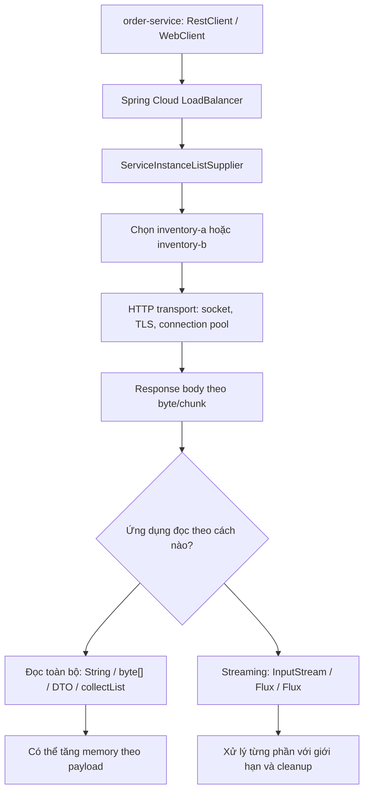

# Giới hạn bộ nhớ khi đọc body, buffer và streaming

Trong giao tiếp giữa các microservices, Spring Cloud LoadBalancer giúp client lựa chọn một `ServiceInstance` theo service ID, discovery, health check và chính sách định tuyến. **Việc chọn được instance không đồng nghĩa với việc đọc response an toàn về bộ nhớ.** Nếu `inventory-service` trả một báo cáo JSON 80 MB, file 2 GB hoặc một luồng sự kiện chạy liên tục, cách `order-service` đọc HTTP body quyết định ứng dụng có tiêu thụ bộ nhớ tăng theo kích thước payload hay không.

Bài học thuộc chương **Kết nối và hiệu năng** của module `SPRING_CLOUD_SERVICE_COMMUNICATION_LOAD_BALANCING`. Trọng tâm là phân biệt **buffer toàn bộ body** với **đọc từng chunk**, hiểu `maxInMemorySize` và `DataBufferLimitException` của WebClient, cách streaming qua RestClient/WebClient, quản lý bộ nhớ heap/direct và `DataBuffer`, cách đặt giới hạn dung lượng thực tế, kiểm thử payload lớn, và mối liên hệ với connection pool, timeout, retry và quan sát hiệu năng.

> **Nguyên tắc:** Không tăng vô hạn giới hạn buffer để xử lý mọi response lớn. Với dữ liệu nhỏ, chọn DTO/`String` là đơn giản; với file lớn hoặc luồng liên tục, sử dụng streaming, giới hạn tổng byte, kiểm soát concurrency và giải phóng tài nguyên đúng cách.

## 1. HTTP body đi qua những lớp nào?

Giả sử `order-service` gọi URL logic `http://inventory-service/api/v1/export` bằng một HTTP client đã cấu hình `@LoadBalanced`:



Hai phần phải tách biệt:

- **Load balancing:** quyết định instance nào nhận request. `spring.cloud.loadbalancer.cache.*` thường cache **danh sách ServiceInstance**, không cache HTTP response body.
- **HTTP body processing:** quyết định đọc, decode, chuyển tiếp hoặc ghi response như thế nào. Giới hạn memory ở đây thuộc tầng HTTP transport, codec/decoder và logic ứng dụng, không phải thuật toán round robin.

Nếu service ID có ba bản sao thì một download vẫn thường kết nối tới **một bản sao được chọn** cho attempt đó. Streaming không đồng nghĩa LoadBalancer tự phân chia từng chunk cho ba instance khác nhau.

## 2. Ba dạng dữ liệu và yêu cầu bộ nhớ

| Kiểu response | Ví dụ | Cách đọc thường phù hợp | Rủi ro chính |
|---|---|---|---|
| JSON nhỏ | `{"available":42}` | `bodyToMono(StockView.class)` hoặc `body(StockView.class)` | DTO/codec cần bộ nhớ nhưng có giới hạn |
| JSON array rất lớn | Hàng trăm nghìn record | Phân trang hoặc stream từng phần tử khi format/codec phù hợp | Gom tất cả thành `List` làm tăng heap |
| File lớn | ZIP, PDF xuất báo cáo, ảnh/video | InputStream hoặc `Flux<DataBuffer>` ghi ra file/đích streaming | `byte[]` hoặc `String` giữ toàn bộ nội dung |
| SSE / NDJSON | Sự kiện thay đổi tồn kho liên tục | `Flux<ServerSentEvent<T>>`, `Flux<T>` | `collectList` không bao giờ hoàn tất hoặc tăng mãi |
| Upload file | Gửi file sang service khác | `Resource`/publisher streaming, có giới hạn size | Nạp toàn bộ file vào byte[]/memory trước khi gửi |

Không có quy tắc “response lớn thì cứ dùng WebClient”. **RestClient đồng bộ vẫn có thể stream qua InputStream**; WebClient cũng có thể vô tình giữ toàn bộ body bằng `bodyToMono(byte[].class)` hoặc `collectList()`.

### 2.1. Các vị trí sử dụng bộ nhớ

Trong một HTTP call có thể tồn tại:

1. **Socket / TLS / transport buffers:** vùng đệm nhận dữ liệu, có thể là direct memory ngoài Java heap.
2. **Decoder/codec buffers:** bộ nhớ tạm khi ghép byte để decode JSON, text hoặc một giá trị.
3. **Java object graph:** DTO, `String`, `byte[]`, `List` tạo sau decode.
4. **Application buffers:** `ByteArrayOutputStream`, cache ứng dụng, collection/reactive operators.
5. **Output queue:** dữ liệu đang chờ ghi ra file, gửi tới service tiếp theo hoặc trả cho HTTP caller.

Vì vậy, một JSON body 10 MB **không đồng nghĩa chỉ tốn đúng 10 MB heap**; có thể có nhiều bản sao trung gian, string/object overhead hoặc memory ngoài heap.

## 3. Mô hình ước lượng rủi ro theo concurrency

Giả sử mỗi request buffer một payload có kích thước trung bình `S`, đồng thời có `C` request đang đọc body. Một ước lượng tối thiểu về phần dữ liệu cần giữ là:

```text
bufferedBytes ≈ concurrentResponses × bufferedBytesPerResponse
             ≈ C × S
```

Ví dụ minh họa:

```text
S = 12 MiB / response
C = 50 response đồng thời

C × S = 600 MiB dữ liệu thô
```

600 MiB là **tính gần đúng ở mức dữ liệu thô**, chưa tính JSON object graph, connection buffers, request data, GC overhead, thread stacks, trace và direct memory. Nó không phải công thức chính xác để dự báo `-Xmx`.

Nếu có retry, cùng một logical call có thể trải qua nhiều attempt. Trong một số cách triển khai, attempt lỗi và attempt mới có thể cùng giữ tài nguyên trong một khoảng ngắn. Vì vậy cần giới hạn số in-flight requests và tổng deadline, không chỉ tối ưu per-request memory.

### 3.1. Streaming thay đổi điều gì?

Trong một pipeline streaming tốt, bộ nhớ cần giữ phụ thuộc nhiều hơn vào **kích thước chunk và số chunk đang in-flight**, thay vì kích thước toàn bộ file:

```text
streamingWorkingSet ≈ activeStreams × inFlightChunks × chunkSize
```

Đây cũng chỉ là mô hình tư duy. Các toán tử reactive có prefetch, network buffer, codec và output sink có thể thêm hàng đợi. Streaming **không đảm bảo bộ nhớ hằng số** nếu ở giữa pipeline có một toán tử thu gom dữ liệu.

## 4. WebClient: giới hạn maxInMemorySize của codec

Spring Framework đặt giới hạn cho việc codec cần **gom dữ liệu vào memory**. Theo tài liệu tham chiếu Spring WebClient, mặc định các codec có ngưỡng khoảng **256 KiB** và việc vượt ngưỡng có thể dẫn tới:

```text
org.springframework.core.io.buffer.DataBufferLimitException:
Exceeded limit on max bytes to buffer
```

Lỗi này thường thấy khi:

- `bodyToMono(String.class)` phải tập hợp một text body lớn.
- `bodyToMono(byte[].class)` phải trả toàn bộ file thành mảng byte.
- Một JSON value/object hoặc một phần tử streaming cần bộ đệm decoder lớn hơn giới hạn.
- Đọc error body cũng cần gom nội dung lớn.
- Một bước gọi `DataBufferUtils.join(...)` hay collector tự gom nhiều buffers vượt giới hạn đã đặt.

**Điểm rất quan trọng:** `maxInMemorySize` **không phải giới hạn tổng kích thước HTTP response** cho mọi API. Nó ràng buộc việc **buffer của codec khi decode một giá trị**. Một response streaming gồm nhiều phần tử nhỏ có thể lớn hơn 256 KiB **tổng cộng** mà vẫn hoạt động nếu không có phần tử/đoạn nào đòi gom vượt giới hạn và không có collection cuối.

### 4.1. Tăng giới hạn có kiểm soát trên WebClient.Builder

Ví dụ cho API có response JSON đã được chấp nhận với mức tối đa 1 MiB:

```java
import org.springframework.cloud.client.loadbalancer.LoadBalanced;
import org.springframework.context.annotation.Bean;
import org.springframework.context.annotation.Configuration;
import org.springframework.web.reactive.function.client.WebClient;

@Configuration(proxyBeanMethods = false)
public class InventoryWebClientConfiguration {

    @Bean("inventoryWebClientBuilder")
    @LoadBalanced
    WebClient.Builder inventoryWebClientBuilder() {
        return WebClient.builder()
                .codecs(configurer ->
                        configurer.defaultCodecs()
                                .maxInMemorySize(1024 * 1024));
    }

    @Bean
    WebClient inventoryWebClient(
            @Qualifier("inventoryWebClientBuilder")
            WebClient.Builder builder) {

        return builder.baseUrl("http://inventory-service")
                .build();
    }
}
```

Cần bổ sung import `org.springframework.beans.factory.annotation.Qualifier`. Builder được Spring quản lý và đánh dấu `@LoadBalanced` để các request dùng `http://inventory-service` đi qua lựa chọn instance nếu có Spring Cloud LoadBalancer cùng discovery/supplier phù hợp.

Ở ví dụ này `1024 * 1024` tương đương **1 MiB**. Không nâng lên 1 GiB chỉ để tránh `DataBufferLimitException`: một lượng lớn concurrent calls sẽ làm tăng nguy cơ áp lực heap và GC. Nếu response là file 1 GiB, streaming là giải pháp đúng hơn.

### 4.2. Tùy biến đúng client đang được sử dụng

Nếu ứng dụng có nhiều `WebClient` hoặc nhiều `WebClient.Builder`, hãy chắc chắn codec configuration được gắn vào **builder tạo ra client thực sự gửi request**. Sửa builder A sẽ không tự sửa WebClient đã build từ builder B.

Spring Boot có thể cung cấp các customization cho builder thông qua auto-configuration. Khi tự tạo `WebClient.builder()`, cần kiểm tra có giữ được các customizers quan trọng của ứng dụng như metrics, TLS, proxy hoặc timeout không. Các property Boot quản lý codec có thể thay đổi tên/cách áp dụng theo phiên bản; đoạn cấu hình trực tiếp qua `WebClient.Builder.codecs(...)` giúp minh họa rõ phạm vi tác động.

## 5. Phân biệt DataBufferLimitException, OutOfMemoryError và timeout

Ba tín hiệu này có nguyên nhân rất khác nhau:

| Tín hiệu | Diễn giải chính | Hướng xử lý |
|---|---|---|
| `DataBufferLimitException` | Codec cần gom một giá trị vượt ngưỡng đã cấu hình | Kiểm tra payload/schema, phân trang, streaming hoặc tăng ngưỡng có giới hạn |
| `OutOfMemoryError: Java heap space` | Heap không đủ cho object graph/buffers đang tồn tại | Kiểm tra heap dump, concurrency, collector, cache và kích thước payload |
| Direct memory pressure / Netty leak warning | Off-heap/pooled buffer bị giữ quá lâu hoặc không release | Kiểm tra DataBuffer ownership, pool metrics và cancellation |
| Response timeout | Client không nhận tiến triển/kết quả trong hạn phù hợp | Kiểm tra service latency, network, response timeout và retry |
| HTTP 413 từ server/proxy | Request upload quá lớn theo giới hạn phía nhận | Điều chỉnh hợp đồng API/limit đúng tầng, không phải maxInMemorySize phía download |
| HTTP 5xx | Service/proxy trả lỗi | Phân loại theo status/transport; không mặc định là thiếu memory của client |

`DataBufferLimitException` là cơ chế bảo vệ có chủ đích, **không đồng nghĩa JVM đã OutOfMemory**. Ngược lại, tăng `maxInMemorySize` để loại bỏ lỗi có thể đưa hệ thống tới OOM nếu response đồng thời lớn.

### 5.1. Những việc cần xác minh trước khi tăng limit

- Kích thước **thực** của payload, không chỉ header `Content-Length`.
- Kiểu body đang đọc: `String`, `byte[]`, JSON object, `Flux<T>` hay `Flux<DataBuffer>`.
- Endpoint có hợp đồng trả JSON nhỏ hay thực sự trả file/report lớn?
- Một phần tử JSON/NDJSON có dài bất thường không?
- Có `collectList()`, `reduce` nối string, `buffer()` hoặc `DataBufferUtils.join` ở downstream không?
- Có bao nhiêu request và stream cùng hoạt động?
- Có thể phân trang, chuyển NDJSON/SSE hoặc stream file thay vì gom hết không?

## 6. Cách đọc có thể làm phát sinh buffering

Một số cách gọi ngắn gọn nhưng giữ nhiều dữ liệu:

```java
// Dễ hiểu cho JSON nhỏ, không phù hợp download rất lớn.
Mono<byte[]> allBytes = webClient.get()
        .uri("/exports/report.bin")
        .retrieve()
        .bodyToMono(byte[].class);

// Tạo một String cho toàn bộ text body.
Mono<String> fullText = webClient.get()
        .uri("/exports/report.txt")
        .retrieve()
        .bodyToMono(String.class);

// Phần tử Flux có thể streaming,
// nhưng collectList lại giữ toàn bộ tập trong heap.
Mono<List<EventView>> allEvents = webClient.get()
        .uri("/events")
        .retrieve()
        .bodyToFlux(EventView.class)
        .collectList();
```

`collectList()` có thể phù hợp nếu số phần tử có giới hạn nhỏ, nhưng đối với một stream dài hoặc vô hạn, nó tích lũy dữ liệu và có thể không bao giờ hoàn tất.

Những thao tác sau cũng cần xem xét:

| Thao tác | Hành vi bộ nhớ cần lưu ý |
|---|---|
| `bodyToMono(byte[].class)` | Trả toàn body thành một byte array |
| `bodyToMono(String.class)` | Tạo String chứa toàn body |
| `bodyToMono(List.class)` | Decode và giữ list/object graph lớn |
| `bodyToFlux(T.class)` | Có thể decode dần, nhưng từng phần tử vẫn tiêu thụ memory |
| `bodyToFlux(DataBuffer.class)` | Truy cập từng buffer thô; phải quản lý ownership |
| `collectList()` | Thu gom toàn bộ emitted elements |
| `buffer(1000)` | Gom từng nhóm 1000 elements, làm tăng working set |
| `cache()` trên Flux dài | Giữ lại signals/items để phát lại, có thể tăng memory |
| `DataBufferUtils.join(source)` | Ghép buffers thành một DataBuffer, không phải streaming-to-file |
| `subscribe()` bỏ qua publisher | Có thể không kiểm soát thời gian sống, lỗi và cancellation |

Không phải cứ dùng `Flux` là đã streaming hiệu quả: pipeline chỉ giữ tính chất đó nếu các bước xử lý và sink **không gom dữ liệu vô hạn**.

## 7. RestClient: stream response qua InputStream trong exchange

Với client đồng bộ, `RestClient` có thể xử lý response ngay khi stream đang mở qua `exchange(...)`. Điều này khác với `retrieve().body(byte[].class)`, nơi caller yêu cầu trả toàn bộ byte array.

Ví dụ một downloader được tạo từ `RestClient.Builder` đã gắn `@LoadBalanced`:

```java
import java.io.IOException;
import java.io.InputStream;
import java.io.OutputStream;
import java.io.UncheckedIOException;
import java.nio.file.Files;
import java.nio.file.Path;

import org.springframework.web.client.RestClient;

public final class InventoryExportDownloader {

    private static final long MAX_DOWNLOAD_BYTES =
            200L * 1024L * 1024L; // 200 MiB

    private final RestClient client;

    public InventoryExportDownloader(RestClient client) {
        this.client = client;
    }

    public long download(String exportId, Path target) {

        // target phải là file tạm do ứng dụng quản lý;
        // không truyền đường dẫn file người dùng đã tồn tại.
        try {
            return client.get()
                    .uri("http://inventory-service/api/v1/exports/{id}",
                            exportId)
                    .exchange((request, response) -> {
                        if (!response.getStatusCode()
                                .is2xxSuccessful()) {
                            throw new IllegalStateException(
                                    "Export HTTP "
                                    + response.getStatusCode());
                        }

                        try (InputStream input =
                                     response.getBody();
                             OutputStream output =
                                     Files.newOutputStream(target)) {
                            return copyBounded(
                                    input, output, MAX_DOWNLOAD_BYTES);
                        } catch (IOException error) {
                            throw new UncheckedIOException(error);
                        }
                    });
        } catch (RuntimeException failure) {
            try {
                Files.deleteIfExists(target);
            } catch (IOException cleanupFailure) {
                failure.addSuppressed(cleanupFailure);
            }
            throw failure;
        }
    }

    private static long copyBounded(
            InputStream input,
            OutputStream output,
            long limit) throws IOException {

        byte[] chunk = new byte[16 * 1024];
        long total = 0;
        int count;

        while ((count = input.read(chunk)) != -1) {
            if (count > limit - total) {
                throw new IOException(
                        "Download exceeds configured limit");
            }

            output.write(chunk, 0, count);
            total += count;
        }

        return total;
    }
}
```

Các điểm kỹ thuật:

- Response được đọc thành **từng chunk 16 KiB**, không tạo một `byte[]` kích thước bằng file.
- Chỉ đọc/ghi response **trong callback `exchange`**. Không trả `InputStream` ra ngoài callback để dùng khi response đã bị đóng.
- `exchange` cho phép đọc status/header trực tiếp; **status handlers của `retrieve()` không tự áp dụng** trong callback `exchange`. Phải kiểm tra status như ví dụ.
- Giới hạn `MAX_DOWNLOAD_BYTES` là **giới hạn tổng dung lượng ứng dụng tự áp**, độc lập với `maxInMemorySize` của WebClient.
- Nếu lỗi giữa chừng, đoạn mã cố xóa file đích chưa hoàn chỉnh. Với production, nên ghi vào **file tạm**, kiểm tra checksum/size rồi **atomic move** khi hoàn tất.
- `target` phải được cấp bởi mã tin cậy; không ghép trực tiếp tên file người dùng vào một đường dẫn hệ thống.

**Cảnh báo về request factory:** streaming response qua `InputStream` không bảo đảm mọi request factory/HTTP client version đều không buffer ở tầng transport. Hãy xác minh implementation và cấu hình thật, nhất là khi dùng proxy, decompression hoặc interceptors ghi log body.

### 7.1. Tạo RestClient có LoadBalancer

```java
@Configuration(proxyBeanMethods = false)
class ExportClientConfiguration {

    @Bean("loadBalancedRestClientBuilder")
    @LoadBalanced
    RestClient.Builder loadBalancedRestClientBuilder() {
        return RestClient.builder();
    }

    @Bean
    InventoryExportDownloader exportDownloader(
            @Qualifier("loadBalancedRestClientBuilder")
            RestClient.Builder builder) {

        return new InventoryExportDownloader(
                builder.build());
    }
}
```

Import tương ứng thuộc `org.springframework.context.annotation.*`, `org.springframework.cloud.client.loadbalancer.LoadBalanced` và `org.springframework.beans.factory.annotation.Qualifier`. Ở đây URL có hostname `inventory-service`; Spring Cloud LoadBalancer chọn instance trước khi transport nhận và đọc response. Nếu tạo một `RestClient` thường không qua builder được đánh dấu, URI có thể bị xử lý bằng DNS thông thường.

## 8. WebClient: nhận từng DataBuffer

WebClient hỗ trợ luồng body dạng `Flux<DataBuffer>`:

```java
import org.springframework.core.io.buffer.DataBuffer;
import reactor.core.publisher.Flux;

Flux<DataBuffer> chunks = webClient.get()
        .uri("http://inventory-service/api/v1/exports/report.bin")
        .retrieve()
        .bodyToFlux(DataBuffer.class);
```

Ở đây mỗi `DataBuffer` là một phần của dữ liệu, không phải toàn bộ response. Kích thước chunk thực tế phụ thuộc HTTP stack, TLS, network, codecs và upstream; **không được giả định mỗi chunk luôn đúng 16 KiB**.

Khi làm việc ở mức thấp với `DataBuffer`, cần quản lý **ownership**. Trên Reactor Netty, nhiều buffers có thể là `PooledDataBuffer` dùng reference counting. Nếu đọc xong mà không release, direct memory/pooled memory có thể bị giữ lại.

### 8.1. Ví dụ đếm byte mà không gom body

```java
import org.springframework.core.io.buffer.DataBuffer;
import org.springframework.core.io.buffer.DataBufferUtils;
import reactor.core.publisher.Mono;

Mono<Long> bodyLength = webClient.get()
        .uri("http://inventory-service/api/v1/exports/report.bin")
        .retrieve()
        .bodyToFlux(DataBuffer.class)
        .map(buffer -> {
            try {
                return (long) buffer.readableByteCount();
            } finally {
                DataBufferUtils.release(buffer);
            }
        })
        .reduce(0L, Long::sum);
```

Pipeline này chỉ cộng độ dài các chunk. Nó giữ một `long` tích lũy và bộ đệm đang xử lý, **không giữ toàn bộ response trong một byte array**.

Tuy nhiên, với luồng có `filter`, `flatMap`, `take` hoặc cancellation, cần kiểm tra những buffer **bị loại mà chưa đi vào `map`**. Có thể thêm `doOnDiscard(DataBuffer.class, DataBufferUtils::release)` ở vị trí phù hợp theo hướng dẫn Spring Data Buffers để tránh leak khi buffer bị discard. Không release cùng một buffer hai lần hoặc giữ nó sau khi release.

### 8.2. Không dùng subscribe() thiếu quản lý

Ví dụ không nên dùng:

```java
webClient.get()
        .uri("/exports/report.bin")
        .retrieve()
        .bodyToFlux(DataBuffer.class)
        .subscribe(); // không tiêu thụ/release, không điều phối kết quả
```

Đoạn code không có subscriber xử lý sở hữu buffer, không truyền completion/error cho caller và khó hủy bỏ khi client đóng. Thay vì gọi `subscribe()` tùy ý trong service, hãy **trả publisher** để tầng gọi kiểm soát subscription, cancellation và kết quả.

## 9. Streaming response ra file bằng DataBufferUtils.write

Khi mục tiêu là lưu file, Spring cung cấp overload `DataBufferUtils.write(Publisher<DataBuffer>, Path, OpenOption...)` trả về `Mono<Void>` báo hoàn tất hoặc lỗi.

Ví dụ:

```java
import java.nio.file.Path;
import java.nio.file.StandardOpenOption;

import org.springframework.core.io.buffer.DataBuffer;
import org.springframework.core.io.buffer.DataBufferUtils;
import org.springframework.web.reactive.function.client.WebClient;

import reactor.core.publisher.Flux;
import reactor.core.publisher.Mono;

public final class ReactiveExportDownloader {

    private final WebClient client;

    public ReactiveExportDownloader(WebClient client) {
        this.client = client;
    }

    public Mono<Void> download(String exportId, Path temporaryFile) {
        Flux<DataBuffer> source = client.get()
                .uri("http://inventory-service/api/v1/exports/{id}",
                        exportId)
                .retrieve()
                .bodyToFlux(DataBuffer.class);

        return DataBufferUtils.write(
                source,
                temporaryFile,
                StandardOpenOption.CREATE,
                StandardOpenOption.TRUNCATE_EXISTING,
                StandardOpenOption.WRITE);
    }
}
```

**Điểm cần xác minh khi dùng API thực tế:**

- `temporaryFile` phải là đường dẫn hợp lệ/được phép ghi; không dùng raw path từ URL người dùng.
- Khi `Mono` hoàn tất, file có thể được chuyển từ đường dẫn tạm sang đích cuối sau khi kiểm tra size/checksum.
- Nếu stream lỗi, bị hủy hoặc vượt giới hạn size, phải **dọn file chưa hoàn chỉnh**.
- Không dùng `Files.readAllBytes(temporaryFile)` ngay sau đó nếu mục tiêu ban đầu là tránh buffer toàn bộ file.
- Phân biệt overload `write` nhận `Path` và overload nhận `OutputStream`/channel; các overload channel **không tự release buffers hoặc đóng channel** theo Javadoc, nên code dùng chúng phải xử lý tài nguyên, release và termination rõ ràng.
- Với low-level `DataBuffer`, kiểm tra quy tắc release/cancellation trong Spring Framework version đang sử dụng.

Ví dụ ở trên minh họa streaming-to-disk, **chưa áp dụng quota tổng số byte**. Trong môi trường production phải bổ sung giới hạn download, quota disk, tên file tạm, checksum và cleanup khi lỗi.

### 9.1. Streaming và response lỗi

Với `retrieve()`, WebClient thường chuyển HTTP 4xx/5xx thành lỗi. Khi cần kiểm tra `Content-Length` trước khi nhận body hoặc phân loại status chi tiết, dùng `exchangeToFlux(...)`/`exchangeToMono(...)` và quyết định cách consume body trong callback.

```java
Flux<DataBuffer> source = webClient.get()
        .uri("/exports/report.bin")
        .exchangeToFlux(response -> {
            if (!response.statusCode().is2xxSuccessful()) {
                return response.createError().flux();
            }

            return response.bodyToFlux(DataBuffer.class);
        });
```

`exchangeToFlux` quản lý release phần body không được consume sau khi publisher kết thúc theo contract của Spring, nhưng **DataBuffer do code ứng dụng chủ động nhận rồi giữ lại vẫn cần được xử lý ownership đúng**.

## 10. Giới hạn tổng dung lượng ngay trong streaming pipeline

Giới hạn codec **không thay thế** giới hạn tổng dung lượng một download. Nếu API có thể stream đến vô hạn, ứng dụng vẫn có thể ghi đầy disk.

Một hướng đơn giản là dùng `Content-Length` để từ chối sớm khi header khai báo quá lớn, sau đó **vẫn đếm byte thực nhận** vì header có thể thiếu, sai hoặc response dùng chunked transfer encoding.

Ví dụ bọc source bằng toán tử kiểm tra số byte:

```java
import java.util.concurrent.atomic.AtomicLong;

import org.springframework.core.io.buffer.DataBuffer;
import org.springframework.core.io.buffer.DataBufferUtils;

import reactor.core.publisher.Flux;

static Flux<DataBuffer> limitBody(
        Flux<DataBuffer> source, long maxBytes) {

    AtomicLong counter = new AtomicLong();

    return source.<DataBuffer>handle((buffer, sink) -> {
        long size = buffer.readableByteCount();
        long before = counter.get();

        if (size > maxBytes - before) {
            DataBufferUtils.release(buffer);
            sink.error(new IllegalStateException(
                    "Downloaded body exceeds limit"));
            return;
        }

        counter.addAndGet(size);
        sink.next(buffer);
    }).doOnDiscard(
            DataBuffer.class,
            DataBufferUtils::release);
}
```

Điều kiện **một subscriber cho một invocation** quan trọng: `AtomicLong` được tạo khi gọi `limitBody(...)`. Nếu một `Flux` chứa counter được sử dụng lại cho nhiều subscription, counter có thể bị dùng chung và làm sai kết quả. Trong service nên tạo pipeline mới cho từng logical download (có thể dùng `Flux.defer(...)`).

Khi phát hiện vượt hạn:

1. Buffer hiện tại đã được release trong nhánh lỗi.
2. Publisher phát `onError`, downstream ngừng ghi.
3. Cần hủy/đóng response theo contract của HTTP client.
4. Cần xóa file tạm đang ghi dở.
5. Log nguyên nhân như `BODY_LIMIT_EXCEEDED`, không coi là timeout mạng.

**Chú ý:** Phần tự viết với `DataBuffer` đòi hỏi kiểm thử kỹ các đường đi cancel/discard để tránh release thiếu hoặc release hai lần. Một cách thay thế nếu không cần reactive là dùng `InputStream` + bộ đếm byte ở ví dụ RestClient mục 7, dễ kiểm soát hơn.

## 11. Streaming JSON, NDJSON và SSE

Streaming không nhất thiết là byte thô. Spring WebClient có thể giải mã từng phần tử của một luồng, nhưng **định dạng của server phải phù hợp**.

### 11.1. JSON object nhỏ

```java
Mono<StockView> item = webClient.get()
        .uri("/items/{sku}", "SKU-001")
        .retrieve()
        .bodyToMono(StockView.class);
```

Phù hợp khi một object có kích thước hợp lý. Một JSON object cực lớn vẫn có thể vượt `maxInMemorySize` khi codec phải gom dữ liệu cho **một giá trị**.

### 11.2. NDJSON: mỗi dòng là một object

Server trả `application/x-ndjson`:

```text
{"sku":"SKU-001","available":10}
{"sku":"SKU-002","available":6}
{"sku":"SKU-003","available":3}
```

Client:

```java
Flux<StockView> updates = webClient.get()
        .uri("/exports/stock.ndjson")
        .accept(MediaType.parseMediaType(
                "application/x-ndjson"))
        .retrieve()
        .bodyToFlux(StockView.class);
```

Ứng dụng có thể xử lý từng record, ví dụ ghi vào storage hoặc cập nhật chỉ số, thay vì gom tất cả thành `List`. Từng record vẫn phải có kích thước phù hợp với codec và memory budget. Một dòng NDJSON cực dài vẫn có thể gây `DataBufferLimitException`.

### 11.3. Server-Sent Events (SSE)

```java
import org.springframework.core.ParameterizedTypeReference;
import org.springframework.http.MediaType;
import org.springframework.http.codec.ServerSentEvent;

Flux<String> events = webClient.get()
        .uri("/events/stock")
        .accept(MediaType.TEXT_EVENT_STREAM)
        .retrieve()
        .bodyToFlux(
                new ParameterizedTypeReference<
                        ServerSentEvent<String>>() {})
        .filter(event -> event.data() != null)
        .map(ServerSentEvent::data);
```

SSE có thể là luồng vô hạn; **không dùng `collectList()`** nếu không có điều kiện dừng. Cần xử lý reconnect, heartbeat, event ID, cancellation và backpressure theo hợp đồng API.

### 11.4. JSON array lớn và phân trang

`bodyToFlux(StockView.class)` có thể giải mã dần các phần tử JSON array khi decoder hỗ trợ streaming, nhưng không nên mặc định mọi định dạng/codec đều xử lý mọi array mà không buffer. Ngoài ra một `StockView` riêng lẻ có thể lớn hơn giới hạn per-value.

Với API truy vấn có dữ liệu hữu hạn, **pagination** thường dễ vận hành hơn: giới hạn số phần tử/page, kích thước response, số page in-flight và thời gian truy vấn. Streaming phù hợp cho export/sự kiện, trong khi pagination phù hợp cho API đọc/lọc có retry và checkpoint rõ ràng.

## 12. Streaming upload: không nạp toàn bộ file vào byte[]

Với upload, pattern sau buộc giữ toàn file trong heap:

```java
byte[] all = Files.readAllBytes(path);

webClient.post()
        .uri("/files")
        .bodyValue(all)
        .retrieve()
        .toBodilessEntity();
```

Với file lớn, dùng resource/file publisher thay thế. Ví dụ WebClient:

```java
import java.nio.file.Path;

import org.springframework.core.io.FileSystemResource;
import org.springframework.http.MediaType;
import org.springframework.web.reactive.function.BodyInserters;

Mono<Void> upload(Path path) {
    return webClient.post()
            .uri("http://inventory-service/api/v1/files")
            .contentType(
                    MediaType.APPLICATION_OCTET_STREAM)
            .body(BodyInserters.fromResource(
                    new FileSystemResource(path)))
            .retrieve()
            .bodyToMono(Void.class);
}
```

Hành vi tối ưu/streaming cụ thể phụ thuộc transport và request body inserter; cần kiểm tra request factory/connector và hệ thống file thực tế. Với multipart, sử dụng multipart builder/file resource thay vì tự tạo một `byte[]` chứa tất cả các phần.

Giới hạn upload còn nằm ở **service nhận, reverse proxy và gateway**, ví dụ cấu hình multipart max file/request size trên Servlet hay WebFlux. `maxInMemorySize` phía WebClient **không** thay thế giới hạn multipart/server. Với WebFlux server, file parts có thể được spool ra disk sau một ngưỡng và chịu quota disk/parts riêng.

### 12.1. Retry upload và tính phát lại của body

Nếu upload bị retry sau timeout:

- `Resource` cần còn đọc được ở lần thử tiếp theo.
- InputStream dùng một lần có thể đã bị consume.
- File phải còn tồn tại, không bị sửa giữa các attempt.
- Server cần biết upload idempotent/resumable hay không.
- Với file nhiều GB, retry toàn bộ có thể tốn network và disk rất lớn.

Nếu cần upload lớn, có thể thiết kế **chunked/resumable upload** ở tầng API cùng checksum và offset. Đây là **hợp đồng nghiệp vụ riêng**, không phải chức năng mà LoadBalancer tự sinh ra.

## 13. Backpressure: streaming không tự tránh được hàng đợi

Với Reactor, `Flux<DataBuffer>` thường có cơ chế demand để downstream thông báo tốc độ tiêu thụ. Nhưng những operator có prefetch/queue hoặc cầu nối sang API blocking có thể làm tăng memory.

Những vấn đề cần lưu ý:

- `flatMap` có thể xử lý nhiều phần tử song song và giữ dữ liệu đang chờ.
- `buffer(n)` gom `n` phần tử một lần.
- `onBackpressureBuffer()` không giới hạn có thể làm queue tăng rất lớn.
- `publishOn(...)` có hàng đợi/prefetch theo scheduler.
- `collectList()` làm mất lợi ích xử lý từng item.
- Ghi file/DB chậm có thể khiến dữ liệu đứng chờ ở nhiều tầng.
- Client upstream chưa chắc hỗ trợ backpressure end-to-end theo cùng một cơ chế.

Một pattern an toàn hơn khi từng event cần xử lý tuần tự:

```java
Flux<StockView> source = webClient.get()
        .uri("/exports/stock.ndjson")
        .retrieve()
        .bodyToFlux(StockView.class);

Mono<Void> completed = source
        .concatMap(item -> writeOneItem(item))
        .then();
```

Ở đây `writeOneItem` là method **tự định nghĩa trả `Mono<Void>`** và cần thực hiện I/O theo cách không block event loop. `concatMap` giữ thứ tự và tránh nhiều operation cùng chạy như `flatMap` mặc định, nhưng vẫn phải kiểm tra prefetch và giới hạn tài nguyên của publisher cụ thể.

Nếu `writeOneItem` dùng JDBC hoặc `Files.copy` blocking, chuyển công việc sang `Schedulers.boundedElastic()` hoặc dùng API async phù hợp; không gọi blocking I/O trực tiếp trên Reactor Netty event-loop.

### 13.1. Cancellation cũng là đường đi cần test

Client có thể hủy stream vì:

- Caller ngắt kết nối.
- Deadline hết hạn.
- `take(n)` chỉ cần n phần tử.
- Test hủy subscription.
- Service shutdown.

Khi cancellation, cần giải phóng DataBuffer chưa tiêu thụ, đóng file/channel và dọn file tạm. Nếu response chưa được consume đủ, connection có thể cần đóng thay vì tái sử dụng tùy HTTP client. Không giả định mọi cancellation đều cho connection reuse như khi đọc hết body.

## 14. Connection pool, timeout và bộ nhớ phải được thiết kế cùng nhau

Spring Cloud LoadBalancer chọn instance; HTTP transport thường quản lý **connection pool** để tái sử dụng kết nối theo địa chỉ đích thực tế, bao gồm host/port/TLS. Chọn instance khác có thể dẫn tới một pool/key kết nối khác hoặc một connection mới, tùy transport.

Một stream lớn giữ connection hoạt động lâu. Nếu có hàng trăm download chậm, vấn đề có thể là **pool exhaustion** hoặc backpressure, không chỉ maxInMemorySize.

### 14.1. Các giới hạn độc lập

| Giới hạn | Điều khiển | Không điều khiển |
|---|---|---|
| Codec `maxInMemorySize` | Buffer một giá trị của codec WebClient | Tổng byte tải xuống hoặc số concurrent streams |
| Download size quota | Tổng byte application chấp nhận | Thời gian kết nối hoặc số connection |
| Connection pool max | Số connection đồng thời theo provider/pool | Số bytes decoder đang giữ trong heap |
| Pending acquire timeout | Thời gian đợi lấy connection từ pool | Thời gian server truyền hết body |
| Connect timeout | Thời gian thiết lập kết nối | Toàn bộ response body |
| Response/read timeout | Thời gian chờ dữ liệu theo semantics transport | Một deadline tổng cho mọi retry |
| Overall deadline | Thời gian tối đa của một logical operation | Tự động chọn chunk size, codec buffer |
| Retry budget | Số lần attempt/instance re-selection | Tự động làm thao tác ghi idempotent |

Nếu dùng Reactor Netty, có thể thiết lập `HttpClient` với `ConnectionProvider` và response timeout. Ví dụ cấu hình minh họa:

```java
import java.time.Duration;

import io.netty.channel.ChannelOption;
import reactor.netty.http.client.HttpClient;
import reactor.netty.resources.ConnectionProvider;

import org.springframework.http.client.reactive.ReactorClientHttpConnector;
import org.springframework.web.reactive.function.client.WebClient;

ConnectionProvider provider = ConnectionProvider
        .builder("inventory-requests")
        .maxConnections(80)
        .pendingAcquireTimeout(Duration.ofSeconds(2))
        .build();

HttpClient httpClient = HttpClient.create(provider)
        .option(ChannelOption.CONNECT_TIMEOUT_MILLIS, 2000)
        .responseTimeout(Duration.ofSeconds(10));

WebClient client = loadBalancedBuilder
        .clientConnector(
                new ReactorClientHttpConnector(httpClient))
        .baseUrl("http://inventory-service")
        .build();
```

Ở đây `loadBalancedBuilder` là `WebClient.Builder` đã được Spring quản lý và có `@LoadBalanced`. Những giá trị 80/2s/10s chỉ là **ví dụ cấu hình**, không phải khuyến nghị cố định cho mọi hệ thống.

Quan trọng:

- Quản lý vòng đời `ConnectionProvider`, tránh tạo một provider mới **cho mỗi request**.
- Pool size phải phù hợp tải, downstream capacity và số client instances.
- Response timeout không tự đảm bảo file nhiều GB hoàn tất trong 10 giây; semantics timeout cần được xác nhận với Reactor Netty version đang dùng.
- Một stream hoạt động lâu giữ connection bận, nên cần giới hạn concurrent streams/disk/network throughput.
- Khi retry chuyển sang một instance khác, có thể tạo thêm kết nối mới; cân nhắc ngân sách retry và pool.

## 15. Retry, cache và health check khi đang streaming

### 15.1. Retry một response đã nhận được một phần

Giả sử A đã trả 50 MiB của file rồi kết nối bị cắt. Client retry sang B:

```text
attempt 1:
  inventory-a -> bytes 0..49 MiB -> connection reset

attempt 2:
  inventory-b -> ??? 
```

**Không được tự nối bytes của attempt thứ hai vào file của attempt thứ nhất** nếu chưa có hợp đồng rõ ràng về cùng phiên bản nội dung và offset.

Các chiến lược phù hợp:

- Với file nhỏ/vừa: xóa file tạm của attempt lỗi và tải lại **từ byte 0**.
- Với file lớn: dùng `Range`, `ETag`/`If-Range`, checksum, object version hoặc API resume được thiết kế riêng.
- Với event stream: dùng event ID/checkpoint và deduplication thay vì giả định retry không mất/trùng sự kiện.
- Với POST upload: cần idempotency hoặc upload session/chunk protocol.

Spring Cloud LoadBalancer **không tự ghép một byte stream đã đứt** từ hai instance thành một file hợp lệ. Lựa chọn same/next instance chỉ quyết định đích của attempt, còn dữ liệu response phải được ứng dụng đảm bảo nhất quán.

### 15.2. Cache của LoadBalancer không phải cache body

`CachingServiceInstanceListSupplier` có thể giữ danh sách instance để giảm lookup discovery. Nó không giải quyết bộ nhớ lớn do `bodyToMono(byte[].class)` hoặc `collectList()`.

Nếu instance B bị gỡ nhưng cache còn dữ liệu cũ, tải file có thể gặp connection error. Đây là vấn đề freshness của danh sách; nó khác hoàn toàn `DataBufferLimitException`.

### 15.3. Health check không cứu được một stream đang dở

Health check có thể lọc instance trước lần chọn tiếp theo. Nó không tự di chuyển stream đang mở trên instance A sang B nếu A dừng giữa chừng. Cần hợp đồng resume/retry ở tầng ứng dụng.

### 15.4. Hint và zone

Routing theo zone/hint có thể làm các request download chọn nhóm instance khác nhau. Nếu file chỉ tồn tại cục bộ trên A, retry sang B có thể gặp 404 dù B khỏe. Với dữ liệu download lớn, nên đặt file ở object storage dùng chung hoặc có chiến lược phân phối nhất quán giữa các instance.

## 16. Kịch bản kiểm thử: 512 KiB body và giới hạn 256 KiB

Một thử nghiệm nhỏ giúp phân biệt **buffering** với **streaming**:

1. Tạo HTTP server local trả 512 KiB text/plain.
2. Tạo WebClient với `maxInMemorySize=256 * 1024`.
3. Đọc bằng `bodyToMono(String.class)`: kỳ vọng codec báo giới hạn buffer.
4. Đọc cùng endpoint bằng `bodyToFlux(DataBuffer.class)`, release từng buffer và cộng số byte: kỳ vọng nhận đủ 512 KiB mà không phải gom toàn body.
5. Tăng ngưỡng codec lên 1 MiB, đọc lại `bodyToMono(String.class)`: với dữ liệu này có thể thành công.
6. Tách thí nghiệm tải đồng thời và download-to-file ra khỏi bài test cơ bản.

Ví dụ JUnit với JDK `HttpServer` và WebClient. Đây là bài kiểm tra **codec/body** nên dùng URL cục bộ trực tiếp; integration test LoadBalancer bằng service ID là bước riêng.

```java
import java.io.IOException;
import java.io.OutputStream;
import java.net.InetSocketAddress;
import java.nio.charset.StandardCharsets;

import com.sun.net.httpserver.HttpServer;
import org.junit.jupiter.api.AfterAll;
import org.junit.jupiter.api.Test;
import org.springframework.core.io.buffer.DataBufferUtils;
import org.springframework.core.io.buffer.DataBufferLimitException;
import org.springframework.web.reactive.function.client.WebClient;
import reactor.test.StepVerifier;

import static org.junit.jupiter.api.Assertions.assertEquals;

class WebClientBodyMemoryTest {

    static final byte[] PAYLOAD =
            "x".repeat(512 * 1024)
                    .getBytes(StandardCharsets.UTF_8);

    static final HttpServer SERVER = startServer();

    static String url() {
        return "http://127.0.0.1:"
                + SERVER.getAddress().getPort() + "/large";
    }

    @Test
    void aggregatingExceedsCodecLimit() {
        WebClient client = WebClient.builder()
                .codecs(c -> c.defaultCodecs()
                        .maxInMemorySize(256 * 1024))
                .build();

        StepVerifier.create(client.get()
                        .uri(url())
                        .retrieve()
                        .bodyToMono(String.class))
                .expectError(DataBufferLimitException.class)
                .verify();
    }

    @Test
    void rawStreamingCanCountAllBytes() {
        WebClient client = WebClient.builder()
                .codecs(c -> c.defaultCodecs()
                        .maxInMemorySize(256 * 1024))
                .build();

        StepVerifier.create(client.get()
                .uri(url())
                .retrieve()
                .bodyToFlux(
                        org.springframework.core.io.buffer
                                .DataBuffer.class)
                .map(buffer -> {
                    try {
                        return (long) buffer.readableByteCount();
                    } finally {
                        DataBufferUtils.release(buffer);
                    }
                })
                .reduce(0L, Long::sum))
                .expectNext((long) PAYLOAD.length)
                .verifyComplete();
    }

    @Test
    void higherBoundAllowsSmallEnoughTextBody() {
        WebClient client = WebClient.builder()
                .codecs(c -> c.defaultCodecs()
                        .maxInMemorySize(1024 * 1024))
                .build();

        StepVerifier.create(client.get()
                .uri(url())
                .retrieve()
                .bodyToMono(String.class)
                .map(String::length))
                .expectNext(PAYLOAD.length)
                .verifyComplete();
    }

    @AfterAll
    static void stop() {
        SERVER.stop(0);
    }

    private static HttpServer startServer() {
        try {
            HttpServer server = HttpServer.create(
                    new InetSocketAddress("127.0.0.1", 0),
                    0);

            server.createContext("/large", exchange -> {
                exchange.getResponseHeaders().set(
                        "Content-Type",
                        "text/plain; charset=UTF-8");

                exchange.sendResponseHeaders(
                        200, PAYLOAD.length);

                try (OutputStream out =
                             exchange.getResponseBody()) {
                    out.write(PAYLOAD);
                }
            });

            server.start();
            return server;
        } catch (IOException error) {
            throw new ExceptionInInitializerError(error);
        }
    }
}
```

### 16.1. Điều kiện chạy test

- Có `spring-webflux`/`spring-boot-starter-webflux` phù hợp, Reactor Netty connector nếu dùng HTTP client Netty mặc định, JUnit 5 và `reactor-test`.
- Server chạy trên cổng động; không phụ thuộc service registry.
- Dữ liệu text toàn ký tự ASCII, nên độ dài string và số byte UTF-8 bằng nhau trong phép test.
- `DataBufferLimitException` có thể bị wrap trong exception khác ở một số phiên bản/integration; khi đó test cần unwrap chain đúng cách thay vì bỏ assertion.
- Khi chạy trong môi trường có nhiều test sử dụng cache/context chung, hãy cô lập client và server.
- Không coi kết quả 512 KiB thành benchmark về throughput hay heap usage dưới tải thật.

### 16.2. Kiểm tra tích hợp với LoadBalancer riêng

Sau test codec, cấu hình hai server A/B cùng service ID `inventory-service` bằng `SimpleDiscoveryClient` và dùng `@LoadBalanced WebClient.Builder`:

```properties
spring.cloud.discovery.client.simple.instances.inventory-service[0].uri=http://localhost:18081
spring.cloud.discovery.client.simple.instances.inventory-service[1].uri=http://localhost:18082
```

Lời gọi logic:

```java
Flux<DataBuffer> data = loadBalancedWebClient.get()
        .uri("http://inventory-service/large")
        .retrieve()
        .bodyToFlux(DataBuffer.class);
```

Đoạn này giả định biến `loadBalancedWebClient` là client đã build từ builder có `@LoadBalanced`. Để kiểm chứng đích nhận, mỗi server nên trả thêm `X-Instance-Id` hoặc log ID. Không đặt cứng localhost và gọi trực tiếp port rồi kết luận LoadBalancer đã chọn instance.

## 17. Đo hiệu năng thật: không chỉ quan sát heap

Một hệ thống có thể có heap ổn nhưng vẫn chậm vì pool bị chiếm bởi các stream dài, hoặc có direct-memory leak do `DataBuffer` không được release.

| Nhóm chỉ số | Dữ liệu nên đo | Ý nghĩa |
|---|---|---|
| Java heap | Used heap, allocation rate, GC pause | Có gom DTO/byte[]/list quá lớn không |
| Direct/pooled memory | Netty allocator gauges, leak warnings | Có giữ pooled buffers/connection buffers lâu không |
| HTTP transport | Active/idle connections, pending acquire, timeout | Pool có đủ capacity không |
| Streaming | Concurrent streams, bytes transferred, bytes/sec, duration | File/sự kiện có kéo dài chiếm tài nguyên không |
| Decoder | DataBufferLimitException count, JSON decode failures | Payload có vượt giới hạn per-value không |
| Request failures | 413, 429, 5xx, reset, timeout, cancel | Lỗi đến từ tầng nào |
| LoadBalancer | Service ID, instance count, instance selection, retry attempts | Lỗi có liên quan chọn instance không |
| Disk | Temp file count, occupied bytes, free space, cleanup errors | Streaming-to-file có làm đầy ổ đĩa không |
| Application | P95/P99 latency, in-flight requests, queue size | Có áp lực concurrency/backpressure không |

Nên ghi kết quả dưới dạng bảng so sánh:

| Kịch bản | Body size | Method | Concurrency | Heap peak | Direct memory | P95 latency | Thành công/lỗi |
|---|---:|---|---:|---:|---:|---:|---|
| JSON nhỏ | 4 KiB | `bodyToMono(DTO)` | 20 | Đo thực tế | Đo thực tế | Đo thực tế | Đo thực tế |
| Text lớn | 8 MiB | `bodyToMono(String)` | 20 | Đo thực tế | Đo thực tế | Đo thực tế | Đo thực tế |
| File lớn | 100 MiB | Streaming-to-file | 20 | Đo thực tế | Đo thực tế | Đo thực tế | Đo thực tế |
| NDJSON | 100.000 record | `bodyToFlux(DTO)` | 10 | Đo thực tế | Đo thực tế | Đo thực tế | Đo thực tế |

**Không tự điền số đo khi chưa chạy thử nghiệm.** Nếu streaming ít tốn heap hơn nhưng P95 xấu hơn, có thể do file sink, disk I/O, connection pool hoặc backpressure, không chỉ do codec.

### 17.1. Tách metric cardinality cao

Không gắn từng file name, request ID, full URL query hay instance IP làm tag Micrometer nếu số lượng giá trị không giới hạn. Dùng `serviceId`, endpoint template, outcome category và kích thước phân nhóm; lưu chi tiết per-request vào log/trace có sampling.

## 18. Các lỗi thường gặp và hướng xử lý

| Hiện tượng | Nguyên nhân có thể | Cách khắc phục |
|---|---|---|
| `DataBufferLimitException` khi đọc file lớn | `bodyToMono(byte[].class)`/`String` hoặc codec phải gom giá trị lớn | Streaming file hoặc tăng ngưỡng có kiểm soát |
| Đã tăng limit nhưng vẫn OOM | Tải đồng thời quá lớn, `collectList`, nhiều copies/DTO | Giảm concurrency, phân trang, streaming và đo heap |
| `bodyToFlux` vẫn tăng heap | `collectList`/`buffer`/`cache`/unbounded queue downstream | Kiểm tra toàn pipeline và backpressure |
| Direct memory tăng liên tục | `DataBuffer` bị giữ hoặc không release | Kiểm tra ownership, `doOnDiscard` và Netty leak detection |
| Download thiếu byte | Hủy stream giữa chừng, lỗi disk/network, timeout | File tạm, checksum, atomic move, retry/resume có contract |
| Response lỗi gây DataBufferLimitException | Error body quá lớn, error handler gom nội dung | Giới hạn body lỗi và dùng status handling phù hợp |
| Tăng pool không giúp throughput | Downstream chậm, disk chậm hoặc quá nhiều stream | Giới hạn concurrent requests, phân tích bottleneck |
| Upload 413 dù client tăng maxInMemorySize | Giới hạn upload phía server/proxy | Điều chỉnh đúng giới hạn request nhận và hợp đồng API |
| JSON array lớn vẫn chậm | Nhiều object được giữ ở downstream | Pagination hoặc streaming processing; tránh `collectList` |
| SSE kết nối mãi không kết thúc | Stream được thiết kế dài hạn | Heartbeat, cancellation, connection budget |
| Retry file sinh nội dung sai | Nối các attempt khác version/offset | Tải lại từ đầu hoặc Range/ETag/resume hợp lệ |
| Gọi qua IP cố định, không thấy LoadBalancer | Client không dùng service ID hoặc không `@LoadBalanced` | Kiểm tra builder, URL và supplier |
| Stream từ instance chết vẫn lỗi | Health check chỉ áp cho lần chọn mới | Xử lý retry/resume ở tầng application |
| Thời gian tải tăng sau thêm instance | Pool mới cần tạo connection/TLS, hoặc policy phân phối khác | Đo connect time, pool per target và selected instance |

## 19. Checklist triển khai an toàn

1. Xác định endpoint trả DTO nhỏ, JSON array lớn, file, NDJSON hay SSE.
2. Dùng `bodyToMono(DTO)` hoặc `RestClient.body(DTO.class)` cho response nhỏ, có schema và giới hạn rõ.
3. Tránh `byte[]`/`String`/`collectList` khi kích thước payload có thể rất lớn.
4. Hiểu `maxInMemorySize` giới hạn việc buffer một giá trị codec; không nhầm với tổng size HTTP.
5. Với WebClient raw chunks, kiểm soát `DataBuffer` ownership, release và discard/cancel.
6. Với RestClient, đọc `InputStream` trong callback `exchange`, không dùng stream sau khi response đóng.
7. Ghi download vào file tạm, kiểm tra checksum/size, cleanup trên lỗi/cancel rồi mới promote.
8. Có giới hạn **tổng số byte nhận**, không chỉ tin `Content-Length`.
9. Có quota disk và giới hạn concurrent streams.
10. Cấu hình connection pool, pending acquire, connect/response timeout và deadline phù hợp.
11. Không bật retry file/POST vô điều kiện; xác định quy tắc restart, Range/ETag hoặc idempotency.
12. Kiểm tra proxy/gateway có buffering hay giới hạn body riêng không.
13. Dùng `@LoadBalanced` builder và service ID nếu muốn Spring Cloud LoadBalancer chọn instance.
14. Đo heap, direct memory, pool active/pending, transferred bytes, P95/P99 và error rates.
15. Test cả ngưỡng thấp gây lỗi, stream thành công, body vượt quota, cancel và server disconnect.
16. Không cho phép user cung cấp trực tiếp path/host làm đích file hoặc URL nội bộ.

## 20. Tổng kết

**Giới hạn bộ nhớ khi đọc HTTP body** là vấn đề của cách client decode, buffer và tiêu thụ dữ liệu, không phải chỉ của Spring Cloud LoadBalancer. `RestClient` có thể stream qua `InputStream` trong `exchange`; `WebClient` có thể xử lý từng chunk bằng `Flux<DataBuffer>` hoặc từng record bằng `Flux<T>`. Ngược lại, `bodyToMono(String.class)`, `bodyToMono(byte[].class)` và `collectList()` có thể giữ lượng dữ liệu lớn trong bộ nhớ.

WebClient có `maxInMemorySize` của codec (theo tài liệu Spring Framework mặc định khoảng **256 KiB**) để tránh buffer quá lớn cho một giá trị; vượt ngưỡng có thể phát sinh `DataBufferLimitException`. Đây **không phải quota download tổng**. Muốn xử lý file lớn ổn định cần streaming thật sự, kiểm soát byte count, DataBuffer ownership, disk cleanup, connection pool, concurrency, timeout và backpressure.

Trong module `SPRING_CLOUD_SERVICE_COMMUNICATION_LOAD_BALANCING`, LoadBalancer vẫn chọn `ServiceInstance` cho mỗi attempt theo discovery/health/routing. Khi stream bị ngắt, LoadBalancer không tự nối dữ liệu từ instance khác; retry/resume phải tuân thủ hợp đồng ở tầng ứng dụng. Kiểm thử tốt cần vừa xác minh đường đi service ID, vừa đo body memory, số byte, connection usage và kết quả cuối dưới nhiều mức tải.

### Tài liệu tham khảo

- [Spring Framework — WebClient Configuration: MaxInMemorySize](https://docs.spring.io/spring-framework/reference/web/webflux-webclient/client-builder.html) — ngưỡng codec mặc định và cách cấu hình.
- [Spring Framework — Data Buffers and Codecs](https://docs.spring.io/spring-framework/reference/core/databuffer-codec.html) — pooled buffers, `DataBufferUtils`, release và discard.
- [Spring Framework — DataBufferUtils Javadoc](https://docs.spring.io/spring-framework/docs/current/javadoc-api/org/springframework/core/io/buffer/DataBufferUtils.html) — overload `write`, `read`, `join` và semantics về tài nguyên.
- [Spring Framework — REST Clients](https://docs.spring.io/spring-framework/reference/integration/rest-clients.html) — RestClient `exchange` và WebClient APIs.
- [Spring Cloud Commons — Spring Cloud LoadBalancer](https://docs.spring.io/spring-cloud-commons/reference/spring-cloud-commons/loadbalancer.html) — service ID, instance supplier, cache, health và chọn instance.

