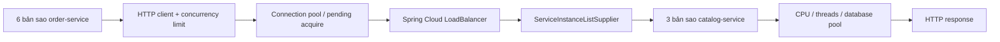
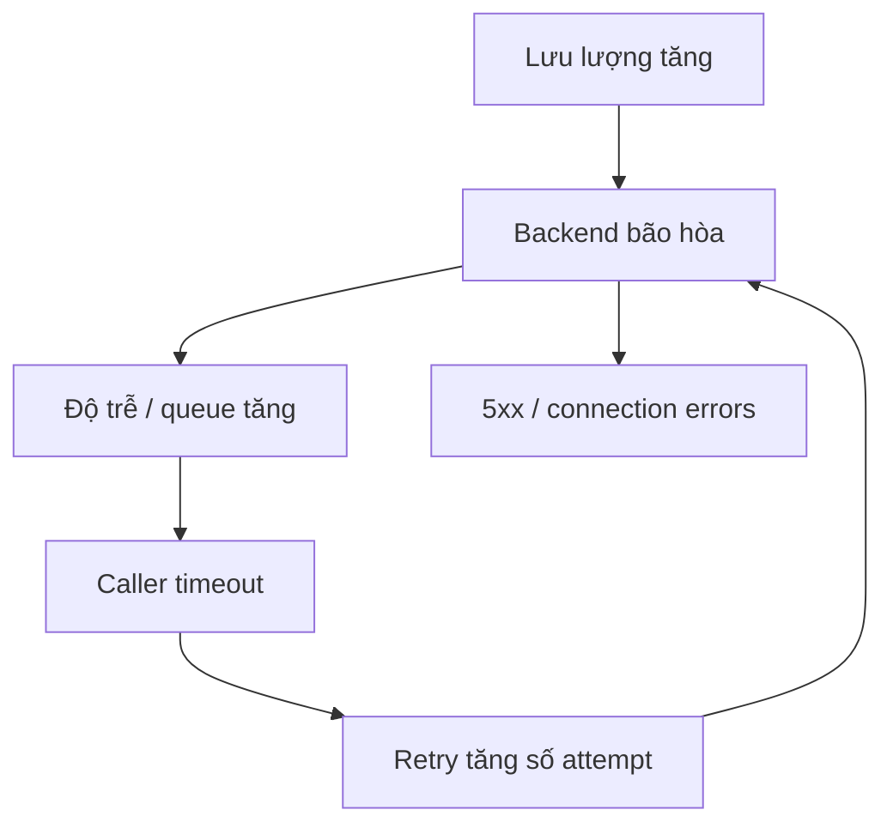

# Cân bằng giữa số luồng, mức đồng thời và khả năng bên đích

Trong hệ thống microservices, một HTTP client có thể kết nối thành công đến mọi bản sao của dịch vụ đích nhưng vẫn gây **quá tải** nếu gửi quá nhiều request cùng lúc. Spring Cloud LoadBalancer giúp tìm và chọn `ServiceInstance` theo service ID; nó **không tự động** bảo đảm rằng số request đang xử lý phù hợp với CPU, database pool, thread pool hay giới hạn của dịch vụ được gọi.

Bài học thuộc phần **Kết nối và hiệu năng** của Spring Cloud LoadBalancer. Mục tiêu là hiểu mối quan hệ giữa **số luồng (threads)**, **số kết nối (connections)**, **số request đồng thời (in-flight requests)**, **hàng đợi**, **thời gian đáp ứng**, cũng như cách phối hợp `RestClient`, `RestTemplate`, `WebClient` và OpenFeign để bảo vệ dịch vụ đích khi có nhiều caller và nhiều instance.

## 1. Phân biệt năm loại tài nguyên thường bị nhầm lẫn

| Khái niệm | Đo lường | Vai trò | Điều không thể suy ra |
|---|---|---|---|
| Thread | Số thread của server hoặc client | Thực thi mã Java, có thể bị giữ khi gọi I/O đồng bộ | 100 thread không đồng nghĩa 100 connection |
| Connection | Số kết nối TCP/TLS đang mở và được dùng | Tái sử dụng socket, giảm chi phí thiết lập kết nối | 50 connection không nhất thiết đồng nghĩa 50 request đang chạy |
| In-flight requests | Số request đã bắt đầu nhưng chưa hoàn thành | Thể hiện mức đồng thời đang đặt lên backend | Không phải mọi request đều đang dùng CPU |
| Queue | Số công việc chờ slot, connection hoặc thread | Hấp thụ một phần đột biến lưu lượng | Queue dài không làm tăng công suất xử lý thực |
| Throughput | Request hoàn thành mỗi giây (RPS) | Khả năng xử lý trong một khoảng thời gian | Throughput cao không bảo đảm p95/p99 tốt |

Với giao tiếp **blocking**, một lời gọi OpenFeign hoặc `RestTemplate` thông thường giữ một thread của caller trong lúc đợi HTTP response. Với `WebClient` non-blocking, thread I/O thường không phải chờ theo kiểu một thread cho mỗi request, nhưng **request vẫn chiếm tài nguyên**: kết nối hoặc HTTP stream, bộ nhớ, slot xử lý tại backend và tài nguyên trong chuỗi xử lý.

**HTTP/1.1** thường không multiplex nhiều request đồng thời trên cùng một connection như **HTTP/2**. Khi dùng HTTP/2, một connection có thể mang nhiều stream, nên càng không thể đánh đồng giới hạn connection với giới hạn request. Phải kiểm tra phiên bản HTTP và khả năng của connector thực tế.

## 2. Luồng request và các điểm có thể bị nghẽn

Giả sử sáu instance `order-service` cùng gọi ba instance `catalog-service`.



Sơ đồ là cách phân chia **trách nhiệm**, không bắt buộc biểu diễn thứ tự nội bộ chính xác của mọi HTTP client: bước chọn instance có thể diễn ra trước khi chọn connection pool theo địa chỉ đích. Về mặt phân tích công suất, có các giới hạn cần xét:

1. **Ingress của caller:** số request mà server `order-service` đang nhận và xử lý.
2. **Mức đồng thời gọi ra:** số HTTP call đồng thời từ `order-service` đến `catalog-service`.
3. **HTTP connector:** số connection được phép mở, số yêu cầu chờ mượn connection, timeout của thao tác mượn.
4. **Discovery và LoadBalancer:** tập instance thực tế tại thời điểm gọi, chính sách round-robin/random/zone/health.
5. **Công suất từng instance đích:** CPU, thread xử lý, database connection, độ trễ thao tác downstream và giới hạn memory.
6. **Tài nguyên toàn cụm:** nhiều caller và nhiều service khác cùng có thể tải lên các instance đích.

Nếu `catalog-service` xử lý được tối đa 40 request đồng thời **trong điều kiện SLA đã đo**, việc mỗi caller tự cho phép 30 request đồng thời có thể vượt khả năng cụm dù mọi caller riêng lẻ nhìn thấy ít tải.

## 3. Quan hệ giữa RPS, độ trễ và số request đang xử lý

Theo **Little's Law**, trong một hệ thống ổn định và khi dùng cùng phạm vi đo:

\[
L = \lambda \times W
\]

Trong đó:

- `L`: số request trung bình ở trong hệ thống/đoạn pipeline đang xét;
- `λ`: tốc độ hoàn thành hoặc tốc độ đến trung bình, tính bằng request/giây khi trạng thái ổn định;
- `W`: thời gian trung bình của request trong đoạn pipeline tương ứng, tính bằng giây.

**Ví dụ:** nếu caller gửi ổn định 200 RPS đến `catalog-service` và một request HTTP mất trung bình 150 ms từ lúc bắt đầu đến khi kết thúc, mức in-flight trung bình xấp xỉ:

```text
L = 200 request/giây × 0,150 giây = 30 request đồng thời.
```

Nếu độ trễ tăng lên 600 ms nhưng tốc độ đến vẫn là 200 RPS, mức in-flight cần thiết có thể lên đến 120. Nếu giới hạn đồng thời chỉ 40, request phải chờ hoặc bị từ chối; khi đó throughput thực có thể giảm, queue tăng và giả định trạng thái ổn định cần được xét lại.

Công thức này **không phải** công thức cấp phát thread cứng, cũng không chứng minh rằng tăng concurrency sẽ luôn tăng throughput. Khi backend gần bão hòa, thêm request có thể chỉ tăng thời gian chờ, timeout và tiêu thụ memory. Việc chọn giới hạn nên dựa vào **kết quả đo tải**, đặc biệt là p95/p99 latency, lỗi và số request bị từ chối.

### 3.1. Công suất cụm và nhiều ứng dụng caller

Một ước lượng ban đầu trong điều kiện phân phối tương đối đều:

\[
C_{\text{per-target}} \approx
\frac{N_{\text{callers}} \times C_{\text{per-caller}}}{N_{\text{targets}}}
\]

Ví dụ giả định có **6 bản sao caller**, mỗi bản sao cho phép **30 request** đồng thời đến `catalog-service`, và có **3 instance catalog**:

```text
Tổng tối đa từ các caller = 6 × 30 = 180 request.
Tải đồng thời/target nếu phân phối đều = 180 / 3 = 60.
```

Nếu mỗi target chỉ duy trì tốt 40 request đồng thời, 60 là vượt ngưỡng đã đo. Với mục tiêu thử nghiệm giữ **20% headroom** so với 40 request/target, ngân sách tham khảo là 32 request/target, tức 96 request cho cả cụm. Chia cho sáu caller: **16 request/caller**.

```text
6 caller × 16 = 96 request toàn cụm.
96 / 3 target = 32 request/target (khi phân phối đều).
```

Các con số 40, 20% và 16 **chỉ là dữ liệu minh họa**. Giới hạn phải được đo và điều chỉnh theo tải thật. Phân phối thực tế có thể lệch vì zone preference, sticky session, instance weights, cache discovery, request dài/ngắn khác nhau và traffic từ **các caller khác**. Vì thế, giới hạn ở caller không thể thay thế việc đo overload tại từng target.

## 4. Với RestTemplate, RestClient và OpenFeign: tránh nhân bội thread chờ

Các HTTP client theo phong cách đồng bộ thường có dạng:

```java
ProductResponse product = catalogFeignClient.getProduct("42");
// Thread gọi bị giữ cho đến khi lời gọi hoàn tất hoặc thất bại.
```

Nếu một controller xử lý request đồng bộ rồi gọi ba API tuần tự, thread có thể bị giữ trong suốt các lần gọi đó. Khi upstream chậm, các thread chờ tăng lên và làm giảm số request mới mà server caller còn có thể tiếp nhận.

Tuy nhiên, **thread pool của web server không phải connection pool của HTTP client**. Ví dụ cấu hình tối đa thread của Tomcat chỉ tác động một mặt của hệ thống (khi ứng dụng dùng Tomcat); không đặt giới hạn độc lập cho tất cả cuộc gọi ra `catalog-service`.

Đối với `RestTemplate`, connection reuse và số connection tối đa phụ thuộc `ClientHttpRequestFactory`/HTTP client được chọn. `SimpleClientHttpRequestFactory` sử dụng cơ chế JDK cơ bản, không cung cấp cùng bộ API connection pooling như Apache HttpComponents. `RestClient` cũng phụ thuộc request factory thực tế. OpenFeign có thể sử dụng HTTP client khác nhau tùy dependency và cấu hình; đừng coi mọi Feign client có cùng kiểu pool.

### 4.1. Bulkhead giới hạn số request đồng thời đến một dependency

Một kỹ thuật bảo vệ đơn giản là **bulkhead**: chỉ cho phép một số request đang chạy nhất định đến một dependency, và từ chối sớm khi không còn slot thay vì để vô hạn request chờ. Ví dụ Java minh họa cho lời gọi đồng bộ:

```java
import java.util.concurrent.Semaphore;

public final class CatalogGateway {
    private final CatalogFeignClient client;
    private final Semaphore slots = new Semaphore(16);

    public CatalogGateway(CatalogFeignClient client) {
        this.client = client;
    }

    public ProductResponse getProduct(String id) {
        if (!slots.tryAcquire()) {
            throw new CatalogBusyException(
                    "Catalog concurrency budget exhausted");
        }

        try {
            return client.getProduct(id);
        } finally {
            slots.release();
        }
    }

    public static class CatalogBusyException extends RuntimeException {
        public CatalogBusyException(String message) {
            super(message);
        }
    }
}
```

Ở đây, `CatalogFeignClient` và `ProductResponse` là các thành phần nghiệp vụ giả định. `Semaphore(16)` là giới hạn **trong một đối tượng gateway của một tiến trình caller**, không phải giới hạn toàn cụm. Một cách triển khai trong Spring là tạo gateway thành singleton bean; không khởi tạo một gateway mới cho từng request, vì làm vậy mỗi request lại có semaphore riêng.

`tryAcquire()` không chờ, nên lỗi overload xuất hiện nhanh và rõ; caller có thể ánh xạ sang response phù hợp hoặc áp dụng chính sách fallback có giới hạn. Khi yêu cầu chờ ngắn có kiểm soát, có thể dùng `tryAcquire(timeout, unit)` nhưng phải tính thời gian chờ vào **deadline tổng**. Trong production, thư viện bulkhead chuyên dụng còn có metrics, queue giới hạn và cách cấu hình tập trung; nguyên tắc không thay đổi.

**Chú ý:** semaphore này không giới hạn số connection của các dependency khác, và không phân phối quota công bằng giữa các bản sao caller. Nếu muốn một giới hạn thực sự toàn cụm, cần kiến trúc điều phối hoặc cơ chế overload control tại chính dịch vụ đích.

## 5. Với WebClient: non-blocking không có nghĩa concurrency vô hạn

`WebClient` thường sử dụng Reactor Netty với I/O event loop. Request được phát khi có subscription; mỗi request in-flight vẫn giữ trạng thái, tài nguyên HTTP và có thể tạo áp lực lên backend. Do không phải chặn một thread trên mỗi request, ứng dụng có thể khởi tạo **rất nhiều** HTTP call nhanh chóng nếu không giới hạn.

Ví dụ không có giới hạn rõ ràng:

```java
Flux<ProductResponse> responses = Flux.fromIterable(productIds)
        .flatMap(catalogClient::getProduct);
```

`flatMap` có mức concurrency mặc định và cơ chế prefetch theo Reactor, **không nên xem đó là chính sách capacity của dịch vụ đích**. Nên khai báo giới hạn phù hợp với pipeline:

```java
Flux<ProductResponse> responses = Flux.fromIterable(productIds)
        .flatMap(catalogClient::getProduct, 12);
```

Mức `12` ở đây giới hạn số publisher con được subscribe đồng thời **trong một subscription của pipeline này**. Nó không tự tạo quota chung cho mọi HTTP request trong tiến trình: nếu có mười request đến controller và mỗi request kích hoạt pipeline này, tổng mức đồng thời có thể tiến tới 120. Cần kết hợp với bulkhead/global limiter ở phạm vi dịch vụ gọi khi cần.

### 5.1. Cấu hình connection pool của Reactor Netty

Ví dụ cấu hình một HTTP connector dùng connection pool có giới hạn và đặt vào `@LoadBalanced WebClient.Builder`:

```java
import java.time.Duration;
import io.netty.channel.ChannelOption;
import org.springframework.cloud.client.loadbalancer.LoadBalanced;
import org.springframework.context.annotation.Bean;
import org.springframework.context.annotation.Configuration;
import org.springframework.http.client.reactive.ReactorClientHttpConnector;
import org.springframework.web.reactive.function.client.WebClient;
import reactor.netty.http.client.HttpClient;
import reactor.netty.resources.ConnectionProvider;

@Configuration(proxyBeanMethods = false)
public class CatalogWebClientConfiguration {

    @Bean
    ConnectionProvider upstreamConnectionProvider() {
        return ConnectionProvider.builder("upstream-http")
                .maxConnections(40)
                .pendingAcquireMaxCount(80)
                .pendingAcquireTimeout(Duration.ofMillis(300))
                .build();
    }

    @Bean
    @LoadBalanced
    WebClient.Builder loadBalancedWebClientBuilder(
            ConnectionProvider upstreamConnectionProvider) {

        HttpClient httpClient = HttpClient
                .create(upstreamConnectionProvider)
                .option(ChannelOption.CONNECT_TIMEOUT_MILLIS, 1_000)
                .responseTimeout(Duration.ofSeconds(2));

        return WebClient.builder()
                .clientConnector(
                        new ReactorClientHttpConnector(httpClient));
    }
}
```

Các giới hạn trong ví dụ có ý nghĩa:

- `maxConnections(40)`: giới hạn connection của **từng pool ứng với remote address** theo cách tổ chức pool của Reactor Netty; **không** phải chính sách chỉ cho phép 40 request đến **toàn bộ** `catalog-service` khi có nhiều instance/host.
- `pendingAcquireMaxCount(80)`: giới hạn số lượt chờ mượn connection theo pool; không phải số lượng request được backend xử lý an toàn.
- `pendingAcquireTimeout(300 ms)`: thời gian tối đa chờ slot connection; không phải read timeout hay deadline end-to-end.
- `CONNECT_TIMEOUT_MILLIS`: thời gian thiết lập TCP connection.
- `responseTimeout(2 s)`: giới hạn chờ phản hồi theo semantics của HTTP connector, không bao phủ mặc định tất cả thời gian ở queue, discovery, retry và xử lý upstream.

Đây là cấu hình minh họa, **không phải giá trị mặc định hay lời khuyên dùng nguyên cho production**. Những giá trị này cần đối chiếu phiên bản Reactor Netty, protocol HTTP/1.1 hoặc HTTP/2, số remote address, mức concurrency và kết quả load test.

Pool được chia sẻ bởi builder và các WebClient được tạo từ builder đó. Nếu muốn resource có vòng đời rõ ràng, cần quản lý việc đóng `ConnectionProvider`/HTTP resources khi ứng dụng dừng theo lifecycle phù hợp. Chỉ có connection pool không thể thay thế bulkhead: khi nhiều instance đích có nhiều pool riêng, tổng in-flight request đến một service ID vẫn có thể lớn.

### 5.2. Đừng giải quyết bão hòa bằng cách chỉ tăng pool

Giả sử pending acquire liên tục tăng, việc tăng `maxConnections` từ 40 lên 200 có thể giảm thời gian đợi pool ở caller nhưng đồng thời tạo thêm yêu cầu vào server và database, khiến p99 tăng hoặc tỷ lệ `503` cao hơn. Cần xác minh **điểm nghẽn nằm ở đâu**:

1. Pool của caller đã hết connection nhưng backend còn headroom?
2. Backend đã bão hòa CPU, thread hoặc database connection?
3. Network/TLS khiến connection thiết lập chậm?
4. Retry đang nhân số request sau timeout?
5. Một instance bị lệch tải vì zone, affinity hoặc thiếu health filter?

Chỉ tăng pool khi đo đạc chứng minh pool là giới hạn không cần thiết và dịch vụ đích còn khả năng xử lý.

## 6. Hàng đợi, backpressure và từ chối tải sớm

Một queue có thể làm mượt burst ngắn nhưng không tạo thêm công suất. Nếu trung bình mỗi giây có 300 request đến mà hệ thống chỉ hoàn thành 200 request, queue tăng khoảng 100 request/giây trước khi đến giới hạn hoặc hệ thống thay đổi.

Có ba cách phản ứng với tải vượt khả năng:

| Chính sách | Cách hoạt động | Ưu điểm | Rủi ro |
|---|---|---|---|
| Queue có giới hạn | Giữ một lượng request chờ slot | Chịu burst ngắn | Tăng latency; có thể timeout khi chờ |
| Fail-fast / load shedding | Từ chối khi hết quota | Bảo vệ backend và giảm retry storm nếu caller xử lý đúng | Cần response và cơ chế thông báo rõ |
| Rate limit | Giới hạn tốc độ request theo thời gian | Bảo vệ thông lượng trung bình và tenant | Không tự giới hạn số in-flight nếu latency tăng |

**Concurrency limit** và **rate limit** khác nhau: 100 RPS với thời gian xử lý 100 ms thường tạo khoảng 10 in-flight, nhưng cũng 100 RPS với thời gian xử lý 2 giây có thể tạo gần 200 in-flight. Một hệ thống có thể cần cả hai.

Reactive Streams có backpressure để điều phối việc tiêu thụ dữ liệu giữa Publisher và Subscriber. Tuy nhiên, backpressure ở một `Flux` không tự động đặt quota toàn cụm cho những HTTP request được sinh từ nhiều controller, nhiều caller instance hoặc qua các vòng retry. Phải xác định rõ **phạm vi** của mỗi giới hạn.

## 7. Retry, timeout và hiệu ứng khuếch đại khi đích quá tải

Khi backend chậm, nhiều caller timeout rồi retry cùng lúc có thể làm số request dồn lên backend **cao hơn** lưu lượng nghiệp vụ ban đầu. Đây là feedback loop nguy hiểm:



Nếu 100 request nghiệp vụ/giây phát sinh tối đa hai lần retry, số **attempt** có thể lên đến 300 request/giây trong tình huống xấu. Phần tăng thêm này phải nằm trong ngân sách capacity và đồng thời, không được xem như traffic miễn phí.

Nguyên tắc:

- Đặt **connect timeout**, **response/read timeout**, **pending acquire timeout** và **deadline tổng** theo đúng tầng; không cộng cơ học các timeout mà bỏ qua thời gian queue và retry.
- Retry có giới hạn số lần, backoff hợp lý và **jitter** để tránh các caller thử lại cùng lúc. Chỉ retry loại lỗi có khả năng hết theo thời gian.
- Với thao tác thay đổi trạng thái như tạo đơn hàng, cần idempotency key hoặc bảo đảm tương đương trước khi retry vì server có thể đã xử lý request trước khi response bị mất.
- Đối với timeout/`503`, cân nhắc **retry budget**; nếu toàn bộ caller đều retry khi hệ thống đang nghẽn, việc chuyển instance bằng LoadBalancer không đủ để khôi phục.
- Không mặc định retry sẽ chọn instance khác; điều đó phụ thuộc policy, trạng thái discovery, sticky session và cấu hình tránh instance trước.

Khi dùng `WebClient.timeout(Duration)`, cần hiểu vị trí operator so với `retryWhen`. Nếu `timeout` nằm **trước** `retryWhen`, thời hạn đó thường được áp dụng cho từng subscription/attempt; thêm deadline tổng nếu cần bảo đảm thời gian tối đa cho toàn bộ lời gọi. Với `RestClient`, `RestTemplate` và OpenFeign, behavior retry và timeout còn phụ thuộc HTTP client, Spring Cloud LoadBalancer và retryer tương ứng.

## 8. Kết hợp LoadBalancer với capacity của từng instance

Spring Cloud LoadBalancer chọn instance từ danh sách `ServiceInstanceListSupplier`, có thể chịu tác động của:

- **Discovery:** instance vừa tạo hoặc vừa gỡ có thể chưa hiện/biến mất ngay do registry, refresh hoặc cache.
- **Health check:** nếu có cấu hình, instance không đạt health probe có thể được loại khỏi danh sách. Registry có instance không có nghĩa endpoint nghiệp vụ sẵn sàng.
- **Zone preference:** có thể ưu tiên instance cùng zone; nhóm này có thể bị tải cao hơn nhóm còn lại.
- **Request-based sticky session:** giữ affinity khi phù hợp, nhưng có thể tạo hot spot cho một số instance.
- **Thuật toán chọn:** round-robin hoặc random phân phối số request theo policy; chúng **không tự bảo đảm phân phối đều CPU, thời gian xử lý hay concurrency**.
- **Weight/metadata/custom policy:** có thể điều chỉnh phân phối theo khả năng đích nếu ứng dụng triển khai và đo đúng, nhưng weight tĩnh vẫn không thay thế overload protection.

Ví dụ ba instance cùng service ID có capacity rất khác nhau:

| Instance | Năng lực tham khảo đã đo | Số in-flight đang có | Đánh giá sơ bộ |
|---|---:|---:|---|
| `catalog-1` | 40 | 35 | Gần ngưỡng |
| `catalog-2` | 40 | 12 | Còn headroom |
| `catalog-3` | 20 | 19 | Gần ngưỡng |

Round-robin có thể tiếp tục luân phiên request dù `catalog-3` chậm hơn vì instance đó chỉ đủ 20 request đồng thời. Một chiến lược nâng cao có thể dùng weight/metrics hoặc kiểm soát overload tại backend. Dù chọn policy nào, **limit tại caller** và **phản hồi từ backend khi quá tải** vẫn cần phối hợp.

Một ví dụ kiến trúc tốt thường bao gồm: readiness đúng lúc, graceful shutdown/drain, timeout hợp lý, giới hạn concurrency riêng cho từng downstream và khả năng phản hồi overload rõ ràng. Không chỉ điều chỉnh `spring.cloud.loadbalancer` rồi bỏ qua connection pool và capacity của server đích.

## 9. Đo đúng chỉ số trước khi chọn con số cấu hình

Tối ưu hiệu năng cần xác định **điểm nghẽn** bằng số liệu thay vì suy luận từ CPU trung bình.

| Vị trí đo | Chỉ số gợi ý | Câu hỏi chẩn đoán |
|---|---|---|
| Caller HTTP client | Active/idle connections, pending acquire, pool acquire latency | Chờ connection hay đã gửi request? |
| Caller application | Threads bận, request in-flight, bulkhead rejections | Bị nghẽn ở thread/slot nào? |
| LoadBalancer | Service ID, instance được chọn, candidate count, empty result | Traffic có lệch vào instance nào? |
| Backend | In-flight requests, queue, CPU, memory, GC, worker threads | Backend đang bão hòa nguồn lực nào? |
| Backend dependencies | Database pool, query latency, downstream errors | Request chậm vì database hoặc service thứ ba? |
| HTTP result | RPS, p50/p95/p99, 4xx/5xx, timeouts | Tail latency và lỗi tăng ở ngưỡng nào? |
| Retry policy | Attempts/request, retry success, tổng thời gian | Retry đang khắc phục hay khuếch đại tải? |

Các metric gắn nhãn `serviceId` và loại lỗi thường hữu ích để tổng hợp. Tránh dùng `traceId` hoặc `instanceId` làm metric label ở quy mô không kiểm soát vì cardinality lớn; có thể dùng log/trace được lấy mẫu cho chi tiết instance. Cần có cách theo dõi **mỗi instance** nếu muốn phát hiện hot spot, song phải thiết kế mức nhãn và hệ thống lưu trữ phù hợp.

### 9.1. Một bảng số liệu dễ diễn giải

Ví dụ kết quả thử tải giả định khi tăng concurrency từ 16 đến 128:

| Concurrent request | Throughput (RPS) | p95 latency | Lỗi/timeout | Nhận xét |
|---:|---:|---:|---:|---|
| 16 | 100 | 180 ms | 0% | Ổn định |
| 32 | 190 | 240 ms | 0% | Còn tăng throughput |
| 64 | 230 | 950 ms | 2% | Tiến gần bão hòa |
| 128 | 225 | 2.400 ms | 12% | Concurrency tăng nhưng throughput không tăng |

Đây là **số liệu mô phỏng**, không phải benchmark của Spring Cloud. Trong ví dụ, từ 64 lên 128 request đồng thời, throughput không cải thiện trong khi p95 và timeout tăng rất mạnh. Điểm vận hành phù hợp cần xét SLA, chi phí và headroom, có thể nằm thấp hơn concurrency tạo throughput cao nhất.

## 10. Quy trình load test và lựa chọn giới hạn

Một quy trình có thể lặp lại khi tích hợp `RestClient`, `WebClient` hoặc OpenFeign với `catalog-service`:

1. **Đo năng lực một instance đích:** chạy thử ở nhiều mức concurrency, ghi RPS, p95/p99, CPU, database pool, lỗi và thời điểm latency bắt đầu tăng nhanh.
2. **Đo nhiều instance:** khởi chạy các bản sao có cấu hình thật; kiểm tra LoadBalancer có phân phối request theo service ID, zone, health và affinity như mong đợi.
3. **Thêm nhiều caller:** tăng số bản sao `order-service`. Tính tổng mức đồng thời tối đa khi mỗi caller đều đạt ngưỡng. Không chỉ xem số request từ một caller.
4. **Chọn mức giới hạn ban đầu:** dựa trên công suất đã đo, trừ headroom hợp lý rồi phân bổ quota cho các caller theo traffic và loại request.
5. **Giới hạn các hàng đợi:** tránh tình trạng pool acquisition chờ quá lâu hoặc task queue tăng mãi. Ghi metric rejections thay vì chỉ thấy request timeout ở tầng ngoài.
6. **Kiểm tra các thao tác chậm:** cùng lúc có request đọc ngắn và thao tác kéo dài; xác định có cần bulkhead riêng để request chậm không chiếm hết tài nguyên.
7. **Kiểm tra rollout/scale-in:** tắt một instance đích. Tổng công suất còn lại giảm, vì thế quota đã an toàn khi có ba instance có thể quá cao khi chỉ còn hai.
8. **Kiểm tra lỗi và retry:** tạo một lỗi mạng/`503` có kiểm soát, xác minh retries không làm tải đột ngột tăng vượt capacity.
9. **Kiểm tra tail latency:** xem p95/p99 theo thời gian và số request timeout, không chỉ trung bình. Đối chiếu thời gian chờ pool, chờ server và xử lý nghiệp vụ.
10. **Lặp lại với phiên bản production-like:** protocol, connection reuse, TLS, HTTP client connector, thời gian xử lý database và số instance đều ảnh hưởng kết quả.

### 10.1. Tình huống khi một instance biến mất

Nếu ba instance có tổng capacity khoảng `3 × 40 = 120` in-flight, mất một instance khiến capacity lý thuyết còn `80` trước khi tính headroom. Một quota caller toàn cụm là `96` có thể từng an toàn khi có ba instance nhưng trở nên vượt khả năng khi chỉ còn hai.

Vì vậy, cố định quota ở mức chịu được **một số kịch bản suy giảm** hoặc sử dụng overload control/adaptive concurrency có tín hiệu tin cậy để giảm tải khi capacity đích biến động. Đừng giả định service discovery cập nhật ngay lập tức: trong cửa sổ hội tụ, LoadBalancer vẫn có thể chọn instance không còn reachable.

## 11. Các lỗi thiết kế và cách khắc phục

| Biểu hiện | Sai lầm thường gặp | Hướng khắc phục |
|---|---|---|
| Tăng connection pool nhưng 503 nhiều hơn | Backend không có headroom | Đo capacity của backend và giảm concurrency, không chỉ tăng pool |
| WebClient làm CPU/RAM tăng bất thường | Fan-out quá rộng, quá nhiều subscription đồng thời | Dùng `flatMap(..., concurrency)` và giới hạn ở phạm vi service |
| Servlet threads bị giữ kín khi downstream chậm | Blocking calls với timeout quá dài | Đặt timeout, tách bulkhead và giảm số call đồng thời |
| Pool pending acquire dài, p99 xấu | Queue chờ không giới hạn hoặc quá lớn | Giới hạn queue, timeout mượn connection và fail-fast |
| Sau scale-in, timeout tăng | Quota không giảm khi mất instance; discovery/cache stale | Điều chỉnh headroom, graceful drain, health checks |
| Retry làm lượng request tăng gấp nhiều lần | Không có retry budget, backoff hoặc idempotency | Giới hạn attempts và deadline, chọn lỗi có thể retry |
| Một instance nóng dù round-robin | Sticky/zone, capacity không đều hoặc request dài | Đo traffic theo instance và chính sách định tuyến thực tế |
| Tăng thread count mà RPS không tăng | Điểm nghẽn ở DB pool/CPU/backend | Tối ưu bottleneck thật, không tăng mọi giới hạn |
| Rate limit ổn nhưng hết connection | Latency tăng làm in-flight tăng | Kết hợp rate limit với concurrency/bulkhead limit |

## 12. Nguyên tắc cần nhớ

1. **Threads, connections và requests in-flight là ba đại lượng khác nhau.** Chỉ tối ưu một đại lượng không bảo đảm tăng năng lực toàn hệ thống.
2. **Công suất dịch vụ đích là giới hạn cốt lõi.** Nhiều bản sao caller có thể cộng dồn traffic vượt capacity của toàn cụm hoặc một instance.
3. **Little's Law giúp ước lượng:** ở trạng thái ổn định, số request trong hệ thống xấp xỉ tốc độ hoàn thành nhân với thời gian lưu lại. Độ trễ tăng thường làm in-flight và queue tăng nếu tốc độ đến không giảm.
4. **Blocking và reactive cần cách giới hạn khác nhau.** Không-blocking giảm việc giữ thread khi chờ I/O nhưng không cho phép gửi vô hạn request.
5. **Connection pool không phải bulkhead toàn service.** Pool thường quản lý kết nối theo remote address/route; quota request cần có phạm vi riêng.
6. **Timeout, retry và queue phải có ngân sách.** Retry khi quá tải có thể khiến sự cố nặng hơn; cân nhắc idempotency và deadline tổng.
7. **LoadBalancer giúp chọn instance, không thay thế capacity management.** Discovery, health, zone, affinity và weight ảnh hưởng phân phối; cần kết hợp với kiểm soát overload và giám sát ở backend.
8. **Chọn số liệu cấu hình bằng thử tải có kiểm soát.** Theo dõi p95/p99, lỗi, pending acquire, in-flight, tải theo instance và tác động khi mất một instance.

Khi các giới hạn ở caller, connection pool, LoadBalancer và backend được thiết kế như **một hệ thống chung**, giao tiếp giữa các dịch vụ qua Spring Cloud LoadBalancer sẽ ổn định hơn cả trong điều kiện bình thường lẫn lúc tăng tải, timeout hoặc rollout.

