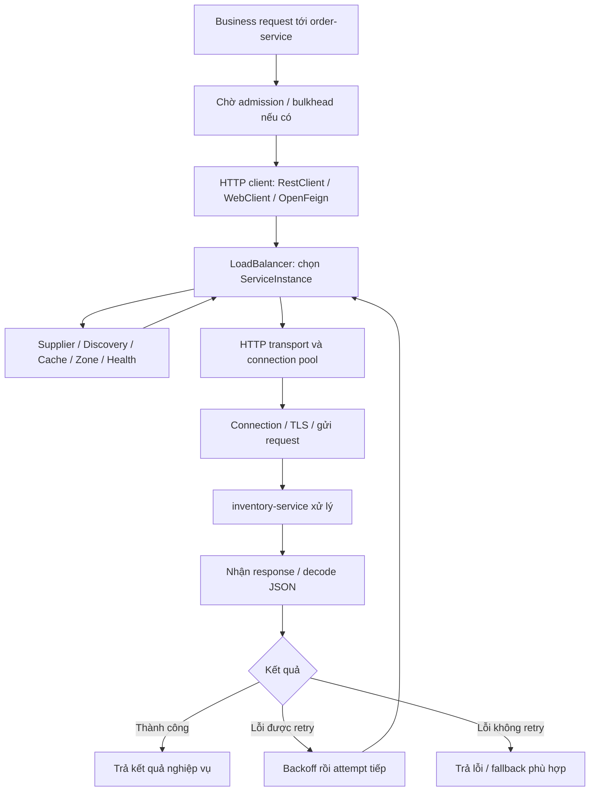

# Đo throughput, độ trễ phân vị và mức sử dụng tài nguyên

Khi triển khai Spring Cloud LoadBalancer, một câu hỏi quan trọng không chỉ là **request đã được chuyển đến replica nào**, mà còn là **hệ thống xử lý được bao nhiêu request, mất bao lâu và tiêu thụ bao nhiêu tài nguyên**. Một cấu hình có thể phân phối đều số lần chọn `ServiceInstance` nhưng vẫn chậm: một replica có thể bị giới hạn connection pool, một vùng có độ trễ mạng cao, hoặc retry làm tăng tải lên các replica còn sống.

Để đánh giá hiệu năng, cần đo ba nhóm số liệu song song:

1. **Throughput:** số request hoặc HTTP attempt xử lý trong một khoảng thời gian, thường tính bằng request/giây (RPS).
2. **Độ trễ phân vị:** thời gian hoàn tất request ở các phân vị `p50`, `p95`, `p99`, thay vì chỉ nhìn giá trị trung bình.
3. **Mức sử dụng tài nguyên:** CPU, heap/GC, thread, connection pool, số request đang xử lý, hàng đợi và tài nguyên của dependency.

Bài này thuộc chương **Kết nối và hiệu năng** của module `SPRING_CLOUD_SERVICE_COMMUNICATION_LOAD_BALANCING`. Trọng tâm là đo lường trên đường gọi `order-service → inventory-service` với `RestClient`, `WebClient` hoặc OpenFeign; tách hiệu ứng discovery, `ServiceInstanceListSupplier`, health check, zone, timeout và retry khỏi thời gian HTTP thực tế. Các ví dụ Micrometer, Prometheus và kiểm thử tải giúp biến nhận định “LoadBalancer đang chậm” thành một giả thuyết có thể kiểm chứng.

> **Nguyên tắc:** một metric phải được hiểu cùng **đơn vị**, **phạm vi đo**, **khoảng thời gian**, **loại request** và **tỷ lệ lỗi**. Không nên so sánh p99 của một nhóm endpoint có retry với p99 của nhóm khác không retry rồi kết luận thuật toán cân bằng tải tốt hay xấu.

## 1. Sơ đồ các điểm đo trên một lời gọi

Giả sử `order-service` gọi URL logic:

```http
GET /api/stocks/BOOK-001 HTTP/1.1
Host: inventory-service
Accept: application/json
```

Spring Cloud LoadBalancer chọn một `ServiceInstance` rồi HTTP client gửi request tới host/port của instance đó.



Đường đi này có **nhiều loại thời gian** khác nhau. Nếu đo từ đầu business request đến kết quả cuối, ta thu được *latency tổng*. Nếu đo mỗi attempt tại HTTP transport, ta có *attempt latency*. Nếu đo thời gian `choose(...)`, ta đang quan sát riêng một phần chọn instance. Cả ba đều hữu ích nhưng **không được dùng thay thế nhau**.

| Điểm quan sát | Câu hỏi nó trả lời |
| --- | --- |
| Tầng API của `order-service` | Người dùng phải chờ bao lâu để nhận kết quả cuối? |
| Tầng adapter gọi `inventory-service` | Một lời gọi dependency, gồm retry nếu có, mất bao lâu? |
| Mỗi HTTP attempt | Mỗi lần gửi mạng tới một replica mất bao lâu, kết quả ra sao? |
| LoadBalancer/supplier | Danh sách ứng viên có bao nhiêu, mất bao lâu để chọn? |
| Tầng server của từng replica | Server thực sự xử lý bao nhiêu request, tốn CPU/DB bao nhiêu? |

Cần định nghĩa rõ nơi đặt Timer hoặc Observation trước khi đọc dashboard. Một metric đồng hồ bấm từ caller không thể tự phân chia chính xác thời gian DNS, pool, server và network nếu không có instrumentation ở những ranh giới đó.

## 2. Throughput: đếm cái gì, ở đâu?

**Throughput** thường là số công việc hoàn tất trên một đơn vị thời gian. Với HTTP, các dashboard có thể gọi chung là RPS dù đang đo những thứ khác nhau.

| Loại throughput | Cách đếm | Ý nghĩa |
| --- | --- | --- |
| Incoming RPS | Mọi HTTP request đi vào `order-service` | Nhu cầu mà caller nhận |
| Business completion RPS | Số thao tác nghiệp vụ kết thúc mỗi giây | Năng lực giải quyết công việc cuối cùng |
| Outbound logical-call RPS | Số lần code caller bắt đầu một lời gọi dependency | Số lời gọi ở tầng adapter trước retry |
| Outbound attempt RPS | Số HTTP attempt thực sự gửi đi | Tải mạng và tải downstream, bao gồm retry |
| Successful RPS | Số kết quả hoàn tất thành công mỗi giây | Useful throughput |
| Error/rejected RPS | Request lỗi hoặc bị từ chối mỗi giây | Phần demand không được phục vụ như mong đợi |

Giả sử trong một giây caller nhận **800 business request**. Trong số đó có **80 request thất bại ở attempt đầu rồi được retry thêm một lần**. Nếu mỗi business request bình thường tạo một HTTP call:

```text
Incoming business RPS:         800
HTTP attempts lần đầu:        800
HTTP attempts do retry:        80
Outbound HTTP attempt RPS:    880
Amplification factor:         880 / 800 = 1,10
```

Nếu tất cả retry thành công, successful business throughput có thể vẫn gần 800 RPS. Nhưng `inventory-service` phải xử lý hoặc ít nhất tiếp nhận **880 attempt/giây**, không phải 800. Nếu retry có thêm nhiều tầng, amplification có thể lớn hơn.

**Không dùng số lần LoadBalancer chọn instance làm bằng chứng toàn bộ request đã tới server.** Một lựa chọn thành công có thể theo sau bởi connection refused, timeout hoặc lỗi TLS. Ngược lại, một HTTP attempt tới server có thể trả lỗi nghiệp vụ và vẫn được tính vào attempt throughput.

## 3. Thời gian đo và tỷ lệ lỗi phải đi cùng throughput

Trong một khoảng quan sát độ dài `Δt`:

```text
RPS = số request thuộc phạm vi đo / Δt (giây)
errorRate = số request kết thúc lỗi / tổng request kết thúc
successRate = số request thành công / tổng request kết thúc
```

Ví dụ trong 60 giây:

```text
Business requests hoàn tất: 48.000
Trong đó thành công:       46.800
Trong đó thất bại:          1.200

Completion RPS = 48.000 / 60 = 800 RPS
Success RPS    = 46.800 / 60 = 780 RPS
Error rate     = 1.200 / 48.000 = 2,5%
```

Nếu chỉ hiển thị `800 RPS`, ta không biết đây là 800 thành công hay có 2,5% lỗi. Một thuật toán có thể tăng throughput tính theo attempt nhờ retry nhưng làm **useful throughput** không đổi, trong khi CPU/connection của downstream tăng.

Cần chú ý các request đang xử lý tại cuối cửa sổ đo: chúng chưa được tính là hoàn tất nhưng vẫn chiếm tài nguyên. Với tải tăng nhanh, so sánh request **bắt đầu** và **hoàn tất** giúp phát hiện queue đang tích lũy.

## 4. Độ trễ trung bình khác độ trễ phân vị

**Latency** là khoảng thời gian từ mốc bắt đầu tới mốc kết thúc đã được định nghĩa. Có thể đo bằng mili giây (ms) hoặc giây (s); Prometheus thường xuất metric duration theo đơn vị **giây**.

Giả sử thời gian cho 10 request là:

```text
20, 22, 23, 25, 27, 28, 29, 31, 35, 760 (ms)
```

Chín request hoàn tất dưới 40 ms, nhưng một request mất 760 ms. Trung bình bị kéo tăng bởi request chậm nhất; ngược lại, nếu lượng request rất lớn, trung bình có thể che giấu cả một nhóm người dùng ở vùng đuôi phân phối đang trải nghiệm độ trễ cao.

Các phân vị thường được theo dõi:

| Chỉ số | Cách diễn giải thực tế |
| --- | --- |
| `p50` | Trung vị: khoảng 50% số quan sát không vượt mức này |
| `p90` | Khoảng 90% số quan sát không vượt mức này |
| `p95` | Khoảng 95% số quan sát không vượt mức này |
| `p99` | Khoảng 99% số quan sát không vượt mức này |
| `max` | Quan sát chậm nhất trong phạm vi đo |

Cách nội suy giá trị phân vị có thể khác giữa công cụ, histogram và tập mẫu. Không nên coi p99 là “request chậm nhất”: khoảng 1% quan sát vẫn có thể **chậm hơn p99**, và các ngoại lệ rất dài có thể tạo trải nghiệm tệ dù p99 không đổi đáng kể.

Ví dụ 10.000 request có `p99 ≈ 600 ms` nghĩa là khoảng 99% request nằm tại hoặc dưới mức 600 ms theo phương pháp ước lượng đang dùng. Nó không đồng nghĩa tất cả 10.000 request xong trước 600 ms.

## 5. Vì sao p95 và p99 đặc biệt quan trọng khi chọn replica?

Một service có hai replica:

| Instance | p50 | p95 | p99 | Phân tích |
| --- | ---: | ---: | ---: | --- |
| A | 45 ms | 90 ms | 220 ms | Tương đối ổn định |
| B | 43 ms | 410 ms | 1.500 ms | Phần đuôi rất chậm |

Nếu chỉ nhìn p50, hai instance gần như giống nhau. Nhưng một số request tới B có thể chờ dài, hết read timeout rồi retry sang A, làm số attempt tăng.

Các nguyên nhân cần điều tra gồm:

- B bị giới hạn CPU hoặc có GC pause dài.
- Connection pool đến database ở B cạn.
- B xử lý một nhóm request tốn kém hơn.
- B chạy ở zone xa hoặc có network jitter.
- Một số request phải chờ queue do giới hạn concurrency.
- HTTP client tại caller bị chờ kết nối trong pool trước khi thực sự gửi.
- Cache miss, lock contention hoặc downstream phía sau B phản hồi chậm.

**Tail latency của toàn hệ thống không chỉ do thuật toán LoadBalancer.** LoadBalancer có thể vẫn chọn danh sách đúng, nhưng điều kiện thực thi ở mỗi replica khác nhau.

Nên so sánh p95/p99 **trên cùng loại request, cùng cửa sổ thời gian và có đủ dữ liệu**. Khi tách theo instance có rất ít quan sát, phân vị có thể dao động mạnh và gây kết luận sai.

## 6. Histogram và percentile: cách tổng hợp đúng

Một histogram thời gian có các bucket đếm số quan sát có thời gian nhỏ hơn hoặc bằng một ngưỡng. Khi dùng Prometheus, các bucket thường được biểu diễn bằng chuỗi metric có suffix `_bucket` và nhãn `le` (less than or equal).

Ví dụ dữ liệu đơn giản:

```text
Duration <= 0.05 s:  7.000 request
Duration <= 0.10 s:  9.000 request
Duration <= 0.25 s:  9.700 request
Duration <= 0.50 s:  9.900 request
Duration <= +Inf:   10.000 request
```

Với histogram như vậy, có thể ước lượng p95 trong khoảng bucket phù hợp. **Độ chính xác phụ thuộc ranh giới bucket và số lượng mẫu**; histogram không giữ nguyên mọi duration ban đầu.

### 6.1. Không lấy trung bình p99 của từng instance

Nếu instance A có p99 = 200 ms, B có p99 = 800 ms, **p99 chung không được tính bằng (200 + 800) / 2 = 500 ms**. Phân vị không phải đại lượng tuyến tính có thể trung bình cộng.

Muốn tính p99 tổng cho nhiều replica hoặc nhiều process, cần tổng hợp **phân phối gốc** hoặc các bucket histogram tương thích, có trọng số quan sát đúng. Khi các instance có lượng request rất khác nhau, việc trung bình p99 càng dễ sai.

### 6.2. Đừng gộp thành một phân phối nếu câu hỏi cần so sánh

Histogram toàn service giúp trả lời “người dùng gọi `inventory-service` nhìn chung phải chờ bao lâu?”. Nhưng để phát hiện một replica hoặc một zone chậm bất thường, cần thêm chiều phân tích thích hợp.

Với metric có cardinality cao như dynamic path, SKU hoặc request ID, **không nên đưa thẳng vào label**. Có thể dùng method, path template và service ID làm label ổn định; còn selected instance có thể được quan sát qua tracing/log có sampling, hoặc metric với tập label được quản trị chặt chẽ.

## 7. Ba mốc độ trễ: client, load balancing và server

Để xác định nơi chậm, tách các khoảng thời gian:

```text
t0  Caller bắt đầu lời gọi dependency
 |
 | T_client_before_send (admission, chọn instance, chờ pool...)
 |
t1  HTTP request tới server (mốc quan sát tại server)
 |
 | T_server_processing (application + database + downstream)
 |
t2  Server phát response
 |
 | Network/receive/decode
 |
t3  Caller nhận kết quả / xử lý lỗi
```

Về mặt ý tưởng:

```text
Caller-observed latency ≈ thời gian trước khi gửi
                        + thời gian xử lý server
                        + truyền nhận/đọc/giải mã
                        + retry/backoff nếu có
```

Các mốc đo ở hai máy có thể lệch đồng hồ; không nên lấy timestamp tường của caller trừ timestamp của server rồi coi đó là network latency chính xác nếu chưa đồng bộ thời gian. Trong cùng process, nên dùng đồng hồ monotonic để đo elapsed time.

Với HTTP/2, multiplexing cho phép nhiều request đi qua cùng kết nối; với HTTP/1.1, giới hạn pool kết nối thường ảnh hưởng trực tiếp đến số request đồng thời. Vì vậy, **số socket đang mở không phải số HTTP request in-flight trong mọi protocol**.

## 8. Throughput, latency và concurrency: mối quan hệ qua Little's Law

Trong điều kiện tương đối ổn định, Little’s Law cho mối quan hệ:

```text
Concurrency trung bình ≈ Throughput (request/giây) × Latency trung bình (giây)
```

Ví dụ `order-service` gọi `inventory-service` với 800 HTTP attempt/giây và latency trung bình 50 ms:

```text
800 × 0,05 = khoảng 40 request in-flight
```

Nếu latency tăng lên 250 ms nhưng arrival rate vẫn khoảng 800 attempt/giây:

```text
800 × 0,25 = khoảng 200 request in-flight
```

Nếu tài nguyên của client chỉ cho phép 64 request đang thực thi đồng thời, lượng request dư có thể phải **chờ pool/queue**, bị từ chối hoặc làm giảm throughput đạt được. Tăng latency có thể làm concurrency tăng **trước khi** thấy CPU cao, vì request bị chờ mạng hoặc dependency.

Công thức là quan hệ trung bình trong trạng thái tương đối ổn định. Không thể thay latency trung bình bằng p99 để coi kết quả là concurrency chính xác; càng không dùng nó như cam kết capacity khi tải burst hoặc hệ thống chưa đạt trạng thái ổn định.

## 9. Connection pool: một nơi nghẽn trước cả server

Spring Cloud LoadBalancer chọn `ServiceInstance`, còn HTTP client xử lý kết nối. Với RestClient, phần HTTP transport có thể do JDK HTTP Client, Apache HttpComponents hoặc implementation khác cung cấp. Với WebClient thường dùng Reactor Netty; OpenFeign có thể dùng HTTP client khác nhau theo cấu hình.

Trong một client có pooling, cần quan sát:

| Thông số | Ý nghĩa | Dấu hiệu bất thường |
| --- | --- | --- |
| Connections active | Kết nối đang dùng | Gần chạm giới hạn kéo dài |
| Connections idle | Kết nối sẵn để tái sử dụng | Bất ngờ cao hoặc không được reuse |
| Connections pending / waiters | Request đang chờ lấy kết nối | Tăng liên tục, latency caller tăng |
| Pool acquisition time | Thời gian chờ lấy slot/kết nối | p95/p99 tăng dù server p95 bình thường |
| Connection timeout | Không thiết lập kết nối kịp | Network, target hoặc giới hạn kết nối |
| Pool acquisition timeout | Không lấy được kết nối từ pool trong ngân sách | Pool thiếu slot, leak hoặc request giữ lâu |

**Pool được quản lý theo phạm vi nào phải kiểm tra theo HTTP client cụ thể.** Một pool có thể có giới hạn tổng và giới hạn theo origin/route. Khi LoadBalancer chọn 10 replica thay vì 2, số origin và kết nối cần thiết có thể tăng; không nên suy pool 200 connection tương đương mỗi replica luôn có 200 connection.

Với HTTP/2, có thể multiplex nhiều stream trên một connection, nên phân tích thêm giới hạn stream/concurrent requests và hành vi của implementation. Với HTTP/1.1, nhiều request đồng thời thường cần nhiều kết nối hoạt động, trừ khi client sử dụng cơ chế phù hợp.

**Không tạo một HTTP client/pool mới cho mỗi request.** Hãy tái sử dụng HTTP client đã cấu hình và quản lý vòng đời tài nguyên, tránh chi phí TLS handshake, rò rỉ socket hoặc mất khả năng pooling.

## 10. CPU, heap, GC, thread và dependency chung

Một replica được health check đánh giá `UP` chưa chắc còn khả năng xử lý thêm 200 RPS. Đo tài nguyên cần đi từ triệu chứng tới nguyên nhân.

| Nhóm tài nguyên | Các metric đáng theo dõi | Tác động thường thấy |
| --- | --- | --- |
| CPU | CPU utilization, throttling, runnable threads | Khi bão hòa, latency và error rate tăng |
| Heap / allocation | Heap used, allocation rate, GC pause | GC kéo dài hoặc memory pressure |
| Thread | Live threads, thread pool active/queue | Request đợi thực thi, throughput giảm |
| Connection pool phía client | Active/idle/pending connections | Caller chờ slot dù target còn khỏe |
| DB connection pool phía server | Active/idle/pending, acquisition timeout | Replica bận chờ database |
| Network | Throughput byte, retransmission, handshake | Tăng latency hoặc timeout |
| I/O và dependency | Disk latency, cache miss, downstream p95 | API chậm dù CPU chưa cao |

**CPU thấp không chứng minh hệ thống khỏe.** Nếu phần lớn request đang chờ connection tới database, CPU có thể thấp nhưng p99 rất cao. Ngược lại, CPU cao có thể là do nén/giải mã JSON hoặc GC, không phải do lựa chọn instance.

Một kịch bản đặc biệt: bốn replica `inventory-service` đều dùng chung một database pool hoặc DB cluster đang đầy tải. Thêm replica có thể tăng số kết nối và cạnh tranh truy vấn, **không tạo thêm throughput**. Khi xét nguyên nhân, phải nhìn tài nguyên của dependency chung, không chỉ tài nguyên từng pod.

## 11. Spring Cloud LoadBalancer ảnh hưởng số đo ra sao?

Một đường đi có thể chứa các supplier:

```text
Discovery/Registry
  -> cache nếu có
  -> health / zone / hint filters theo cấu hình
  -> danh sách ứng viên
  -> RoundRobinLoadBalancer hoặc thuật toán khác
  -> ServiceInstance được chọn
```

Các thay đổi cấu hình có thể ảnh hưởng metric theo cách khác nhau:

| Thay đổi | Điều cần đo trước và sau |
| --- | --- |
| Bật/tắt cache instance | Latency chọn instance, tần suất discovery query, độ trễ nhận topology mới |
| Bật health check | Số instance đủ điều kiện, số request tới replica lỗi, chi phí probe |
| Bật zone preference | Tỷ lệ lựa chọn cùng zone, network latency, chi phí lưu lượng liên vùng |
| Đổi thuật toán selection | Phân phối lượt chọn, p95/p99 theo service/instance, fairness |
| Tăng số replica | Useful throughput, latency tail, CPU mỗi replica và shared bottleneck |
| Bật retry | Success rate cuối, attempts/business request, thêm tải và deadline exceeded |

**Không kết luận LoadBalancer nhanh hơn chỉ vì p50 giảm.** Có thể phần lớn request nhanh hơn nhưng p99 xấu đi do một instance nhận quá tải hoặc retry đang kéo dài request ở đuôi phân phối.

Nếu muốn đo riêng latency chọn instance, instrument đoạn lựa chọn hoặc `LoadBalancerLifecycle` khi integration hỗ trợ. Thời gian của một HTTP interceptor ở vị trí bên ngoài có thể bao gồm nhiều bước khác; phải xác nhận ranh giới thực tế.

## 12. Tại sao phân phối request không nhất thiết đều?

Giả sử `RoundRobinLoadBalancer` nhận danh sách [A,B,C] ổn định, việc lựa chọn trên cùng một instance LoadBalancer thường có tính luân phiên. Nhưng số HTTP response quan sát tại mỗi server vẫn có thể khác nhau vì:

- Nhiều caller process có bộ đếm riêng.
- Discovery/health/zone lọc danh sách khác nhau giữa các caller.
- Một số request gặp lỗi trước khi tới server.
- Retry tạo thêm attempt, có thể chọn lại hoặc tránh instance trước.
- Traffic có nhiều service ID, path hoặc zone khác nhau.
- Weighted routing hoặc custom supplier đã thay đổi tập ứng viên.
- Một instance xử lý chậm hơn nên tại thời điểm đo vẫn còn nhiều request in-flight.

Ví dụ:

```text
LoadBalancer selected A: 300 lần
LoadBalancer selected B: 300 lần
LoadBalancer selected C: 300 lần

Server A nhận: 290 request (10 attempt lỗi kết nối)
Server B nhận: 300 request
Server C nhận: 300 request
```

Không có mâu thuẫn: **lượt chọn không phải luôn bằng request đã được server nhận**. Nếu retry từ A chuyển sang C, server C có thể nhận thêm attempt dù số business request ban đầu không đổi.

Khi so sánh phân phối, hãy xác định đang đếm *selection*, *HTTP attempt* hay *server request*, cùng một cửa sổ thời gian và cùng nhóm caller.

## 13. Bật Micrometer và endpoint metrics trong Spring Boot

Một cách thường gặp để đo ứng dụng Spring Boot là dùng Spring Boot Actuator và Micrometer. Nếu hệ thống xuất dữ liệu qua Prometheus, có thể dùng dependency Maven:

```xml
<dependency>
    <groupId>org.springframework.boot</groupId>
    <artifactId>spring-boot-starter-actuator</artifactId>
</dependency>

<dependency>
    <groupId>io.micrometer</groupId>
    <artifactId>micrometer-registry-prometheus</artifactId>
</dependency>
```

Trong ứng dụng dùng Spring Cloud LoadBalancer, cần có starter tương thích và nguồn instance phù hợp; dependency metrics **không thay thế** `spring-cloud-starter-loadbalancer`.

Ví dụ môi trường lab:

```properties
management.endpoints.web.exposure.include=health,info,metrics,prometheus
management.endpoint.health.show-details=when_authorized
```

Với cấu hình và registry phù hợp, Prometheus có thể scrape endpoint `/actuator/prometheus`. Tuy nhiên, việc expose endpoint phụ thuộc bảo mật, mạng và phiên bản Actuator. **Không mở công khai endpoint metrics trong production** nếu chưa có kiểm soát truy cập, cấu hình management port/network và chính sách bảo mật thích hợp.

Micrometer/Spring Boot có thể cung cấp metrics HTTP, JVM, CPU và các chỉ số khác theo instrumentation hiện hữu. **Tên metric và tags không bất biến giữa mọi phiên bản**; phải kiểm tra danh sách thực sự được xuất trước khi viết dashboard production. Những metric về connection pool/LoadBalancer chỉ xuất hiện nếu implementation và instrumentation tương ứng đã được bật.

## 14. Ví dụ đo duration và in-flight cho lời gọi RestClient

Để minh họa một nguồn số liệu có tên ổn định, ta tự thêm Timer và Gauge quanh một lời gọi dependency đồng bộ.

```java
import java.util.List;
import java.util.concurrent.atomic.AtomicInteger;

import io.micrometer.core.instrument.MeterRegistry;
import io.micrometer.core.instrument.Tag;
import io.micrometer.core.instrument.Timer;
import org.springframework.cloud.client.loadbalancer.LoadBalanced;
import org.springframework.stereotype.Component;
import org.springframework.web.client.RestClient;

@Component
class InventoryGateway {

    private final RestClient client;
    private final MeterRegistry registry;
    private final AtomicInteger inFlight = new AtomicInteger();
    private final Timer successTimer;
    private final Timer errorTimer;

    InventoryGateway(
            @LoadBalanced RestClient.Builder builder,
            MeterRegistry registry) {

        this.registry = registry;
        this.client = builder
                .baseUrl("http://inventory-service")
                .build();

        registry.gauge(
                "app.downstream.inflight",
                List.of(Tag.of("target_service", "inventory-service")),
                inFlight,
                AtomicInteger::doubleValue);

        this.successTimer = Timer.builder("app.downstream.call.duration")
                .tag("target_service", "inventory-service")
                .tag("outcome", "success")
                .publishPercentileHistogram()
                .register(registry);

        this.errorTimer = Timer.builder("app.downstream.call.duration")
                .tag("target_service", "inventory-service")
                .tag("outcome", "error")
                .publishPercentileHistogram()
                .register(registry);
    }

    StockResponse getStock(String sku) {
        inFlight.incrementAndGet();
        Timer.Sample sample = Timer.start(registry);
        boolean success = false;

        try {
            StockResponse response = client.get()
                    .uri("/api/stocks/{sku}", sku)
                    .retrieve()
                    .body(StockResponse.class);

            success = true;
            return response;
        } finally {
            sample.stop(success ? successTimer : errorTimer);
            inFlight.decrementAndGet();
        }
    }
}
```

Đoạn code giả định `StockResponse` là DTO của ứng dụng và Spring context đã có bean `RestClient.Builder` được đánh dấu `@LoadBalanced`. Cách khai báo builder có thể dùng:

```java
@Bean
@LoadBalanced
RestClient.Builder loadBalancedRestClientBuilder() {
    return RestClient.builder();
}
```

**Ý nghĩa của metric tùy biến:**

- `app.downstream.call.duration` đo **mỗi lần gọi method `getStock` tại adapter** từ caller, gồm thời gian retry nếu các attempt bên trong đã được cấu hình ở client.
- `outcome` chỉ có hai giá trị cố định `success` hoặc `error` theo kết quả của method. Kết quả HTTP `200` nhưng tồn kho không đủ vẫn được tính là `success` về mặt HTTP adapter; nghiệp vụ cần metric riêng nếu muốn đo thất bại kiểm tra tồn kho.
- `app.downstream.inflight` phản ánh **số lời gọi đang diễn ra trong một process caller**, không phải số socket, số stream HTTP/2 hay concurrency toàn cụm.
- `publishPercentileHistogram()` yêu cầu Micrometer xuất thông tin phân phối đủ để tính phân vị từ histogram ở backend hỗ trợ; độ chính xác còn phụ thuộc bucket và cấu hình registry.

**Điểm giới hạn:** snippet đo *logical downstream call*, **không tự đo riêng từng HTTP attempt**. Nếu client retry ba lần bên trong, Timer của ví dụ vẫn ghi **một quan sát**. Để đo attempt RPS, cần instrumentation ở tầng HTTP client/transport hoặc tích hợp retry, đồng thời giữ tên metric khác để tránh nhầm định nghĩa.

Khi Spring Boot đã có observation HTTP client, đừng tạo thêm metric cùng tên/ý nghĩa mà không quy định rõ mục đích. Instrument tùy chỉnh này có ích để đo toàn bộ lời gọi dependency, bao gồm logic của adapter.

## 15. Đọc throughput và latency từ Prometheus

Giả sử Prometheus đang thu thập metric ở mục trước. Với convention đặt tên Prometheus thông thường, Timer `app.downstream.call.duration` có thể được xuất dưới các chuỗi như:

```text
app_downstream_call_duration_seconds_count
app_downstream_call_duration_seconds_sum
app_downstream_call_duration_seconds_bucket
```

**Tên thực tế cần được kiểm tra trong endpoint metrics**, vì convention và version thư viện có thể thay đổi. Nếu histogram chưa được bật hoặc backend không xuất bucket, chuỗi `_bucket` sẽ không tồn tại và truy vấn `histogram_quantile` không thể hoạt động.

### 15.1. Tổng logical-call throughput theo service ID

```promql
sum(
  rate(
    app_downstream_call_duration_seconds_count{
      target_service="inventory-service"
    }[5m]
  )
)
```

Kết quả có đơn vị **call/giây** trong cửa sổ gần 5 phút, tính từ counter số quan sát Timer. Đây là *logical-call completion rate* theo điểm đo ví dụ, không phải *HTTP attempt rate*.

### 15.2. Throughput theo outcome

```promql
sum by (outcome) (
  rate(
    app_downstream_call_duration_seconds_count{
      target_service="inventory-service"
    }[5m]
  )
)
```

Hai series `success` và `error` giúp phân biệt lượng lời gọi adapter thành công và thất bại. Không nên gọi chúng là business success/failure nếu nghiệp vụ còn kiểm tra `availableQuantity`.

### 15.3. Độ trễ trung bình

```promql
sum(rate(app_downstream_call_duration_seconds_sum{
  target_service="inventory-service"
}[5m]))
/
sum(rate(app_downstream_call_duration_seconds_count{
  target_service="inventory-service"
}[5m]))
```

Đây là **mean latency** trong cửa sổ, đơn vị **giây**. Nếu số lượng quan sát bằng 0, dashboard cần xử lý mẫu số 0 hoặc chuỗi không có dữ liệu.

### 15.4. p95 từ histogram

```promql
histogram_quantile(
  0.95,
  sum by (le) (
    rate(app_downstream_call_duration_seconds_bucket{
      target_service="inventory-service"
    }[5m])
  )
)
```

Phương pháp này tổng hợp bucket histogram theo thời gian và ước lượng p95 chung. Tương tự thay `0.95` bằng `0.99` để xem p99. Không tính `avg(p99_per_instance)` rồi gọi đó là p99 toàn dịch vụ.

### 15.5. Số lời gọi đang thực thi

```promql
sum(app_downstream_inflight{
  target_service="inventory-service"
})
```

Đây là tổng Gauge in-flight qua các process caller đang được scrape. Cần xác định khoảng trễ scrape và instance đang tồn tại; số đo không phải ảnh chụp atomically nhất quán của toàn cụm.

## 16. Cách đặt SLO và dashboard hữu ích

Một dashboard vận hành hiệu năng nên trả lời cùng lúc:

1. **Có phục vụ đủ công việc không?** Incoming RPS, completion RPS và useful success RPS.
2. **Người dùng phải đợi bao lâu?** p50/p95/p99 end-to-end latency và tỷ lệ request vượt SLO.
3. **Có đang trả lỗi không?** Error rate, timeout, 429/503, load-shed và circuit-breaker rejection.
4. **Có đang khuếch đại tải không?** HTTP attempts/business request, retry count, backoff.
5. **Nghẽn ở đâu?** CPU, heap/GC, threads, connection pool waiters, database pool và queue.
6. **Traffic đến replica nào?** Selected instance/zone distribution, eligible instance count và health.
7. **Độ mới topology có vấn đề không?** Discovery/cache refresh và request tới instance đã deregister.

Một SLO minh họa cho thao tác `GET /api/stocks/{sku}`:

| Chỉ tiêu giả định | Mục tiêu dùng trong lab |
| --- | --- |
| Thành công cuối cùng | ≥ 99,5% |
| p95 logical-call latency | ≤ 250 ms |
| p99 logical-call latency | ≤ 600 ms |
| CPU trung bình replica ở tải mục tiêu | < 80% |
| Retry amplification | ≤ 1,05 attempt/business call |
| Rejected requests | Theo giới hạn admission và hợp đồng API |

Các số trong bảng **không phải khuyến nghị chung**. SLO phải dựa trên trải nghiệm người dùng, loại API, địa lý triển khai, ngân sách hệ thống và khả năng phục hồi. Nếu p99 cao nhưng error rate thấp, vẫn cần xử lý tail latency; nếu p99 thấp nhưng nhiều request bị shed khỏi điểm đo, kết luận “hệ thống khỏe” là sai.

## 17. Thiết kế bài kiểm thử tải có khả năng tái lập

Một bài kiểm thử tốt cần có **load generator**, **điều kiện môi trường** và **tiêu chí đánh giá** rõ ràng.

### 17.1. Chuẩn bị

- Chạy `inventory-service` với 4 replica và cùng version ứng dụng.
- Cấu hình `order-service` gọi bằng URL logic, tích hợp Spring Cloud LoadBalancer.
- Ghi rõ chính sách Round Robin, zone, health check, cache, timeout và retry.
- Dùng dữ liệu test ổn định; endpoint `GET` không làm thay đổi trạng thái.
- Đặt load generator **ngoài máy đo tải chính** khi có thể; theo dõi CPU, memory và network của chính load generator.
- Xác định kịch bản tỷ lệ endpoint; không chỉ bắn một SKU nếu production có workload khác.

### 17.2. Tăng tải theo nhiều mức

Ví dụ kiểm thử các mức **200, 400, 600, 800 RPS**, giữ đủ lâu ở mỗi mức sau warm-up để quan sát histogram và tài nguyên. Trong mỗi mức ghi:

| Mức tải mục tiêu | Actual completed RPS | p95 | p99 | Error rate | CPU & pool saturation |
| ---: | --- | --- | --- | --- | --- |
| 200 | Đo thực tế | Đo | Đo | Đo | Đo |
| 400 | Đo thực tế | Đo | Đo | Đo | Đo |
| 600 | Đo thực tế | Đo | Đo | Đo | Đo |
| 800 | Đo thực tế | Đo | Đo | Đo | Đo |

Không ghi trước “kết quả kỳ vọng” như 200 request hoàn tất chỉ vì generator đã cố phát 200 RPS. Một ứng dụng có thể bắt đầu tích queue và hoàn tất ít hơn mức phát vào, hoặc generator không đạt được tốc độ mong muốn.

**Nên kiểm soát offered load theo arrival rate khi mục tiêu là kiểm tra khả năng chịu tải ở RPS cố định.** Công cụ tạo tải *closed-loop* chỉ phát request tiếp theo sau khi nhận response có thể tự giảm tốc độ phát khi server chậm, làm che hiện tượng quá tải. Đây là một dạng sai lệch đo lường thường được nhắc đến với tên *coordinated omission*. Cần xem công cụ kiểm thử (k6, JMeter, Gatling hoặc tương đương) đang dùng mô hình tải nào.

### 17.3. Đo cùng một cửa sổ thời gian

Khi so sánh bản cấu hình A và B:

- Dùng cùng thời lượng warm-up và cửa sổ thu thập.
- Cùng version, topology, tải, tỷ lệ endpoint và dữ liệu.
- Giữ ổn định dependency và cấu hình autoscaling trong phép thử đối chứng, nếu phù hợp.
- Xác định metric ở caller hay server, thành công hay attempt, và có tính retry không.
- Lặp lại nhiều lần và báo cáo độ biến thiên thay vì chọn lần tốt nhất.

Bài đo p99 nên có đủ quan sát trong mỗi cửa sổ. Với vài chục request, một p99 có thể gần như chỉ phản ánh request chậm nhất và biến động mạnh; cần chú ý kích thước mẫu và độ phân giải histogram.

## 18. Phân tích kết quả khi tăng tải

Giả sử một thí nghiệm giả định cho cùng nhóm endpoint cho kết quả sau:

| Offered load | Completed RPS | p50 | p95 | p99 | Error rate |
| ---: | ---: | ---: | ---: | ---: | ---: |
| 200 RPS | 200 | 35 ms | 75 ms | 130 ms | 0,1% |
| 400 RPS | 399 | 39 ms | 95 ms | 190 ms | 0,2% |
| 600 RPS | 595 | 50 ms | 180 ms | 480 ms | 0,8% |
| 800 RPS | 670 | 110 ms | 640 ms | 1.900 ms | 7,5% |

Đây là **dữ liệu hư cấu để phân tích**, không phải benchmark của Spring Cloud LoadBalancer.

Một số nhận định đúng:

- Ở 800 RPS đầu vào, completed RPS chỉ 670: hệ thống không duy trì được throughput theo offered load.
- p95 và p99 tăng mạnh, báo hiệu tail latency xấu đi trước hoặc đồng thời với lỗi.
- Error rate 7,5% không phù hợp một SLO 99,5% thành công.
- Chưa thể kết luận nguyên nhân là Round Robin: cần CPU, GC, DB pool, HTTP pool, retry và phân phối request theo replica.

Một câu hỏi tiếp theo: **670 completed RPS bao gồm thành công và thất bại hay chỉ thành công?** Nếu bao gồm lỗi, useful throughput sẽ còn thấp hơn. Bảng đo thực tế phải ghi rõ định nghĩa này.

## 19. Kiểm thử failover: khi hai replica biến mất

Để kiểm chứng khả năng phục hồi, giữ offered load ở một mức đã biết rồi tắt lần lượt A và B.

Ví dụ trước khi tắt có bốn instance, mỗi instance nhận khoảng 200 request/giây. Sau khi chỉ còn C và D, cùng lượng 800 RPS có thể dồn thành khoảng 400 RPS/replica nếu phân phối đều — chưa tính retry.

Khi làm bài test này, cần đo:

1. **Time-to-converge:** mất bao lâu từ lúc replica dừng đến khi caller thôi chọn nó?
2. **Số request lỗi trong giai đoạn hội tụ:** lỗi kết nối/timeout tới replica đã chết.
3. **Attempt amplification:** retry có tăng lượng request gửi sang C/D không?
4. **Useful throughput và p95/p99:** phần công việc còn phục vụ được sau khi mất capacity.
5. **CPU, pool, queue của C/D:** có đang bão hòa không?
6. **Admission/load shedding:** có từ chối có kiểm soát khi nhu cầu vượt năng lực không?
7. **Warm-up và ramp-up:** khi thêm replica trở lại, traffic có tăng từng bước và p99 có ổn định không?

Không dùng tiêu chí “sau khi tắt A/B vẫn phải luôn đạt 800 RPS” nếu hệ thống thực sự không còn đủ công suất. Một kết quả có ý nghĩa hơn là biết **ngưỡng throughput bền vững mới**, mức lỗi có kiểm soát và thời gian phục hồi khi trả lại replica.

## 20. Những bẫy thường khiến số liệu đánh lừa

| Bẫy | Vì sao sai | Cách khắc phục |
| --- | --- | --- |
| Chỉ nhìn throughput | Nhiều request có thể kết thúc lỗi hoặc bị retry | Hiển thị useful success throughput và error rate |
| Chỉ nhìn latency trung bình | Che một nhóm request rất chậm | Theo dõi p50/p95/p99 và timeout |
| Trung bình p99 các instance | Phân vị không cộng/trung bình tuyến tính | Tổng hợp histogram bucket có trọng số quan sát |
| Không phân biệt request và attempt | Retry làm attempt RPS cao hơn business RPS | Gắn định nghĩa/metric riêng theo tầng |
| Đếm selection như server request | Lỗi network có thể xảy ra sau bước chọn | Quan sát cả selection và server receive |
| Chỉ đo request thành công | Bỏ qua timeout và request lỗi chậm | Ghi latency cho cả outcome thành công/lỗi |
| Benchmark ngay sau startup | JIT, cache, pool chưa warm-up | Tách warm-up khỏi cửa sổ đo ổn định |
| Load generator tự chậm theo server | Offered load giảm khi server quá tải | Dùng mô hình arrival rate phù hợp |
| Chia metric theo SKU/user ID | Cardinality tăng rất cao | Dùng path template, nhóm dữ liệu và sampling log |
| Không đo pool wait time | Tưởng server chậm trong khi caller chờ connection | Quan sát pool active/pending/acquisition latency |
| Gộp mọi zone | Che network latency hoặc failover xuyên vùng | Phân tích theo zone đã chuẩn hóa nếu cần |
| Cùng lúc đổi retry, pool và thuật toán | Không biết thay đổi nào gây hiệu ứng | Làm đối chứng từng thay đổi và lặp phép đo |
| So metric các cửa sổ lệch nhau | Sai kết luận do traffic/incident khác thời điểm | Đồng bộ khoảng quan sát và điều kiện thử |

Các cảnh báo này cũng áp dụng khi so sánh RestClient, WebClient và OpenFeign. Chúng có kiểu thực thi, transport và pooling có thể khác nhau; chỉ so throughput của chúng mà không cố định workload và tài nguyên là không đủ để kết luận client nào tốt hơn.

## 21. Quy trình chẩn đoán một vấn đề hiệu năng thực tế

**Tình huống:** `order-service` gọi `inventory-service`; incoming RPS không đổi nhưng p99 tăng từ 200 ms lên 1.500 ms.

Hãy lần lượt:

1. **Xác nhận định nghĩa metric:** p99 của business request, logical dependency call hay HTTP attempt?
2. **Kiểm tra sample và cửa sổ:** dữ liệu có đủ lớn và cùng workload, cùng version không?
3. **So sánh outcome:** timeout/error rate có tăng không, đặc biệt ở phần đuôi?
4. **Đọc attempt/business ratio:** retry amplification có tăng mà incoming RPS không tăng không?
5. **Kiểm tra topology:** số instance đủ điều kiện của `inventory-service` có giảm không?
6. **Quan sát lựa chọn:** traffic có lệch sang zone khác hoặc dồn vào một instance không?
7. **Kiểm tra HTTP pool caller:** pending queue và acquisition latency có tăng không?
8. **Kiểm tra tài nguyên server:** CPU, GC pause, thread, DB connection pool và queue.
9. **Kiểm tra timeout/backoff:** tổng thời gian retry có giải thích được phần tăng p99 không?
10. **So sánh trước/sau một thay đổi:** có ai chỉnh cache TTL, zone, health, pool, retry, version hay deployment không?
11. **Xác minh bằng test tải có kiểm soát:** đổi một yếu tố, giữ các điều kiện khác.
12. **Bảo vệ hệ thống:** nếu thiếu công suất, cân nhắc admission limit, giảm retry hoặc graceful degradation, không chỉ tăng số replica mù quáng.

Nếu caller p99 cao nhưng server p99 thấp, hãy nghi ngờ thời gian trước khi request tới server (pool wait, discovery, connect, DNS, retry/backoff), hoặc sự khác biệt phạm vi đo. Nếu cả caller và server p99 đều cao, hãy xem server và dependency chung. Nếu chỉ một replica có p99 xấu, tìm nguyên nhân cục bộ và bảo vệ bằng health/traffic policy phù hợp.

## 22. Những nguyên tắc vận hành nên duy trì

1. **Gắn tên và định nghĩa cho mỗi metric.** Phân biệt incoming, completed, successful và attempted RPS.
2. **Theo dõi ít nhất p50, p95, p99 và error rate.** Chỉ nhìn trung bình không đủ.
3. **Sử dụng histogram khi cần phân vị tổng hợp.** Không lấy trung bình p99 giữa các process.
4. **Đo phần thời gian ở cả caller và server.** Chênh lệch gợi ý vùng cần điều tra, không tự xác nhận network latency.
5. **Kiểm tra connection pool và queue trước khi kết luận server chậm.**
6. **Đặt metric theo scope phù hợp.** Service ID và path template thường hữu ích; tránh dynamic IDs.
7. **Giới hạn retry và đo amplification.** Request có thể thành công cuối cùng nhưng làm downstream quá tải.
8. **Xét topology khi đọc throughput.** Mất một nửa replica trong khi demand giữ nguyên có thể khiến tail latency tăng nhanh.
9. **Benchmark có warm-up và offered load được kiểm soát.** Tách giai đoạn quá độ khỏi steady-state.
10. **So sánh cấu hình trên cùng workload.** Cùng tải, cùng loại request, cùng số replica và cùng tỷ lệ lỗi.
11. **Đặt SLO bằng trải nghiệm nghiệp vụ.** p99 của API đọc kho khác với deadline của thao tác thanh toán hoặc xuất báo cáo.
12. **Không dùng metric làm cơ chế bảo mật.** Bảo vệ endpoint và loại bỏ dữ liệu nhạy cảm khỏi logs/labels.

## 23. Tự kiểm tra kiến thức

1. Throughput của business request và throughput của HTTP attempt khác nhau ở đâu khi có retry?
2. Nếu 800 request/giây có 10% request retry thêm một lần, attempt RPS là bao nhiêu?
3. Vì sao không được tính p99 chung bằng cách trung bình p99 của từng replica?
4. `p50`, `p95` và `p99` giúp nhận diện những vấn đề khác nhau như thế nào?
5. Histogram có giới hạn độ chính xác gì? Khi nào truy vấn `histogram_quantile` không có dữ liệu?
6. Theo Little’s Law, với 800 RPS và latency trung bình 250 ms, concurrency trung bình khoảng bao nhiêu?
7. Khi HTTP client pool bị đầy, điều gì có thể tăng dù CPU của downstream chưa cao?
8. Vì sao Round Robin chia đều lượt chọn chưa chứng minh server nhận số request bằng nhau?
9. Khi bốn replica giảm còn hai nhưng offered RPS không đổi, vì sao throughput hữu ích có thể giảm và p99 tăng?
10. Một load generator closed-loop có thể che dấu sự cố quá tải bằng cách nào?
11. Đo một Timer quanh phương thức adapter có tự cho biết số retry HTTP attempt hay không?
12. Nếu caller p99 tăng nhưng server p99 không đổi, cần kiểm tra những tầng nào?
13. Những metric nào nên đặt cạnh p99 trên dashboard để tránh nhận định sai rằng hệ thống đang khỏe?

**Kết luận:** đo hiệu năng Spring Cloud LoadBalancer không dừng ở việc xác nhận thuật toán đã chọn `ServiceInstance` đúng. Cần đo **useful throughput**, **latency phân vị có phạm vi rõ ràng** và **mức sử dụng tài nguyên ở cả caller, network, pool, replica và dependency chung**. Khi số liệu liên kết được business request với HTTP attempt và instance được chọn, ta mới phân biệt được bottleneck do discovery, retry, connection pool, zone, downstream hay thực sự do chính sách cân bằng tải; từ đó cải thiện có kiểm chứng thay vì tinh chỉnh thông số một cách cảm tính.
