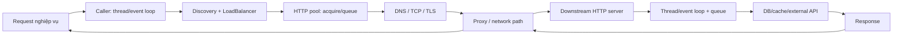
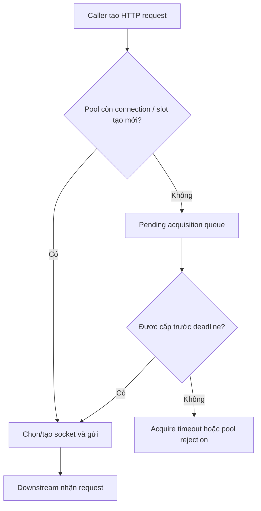
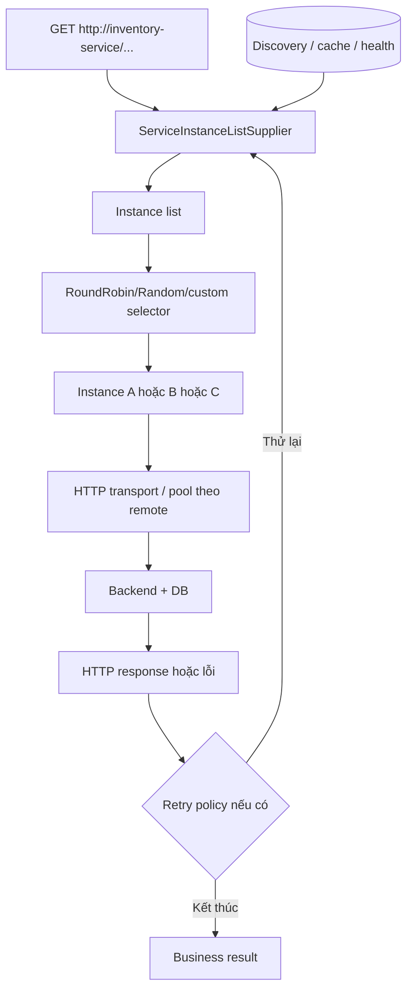
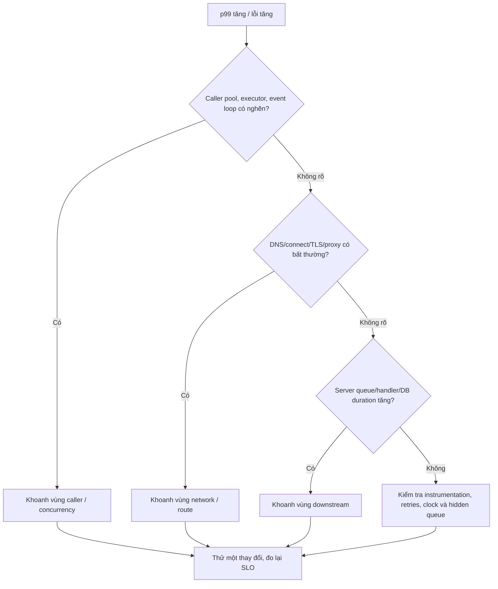

# Phân biệt nút thắt ở bên gọi, mạng và dịch vụ đích

Một request từ `order-service` đến `inventory-service` mất 2 giây không có nghĩa `inventory-service` xử lý chậm 2 giây. Thời gian đó có thể bị tiêu tốn **trước khi request rời bên gọi**, trong lúc **DNS/TCP/TLS/đường mạng** hoạt động hoặc **sau khi request tới dịch vụ đích**. Khi có Spring Cloud LoadBalancer, còn phải xét thời gian lấy danh sách `ServiceInstance`, chọn instance, connection pool và ảnh hưởng của retry.

Ví dụ, `order-service` dùng `@LoadBalanced WebClient.Builder` để gọi `http://inventory-service/api/products/P-1001`. Người dùng nhìn thấy HTTP 504 sau 3 giây. Một nhóm tăng `readTimeout`, nhóm khác thêm instance, nhóm khác tăng connection pool; **cả ba đều có thể vô ích** nếu nguyên nhân thật là WebClient bị block trên event-loop hoặc proxy đang mất gói. Cần đo đúng giai đoạn trước khi quyết định thay đổi.

Bài thuộc chương **Kết nối và hiệu năng** của module Spring Cloud LoadBalancer. Trọng tâm là phân biệt ba miền gây nút thắt — **caller**, **network** và **downstream** — bằng dấu hiệu, metric, distributed tracing và thử nghiệm có kiểm soát. Các ví dụ áp dụng cho `RestClient`, `WebClient`, `OpenFeign`, đồng thời gắn với discovery, lựa chọn `ServiceInstance`, timeout, retry, cache và health check.

## 1. Ba miền nút thắt và ranh giới trách nhiệm

| Miền | Thành phần điển hình | Tài nguyên dễ nghẽn | Dấu hiệu nổi bật |
|---|---|---|---|
| **Bên gọi (caller)** | Application threads, Reactor event loop, queue/bulkhead, HTTP connector, connection pool, LoadBalancer client context | CPU/GC, thread/queue, pool permits, pending connection acquisition | Request chờ lâu **trước khi được gửi**, pool pending cao, blocking event loop, saturation dù backend còn khỏe. |
| **Mạng và hạ tầng trung gian** | DNS, route, TCP, TLS, NAT, firewall, proxy, service mesh, ingress, load balancer hạ tầng | DNS resolver, RTT, bandwidth, socket/network buffers, conntrack, proxy upstream pool | Connect/TLS latency, packet loss/retransmission, reset, lỗi theo AZ/zone, proxy 502/504. |
| **Dịch vụ đích (downstream)** | Server accept queue, HTTP worker/event loop, thread pool, database/Redis client pool, locks, external dependencies | CPU, heap/GC, executor, DB connections, disk I/O, lock, downstream tiếp theo | Server nhận request sớm nhưng phản hồi muộn; handler/DB spans dài, queue tăng, instance-specific p99 cao. |

**Spring Cloud LoadBalancer không tự điều khiển cả ba miền.** Nó chọn `ServiceInstance` từ nguồn instance và thuật toán của caller. Nếu một instance được chọn đúng nhưng backend thiếu database connection, LoadBalancer không tự làm database nhanh hơn. Nếu pool ở caller hết connection, việc tăng số instance có thể hoặc không giúp tùy pool/remote và giới hạn tổng; phải đo.



Sơ đồ là cách nhìn khái niệm: DNS có thể xảy ra trước TCP, TLS có thể được reuse, proxy có thể kết thúc TLS rồi mở kết nối khác và nhiều pha có thể trùng nhau. **Không cộng thời lượng span một cách máy móc** nếu chúng chạy song song, lồng nhau hoặc được ghi bằng các đồng hồ khác nhau.

## 2. Chia nhỏ thời gian gọi HTTP theo pha

Để chẩn đoán, nên hỏi: “Thời gian đã đi đâu **trước khi** backend xử lý?” và “Backend thực sự tốn bao lâu?”.

```text
Caller nhận yêu cầu
  ├─ chờ scheduler/executor/bulkhead
  ├─ discovery/supplier + chọn ServiceInstance
  ├─ chờ cấp connection từ HTTP pool
  ├─ DNS (nếu cần) + TCP connect + TLS handshake (nếu cần)
  ├─ gửi request qua mạng/proxy
  │    └─ downstream nhận request
  │         ├─ chờ server queue/worker
  │         ├─ handler/business logic
  │         └─ DB/cache/another downstream
  ├─ nhận response headers và body
  └─ giải mã, transform, trả response cho caller phía trên
```

Một phép chia **minh họa**, không phải số đo từ hệ thống thực:

| Pha quan sát | Thời lượng giả lập |
|---|---:|
| Chờ ở executor và HTTP pool bên gọi | 650 ms |
| DNS/TCP/TLS và proxy/network | 150 ms |
| Chờ queue + xử lý tại downstream | 1.050 ms |
| Trả body, giải mã và xử lý caller | 150 ms |
| **Tổng theo phép đo không chồng lấp của ví dụ** | **2.000 ms** |

Nếu chỉ nhìn `2.000 ms` từ caller, sẽ dễ tăng timeout và bỏ qua `650 ms` bị xếp hàng tại chỗ. Nhưng nếu chỉ nhìn server handler time `800 ms`, cũng dễ bỏ sót server queue, proxy và network.

**Lưu ý đo đạc:** Không phải mọi instrument tự động tạo đủ bốn khoản trên; histogram HTTP client có thể bao gồm nhiều pha, trong khi server HTTP timer thường đo đoạn sau khi request đã tới server. Muốn phân rã đáng tin cậy phải xác định rõ điểm bắt đầu/kết thúc từng metric và trace span.

## 3. Dấu hiệu của nút thắt tại bên gọi

Nút thắt ở caller thường có đặc điểm: downstream vẫn trả lời nhanh khi gọi trực tiếp, nhưng request đi qua caller chậm hoặc bị từ chối.

### 3.1. HTTP connection pool bị bão hòa

Với WebClient sử dụng Reactor Netty hoặc Feign/RestClient dùng Apache HttpClient, pool có thể giới hạn tổng và/hoặc số connection theo remote route. Khi concurrent requests vượt khả năng cấp connection:

- Active/leased connections tăng gần hạn mức.
- Pending acquire hoặc connection-request queue tăng.
- Thời gian chờ lấy connection tăng, rồi sinh acquisition timeout.
- Không nhất thiết có request tương ứng trong **downstream access log** vì chưa gửi HTTP.
- `connectTimeout` có thể chưa kích hoạt; lỗi xảy ra **trước** khi mở TCP mới.



**Quan trọng:** Với Reactor Netty, `maxConnections` thường áp dụng theo remote address pool, không phải một hạn mức duy nhất cho toàn `inventory-service` khi có nhiều instance. Với HC5, cần kiểm tra cả max total lẫn max per route và manager nào đang được dùng. Không suy từ `activeConnections=20` rằng toàn ứng dụng chỉ có 20 request in-flight.

### 3.2. Thread pool hoặc executor bị nghẽn

Với `RestClient` và `OpenFeign` đồng bộ, thread gọi có thể chờ HTTP response. Nếu một request chậm giữ thread lâu, executor/servlet thread pool có thể đầy:

- Executor active threads chạm giới hạn, queue size tăng.
- Request mới nằm trong hàng đợi trước khi gateway method được gọi.
- Caller CPU có thể **không cao**: threads đang blocked/waiting.
- Stack traces có thể cho thấy chờ socket read, lock, semaphore hoặc DB connection ở chính caller.

Tăng số thread bừa bãi có thể làm thêm connection/request đổ sang downstream đang quá tải. Cần xác định thread đang chờ **điều gì** và đo mức concurrency thực.

### 3.3. Reactor event loop bị block

`WebClient` không blocking không có nghĩa mọi code của ứng dụng đều non-blocking. Ví dụ gọi `Thread.sleep(...)`, JDBC blocking hoặc `Mono.block()` trên event-loop thread có thể khiến event loop chậm xử lý cả những kết nối không liên quan.

Dấu hiệu:

- Event-loop lag hoặc scheduling delay tăng.
- Latency tăng đồng loạt trên nhiều outbound hosts, kể cả backend khỏe.
- Thread dump/profiler phát hiện blocking operation trên thread I/O.
- CPU có thể cao vì xử lý nặng, hoặc thấp vì nhiều thread đợi lock/I/O.

Giữ pipeline reactive không blocking trên event loop; nếu bắt buộc dùng blocking library, chuyển công việc sang scheduler thích hợp có giới hạn concurrency, hoặc dùng client blocking trong kiến trúc đã cấp riêng thread/virtual thread phù hợp. Không giải quyết vấn đề event-loop blocking bằng cách chỉ tăng pool connections.

### 3.4. CPU, GC và xử lý dữ liệu ở caller

JSON decode/encode lớn, mapping DTO, compression, cryptography, logging mức DEBUG, tracing quá chi tiết hoặc batch xử lý tại caller có thể tiêu tốn thời gian **sau khi HTTP response đã nhận**. Dấu hiệu:

- TTFB nhanh nhưng end-to-end operation vẫn chậm.
- CPU cao, GC pause hoặc allocation rate tăng.
- Time trên map/filter/decoder spans lớn.
- Network và server spans không tăng tương ứng.

Đừng đồng nhất “HTTP response đã nhận” với “business operation đã hoàn tất”: caller còn phải decode, kiểm tra, ghép dữ liệu và trả kết quả cho upstream.

## 4. Nút thắt tại mạng: DNS, TCP, TLS và proxy

Network bottleneck thường biểu hiện khác nhau theo đường mạng, host, zone, proxy hoặc tình trạng socket reuse:

| Pha | Dấu hiệu | Hướng kiểm tra |
|---|---|---|
| **DNS lookup** | Mất thời gian trước TCP connect, resolver errors, NXDOMAIN hoặc timeout; có thể theo hostname cụ thể. | DNS resolver/config, cache TTL, search domains, DNS server latency; kiểm tra URI instance từ discovery. |
| **TCP connect** | Thời gian mở socket mới tăng; `ConnectTimeoutException` hoặc refused/unreachable. | Route, firewall, listener port, SYN retransmission, conntrack/NAT, backend accept backlog. |
| **TLS handshake** | TCP kết nối nhanh nhưng handshake chậm/lỗi; `SSLHandshakeException`. | CA, SNI, SAN/hostname, mTLS, crypto CPU, TLS termination/proxy, session reuse. |
| **Packet loss / RTT** | TCP retransmissions, throughput giảm, tail latency tăng, khác biệt theo zone/path. | NIC, packet drops, MTU, latency mạng, network policy, proxy metrics. |
| **Proxy/service mesh** | Client thấy 502/503/504 hoặc upstream timeouts; app server không thấy request. | Phân biệt downstream application vs proxy, xem access log và upstream cluster health. |
| **Băng thông / flow control** | Response body lớn truyền chậm, tốc độ nhận không ổn định. | Bytes/s, TCP window, backpressure, socket buffers, HTTP/2 flow control. |

**Phân biệt connect timeout và connection refused:** connect timeout thường là kết nối TCP không hoàn thành trước ngưỡng; refused có thể xuất hiện tức thì khi đích từ chối kết nối. Cả hai không chứng minh server application đã nhận HTTP request.

### Keep-alive giúp và cũng có thể gây khó chẩn đoán

HTTP client thường tái sử dụng connection:

- Khi socket đã tồn tại, **không có TCP connect mới**, do đó connect timeout không phát sinh cho lượt này.
- Proxy/server có thể đã đóng idle connection; request dùng lại socket có thể gặp reset/premature close.
- Pool cho instance vừa bị remove khỏi discovery có thể vẫn giữ idle sockets một thời gian.
- Việc scale up tạo remote mới có thể làm vài request đầu chậm do TCP/TLS warm-up.

Khi so sánh latency, phân biệt **cold connections** và **warm connections**. Một lỗi chỉ xuất hiện sau vài phút idle có thể liên quan timeout keep-alive giữa client/proxy/server, không phải thuật toán round robin.

### Không vội kết luận “mạng chậm” từ một client-side timeout

Nếu client đọc response chậm, nguyên nhân cũng có thể là backend mất 5 giây truy vấn DB, hoặc caller đã xếp hàng trong pool. Cần đồng thời có thời điểm request đến server, network connection events và backend spans. Ping/ICMP tốt không chứng minh HTTP/TLS đi qua cùng route hoặc proxy và không chứng minh server handler nhanh.

## 5. Nút thắt tại dịch vụ đích

Ngay cả khi TCP/TLS ổn định, downstream vẫn có thể chậm vì request không được xử lý ngay hoặc vì logic nghiệp vụ.

### 5.1. Server-side queue hoặc thread pool

Server có thể đã nhận connection nhưng đang chờ worker thread, event loop, request queue hoặc một semaphore nội bộ. Trong một số stack, thời gian chờ trước handler **không nằm trong span của controller**. Triệu chứng: caller TTFB cao, handler duration đo được lại nhỏ; server executor queue hoặc active requests cao.

### 5.2. Database pool, locks và slow queries

Một request Java có thể chờ connection từ database pool trước khi chạy SQL, hoặc đợi row lock:

```text
HTTP request được nhận
  -> chờ một DB connection từ pool (700 ms)
  -> thực thi query/lock (450 ms)
  -> map DTO và trả response (40 ms)
```

Nếu chỉ tối ưu HTTP pool phía caller trong khi DB pool exhausted, hiệu năng không cải thiện. Phải theo dõi `db.pool.active`, `db.pool.pending`, query latency, slow SQL, lock wait và concurrency tại backend.

### 5.3. CPU, GC, disk và downstream sâu hơn

CPU saturation, GC stop-the-world, đồng bộ lock, gọi Redis/API thứ ba hoặc disk I/O chậm đều có thể kéo dài server duration. Một HTTP timer của `inventory-service` đo 1,2 giây chưa chắc nghĩa là CPU xử lý 1,2 giây — phần lớn có thể chờ `pricing-service` hoặc database.

Distributed trace nên thể hiện nested spans tại downstream: HTTP server → business handler → SQL/client HTTP. Không dùng một CPU chart duy nhất để tuyên bố “backend khỏe”.

### 5.4. Chậm chỉ ở một số instance

Khi `inventory-1` có DB pool cạn nhưng `inventory-2` khỏe:

- `serviceId=inventory-service` có p99 cao nhưng trung bình có thể vẫn ổn.
- Metrics theo `instanceId` cho thấy lỗi/latency tập trung tại `inventory-1`.
- Nếu round robin phân phối đều request count, **tải xử lý đang chạy** vẫn có thể rất khác do thời gian phục vụ không đồng đều.
- Health endpoint `/actuator/health` có thể vẫn báo UP nếu không phản ánh readiness xử lý request thực.

Đây là lúc cần so sánh **selected instance**, latency từng backend, readiness và supplier health/caching; không mặc định tăng connection pool hoặc ngẫu nhiên đổi thuật toán sẽ chữa được bottleneck.

## 6. Sử dụng timeline và distributed trace để định vị khoảng trễ

Một trace hữu ích cần phân biệt **điểm request xuất phát**, **điểm đến**, **phần chờ trước khi gửi HTTP** và **thời gian downstream thực thi**.

Ví dụ hai cách giải thích cho cùng một client span dài 2 giây:

```text
Trường hợp A — caller đang nghẽn:
Client span:              [--------------------- 2000 ms --------------------]
  bulkhead/pool pending:  [------------ 1500 ms ------------]
  network + server:                                      [--- 400 ms ---]
  decode/other:                                                       [100]

Trường hợp B — backend đang chậm:
Client span:              [--------------------- 2000 ms --------------------]
  local + network:        [-- 100 ms --]
  downstream server:                  [---------------- 1800 ms ----------]
  response/decode:                                                     [100]
```

Các timeline là **số giả lập**; không phải metric thật hay phép tính được framework tự làm. Cần lấy metric có điểm đo rõ ràng và quan sát critical path.

### Những span quan trọng

| Span / metric | Điểm bắt đầu và kết thúc mong muốn | Vì sao hữu ích? |
|---|---|---|
| Business operation | Khi caller nhận việc → hoàn tất nghiệp vụ. | Phản ánh latency người dùng chịu, gồm queue, retry, fallback và decode. |
| Outbound HTTP client | Khi client phát request logic → body/response được xử lý theo instrumentation. | Cho biết độ trễ liên quan HTTP call, nhưng có thể gồm hoặc bỏ qua queue/pool tùy SDK. |
| Connection acquisition | Bắt đầu chờ pool → lấy được connection hoặc lỗi. | Phân biệt caller pool bão hòa với TCP/network. |
| TCP connect / TLS handshake | Bắt đầu thiết lập socket mới → kết nối sẵn sàng. | Phân biệt mạng/TLS với xử lý server. |
| Inbound HTTP server | Khi server instrument bắt đầu xử lý → response hoàn tất theo stack. | So sánh với client latency để tìm khoảng trễ ngoài server. |
| Business/DB spans ở backend | Vào handler → query/lock/external call → ra handler. | Xác định nơi tiêu thụ thời gian tại dịch vụ đích. |

**Không lấy timestamp tuyệt đối ở hai máy rồi trừ tùy tiện**: đồng hồ hệ thống có thể lệch dù đã đồng bộ NTP. Dùng span duration từ clock monotonic hoặc trace context do SDK ghi, đồng thời kiểm tra ý nghĩa span. Nested spans có thể đếm trùng; hai span dài 500 ms chạy song song không có nghĩa tổng cần cộng 1.000 ms.

### Cần theo dõi một HTTP attempt hay toàn bộ logical request?

Nếu caller retry ba lần, client operation span có thể dài 3 giây trong khi từng attempt chỉ dài 300 ms và phần còn lại là backoff/pool/processing. Ghi riêng:

- `operationId`/trace ID cho toàn thao tác.
- `attempt` và retry layer cho từng lượt.
- `serviceId`, selected `instanceId`/remote host (có kiểm soát cardinality).
- `outcome`, loại exception/status, tổng latency và per-attempt latency.

Không nhầm tổng thời gian của **ba lần thử** với thời gian xử lý một request đơn tại `inventory-service`.

## 7. Bảng phân biệt nhanh theo triệu chứng

| Dấu hiệu quan sát | Nghi caller | Nghi network/proxy | Nghi downstream |
|---|---|---|---|
| Backend access log không thấy request tương ứng | Pool acquire, thread/bulkhead reject trước gửi. | Packet/route/proxy có thể chặn trước backend. | Ít phù hợp nếu log đầy đủ; phải kiểm tra độ tin cậy log. |
| Pool pending/leased tăng, connect time bình thường | **Rất đáng nghi**. | Có thể gây gián tiếp do socket giữ lâu. | Có thể là nguyên nhân gốc khi backend phản hồi chậm. |
| Reactor event-loop lag hoặc caller executor queue cao | **Rất đáng nghi**. | Ít điển hình. | Có thể gián tiếp làm caller tích queue. |
| TCP SYN retransmission / connect timeout cao | Có thể do local socket/conntrack exhaustion. | **Rất đáng nghi**. | Backend accept backlog/listener cũng có thể gây ra. |
| TLS handshake lỗi hoặc tăng thời gian | Sai cấu hình truststore ở caller. | TLS termination/proxy/network. | TLS listener/backend có thể quá tải. |
| HTTP client p99 cao nhưng HTTP server span ngắn | Pool/scheduling/decode. | Network/proxy/transfers. | Server queue trước span hoặc instrumentation thiếu. |
| Backend server p99 và DB wait cao | Có thể tạo backpressure lên caller. | Không phải giả thuyết chính. | **Rất đáng nghi**. |
| Chậm chỉ với một instance | Route pool cụ thể đang nghẽn. | Đường mạng tới instance/zone đó. | Instance đó CPU/DB/GC/ready khác nhau. |
| Mọi service ID đều chậm từ cùng caller | Caller quá tải hoặc shared pool. | Egress/DNS/proxy dùng chung. | Chỉ hợp lý nếu nhiều backend cùng phụ thuộc tài nguyên chia sẻ. |
| HTTP 504 ở gateway, không có caller-side timeout tương ứng | Caller có thể nhận status từ proxy. | **Rất đáng nghi** timeout upstream của gateway. | Backend có thể là nguyên nhân khiến proxy timeout. |

Đây là bảng **định hướng điều tra**, không phải phép phân loại chắc chắn. Một sự cố thường có chuỗi nguyên nhân: downstream chậm → connection giữ lâu → caller pool pending cao → retry tăng → backend càng chậm.

## 8. Spring Cloud LoadBalancer ảnh hưởng đến hiệu năng ở đâu?

Spring Cloud LoadBalancer chọn đích **phía client** theo service ID và danh sách instance. Nó có thể ảnh hưởng độ trễ/độ ổn định qua:

1. **Discovery lookup/supplier chain:** lấy danh sách từ registry, cache, health filter, zone preference hoặc custom supplier.
2. **Thuật toán chọn đích:** round robin, random hoặc chính sách tùy chỉnh, có thể phân phối tải không đều khi request cost khác nhau.
3. **Cache và dữ liệu stale:** instance đã bị rút nhưng vẫn còn trong cache, dẫn tới connect/read timeout.
4. **Health checks/readiness:** một số instance bị loại hoặc được đưa vào trở lại; health endpoint không nhất thiết phát hiện DB pool nghẽn nếu readiness không phản ánh điều đó.
5. **Retry-on-next-instance:** có thể chuyển request sau lỗi, nhưng cũng làm tăng số HTTP attempts và thời gian logic.



### Round robin không tự cân bằng thời gian xử lý

Round robin cố gắng phân phối **lượt chọn**, không nhất thiết phân phối **số request đang xử lý**, CPU hay DB load. Nếu `inventory-1` mất trung bình 100 ms/request và `inventory-2` mất 1 giây/request, cùng số lượt gọi có thể tạo concurrency đang hoạt động và pool pressure rất khác.

Không đổi sang random chỉ vì p99 một instance cao. Cần xác minh instance health, request mix, concurrency, pool route, locality và chính sách routing trước.

### Service ID và remote address không hoàn toàn tương đương

Trong môi trường có service mesh, NAT hoặc HTTP proxy, client có thể kết nối tới proxy chung trong khi LoadBalancer lựa chọn instance logic. HTTP pool quản lý connection theo **remote address mà transport thực sự thấy**, có thể không phải từng `ServiceInstance` theo cách trực giác. Do đó quan sát socket count theo service ID phải đi cùng route/proxy configuration.

### Không tìm thấy instance là một nhóm lỗi riêng

Khi supplier trả danh sách rỗng, caller có thể nhận lỗi không có instance hoặc response lỗi tùy tích hợp. Ở thời điểm đó chưa có TCP request tới backend. Tăng connect timeout hoặc connection pool không sửa được lỗi discovery; cần kiểm tra registration, readiness, health probe, service ID và trạng thái cache.

## 9. Timeout và retry có thể che khuất nguyên nhân thực

Ba ví dụ:

**Ví dụ A — Pool đang nghẽn:** Một request đợi connection 800 ms, backend trả trong 100 ms. Tăng `responseTimeout` từ 1 lên 5 giây có thể không thay đổi latency 900 ms; cần xử lý pending acquire/concurrency.

**Ví dụ B — Network mất gói:** TCP connect mất 1,5 giây, backend xử lý 40 ms. Tăng connection pool không giải quyết TCP retransmission. Cần kiểm tra path/conntrack/firewall và connection reuse.

**Ví dụ C — Backend DB pool hết slot:** HTTP request đến server ngay, nhưng server chờ database 2 giây. Tăng caller timeout khiến request chờ lâu hơn; bật retry có thể nhân thêm áp lực lên database.

| Giới hạn | Bảo vệ điều gì? | Nó không bảo vệ trọn vẹn điều gì? |
|---|---|---|
| Pool acquire timeout | Chờ HTTP connection từ pool. | TCP connect, TLS hoặc server response. |
| Connect timeout | Thiết lập kết nối TCP mới theo transport. | DNS, pool wait, toàn bộ TLS/HTTP body. |
| Read/response timeout | Chờ dữ liệu/response theo HTTP engine. | Không nhất thiết là overall deadline. |
| Overall deadline | Toàn logical operation trong scope được bao bọc. | Không tự rollback side effect đã diễn ra ở backend. |
| Retry limit | Số lần thử gửi lại trong một tầng. | Không tự giới hạn tổng attempts nếu các tầng khác cũng retry. |

### Nhân tải khi có nhiều tầng retry

Nếu caller retry hai attempts ở tầng business, LoadBalancer cũng thử tối đa hai attempts, và transport tự phục hồi đến hai attempts trong trường hợp được phép, một logical operation có thể tạo **tối đa tám attempts ở tầng thấp trong kịch bản lồng nhau giả định**. Số HTTP requests thực đến backend có thể ít hơn nếu lỗi xảy ra trước bước gửi.

Khi backend đã bão hòa, retries thiếu backoff/deadline làm queue, pool pending và p99 tăng. Đừng bật retry với mọi `5xx`, `429` hoặc TLS failure. Cần chính sách theo exception/status, rate limit/`Retry-After`, idempotency và ngân sách thời gian.

### Phân biệt HTTP status với lỗi trước khi có HTTP

HTTP `502/503/504` có thể do gateway/proxy trả, không phải Java HTTP client tự sinh ra từ connect timeout. `Connection refused`, `UnknownHostException` hoặc pool acquire timeout thường không có HTTP response nghiệp vụ từ backend. Không gắn mọi lỗi thành “server trả 504” nếu caller chỉ nhận exception.

## 10. Không cộng p95/p99 của các thành phần để ra p95/p99 tổng

Giả sử p99 của client pool acquire là 300 ms, p99 TCP/TLS là 200 ms và p99 backend là 1.000 ms. **Không thể kết luận** p99 tổng = 1.500 ms chỉ bằng cách cộng các percentile độc lập: các pha có thể xảy ra ở những requests khác nhau, có pha bỏ qua nhờ keep-alive và có pha chồng lấp.

Đúng hơn, hãy dùng:

- End-to-end latency distribution cho **cùng tập logical operations**.
- Trace mẫu của tail requests và critical path để xem pha nào chiếm thời gian.
- Histogram/counter theo component để thấy phân phối, chứ không lấy percentile làm số hạng cộng.
- Log correlation theo attempt, service ID và selected instance để tách tải không đồng đều.

### Sử dụng Little's Law như một điểm khởi đầu

Ở trạng thái tương đối ổn định:

```text
Số operations đang xử lý trung bình
  ≈ tốc độ đến trung bình (operations/s)
    × thời gian trong hệ thống trung bình (s)
```

Ví dụ `200 operations/s × 0,25 s = khoảng 50 operations đồng thời` ở phạm vi đang đo. Đây là **concurrency trung bình**, không phải pool size tối ưu hay peak concurrency. Cần xem burst, retry amplification, request cost, instance count, p95/p99, HTTP/2 multiplexing và max concurrent calls.

Khi thời gian xử lý tăng mà throughput đến không giảm, số request in-flight hoặc queue sẽ có xu hướng tăng. Nếu tài nguyên giới hạn, hệ thống bắt đầu từ chối hoặc timeout — đúng biểu hiện của overload.

### Tách latency khỏi throughput và lỗi

Chỉ tăng throughput hoặc chỉ giảm mean latency không đủ. Cần cùng lúc xem:

- Throughput tốt thực sự: **successful logical operations/s**, không chỉ HTTP attempts/s.
- p50, p95, p99 latency của logical operation.
- Timeout/error/retry rates, kết quả lần đầu so với sau retry.
- Queue/pool pending, CPU/memory, network và backend dependencies.

Một hệ thống có thể có throughput cao hơn nhưng p99 tăng gấp nhiều lần vì tạo quá nhiều hàng đợi. Trong trường hợp đó, giảm concurrency/queue có kiểm soát đôi khi tốt hơn tăng maxConnections.

## 11. Đo WebClient và Reactor Netty phía caller

Với `WebClient` sử dụng Reactor Netty, có thể tạo `ConnectionProvider` riêng cho workload để đo pool acquisition và giới hạn tài nguyên. Ví dụ minh họa trên những phiên bản Reactor Netty hỗ trợ builder API tương ứng:

```java
import java.time.Duration;
import io.netty.channel.ChannelOption;
import org.springframework.cloud.client.loadbalancer.LoadBalanced;
import org.springframework.context.annotation.Bean;
import org.springframework.context.annotation.Configuration;
import org.springframework.http.client.reactive.ReactorClientHttpConnector;
import org.springframework.web.reactive.function.client.WebClient;
import reactor.netty.http.client.HttpClient;
import reactor.netty.resources.ConnectionProvider;

@Configuration(proxyBeanMethods = false)
class InventoryWebClientConfig {

    @Bean(destroyMethod = "dispose")
    ConnectionProvider inventoryConnectionProvider() {
        return ConnectionProvider.builder("inventory-pool")
                .maxConnections(64)
                .pendingAcquireMaxCount(128)
                .pendingAcquireTimeout(Duration.ofMillis(300))
                .maxIdleTime(Duration.ofSeconds(20))
                .metrics(true)
                .build();
    }

    @Bean
    @LoadBalanced
    WebClient.Builder inventoryLoadBalancedBuilder(
            ConnectionProvider inventoryConnectionProvider) {
        HttpClient httpClient = HttpClient.create(inventoryConnectionProvider)
                .option(ChannelOption.CONNECT_TIMEOUT_MILLIS, 1500)
                .responseTimeout(Duration.ofSeconds(3));
        return WebClient.builder()
                .clientConnector(new ReactorClientHttpConnector(httpClient));
    }
}
```

Các giá trị 64/128/300 ms/20 s/1,5 s/3 s chỉ để minh họa, **không phải recommendation mặc định cho production**. Cần `Micrometer`/meter registry và tích hợp phù hợp để metrics thực sự xuất hiện. Tên meters và tags phụ thuộc Reactor Netty version, nên kiểm tra metadata/thực tế thay vì viết dashboard dựa trên tên đoán.

**Lưu ý:**

- `ConnectionProvider.metrics(true)` cung cấp instrumentation của pool nếu môi trường có cấu hình hỗ trợ; nó không tự đo đầy đủ business latency hay selected instance.
- Pool do chính configuration tạo có thể được dispose khi context đóng; không tự dispose tài nguyên Reactor Netty **dùng chung** mà Spring Boot hoặc các client khác quản lý.
- Tự tạo `WebClient.builder()` có thể không kế thừa mọi `WebClientCustomizer`/observation/SSL của Spring Boot. Trong dự án thật, cần tích hợp customizer/configurer phù hợp phiên bản để giữ instrumentation và client policy.
- `responseTimeout` của Reactor Netty không phải overall deadline của mọi logical operation. Khi cần deadline tổng, áp dụng giới hạn ở pipeline/orchestration bên ngoài retry.

### Giới hạn concurrency ở tầng ứng dụng

Ví dụ caller lấy nhiều sản phẩm:

```java
Flux<ProductView> items = Flux.fromIterable(productIds)
        .flatMap(id -> inventoryWebClient.get()
                        .uri("/api/products/{id}", id)
                        .retrieve()
                        .bodyToMono(ProductView.class),
                16);
```

`16` là mức concurrent inner subscriptions của pipeline này, không phải tổng concurrency toàn hệ thống. Đừng cho phép hàng nghìn calls đồng thời chỉ vì WebClient non-blocking; pool, network và backend vẫn có giới hạn.

## 12. RestClient và OpenFeign: đo timeout, pool và thread waiting

### RestClient (blocking)

Khi dùng `@LoadBalanced RestClient.Builder`, hãy xác định `ClientHttpRequestFactory` thực tế:

- Factory dựa trên JDK có tập timeout và connection reuse riêng.
- Apache HttpComponents có connection manager/pool với giới hạn và timeout lấy connection.
- Các version Spring Boot có thể chọn hoặc customize HTTP client dựa trên classpath.

Để phân biệt caller nghẽn và backend chậm, theo dõi executor/servlet threads tại caller, HTTP client spans, pool leased/pending nếu có, và selected instance. **Một response chậm không chứng minh thread ở caller đang tiêu CPU**: thread có thể đang chờ socket read.

### OpenFeign

`@FeignClient(name = "inventory-service")` không đặt URL cố định có thể dùng Spring Cloud LoadBalancer wrapper để chọn instance. Nhưng pool thuộc **underlying Feign transport**, ví dụ Apache HttpClient 5 (`feign-hc5`) hoặc OkHttp (`feign-okhttp`), không phải một property chung của mọi Feign client.

Nếu dùng HC5, kiểm tra max connections **tổng** và **per route**, pending/leased/available connections cùng thời gian acquire. Nếu dùng OkHttp, theo dõi connection pool/dispatcher bằng công cụ tương ứng; không áp các tham số per-route của HC5 cho OkHttp.

Một `@FeignClient` có `url` tĩnh có thể đi trực tiếp đến URL thay vì chọn instance qua discovery. Trong trường hợp đó, so sánh Feign timing với LoadBalancer algorithm không có ý nghĩa; cần xác minh bean/wrapper và cấu hình URL thực sự.

### Instrumentation phù hợp với từng tầng

| Client | Tín hiệu nên đo tại caller | Điều cần xác minh |
|---|---|---|
| RestClient | HTTP client observation, request factory, connect/read timeout, executor waiting, connection manager nếu có. | Builder có `@LoadBalanced`, đã nhận Boot customizers? |
| WebClient | Reactor Netty active/idle/pending, response latency, event loop, Reactor scheduling, selected instance. | Connector đúng Reactor Netty hay JDK/Jetty/Apache? |
| OpenFeign | Micrometer/Feign metrics, HTTP transport pool, Feign retry, LoadBalancer wrapper, caller threads. | Feign delegate là HC5/OkHttp/JDK? Retryer có hoạt động? |

Không mặc định chỉ thêm Spring Boot Actuator là có đủ metric pool, DNS hay selected instance; nhiều metric cần bật ở HTTP engine hoặc custom observation. Cũng không dùng raw product ID, user ID, URL có query bí mật làm metric label.

## 13. Quy trình điều tra khi một API đột ngột chậm

Một quy trình thực tế nên đi từ **phạm vi ảnh hưởng** tới **đường đi của request**, tránh thay cấu hình trước khi có giả thuyết.

### Bước 1 — Xác định biểu hiện và phạm vi

Ghi rõ:

- Lỗi bắt đầu khi nào, kéo dài bao lâu, sau deploy/scaling/cấu hình nào?
- Chỉ một endpoint hay mọi endpoint? Chỉ một service ID hay mọi downstream?
- Chỉ một caller instance/pod, một region/AZ, một backend hay tất cả?
- p50, p95, p99, throughput, error rate, timeout count thay đổi thế nào?
- Có retry, circuit breaker OPEN, bulkhead rejection hoặc autoscaling diễn ra cùng lúc không?

Ví dụ nếu `order-service` gọi **mọi** dependency đều chậm, nghi shared client executor, DNS/proxy egress hoặc CPU/GC caller. Nếu chỉ `inventory-service` chậm và tập trung vào `inventory-2`, ưu tiên điều tra đường đến instance đó và backend cụ thể.

### Bước 2 — Xác minh đường đi thật

Kiểm tra:

1. URL logic (`http://inventory-service`) hay URL cố định?
2. Spring Cloud LoadBalancer có tham gia không, selected `ServiceInstance` là gì?
3. HTTP transport thực tế có proxy/service mesh không?
4. Request có đi qua gateway/ingress không, proxy nào là điểm termination TLS?
5. Một logical operation có bao nhiêu attempts vì retry?

**Một instance trong discovery không đồng nghĩa TCP destination duy nhất.** Khi có sidecar/proxy, connection thực có thể đến một địa chỉ khác. Nếu cần test bằng cách gọi thẳng backend, phải nói rõ phép thử đó **bỏ qua những lớp nào** — không dùng kết quả gọi trực tiếp để tuyên bố proxy/network path production khỏe.

### Bước 3 — Kiểm tra caller trước khi kết luận backend lỗi

Ở thời điểm lỗi, xem:

- Executor active/queue/rejected và thread dump.
- Event-loop lag/blocking call, CPU, GC.
- HTTP pool active/idle/pending/acquire timeout.
- Bulkhead queue/available permits, circuit breaker not-permitted.
- Per-attempt timeout, retry count và overall deadline.

Nếu caller pending cao và backend không nhận thêm request, ưu tiên điều chỉnh concurrency, pool/queue hoặc nguồn làm giữ connection thay vì tăng backend replica ngay.

### Bước 4 — So sánh mạng và downstream bằng trace

Correlate trace ID:

- Caller bắt đầu request lúc nào? Có pool/DNS/connect/TLS events không?
- Proxy có nhận request và gửi upstream không? HTTP status do proxy hay app trả?
- Backend có access log của request ID không? Bắt đầu xử lý và trả response khi nào?
- Handler có spans nào chờ DB/cache/lock/external HTTP call?

Không lấy một span của backend ngắn làm bằng chứng backend hoàn toàn khỏe nếu request queue trước khi vào handler không được instrument.

### Bước 5 — Thay một biến trong môi trường an toàn

Thử nghiệm có kiểm soát, ví dụ:

- Giảm caller concurrency để xem pending pool và p99 có giảm không.
- Cố định route tới một backend rồi so sánh các backend cùng workload.
- Thử cold vs warm connections để phân biệt connect/TLS với reuse.
- Mô phỏng network latency/loss qua proxy thử nghiệm **có quyền kiểm soát**.
- Tạo endpoint backend chậm giả lập, theo dõi handler time và client response time.

Tránh thay đồng thời maxConnections, timeout, retry, load balancing algorithm và backend replica count: nếu kết quả cải thiện sẽ không xác định được nguyên nhân.



## 14. Thiết lập baseline đo theo instance và pha

Trước khi điều tra sự cố, nên có một dashboard baseline và logs liên kết được.

| Nhóm metric | Mẫu quan sát nên có | Ghi chú |
|---|---|---|
| SLO caller | Successful operations/s, logical p50/p95/p99, timeout, error ratio. | Tính trên logical operations, không chỉ HTTP attempts. |
| Client attempts | Attempt count, status/exception, retry reason, success-after-retry. | Cần correlation để không đếm retry thành người dùng mới. |
| LoadBalancer | Service ID, selected instance, số instance hợp lệ, không có instance, health/supplier events. | Tránh gắn instance IDs ngắn hạn vào metric có cardinality vô hạn. |
| Caller transport | Pool leased/idle/pending, acquire time, TCP connect/TLS errors, connection churn. | Metric khác nhau giữa Reactor Netty, HC5, OkHttp/JDK. |
| Caller runtime | CPU, GC pause, event loop lag, worker/executor queue, thread state. | Event loop block có thể làm nhiều downstream chậm cùng lúc. |
| Network/proxy | TCP retransmit/loss, RTT khi đo được, proxy upstream latency, 502/503/504, DNS latency. | Thiết bị trung gian có thể là nguồn HTTP status. |
| Target HTTP | Request in-flight, server queue, handler duration, p95/p99 theo route/instance. | Server timer có thể không bao gồm queue trước handler. |
| Target dependencies | DB pool wait, SQL latency/locks, cache latency, nested HTTP spans, disk I/O. | Tìm sự chờ bên trong request đích. |

Ví dụ log có correlation:

```text
traceId=8b11
operation=read-product
serviceId=inventory-service
selectedInstance=inventory-2
attempt=1
clientPoolAcquireMs=410
connectMs=0
serverObservedMs=70
logicalDurationMs=520
outcome=SUCCESS
```

**Đây là log giả lập để minh họa format**, không phải các field được Spring Cloud LoadBalancer tự ghi. `connectMs=0` ở ví dụ **có thể** là reuse connection hoặc chưa đo được connect, không được tự hiểu là connect luôn bằng 0; hãy đặt trạng thái observation như `reusedConnection=true` hoặc `phaseNotObserved` nếu instrumentation hỗ trợ.

### Phân nhóm cardinality

Metric labels nên ưu tiên `serviceId`, HTTP method, route template, error class và môi trường ổn định. Những nhãn như `productId`, full URL có query string, token, request ID hay user ID tạo nhiều time series và có thể lộ dữ liệu. Chi tiết theo `instanceId` hữu ích khi điều tra nhưng cần cân nhắc lifespan của pod/instance, giới hạn cardinality, sampling hoặc log/traces thay vì gắn mãi vào mọi metric.

## 15. Bài lab: ba lớp cùng một đường gọi

Mục tiêu lab là **chứng minh định vị bottleneck bằng tín hiệu**, không chỉ mô tả lý thuyết. Chuẩn bị:

- Caller `order-service` dùng `@LoadBalanced WebClient.Builder` (hoặc RestClient/Feign với instrumentation tương đương).
- Hai backend `inventory-1` tại `localhost:8081` và `inventory-2` tại `localhost:8082`.
- Cả hai có `GET /lab/fast` trả ngay và `GET /lab/slow` trả sau độ trễ có kiểm soát.
- Một load generator **giới hạn tải**, có thể ghi request count, p95/p99, failure count.
- Metric caller pool, server handler, thread/event loop; nếu có proxy lab, thêm DNS/connect/TLS/proxy metrics.

### Đăng ký instance tĩnh trong môi trường học

```yaml
spring:
  cloud:
    discovery:
      client:
        simple:
          instances:
            inventory-service:
              - uri: http://localhost:8081
              - uri: http://localhost:8082
```

`SimpleDiscoveryClient` giúp giảm biến số do registry, nhưng **không tự phản ánh autoscaling/health thật** nếu danh sách tĩnh không thay đổi. Dùng môi trường test với dữ liệu giả, tránh stress test production.

### Endpoint mô phỏng chậm ở WebFlux backend

```java
import java.time.Duration;
import org.springframework.web.bind.annotation.GetMapping;
import org.springframework.web.bind.annotation.RestController;
import reactor.core.publisher.Mono;

@RestController
class InventoryPerformanceLabController {

    @GetMapping("/lab/fast")
    Mono<String> fast() {
        return Mono.just("ok");
    }

    @GetMapping("/lab/slow")
    Mono<String> slow() {
        return Mono.just("slow-ok")
                .delayElement(Duration.ofMillis(900));
    }
}
```

`delayElement` minh họa **thời gian chờ phản hồi không blocking event loop**; nó không mô phỏng CPU saturation hay DB pool exhaustion. Muốn thử những loại bottleneck đó, dùng workload/limiter/proxy test riêng thay vì thêm `Thread.sleep()` trực tiếp vào WebFlux event loop và gọi đó là xử lý database.

### Kịch bản A — Baseline với hai instance khỏe

Gọi `/lab/fast` qua service ID ở mức concurrency thấp; ghi selected instance, tổng latency, pool reuse và server duration. Xác minh gateway thực sự chọn cả hai backend nếu chính sách round robin và danh sách ổn định. Phân biệt cold first request với warm requests trước khi so sánh.

### Kịch bản B — Caller connection pool là nút thắt

Đặt `maxConnections(2)` và `pendingAcquireMaxCount(4)` trên connection provider của caller **chỉ trong lab**, sau đó gửi số request concurrent lớn hơn khả năng xử lý. Dùng `/lab/slow` để giữ connection bận.

Kỳ vọng quan sát **có điều kiện**: active connections chạm limit, pending acquire tăng và một số request bị từ chối/hết thời gian chờ pool. Backend có thể vẫn xử lý nhanh khi từng request thực sự đến. Nếu không thấy các biểu hiện trên, xem request có được phân phối sang hai remote pools hay có HTTP/2 multiplexing, request concurrency thực thấp hơn dự kiến hoặc HTTP engine khác được chọn.

### Kịch bản C — Event loop / executor caller bị nghẽn

Sử dụng một tác vụ test riêng làm bận executor hoặc một blocking test được cô lập, theo dõi scheduling delay/thread waiting và p99 khi gọi `/lab/fast`. Với WebFlux, không chủ ý làm treo event loop chung trong một hệ thống dùng cho người khác. Mục tiêu là nhận ra client latency tăng **dù HTTP server timer vẫn nhỏ**, và khôi phục được khi bỏ nghẽn caller.

### Kịch bản D — Giả lập latency/loss ở đường mạng

Nếu có một proxy fault-injection test được phép quản lý, thêm latency có hạn mức giữa caller và backend; thử một tỷ lệ packet loss rất nhỏ rồi khôi phục. Quan sát connect/TLS/response latency, TCP retry và status của proxy.

Không chỉnh firewall/routing production hoặc gửi traffic thử đến IP ngoài không thuộc quyền kiểm soát. Kịch bản lỗi mạng phải có khả năng rollback ngay và tách biệt với dữ liệu người dùng.

### Kịch bản E — Downstream phản hồi chậm

Gọi `/lab/slow` và so sánh client latency với server handler duration. Với endpoint `delayElement`, server duration nên tăng rõ theo độ trễ mô phỏng; pool pending chỉ tăng khi concurrency đủ lớn để giữ hết slots. Nếu muốn kiểm tra DB pool hoặc lock, cần dùng một backend test được instrument riêng cho SQL/DB queue thay vì suy từ endpoint chậm nhân tạo.

### Kịch bản F — Một instance chậm, instance còn lại khỏe

Cấu hình `inventory-1` phục vụ `/lab/fast`, còn `inventory-2` phục vụ route tương ứng với độ trễ. Với round robin, so sánh request count, p95/p99 và error rate **theo selected instance**, cùng pool usage theo remote. Quan sát logical p99 có thể tăng dù một nửa requests vẫn nhanh.

Kiểm tra readiness/health check: endpoint `/actuator/health` báo UP chưa chắc có nghĩa instance đáp ứng SLO latency. Không thay readiness thành probe quá nặng hoặc phụ thuộc toàn bộ downstream khiến false negative/feedback loop.

### Kịch bản G — Retry khuếch đại lỗi

Cho backend trả `503` có kiểm soát; thử một policy retry GET tối đa một lượt với backoff nhỏ, rồi so sánh logical RPS với HTTP attempts/s, pool pending và server error rate. Dừng test khi thấy dấu hiệu quá tải; không bật retry toàn bộ `POST` hoặc thao tác ghi không có idempotency.

### Bảng ghi kết quả

| Kịch bản | Caller pool pending | Connect/TLS latency | Server handler time | HTTP attempts / operation | Logical p99 | Kết luận sau đo |
|---|---|---|---|---|---|---|
| Baseline | Ghi thực tế | Ghi thực tế | Ghi thực tế | Ghi thực tế | Đo thực tế | Khoanh vùng |
| Pool bão hòa | Ghi thực tế | Ghi thực tế | Ghi thực tế | Ghi thực tế | Đo thực tế | Khoanh vùng |
| Network latency | Ghi thực tế | Ghi thực tế | Ghi thực tế | Ghi thực tế | Đo thực tế | Khoanh vùng |
| Backend chậm | Ghi thực tế | Ghi thực tế | Ghi thực tế | Ghi thực tế | Đo thực tế | Khoanh vùng |
| Một instance chậm | Ghi theo instance | Ghi theo instance | Ghi theo instance | Ghi thực tế | Đo thực tế | Khoanh vùng |
| Retry | Ghi thực tế | Ghi thực tế | Ghi thực tế | Ghi thực tế | Đo thực tế | Khoanh vùng |

Không điền số liệu chưa đo. Ghi rõ version Spring Boot/Cloud, HTTP transport, topology, số caller replicas, protocol HTTP/1.1 hay HTTP/2 và mô tả workload.

## 16. Chọn hướng xử lý theo nút thắt đã chứng minh

Không có một thay đổi chung giải quyết mọi tình huống. Hãy chọn giải pháp dựa trên **evidence** thu thập được và đo lại SLO sau khi can thiệp.

### Khi nút thắt ở caller

| Đã xác nhận | Hướng xử lý | Điều không nên làm |
|---|---|---|
| Connection pool pending do concurrency vượt capacity | Điều chỉnh pool theo remote/route, hạn chế concurrent requests và backpressure; đo cả backend capacity. | Tăng `maxConnections` vô hạn mà không kiểm tra DB/server. |
| Executor queue cao, nhiều threads chờ I/O | Giảm fan-out, đặt deadline, tách workload, kiểm soát số blocking calls và thread/virtual-thread policy. | Chỉ thêm threads khi upstream/downstream đã bão hòa. |
| Event loop bị block | Loại blocking call khỏi event loop, chuyển đúng scheduler/transport. | Tăng CPU hoặc HTTP connection pool để che giấu blocking. |
| GC và allocations cao khi decode JSON | Giảm body size, streaming phù hợp, codec/buffer tuning theo profiling. | Tăng timeout mà không xử lý memory pressure. |
| Bulkhead đầy | Tách quota theo dependency/operation, điều chỉnh concurrency dựa trên measured load. | Retry `BulkheadFullException` tức thì, tạo thêm queue. |

### Khi nút thắt ở network/proxy

| Đã xác nhận | Hướng xử lý | Điều không nên làm |
|---|---|---|
| DNS resolution chậm/lỗi | Kiểm tra resolver, service name, TTL/negative cache và DNS server/path. | Chỉ tăng connect timeout, hoặc hard-code IP production. |
| TCP connect/retransmission cao | Xem network ACL/route, AZ, conntrack/NAT, SYN backlog, socket reuse. | Chỉ tăng pool mà bỏ qua packet loss/route. |
| TLS handshake tốn thời gian hoặc lỗi | Kiểm tra certificate, SNI/SAN, mTLS, proxy termination, TLS session reuse. | Tắt hostname verification hoặc trust-all. |
| Proxy 502/504 | Đối chiếu proxy upstream timeout, connection pool, route/cluster health và backend timing. | Gán mọi HTTP 504 thành lỗi đọc response trong Java caller. |
| Large body/HTTP2 flow control | Kiểm tra payload size, compression, chunking, backpressure, network throughput. | Chỉ điều chỉnh round robin để kỳ vọng băng thông tăng. |

### Khi nút thắt ở downstream

| Đã xác nhận | Hướng xử lý | Điều không nên làm |
|---|---|---|
| DB pool wait hoặc slow SQL | Tối ưu query/index, giảm lock contention, cân đối DB pool và request concurrency. | Tăng caller read timeout khiến nhiều request chờ lâu hơn. |
| Handler/server queue bão hòa | Giới hạn inbound concurrency, sửa blocking, tăng capacity có kiểm chứng. | Bật retry-all khiến backend nhận thêm tải lúc đã quá tải. |
| Một instance chậm/không ready | Điều tra instance và readiness, scale/drain an toàn, sửa health signal/supplier routing. | Mặc định loại mọi instance chỉ vì một probe nặng thất bại. |
| Dependency sâu hơn bị chậm | Theo dấu nested spans, áp deadline/bulkhead theo hop, cải thiện dependency gốc. | Coi `inventory-service` CPU thấp là bằng chứng toàn request nhanh. |

**Tối ưu theo vòng lặp nhỏ:** (1) đo baseline, (2) chọn một giả thuyết, (3) can thiệp một biến, (4) đo lại throughput/p99/error/pool/backend, (5) giữ hoặc rollback. Một thay đổi làm p50 tốt hơn nhưng p99 và tỷ lệ lỗi xấu đi chưa chắc là cải thiện.

## 17. Những ngộ nhận dễ dẫn đến tuning sai

**“LoadBalancer chia đều request nên mọi instance chịu tải bằng nhau.”** Không đúng khi độ nặng request khác nhau. Round robin chia lượt chọn chứ không trực tiếp điều tiết CPU, request cost, DB pool hay số tác vụ đang chạy.

**“Read timeout nghĩa là mạng chậm.”** Không đủ: server có thể đã nhận request và đang chờ DB; caller có thể bị proxy ngắt; với streaming timeout còn phụ thuộc khoảng không nhận được dữ liệu.

**“Backend handler chỉ chạy 50 ms, vậy mạng gây ra 2 giây còn lại.”** Chưa chắc: có queue trước handler, client pool wait, retry backoff và decode sau response. Phải xác định scope của span.

**“CPU caller thấp nghĩa là caller không nghẽn.”** Sai nếu threads đang chờ connection pool, lock hoặc blocking I/O. Xem wait states và queue metrics.

**“Tăng connection pool luôn tăng throughput.”** Không nếu backend DB/worker hết capacity; có thể chỉ tạo thêm sockets, TLS handshakes và timeout.

**“TCP connect thành công là network đã khỏe.”** Không: response path vẫn có thể mất gói, proxy có thể timeout, MTU hoặc bandwidth có thể là nút thắt; TLS và HTTP/2 flow control có thể gây trễ.

**“Gọi trực tiếp IP backend nhanh, vậy hệ thống production phải nhanh.”** Không nếu production sử dụng proxy, TLS, service mesh, khác zone hay policy route khác. Test trực tiếp chỉ loại trừ được những pha nó thực sự đi qua.

**“Retry luôn tăng tính ổn định.”** Retry trong khi backend quá tải thường gây amplification, pool pending và tail latency tăng. Cần classifier, retry budget, backoff/jitter, overall deadline và idempotency.

**“Health endpoint báo UP nghĩa là instance đáp ứng SLO.”** Không: health check đơn giản không nhất thiết đo concurrency, DB locks hoặc thời gian xử lý thực. Readiness cần có ngữ nghĩa chính xác mà không tạo thêm tải nguy hiểm.

**“Khi một request 504, Spring Cloud LoadBalancer là nguồn 504.”** Không mặc định: response có thể đến từ ingress/proxy/gateway hoặc server; lỗi client-side connect timeout có thể chỉ là exception mà không có HTTP status.

## 18. Checklist chẩn đoán nút thắt theo ba miền

- [ ] Định nghĩa rõ logical operation, HTTP attempt, backend request và phạm vi metric thời gian.
- [ ] Ghi SLO, baseline p50/p95/p99, successful operations/s, error/timeout/retry rates.
- [ ] Xác nhận caller dùng đúng `@LoadBalanced` RestClient/WebClient hoặc OpenFeign wrapper, không phải URL cố định nếu mục tiêu là discovery.
- [ ] Biết service ID được resolve thành những `ServiceInstance` nào và client có chọn đúng instance không.
- [ ] Đo discovery/supplier latency và nhận diện danh sách instance stale, rỗng hoặc bị health filter loại hết.
- [ ] Xác minh HTTP connector/transport thực: Reactor Netty, Apache HC5, OkHttp, JDK hoặc engine khác.
- [ ] Đo HTTP pool active/leased/idle/pending và acquisition timeout theo remote khi có thể.
- [ ] Kiểm tra executor/thread queue, blocking threads, event loop lag, caller CPU/GC và quá trình decode.
- [ ] Phân biệt DNS lookup, TCP connect, TLS handshake, response read và overall deadline.
- [ ] Kiểm tra proxy/service mesh/ingress, network retransmissions, conntrack, route/zone và TLS termination khi có dấu hiệu mạng.
- [ ] So sánh caller outbound span và downstream inbound/server spans, hiểu điểm đo và clock skew.
- [ ] Kiểm tra downstream server queue, CPU/GC, handler, DB connection wait, slow queries, locks và external dependencies.
- [ ] Phân tích latency/error theo selected instance; không chỉ nhìn trung bình toàn service.
- [ ] Phân biệt TTFB với thời gian đọc toàn body, đặc biệt với streaming và response lớn.
- [ ] Không cộng các p99 độc lập thành p99 tổng; sử dụng trace critical path và phân phối end-to-end thật.
- [ ] Đếm actual HTTP attempts để phát hiện retry amplification và tách thành công sau retry với thành công lần đầu.
- [ ] Kiểm tra retry-on-next-instance, overall deadline, backoff và circuit breaker/bulkhead có làm thay đổi tải không.
- [ ] Thử các kịch bản caller-pool/network/backend/instance-skew trong môi trường lab có kiểm soát.
- [ ] Chỉ thay đổi một nhóm thông số mỗi lần, đo lại p99/error/throughput và khả năng backend.
- [ ] Không vô hiệu hóa TLS verification, không gửi test dữ liệu thật hoặc stress production để chẩn đoán.
- [ ] Ghi trace/log có correlation ID và kiểm soát metric cardinality, tránh secrets/PII.

## 19. Tóm tắt quy trình ra quyết định

Khi lời gọi Spring Cloud LoadBalancer chậm, có thể đi theo thứ tự:

```text
1. Xác nhận client, service ID và instance thực sự được chọn
2. Xem số HTTP attempts / retries và overall deadline
3. Kiểm tra caller: executor, event loop, bulkhead, HTTP pool pending
4. Kiểm tra network: DNS, TCP, TLS, proxy, retransmissions
5. Kiểm tra downstream: server queue, handler, DB, dependencies
6. So sánh cùng trace ID và route, phân tách cold/warm connection
7. Thử một thay đổi có kiểm soát, đo lại SLO rồi mới mở rộng
```

**Kết luận:** Nút thắt **ở bên gọi** thường biểu hiện qua queue, thread/event loop, bulkhead hoặc connection pool; nút thắt **ở mạng** qua DNS/TCP/TLS/proxy, packet loss và truyền dữ liệu; nút thắt **ở dịch vụ đích** qua server queue, logic, database và downstream phụ thuộc. Spring Cloud LoadBalancer thêm yếu tố chọn `ServiceInstance`, supplier/health/caching và retry, nhưng không thay thế phép đo tại mỗi lớp. Muốn cải thiện hiệu năng liên dịch vụ một cách bền vững, hãy dùng **per-attempt trace + metrics đúng pha + đo theo instance**, xác định điểm nghẽn thật rồi mới chỉnh pool, timeout, retry, routing hoặc backend capacity.
