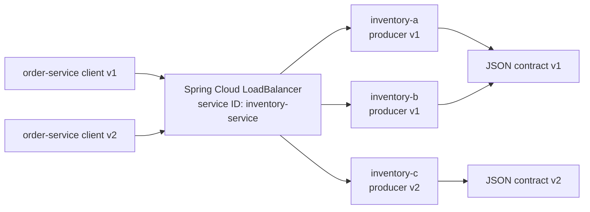

# Hợp đồng API và tương thích khi nhiều phiên bản cùng chạy

## 1. Một service ID, nhiều phiên bản: vấn đề không nằm ở thuật toán chọn đích

Trong chương **Hợp đồng và lỗi** của module `SPRING_CLOUD_SERVICE_COMMUNICATION_LOAD_BALANCING`, `order-service` gọi `inventory-service` bằng service ID. Spring Cloud LoadBalancer lấy danh sách `ServiceInstance` qua discovery, áp health check/zone/routing khi được cấu hình rồi chọn bản sao cho `RestClient`, `WebClient` hoặc OpenFeign. Cơ chế này giúp nhiều bản sao cùng phục vụ lưu lượng, nhưng cũng tạo một rủi ro khi **nhiều phiên bản API cùng tồn tại** trong quá trình rolling deployment, canary hoặc rollback.

Giả sử:

- `inventory-a` và `inventory-b` đang chạy ứng dụng **v1**.
- Nhóm triển khai `inventory-c` chạy **v2**, cùng đăng ký tên `inventory-service`.
- `order-service` vẫn gọi URL `http://inventory-service/api/inventory/ABC-1`.

Một request có thể đến v1 và request tiếp theo đến v2. Retry thậm chí có thể chuyển cùng một logical request từ v1 sang v2. **LoadBalancer chỉ chọn một instance đang đủ điều kiện theo chính sách, không tự kiểm chứng JSON, status hoặc ý nghĩa trường dữ liệu của hai phiên bản có tương thích hay không.**

Vì vậy, khả năng tương thích phải được bảo đảm ở **hợp đồng giữa producer và consumer**, hoặc bằng cơ chế chọn phiên bản cứng và được kiểm thử. Không thể dựa vào sticky routing, cache hay Round Robin để sửa một thay đổi API phá vỡ hợp đồng.

### Mục tiêu bài học

Sau bài này, bạn có thể:

1. Phân biệt phiên bản **triển khai**, phiên bản **API** và phiên bản **schema**.
2. Xác định được tương thích ngược (backward compatibility) và tương thích xuôi (forward compatibility) khi client/server v1 và v2 cùng chạy.
3. Phân loại thay đổi an toàn hoặc phá vỡ hợp đồng đối với URL, header, JSON, enum, kiểu dữ liệu, mã HTTP và ý nghĩa nghiệp vụ.
4. Thiết kế DTO có xử lý trường mở rộng nhưng không che lỗi thiếu trường bắt buộc.
5. Triển khai theo chiến lược **expand → migrate → contract**, hỗ trợ rollback trong khoảng thời gian tương thích.
6. Đặt ranh giới chọn phiên bản bằng service ID, URL, metadata hoặc version-aware routing khi không thể giữ một hợp đồng chung.
7. Tạo ma trận test client/server cũ–mới, contract tests và kiểm thử rolling/canary với Spring Cloud LoadBalancer.
8. Quan sát lỗi 404/409/422/5xx, lỗi decode và sai khác ngữ nghĩa trong quá trình chuyển phiên bản.

## 2. Sơ đồ rủi ro khi rolling deployment



Trong thực tế, không phải client v1 và v2 **bắt buộc** cùng lúc gọi một instance; sơ đồ cho thấy điều có thể xảy ra khi cả hai thế hệ caller và producer đăng ký/cấu hình cùng service ID mà **không có bộ lọc version**.

### 2.1. Bốn tổ hợp bắt buộc xem xét

| Consumer (caller) | Producer (instance) | Vì sao quan trọng |
|---|---|---|
| **Client v1 → Server v1** | Trạng thái ban đầu | Baseline, không chứng minh an toàn khi nâng cấp |
| **Client v1 → Server v2** | Server được nâng cấp trước | Server mới còn đáp ứng yêu cầu của client cũ hay không? |
| **Client v2 → Server v1** | Caller nâng cấp trước, hoặc producer rollback | Client mới có chịu được trường/chức năng chưa tồn tại ở server cũ? |
| **Client v2 → Server v2** | Trạng thái mới | Chức năng mới có chạy đúng khi cả hai đã nâng cấp? |

Nếu triển khai producer trước, tổ hợp quan trọng nhất là **v1 client → v2 server**. Nhưng nếu cần rollback hoặc có caller được nâng cấp trước thì **v2 client → v1 server** cũng là yêu cầu thực tế. Nếu một tổ hợp không được hỗ trợ, phải thiết kế **chính sách định tuyến và trình tự rollout** ngăn nó xảy ra, thay vì bỏ qua test.

**Tương thích không nhất thiết có nghĩa bốn tổ hợp đều hỗ trợ mọi chức năng mới.** Ví dụ client v2 có thể đọc API v1 nhưng phải tắt nút “đặt giữ hàng nhanh” khi server v1 không cung cấp dữ liệu cần thiết. Đó là tương thích có suy giảm chức năng được ghi rõ, không phải đoán giá trị còn thiếu.

## 3. Phạm vi của một hợp đồng API

Một hợp đồng HTTP không chỉ là danh sách DTO:

| Thành phần | Ví dụ | Rủi ro khi thay đổi |
|---|---|---|
| Địa chỉ và HTTP method | `GET /api/inventory/{sku}` | Đổi path hoặc GET thành POST khiến client cũ nhận 404/405 |
| Path/query/header | `sku`, `warehouse`, `X-Api-Version` | Biến optional thành required phá vỡ client cũ |
| Content type | `application/json`, `application/x-ndjson` | Thay JSON array bằng NDJSON có thể làm codec fail |
| Body JSON | `sku`, `available` | Đổi tên, kiểu, nullable, object/list gây lỗi decode hoặc sai dữ liệu |
| Giá trị enum | `AVAILABLE`, `OUT_OF_STOCK` | Thêm enum có thể phá client parse enum nghiêm ngặt |
| Status và lỗi | 200/404/409/429/503 + `ProblemDetail` | Đổi ý nghĩa 404 thành 200 body rỗng hoặc ngược lại có thể phá logic |
| Ngữ nghĩa nghiệp vụ | `available` là “số lượng có thể bán” | Đổi thành “số lượng vật lý” mà vẫn giữ tên là phá vỡ **ngữ nghĩa** |
| Auth và quyền | Header bearer, scope, tenant | Thay yêu cầu quyền hoặc chấp nhận token cũ phải có kế hoạch |
| Idempotency/retry | `Idempotency-Key`, trạng thái retryable | Thay từ safe GET sang thao tác có side effect tạo lỗi lặp |
| Phân trang/thứ tự | `page`, `limit`, thứ tự mặc định | Client có thể bỏ sót/trùng item khi behavior đổi |
| Dữ liệu thời gian/đơn vị | UTC ISO-8601, millisecond, đơn vị tiền tệ | Đổi đơn vị mà không đổi tên khiến dữ liệu sai nghiêm trọng |

**Phiên bản ứng dụng** (ví dụ build `2.18.0`), **phiên bản hợp đồng API** (ví dụ `inventory-api/v1`) và **phiên bản OpenAPI document** (trường `info.version`) là ba khái niệm liên quan nhưng **không đồng nhất**. Một build mới có thể vẫn phục vụ API v1; một server có thể phục vụ đồng thời v1/v2; thay library Spring Cloud cũng không tự đổi hợp đồng của nghiệp vụ.

### 3.1. Tương thích ngược và tương thích xuôi

Theo cách nhìn producer:

- **Backward compatible:** server **mới** vẫn phục vụ consumer **cũ** theo những điều client cũ đã kỳ vọng.
- **Forward compatible ở phía consumer:** client **mới** có thể giao tiếp với server **cũ** trong phạm vi chức năng đã thỏa thuận, kể cả khi server cũ chưa biết tính năng mới.

Hai khả năng không tự có chỉ bằng việc “cùng parse được JSON”. Cần kiểm tra **ràng buộc bắt buộc và logic nghiệp vụ**. Ví dụ JSON v2 thêm `reservationEligible=true`; client v1 bỏ qua trường này có thể vẫn đọc được số lượng, nhưng client v2 khi gọi server v1 phải biết `reservationEligible` đang **unknown**, không được tự coi là `true`.

## 4. Ví dụ v1 và v2: thêm field một cách có kiểm soát

### 4.1. Producer v1

HTTP response của `GET /api/inventory/ABC-1`:

```http
HTTP/1.1 200 OK
Content-Type: application/json

{"sku":"ABC-1","available":12}
```

Hợp đồng v1 nói `sku` và `available` **bắt buộc**. `available` là số nguyên không âm, mô tả số lượng có thể bán tại thời điểm đọc.

### 4.2. Producer v2: mở rộng mà không phá nội dung cũ

```http
HTTP/1.1 200 OK
Content-Type: application/json

{"sku":"ABC-1","available":12,"reservationEligible":true}
```

Server v2 vẫn trả `sku` và `available` cùng kiểu/ý nghĩa. Trường `reservationEligible` là **optional**, chỉ cung cấp thông tin bổ sung.

Điều này *có thể* tương thích ngược nếu client cũ cho phép bỏ qua field không biết. Nếu client cũ bật strict JSON deserialization hoặc kiểm tra schema `additionalProperties=false`, thêm field vẫn có thể bị coi là breaking. Vì vậy không thể nói “thêm field luôn an toàn” khi chưa biết **hợp đồng của consumer**.

### 4.3. Producer v2 phá vỡ hợp đồng

```json
{
  "productCode": "ABC-1",
  "stock": 12
}
```

Dù JSON hợp lệ, client cũ tìm `sku` và `available` sẽ thiếu dữ liệu. Nguy hiểm hơn, với Java DTO dùng primitive `int available`, trường thiếu có thể trở thành **0** theo cách deserialize, khiến hệ thống tưởng hết hàng. Đây là lỗi nghiệp vụ âm thầm, đôi khi nghiêm trọng hơn exception.

**Quy tắc:** trường bắt buộc phải được **xác minh sau decode**. Không lấy khả năng parse JSON thành công làm bằng chứng hợp đồng được giữ nguyên.

## 5. DTO ở consumer: chấp nhận mở rộng nhưng không chấp nhận thiếu ý nghĩa

Một DTO wire đủ linh hoạt cho v1 và v2:

```java
import com.fasterxml.jackson.annotation.JsonIgnoreProperties;

@JsonIgnoreProperties(ignoreUnknown = true)
public record InventoryWire(
        String sku,
        Integer available,
        Boolean reservationEligible) {
}
```

Tại sao chọn `Integer` và `Boolean` thay vì `int`/`boolean`?

- `Integer available` cho phép phân biệt **thiếu/null** với **0**. Đó là trường bắt buộc nên phải validate.
- `Boolean reservationEligible` là optional trong giai đoạn v1/v2 cùng tồn tại; `null` nghĩa là **chưa có thông tin**, không phải `false`.
- `@JsonIgnoreProperties(ignoreUnknown = true)` cho phép bỏ qua các trường mới khác khi client này chưa sử dụng. Nó **không** tự xác minh field bắt buộc hay giữ nguyên ngữ nghĩa.

Định nghĩa kết quả miền:

```java
enum ReservationCapability {
    YES, NO, UNKNOWN
}

record InventoryView(
        String sku, int available, ReservationCapability capability) {
}
```

Bộ kiểm tra wire → domain:

```java
final class ContractViolationException extends RuntimeException {
    ContractViolationException(String message) {
        super(message);
    }
}

final class InventoryDecoder {

    private InventoryDecoder() {
    }

    static InventoryView validate(
            InventoryWire wire, String requestedSku) {

        if (wire == null
                || wire.sku() == null
                || !requestedSku.equals(wire.sku())
                || wire.available() == null
                || wire.available() < 0) {
            throw new ContractViolationException(
                    "Invalid inventory response contract");
        }

        ReservationCapability capability =
                wire.reservationEligible() == null
                        ? ReservationCapability.UNKNOWN
                        : wire.reservationEligible()
                            ? ReservationCapability.YES
                            : ReservationCapability.NO;

        return new InventoryView(
                wire.sku(), wire.available(), capability);
    }
}
```

Kết quả:

| Server | JSON trả về | Consumer mới diễn giải |
|---|---|---|
| v1 | `sku` + `available` | Giá trị tồn kho hợp lệ, `capability=UNKNOWN` |
| v2 | Có thêm `reservationEligible=true` | Giá trị tồn kho hợp lệ, `capability=YES` |
| v2 | Có thêm `reservationEligible=false` | Giá trị tồn kho hợp lệ, `capability=NO` |
| Server lỗi contract | Thiếu `available`, sai `sku` hoặc âm | Phát `ContractViolationException`, **không** tự trả 0 |

Nếu nghiệp vụ cần đặt giữ hàng, `UNKNOWN` **không cho phép tự chốt**. Nó có nghĩa producer cũ chưa cung cấp thông tin theo hợp đồng mới. Một API giữ hàng riêng với cơ chế atomic reservation vẫn cần thiết để tránh race condition; field hiển thị chỉ là chỉ báo.

### 5.1. Không giải quyết mọi vấn đề bằng ignoreUnknown

- Không sửa được đổi từ `available:12` sang `available:"12"` nếu hợp đồng không cho phép type coercion.
- Không sửa được việc `available` biến thành đơn vị khác.
- Không sửa được việc producer trả body rỗng với HTTP 200.
- Không sửa được enum client parse bằng Java enum không có fallback cho giá trị mới.
- Không làm cho v1 server hiểu một request v2 mang required header/body mới.

**Tolerant reader chỉ giúp khi thay đổi phù hợp với hợp đồng và validation.** Nó không phải lý do bỏ test giữa các thế hệ client/server.

## 6. Ma trận thay đổi: additive, có điều kiện và breaking

| Thay đổi producer | Mức độ rủi ro | Điều kiện để tương thích |
|---|---|---|
| Thêm field response **optional** | Thường additive | Client cũ bỏ qua unknown; field cũ giữ kiểu/ý nghĩa |
| Thêm optional query parameter | Có thể additive | Server cũ vẫn chấp nhận request mới bỏ tham số; client mới có fallback |
| Thêm endpoint mới | Thường additive | Không thay route cũ, auth/routing không xung đột |
| Thêm enum response mới | Có thể breaking | Consumer có nhánh `UNKNOWN`/default an toàn |
| Thêm HTTP status mới | Có thể breaking | Caller xử lý code theo class/hợp đồng, không chỉ so sánh một status |
| Đổi field `int` thành `string` | Breaking | Cần chuyển đổi có version hoặc contract thỏa thuận |
| Xóa/đổi tên field required | Breaking | Client cũ vẫn phụ thuộc field đó |
| Thêm field request **required** | Breaking | Client cũ không gửi, server mới từ chối |
| Bỏ header auth hoặc đổi scope | Có thể breaking và nhạy cảm | Cần migration bảo mật, không “fail-open” |
| Đổi JSON object thành JSON array | Breaking | Client decoder và semantics thay đổi |
| Chuyển 404 thành 200 + body rỗng | Có thể breaking | Người gọi đang dựa vào 404 để nhận biết “không tồn tại” |
| Đổi `available` từ sellable sang on-hand | **Breaking về ngữ nghĩa** | Không thể sửa chỉ bằng JSON parser |
| Đổi giá trị từ số tiền theo cent sang đồng tiền lớn | **Breaking nghiêm trọng** | Cần field/unit mới hoặc API version rõ ràng |
| Thêm server-side validation chặt hơn | Có thể breaking | Request cũ từng được chấp nhận nay 400/422 |
| Bỏ sorting ổn định hoặc đổi phân trang | Có thể breaking | Consumer có thể lặp/bỏ sót item |
| Thêm header phản hồi chỉ phục vụ quan sát | Thường additive | Không thay bắt buộc/format cũ |

Đừng đánh giá compatibility chỉ bằng diff của OpenAPI. Các quy tắc như **idempotency**, tính mới của dữ liệu, quyền, thứ tự, timeout và ý nghĩa trạng thái cần kiểm thử tích hợp và giám sát thực tế.

### 6.1. Request evolution có thể nguy hiểm hơn response evolution

Producer v2 thêm field response optional đôi khi đơn giản. Nhưng consumer v2 gửi trường request mới mà producer v1 chưa hiểu có thể bị bỏ qua hoặc bị từ chối. Nếu field đó quyết định tính toàn vẹn giao dịch, **việc server cũ bỏ qua nó còn nguy hiểm hơn trả 400**.

Ví dụ client v2 gửi `Idempotency-Key` cho `POST /reservations` nhưng server v1 **không hỗ trợ deduplication**. Dù HTTP request có thể thành công, retry sau timeout vẫn có thể tạo hai reservations. Không dùng “server cũ bỏ qua header” làm bằng chứng tương thích nghiệp vụ.

## 7. Hợp đồng lỗi và HTTP status phải ổn định

Khi nhiều bản sao cùng service ID, các loại lỗi cần phân biệt:

| Tình huống | Nguồn phát sinh | Chính sách ví dụ ở caller |
|---|---|---|
| `404 Not Found` từ inventory vì SKU không tồn tại | **Producer** đã nhận request, xác định domain không có resource | Trả 404/`SKU_NOT_FOUND` nếu contract nói như vậy |
| `400` hoặc `422` vì request không hợp lệ | Producer validation | Không retry y nguyên; sửa request/contract |
| `409 Conflict` khi xung đột reservation | Producer/domain | Xử lý conflict theo nghiệp vụ; không retry vô điều kiện |
| `429 Too Many Requests` | Producer/rate limit | Giới hạn retry, cân nhắc `Retry-After` và deadline |
| `503 Service Unavailable` do producer | Producer không sẵn sàng | Phân loại lỗi dependency, retry có giới hạn nếu an toàn |
| `503` tổng hợp khi LoadBalancer không tìm được instance | **Caller/LoadBalancer**, có thể chưa gửi HTTP | Ghi `no-instance`; không suy ra server trả 503 |
| Connect/read timeout | Client HTTP/transport sau chọn đích | Không biết chắc server có thực thi thao tác hay không |
| JSON decode/validation fail | Contract mismatch | Báo lỗi contract; không tự retry vô hạn |
| Circuit breaker OPEN | Caller chặn request | Không nói “server inventory trả 503” |
| HTTP 200 có payload sai semantics | Producer v2 thay đổi nghĩa field | Đặc biệt nguy hiểm; monitor và test domain |

**404 không có nghĩa service ID không tồn tại.** Một `@LoadBalanced WebClient` gọi service ID sai có thể nhận 503 tổng hợp khi không có instance, còn HTTP 404 thường biểu thị server đã nhận request và endpoint/resource không tồn tại (trừ khi gateway/fallback thay đổi semantics). Việc phân biệt phải dựa trên trace và log, không chỉ status.

### 7.1. Giữ machine-readable error code ổn định

Một API có thể trả `ProblemDetail` theo RFC 9457:

```json
{
  "type": "https://api.example.test/problems/sku-not-found",
  "title": "SKU not found",
  "status": 404,
  "detail": "SKU requested does not exist",
  "code": "SKU_NOT_FOUND",
  "traceId": "trace-123"
}
```

Đây là **ví dụ hợp đồng**, không phải body Spring Boot tự sinh với các extension `code`/`traceId`. `type` là URI tài liệu vấn đề; URL minh họa phải thay bằng URI được tổ chức quản lý. Tránh để nội dung `detail` là nền tảng cho branching: text có thể đổi theo localization/copywriting. Client nên dựa vào `status` và trường `code` đã được định nghĩa ổn định.

Một handler trong Spring MVC:

```java
@RestControllerAdvice
class InventoryErrorAdvice {

    @ExceptionHandler(SkuNotFoundException.class)
    ResponseEntity<ProblemDetail> notFound(
            SkuNotFoundException error) {

        ProblemDetail detail = ProblemDetail.forStatusAndDetail(
                HttpStatus.NOT_FOUND, "SKU không tồn tại");
        detail.setTitle("Không tìm thấy mã hàng");
        detail.setProperty("code", "SKU_NOT_FOUND");

        return ResponseEntity.status(HttpStatus.NOT_FOUND)
                .body(detail);
    }
}
```

`SkuNotFoundException` là exception domain tự định nghĩa, không phải class của Spring. Theo cùng pattern, `order-service` có thể trả `503` với `code=DEPENDENCY_UNAVAILABLE` khi không gọi được inventory, hoặc `502`/lỗi nội bộ được phân loại rõ khi upstream phá vỡ schema. **Không** giả vờ SKU hết hàng/không tồn tại sau một timeout.

### 7.2. Thay đổi error semantics cũng phải versioned

Ví dụ producer v1 trả `404` cho “SKU không tồn tại”, producer v2 lại trả `200 {"available":0}` cho cùng tình huống. Một client có thể coi đó là “SKU tồn tại nhưng hết hàng”, gây ra kết quả khác nhau theo instance. Đây là **breaking change ngay cả khi cả hai payload đều parse được**. Muốn đổi semantics, cần một API version được thương lượng hoặc giai đoạn migration có producer hỗ trợ hai hợp đồng rõ ràng.

## 8. Cấu hình WebClient có LoadBalancer và validation

Trong `order-service`, sử dụng `@LoadBalanced WebClient.Builder` để gọi service ID:

```java
@Configuration(proxyBeanMethods = false)
class InventoryWebClientConfiguration {

    @Bean
    @LoadBalanced
    WebClient.Builder loadBalancedWebClientBuilder() {
        return WebClient.builder();
    }
}
```

Gateway giải mã bằng `InventoryWire` rồi kiểm tra contract:

```java
@Service
class InventoryGateway {

    private final WebClient client;

    InventoryGateway(@LoadBalanced WebClient.Builder builder) {
        this.client = builder.clone()
                .baseUrl("http://inventory-service")
                .build();
    }

    Mono<InventoryView> read(String sku) {
        return client.get()
                .uri("/api/inventory/{sku}", sku)
                .retrieve()
                .bodyToMono(InventoryWire.class)
                .switchIfEmpty(Mono.error(
                        new ContractViolationException("Empty JSON body")))
                .map(wire -> InventoryDecoder.validate(wire, sku));
    }
}
```

Với Spring Cloud LoadBalancer, mỗi subscription HTTP sẽ chọn một instance từ các bản sao có trong discovery/supplier. `InventoryDecoder` giữ contract ở **ranh giới HTTP adapter**, giúp domain service nhận dữ liệu đã validate. `bodyToMono` rỗng không bị biến thành `available=0`. Nếu producer trả HTTP 404/503, `retrieve()` mặc định phát `WebClientResponseException` theo status; các lỗi đó **không** đi qua nhánh `map`.

**Không bắt mọi lỗi bằng `onErrorReturn(InventoryView(sku,0,...))`.** Lỗi hợp đồng, no-instance, HTTP 404, timeout và response hợp lệ với 0 tồn kho là những trường hợp khác nhau.

### 8.1. RestClient và OpenFeign cũng cần validation

Với `RestClient` blocking:

```java
InventoryWire wire = restClient.get()
        .uri("/api/inventory/{sku}", sku)
        .retrieve()
        .body(InventoryWire.class);

InventoryView view = InventoryDecoder.validate(wire, sku);
```

Trong snippet này `restClient` là một bean đã được tạo từ `@LoadBalanced RestClient.Builder` với `baseUrl("http://inventory-service")`. `body(...)` có thể trả `null` khi body rỗng, nên `validate` phải xử lý `null` như trên.

Với OpenFeign, một client minh họa:

```java
@FeignClient(name = "inventory-service", path = "/api/inventory")
interface InventoryFeignApi {

    @GetMapping("/{sku}")
    InventoryWire read(@PathVariable("sku") String sku);
}
```

Có Spring Cloud OpenFeign và Spring Cloud LoadBalancer phù hợp chưa có nghĩa API v1/v2 tự tương thích; response của cả hai phiên bản vẫn cần validate. Các exception mặc định của Feign cho HTTP status/transport **khác** `WebClientResponseException`, vì vậy đặt lớp adapter để quy đổi về domain error ổn định. Không dùng retry để “chọn đến khi trúng một phiên bản có thể parse” — điều đó che lỗi contract và làm tải khó dự đoán.

## 9. Versioning: khi nào cần đường đi riêng?

Nếu giữ API chung v1-compatible trong suốt quá trình rolling, việc cùng service ID là bình thường. Khi thay đổi **breaking**, có các phương án:

| Phương án | Ví dụ | Ưu điểm | Giới hạn |
|---|---|---|---|
| **Thêm field optional, cùng endpoint** | `GET /api/inventory/{sku}` | Đơn giản, hỗ trợ rolling | Phải test tolerant reader, không đổi nghĩa field cũ |
| **Path versioning** | `/api/v1/inventory/{sku}`, `/api/v2/inventory/{sku}` | Hợp đồng rõ, có thể cùng một server hỗ trợ hai path | Mỗi instance mà LoadBalancer chọn **phải** hỗ trợ path client gọi, nếu cùng service ID |
| **Header/media type versioning** | `X-Api-Version: 2` hoặc media type riêng | Giữ URI ổn định | Proxy/cache/routing phải truyền version, server cũ có thể không hiểu |
| **Service ID riêng** | `inventory-v1` và `inventory-v2` | Tách tập instance và rollout/rollback rõ ràng | Tăng discovery/config/quan sát và giai đoạn vận hành song song |
| **Version-aware supplier** | Lọc instance theo metadata version | Routing theo contract mà không tách service ID | Cần support/version propagation thực tế; không được fallback sang version sai |

### 9.1. Đổi path là chưa đủ khi các instance cũ không hiểu path mới

Giả sử client gọi `http://inventory-service/api/v2/inventory/ABC-1` nhưng LoadBalancer vẫn có thể chọn `inventory-a` v1 chỉ hỗ trợ `/api/v1/...`. Khi đó server v1 trả 404. Path versioning chỉ giải quyết **phần định danh contract**; cần bảo đảm **tất cả instance có thể được chọn đều hỗ trợ path yêu cầu**, hoặc đặt bộ lọc hard routing, hoặc tách service IDs.

Tương tự, việc thêm header `X-Api-Version: 2` không tự động khiến Round Robin bỏ qua instance v1. API version trong **HTTP request** và version metadata của **ServiceInstance** phải được nối với nhau bằng một cơ chế routing thực sự.

### 9.2. Không dùng zone, hint hoặc sticky như hàng rào cứng cho version

Các chính sách *preference* có thể fallback:

- `ZonePreferenceServiceInstanceListSupplier` có thể trả toàn bộ instance khi zone ưu tiên không có ứng viên.
- `HintBasedServiceInstanceListSupplier` có thể trả toàn bộ instance nếu không có hint match.
- `SameInstancePreferenceServiceInstanceListSupplier` chỉ ưu tiên instance đã chọn trước, không gắn version theo người dùng và không bảo đảm giữ instance sau failover.

Vì vậy **không** dùng chúng như bảo đảm an toàn cho một thay đổi breaking nếu implementation có fallback sang bản không tương thích. Với **hard version requirement**, khi không có instance hợp lệ phải **fail closed/no-instance** thay vì định tuyến đến API version khác và hy vọng request thành công.

## 10. Spring Cloud Commons 5.0+: API Version-Based Load-Balancing

**Phần này áp dụng cho Spring Cloud Commons 5.0+**, không được giả định có trong các ứng dụng Spring Cloud Commons 4.3 hoặc cũ hơn. Tài liệu 5.0 mô tả `BlockingApiVersionServiceInstanceListSupplier` và `ReactiveApiVersionServiceInstanceListSupplier`.

Có thể tạo supplier qua builder (ví dụ cho `WebClient` reactive):

```java
class InventoryVersionRoutingConfiguration {

    @Bean
    ServiceInstanceListSupplier inventorySupplier(
            ConfigurableApplicationContext context) {
        return ServiceInstanceListSupplier.builder()
                .withDiscoveryClient()
                .withCaching()
                .withReactiveApiVersioning()
                .build(context);
    }
}
```

Với `RestClient` blocking, dùng `.withBlockingApiVersioning()` thay thế. Cấu hình `@LoadBalancerClient(name="inventory-service", configuration=InventoryVersionRoutingConfiguration.class)` nếu muốn áp cho service ID cụ thể. **Không** component-scan lớp cấu hình riêng này vào root context một cách vô tình; nó phải được nạp trong LoadBalancer child context của service ID được nhắm tới.

Có thể chọn cấu hình có sẵn:

```yaml
spring:
  cloud:
    loadbalancer:
      configurations: api-version
      api-version:
        header: X-Api-Version
        required: true
        fallback-to-available-instances: false
```

Các property ở ví dụ trên là dạng **global trong Commons 5.0**; cấu hình theo client ID có các tiền tố/kiểu binding riêng theo version. Xác minh `spring.cloud.loadbalancer.api-version.*` ở *Configuration Properties* của đúng artifact đang chạy. Mã ví dụ này minh họa ý định, không phải một migration recipe dùng được cho Commons 4.x.

**Điểm kiểm soát quan trọng:** supplier đối chiếu version của request (header/query/path/media type theo cấu hình) với metadata `API_VERSION` của `ServiceInstance`. Khi không có instance match, mặc định có thể trả danh sách rỗng; property `fallback-to-available-instances=false` giữ hành vi không đi nhầm vào bản khác. Nếu đặt true, việc fallback sang bất kỳ instance có thể **phá vỡ ràng buộc tương thích cứng**.

Để hoạt động, cần:

1. Registry cung cấp metadata `API_VERSION` đúng cho từng instance.
2. Request đi qua đúng client/filter để thông tin version được supplier đọc.
3. Mỗi instance có version metadata đúng với API nó thực sự phục vụ.
4. Test các trường hợp version thiếu, sai, không match, registry/cache stale.
5. Không cho default version thay thế một version bắt buộc mà client có chủ đích gửi.

Ví dụ metadata logic:

```text
inventory-a: serviceId=inventory-service, API_VERSION=1, host=:8081
inventory-b: serviceId=inventory-service, API_VERSION=1, host=:8082
inventory-c: serviceId=inventory-service, API_VERSION=2, host=:8083
```

Đây là dữ liệu **minh họa**, không phải YAML đăng ký chung cho mọi registry. Cách gắn metadata vào Eureka/Consul/Kubernetes khác nhau; cần cấu hình theo provider thật và quan sát `ServiceInstance.getMetadata()`.

**Lưu ý phạm vi:** một instance có thể hỗ trợ cả v1/v2, trong khi metadata `API_VERSION` của supplier cơ bản biểu thị một giá trị version. Nếu muốn mô hình “instance hỗ trợ tập phiên bản”, hãy cân nhắc tách service IDs, custom supplier/metadata phù hợp hoặc vận hành hai endpoint với routing riêng; không giả định một key đơn tự mã hóa đa phiên bản.

## 11. Kế hoạch deploy: expand → migrate → contract

Trường hợp mong muốn cuối cùng là v2 có thêm field `reservationEligible` và một endpoint v2 cho thao tác giữ hàng. Đừng cập nhật tất cả server/client đồng thời rồi hy vọng không có request xen kẽ.

### 11.1. Pha 1 — Expand (mở rộng không phá vỡ)

- Thêm field optional/endpoint mới ở producer, **giữ tất cả field/path/status và semantics cũ**.
- Nếu cần thay schema DB, thêm column/bảng mới theo cách cả code cũ và mới vẫn chạy; không xóa/đổi nghĩa column cũ.
- Producer v2 phải chạy cùng producer v1 mà không làm consumer v1 lỗi.
- Consumer hiện tại vẫn chỉ dựa vào field cũ, có khả năng bỏ qua field mở rộng.
- Chạy contract tests cho các response cũ và mới.

### 11.2. Pha 2 — Migrate (chuyển consumer từng phần)

- Nâng consumer v2 để hiểu field/endpoint mới nhưng vẫn xử lý producer v1 trong cửa sổ rollout/rollback nếu policy yêu cầu.
- Với khả năng chưa có ở v1, trả `UNKNOWN`/ẩn hành động mới thay vì tự suy giá trị.
- Nếu cần bắt buộc dùng API v2, phải đặt version routing cứng hoặc service ID mới.
- Theo dõi version thực nhận từ server và tỷ lệ lỗi theo consumer/server pair.
- Thử rollback consumer và producer độc lập trong môi trường test.

### 11.3. Pha 3 — Contract (thu hẹp hợp đồng cũ)

Chỉ loại field/path/behavior cũ khi:

1. Đã xác nhận **không còn consumer v1** hoặc đã có cơ chế routing tách biệt.
2. Thời hạn hỗ trợ/deprecation đã được công bố và qua cửa sổ an toàn.
3. Hệ thống đo được traffic tới API cũ, kể cả batch job/cron/mobile client chậm cập nhật.
4. Có kế hoạch rollback không phụ thuộc phần đã xóa.
5. Contract tests và kiểm thử migration DB chứng minh tương thích trong cửa sổ dự kiến.

Nếu một producer v2 cần đọc/ghi DB theo schema mới, việc rollback ứng dụng không nên đòi rollback dữ liệu đã được cập nhật phá vỡ compatibility. Dùng expand-read-write-contract và migration hai pha khi cần, tránh xóa column trước khi code cũ ngừng chạy.

### 11.4. Canary và rolling traffic

Một rollout thận trọng:

```text
0% v2 producer  -> tất cả consumer v1 dùng v1 producer
10% v2 producer -> consumer v1 có thể đụng v2 nếu cùng service ID
50% v2 producer -> kiểm tra contract error và semantic metrics
100% v2 producer -> duy trì hỗ trợ v1 contract đến hết cửa sổ migration
Consumer v2 rollout -> kiểm tra v2 client với producer v2 và rollback về v1
Thu hồi v1 contract -> chỉ sau khi chứng minh không còn consumer v1
```

Không chỉ theo dõi HTTP 5xx: một thay đổi “tương thích cú pháp nhưng sai ngữ nghĩa” có thể tạo 200 cùng giá trị sai. Cần metric domain như tỷ lệ `available=0` bất thường, lượng reservations sai, chênh tồn kho và tỷ lệ `UNKNOWN` tăng sau rollout.

## 12. Retry và LoadBalancer có thể chuyển giữa hai phiên bản

Khi request đầu tiên được chọn tới `inventory-a` v1 rồi gặp timeout, Spring Cloud LoadBalancer có thể chọn `inventory-c` v2 ở retry tiếp theo nếu vẫn cùng tập ứng viên. Vì vậy:

- Mọi instance được retry chọn đều phải hỗ trợ **cùng hợp đồng request**.
- Không “retry until valid JSON” khi lần đầu nhận body sai contract: đó là lỗi triển khai producer, không phải lỗi mạng tạm thời.
- Nếu request là POST đặt giữ hàng, phải có `Idempotency-Key`, quy tắc dedup và hợp đồng tương thích ở **cả** v1 và v2; nếu v1 chưa hỗ trợ thì không gửi POST đó tới v1.
- Timeout/HTTP 503 không đảm bảo server chưa xử lý giao dịch; retry có thể nhân side effects nếu các version xử lý khác nhau.
- Sticky-session hay preference không đảm bảo một phiên không bao giờ bị chuyển sang instance version khác sau restart/scale-in.

Một ví dụ đặc biệt nguy hiểm:

```text
POST /reservations, header Idempotency-Key: order-123
Attempt 1 -> v1, v1 không hiểu header; server đã tạo reservation, response mất
Attempt 2 -> v2, v2 có idempotency store mới; tạo reservation lần nữa
=> Hai reservations mặc dù caller chỉ có một logical request.
```

**Kết luận:** “client v2 vẫn parse được response v1” là điều kiện cần nhưng không đủ đối với các thao tác ghi. Compatibility phải bao gồm **trạng thái, idempotency, transaction và error semantics**.

## 13. Kiểm thử tương thích: không chỉ unit test v2/v2

### 13.1. Ma trận tối thiểu

| Test case | Consumer | Producer/instance | Kỳ vọng |
|---|---|---|---|
| TC01 | v1 | v1 | Baseline tương thích |
| TC02 | v1 | v2 | Response field cũ ổn định, không decode fail |
| TC03 | v2 | v1 | Đọc được dữ liệu cũ, optional capability là `UNKNOWN` |
| TC04 | v2 | v2 | Dùng field mới khi hiện diện |
| TC05 | v1 | v2 invalid | Fail đúng cách, không âm thầm `available=0` |
| TC06 | v2 | v1 trả 404 | Giữ semantics SKU_NOT_FOUND |
| TC07 | v1/v2 | producer trả 503 | Phân loại dependency unavailable, không trả sai data |
| TC08 | v1/v2 | không có instance | Lỗi no-instance, không nhầm với SKU_NOT_FOUND |
| TC09 | v2 | v1 rồi retry sang v2 | Hợp đồng được giữ khi đích đổi |
| TC10 | v2 | v2 rồi rollback sang v1 | Không có chức năng mới bị thực thi sai |
| TC11 | v2 | producer trả enum mới | Unknown value được xử lý an toàn, không parse crash nếu contract cho phép |
| TC12 | v1/v2 | producer thay semantics available | Test domain thất bại dù JSON vẫn hợp lệ |
| TC13 | v2 | POST v1 không hỗ trợ idempotency | Không route, không gửi, hoặc fail closed |
| TC14 | v2 | chỉ có instance v1 khi yêu cầu API v2 | Không fallback sang v1 nếu version hard-required |

**Không cần giả định tất cả test phải pass ở chế độ “chức năng hoàn chỉnh”.** Ví dụ TC03 có thể pass bằng “dữ liệu tồn kho được hiển thị, tính năng reservation v2 bị khóa”. Nhưng TC14 phải xác minh request bị chặn/routing không có ứng viên thay vì lọt vào v1.

### 13.2. Unit test cho DTO và validation

Ví dụ dùng Jackson/JUnit 5, cùng `InventoryWire` và `InventoryDecoder` ở mục 5:

```java
class InventoryContractTest {

    private final ObjectMapper mapper = new ObjectMapper();

    @Test
    void acceptsV1AndV2Payloads() throws Exception {
        String v1 = "{\"sku\":\"ABC-1\",\"available\":12}";
        String v2 = "{\"sku\":\"ABC-1\",\"available\":12,"
                + "\"reservationEligible\":true,\"newField\":\"ignored\"}";

        InventoryView oldView = InventoryDecoder.validate(
                mapper.readValue(v1, InventoryWire.class), "ABC-1");
        InventoryView newView = InventoryDecoder.validate(
                mapper.readValue(v2, InventoryWire.class), "ABC-1");

        assertEquals(12, oldView.available());
        assertEquals(ReservationCapability.UNKNOWN,
                     oldView.capability());

        assertEquals(12, newView.available());
        assertEquals(ReservationCapability.YES,
                     newView.capability());
    }

    @Test
    void missingRequiredFieldFailsValidation() throws Exception {
        InventoryWire wire = mapper.readValue(
                "{\"sku\":\"ABC-1\"}", InventoryWire.class);

        assertThrows(ContractViolationException.class,
                () -> InventoryDecoder.validate(wire, "ABC-1"));
    }
}
```

Các import JUnit `@Test`, `assertEquals`, `assertThrows` và `ObjectMapper` được lược bỏ. Code minh họa cho Java/Spring Boot 3.x và Jackson 2.x; với Jackson 3 hoặc cấu hình mapper khác, đối chiếu dependency/BOM và API đang sử dụng. Test này **chưa thay thế** tích hợp HTTP: nó chỉ chứng minh phép decode/validate.

### 13.3. Consumer-driven contract tests

Spring Cloud Contract hỗ trợ khai báo contracts, tạo **producer verification tests** và cung cấp WireMock **stubs** để consumer kiểm thử mà không cần dựng toàn bộ registry. Có thể dùng:

- **Producer-side verifier:** kiểm tra `inventory-service` thực trả đúng path/status/headers/schema đã cam kết.
- **Stub Runner / WireMock:** `order-service` chạy test với stubs mô tả cả tình huống v1 và v2.
- **LoadBalancer integration test:** registry giả hoặc `SimpleDiscoveryClient` trỏ tới hai mock servers, mỗi server chạy một phiên bản contract, rồi kiểm tra request có thể đến cả hai.
- **Migration test:** kết hợp legacy/new DTO, không chỉ kiểm thử client và server mới nhất.

Việc Spring Cloud Contract Stub Runner có thể stub `DiscoveryClient` và tích hợp LoadBalancer là tính năng phụ thuộc starter và cấu hình phiên bản. Không giả định chỉ thêm một annotation là toàn hệ thống đã mô phỏng được discovery; phải cấu hình stub artifacts/group và wiring đúng theo Spring Cloud Contract version.

### 13.4. OpenAPI giúp thống nhất contract, không thay runtime compatibility

Ví dụ một phần schema:

```yaml
openapi: 3.0.3
info:
  title: Inventory API
  version: "1.1.0"
paths:
  /api/inventory/{sku}:
    get:
      parameters:
        - name: sku
          in: path
          required: true
          schema:
            type: string
      responses:
        "200":
          description: Inventory snapshot
          content:
            application/json:
              schema:
                $ref: "#/components/schemas/Inventory"
        "404":
          description: SKU not found
components:
  schemas:
    Inventory:
      type: object
      required: [sku, available]
      properties:
        sku:
          type: string
        available:
          type: integer
          format: int32
          minimum: 0
        reservationEligible:
          type: boolean
          description: Optional; absent when unknown or unsupported
```

Trường `reservationEligible` không nằm trong `required`. `info.version` là **phiên bản mô tả API**, không tự khiến LoadBalancer định tuyến sang một instance có version phù hợp. Mỗi lần thay đổi schema, cần test khả năng đọc trên các consumer thật và kiểm tra cả semantics/status ngoài schema.

Nếu dùng automated OpenAPI diff, đừng coi việc báo “non-breaking” là đủ; test thêm `404↔200`, retry/idempotency, dữ liệu cũ và giới hạn auth.

## 14. Lab rolling deployment hai phiên bản dưới một service ID

### 14.1. Topology

| Tiến trình | Service ID | Port | Producer version |
|---|---|---:|---|
| `order-service` | `order-service` | 8080 | Consumer có `InventoryGateway` |
| `inventory-a` | `inventory-service` | 8081 | v1 |
| `inventory-b` | `inventory-service` | 8082 | v1 |
| `inventory-c` | `inventory-service` | 8083 | v2 |

Cấu hình `SimpleDiscoveryClient` trong caller:

```yaml
spring:
  application:
    name: order-service
  cloud:
    discovery:
      client:
        simple:
          instances:
            inventory-service:
              - uri: http://localhost:8081
                instance-id: inventory-a
              - uri: http://localhost:8082
                instance-id: inventory-b
              - uri: http://localhost:8083
                instance-id: inventory-c
    loadbalancer:
      retry:
        enabled: false
      cache:
        enabled: false
server:
  port: 8080
```

Đây là danh sách **tĩnh cho lab**. Trong rollout thật, dùng registry/rolling controller và chờ discovery, cache, health check cập nhật. `localhost` chỉ dùng được khi caller và các instance trong cùng network namespace; ở container, dùng hostname có thể truy cập được từ caller.

### 14.2. Server v1/v2 (controller riêng ở từng tiến trình)

Ứng dụng v1:

```java
@RestController
class InventoryV1Controller {

    @GetMapping("/api/inventory/{sku}")
    ResponseEntity<Map<String, Object>> get(
            @PathVariable String sku) {

        return ResponseEntity.ok()
                .header("X-Server-Revision", "v1")
                .body(Map.of(
                        "sku", sku,
                        "available", 12));
    }
}
```

Ứng dụng v2 (chạy **thay thế** v1 controller ở một tiến trình khác, không đăng ký cả hai cho cùng path):

```java
@RestController
class InventoryV2Controller {

    @GetMapping("/api/inventory/{sku}")
    ResponseEntity<Map<String, Object>> get(
            @PathVariable String sku) {

        return ResponseEntity.ok()
                .header("X-Server-Revision", "v2")
                .body(Map.of(
                        "sku", sku,
                        "available", 12,
                        "reservationEligible", true));
    }
}
```

`X-Server-Revision` là header **instrumentation của lab**, không phải header chuẩn của Spring Cloud hay bảo đảm phiên bản API. Không dựa vào client-supplied header để ủy quyền hoặc coi revision là nguồn đáng tin duy nhất; log triển khai và metadata mới là nguồn kiểm tra trạng thái rollout.

### 14.3. Endpoint caller

```java
@RestController
@RequestMapping("/demo/inventory")
class InventoryDemoController {

    private final InventoryGateway gateway;

    InventoryDemoController(InventoryGateway gateway) {
        this.gateway = gateway;
    }

    @GetMapping("/{sku}")
    Mono<InventoryView> read(@PathVariable String sku) {
        return gateway.read(sku);
    }
}
```

Chạy 2 replica v1 và 1 replica v2, sau đó:

```bash
curl -i http://localhost:8080/demo/inventory/ABC-1
curl -i http://localhost:8080/demo/inventory/ABC-1
curl -i http://localhost:8080/demo/inventory/ABC-1
```

Với Round Robin và request tuần tự, các lựa chọn thường luân phiên qua tập ứng viên; nhưng có request nền, retry, health filter hoặc cache thì thứ tự có thể khác. **Chỉ có thể biết bản nào thực xử lý bằng log/trace instance**, hoặc dữ liệu đã được instrument phù hợp. `InventoryView` trong ví dụ chỉ trả trạng thái capability, chưa gắn tên version; nếu muốn đo canary cần thêm HTTP client instrumentation hoặc request capture riêng.

### 14.4. Biến thể phá vỡ để chứng minh rủi ro

Thay v2 controller trả `{"sku":"ABC-1","stock":12}`. Khi LoadBalancer chọn v1, caller vẫn nhận response hợp lệ; khi chọn v2, `InventoryDecoder.validate` phát `ContractViolationException` vì thiếu `available`. Nếu dùng DTO primitive, sự cố có thể bị che thành `0`.

Đếm **contract_violation** theo instance/revision; tỷ lệ lỗi dao động theo tỷ lệ traffic tới v2. Nếu retry bật rồi lại chọn v1, request có thể thành công lần sau, khiến lỗi rollout không hiện ở tỷ lệ HTTP success cuối. Vì vậy **tắt retry trước để đo**, và không retry riêng lỗi schema/contract.

## 15. Canary/rollback: quan sát gì để không bị đánh lừa?

Các metric sau là **đề xuất tự instrument**, không phải tên metric Spring Cloud luôn cung cấp:

| Metric hoặc thông tin trace | Ý nghĩa |
|---|---|
| `http_attempts_total` theo service, method và revision | Có bao nhiêu lần gọi thật tới v1/v2? |
| `contract_decode_failure_total` | JSON không decode được |
| `contract_validation_failure_total` | Decode được nhưng thiếu/sai field bắt buộc |
| `api_version_mismatch_total` | Client yêu cầu API version không được instance hỗ trợ |
| `upstream_404_total`, `upstream_409_total`, `upstream_5xx_total` | Sai lệch HTTP/error semantics |
| `no_instance_total` | Không có instance đủ điều kiện |
| `retry_count`, `retry_success_after_switch` | Retry có đang che lỗi của một revision? |
| `consumer_version`, `producer_revision` trong log/trace | Xác định cặp thực tế đã giao tiếp |
| `domain_invariant_failure_total` | Trường có đúng **ý nghĩa** không, ví dụ giá trị bất thường |
| `request_latency_p95/p99` | Bản mới có làm chậm client cũ không? |
| `traffic_share_by_revision` | Canary thật sự nhận bao nhiêu lưu lượng? |
| `rollback_readiness` | Client/DB schema đã hỗ trợ rollback chưa? |

Tránh thêm `requestId`, `sku`, token hoặc raw user ID vào **metric label** vì cardinality/bảo mật. Dùng trace/log với correlation ID; với Spring Cloud LoadBalancer có thể tham khảo `LoadBalancerLifecycle` để quan sát lựa chọn instance, nhưng phải đối chiếu callback/version thật.

### 15.1. Gate trước khi tăng canary traffic

Một quy trình minh họa:

1. Chạy contract tests và compatibility matrix trước deploy.
2. Gửi canary 5–10% theo cơ chế routing đang dùng; **đo tỷ lệ thực** chứ không tin cấu hình mong muốn.
3. So sánh error/latency và domain metrics theo revision với cùng phân bố request.
4. Đặc biệt kiểm tra `contract_validation_failure_total=0` và không có thay đổi bất thường về 404/409.
5. Tăng traffic từng bước sau khi có bằng chứng; theo dõi không chỉ p95 tổng mà cả nhóm consumer cũ.
6. Test rollback khi còn một số producer v2 và một số producer v1.
7. Chỉ bỏ v1 support khi không còn consumer cần nó.

Không suy ra việc canary trúng instance v2 từ header do client tự gửi; quan sát revision ở server/log đáng tin và span tới instance thực.

## 16. Lỗi thường gặp và cách xử lý

| Triệu chứng | Nguyên nhân khả dĩ | Cách xử lý |
|---|---|---|
| Một số request trả 200, một số decode lỗi | v1/v2 cùng service ID nhưng payload khác contract | Test từng instance/revision, khôi phục field cũ |
| Trường `available` tự thành 0 ở v2 | Producer bỏ field, DTO primitive | Dùng wrapper nullable + validation fail-fast |
| `404` chỉ xảy ra khi trúng instance v1 | Client gọi path/header chỉ v2 hỗ trợ | Version routing cứng hoặc rollout endpoint tương thích trước |
| HTTP 503 nhưng không có log downstream | Không có instance, LB filter tạo lỗi trước HTTP | Kiểm tra discovery/health/version filter |
| Sau retry request “khỏi lỗi” | Attempt thứ hai trúng instance phiên bản khác | Đếm attempts, không retry contract violations |
| Thêm enum làm client cũ crash | Consumer enum không có unknown branch | Quy ước unknown sentinel và test consumer |
| OpenFeign hoạt động khác WebClient | Decoder/error handler/retry khác | Lớp adapter phân loại lỗi về domain contract |
| Rollback producer làm client v2 hỏng | Client v2 bắt buộc dùng field/endpoint v2 | Tách feature flag, giữ client forward-compatible hoặc route v2-only |
| Đã bật hint=2 nhưng vẫn có request vào v1 | Hint supplier có fallback khi không match | Dùng hard version-aware routing/tách service ID |
| Có metadata version nhưng supplier vẫn chọn sai | Registry thiếu metadata, cache stale, request context không truyền version | Instrument supplier và thử nonmatch |
| Test pass với mock mới nhất nhưng fail production | Thiếu matrix v1/v2 | Stub cả v1 và v2, chaos test rolling |
| JSON hợp lệ nhưng thanh toán/tồn kho sai | Đổi semantics/đơn vị mà không đổi schema | Domain invariants, API version mới và migration |
| Client hiểu `null` là `false` | Optional field thiếu bị gán mặc định | Dùng nullable/sentinel `UNKNOWN`, chặn chức năng nhạy cảm |
| Sau deploy cũ/mới DB lỗi | Schema không tương thích hai chiều | Expand-migrate-contract và rollback test |

## 17. Bài tập và checklist tự đánh giá

### Bài 1 — Phân tích compatibility

Từ payload v1 `{"sku":"ABC-1","available":12}`, đề xuất ba thay đổi additive và ba thay đổi breaking. Với mỗi thay đổi, giải thích theo **hai chiều** client v1 → server v2 và client v2 → server v1; không dùng cụm “thêm field luôn an toàn” khi chưa kiểm tra parser/validation.

### Bài 2 — Validation chống “0 giả”

Dùng `InventoryWire` có `Integer available`. Tạo test server trả ba payload: đủ trường, thiếu `available`, `available=-1`. Yêu cầu: chỉ payload đầu thành công; hai payload sai phải báo lỗi hợp đồng, **không** thành “hết hàng”.

### Bài 3 — Rolling 2 v1 + 1 v2

Dựng topology ở mục 14, gọi 100 GET và ghi revision instance thực nhận. Cho v2 thêm `reservationEligible` optional; chứng minh consumer cũ đọc được và consumer mới gán `UNKNOWN` khi vào v1. Sau đó thử biến thể v2 đổi tên `available` thành `stock` và quan sát tỷ lệ contract violations.

### Bài 4 — Retry chuyển version

Bật retry một lần với GET, tạo timeout ở v1 rồi retry sang v2. Ghi mỗi attempt và server revision. Giải thích vì sao retry có thể che mismatch nếu schema v2 sai, và vì sao lỗi contract không nên được retry như lỗi kết nối.

### Bài 5 — Version routing fail closed

Trên Commons 5.0+ (hoặc custom supplier version-aware), yêu cầu `X-Api-Version: 2` nhưng registry chỉ có v1. Xác minh **không chọn nhầm v1** và phát lỗi có ý nghĩa; sau đó thêm instance v2 có metadata đúng. Không áp bài này nguyên xi lên Commons 4.3 vì thiếu feature built-in tương ứng.

### Bài 6 — Error contract

Cho producer v1 và v2 đều trả 404 + `code=SKU_NOT_FOUND` với SKU không tồn tại. Sau đó làm v2 trả 200 + available=0 cho cùng tình huống; viết test phát hiện semantic mismatch và quyết định versioning/migration cần thiết.

### Bài 7 — Breaking write contract

Thiết kế `POST /reservations` dùng idempotency key. Mô phỏng server v1 bỏ qua header và v2 hỗ trợ. Chứng minh không thể chỉ dựa vào parser response để gọi hỗn hợp v1/v2; đề xuất cách tách service ID, deploy v1 hỗ trợ dedup trước hoặc chặn route v2 sang v1.

### Checklist hoàn thành

- [ ] Phân biệt phiên bản deploy, phiên bản contract và OpenAPI `info.version`.
- [ ] Có ma trận client v1/v2 × producer v1/v2 cho mọi đường gọi quan trọng.
- [ ] Các field required giữ tên/kiểu/ngữ nghĩa; field optional có cách xử lý khi thiếu.
- [ ] Tolerant reader bỏ qua unknown nhưng validation không được che mất field required.
- [ ] Enum/status/error code mới được client xử lý an toàn theo contract.
- [ ] LoadBalancer không bị hiểu nhầm là bộ kiểm tra compatibility.
- [ ] API version path/header chỉ có ý nghĩa khi instance được chọn thực sự hỗ trợ version yêu cầu.
- [ ] Không dùng zone/hint/sticky preference có fallback làm hard version barrier.
- [ ] Nếu dùng Commons 5.0+ version supplier, đã xác minh metadata `API_VERSION` và fail-closed khi không match.
- [ ] Retry/timeout không che lỗi schema và không nhân side effect thao tác ghi.
- [ ] Đã chạy producer verification, consumer stubs và rolling integration test.
- [ ] Có contract/semantic metrics theo server revision và consumer version.
- [ ] Có kế hoạch expand–migrate–contract và rollback ở cả ứng dụng và DB.
- [ ] Không xóa hỗ trợ API cũ trước khi chứng minh không còn consumer cũ.

## Tài liệu tham khảo chính thức

- [Spring Cloud Commons 4.3 — Spring Cloud LoadBalancer](https://docs.spring.io/spring-cloud-commons/reference/4.3/spring-cloud-commons/loadbalancer.html): `ServiceInstanceListSupplier`, Round Robin/Random, cache/health/zone, lựa chọn instance và retry; không giả định có built-in API version supplier của 5.0.
- [Spring Cloud Commons 5.0 — LoadBalancer, API Version-Based Load-Balancing](https://docs.spring.io/spring-cloud-commons/reference/spring-cloud-commons/loadbalancer.html): `BlockingApiVersionServiceInstanceListSupplier`, `ReactiveApiVersionServiceInstanceListSupplier`, metadata `API_VERSION` và chính sách fallback.
- [Spring Cloud Commons 5.0 — Configuration Properties](https://docs.spring.io/spring-cloud-commons/reference/configprops.html): kiểm tra `spring.cloud.loadbalancer.api-version.*` và các giá trị cấu hình được hỗ trợ.
- [Spring Cloud Contract — Consumer Driven Contracts](https://docs.spring.io/spring-cloud-contract/reference/getting-started/cdc.html): contract phía producer và kiểm thử consumer dựa trên stubs.
- [Spring Cloud Contract — Stub Runner Core](https://docs.spring.io/spring-cloud-contract/reference/project-features-stubrunner/stub-runner-core.html): chạy WireMock stubs và tích hợp kiểm thử không cần server thật.
- [Spring Cloud Contract — Stub Runner Spring Cloud](https://docs.spring.io/spring-cloud-contract/reference/project-features-stubrunner/stub-runner-cloud.html): giả lập `DiscoveryClient` và LoadBalancer cho test.
- [Spring Framework — REST Clients](https://docs.spring.io/spring-framework/reference/integration/rest-clients.html): `RestClient`, `WebClient`, HTTP Service Clients, status/error handling.
- [OpenAPI Specification](https://spec.openapis.org/oas/latest.html): `info.version`, parameters, response contracts, schema và các ràng buộc liên quan.
- [Spring Cloud — Release Train](https://spring.io/projects/spring-cloud/): đối chiếu Spring Boot/Spring Cloud trước khi sử dụng API hoặc cấu hình của bản khác.

**Kết luận:** trong giai đoạn nhiều phiên bản cùng chạy, **cùng service ID không đồng nghĩa cùng API contract**. Spring Cloud LoadBalancer có thể chọn v1 hoặc v2, và retry có thể chuyển đích giữa hai phiên bản. Muốn rollout và rollback an toàn, hãy **mở rộng hợp đồng không phá vỡ**, validate dữ liệu bắt buộc, test cả hai chiều client/server và dùng **hard version routing** khi cần thay đổi breaking. Thành công HTTP chỉ có giá trị khi **ý nghĩa dữ liệu và lỗi** vẫn đúng với những gì consumer đã cam kết.
