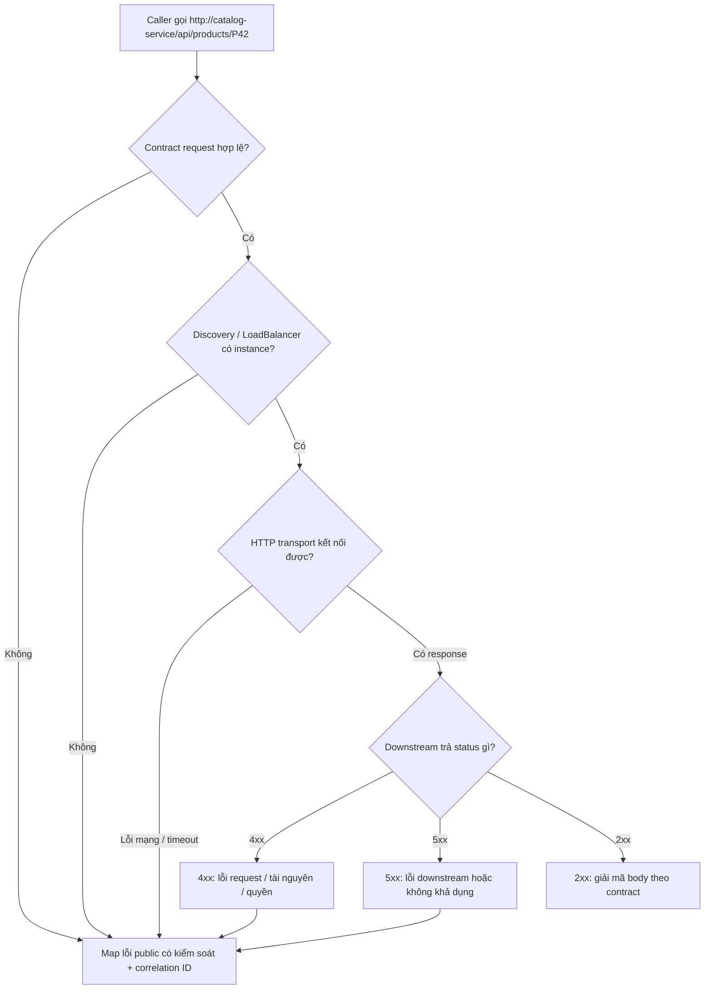
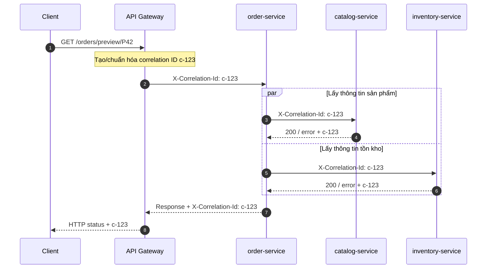

# Quy ước mã lỗi, nội dung lỗi và correlation ID

Khi `order-service` gọi `catalog-service` qua Spring Cloud LoadBalancer, một lời gọi thất bại có thể do sản phẩm không tồn tại, request sai định dạng, không có `ServiceInstance` khả dụng, lỗi kết nối, timeout hoặc chính `catalog-service` trả HTTP `500`. Nếu mỗi tầng biến những tình huống đó thành một response tùy ý, caller khó biết có nên thử lại, người vận hành khó xác định nguồn gốc và các dịch vụ dễ vô tình làm lộ thông tin nội bộ.

Một **hợp đồng lỗi HTTP** (*error contract*) giúp các dịch vụ thống nhất ba câu hỏi: **lỗi thuộc loại nào, client cần làm gì và có thể tra cứu lỗi đó ở đâu?** Bài học thuộc module `SPRING_CLOUD_SERVICE_COMMUNICATION_LOAD_BALANCING`: ứng dụng chọn instance theo service ID bằng discovery/LoadBalancer, rồi sử dụng `RestClient`, `WebClient` hoặc OpenFeign để giao tiếp. Quy ước lỗi cần giữ ổn định bất kể instance nào được chọn, đồng thời phân biệt rõ lỗi nghiệp vụ với lỗi hạ tầng và truyền correlation ID xuyên suốt chuỗi gọi.

## 1. Ba lớp thông tin của một lỗi

Một response lỗi có ích nên có ba lớp thông tin với trách nhiệm riêng:

| Lớp | Nhiệm vụ | Ví dụ |
|---|---|---|
| **HTTP status** | Diễn đạt nhóm kết quả theo chuẩn giao thức | `404 Not Found`, `503 Service Unavailable`, `504 Gateway Timeout` |
| **Mã lỗi ứng dụng** | Phân biệt ngữ nghĩa nghiệp vụ hoặc loại hỏng cụ thể, ổn định cho client | `PRODUCT_NOT_FOUND`, `DEPENDENCY_UNAVAILABLE`, `DOWNSTREAM_TIMEOUT` |
| **Correlation ID / trace context** | Nối response với log và những hop liên quan để điều tra | `X-Correlation-Id: 2d2f...`, W3C `traceparent` |

HTTP status phục vụ mọi HTTP client; mã lỗi ứng dụng cho biết hành động cụ thể; correlation ID hỗ trợ chẩn đoán. Không nên chỉ gửi `{"message":"Something went wrong"}`, cũng không nên đưa toàn bộ stack trace vào body trả cho người dùng.

Ví dụ hai sự cố cùng dẫn đến response thất bại nhưng cần xử lý khác nhau:

```text
GET /api/products/P42 → 404 + PRODUCT_NOT_FOUND
    → Sản phẩm thực sự không tồn tại; retry ngay thường không hữu ích.

GET /api/products/P42 → 503 + DEPENDENCY_UNAVAILABLE
    → Không truy cập được dịch vụ phụ thuộc; có thể thử lại có giới hạn.
```

**Mã lỗi ứng dụng không thay thế HTTP status.** Một hệ thống luôn trả `200 OK` rồi nhét `success:false` trong body có thể làm gateway, HTTP client, cache, alert và circuit breaker hiểu sai kết quả thực tế.

## 2. Phân loại lỗi trước khi quy định status

Không phải mọi lỗi xuất hiện trong một chuỗi gọi đều bắt nguồn từ cùng tầng:



Các nguyên nhân có thể chia thành:

1. **Lỗi đầu vào/contract:** tham số không hợp lệ, body không đúng schema, thiếu quyền.
2. **Lỗi nghiệp vụ:** không tìm thấy sản phẩm, số lượng đặt vượt tồn kho, trạng thái đơn hàng xung đột.
3. **Lỗi discovery/LoadBalancer:** service ID sai, không tìm được ứng viên hoặc không có `ServiceInstance` dùng được.
4. **Lỗi HTTP transport:** DNS, TCP/TLS, connection pool, connect timeout, response timeout.
5. **Lỗi downstream:** server đích trả `5xx` hoặc response không đúng contract.
6. **Lỗi điều phối/phục hồi:** deadline hết, circuit breaker OPEN, bulkhead từ chối, retry budget cạn.

Một request có thể đi qua nhiều loại lỗi: ví dụ `order-service` hết deadline **sau khi** đã thử kết nối đến hai instance. Hợp đồng lỗi public nên mô tả kết quả thích hợp cho caller, còn log/tracing cần giữ chi tiết các lỗi và attempts bên trong.

## 3. Bảng quy ước HTTP status thường dùng

| Status | Khi nào cân nhắc dùng? | Mã lỗi ứng dụng ví dụ | Retry từ client? |
|---|---|---|---|
| `400 Bad Request` | Cú pháp, tham số hoặc kiểu dữ liệu không hợp lệ | `INVALID_REQUEST` | Không, cho đến khi sửa request |
| `401 Unauthorized` | Chưa xác thực hợp lệ | `AUTHENTICATION_REQUIRED` | Chỉ sau khi xử lý xác thực |
| `403 Forbidden` | Đã xác định danh tính nhưng không đủ quyền | `ACCESS_DENIED` | Không bằng cách gửi lại y nguyên |
| `404 Not Found` | Tài nguyên được yêu cầu không tồn tại theo contract | `PRODUCT_NOT_FOUND` | Thường không; tùy eventual consistency |
| `409 Conflict` | Thao tác xung đột với trạng thái hiện tại | `ORDER_STATE_CONFLICT` | Chỉ sau khi đọc lại/tránh xung đột |
| `422 Unprocessable Content` | Cú pháp đúng nhưng quy tắc xử lý nội dung không thỏa | `INSUFFICIENT_STOCK` | Thường cần thay dữ liệu/yêu cầu |
| `429 Too Many Requests` | Client vượt rate limit được áp dụng | `RATE_LIMITED` | Có điều kiện, tôn trọng `Retry-After` |
| `500 Internal Server Error` | Lỗi bất ngờ trong chính dịch vụ đang xử lý | `INTERNAL_ERROR` | Không retry vô điều kiện |
| `502 Bad Gateway` | Thành phần đóng vai gateway/proxy nhận phản hồi không hợp lệ từ upstream | `BAD_UPSTREAM_RESPONSE` | Có điều kiện theo ngữ nghĩa thao tác |
| `503 Service Unavailable` | Dịch vụ hiện không thể phục vụ hoặc dependency thiết yếu không khả dụng | `DEPENDENCY_UNAVAILABLE` | Có điều kiện, backoff và deadline |
| `504 Gateway Timeout` | Gateway/điểm điều phối không nhận response upstream đúng thời hạn | `DOWNSTREAM_TIMEOUT` | Có điều kiện, thận trọng với thao tác ghi |

Đây là **bảng quy ước thiết kế**, không phải ánh xạ tự động mặc định của Spring Cloud. Ví dụ, khi không có instance, một tích hợp LoadBalancer có thể tạo phản hồi `503`, trong khi một phiên bản hoặc adapter khác có thể biểu diễn lỗi bằng exception. Tầng API nên chuẩn hóa các tình huống đó thành contract đã công bố.

Không tùy ý đổi một `404` nghiệp vụ do catalog trả về thành `503` chỉ vì request đi qua `order-service`; cũng không mặc định mọi `404` của upstream đều có nghĩa tài nguyên mà người dùng yêu cầu không tồn tại. Nếu đường dẫn gọi upstream bị cấu hình sai, đó có thể là **lỗi tích hợp nội bộ** cần ánh xạ thành lỗi dịch vụ phù hợp, không phải `PRODUCT_NOT_FOUND` cho khách hàng.

`408 Request Timeout` thường liên quan việc server chờ nhận request hoàn chỉnh từ client, **không** phải mã mặc định cho mọi lỗi chờ downstream. Mã `499` đôi khi xuất hiện trong log proxy để nói client đóng kết nối, nhưng **không phải HTTP status chuẩn** để ứng dụng tự phát cho mọi timeout.

## 4. Chọn định dạng body: Problem Details theo RFC 9457

Thay vì mỗi API tự phát JSON khác nhau, có thể dùng **Problem Details for HTTP APIs** được chuẩn hóa bởi RFC 9457. Spring Framework hỗ trợ kiểu `ProblemDetail` ở các phiên bản hiện đại, thuận tiện để trả thông tin lỗi có cấu trúc.

Ví dụ một response public từ `order-service` khi dependency tạm thời không khả dụng:

```http
HTTP/1.1 503 Service Unavailable
Content-Type: application/problem+json
X-Correlation-Id: 7af0ad21-39b6-4702-8915-8ce07af2b5d0

{
  "type": "urn:problem:dependency-unavailable",
  "title": "Service temporarily unavailable",
  "status": 503,
  "detail": "Product information is temporarily unavailable.",
  "instance": "/orders/preview/P42",
  "code": "DEPENDENCY_UNAVAILABLE",
  "correlationId": "7af0ad21-39b6-4702-8915-8ce07af2b5d0"
}
```

Ý nghĩa các trường:

| Trường | Vai trò | Quy tắc |
|---|---|---|
| `type` | Định danh loại lỗi, thường là URI | Giữ ổn định; có tài liệu mô tả nếu dùng URI truy cập được |
| `title` | Mô tả ngắn cho loại lỗi | Không chứa dữ liệu bí mật; có thể bản địa hóa cho UI |
| `status` | Mã HTTP tương ứng | Khớp status của HTTP response thực tế |
| `detail` | Thông tin an toàn, dễ hiểu về lần lỗi này | Không đưa stack trace, SQL, hostname hoặc token |
| `instance` | Định danh lần xảy ra lỗi/đường dẫn request | Không dùng để lộ host nội bộ hay query chứa bí mật |
| `code` | Extension: mã lỗi ứng dụng | Dùng chuỗi ổn định để caller phân nhánh logic |
| `correlationId` | Extension: khóa tra cứu sự cố | Nhất quán với response header và log |

Các trường `code` và `correlationId` là **extension do hệ thống tự thống nhất**, không phải field bắt buộc của RFC 9457. Hệ thống có thể bổ sung `errors` cho validation, nhưng phải định nghĩa cấu trúc và chính sách lộ dữ liệu rõ ràng. Không nên bắt caller phân tích câu tiếng Anh trong `detail` để nhận biết lỗi.

### Phân biệt status và `code`

Một HTTP status có thể đi với nhiều mã lỗi ứng dụng:

```json
{
  "status": 409,
  "code": "ORDER_STATE_CONFLICT"
}
```

```json
{
  "status": 409,
  "code": "DUPLICATE_IDEMPOTENCY_KEY"
}
```

Ngược lại, không nên dùng cùng `code` với nhiều ý nghĩa thay đổi tùy từng release. Khi cần phát triển contract, hãy **bổ sung mã mới** hoặc có quy trình versioning/migration, thay vì tự đổi semantics của một mã đã công bố.

## 5. Correlation ID là gì, khác trace ID thế nào?

**Correlation ID** là một mã định danh được truyền qua các thành phần để ghép những log/sự kiện liên quan cùng một yêu cầu. Nó thường được tạo tại ranh giới tin cậy như API Gateway rồi truyền xuống `order-service`, `catalog-service`, `inventory-service` và các HTTP client.



**Trace ID** là phần của hệ thống distributed tracing như W3C Trace Context, thường được mang trong header `traceparent`. Mỗi hop có thể tạo **span** riêng với span ID khác nhau nhưng cùng trace ID để quan sát quan hệ cha–con và latency.

| Thuộc tính | Correlation ID | W3C trace ID |
|---|---|---|
| Mục tiêu | Nối các log và lỗi theo quy ước ứng dụng | Nối các span trong distributed tracing |
| Ví dụ header | `X-Correlation-Id` (tùy chọn nội bộ) | `traceparent` (chuẩn W3C) |
| Cách tạo | Gateway/ứng dụng sinh và quản lý | Instrumentation tracing sinh và lan truyền |
| Thay đổi giữa retry? | Thường giữ nguyên cho logical request | Các attempt có thể là span khác nhau cùng trace |
| Có thể dùng như bằng chứng xác thực? | **Không** | **Không** |

Correlation ID và trace ID **không nhất thiết giống nhau**. Một tổ chức có thể chọn dùng trace ID làm correlation ID nếu có quy ước nhất quán, nhưng không cần tự sao chép `traceparent` sang `X-Correlation-Id` khi hệ thống tracing đã cung cấp chức năng tương đương.

Trong Spring Boot, Micrometer Observation/Tracing có thể tự lan truyền trace context nếu dependency và instrumentation được cấu hình phù hợp. `X-Correlation-Id` là header ứng dụng tự chọn; **Spring Cloud LoadBalancer không mặc nhiên tạo hoặc chuyển tiếp header này**. Nên tránh tạo cơ chế correlation thủ công cạnh tranh với tracing chuẩn mà không có nhu cầu rõ ràng.

## 6. Thiết kế vòng đời correlation ID an toàn

Một quy ước thực tế:

1. **Ingress tin cậy** tạo correlation ID mới hoặc chấp nhận ID từ upstream đã được xác thực, được phép tin cậy.
2. **Kiểm tra format và giới hạn độ dài** để tránh dữ liệu điều khiển, log injection và giá trị quá lớn.
3. **Giữ nguyên** ID cho cùng logical request khi gọi các downstream service; mỗi retry/attempt có thể có thêm mã attempt riêng.
4. **Đính kèm ID** vào request header outbound, response header public và các sự kiện log/tracing cần đối chiếu.
5. **Xóa context cục bộ** sau khi request hoàn tất; không để một thread hoặc connection tái sử dụng mang ID của người khác.

Nếu server public trực tiếp nhận request từ Internet, không nên mù quáng tin và phản hồi y nguyên một chuỗi tùy ý từ client. Gateway thường là nơi **mint ID của chính hệ thống** và ghi đè header đến từ nguồn ngoài. Các service nội bộ có thể chấp nhận ID từ gateway sau khi kiểm tra trust boundary và validation.

Quy tắc format có thể là UUID hoặc chuỗi ASCII ngắn chỉ gồm chữ, số, dấu `-`, `_`, `.` với giới hạn 64 ký tự. ID cần đủ ngẫu nhiên để giảm trùng, nhưng **không dùng làm access token hoặc khóa phân quyền**. Không đưa email, số điện thoại, mã định danh bí mật hoặc nội dung payload vào ID.

## 7. Ví dụ Spring MVC: tạo/nhận correlation ID từ gateway tin cậy

Ví dụ dùng `OncePerRequestFilter` trong `order-service` **nằm sau gateway được tin cậy**. Nếu endpoint có thể được gọi trực tiếp từ Internet, hãy thay chiến lược nhận header bằng cách tạo ID mới tại ingress và kiểm soát trust boundary trước.

```java
package com.example.orders.web;

import jakarta.servlet.FilterChain;
import jakarta.servlet.ServletException;
import jakarta.servlet.http.HttpServletRequest;
import jakarta.servlet.http.HttpServletResponse;
import java.io.IOException;
import java.util.UUID;
import java.util.regex.Pattern;
import org.slf4j.MDC;
import org.springframework.stereotype.Component;
import org.springframework.web.filter.OncePerRequestFilter;

@Component
public class CorrelationIdFilter extends OncePerRequestFilter {

    public static final String HEADER = "X-Correlation-Id";
    public static final String ATTRIBUTE = "correlationId";

    private static final Pattern VALID =
            Pattern.compile("[A-Za-z0-9._-]{1,64}");

    @Override
    protected void doFilterInternal(
            HttpServletRequest request,
            HttpServletResponse response,
            FilterChain chain) throws ServletException, IOException {

        String received = request.getHeader(HEADER);
        String correlationId = received != null &&
                VALID.matcher(received).matches()
                ? received : UUID.randomUUID().toString();

        request.setAttribute(ATTRIBUTE, correlationId);
        response.setHeader(HEADER, correlationId);

        try (MDC.MDCCloseable ignored =
                     MDC.putCloseable(ATTRIBUTE, correlationId)) {
            chain.doFilter(request, response);
        }
    }
}
```

Điểm cần nhớ:

- `request.setAttribute` cho phép controller/advice truy cập ID trong phạm vi request.
- `response.setHeader` giúp client dùng ID để báo lỗi cho bộ phận hỗ trợ.
- `MDC` giúp đưa ID vào log khi pattern logging được cấu hình tương ứng; không mặc nhiên có nếu pattern không dùng key đó.
- `try-with-resources` bảo đảm context MDC của thread hiện tại được dọn dẹp khi filter kết thúc.
- Với async servlet, `@Async`, `CompletableFuture` và WebFlux, **ThreadLocal MDC không tự động lan truyền qua mọi thread**. Cần cơ chế context propagation/tracing được hỗ trợ, thay vì copy MDC bằng tay không kiểm soát.

Mẫu trên chỉ kiểm tra cú pháp ID, **không xác thực nguồn header**. Trên hệ thống public, hãy để gateway ghi đè ID không tin cậy, hoặc sửa filter để luôn tạo ID mới tại ranh giới public. Việc một header có format hợp lệ không làm nó trở thành dữ liệu đáng tin để cấp quyền.

## 8. Ví dụ Spring MVC: trả ProblemDetail nhất quán

Tạo hai loại exception đại diện cho hai nhóm lỗi khác nhau:

```java
package com.example.orders.error;

public class ProductNotFoundException extends RuntimeException {
    public ProductNotFoundException(String id) {
        super("Product not found: " + id);
    }
}
```

```java
package com.example.orders.error;

public class DependencyUnavailableException extends RuntimeException {
    public DependencyUnavailableException(String message, Throwable cause) {
        super(message, cause);
    }
}
```

Trong `@RestControllerAdvice`, dùng `ProblemDetail` để giữ cấu trúc response như nhau, nhưng không tiết lộ nội dung `Throwable` nội bộ:

```java
package com.example.orders.error;

import com.example.orders.web.CorrelationIdFilter;
import jakarta.servlet.http.HttpServletRequest;
import java.net.URI;
import org.springframework.http.HttpStatus;
import org.springframework.http.MediaType;
import org.springframework.http.ProblemDetail;
import org.springframework.http.ResponseEntity;
import org.springframework.web.bind.annotation.ExceptionHandler;
import org.springframework.web.bind.annotation.RestControllerAdvice;

@RestControllerAdvice
public class ApiExceptionHandler {

    @ExceptionHandler(ProductNotFoundException.class)
    ResponseEntity<ProblemDetail> notFound(
            ProductNotFoundException exception,
            HttpServletRequest request) {
        return problem(HttpStatus.NOT_FOUND,
                "urn:problem:product-not-found",
                "PRODUCT_NOT_FOUND",
                "Product not found",
                "The requested product does not exist.", request);
    }

    @ExceptionHandler(DependencyUnavailableException.class)
    ResponseEntity<ProblemDetail> unavailable(
            DependencyUnavailableException exception,
            HttpServletRequest request) {
        return problem(HttpStatus.SERVICE_UNAVAILABLE,
                "urn:problem:dependency-unavailable",
                "DEPENDENCY_UNAVAILABLE",
                "Service temporarily unavailable",
                "Required product information is temporarily unavailable.",
                request);
    }

    private ResponseEntity<ProblemDetail> problem(
            HttpStatus status,
            String type,
            String code,
            String title,
            String safeDetail,
            HttpServletRequest request) {

        ProblemDetail detail = ProblemDetail.forStatusAndDetail(
                status, safeDetail);
        detail.setType(URI.create(type));
        detail.setTitle(title);
        detail.setProperty("code", code);

        String correlationId = (String) request.getAttribute(
                CorrelationIdFilter.ATTRIBUTE);
        if (correlationId != null) {
            detail.setProperty("correlationId", correlationId);
        }

        return ResponseEntity.status(status)
                .contentType(MediaType.APPLICATION_PROBLEM_JSON)
                .body(detail);
    }
}
```

Trong ví dụ, header `X-Correlation-Id` do filter thêm vào HTTP response; handler thêm cùng ID vào body. Các exception này do **ứng dụng** định nghĩa, không phải mọi lỗi transport/LoadBalancer tự động được Spring biến thành chúng. Tầng gọi downstream cần nhận diện nguyên nhân thực tế rồi ném exception phù hợp, tránh dựa vào `catch (Exception)` cho mọi lỗi.

`@RestControllerAdvice` không nhất thiết bao phủ mọi lỗi phát sinh trước controller hoặc ngoài Servlet dispatch. Spring Security, lỗi ở gateway, filter chain và reactive server cần cấu hình error response tương ứng để vẫn giữ hợp đồng về status/body/correlation ID.

## 9. Truyền correlation ID khi gọi bằng RestClient

Một client tạo từ `@LoadBalanced RestClient.Builder` có thể gọi service ID và chuyển correlation ID bằng header theo từng request:

```java
package com.example.orders.catalog;

import org.springframework.cloud.client.loadbalancer.LoadBalanced;
import org.springframework.stereotype.Component;
import org.springframework.web.client.RestClient;

@Component
public class CatalogRestClient {
    private final RestClient client;

    public CatalogRestClient(@LoadBalanced RestClient.Builder builder) {
        this.client = builder.clone()
                .baseUrl("http://catalog-service")
                .build();
    }

    public ProductDto getProduct(String id, String correlationId) {
        return client.get()
                .uri("/api/products/{id}", id)
                .header("X-Correlation-Id", correlationId)
                .retrieve()
                .body(ProductDto.class);
    }
}
```

`ProductDto` là DTO do ứng dụng khai báo. Cách truyền ID **tường minh** giúp tránh phụ thuộc `ThreadLocal` khi ứng dụng chuyển đổi luồng thực thi. Trong dự án lớn có thể dùng interceptor/observation để thêm header tự động, nhưng phải bảo đảm lấy ID từ **request đang xử lý**, không lưu một ID của người dùng vào singleton client hoặc biến toàn cục.

Với `RestClient`, response `4xx/5xx` thường được `retrieve()` chuyển thành exception theo cơ chế xử lý status. Ứng dụng nên phân loại status và body theo contract, sau đó ánh xạ thành loại lỗi nội bộ phù hợp. Không nên chuyển nguyên văn body lỗi từ downstream ra Internet nếu body đó chứa thông tin hạ tầng, nội dung SQL hoặc chi tiết triển khai.

## 10. Truyền correlation ID khi gọi bằng WebClient

Với `WebClient`, dùng builder đã được tích hợp Spring Cloud LoadBalancer và thêm header vào **request reactive**:

```java
package com.example.orders.catalog;

import org.springframework.cloud.client.loadbalancer.LoadBalanced;
import org.springframework.stereotype.Component;
import org.springframework.web.reactive.function.client.WebClient;
import reactor.core.publisher.Mono;

@Component
public class CatalogWebClient {
    private final WebClient client;

    public CatalogWebClient(@LoadBalanced WebClient.Builder builder) {
        this.client = builder.clone()
                .baseUrl("http://catalog-service")
                .build();
    }

    public Mono<ProductDto> getProduct(
            String id, String correlationId) {
        return client.get()
                .uri("/api/products/{id}", id)
                .header("X-Correlation-Id", correlationId)
                .retrieve()
                .bodyToMono(ProductDto.class);
    }
}
```

Trong pipeline reactive, response HTTP lỗi thường xuất hiện dưới dạng tín hiệu `onError`, **không nhất thiết ném ngay lúc tạo `Mono`**. Khi dùng `onStatus` hoặc `onErrorResume`, nên quyết định rõ trường hợp nào có fallback hợp lệ và trường hợp nào phải giữ lỗi.

Ví dụ chỉ ánh xạ `503` của một downstream thành exception hạ tầng của ứng dụng:

```java
Mono<ProductDto> result = client.get()
        .uri("/api/products/{id}", id)
        .header("X-Correlation-Id", correlationId)
        .retrieve()
        .onStatus(status -> status.value() == 503,
                response -> Mono.error(
                        new DependencyUnavailableException(
                                "Catalog service unavailable", null)))
        .bodyToMono(ProductDto.class);
```

Đoạn code này minh họa `onStatus` cho `WebClient.ResponseSpec`; `DependencyUnavailableException` được định nghĩa như phần trước. Đừng tự động cho mọi `404` trở thành “không có sản phẩm” nếu lỗi có thể bắt nguồn từ path sai hoặc một API downstream khác. Đừng dùng `onErrorResume(error -> Mono.just(defaultProduct))` cho mọi lỗi vì kết quả giả có thể che giấu sự cố.

Nếu dùng Reactor Context và Micrometer Tracing, trace context có thể được lan truyền theo cơ chế instrumentation; `X-Correlation-Id` vẫn là header ứng dụng phải cấu hình nếu muốn dùng riêng. Tránh đặt ID riêng của một request vào `WebClient.Builder.defaultHeader(...)` dùng chung cho nhiều request hoặc nhiều người dùng.

## 11. Truyền correlation ID trong OpenFeign

Feign có thể nhận correlation ID như một tham số header trong interface:

```java
package com.example.orders.catalog;

import org.springframework.cloud.openfeign.FeignClient;
import org.springframework.web.bind.annotation.GetMapping;
import org.springframework.web.bind.annotation.PathVariable;
import org.springframework.web.bind.annotation.RequestHeader;

@FeignClient(name = "catalog-service")
public interface CatalogFeignClient {

    @GetMapping("/api/products/{id}")
    ProductDto getProduct(
            @PathVariable("id") String id,
            @RequestHeader("X-Correlation-Id") String correlationId);
}
```

OpenFeign có thể dùng `RequestInterceptor` để gắn header theo context hiện tại, nhưng cần kiểm tra **cách truyền context khi chạy thread pool/async**; không đọc nhầm correlation ID của request khác. Với cách truyền tham số tường minh ở trên, caller biết rõ ID nào được gửi sang downstream.

Khi downstream trả `4xx/5xx`, Feign thường dùng `ErrorDecoder` để chuyển response lỗi thành exception. Nếu muốn giải mã Problem Details thành exception chuyên biệt, cần xử lý body cẩn thận: body có thể rỗng, JSON sai schema, kích thước quá lớn hoặc đã được đọc một lần. Việc mapping một `404` từ Feign thành `ProductNotFoundException` chỉ an toàn khi **đã xác định method/endpoint tương ứng**.

**Quan trọng:** `@FeignClient(name = "catalog-service")` dùng service ID để LoadBalancer chọn instance khi cấu hình phù hợp; nếu khai báo `url` cố định, request có thể bỏ qua discovery. Correlation ID không quyết định bản sao được chọn và không thay thế `X-Forwarded-*`, trace context hay thông tin xác thực.

## 12. Khi lỗi đi qua nhiều service, ai chịu trách nhiệm ánh xạ?

Giả sử request từ người dùng đi theo chuỗi:

```text
Client → Gateway → order-service → catalog-service
```

Một lỗi ở `catalog-service` có thể xuất hiện dưới nhiều dạng tại `order-service`:

| Nguồn lỗi | Điều order-service nhận được | Hợp đồng public nên cân nhắc |
|---|---|---|
| Sản phẩm thực sự không tồn tại | HTTP `404` với `PRODUCT_NOT_FOUND` | Trả `404/PRODUCT_NOT_FOUND` nếu cùng tài nguyên/ngữ nghĩa |
| Catalog từ chối do không có quyền nội bộ | HTTP `401` hoặc `403` | Không tự tiết lộ cấu hình quyền nội bộ; phân tích lỗi tích hợp |
| Không có instance của catalog | Không chọn được `ServiceInstance`, có thể là `503`/exception | `503/DEPENDENCY_UNAVAILABLE` nếu chức năng bắt buộc cần catalog |
| Không kết nối được đến instance đã chọn | Connect exception | `503/DEPENDENCY_UNAVAILABLE` hoặc policy tương ứng |
| Chờ catalog quá deadline | Timeout hoặc cancellation | `504/DOWNSTREAM_TIMEOUT` nếu order đang đóng vai trò điều phối upstream |
| Catalog trả JSON sai schema | Decode/mapping exception | Lỗi tích hợp/upstream response; không coi là lỗi đầu vào người dùng |
| Circuit breaker đang OPEN | Call bị short-circuit, không có HTTP response từ catalog | `503/DEPENDENCY_UNAVAILABLE` hoặc fallback được công bố |
| Người dùng nhập số lượng không hợp lệ | Validation ngay tại order-service | `400/INVALID_REQUEST` hoặc `422` theo hợp đồng |

Không có quy tắc “bê nguyên HTTP status của downstream ra ngoài” cho mọi tình huống. API Gateway và `order-service` có **ranh giới hợp đồng public** riêng, cần quyết định kết quả nào nên lộ cho người gọi. Một `404` khi `order-service` gọi sai đường dẫn nội bộ không thể coi là bằng chứng sản phẩm không tồn tại.

Khi ánh xạ lỗi, nên giữ **nguyên nhân gốc trong log/trace**, nhưng body public chỉ chứa `code`, mô tả an toàn và correlation ID. Nếu một upstream trả Problem Details có correlation ID khác, hãy thống nhất cách liên kết: giữ correlation ID của logical request ở response ngoài, còn span/log nội bộ chứa ID của từng attempt nếu cần.

## 13. Lỗi discovery, LoadBalancer và transport phải được tách riêng

Một ví dụ phổ biến:

```text
GET http://catalog-service/api/products/P42
  → ServiceInstanceListSupplier trả []
  → LoadBalancer không chọn được instance
  → HTTP request không hề đến catalog-service
```

Đây là lỗi **lựa chọn đích**, khác với một bản sao đã được chọn rồi trả `503`:

```text
GET http://catalog-service/api/products/P42
  → LoadBalancer chọn catalog-b
  → HTTP request đến catalog-b
  → catalog-b trả 503 Service Unavailable
```

Cả hai tình huống có thể kết thúc bằng public `503`, nhưng điều tra và khắc phục khác nhau:

- Trường hợp đầu kiểm tra service ID, discovery/registry, zone/health filtering, named child context và danh sách ứng viên.
- Trường hợp sau kiểm tra instance B, health/readiness, dependency, status và thời gian phản hồi server.
- Nếu đã chọn B nhưng TCP kết nối thất bại, kiểm tra host/port, DNS/TLS, connect timeout và cấu hình mạng.
- Nếu request treo trước khi kết nối vì pool cạn, kiểm tra `connectionRequestTimeout`, connection pool `leased/pending` và concurrency limit.

`RestClient`, `WebClient` và OpenFeign có thể biểu diễn cùng nguyên nhân bằng **exception và response khác nhau**. Không viết một bộ ánh xạ chung chỉ dựa vào tên exception theo suy đoán; kiểm tra lớp tích hợp/phiên bản thực tế và chuyển thành **exception nội bộ đã được chuẩn hóa** tại lớp client adapter.

Ở tầng API public, vẫn có thể dùng một mã `DEPENDENCY_UNAVAILABLE` để tránh lộ chi tiết hạ tầng, trong khi log/trace phải ghi rõ `failureStage=discovery|selection|connect|pool|response|decode`, service ID và instance ID khi có.

## 14. Correlation ID và các lần retry

Nếu một logical GET được thử lại hai lần, tốt nhất giữ cùng correlation ID để các attempt nằm trong cùng chuỗi điều tra:

```text
correlationId = c-123
  attempt 1 → catalog-a → connect timeout
  attempt 2 → catalog-b → 503
  attempt 3 → catalog-c → 200
```

Các attempt có thể được gắn `attemptNumber` hoặc span ID riêng. Không tạo một correlation ID mới cho mỗi retry nếu điều đó làm mất khả năng ghép các request cùng nguồn gốc. Đồng thời, không dùng correlation ID như idempotency key cho mọi thao tác ghi: **mục đích và vòng đời khác nhau**.

| ID | Mục đích | Quy tắc |
|---|---|---|
| Correlation ID | Truy vết logical request qua các hop | Giữ nguyên giữa các attempts của một request |
| Trace ID / span ID | Nối các phép đo latency và quan hệ cha–con | Trace liên kết; các spans/attempts có thể khác nhau |
| Idempotency key | Chống thực thi trùng một thao tác nghiệp vụ | Giữ cùng key khi retry cùng hành động, có kiểm tra payload |
| Business ID | Nhận diện đơn hàng/sản phẩm/giao dịch | Theo domain, không nên dựa vào nó để thay thế trace context |

Một `POST /payments` có thể timeout sau khi payment provider đã ghi nhận giao dịch. Retry với cùng correlation ID **không tự ngăn thanh toán trùng**; cần idempotency key và cơ chế deduplication dùng chung giữa các replica. Correlation giúp điều tra, còn idempotency giúp bảo đảm xử lý nghiệp vụ.

## 15. Error contract và chính sách retry cần thống nhất

Khi caller nhận lỗi, không phải status nào cũng đáng retry. Một chính sách hợp lý phải xét đồng thời **HTTP status, error code, method/idempotency và thời gian còn lại**:

| Tình huống | Hành vi gợi ý |
|---|---|
| `400/INVALID_REQUEST` | Không retry; client sửa request |
| `404/PRODUCT_NOT_FOUND` | Không retry ngay, trừ khi API có eventual consistency rõ ràng |
| `409/ORDER_STATE_CONFLICT` | Đọc lại trạng thái hoặc giải quyết xung đột |
| `429/RATE_LIMITED` | Tôn trọng `Retry-After` nếu còn deadline và được phép retry |
| `503/DEPENDENCY_UNAVAILABLE` | Chỉ retry ít lần, có backoff/jitter và retry budget |
| `504/DOWNSTREAM_TIMEOUT` | Retry có điều kiện; với thao tác ghi phải kiểm tra idempotency |
| `500/INTERNAL_ERROR` | Không mặc định retry mọi lỗi server |

Nếu cả Gateway, Spring Cloud LoadBalancer, Feign và Reactor đều retry, số HTTP attempts có thể bị nhân lên. Error contract nên cung cấp tín hiệu đủ để **một tầng chịu trách nhiệm retry** ra quyết định; không nên dựa vào một field `retryable:true` do bất kỳ upstream nào gửi mà bỏ qua budget, idempotency và trạng thái hệ thống.

`Retry-After` là header chuẩn hữu ích khi rate limit hoặc service tạm không phục vụ. Hãy đặt giá trị theo khả năng/hợp đồng thực tế và không làm client chờ vượt deadline. Một response lỗi public không nên hứa retry sẽ thành công nếu hệ thống không thể dự đoán thời điểm phục hồi.

## 16. Bảo mật và giới hạn dữ liệu lỗi trả ra ngoài

Body lỗi có cấu trúc không có nghĩa mọi chi tiết đều được công bố:

- **Không gửi** stack trace, SQL statement, connection string, địa chỉ IP/host nội bộ, instance ID nhạy cảm hoặc cấu hình topology trong `detail`.
- **Không phản chiếu** nguyên văn input do người dùng gửi vào thông báo lỗi nếu nó có thể chứa dữ liệu nhạy cảm hoặc ký tự điều khiển.
- **Không log** access token, cookie, mật khẩu, dữ liệu thanh toán hay toàn bộ body chỉ để tra cứu correlation ID.
- **Giới hạn độ dài và ký tự** của correlation ID; ID do client gửi không phải bằng chứng danh tính hay quyền truy cập.
- **Tách public và internal error details**: internal log có cause và stack trace phù hợp; public body dùng mã lỗi, thông điệp an toàn và ID để liên hệ hỗ trợ.
- **Cẩn thận với validation errors**: trường `errors` có thể nêu tên field và nguyên nhân nhưng tránh echo toàn bộ giá trị input, đặc biệt với trường bí mật.

Ví dụ **không nên trả**:

```json
{
  "status": 503,
  "detail": "Cannot connect to jdbc:postgresql://10.0.4.12:5432/inventory, password=..."
}
```

Thay bằng:

```json
{
  "type": "urn:problem:dependency-unavailable",
  "title": "Service temporarily unavailable",
  "status": 503,
  "detail": "Inventory information is temporarily unavailable.",
  "code": "DEPENDENCY_UNAVAILABLE",
  "correlationId": "7af0ad21-39b6-4702-8915-8ce07af2b5d0"
}
```

Nhờ correlation ID, nhóm vận hành tìm nguyên nhân cụ thể trong hệ thống log/tracing được kiểm soát quyền truy cập, thay vì phơi bày thông tin nhạy cảm cho mọi client.

## 17. Observability: đo lỗi mà không nhầm nguyên nhân

Một lỗi public `503` chưa đủ để kết luận registry hỏng hay server chết. Cần liên kết dữ liệu ở các tầng:

| Trường quan sát | Dùng để trả lời |
|---|---|
| `correlationId`, `traceId`, `spanId` | Những hop/attempts nào liên quan? |
| `serviceId`, `instanceId` được chọn | Request đã chọn replica nào, hay không có instance? |
| `http.method`, route template | API nào xảy ra lỗi? |
| `http.response.status_code` | Status public và status downstream là gì? |
| `error.code` | Loại lỗi ứng dụng nào? |
| `failure.stage` | Lỗi ở discovery, selection, connect, pool, response hay decode? |
| `attempt.number`, `retry.owner` | Có retry lồng nhau hoặc tăng số request không? |
| `remaining.deadline` | Request còn ngân sách khi thử lại không? |
| `circuit.breaker.state` | Có fail fast vì breaker OPEN không? |
| Duration/p95/p99 | Lỗi xuất hiện sau thời gian chờ nào? |

Ví dụ log minh họa:

```text
INFO  correlationId=c-123 serviceId=catalog-service attempt=1
      instanceId=catalog-a outcome=connect_timeout durationMs=300
WARN  correlationId=c-123 serviceId=catalog-service attempt=2
      instanceId=catalog-b outcome=upstream_503 durationMs=140
INFO  correlationId=c-123 api=/orders/preview/{id}
      publicStatus=503 errorCode=DEPENDENCY_UNAVAILABLE
```

Đừng gắn correlation ID, trace ID hoặc instance ID động làm metric label có cardinality cực cao nếu không được quản lý; dùng tracing/log để điều tra riêng từng request, còn metric tổng hợp dùng nhãn ổn định như route template, HTTP status, error code và service ID với số lượng giới hạn. Nếu có metrics theo instance ID, cần kiểm soát cardinality khi autoscaling hoặc triển khai nhiều replica.

## 18. Bài thực hành: đồng nhất lỗi trên hai bản sao

**Mục tiêu:** cho thấy response error contract giữ nguyên bất kể LoadBalancer chọn instance nào, correlation ID đi qua các hop và lỗi không có instance được phân biệt với lỗi HTTP của downstream.

### Chuẩn bị

Chạy hai bản sao `catalog-service` trên `localhost:8081` và `localhost:8082`, mỗi bản sao có endpoint:

- `GET /api/products/P42`: trả `200` với DTO sản phẩm.
- `GET /api/products/NOT-FOUND`: trả Problem Details `404/PRODUCT_NOT_FOUND`.
- `GET /api/products/SLOW`: cố ý chậm để thử timeout.
- `GET /api/products/ERROR`: trả `503/DEPENDENCY_UNAVAILABLE` có kiểm soát.

Trong `order-service`, dùng danh sách tĩnh của `SimpleDiscoveryClient`:

```yaml
spring:
  cloud:
    discovery:
      client:
        simple:
          instances:
            catalog-service:
              - uri: http://localhost:8081
              - uri: http://localhost:8082
```

`localhost` chỉ phù hợp nếu consumer và hai bản sao chạy trong cùng ngữ cảnh mạng. Nếu ứng dụng chạy trong container hoặc Kubernetes, cần dùng địa chỉ mà consumer thực sự truy cập được. Cấu hình static discovery không tự xóa instance đã dừng; health/filter/retry phải được thiết kế riêng.

### Các ca kiểm thử

| Ca | Thao tác | Điều cần xác nhận |
|---|---|---|
| 1 — Thành công | Gọi `P42` qua service ID | Response `200`, chọn một instance hợp lệ |
| 2 — Không tìm thấy | Gọi `NOT-FOUND` nhiều lần | Cùng `404`, `PRODUCT_NOT_FOUND` và schema Problem Details trên cả hai replica |
| 3 — Không có instance | Gọi service ID không được đăng ký | Không có HTTP call downstream; public error ổn định theo contract |
| 4 — Kết nối lỗi | Dừng một replica, giữ static discovery | Phân biệt connect error với HTTP status do server trả |
| 5 — Downstream chậm | Gọi `SLOW` với timeout ngắn | Public timeout phù hợp, log có failure stage và correlation ID |
| 6 — Downstream trả `503` | Gọi `ERROR` | Phân biệt upstream trả `503` với LoadBalancer không chọn được instance |
| 7 — Truyền correlation | Gọi Gateway → order → catalog | Cùng một ID trong request headers, response và log các service |
| 8 — Retry có giới hạn | Gây một lỗi tạm thời rồi retry | Correlation ID ổn định, attempt number khác nhau, không gửi lặp vô hạn |
| 9 — Input xấu | Gửi path/body vi phạm contract | Không lộ stack trace, token hoặc thông tin nội bộ |

Khi kiểm tra, đừng chỉ nhìn HTTP status hoặc thứ tự response. Ghi nhận instance được chọn, header `X-Correlation-Id`, body Problem Details, log từng attempt và status thực tế từ upstream. Nên bổ sung contract tests dùng `MockMvc`/`WebTestClient` cho server và stub HTTP như WireMock hoặc MockWebServer cho các client tương ứng, theo dependency hiện có của dự án.

### Ví dụ assertions cần có trong contract test

Với endpoint không tìm thấy sản phẩm, các assertions quan trọng:

```text
HTTP status = 404
Content-Type = application/problem+json
body.status = 404
body.code = PRODUCT_NOT_FOUND
body.type = urn:problem:product-not-found
body.correlationId = response.header[X-Correlation-Id]
body.detail KHÔNG chứa stack trace / hostname nội bộ
```

Với lỗi không có instance, cần xác minh **không có request nào đến stub downstream**; với lỗi upstream `503`, cần xác minh stub nhận request và trả status đúng. Đây là cách chứng minh error contract phản ánh đúng **giai đoạn hỏng**, thay vì suy luận từ một body public giống nhau.

## 19. Các anti-pattern cần tránh

| Anti-pattern | Hậu quả | Cách thay thế |
|---|---|---|
| Mọi lỗi đều trả `200` + `success:false` | Client/proxy/alert không hiểu status thực tế | HTTP status đúng và error body chuẩn |
| Tất cả lỗi đều dùng `500 INTERNAL_ERROR` | Mất khả năng phân loại lỗi nghiệp vụ và hạ tầng | Bảng mapping status/code rõ ràng |
| Client phân tích nội dung `message` để xử lý | Dễ vỡ khi đổi ngôn ngữ hoặc thông điệp | Mã `code` ổn định |
| Bê nguyên exception/stack trace của downstream ra public | Lộ topology, dữ liệu bí mật | Sanitize public detail; giữ cause ở log nội bộ |
| Dùng `correlationId` như token xác thực | Có thể bị giả mạo/chèn từ client | Phân quyền riêng, tạo ID tại trust boundary |
| Không truyền ID qua HTTP client | Mất liên kết log khi qua hop | Propagate header hoặc tracing context |
| Đặt correlation ID vào singleton builder | Rò ID giữa các request/người dùng | Header per request hoặc context propagation an toàn |
| Retry tạo correlation ID mới mỗi lần | Khó nối attempts với cùng logical request | Giữ correlation ID, thêm attempt/span ID riêng |
| `404` upstream nào cũng biến thành product không tồn tại | Che lỗi sai path hoặc cấu hình tích hợp | Mapping theo method/contract và nguyên nhân |
| Cứ thấy `503` là do LoadBalancer không có instance | Bỏ qua việc server thực sự trả `503` | Phân biệt selection, transport và upstream response |
| Đưa correlation ID làm metric label tùy ý | Cardinality cao, tốn tài nguyên monitor | Dùng log/trace, metric có nhãn ổn định |

## 20. Checklist trước khi phát hành hợp đồng lỗi

1. API đã công bố bảng HTTP status và `code` đủ để caller ra quyết định chưa?
2. Có chọn một schema Problem Details nhất quán cho các response lỗi không?
3. `status` trong body có khớp HTTP status và `Content-Type` có đúng không?
4. Mã lỗi ứng dụng có ổn định qua các phiên bản và được document cho client không?
5. Đã phân biệt lỗi validation, lỗi nghiệp vụ, discovery/LoadBalancer, transport và lỗi downstream chưa?
6. `order-service`/Gateway có quy tắc mapping nội bộ → public thay vì pass-through mù quáng không?
7. Correlation ID có được tạo ở trust boundary, validate và truyền qua RestClient/WebClient/Feign không?
8. Correlation ID trong response header/body có trùng nhau; logs và trace có tìm được qua ID đó không?
9. Khi dùng Reactor/async, context propagation có được kiểm thử qua các lần đổi thread không?
10. Retry có giữ logical request ID nhưng phân biệt các attempts; thao tác ghi có idempotency riêng không?
11. Body lỗi có tránh stack trace, token, dữ liệu cá nhân, thông tin hạ tầng nhạy cảm không?
12. Đã kiểm thử cùng contract trên nhiều instance, không có instance, connect timeout, read timeout, upstream `503` và lỗi decode chưa?

**Kết luận:** Một hợp đồng lỗi tốt cần **status HTTP đúng ngữ nghĩa, `code` ứng dụng ổn định, body an toàn có cấu trúc và correlation ID để truy vết**. Spring Cloud LoadBalancer chọn `ServiceInstance` và các HTTP client thực hiện request; mỗi tầng có thể thất bại theo cách khác nhau. Khi tách rõ lỗi nghiệp vụ với lỗi discovery/transport, chuẩn hóa phản hồi bằng Problem Details và truyền correlation ID qua toàn chuỗi, hệ thống vừa dễ tích hợp cho client, vừa có thể điều tra sự cố chính xác mà không làm lộ thông tin nội bộ.
