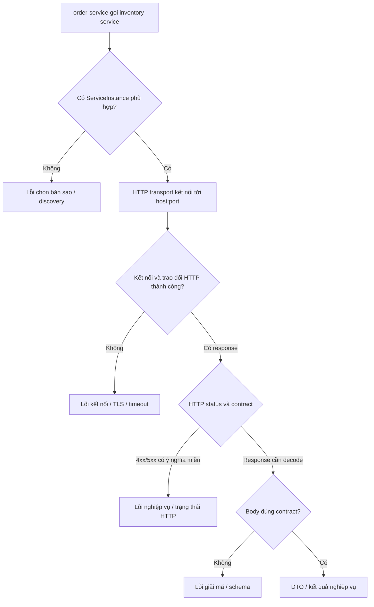
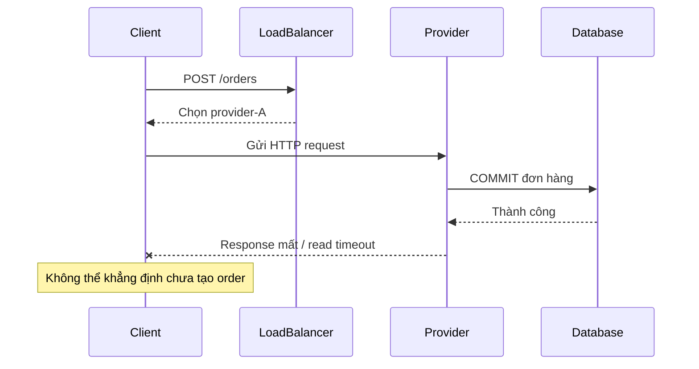
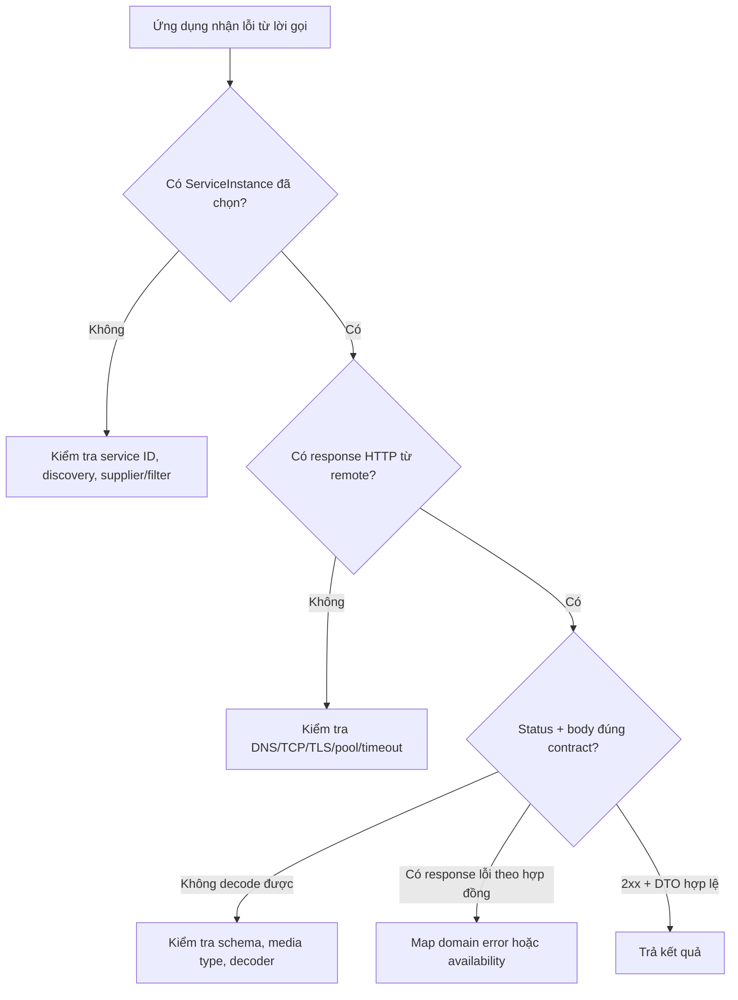

# Phân biệt lỗi chọn bản sao, kết nối, giải mã và nghiệp vụ

Khi một microservice gọi dịch vụ khác qua Spring Cloud LoadBalancer, lỗi không chỉ có một loại. `order-service` có thể không tìm được bản sao của `inventory-service`, chọn được bản sao nhưng không kết nối được, nhận HTTP `200` nhưng không đọc được JSON, hoặc nhận một phản hồi hợp lệ `404`/`409` vì quy tắc nghiệp vụ. Cả bốn tình huống đều có thể khiến luồng gọi kết thúc bằng exception, nhưng **nguồn gốc, trách nhiệm xử lý và chính sách retry hoàn toàn khác nhau**.

Bài học thuộc chương **Hợp đồng và lỗi** trong module Spring Cloud LoadBalancer: ta sẽ lần theo hành trình **service ID → danh sách `ServiceInstance` → kết nối HTTP → status và body → dữ liệu nghiệp vụ**, phân biệt bốn nhóm lỗi, sau đó áp dụng vào `RestClient`, `RestTemplate`, `WebClient` và OpenFeign. Mục tiêu là không đánh đồng mọi HTTP 503 thành “không có instance”, mọi timeout thành “server chưa xử lý”, hay mọi 404 thành “dịch vụ không khỏe”.

## 1. Bản đồ bốn nhóm lỗi

Giả sử ứng dụng gọi URL logic:

```http
GET /api/v1/items/42 HTTP/1.1
Host: inventory-service
Accept: application/json
```

Trong lời gọi dùng LoadBalancer, tên `inventory-service` được hiểu là **service ID**, không nhất thiết là tên DNS có thể phân giải trực tiếp. Tùy tích hợp, LoadBalancer lấy danh sách từ discovery/supplier, chọn một bản sao rồi dựng URI thật để HTTP client kết nối.



Sơ đồ chỉ ra **bước phát hiện lỗi**, không hàm ý HTTP 5xx luôn là lỗi nghiệp vụ: một response 5xx thường là lỗi kỹ thuật từ provider hoặc gateway, còn `400/404/409/422` có thể là kết quả nghiệp vụ dự kiến. Cũng có tình huống lỗi ở nhiều lớp cùng lúc, ví dụ LoadBalancer **tạo response 503 tổng hợp** khi không tìm thấy instance; client nhận mã HTTP nhưng **không có provider nào đã được gọi**.

| Nhóm | Phát sinh ở đâu? | Dấu hiệu điển hình | Người xử lý đầu tiên |
|---|---|---|---|
| **Chọn bản sao** | Discovery, danh sách ứng viên, chính sách load balancing | Không có instance cho service ID; danh sách rỗng sau lọc | LoadBalancer/discovery config |
| **Kết nối/vận chuyển** | DNS đích, socket, TLS, connection pool, đọc/ghi HTTP | Connect refused, connect/read timeout, TLS handshake failure | HTTP transport và resilience |
| **Giải mã/hợp đồng dữ liệu** | Chuyển HTTP body thành DTO | JSON không hợp lệ, kiểu dữ liệu lệch, content type không hỗ trợ | Codec/decoder và quản lý API contract |
| **Nghiệp vụ** | Provider/caller diễn giải status và mã lỗi miền | ITEM_NOT_FOUND, STOCK_CONFLICT, VALIDATION_FAILED | Tầng service/application |

**Quy tắc chẩn đoán:** phải biết **request đã đi tới bước nào** trước khi chọn biện pháp xử lý. Một exception Java không đủ để tự suy ra root cause nếu exception đã bị tầng trên bọc hoặc dịch thành thông báo chung.

## 2. Lỗi chọn bản sao: chưa có đích để gọi

Spring Cloud LoadBalancer thường làm việc với một `service ID` và tập `ServiceInstance` do `ServiceInstanceListSupplier` cung cấp. Một instance có thông tin như service ID, host, port, URI, secure flag và metadata. Thuật toán Round Robin/Random chỉ có thể chọn trong những instance mà supplier đang cung cấp.

### 2.1. Khi nào không có instance?

- URL logic dùng sai service ID: ứng dụng gọi `inventory-svc` trong khi discovery chỉ có `inventory-service`.
- Discovery client chưa đăng ký, registry tạm không truy cập được, hoặc dữ liệu đăng ký chưa được truyền tới client.
- Tất cả ứng viên bị loại bởi một chuỗi lọc version/zone/metadata tùy biến.
- Danh sách tĩnh của `SimpleDiscoveryClient` không khai báo dịch vụ đang gọi.
- Caching/supplier đang giữ một snapshot rỗng hoặc chưa kịp làm mới sau scale-out.

Ví dụ khai báo **đúng** hai bản sao trong profile lab:

```yaml
spring:
  cloud:
    discovery:
      client:
        simple:
          instances:
            inventory-service:
              - uri: http://localhost:8091
              - uri: http://localhost:8092
```

Nếu code gọi `http://inventory-service/api/v1/items/42` thì service ID và khóa `inventory-service` khớp. Nếu gọi nhầm `http://inventory/api/v1/items/42`, danh sách ứng viên cho `inventory` có thể rỗng dù hai provider vẫn chạy tốt.

### 2.2. Không có instance không nhất thiết ném cùng loại exception

Hành vi quan sát được phụ thuộc tích hợp client:

- Với blocking LoadBalancer, một số `LoadBalancerClient`/`ClientHttpRequestInterceptor` có thể ném exception hoặc biểu diễn tình huống không có đích bằng response lỗi.
- Với `ReactorLoadBalancerExchangeFilterFunction` dành cho WebClient, đường không có instance có thể tạo `ClientResponse` với status `503 Service Unavailable`, sau đó `retrieve()` chuyển status đó thành `WebClientResponseException`.
- Với Spring Cloud OpenFeign, `FeignBlockingLoadBalancerClient` có thể tạo response `503` tổng hợp khi không có instance, và response đi qua `ErrorDecoder`.

**Vì thế HTTP 503 hoặc `FeignException.ServiceUnavailable` không đủ để kết luận provider đã trả 503.** Cần chứng cứ có `selectedInstance`, URI đích hoặc server-side trace. Trái lại, nếu thực sự không có instance, đừng tìm lỗi trong JSON body của provider: request chưa tới provider.

### 2.3. Khác với đã chọn nhầm một đích chết

Giả sử discovery **vẫn** trả `http://localhost:8092`, nhưng process trên port 8092 đã dừng. LoadBalancer có thể chọn instance B bình thường; HTTP client mới báo `Connection refused`. Đó là **lỗi kết nối sau chọn đích**, không phải lỗi “không có instance”.

```text
Danh sách ứng viên = []              → không chọn được ServiceInstance
Danh sách ứng viên = [A, B]; B chết  → vẫn có thể chọn B, nhưng HTTP connect lỗi
```

Health check, discovery refresh và graceful shutdown giúp giảm khả năng chọn đích đã chết, nhưng không thể loại bỏ tuyệt đối race condition giữa lúc chọn instance và lúc gửi request.

## 3. Lỗi kết nối: có đích nhưng không hoàn thành trao đổi HTTP

Lỗi transport xảy ra khi HTTP client không thể thực hiện hoặc hoàn thành một request, bất kể business response mong muốn là gì.

| Hiện tượng | Ví dụ nguyên nhân | Cách xác minh |
|---|---|---|
| `Connection refused` | Sai port, instance đã dừng, proxy không lắng nghe | Gọi trực tiếp URI instance từ môi trường client |
| DNS resolution failure | Host thật của instance không phân giải được | Kiểm tra DNS/network bên trong container/JVM |
| Connect timeout | Firewall, routing, instance không chấp nhận kết nối đúng hạn | Quan sát connect phase, network policy và port |
| TLS handshake/certificate error | Sai chứng chỉ, hostname, truststore, protocol | Kiểm tra trust/hostname và log TLS |
| Read/response timeout | Backend chậm, network bị nghẽn, chờ pool, retry kéo dài | Trace từng phase và tổng deadline |
| Connection reset / broken pipe | Peer đóng kết nối hoặc mạng ngắt | Phân biệt reset trước hay sau khi request được gửi |
| Pool acquisition timeout | Connection pool hết chỗ, quá nhiều request đồng thời | Theo dõi pending connections/concurrency |

### 3.1. Timeout không nói rõ server đã xử lý hay chưa

Nếu client timeout **sau khi gửi POST**, server có thể đã commit giao dịch nhưng chưa trả response. Với thao tác ghi, đây là **kết quả không xác định**: retry không có idempotency key hoặc business key có thể tạo đơn hàng, thanh toán hay sự kiện trùng.



Với GET idempotent, retry có giới hạn thường dễ chấp nhận hơn, nhưng vẫn cần deadline. Với POST/PATCH và các operation ghi có side effect, hãy thiết kế idempotency ở nơi thật sự ghi dữ liệu trước khi cho phép retry.

### 3.2. Không gộp mọi exception transport thành “dịch vụ không có item”

Các exception có thể thay đổi theo HTTP client và transport:

- `RestTemplate`/`RestClient` thường biểu hiện lỗi I/O dưới dạng `ResourceAccessException`.
- `WebClient` thường phát `WebClientRequestException` hoặc exception transport khác, ngoài lỗi HTTP response.
- OpenFeign có thể bọc lỗi I/O thành `RetryableException`, nhưng retry thực tế phụ thuộc `Retryer`.

Chuyển mọi exception thành `ItemNotFoundException` sẽ làm caller tưởng resource không tồn tại dù hệ thống đang mất kết nối. Điều đó che lỗi availability, khiến metric và chính sách phục hồi sai.

## 4. Lỗi giải mã: HTTP tới nơi nhưng body không đúng hợp đồng

Một response `200 OK` không bảo đảm client tạo được DTO. Ví dụ, provider trả:

```http
HTTP/1.1 200 OK
Content-Type: application/json

{"id":"42","available":"many"}
```

Nhưng DTO client mong đợi:

```java
public record StockDto(String id, int available) {
}
```

Trường `available` được khai báo là `int` nhưng provider trả chuỗi `"many"`; decoder JSON thường không thể ánh xạ thành số nguyên, dẫn đến exception **sau khi đã nhận HTTP 200**.

Những tình huống khác:

- Body không phải JSON hợp lệ (`{"id":...` bị cắt nửa).
- `Content-Type` là `text/html` hoặc media type không được cấu hình decoder, trong khi client đang mong DTO.
- Đổi tên field hoặc đổi cấu trúc object/array không tương thích với schema kỳ vọng.
- Provider trả 204/body rỗng, nhưng tầng gọi tự giả định **luôn có DTO** và phát lỗi khi xử lý kết quả trống.
- Một version dịch vụ mới dùng enum hoặc định dạng ngày không được decoder cũ hỗ trợ.
- Tệp response lớn vượt giới hạn bộ đệm decoder của reactive HTTP client.

**Phân biệt ba sự kiện:** HTTP transport nhận response thành công, HTTP status là 2xx, và deserialize thành kiểu Java thành công. Chúng là các bước độc lập.

### 4.1. Dấu hiệu trong các HTTP client

| Client | Lỗi giải mã thường thấy | Không nên nhầm với |
|---|---|---|
| `RestTemplate` | `RestClientException`/message-converter exception có cause liên quan JSON | Không có `ServiceInstance` |
| `RestClient` | Message conversion / `RestClientException` tùy converter | HTTP 404/503 từ provider |
| `WebClient` | `DecodingException`, `UnsupportedMediaTypeException`, codec/buffer exception tùy tình huống | `WebClientResponseException` của status 4xx/5xx |
| OpenFeign | `DecodeException` hoặc converter/decoder exception | `ErrorDecoder` của response lỗi HTTP |

Tên lớp cụ thể còn tùy Spring Framework, Jackson, OpenFeign và HTTP transport đang dùng. Tốt hơn là **giữ cause và trace** thay vì dựa vào chuỗi `exception.getMessage()` để quyết định retry.

### 4.2. Hợp đồng tương thích giúp giảm decode failure

Hãy xác định rõ kiểu dữ liệu và schema:

```json
{
  "id": "42",
  "available": 12
}
```

Khi mở rộng API, ưu tiên những thay đổi **tương thích ngược** với client còn đang chạy: thêm field tùy chọn, duy trì kiểu của field hiện có, quản lý enum và version; có integration/contract test giữa provider và consumer. Không nên đổi `available` từ integer sang string rồi trông đợi LoadBalancer hay retry giải quyết được lỗi đó. Cố retry request giống hệt nhiều lần thường chỉ lặp lại **cùng lỗi schema**.

## 5. Lỗi nghiệp vụ: response có ý nghĩa theo API contract

Một dịch vụ có thể từ chối request **đúng quy tắc nghiệp vụ** dù kết nối và giải mã đều tốt. Ví dụ:

```http
HTTP/1.1 409 Conflict
Content-Type: application/problem+json

{
  "type": "https://example.test/problems/stock-conflict",
  "title": "Stock conflict",
  "status": 409,
  "detail": "Requested quantity exceeds available stock",
  "code": "STOCK_CONFLICT"
}
```

Đây là ví dụ body **Problem Details** theo hướng RFC 9457. Các field chuẩn gồm `type`, `title`, `status`, `detail`, `instance` (tùy chọn); `code` là **extension do API quy định**, không phải field bắt buộc của chuẩn. `example.test` chỉ là URL minh họa.

Những lỗi nghiệp vụ điển hình:

| HTTP status | Mã nghiệp vụ ví dụ | Ý nghĩa | Hướng xử lý |
|---|---|---|---|
| `400/422` | `VALIDATION_FAILED` | Input không hợp lệ | Trả lỗi để caller sửa request; không retry y nguyên |
| `404` | `ITEM_NOT_FOUND` | Resource không tồn tại | Kết quả dự kiến nếu endpoint đã định nghĩa |
| `409` | `STOCK_CONFLICT` | Xung đột tồn kho/phiên bản | Cập nhật dữ liệu/đổi yêu cầu, không retry mù |
| `412` | `PRECONDITION_FAILED` | `If-Match` hoặc điều kiện version thất bại | Xử lý optimistic concurrency |
| `401/403` | `NOT_AUTHORIZED` | Thiếu xác thực/quyền | Sửa auth; đừng coi instance chết |
| `429` | `RATE_LIMITED` | Giới hạn tốc độ/công suất | Xem `Retry-After`, backoff và quota |
| `503` | `DEPENDENCY_UNAVAILABLE` | Không thể phục vụ ở thời điểm hiện tại | Lỗi availability, thường không phải business rejection |

**Không ánh xạ máy móc mọi 404 thành `ITEM_NOT_FOUND`.** Nếu 404 do sai path, thiếu route trên phiên bản triển khai mới hoặc gateway, nó là lỗi hợp đồng/routing; muốn phân biệt phải kết hợp endpoint, mã lỗi trong body và trace. Tương tự, không phải tất cả `409` đều được phép retry y nguyên.

### 5.1. HTTP status, error code và message có vai trò khác nhau

- **HTTP status:** lớp phản hồi ở mức protocol, hữu ích cho gateway, HTTP client và monitoring.
- **Mã lỗi nghiệp vụ ổn định:** giúp caller ra quyết định có thể lập trình, ví dụ `STOCK_CONFLICT`.
- **Thông điệp:** cho người dùng/log, có thể thay đổi theo ngôn ngữ và không thích hợp làm khóa phân loại.
- **Correlation/request ID:** giúp truy vết một yêu cầu qua nhiều service.

Nên định nghĩa contract rõ cho lỗi có thể dự đoán: status phù hợp, `code` có kiểu/giá trị ổn định, `detail` không lộ nội bộ, tiêu chí retry và versioning. Với response 5xx, không trả stack trace, SQL query, token hoặc cấu hình hạ tầng ra client.

## 6. Một status HTTP không nói chắc lỗi phát sinh ở tầng nào

Tình huống đáng chú ý nhất trong Spring Cloud LoadBalancer là **HTTP 503**:

| Trường hợp | Provider nhận request? | Ai tạo status/lỗi? | Cách kiểm tra |
|---|---|---|---|
| Danh sách instance rỗng | Không | Có thể LoadBalancer tạo 503 tổng hợp | Kiểm tra supplier, `selectedInstance` rỗng |
| Chọn instance và backend trả 503 | Có | Provider | Tìm access log/trace của provider |
| API gateway trả 503 trước khi tới provider | Không hoặc chưa đến provider | Gateway/proxy | Kiểm tra trace gateway và upstream connection |
| Port đã chết nhưng vẫn trong danh sách | Đã chọn đích nhưng không kết nối được | HTTP transport phát connect error | Kiểm tra URI thật và socket error |
| Backend trả 200 với JSON sai | Có | Decoder của client phát lỗi | Kiểm tra status 200 và stack trace converter |

Đừng dùng điều kiện `if (status == 503) { discoveryIsBroken = true; }` để khẳng định nguồn lỗi. Khi có 503 tổng hợp ở tầng LoadBalancer, client có thể nhận được một đối tượng response tương tự HTTP response dù backend không được gọi. Cần instrument tại cả hai phía của ranh giới LoadBalancer/transport.

### Sơ đồ quyết định tối thiểu



Khi chưa có instrument để biết instance đã chọn, đừng giả định có/không từ một dòng log: cần bổ sung metric hoặc trace tại đúng chỗ.

## 7. RestClient và RestTemplate: tách HTTP status khỏi I/O và decode

Với Spring Framework 6.1+ và phiên bản Spring Cloud tương thích, có thể dùng `@LoadBalanced RestClient.Builder`:

```java
import org.springframework.cloud.client.loadbalancer.LoadBalanced;
import org.springframework.context.annotation.Bean;
import org.springframework.context.annotation.Configuration;
import org.springframework.web.client.RestClient;

@Configuration
class HttpClientConfiguration {

    @Bean
    @LoadBalanced
    RestClient.Builder loadBalancedRestClientBuilder() {
        return RestClient.builder();
    }
}
```

Bean này giúp RestClient gọi `http://inventory-service` theo service ID, thay vì gửi tên đó thẳng tới DNS như một HTTP client chưa cấu hình LoadBalancer. Trong môi trường thực, cần thêm `spring-cloud-starter-loadbalancer` và supplier/discovery đúng service ID.

### 7.1. DTO và exception của ứng dụng

Ví dụ domain client sử dụng:

```java
record ItemDto(String id, String name, int available) {
}

final class ItemNotFoundException extends RuntimeException {
    ItemNotFoundException(String id) {
        super("Item not found: " + id);
    }
}

final class StockConflictException extends RuntimeException {
    StockConflictException() {
        super("Stock conflict");
    }
}
```

Tạo một gateway có `onStatus` chỉ dành cho **những lỗi nghiệp vụ đã biết**:

```java
import org.springframework.beans.factory.annotation.Qualifier;
import org.springframework.stereotype.Service;
import org.springframework.web.client.RestClient;

@Service
class InventoryRestGateway {
    private final RestClient client;

    InventoryRestGateway(
            @Qualifier("loadBalancedRestClientBuilder")
            RestClient.Builder builder) {
        this.client = builder
                .baseUrl("http://inventory-service")
                .build();
    }

    ItemDto findItem(String id) {
        return client.get()
                .uri("/api/v1/items/{id}", id)
                .retrieve()
                .onStatus(status -> status.value() == 404,
                        (request, response) -> {
                            throw new ItemNotFoundException(id);
                        })
                .onStatus(status -> status.value() == 409,
                        (request, response) -> {
                            throw new StockConflictException();
                        })
                .body(ItemDto.class);
    }
}
```

`onStatus` ở đây ánh xạ 404 và 409 theo **contract của endpoint `findItem`**. Với status 5xx chưa được xử lý riêng, RestClient vẫn áp dụng cơ chế lỗi HTTP mặc định, thường thông qua `RestClientResponseException` hoặc subtype tương ứng. Nếu provider trả 200 nhưng JSON sai, lỗi decode xuất hiện **sau** bước kiểm tra status và không trở thành `ItemNotFoundException`.

Đoạn code minh họa **một** phương thức đọc: nếu 404 có nghĩa khác trên endpoint khác, không nên dùng bộ ánh xạ này toàn cục cho mọi request.

### 7.2. Phân loại trong service layer

```java
import org.springframework.web.client.ResourceAccessException;
import org.springframework.web.client.RestClientException;
import org.springframework.web.client.RestClientResponseException;

ItemDto callInventory(InventoryRestGateway gateway, String id) {
    try {
        return gateway.findItem(id);
    } catch (ItemNotFoundException ex) {
        // Lỗi nghiệp vụ đã được xác nhận.
        throw ex;
    } catch (StockConflictException ex) {
        throw ex;
    } catch (RestClientResponseException ex) {
        // Có một HTTP status mà tầng RestClient nhìn thấy.
        // 503 có thể đến từ provider/proxy/LoadBalancer.
        throw ex;
    } catch (ResourceAccessException ex) {
        // Lỗi I/O: connect/read timeout, refused... tùy transport.
        throw ex;
    } catch (RestClientException ex) {
        // Các lỗi còn lại, ví dụ message conversion/decoder.
        throw ex;
    }
}
```

Các `catch` trên chỉ minh họa **phân loại để xử lý hoặc ghi metric**, nên vẫn ném lại exception. Trong sản phẩm thực, có thể chuyển chúng thành kiểu failure có cấu trúc, nhưng không nên chuyển tất cả thành một `RuntimeException("upstream error")` mà bỏ mất cause và status gốc.

**Với RestTemplate:** dùng `@LoadBalanced RestTemplate` và `ClientHttpRequestFactory` phù hợp. Mặc định, HTTP 4xx/5xx thường sinh `HttpClientErrorException`/`HttpServerErrorException` (thuộc họ `RestClientResponseException`); lỗi transport thường là `ResourceAccessException`, còn message conversion là lớp lỗi khác. Ngữ nghĩa phân loại tương tự RestClient, dù API để gắn error handler khác.

## 8. WebClient: HTTP error, request error và decoding error trong pipeline reactive

Với WebFlux, builder được tích hợp LoadBalancer như sau:

```java
import org.springframework.cloud.client.loadbalancer.LoadBalanced;
import org.springframework.context.annotation.Bean;
import org.springframework.context.annotation.Configuration;
import org.springframework.web.reactive.function.client.WebClient;

@Configuration
class ReactiveClientConfiguration {

    @Bean
    @LoadBalanced
    WebClient.Builder loadBalancedWebClientBuilder() {
        return WebClient.builder();
    }
}
```

Tạo client:

```java
import org.springframework.beans.factory.annotation.Qualifier;
import org.springframework.stereotype.Service;
import org.springframework.web.reactive.function.client.WebClient;
import reactor.core.publisher.Mono;

@Service
class InventoryReactiveGateway {
    private final WebClient client;

    InventoryReactiveGateway(
            @Qualifier("loadBalancedWebClientBuilder")
            WebClient.Builder builder) {
        this.client = builder
                .baseUrl("http://inventory-service")
                .build();
    }

    Mono<ItemDto> findItem(String id) {
        return client.get()
                .uri("/api/v1/items/{id}", id)
                .retrieve()
                .onStatus(code -> code.value() == 404,
                        response -> response.releaseBody()
                                .thenReturn(new ItemNotFoundException(id)))
                .onStatus(code -> code.value() == 409,
                        response -> response.releaseBody()
                                .thenReturn(new StockConflictException()))
                .bodyToMono(ItemDto.class);
    }
}
```

`retrieve()` mặc định phát `WebClientResponseException` cho status 4xx/5xx; hai `onStatus` trên chỉ thay đổi cách diễn giải `404` và `409`. `response.releaseBody()` chủ động giải phóng body không sử dụng của response, rồi trả exception nghiệp vụ.

**Không hiểu nhầm:** handler `onStatus(..., response -> Mono.empty())` **không** tự biến toàn bộ request thành kết quả `Mono.empty()`; nó chỉ yêu cầu bỏ qua việc chuyển HTTP status đó thành exception rồi tiếp tục xử lý body. Nếu muốn 404 là kết quả rỗng thực sự, có thể dùng `exchangeToMono()` phân nhánh theo status hoặc bắt `WebClientResponseException.NotFound` sau `retrieve()`.

### 8.1. Quan sát exception theo từng lớp

```java
import org.springframework.core.codec.DecodingException;
import org.springframework.web.reactive.function.client.WebClientRequestException;
import org.springframework.web.reactive.function.client.WebClientResponseException;
import reactor.core.publisher.Mono;

Mono<ItemDto> findWithDiagnostics(
        InventoryReactiveGateway gateway, String id) {
    return gateway.findItem(id)
            .doOnError(ItemNotFoundException.class,
                    ex -> System.err.println("BUSINESS: not found"))
            .doOnError(WebClientResponseException.class,
                    ex -> System.err.println(
                            "HTTP status=" + ex.getStatusCode().value()))
            .doOnError(WebClientRequestException.class,
                    ex -> System.err.println("TRANSPORT failure"))
            .doOnError(DecodingException.class,
                    ex -> System.err.println("DECODING failure"));
}
```

Đây là mã **minh họa loại lỗi**, không phải logging production. Thực tế nên dùng SLF4J, tracing và không ghi response body/token nhạy cảm. `doOnError` chỉ quan sát; nó **không biến lỗi thành thành công**, không retry và không sửa lỗi schema.

Các lớp exception có thể được bọc theo codec/transport; cần xem root cause để phân loại chính xác. Đừng chỉ dựa vào `DecodingException` như một danh sách đầy đủ mọi lỗi giải mã (ví dụ buffer limit hoặc unsupported media type có thể có kiểu khác).

### 8.2. exchangeToMono() khi 404 là kết quả rỗng

Nếu hợp đồng API nói `404` nghĩa là **không có item** thay vì exception:

```java
Mono<ItemDto> findOptional(WebClient client, String id) {
    return client.get()
            .uri("/api/v1/items/{id}", id)
            .exchangeToMono(response -> {
                if (response.statusCode().value() == 404) {
                    return response.releaseBody()
                            .then(Mono.<ItemDto>empty());
                }
                if (response.statusCode().is2xxSuccessful()) {
                    return response.bodyToMono(ItemDto.class);
                }
                return response.createError();
            });
}
```

Đường này **không hợp thức hóa lỗi HTTP 503 hoặc lỗi mạng thành “item không tồn tại”**. Nó chỉ trả rỗng khi response chính xác là 404; status khác vẫn phát lỗi và decoder của 2xx vẫn kiểm tra body.

Trong WebFlux, tránh gọi `block()` ngay trên event loop vì chặn thread xử lý request. Để kiểm thử tín hiệu reactive, có thể dùng `StepVerifier` cùng server HTTP giả lập; mock quá sâu ở lớp `ExchangeFunction` chỉ kiểm tra xử lý status, **chưa chứng minh** LoadBalancer có chọn được instance thật.

## 9. OpenFeign: ErrorDecoder chỉ có HTTP response mới xử lý được

OpenFeign cung cấp `ErrorDecoder` để biến **response HTTP lỗi** thành exception. Nó không xử lý mọi tình huống:

- HTTP 404/409 có thể qua `ErrorDecoder` và được ánh xạ thành exception domain.
- 5xx không tùy biến thường được `ErrorDecoder.Default` chuyển thành `FeignException`.
- Lỗi transport có thể biểu hiện thành `RetryableException` hoặc lỗi Feign khác mà không có `Response` tương ứng.
- HTTP 200 sai schema có thể phát `DecodeException` từ **decoder dữ liệu**, không phải `ErrorDecoder`.
- Khi LoadBalancer tạo response `503` tổng hợp vì không có instance, `ErrorDecoder` có thể thấy 503 dù không có request tới provider.

### 9.1. Định nghĩa Feign client

```java
import org.springframework.cloud.openfeign.FeignClient;
import org.springframework.web.bind.annotation.GetMapping;
import org.springframework.web.bind.annotation.PathVariable;

@FeignClient(
        name = "inventory-service",
        configuration = InventoryFeignConfiguration.class)
public interface InventoryFeignClient {

    @GetMapping("/api/v1/items/{id}")
    ItemDto findById(@PathVariable("id") String id);
}
```

### 9.2. ErrorDecoder theo nghiệp vụ

```java
import feign.Response;
import feign.codec.ErrorDecoder;

final class InventoryErrorDecoder implements ErrorDecoder {

    private final ErrorDecoder fallback = new ErrorDecoder.Default();

    @Override
    public Exception decode(String methodKey, Response response) {
        if (response.status() == 404) {
            return new ItemNotFoundException("unknown");
        }
        if (response.status() == 409) {
            return new StockConflictException();
        }
        // Không đọc body trước khi chuyển về decoder mặc định.
        return fallback.decode(methodKey, response);
    }
}
```

Ví dụ trên dùng `"unknown"` khi tạo `ItemNotFoundException` vì `ErrorDecoder` chỉ nhận `methodKey` và `Response`; muốn lấy ID đã gọi, cần đọc request URI an toàn hoặc thiết kế exception chứa thông tin chuẩn từ error body theo contract. Không nên tự suy ID từ message lỗi hoặc đưa URL/token nguyên văn vào log.

Đăng ký **riêng cho client inventory**:

```java
import feign.codec.ErrorDecoder;
import org.springframework.context.annotation.Bean;
import org.springframework.context.annotation.Configuration;

@Configuration(proxyBeanMethods = false)
public class InventoryFeignConfiguration {

    @Bean
    ErrorDecoder inventoryErrorDecoder() {
        return new InventoryErrorDecoder();
    }
}
```

Đặt `InventoryFeignConfiguration` ngoài vùng component scan thông thường nếu chỉ muốn áp dụng nó cho `@FeignClient(configuration=...)`. Nếu class bị quét vào context chính, bean `ErrorDecoder` có thể ảnh hưởng những client khác.

**404 và `dismiss404`:** khi tùy chọn này bật, Feign có thể chuyển 404 qua decoder dữ liệu thay vì `ErrorDecoder`. Nếu muốn 404 luôn thành `ItemNotFoundException`, giữ `dismiss404=false` và kiểm chứng trên client thực. Mọi 404 không nhất thiết là lỗi nghiệp vụ: nếu URI sai, việc ánh xạ 404 thành “item không tồn tại” có thể che mất lỗi version/routing.

**Retry:** Spring Cloud OpenFeign thường đăng ký `Retryer.NEVER_RETRY` làm mặc định, vì vậy `FeignException` hay `RetryableException` không có nghĩa request chắc chắn được thử lại. Nếu bật retry ở lớp khác (Spring Cloud LoadBalancer, gateway, Resilience4j, service mesh), phải kiểm tra tổng số HTTP attempts.

## 10. Hợp đồng lỗi thống nhất và cách trả response cho caller

Một thiết kế service-to-service thường có hai ranh giới:

1. **Inbound API:** định nghĩa response cho người gọi, gồm HTTP status, mã lỗi miền, payload và tracing.
2. **Outbound client:** gọi upstream, phân loại lỗi thành exception/kiểu dữ liệu phù hợp, tránh để lộ implementation của HTTP client cho toàn bộ code nghiệp vụ.

### 10.1. ProblemDetail cho lỗi miền

Ví dụ Spring Boot 3 / Spring Framework 6 với `ProblemDetail`:

```java
import org.springframework.http.HttpStatus;
import org.springframework.http.ProblemDetail;
import org.springframework.http.ResponseEntity;
import org.springframework.web.bind.annotation.ExceptionHandler;
import org.springframework.web.bind.annotation.RestControllerAdvice;

@RestControllerAdvice
class InventoryProblemAdvice {

    @ExceptionHandler(ItemNotFoundException.class)
    ResponseEntity<ProblemDetail> notFound(ItemNotFoundException error) {
        ProblemDetail body = ProblemDetail.forStatusAndDetail(
                HttpStatus.NOT_FOUND, "Item does not exist");
        body.setTitle("Item not found");
        body.setProperty("code", "ITEM_NOT_FOUND");
        return ResponseEntity.status(HttpStatus.NOT_FOUND).body(body);
    }

    @ExceptionHandler(StockConflictException.class)
    ResponseEntity<ProblemDetail> conflict(StockConflictException error) {
        ProblemDetail body = ProblemDetail.forStatusAndDetail(
                HttpStatus.CONFLICT, "Inventory state changed");
        body.setTitle("Stock conflict");
        body.setProperty("code", "STOCK_CONFLICT");
        return ResponseEntity.status(HttpStatus.CONFLICT).body(body);
    }
}
```

Đoạn code này tạo hợp đồng **inbound** cho lỗi nghiệp vụ. Các ngoại lệ timeout, connection failure, decode error hoặc HTTP 503 từ upstream cần **một chính sách khác** để tránh vô tình chuyển thành 404/409 hoặc lộ stack trace. Tùy vai trò của service, có thể trả `502 Bad Gateway`, `503 Service Unavailable` hoặc `504 Gateway Timeout`, nhưng đó là **quyết định mapping tại service** chứ không phải hành vi tự động được bảo đảm bởi mọi HTTP client.

### 10.2. Không phản chiếu nguyên lỗi upstream ra bên ngoài

Ví dụ `order-service` nhận 503 từ `inventory-service`. Không nên sao chép nguyên body upstream ra cho public caller: nội dung có thể chứa đường dẫn nội bộ, stack trace, tên host và thông tin cấu hình. Thay vào đó, trả error code ổn định như `UPSTREAM_UNAVAILABLE` và correlation ID có thể tra cứu.

Tương tự, `RestClientResponseException.getResponseBodyAsString()`, `WebClientResponseException.getResponseBodyAsString()` và `FeignException.contentUTF8()` có thể chứa dữ liệu nhạy cảm hoặc body rất lớn. Khi log phải giới hạn kích thước, bảo vệ PII/token và chỉ lưu đủ thông tin cần chẩn đoán.

### 10.3. Quy tắc thiết kế hợp đồng versioning

- Giữ status và mã lỗi miền ổn định khi vẫn cùng semantics.
- Khi thêm field vào JSON, bảo đảm các consumer cũ xử lý được; không đổi kiểu dữ liệu tùy tiện.
- Có giới hạn kích thước body lỗi; không giả định mọi 5xx trả JSON.
- Với `204 No Content`, khai báo rõ caller nhận gì thay vì bắt buộc body DTO.
- Không biến lỗi decode thành 404 hay 200 rỗng bằng `catch (Exception)` bao trùm.
- Nếu API sử dụng `ProblemDetail`, thống nhất `Content-Type: application/problem+json` và các extension field được phép.
- Với các operation ghi, định nghĩa idempotency, conflict và trạng thái không xác định khi timeout.

## 11. Bài lab: chủ động tái hiện bốn nhóm lỗi

Thay vì chờ production gặp lỗi rồi suy luận, có thể dựng một lab nhỏ: `inventory-service` có hai bản sao, `order-service` gọi qua LoadBalancer. Provider trả response theo đường dẫn `id`; client chọn service ID từ danh sách tĩnh.

### 11.1. Provider tạo response hợp lệ, nghiệp vụ và sai schema

Trong dự án Spring Boot Web của `inventory-service`:

```java
import java.util.Map;

import org.springframework.beans.factory.annotation.Value;
import org.springframework.http.MediaType;
import org.springframework.http.ResponseEntity;
import org.springframework.web.bind.annotation.GetMapping;
import org.springframework.web.bind.annotation.PathVariable;
import org.springframework.web.bind.annotation.RestController;

record ItemDto(String id, String name, int available) {
}

@RestController
class InventoryDemoController {
    private final int port;

    InventoryDemoController(@Value("${server.port}") int port) {
        this.port = port;
    }

    @GetMapping("/api/v1/items/{id}")
    ResponseEntity<?> getItem(@PathVariable String id) {
        return switch (id) {
            case "missing" -> ResponseEntity.status(404)
                    .body(Map.of("code", "ITEM_NOT_FOUND"));
            case "conflict" -> ResponseEntity.status(409)
                    .body(Map.of("code", "STOCK_CONFLICT"));
            case "unavailable" -> ResponseEntity.status(503)
                    .body(Map.of("code", "DEPENDENCY_UNAVAILABLE"));
            case "bad-json" -> ResponseEntity.ok()
                    .contentType(MediaType.APPLICATION_JSON)
                    .body("{\"id\":\"42\",\"name\":\"Book\","
                            + "\"available\":\"many\"}");
            default -> ResponseEntity.ok(
                    new ItemDto(id, "Item via port " + port, 12));
        };
    }
}
```

Đoạn `bad-json` cố ý trả JSON **cú pháp hợp lệ** nhưng `available` là chuỗi `"many"` thay vì integer. Lỗi này giúp tái hiện **decode/schema mismatch** sau HTTP 200. Các nhánh `missing`/`conflict` trả kết quả nghiệp vụ dự kiến, còn `unavailable` trả lỗi HTTP 503 từ **chính provider**.

Chạy hai bản sao từ cùng JAR trong môi trường lab:

```bash
# Terminal A
java -jar inventory-service.jar --server.port=8091

# Terminal B
java -jar inventory-service.jar --server.port=8092
```

Kiểm tra trực tiếp:

```bash
curl -i http://localhost:8091/api/v1/items/42
curl -i http://localhost:8091/api/v1/items/missing
curl -i http://localhost:8092/api/v1/items/conflict
curl -i http://localhost:8092/api/v1/items/unavailable
curl -i http://localhost:8091/api/v1/items/bad-json
```

Trước khi thử LoadBalancer, kỳ vọng lần lượt HTTP `200` với JSON đúng, `404`, `409`, `503` và **200 với kiểu dữ liệu sai**. Nếu provider trực tiếp không trả những status này, hãy sửa lab trước khi gắn kết quả lỗi cho client.

### 11.2. Client gọi service ID

Trong `application-lab.yml` của `order-service`:

```yaml
server:
  port: 8080

spring:
  application:
    name: order-service
  cloud:
    discovery:
      client:
        simple:
          instances:
            inventory-service:
              - uri: http://localhost:8091
              - uri: http://localhost:8092
```

Ứng dụng client cần `spring-cloud-starter-loadbalancer`, HTTP starter tương ứng và Spring Cloud BOM tương thích với Spring Boot. Dùng một trong ba gateway ở mục 7–9 để gọi `http://inventory-service/api/v1/items/{id}`.

Ví dụ controller `RestClient`:

```java
import org.springframework.web.bind.annotation.GetMapping;
import org.springframework.web.bind.annotation.PathVariable;
import org.springframework.web.bind.annotation.RestController;

@RestController
class InventoryProxyController {
    private final InventoryRestGateway gateway;

    InventoryProxyController(InventoryRestGateway gateway) {
        this.gateway = gateway;
    }

    @GetMapping("/test/items/{id}")
    ItemDto getItem(@PathVariable String id) {
        return gateway.findItem(id);
    }
}
```

Gọi qua client:

```bash
curl -i http://localhost:8080/test/items/42
curl -i http://localhost:8080/test/items/missing
curl -i http://localhost:8080/test/items/conflict
curl -i http://localhost:8080/test/items/unavailable
curl -i http://localhost:8080/test/items/bad-json
```

Với `InventoryProblemAdvice` ở mục 10, các domain exception của `missing`/`conflict` có thể được ánh xạ thành response 404/409 của proxy. Nhưng `unavailable` và `bad-json` **không tự động giữ status gốc** ở API của `order-service`: nếu chưa có handler tương ứng, tầng xử lý lỗi mặc định có thể trả 500. Phải kiểm tra **exception tại HTTP client**, **response do proxy quyết định**, và **status trực tiếp từ provider** như ba quan sát riêng.

### 11.3. Thử lỗi chọn bản sao

Muốn tái hiện **không có instance** mà không cần tắt provider, trong một profile lab riêng hãy gọi một service ID **không có trong discovery**, ví dụ `http://unknown-inventory/api/v1/items/42`, qua **cùng loại `@LoadBalanced` client**.

Quan sát:

1. Supplier không trả instance cho `unknown-inventory`.
2. Không có provider nào nhận request này.
3. Client có thể nhận 503 tổng hợp hoặc exception từ integration; **đừng giả định** tất cả clients đều ném cùng kiểu.

Không thử bằng `WebClient.create("http://unknown-inventory")` không cấu hình LoadBalancer, vì khi đó có thể chỉ tạo DNS error cho hostname `unknown-inventory` — **khác với** kiểm thử lựa chọn instance rỗng.

### 11.4. Thử lỗi kết nối

Trong một profile lab khác, chỉ khai báo:

```yaml
spring:
  cloud:
    discovery:
      client:
        simple:
          instances:
            inventory-service:
              - uri: http://localhost:8999
```

**Không chạy provider** trên 8999. Khởi động client với profile này, gọi `http://inventory-service/...` qua LoadBalancer:

1. Supplier trả một `ServiceInstance` có host/port cụ thể.
2. LoadBalancer chọn được instance đó.
3. TCP connect bị từ chối hoặc timeout do không có tiến trình ở đích.

Đây là **lỗi transport**; không phải lỗi discovery rỗng, dù kết quả cuối với người dùng đều có thể là request thất bại. Đừng sửa URL logic thành `localhost:8999` rồi cho rằng đã kiểm thử LoadBalancer: cần giữ service ID để đi qua bước chọn đích.

### 11.5. Thử lỗi giải mã

Khi hai provider và danh sách instance đang hoạt động, gọi `GET /api/v1/items/bad-json` qua RestClient hoặc WebClient và yêu cầu parse thành `ItemDto` có `available: int`.

Kỳ vọng:

- Provider gửi HTTP 200.
- Không có connect timeout và không cần đổi instance.
- JSON không khớp DTO, nên client phát lỗi codec/decoder.
- Retry request giống hệt sang một instance **cũng trả schema sai** thường không giải quyết được nguyên nhân.

Nếu thêm một provider mới trả schema khác, kết quả có thể lúc thành công lúc lỗi tùy instance được chọn. Khi đó cần log **instance ID/phiên bản triển khai**, không chỉ status 200.

### 11.6. Thử lỗi nghiệp vụ

Gọi `GET /api/v1/items/missing` và `GET /api/v1/items/conflict` qua một gateway có mapping như mục 7–9:

- HTTP 404 → `ItemNotFoundException`.
- HTTP 409 → `StockConflictException`.
- Cả hai status do provider chủ động trả **đúng contract**.
- Circuit breaker/readiness không nên coi các exception domain dự kiến là instance failure chỉ vì không phải 2xx.

**Ghi nhớ:** lỗi nghiệp vụ vẫn có thể là “request thất bại” từ góc độ người dùng nhưng là “provider đang làm đúng công việc” từ góc độ availability. Nên đo hai loại tỷ lệ riêng.

## 12. Ma trận kiểm thử tự động và tiêu chí chấp nhận

| Case | Thiết lập | Tín hiệu client cần khẳng định | Bằng chứng phía provider |
|---|---|---|---|
| Chọn instance thành công | 2 instance khỏe | Có `selectedInstance`, DTO hợp lệ | Provider có access log |
| Không có instance | Service ID chưa đăng ký | Supplier rỗng, lỗi trước kết nối | Không có request |
| Instance chết | URI tĩnh trỏ port đóng | Đã chọn đích, lỗi transport | Không có request ở đích |
| 404 đúng contract | Provider trả `ITEM_NOT_FOUND` | Exception domain/optional empty theo policy | Provider đã nhận request |
| 409 đúng contract | Provider trả `STOCK_CONFLICT` | Exception conflict, không retry vô điều kiện | Provider đã nhận request |
| 503 từ provider | Provider chủ động trả 503 | HTTP status error, không mặc định do discovery | Provider có request và status 503 |
| 200 sai JSON | Trả kiểu dữ liệu không tương thích | Decode exception, status 200 | Provider đã gửi response 200 |
| Timeout sau khi gửi POST | Inject delay/mất response trong lab | Kết quả không xác định; không mặc định retry ghi | Có thể đã commit |
| Breaker OPEN | Circuit breaker từ chối client | `CallNotPermittedException`/fail fast | Không có attempt mới |

### 12.1. Đo đúng nhiều lớp trong test

Với unit test, có thể mock HTTP response để kiểm tra một `ErrorDecoder` hoặc `onStatus` đã ánh xạ 404/409 đúng. Nhưng test đó **chưa chứng minh** discovery và LoadBalancer hoạt động.

Với integration test, nên sử dụng server HTTP thật trên cổng động, đăng ký địa chỉ cho `SimpleDiscoveryClient` bằng cấu hình test, rồi kiểm tra:

1. Có lần thử chọn `ServiceInstance`, hostname/port thực sự được sử dụng.
2. Provider nhận request hoặc **không nhận** request đúng như từng case.
3. Status/headers/body gốc được ghi nhận trong trace hoặc mock HTTP server.
4. Client tạo đúng nhóm exception và proxy ánh xạ response theo contract.
5. Không có retry ngoài dự kiến; đo tổng HTTP attempts thay vì chỉ xem exception cuối.

Một nguyên tắc khi viết assertion:

```text
selection-empty:
  selectedInstanceCount = 0
  providerRequestCount = 0

connection-refused:
  selectedInstanceCount >= 1
  providerRequestCount = 0

decode-error:
  providerResponseStatus = 200
  clientDecodedDto = false

business-not-found:
  providerResponseStatus = 404
  domainErrorCode = ITEM_NOT_FOUND
```

Các trường trong ví dụ là **pseudocode cho assert/instrumentation**, không phải tên metric mặc định do Spring Cloud tự tạo. Cần bổ sung instrument để đo `selectedInstanceCount` thay vì chỉ suy từ response ở controller.

### 12.2. Không trộn lỗi do fault injection với lỗi production

Những kịch bản tắt backend, đổi discovery, làm hỏng JSON hoặc mất response phải thực hiện trong môi trường test/lab. Một proxy thực có thể chia sẻ connection pool, cache và circuit breaker giữa nhiều request; thao tác cố ý gây lỗi trên production có thể làm gia tăng retry và ảnh hưởng tới lưu lượng thật.

## 13. Retry và fallback theo đúng loại lỗi

Retry/fallback là **chính sách của ứng dụng**, không phải hành vi mặc định giống nhau cho mọi Spring Cloud HTTP client.

| Loại lỗi | Retry? | Fallback/degrade? | Lưu ý |
|---|---|---|---|
| Không có instance | Chỉ khi discovery có khả năng phục hồi trong deadline | Trả lỗi có kiểm soát hoặc cache hợp lệ | Retry nhiều lần không tự tạo instance |
| Connect timeout/refused | Có thể, nếu operation an toàn và còn deadline | Cache/fail fast tùy contract | Kiểm tra instance chết và health/discovery |
| Read timeout sau POST | **Không retry mù quáng** | Tra cứu outcome, idempotency key | Server có thể đã commit |
| 200 sai JSON | Thường không retry cùng schema | Fail có thông tin chẩn đoán | Sửa contract hoặc version |
| 404 item không tồn tại | Không retry y nguyên | Trả not-found hoặc Optional.empty | Không coi instance unhealthy |
| 409 conflict | Không retry mù quáng | Đọc lại dữ liệu/đổi thao tác | Có thể cần version/If-Match |
| 429 rate-limit | Cân nhắc retry theo `Retry-After` và budget | Trả capacity response phù hợp | Không tạo retry storm |
| HTTP 502/503/504 | Có thể retry GET idempotent, có giới hạn | Cached read hoặc fail fast | Phân biệt nguồn 503 và deadline |
| Breaker OPEN | Không loop retry ngay | Fail fast/fallback an toàn | Client đang chủ động cô lập downstream |

**Không có chính sách retry chung cho mọi request**. Với GET thực sự chỉ đọc, có thể cho phép retry có backoff, jitter và giới hạn attempts; với POST/PATCH phải chứng minh idempotency hoặc chống trùng nghiệp vụ. Timeout theo từng attempt không thay thế **overall deadline** của request qua nhiều dịch vụ.

### 13.1. Không đánh đồng circuit breaker với health-check supplier

Một `HealthCheckServiceInstanceListSupplier` có thể kiểm tra readiness để xây danh sách ứng viên. Một circuit breaker như Resilience4j lại đo kết quả lời gọi theo service/operation được cấu hình. Nếu business 404 bị ghi nhận là failure trong breaker, một đợt request không tìm thấy item có thể làm breaker mở sai, dù provider khỏe.

Ngược lại, nếu toàn bộ health probes thất bại, health-check supplier có thể **fallback về danh sách gốc** khi còn discovered instances tùy implementation. Đây không phải chứng cứ provider đã khỏe. Nếu yêu cầu fail-closed, cần thiết kế policy riêng; đồng thời vẫn quan sát retry và deadline.

Với breaker, nên phân biệt `recordedFailures`, `ignoredBusinessExceptions`, slow calls và `CallNotPermittedException`. Đối với HTTP 429, có thể tách metric capacity/rate limit thay vì tự đánh dấu instance chết.

## 14. Observability: chứng minh lỗi phát sinh ở đâu

Một bảng log/trace thống nhất sẽ giúp tránh kết luận sai khi sự cố xảy ra ở nhiều hop A → B → C:

| Field/tín hiệu | Vì sao cần? |
|---|---|
| `traceId`, `spanId` | Nối client call với provider/gateway logs |
| `serviceId` | Phân biệt tên logic với host thật |
| `selectedInstanceId` / `selectedHostPort` | Biết LoadBalancer đã chọn instance chưa và chọn ai |
| `discoveredCount` / `eligibleCount` | Nhận diện không có instance hoặc bị lọc hết |
| `attemptIndex` / `retryReason` | Biết một nghiệp vụ đã sinh bao nhiêu HTTP attempts |
| `transportPhase` | Phân biệt DNS, connect, TLS, pool và read |
| `responseOrigin` | Provider, proxy/gateway, LoadBalancer tổng hợp hay chưa xác định |
| `httpStatus` | Mã HTTP mà client thực sự quan sát |
| `domainErrorCode` | Phân biệt nghiệp vụ với giao thức |
| `decoderFailureType` | Biết codec/schema nào thất bại |
| `timeoutOrigin` / `remainingBudgetMs` | Phân biệt hop timeout với deadline tổng |
| `providerRequestSeen` | Có chứng cứ request tới provider không? |

Các tên trên là **gợi ý instrumentation ứng dụng**, không phải tất cả đều là metric được Spring Cloud, Reactor Netty hay OpenFeign cung cấp sẵn.

### 14.1. Chỉ số khuyến nghị

- **Selection failure rate:** số lời gọi không có instance ứng viên trên tổng số yêu cầu theo service ID.
- **Transport failure rate:** connect/refused/TLS/pool/timeouts sau chọn đích.
- **Decode failure rate:** số response nhận thành công ở tầng HTTP nhưng không giải mã thành DTO.
- **Business rejection rate:** tỷ lệ `ITEM_NOT_FOUND`, `STOCK_CONFLICT`, validation... theo operation.
- **Upstream 5xx rate:** tách 5xx do provider thật khỏi response tổng hợp/gateway nếu có dữ liệu nguồn.
- **Retry amplification:** HTTP attempts/logical operations, theo method/loại lỗi.
- **Latency và deadline:** p95/p99 theo hop, còn bao nhiêu budget trước khi gọi downstream.

Khi cấu hình metric, tránh dùng `traceId`, full URL chứa ID cá nhân, `orderId` hoặc `Idempotency-Key` làm label không giới hạn cardinality. Dữ liệu chi tiết nên nằm trong log/trace được bảo vệ; metric dùng service ID, endpoint template, exception category và những nhãn đã kiểm soát.

### 14.2. Quy trình xử lý sự cố

1. **Xác định service ID và operation** đang thất bại; kiểm tra đúng URL logic và bean `@LoadBalanced`.
2. **Kiểm tra danh sách ứng viên**: discovery, health/zone filters, thời gian cache và số `ServiceInstance`.
3. **Kiểm tra instance được chọn** và URI đích trước khi xem HTTP transport.
4. Nếu không có HTTP response, **xem network/transport**: DNS thật của instance, port, TCP, TLS, pool, connect/read timeout.
5. Nếu có response, **xác định nguồn status**: provider/gateway hay LoadBalancer response tổng hợp.
6. Nếu 2xx, **kiểm tra codec/DTO và contract** khi vẫn xảy ra exception.
7. Nếu 4xx, **đối chiếu error code nghiệp vụ**: tránh coi mọi 404/409 là infrastructure failure.
8. Kiểm tra retry, breaker, fallback và overall deadline; giữ cause trong log thay vì overwrite exception.
9. Xác nhận kết quả từ cả client và provider rồi mới chỉnh timeout, retry hoặc health policy.

## 15. Sai lầm thường gặp

| Sai lầm | Hậu quả | Cách khắc phục |
|---|---|---|
| “503 = không có instance” | Chẩn đoán sai khi provider/gateway tự trả 503 | Xác định `selectedInstance` và nguồn response |
| “Chọn được instance nghĩa là gọi thành công” | Bỏ qua lỗi connect/TLS/timeout | Đo từng giai đoạn request |
| “200 = đã xử lý thành công ở client” | JSON/schema lỗi vẫn có thể fail | Kiểm tra decode và DTO |
| “404 = instance không khỏe” | Breaker/health lọc nhầm provider tốt | Phân loại theo API contract |
| “Mọi lỗi WebClientResponseException đều do provider” | Không nhận ra 503 tổng hợp của LoadBalancer | Tracing tại load balancer và HTTP transport |
| “Timeout = POST chưa commit” | Retry tạo dữ liệu/giao dịch trùng | Dùng idempotency key và đối soát outcome |
| “Retry sẽ sửa lỗi decode” | Lặp vô ích khi schema luôn sai | Sửa contract, version hoặc rollout |
| “onErrorResume cho mọi lỗi → empty” | Mất lỗi 5xx, transport và decode | Bắt exception theo loại hẹp |
| “ErrorDecoder của Feign xử lý mọi lỗi” | Bỏ sót lỗi connect và decode 2xx | Kiểm tra transport và decoder dữ liệu |
| “Bật health check thì không bao giờ chọn instance hỏng” | Có stale discovery/cache và fallback all-unhealthy | Xác minh supplier behavior và policy |
| “Chỉ cần xem response ở gateway” | Không biết upstream status hay việc chọn instance | Ghi trace ở client, LB, provider |

## 16. Checklist hoàn thành

- [ ] Hiểu pipeline **service ID → instance → transport → HTTP status/body → decode → domain**.
- [ ] Phân biệt **không có instance** với **đã chọn instance nhưng kết nối thất bại**.
- [ ] Biết vì sao HTTP 503 có thể do provider, gateway hoặc LoadBalancer tạo.
- [ ] Biết 200 và JSON body không tương thích là **lỗi giải mã**, không phải lỗi chọn đích.
- [ ] Chỉ chuyển 404/409 thành exception nghiệp vụ khi API contract xác định rõ.
- [ ] Dùng `onStatus`/`exchangeToMono`/`ErrorDecoder` ở đúng tầng; không catch-all che lỗi.
- [ ] Cấu hình đúng bean `@LoadBalanced` và discovery theo service ID.
- [ ] Giữ status, root cause và error code trong log/trace có bảo vệ dữ liệu.
- [ ] Có retry budget và timeout phù hợp; thao tác ghi phải xét idempotency.
- [ ] Có các ca kiểm thử riêng cho **selection-empty**, **connect-refused**, **decode-error** và **business-404/409**.
- [ ] Có metric tách selection, transport, decode, business rejection và upstream 5xx.
- [ ] Không đánh dấu instance unhealthy chỉ từ một business rejection hợp lệ.

**Kết luận:** một lời gọi liên dịch vụ có thể thất bại **trước khi chọn được bản sao, sau khi đã chọn nhưng chưa có HTTP response, sau khi nhận response nhưng chưa decode được, hoặc vì một quy tắc nghiệp vụ hợp lệ**. Spring Cloud LoadBalancer giải quyết bài toán chọn `ServiceInstance`; các HTTP client và tầng ứng dụng chịu trách nhiệm transport, giải mã và diễn giải contract. Phân biệt chính xác ranh giới từng lỗi giúp hệ thống retry đúng chỗ, không che sự cố và không cô lập nhầm các bản sao đang phục vụ tốt.

### Tài liệu tham khảo

- [Spring Cloud Commons — Spring Cloud LoadBalancer](https://docs.spring.io/spring-cloud-commons/reference/spring-cloud-commons/loadbalancer.html): service ID, supplier, selection và health.
- [Spring Framework — REST Clients](https://docs.spring.io/spring-framework/reference/integration/rest-clients.html): `RestClient`, `RestTemplate` và `WebClient`, status/error handling.
- [Spring Cloud OpenFeign](https://docs.spring.io/spring-cloud-openfeign/reference/spring-cloud-openfeign.html): `@FeignClient`, ErrorDecoder và tích hợp LoadBalancer.
- [RFC 9457 — Problem Details for HTTP APIs](https://www.rfc-editor.org/rfc/rfc9457): định dạng lỗi HTTP có cấu trúc.
- [RFC 9110 — HTTP Semantics](https://www.rfc-editor.org/rfc/rfc9110): ngữ nghĩa status và phương thức HTTP.
