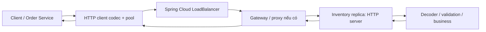
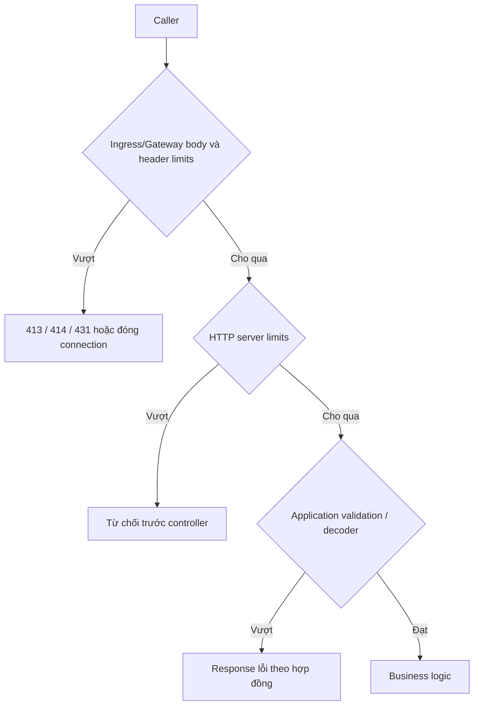
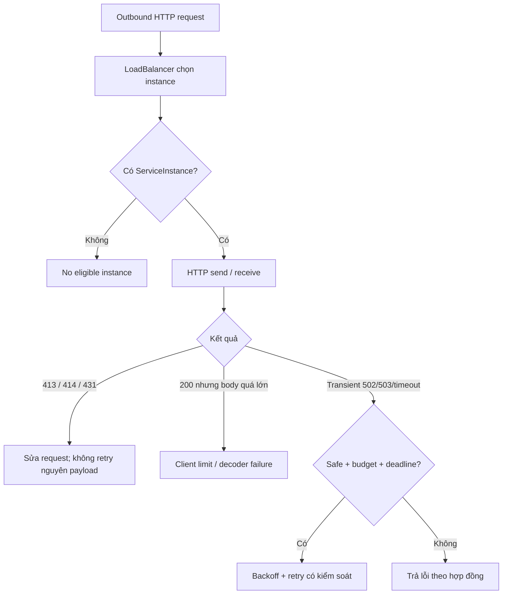

# Giới hạn kích thước yêu cầu và phản hồi

Trong hệ thống microservice, một HTTP request có thể hợp lệ về method, URI và JSON schema nhưng vẫn **quá lớn để xử lý an toàn**. Ví dụ, `order-service` gọi `inventory-service` qua Spring Cloud LoadBalancer để lấy danh sách mặt hàng; nếu endpoint trả về hàng triệu bản ghi trong một JSON duy nhất, bên gọi có thể hết bộ nhớ trong lúc giải mã response. Ở chiều ngược lại, một request tải tệp lên có thể chiếm băng thông, bộ nhớ và kết nối của dịch vụ đích ngay cả khi cuối cùng bị từ chối.

Thiết kế **giới hạn kích thước yêu cầu và phản hồi** là một phần của hợp đồng API, không chỉ là cấu hình tối ưu hiệu năng. Giới hạn phải trả lời rõ: *đếm byte ở tầng nào, bên nào thực thi, lỗi nào trả về, có được stream hay không và caller phải hành xử thế nào khi vượt ngưỡng?*

Bài học thuộc chương **Hợp đồng và lỗi** trong module `SPRING_CLOUD_SERVICE_COMMUNICATION_LOAD_BALANCING`. Trong phạm vi module, Spring Cloud LoadBalancer chọn `ServiceInstance` theo service ID, thông qua discovery, health check và chính sách định tuyến. Nó **không tự đặt giới hạn byte** cho request/response của `RestClient`, `WebClient` hoặc OpenFeign. Những giới hạn này thuộc hợp đồng API, HTTP server, gateway/proxy, codec và HTTP client được tích hợp.

## 1. Tại sao kích thước phải nằm trong hợp đồng?

Xét ba tình huống:

1. `order-service` gửi `POST /api/orders` với 200 dòng hàng; bình thường JSON chỉ vài KB. Một bug phía caller lại tạo 200.000 dòng hàng trong một request.
2. `inventory-service` cung cấp `GET /api/items` không phân trang; số mặt hàng tăng từ 1.000 lên 2 triệu, khiến response JSON tăng từ vài trăm KB lên hàng trăm MB.
3. Một người dùng tải lên tệp nén 5 MB nhưng khi giải nén thành dữ liệu 2 GB. Giới hạn **byte truyền trên mạng** vẫn cho qua, trong khi bộ nhớ/dung lượng xử lý phía server bị cạn.

Nếu hợp đồng chỉ nêu “nhận JSON” mà không có kích thước tối đa, caller không biết nên chia batch ở đâu; server không biết khi nào phải từ chối; gateway và SDK không thể phân biệt request quá lớn với lỗi dịch vụ tạm thời.

**Giới hạn tốt giúp bảo đảm:**

- **An toàn tài nguyên:** tránh một request làm cạn heap, socket, bandwidth, CPU, disk hoặc queue.
- **Độ trễ ổn định:** kích thước payload là một yếu tố quan trọng trong thời gian truyền và xử lý.
- **Hợp đồng dễ dự đoán:** client biết phải phân trang, chunk upload hoặc thay đổi chiến lược.
- **Lỗi rõ ràng:** không che tình huống quá giới hạn thành timeout, `500` hoặc “không có instance”.
- **Khả năng mở rộng:** các replica có cùng chính sách để tránh request thành công ở A nhưng thất bại ở B.

## 2. Đặt giới hạn ở những lớp nào?

Một lời gọi có thể đi qua nhiều tầng. Mỗi tầng có thể có giới hạn riêng.



Khi client-side LoadBalancer chọn trực tiếp host/port của `ServiceInstance`, không nhất thiết có gateway giữa caller và replica. Sơ đồ có nhánh gateway/proxy để nhấn mạnh: nếu tồn tại, lớp đó có thể từ chối trước khi backend nhận request. Trong một số kiến trúc, gateway/VIP có thể nằm **trước** quá trình lựa chọn instance ở một tầng khác; cần xác định topology thực tế thay vì giả định một thứ tự cố định.

| Tầng | Có thể giới hạn | Hậu quả khi cấu hình thiếu nhất quán |
|---|---|---|
| Caller/business code | Số phần tử, tổng byte dữ liệu trước khi gửi, độ lớn file/batch. | Caller tạo payload quá lớn rồi thất bại muộn. |
| HTTP client/codec | Bộ nhớ dùng để encode/decode, buffer body, độ lớn response được giữ trong RAM. | `DataBufferLimitException`, OOM, hoặc stream bị hủy giữa chừng. |
| Gateway / ingress / proxy | URI, header, request body, upload, timeout và buffering. | Request có thể bị từ chối trước khi LoadBalancer/downstream xử lý. |
| HTTP server / container | Request line, header, form, multipart, giới hạn connector cụ thể. | Ứng dụng không bao giờ vào controller; log nằm ở container. |
| Application endpoint | Giới hạn theo nghiệp vụ, JSON depth, số items, kích thước decoded/decompressed. | Payload hợp lệ cú pháp nhưng tiêu tốn tài nguyên quá mức. |
| Response producer | Số bản ghi, page size, mức nén, kích thước streaming chunk. | Client phải nhận dữ liệu rất lớn hoặc timeout. |

**Một limit ở lớp A không tự bảo vệ lớp B.** Ví dụ, giới hạn bộ đệm JSON của WebClient không tự hạn chế số byte mà server được phép gửi qua mạng; một giới hạn multipart của Servlet không tự chặn mọi raw JSON body; và `Content-Length` nhỏ không chứng minh nội dung sau giải nén cũng nhỏ.

## 3. Cần phân biệt những “kích thước” nào?

| Đại lượng | Ví dụ | Đặc điểm |
|---|---|---|
| **URI length** | Đường dẫn dài do hàng chục nghìn ID nằm trong query string. | Được xử lý trước body; có thể gặp giới hạn request line/proxy. |
| **Header bytes** | Cookie, JWT, custom headers lớn hoặc quá nhiều header nhỏ. | Có thể làm server/proxy từ chối request trước application. |
| **Wire request bytes** | `Content-Length` hoặc số byte chuyển qua HTTP framing. | Có thể nhỏ hơn dữ liệu giải nén thực tế. |
| **Decoded request bytes** | JSON text sau giải mã content encoding; dữ liệu sau giải nén. | Phản ánh dữ liệu mà decoder thực sự phải xử lý. |
| **Object size in memory** | DTO, String, List, JSON tree sau parse. | Có thể lớn hơn raw JSON nhiều lần do object overhead. |
| **Wire response bytes** | Payload nén gửi về client. | Tác động băng thông, nhưng không phản ánh chắc chắn chi phí decode. |
| **Buffered response bytes** | Số byte client giữ đồng thời trong RAM để xây DTO. | Phụ thuộc codec, streaming, buffering, conversion. |
| **Số phần tử nghiệp vụ** | 5.000 dòng đơn hàng, 10.000 bản ghi trong một page. | Hữu ích ngay cả khi byte size dưới ngưỡng. |

Ví dụ JSON UTF-8 chứa nhiều ký tự tiếng Việt có **số byte khác số ký tự**:

```text
"a"  -> 1 byte UTF-8
"á"  -> 2 byte UTF-8
"🚀" -> 4 byte UTF-8
```

Đừng dùng `String.length()` (đếm UTF-16 code units trong Java) để khẳng định request body nhỏ hơn một giới hạn byte. Khi thực sự cần đếm byte của JSON, phải dùng **encoding trên đường truyền** và cả quy tắc serialization, escaping. Base64 làm dữ liệu nhị phân thường tăng cỡ khoảng 4/3 trước khi tính JSON overhead; với upload lớn, multipart hoặc streaming thường phù hợp hơn nhúng Base64 vào JSON.

## 4. Phân biệt HTTP status khi vượt giới hạn

Một hợp đồng API cần nêu rõ mã lỗi, body lỗi và hành vi phía caller:

| HTTP status | Tình huống đặc trưng | Cách caller nên xử lý |
|---|---|---|
| **413 Content Too Large** (cũng thường gọi Payload Too Large) | Request body vượt ngưỡng mà server/proxy chấp nhận. | Giảm payload, chia batch/chunk hoặc thay API; không retry nguyên request. |
| **414 URI Too Long** | Request-target/URI quá dài. | Không nhồi danh sách lớn vào query; chuyển sang API phù hợp. |
| **431 Request Header Fields Too Large** | Header đơn lẻ hoặc tổng header vượt giới hạn. | Giảm cookie/JWT/header; không thử instance khác để né limit. |
| **400 Bad Request** | Cú pháp/framing không hợp lệ, hoặc lỗi validation thuộc hợp đồng. | Sửa dữ liệu hoặc format, không retry y nguyên. |
| **415 Unsupported Media Type** | Gửi content type không được hỗ trợ. | Đổi media type/encoding. |
| **422 Unprocessable Content** | Body hợp lệ cú pháp nhưng vi phạm quy tắc nghiệp vụ phù hợp ngữ nghĩa 422. | Sửa dữ liệu; chỉ dùng nếu API quy định. |
| **429 Too Many Requests** | Vượt quota lưu lượng/tốc độ, **không phải byte-size limit thuần túy**. | Giảm tốc và xử lý `Retry-After` nếu có. |
| **502/503/504** | Lỗi gateway, unavailable, timeout hoặc tình huống hạ tầng khác. | Chẩn đoán trước khi retry; không gộp vào 413. |

Một số proxy/HTTP container có thể **đóng kết nối hoặc reset stream** trước khi trả được response chuẩn, đặc biệt khi request đang gửi dở, header quá lớn hoặc body bị từ chối rất sớm. Vì vậy không được khẳng định *mọi* request vượt ngưỡng luôn nhận JSON `413`. Cần kiểm tra access logs ở lớp đã từ chối.

Nếu giới hạn là **vĩnh viễn** của API, retry nguyên payload thường vô ích. RFC cho phép `413` có `Retry-After` khi điều kiện từ chối tạm thời, nhưng không nên tự gắn header đó trừ khi server thực sự có chính sách chờ có căn cứ.

## 5. Content-Length không phải một cơ chế bảo vệ hoàn chỉnh

`Content-Length` có thể giúp server từ chối request quá lớn **trước khi đọc hết body**:

```http
POST /api/items/import HTTP/1.1
Host: inventory-service
Content-Type: application/json
Content-Length: 20000000
```

Nếu giới hạn endpoint là 2 MiB, một giá trị `Content-Length` hợp lệ lớn hơn ngưỡng có thể bị chặn sớm. Nhưng:

- Với **chunked transfer encoding** hoặc một số cơ chế streaming, tổng kích thước chưa biết trước.
- Giá trị `Content-Length` có thể vắng mặt, không hợp lệ hoặc không thể tin tuyệt đối khi đi qua các trung gian; HTTP parser phải xử lý framing đúng chuẩn.
- Header chỉ biểu diễn số byte ở một tầng truyền tải, không phản ánh trực tiếp kích thước sau `Content-Encoding: gzip`.
- Đã đọc một phần body thì ứng dụng vẫn phải quản lý thời gian, băng thông và bộ nhớ cho tới khi dừng.
- Việc đếm response từ `Content-Length` cũng không đủ vì server có thể stream không biết trước chiều dài, và client có thể nhận dữ liệu đã được giải nén.

**Nguyên tắc:** kiểm tra `Content-Length` nếu có để *fail early*, nhưng luôn có cơ chế **đếm byte thực khi đọc/stream**, cộng thêm limit cho dữ liệu sau giải nén, số phần tử và độ sâu cấu trúc khi cần.

### Dữ liệu nén: hai ngưỡng bảo vệ khác nhau

Giả sử request `gzip` 400 KB có thể giải nén thành 100 MB. Chỉ giới hạn wire body 2 MB sẽ không ngăn decoder nhận 100 MB. Nên kiểm soát đồng thời:

1. **Compressed/wire bytes:** tránh chiếm bandwidth và vùng đệm trên đường truyền.
2. **Decompressed/decoded bytes:** tránh memory/CPU exhaustion.
3. **Expansion ratio / tài nguyên xử lý:** tùy định dạng và rủi ro, giới hạn thêm số file, kích thước từng entry, độ sâu nén và thời gian xử lý.

Nếu endpoint không cần nhận compressed request, có thể từ chối `Content-Encoding` không hỗ trợ theo hợp đồng. Không bật giải nén tùy tiện tại nhiều lớp mà không biết byte limit đang được kiểm tra trước hay sau giải nén.

## 6. Ví dụ xây hợp đồng size limit theo endpoint

Các con số sau **chỉ là đề xuất minh họa cho môi trường giả định**, không phải default Spring Boot hay yêu cầu chuẩn HTTP:

| API | Input limit | Output limit | Chiến lược khi vượt ngưỡng |
|---|---|---|---|
| `POST /api/orders` | JSON tối đa 256 KiB và 500 items. | Response JSON tối đa 128 KiB. | `413` nếu quá byte; lỗi validation nếu quá số items; phân nhóm thao tác nếu được phép. |
| `POST /api/items/import` | Multipart tổng 12 MiB, mỗi file 10 MiB. | Job ID nhỏ. | `413`/lỗi multipart; dùng upload phân đoạn/job cho file lớn. |
| `GET /api/items` | URI và headers trong giới hạn HTTP gateway/server. | Mỗi page tối đa 200 records và khoảng 1 MiB. | Pagination bằng cursor có giới hạn page size; không trả toàn bộ inventory. |
| `GET /api/reports/{id}/download` | Request nhỏ. | Có thể nhiều GB nhưng **stream**. | Stream response với kiểm soát quota, deadline và hủy tải; không `bodyToMono(byte[].class)` toàn tệp. |
| `POST /api/search` | JSON filter có cấu trúc tối đa 64 KiB. | Tối đa 1 MiB mỗi page. | Dùng POST cho filter phức tạp thay vì query string cực dài. |

Một hợp đồng nên công bố: **đơn vị** (byte/KiB/MiB), giới hạn theo wire hay decoded body, áp dụng trên **tổng request** hay một phần, các header được hỗ trợ, response format khi lỗi và cơ chế phân trang/chunking.

Đơn vị cần rõ ràng: `1 MiB = 1.048.576 byte`, còn `1 MB` có thể được hiểu là 1.000.000 byte trong một số ngữ cảnh. Nếu các tầng cấu hình dùng ký hiệu `MB` khác nhau, phải kiểm tra cách từng framework parse kích thước; không tự giả định chúng tương đương `MiB`.

## 7. Thực thi ở Gateway, ingress và HTTP server

**Giới hạn sớm ở edge** thường giúp tránh request lớn đi sâu vào cụm dịch vụ. Nhưng vẫn nên có một kiểm tra ở server ứng dụng, vì có thể tồn tại đường gọi nội bộ bỏ qua edge hoặc cấu hình các proxy không đồng nhất.



Giới hạn phải được triển khai **nhất quán giữa các replica** của cùng service ID. Nếu A chấp nhận JSON 4 MiB còn B chỉ 1 MiB, cùng một request có thể lúc thành công, lúc `413` tùy LoadBalancer chọn A hay B. Retry sang instance khác không phải cách thay thế việc thống nhất hợp đồng.

### Spring Boot Servlet/MVC: giới hạn multipart

Đối với Spring Boot sử dụng Servlet/MVC và multipart resolver tương ứng, cấu hình ví dụ:

```yaml
spring:
  servlet:
    multipart:
      max-file-size: 10MB
      max-request-size: 12MB
```

Ở đây `max-file-size` giới hạn một file, còn `max-request-size` giới hạn tổng multipart request theo cách Spring/Servlet container thực thi. **Đây không phải giới hạn áp dụng cho mọi JSON/raw request body.** Một endpoint nhận `@RequestBody OrderRequest` có thể cần cơ chế giới hạn body riêng ở reverse proxy/container/filter, cộng validation theo số phần tử và business rule.

Một số thuộc tính container như `server.tomcat.max-http-form-post-size` liên quan **form POST parsing**, không phải một cấu hình phổ quát chặn tất cả JSON. Thuộc tính request header như `server.max-http-request-header-size` có phạm vi và hành vi phụ thuộc phiên bản Spring Boot và server (Tomcat/Jetty/Undertow/Netty); phải kiểm thử trên server thực tế. Không dùng một thuộc tính chưa kiểm chứng để tuyên bố đã bảo vệ mọi loại payload.

### Hợp đồng lỗi bằng ProblemDetail

Khi server **thật sự có thể chủ động trả response**, dùng cấu trúc lỗi ổn định (ví dụ `application/problem+json`, theo RFC 9457) thay vì trả thông báo không dự đoán được:

```json
{
  "type": "https://example.test/problems/request-too-large",
  "title": "Request content too large",
  "status": 413,
  "detail": "Request body exceeds the limit for this operation.",
  "limitBytes": 1048576
}
```

`limitBytes` là extension field minh họa, phải được API định nghĩa thống nhất. Không công khai thông tin nhạy cảm về đường dẫn nội bộ hoặc cấu hình hạ tầng. Một proxy có thể trả trang lỗi khác hoặc không có JSON; SDK cần xử lý cả trường hợp body lỗi rỗng.

Ví dụ controller advice xử lý exception multipart trong Spring MVC:

```java
import org.springframework.http.HttpStatusCode;
import org.springframework.http.ProblemDetail;
import org.springframework.http.ResponseEntity;
import org.springframework.web.bind.annotation.ExceptionHandler;
import org.springframework.web.bind.annotation.RestControllerAdvice;
import org.springframework.web.multipart.MaxUploadSizeExceededException;

@RestControllerAdvice
class UploadErrorHandler {

    @ExceptionHandler(MaxUploadSizeExceededException.class)
    ResponseEntity<ProblemDetail> oversizedUpload(
            MaxUploadSizeExceededException ignored) {

        ProblemDetail problem = ProblemDetail.forStatusAndDetail(
            HttpStatusCode.valueOf(413),
            "Multipart upload exceeds the configured limit.");

        return ResponseEntity.status(413).body(problem);
    }
}
```

Đây chỉ là ví dụ cho lỗi đi qua exception handling của ứng dụng. Nếu container/proxy từ chối trước khi Spring MVC xử lý, `@RestControllerAdvice` **không nhất thiết được gọi**. Client vẫn phải xử lý HTTP `413`, response không có body, hoặc lỗi transport tương ứng.

## 8. Spring WebFlux: bộ đệm codec khác giới hạn toàn request

Spring WebFlux sử dụng codec với giới hạn bộ nhớ khi cần **buffer** dữ liệu để decode. Ví dụ một ứng dụng WebFlux có thể cấu hình:

```yaml
spring:
  codec:
    max-in-memory-size: 1MB
```

Cấu hình này ảnh hưởng các codec tương ứng được Spring Boot auto-configure, **không phải bảo đảm tổng wire body của mọi endpoint đều tối đa 1 MB**. Streaming với `Flux<DataBuffer>` hoặc `Flux<T>` có thể không giữ toàn bộ body trong bộ nhớ; giới hạn buffering không đồng nghĩa giới hạn tổng số byte đi qua kết nối.

Nếu server cần áp đặt **ngưỡng byte cụ thể cho một body streaming**, có thể thực thi khi đọc flux. Ví dụ endpoint nhận tối đa 1 MiB binary upload để xử lý trong bộ nhớ:

```java
import org.springframework.core.io.buffer.DataBuffer;
import org.springframework.core.io.buffer.DataBufferLimitException;
import org.springframework.core.io.buffer.DataBufferUtils;
import org.springframework.http.HttpStatusCode;
import org.springframework.http.MediaType;
import org.springframework.web.bind.annotation.PostMapping;
import org.springframework.web.bind.annotation.RequestBody;
import org.springframework.web.bind.annotation.RestController;
import org.springframework.web.server.ResponseStatusException;
import reactor.core.publisher.Flux;
import reactor.core.publisher.Mono;

@RestController
class SmallBinaryImportController {

    private static final int MAX_BYTES = 1024 * 1024;

    @PostMapping(
        path = "/api/import-small",
        consumes = MediaType.APPLICATION_OCTET_STREAM_VALUE)
    Mono<Integer> importSmall(@RequestBody Flux<DataBuffer> body) {
        return DataBufferUtils.join(body, MAX_BYTES)
            .map(buffer -> {
                try {
                    int size = buffer.readableByteCount();
                    byte[] bytes = new byte[size];
                    buffer.read(bytes);
                    // Ví dụ: chuyển bytes sang logic xử lý riêng.
                    return bytes.length;
                } finally {
                    DataBufferUtils.release(buffer);
                }
            })
            .onErrorMap(DataBufferLimitException.class,
                error -> new ResponseStatusException(
                    HttpStatusCode.valueOf(413),
                    "Upload exceeds 1 MiB",
                    error));
    }
}
```

`DataBufferUtils.join(body, MAX_BYTES)` tạo một buffer kết hợp nhưng có ngưỡng tổng số byte được join; khi vượt, nó báo `DataBufferLimitException`. Đoạn ví dụ chủ động trả 413 và giải phóng buffer đã nhận khi xử lý xong. **Không dùng mẫu join này cho tệp hàng GB** vì mục đích của nó vẫn là buffer trong bộ nhớ; với upload lớn, dùng xử lý streaming có hạn mức tổng và giải phóng `DataBuffer` đúng vòng đời. Khi có reverse proxy, timeout hoặc client ngắt kết nối, phải kiểm thử cleanup/cancellation.

Ví dụ không bao quát mọi cách upload (multipart, JSON, gzip, server-specific request filters). Đối với JSON, ngoài byte limit cần giới hạn độ sâu, số phần tử, độ dài chuỗi và chi phí xử lý theo schema.

## 9. WebClient: maxInMemorySize bảo vệ decode, không phải toàn bộ download

Ở phía caller, `WebClient` thường decode JSON thành DTO hoặc một `List<ItemDto>`. Trong trường hợp decoder cần tập hợp nội dung vào bộ nhớ, cần đặt hạn mức có chủ đích.

Ví dụ `@LoadBalanced WebClient.Builder` gọi `inventory-service` và giới hạn bộ nhớ dùng bởi các codec mặc định của client:

```java
import org.springframework.cloud.client.loadbalancer.LoadBalanced;
import org.springframework.context.annotation.Bean;
import org.springframework.context.annotation.Configuration;
import org.springframework.web.reactive.function.client.WebClient;

@Configuration
class InventoryWebClientConfiguration {

    @Bean
    @LoadBalanced
    WebClient.Builder loadBalancedWebClientBuilder() {
        return WebClient.builder();
    }

    @Bean
    WebClient inventoryWebClient(
            @LoadBalanced WebClient.Builder builder) {
        return builder.clone()
            .baseUrl("http://inventory-service")
            .codecs(configurer -> configurer.defaultCodecs()
                .maxInMemorySize(2 * 1024 * 1024))
            .build();
    }
}
```

Lời gọi:

```java
Mono<ItemPage> page = inventoryWebClient.get()
    .uri(uriBuilder -> uriBuilder
        .path("/api/items")
        .queryParam("limit", 100)
        .build())
    .retrieve()
    .bodyToMono(ItemPage.class);
```

`ItemPage` là DTO ví dụ. Đặt `maxInMemorySize` có thể làm quá trình decode/buffer thất bại với `DataBufferLimitException` khi quá ngưỡng theo semantics của codec. **Nó không phải hard cap tổng byte nhận trên mạng cho mọi mô hình tiêu thụ response**. Ví dụ, `bodyToFlux(DataBuffer.class)` có thể stream nhiều chunk mà không giữ toàn bộ trong bộ nhớ; tổng số byte tải về vẫn có thể rất lớn nếu caller không áp đặt giới hạn và dừng stream.

| Tình huống | Hạn mức cần quan tâm |
|---|---|
| `bodyToMono(BigDto.class)` | Buffer/decoder memory cap, DTO size, heap. |
| `bodyToFlux(ItemDto.class)` | Hạn mức buffer của mỗi phần decode (tùy codec), số lượng phần tử và tổng stream. |
| `bodyToFlux(DataBuffer.class)` | Tổng bytes streaming, xử lý/hủy/release `DataBuffer`, tốc độ ghi đích. |
| Download có gzip | Wire bytes và bytes sau giải nén, nơi connector thực hiện decompression. |
| HTTP `4xx`/`5xx` với error body lớn | Hạn mức xử lý error response; đừng giả định error body luôn nhỏ. |

Nếu API thường trả vài MB nhưng đôi khi hàng GB, **đừng tăng `maxInMemorySize` lên hàng GB để “sửa” lỗi**. Hãy thiết kế phân trang, response streaming hoặc chuyển sang download vào file/object storage bằng streaming.

### Limit response ở client không nên che mất lỗi nghiệp vụ

`DataBufferLimitException` là lỗi phía caller liên quan cách tiêu thụ response/buffer, không phải HTTP `413` do upstream chắc chắn trả về. Tương tự, `WebClientResponseException` chỉ xuất hiện khi có HTTP error response theo status handling; một response `200 OK` nhưng body quá lớn vẫn có thể làm codec thất bại.

Khi bắt lỗi, phân biệt:

- **HTTP 413**: server/proxy nói request quá lớn.
- **HTTP 200 + decoder size limit**: response từ upstream vượt khả năng/giới hạn client.
- **Transport lỗi/timeout**: body bị ngắt, client hủy stream hoặc lỗi kết nối.
- **No-instance từ LoadBalancer**: không có `ServiceInstance` phù hợp trước khi gửi HTTP.

Không được “retry mọi lỗi WebClient” khiến một response quá lớn bị tải đi tải lại nhiều lần.

## 10. RestClient: hạn chế bộ nhớ khi đọc response

`RestClient` là API đồng bộ của Spring. Nếu caller dùng `body(byte[].class)` với một download không giới hạn, nó có thể giữ quá nhiều dữ liệu trong heap. Trên đường xử lý cần biết chính xác khi nào byte được buffer và HTTP client factory nào đang dùng.

Một cách đọc response **có ngưỡng** là dùng `exchange(...)` và dừng sau tối đa `MAX_BYTES + 1` byte:

```java
import java.io.IOException;
import java.util.Arrays;
import com.fasterxml.jackson.databind.ObjectMapper;
import org.springframework.http.HttpStatusCode;
import org.springframework.web.client.RestClient;

class LimitedInventoryReader {

    private static final int MAX_BYTES = 1024 * 1024;
    private final RestClient client;
    private final ObjectMapper mapper;

    LimitedInventoryReader(RestClient client, ObjectMapper mapper) {
        this.client = client;
        this.mapper = mapper;
    }

    ItemPage getPage() {
        return client.get()
            .uri("/api/items?limit=100")
            .exchange((request, response) -> {
                HttpStatusCode status = response.getStatusCode();
                if (status.isError()) {
                    throw new IllegalStateException(
                        "Inventory HTTP status " + status.value());
                }

                byte[] bytes =
                    response.getBody().readNBytes(MAX_BYTES + 1);

                if (bytes.length > MAX_BYTES) {
                    throw new IllegalStateException(
                        "Inventory response exceeds 1 MiB");
                }
                return mapper.readValue(bytes, ItemPage.class);
            });
    }
}
```

Đây là ví dụ **đọc có giới hạn bộ nhớ** với một response nhỏ, không phải bộ download streaming cho dữ liệu lớn. `ItemPage` do ứng dụng định nghĩa; `IOException` trong đoạn mã được xử lý theo signature của callback và phiên bản Spring đang dùng. Với `exchange(...)`, status handler mặc định kiểu `retrieve()` không tự xử lý như bình thường: code phải kiểm tra status và định nghĩa response/error mapping rõ ràng. Spring quản lý đóng response của `exchange` theo hợp đồng API; nếu tự làm wrapper stream ngoài callback phải xử lý vòng đời tài nguyên cẩn thận.

Nếu response có `Content-Length` hợp lệ vượt MAX, có thể từ chối ngay; nhưng **vẫn phải kiểm tra byte thực đọc** vì content length có thể vắng, streaming/chunked, nén hoặc bị thay đổi qua trung gian. Đối với payload có thể đạt hàng GB, nên dùng API download streaming và giới hạn bytes khi ghi vào file đích, không tạo `byte[]` cực lớn.

### Đặt kết nối, timeout và size limit ở ba tầng khác nhau

- `ClientHttpRequestFactory` / HTTP engine quy định connect/read timeout, pooling và một số behavior stream/buffer.
- Business/API contract quy định **ngưỡng byte/số phần tử** hợp lệ.
- Spring Cloud LoadBalancer quy định **instance đích** theo service ID và danh sách discovery.

Chọn đúng replica không ngăn được response 200 MB. Tăng read timeout không làm việc đọc 200 MB trở nên an toàn về bộ nhớ.

## 11. OpenFeign: giới hạn theo contract và Decoder

OpenFeign cho phép định nghĩa client qua interface:

```java
@FeignClient(
    name = "inventory-service",
    contextId = "inventoryRead"
)
interface InventoryReadClient {

    @GetMapping("/api/items")
    ItemPage getPage(@RequestParam("limit") int limit);
}
```

Các trường hợp cần cân nhắc:

1. **Giới hạn request:** kiểm tra DTO, số records, bytes serialized trước khi gửi. Interceptor của Feign thường phù hợp thêm header và tracing, **không nên xem là một cơ chế tổng quát để kiểm soát mọi body streaming**.
2. **Giới hạn response:** Decoder có thể cần buffer response hoặc parse toàn bộ JSON. Với endpoint lớn, thiết kế API phân trang trước; khi cần một hard limit, triển khai decorator quanh `Decoder`/HTTP `Client` đọc stream có ngưỡng và đảm bảo đóng body.
3. **Cấu hình theo client:** chỉ client nhận dữ liệu lớn mới cần chính sách riêng. Tránh đặt `Decoder`/`Retryer` đặc thù vào parent Spring context và vô tình làm ảnh hưởng các Feign client khác.
4. **Response lỗi:** `ErrorDecoder` và `Retryer` không nên xử lý status hoặc body quá lớn như lỗi transient; không retry mãi một response bị từ chối vì quá giới hạn.

Một decorator có ý nghĩa như sau (pseudocode để tập trung vào cơ chế, API phụ thuộc phiên bản Feign):

```text
LimitedDecoder(maxBytes, delegate):
    nếu response body rỗng: chuyển cho delegate
    nếu content length đáng tin > maxBytes: từ chối sớm
    đọc stream với bộ đếm tối đa maxBytes + 1
    nếu vượt: ngừng đọc, giải phóng body, báo lỗi giới hạn
    nếu đạt: chuyển byte[] đã kiểm tra cho delegate decode
```

Điểm quan trọng là decorator phải **thực sự chặn byte khi đọc**, không chỉ so sánh header, và phải đóng response stream theo đúng contract. Lỗi decoder do vượt giới hạn response không phải tín hiệu nên tự chọn một replica khác để thử lại.

## 12. Response lớn: phân trang, streaming, hoặc job bất đồng bộ

Giới hạn request thường được giải quyết bằng chặn sớm và chia input. Giới hạn response cần thiết kế lại cách **trả dữ liệu** để tránh tải hàng GB vào một biến:

| Chiến lược | Phù hợp | Lưu ý |
|---|---|---|
| Pagination theo page/cursor | Danh sách mặt hàng, search results. | Bắt buộc giới hạn `pageSize`; cursor phải được xác minh/opaque theo hợp đồng. |
| Streaming HTTP | Export lớn, dữ liệu theo dòng, download tệp. | Bounded buffering, cancellation, backpressure, timeout, content integrity. |
| Async export job | Báo cáo cần tính lâu hoặc tạo dữ liệu nhiều GB. | Endpoint tạo job trả ID; caller poll/notify rồi tải file theo quyền. |
| Object storage + signed URL có thời hạn | Download/upload lớn. | Kiểm soát quyền, TTL, size quota, MIME/content scan và dữ liệu nhạy cảm. |
| Field projection | Caller chỉ cần vài trường trong một record lớn. | Hợp đồng API rõ ràng, tránh query tùy ý không giới hạn độ phức tạp. |

### Phân trang không chỉ là thêm tham số limit

`GET /api/items?limit=100` cần server **clamp** hoặc từ chối `limit=1000000`. Nếu API trả cursor, phải đảm bảo cursor không làm phát sinh truy vấn bất thường hoặc vượt quyền. Hạn mức có thể bao gồm số bản ghi, byte size, độ phức tạp truy vấn và tổng thời gian xử lý, vì 100 bản ghi lớn chưa chắc nhỏ hơn 1 MiB.

Với streaming, HTTP/2 flow control và Reactor backpressure giúp kiểm soát nhịp dữ liệu trong một số cấu hình nhưng **không tạo hard cap tổng byte**. Caller vẫn phải chủ động đặt giới hạn và hủy stream nếu chính sách không cho phép vượt.

## 13. Giới hạn kích thước tác động đến retry, timeout và LoadBalancer

Trong hệ thống có nhiều replica, lỗi cần được phân loại trước retry:



**Không có instance** là lỗi khám phá/chọn đích, không phải bằng chứng request quá lớn. `413` là tín hiệu bên nhận hoặc proxy từ chối body. `DataBufferLimitException` tại caller có thể xảy ra ngay cả khi upstream gửi `200 OK`; đây là lỗi do consumer không thể/không muốn buffer response.

### Retry có thể khuếch đại chi phí payload lớn

Giả sử một request upload 8 MiB bị gửi lại ba attempts do read timeout. Nếu mỗi attempt thực sự truyền đủ body, caller có thể upload tổng cộng khoảng **24 MiB** cho một logical operation. Khi nhiều callers đồng thời retry, băng thông, TLS, connection pool và CPU tăng, có thể gây retry storm. Đối với thao tác ghi, lần đầu có thể đã được xử lý thành công nhưng response bị mất: cần idempotency key và chống trùng từ server.

Với download 100 MiB, retry sau khi đã tải 90 MiB có thể buộc tải lại từ đầu nếu API không hỗ trợ resumable/range requests và kiểm tra integrity. Đừng retry toàn bộ stream chỉ vì nhận connection reset mà chưa hiểu semantics của consumer.

### Timeout và giới hạn byte bổ sung cho nhau

- **Size limit**: tối đa bao nhiêu byte/phần tử được xử lý.
- **Deadline**: tổng thời gian được phép cho một logical request, gồm retry và backoff.
- **Throughput/rate quota**: tối đa số bytes/requests theo thời gian nếu cần.
- **Bulkhead/connection pool**: tối đa số lời gọi/socket/luồng cùng chiếm tài nguyên.

Một request 100 KiB có thể tải rất chậm và giữ kết nối hàng phút nếu không có deadline; ngược lại, request 1 GiB có thể đến rất nhanh và làm cạn heap nếu không có byte cap. Cần **cả hai** loại bảo vệ.

## 14. Các lỗi thường gặp và cách khắc phục

| Sai lầm | Hệ quả | Cách sửa |
|---|---|---|
| Chỉ đọc `Content-Length` và bỏ qua stream thực | Chunked/gzip có thể vượt giới hạn. | Giới hạn bytes thực, decoded size và parser complexity. |
| Dùng `spring.servlet.multipart.*` để bảo vệ mọi JSON endpoint | JSON/raw request vẫn có thể vượt ngưỡng. | Dùng ingress/server body limit theo route và kiểm tra tại ứng dụng. |
| Tăng `maxInMemorySize` vô hạn khi WebClient lỗi | Heap/RSS tăng, OOM hoặc GC pause. | Phân trang, streaming, giới hạn decoded bytes. |
| Bọc response vào `byte[]` không giới hạn | Tải nhiều GB vào RAM. | Đọc có giới hạn hoặc stream ra file/object storage. |
| Không giới hạn query/filter | `414`, parse SQL/query quá phức tạp. | Sử dụng POST filter có schema, giới hạn URL, fields và complexity. |
| Dùng một số `MB` không thống nhất giữa client/server/gateway | Lỗi ngẫu nhiên do các lớp áp ngưỡng khác nhau. | Nêu byte/MiB và đo số byte thực. |
| Các replica có limit khác nhau | Request lúc qua, lúc `413` theo instance được chọn. | Đồng bộ contract/config và test trên mọi replica. |
| Retry `413` hoặc decoder limit | Nhân bandwidth/tải mà payload không đổi. | Phân loại non-retryable và yêu cầu caller sửa input. |
| Trả `500` cho mọi DataBufferLimitException | Caller hiểu sai là lỗi transient. | Ánh xạ lỗi inbound đúng 413; lỗi outbound giữ mã nội bộ rõ và log nguyên nhân. |
| Chỉ giới hạn wire bytes của gzip/zip | Compression bomb / parser exhaustion. | Giới hạn decoded size, số file, độ sâu và thời gian. |
| Mặc định response `200` là nhỏ/an toàn | Client có thể OOM khi server xuất dữ liệu lớn. | Có output contract, pagination, streaming và consumer caps. |

## 15. Observability: đo lỗi kích thước ở đúng lớp

Theo dõi ít nhất:

| Tín hiệu | Câu hỏi cần trả lời |
|---|---|
| `request_body_bytes` / `response_body_bytes` | Payload thực lớn cỡ nào? Đang đo wire hay decoded? |
| `413`, `414`, `431` theo operation | Loại giới hạn nào bị chạm và ở gateway hay app? |
| `codec_buffer_limit_exceeded` | Decoder caller/server bị quá hạn mức in-memory? |
| `stream_cancelled` / `client_abort` | Có client dừng khi vượt limit hoặc timeout? |
| `content_length_missing` / chunked traffic | Có cần đo byte thay vì chỉ dựa vào header? |
| Latency p95/p99 và parse time | Payload lớn có làm tăng tail latency hoặc CPU? |
| Heap/RSS, GC, direct memory | Có dấu hiệu buffering hoặc memory pressure? |
| Upload/download bandwidth | Retry đang nhân số byte truyền tải không? |
| `ServiceInstance`/service ID | Có replica nào dùng giới hạn khác, đang lỗi nhiều hơn? |

Đây là **tên tín hiệu minh họa**, không phải mặc định mọi Spring Boot/Micrometer setup đều có sẵn. Tránh dùng request ID, tên file, URI chứa ID cá nhân hoặc header tùy ý làm metric label có cardinality cao. Chỉ log thông tin cần thiết (service ID, route template, nhóm limit, measured bytes, threshold, stage), không log nguyên body, token, cookie hoặc payload chứa thông tin nhạy cảm.

Nếu proxy tạo `413` trước khi request tới application, log/metrics của `inventory-service` có thể không có gì. Khi chẩn đoán, đối chiếu **gateway access log → caller trace → server log** để biết vị trí thực sự đã từ chối.

## 16. Bài thực hành: chứng minh các loại size limit khác nhau

Chuẩn bị `order-service` sử dụng `@LoadBalanced WebClient.Builder` hoặc RestClient/OpenFeign và `inventory-service` có hai replica A/B cùng service ID. Dùng môi trường test, thiết lập giới hạn minh họa rõ ràng, có access logs ở ingress/server và thống kê lỗi ở client.

| Thử nghiệm | Dữ liệu | Kỳ vọng cần kiểm tra |
|---|---|---|
| JSON nhỏ | `POST` dưới 64 KiB, hợp lệ schema. | Thành công trên A/B nếu policy đồng nhất. |
| JSON quá lớn | `POST` vượt ngưỡng app/proxy. | `413` hoặc lỗi lớp từ chối được ghi nhận rõ; không retry nguyên request. |
| URI quá dài | `GET` với hàng nghìn ID trong query. | Proxy/server có thể trả `414` hoặc lỗi request-line tương ứng. |
| Header cực lớn | Cookie/JWT giả, số lượng header cao. | `431` hoặc rejection ở container/proxy; không vào controller nếu bị chặn sớm. |
| Multipart | Một file vượt max-file-size hoặc tổng vượt max-request-size. | Lỗi size có chủ đích; không nhầm config multipart với JSON. |
| Chunked/no Content-Length | Stream vượt 1 MiB. | Bộ đếm byte thực phát hiện và dừng dù không có size header. |
| Gzip/zip expansion | Wire body nhỏ, decoded body lớn. | Chính sách decoded limit chặn, không chỉ wire limit. |
| Response `200` quá lớn | Server trả JSON dài hơn codec memory cap. | WebClient decoder có thể thất bại; không diễn giải thành HTTP 413. |
| Download streaming | Nhiều chunk nhỏ, tổng vượt ngưỡng download policy. | Caller dừng sau tổng byte cho phép, release buffer/connection đúng cách. |
| Retry bật nhầm | `413`/decoder limit được cấu hình retry. | Chứng minh attempts và bytes truyền tăng vô ích, sau đó sửa predicate. |
| Replica lệch cấu hình | A limit 1 MiB, B limit 2 MiB trong test. | Cùng payload 1,5 MiB có kết quả phụ thuộc instance; xác định lỗi rollout. |

### Ví dụ thao tác kiểm thử HTTP

Với một payload test đã tạo sẵn, có thể dùng:

```bash
curl -i -X POST http://localhost:8080/api/items/import \
  -H 'Content-Type: application/json' \
  --data-binary @payload-test.json
```

Đo chính xác kích thước file/encoded bytes trước khi gửi. Với multipart, dùng `curl -F 'file=@sample.bin' ...` và xác minh tổng multipart body gồm cả boundary/headers của từng part. Với lỗi lớn, test nên được giới hạn tài nguyên; không gửi dữ liệu phá hủy hệ thống production.

Sau mỗi thí nghiệm, ghi: loại payload, bytes trên wire/decoded nếu đo được, HTTP status hoặc exception, lớp từ chối, có `ServiceInstance` được chọn hay chưa, attempts, thời gian, memory peak, số request đến downstream. Kết quả phải phân biệt giữa **server limit**, **client codec limit**, **transport error** và **LoadBalancer no-instance**.

## 17. Checklist trước khi triển khai production

- Công bố **giới hạn byte và số phần tử** cho từng endpoint quan trọng; nêu rõ wire/decoded bytes và đơn vị.
- Cấu hình ở **edge/gateway và application** phù hợp topology, tránh các đường nội bộ bỏ qua kiểm tra.
- Đồng bộ limits trên mọi replica; không để LoadBalancer chọn A/B dẫn đến hợp đồng khác nhau.
- Giới hạn URI, request headers và payload riêng; không dùng multipart config làm giới hạn JSON.
- Không chỉ dựa vào `Content-Length`; đếm bytes thực cho chunked/streaming và kiểm soát decompression.
- Có JSON schema constraints: số items, độ dài chuỗi, độ sâu lồng nhau và độ phức tạp xử lý.
- Dùng `413/414/431` đúng ngữ nghĩa khi response HTTP được tạo; không gộp mọi lỗi vào `500`.
- Trả lỗi ổn định, không tiết lộ topology, token hay dữ liệu nhạy cảm trong `ProblemDetail`.
- Với WebClient, hiểu `maxInMemorySize` là giới hạn codec buffer, không phải tổng network byte cap.
- Với RestClient/OpenFeign, kiểm soát cách decoder/buffer đọc response, giới hạn trước khi giữ toàn bộ byte array.
- Thiết kế pagination, streaming hoặc async export/job cho dữ liệu lớn thay vì chỉ tăng buffer.
- Phân biệt size rejection với timeout, no-instance, circuit open và lỗi HTTP upstream.
- Không retry nguyên `413` hoặc response quá lớn; bảo đảm idempotency cho các upload/POST được phép retry.
- Phối hợp byte caps với timeout/deadline, rate/quota, bulkhead và connection pool để tránh request quá chậm.
- Theo dõi bytes, reject rate, latency, memory, stream cancellation, retry attempts và sự đồng nhất giữa replica.
- Test các trường hợp chunked, compressed, multipart, header/URI quá dài và rollout không đồng nhất.

**Ghi nhớ:** **giới hạn kích thước là một phần của hợp đồng API và cơ chế bảo vệ tài nguyên**, không phải trách nhiệm tự động của Spring Cloud LoadBalancer. LoadBalancer chọn `ServiceInstance`; HTTP server/gateway kiểm soát request đến; HTTP client/codec kiểm soát cách nhận và giải mã response; ứng dụng kiểm tra số byte sau giải nén và quy tắc nghiệp vụ. Hãy xác định rõ **đang giới hạn byte ở đâu**, trả lỗi đúng nghĩa và không retry payload vốn vượt ngưỡng. Đó là cách giữ giao tiếp giữa các dịch vụ ổn định dù số replica, lượng dữ liệu và lưu lượng đều tăng.
