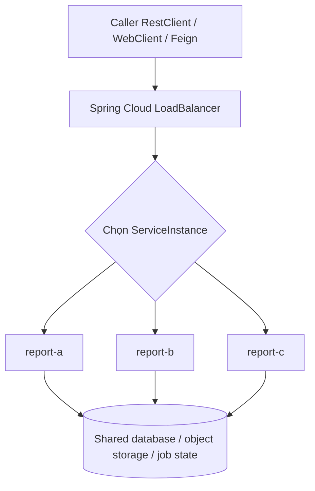
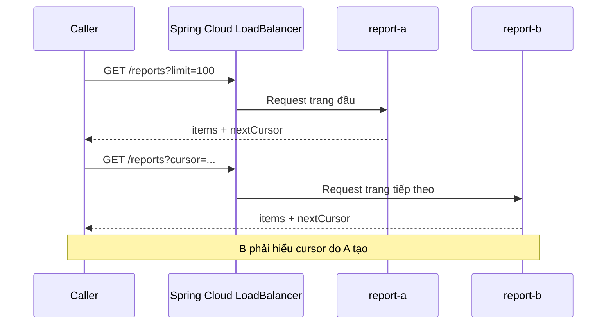
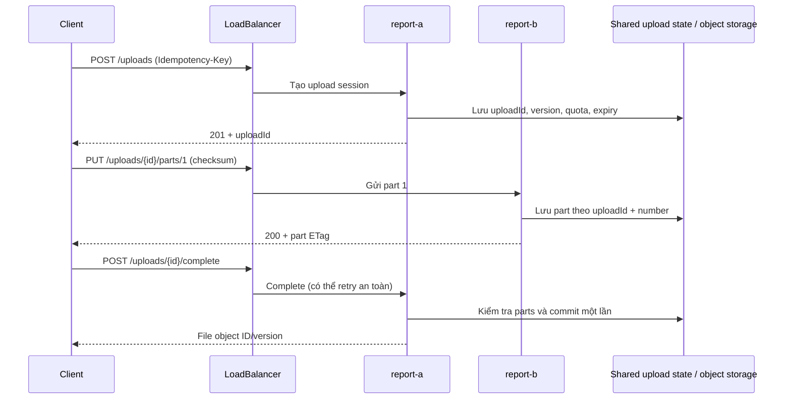
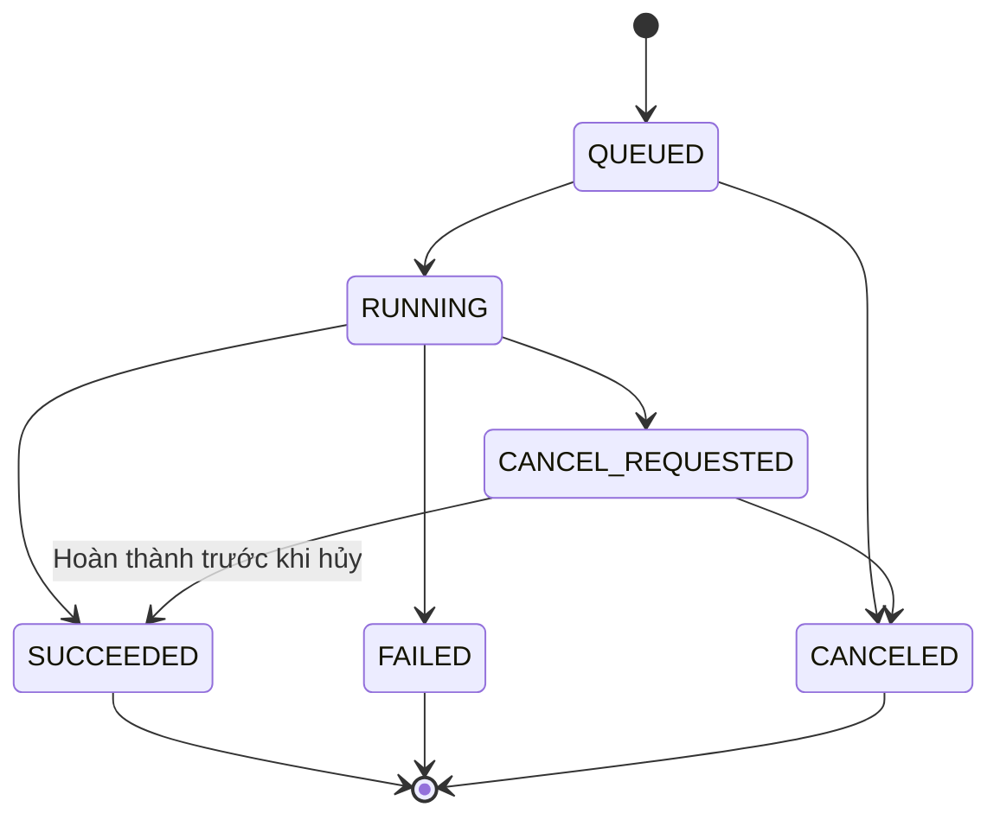
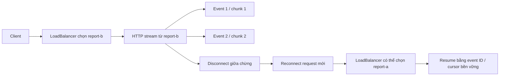

# Pagination, tải tệp và các lời gọi kéo dài

Trong hệ thống microservices, lời gọi `GET http://catalog-service/api/products/42` thường ngắn, ít dữ liệu và dễ thử lại khi kết nối gặp lỗi. Nhưng những giao tiếp như **đọc nhiều trang dữ liệu**, **tải tệp hàng gigabyte**, **upload nhiều phần** hoặc **chờ một job xử lý vài phút** có các ràng buộc khác hẳn. Nếu mỗi request được Spring Cloud LoadBalancer chọn một `ServiceInstance` mới, các giả định ngầm về state của replica, dữ liệu trả về, thời hạn request và tính an toàn khi retry có thể bị phá vỡ.

Bài học thuộc chương **Hợp đồng và lỗi** của module **Spring Cloud Service Communication Load Balancing** giải thích cách thiết kế hợp đồng API cho ba dạng lời gọi này, với `RestClient`, `WebClient`, OpenFeign và Spring HTTP Interface khi phù hợp. Mục tiêu là **giữ đúng dữ liệu và khả năng phục hồi dù request kế tiếp đi sang replica khác**, đồng thời kiểm soát bộ nhớ, connection pool, timeout, backpressure, idempotency và observability.

## 1. Vì sao các lời gọi này cần một hợp đồng riêng?

Giả sử `report-service` có ba instance được discovery trả về:

| Instance | Host:port | Chức năng |
|---|---|---|
| `report-a` | `10.0.1.10:8080` | Phân trang danh sách báo cáo |
| `report-b` | `10.0.1.11:8080` | Phân trang và tải tệp |
| `report-c` | `10.0.1.12:8080` | Phân trang, upload và xem trạng thái job |

Từ caller, cả ba lời gọi đều có thể dùng một service ID:

```text
GET  http://report-service/api/reports?limit=100
GET  http://report-service/api/files/abc/download
POST http://report-service/api/exports
```



Tính đúng đắn phụ thuộc vào **hợp đồng dữ liệu chung**: kết quả trang 2 phải khớp trang 1, file cần có identity/version có thể kiểm tra, job phải có trạng thái truy vấn được từ mọi replica. LoadBalancer chỉ chọn endpoint; nó **không** sao chép trạng thái session trong RAM, tự giữ snapshot phân trang hoặc tự nối lại byte stream bị đứt.

| Loại lời gọi | Rủi ro lớn nhất | Hợp đồng cần có |
|---|---|---|
| Pagination | Bỏ sót/trùng phần tử giữa các trang, nhất là khi dữ liệu thay đổi hoặc chuyển replica | Thứ tự ổn định, cursor/snapshot và pagination token đúng phạm vi |
| Download tệp lớn | Tràn bộ nhớ, đứt giữa tệp, file bị thay phiên bản | Streaming, giới hạn kích thước, `ETag`, `Range`/resume, checksum |
| Upload tệp | Retry gửi lại một phần gây trùng/hỏng file, trạng thái upload nằm cục bộ | Upload ID, chunk offset, idempotency, storage dùng chung, finalize an toàn |
| Request kéo dài | Gateway/connection timeout, giữ thread lâu, client không biết job đã hoàn tất chưa | `202 Accepted`, operation ID, polling/callback/streaming, deadline và cancellation semantics |

## 2. LoadBalancer chọn instance theo từng HTTP request, không theo một phiên làm việc mặc định

Một lần gọi LoadBalancer được kích hoạt khi client thực hiện một HTTP request qua URI logic `http://report-service/...`. Với round-robin, trang 1 có thể đi tới `report-a`, trang 2 tới `report-b`; request tải lại một đoạn tệp sau khi đứt có thể đi tới `report-c`.



**HTTP keep-alive không bắt các request liên tiếp phải trở về cùng replica.** Connection pool thường được quản lý theo địa chỉ đích thực; LoadBalancer chọn instance trước khi transport quyết định mượn connection nào. Tương tự, cơ chế retry có thể thử instance khác, không bảo đảm giữ nguyên server gốc.

Spring Cloud hỗ trợ same-instance preference và một số dạng sticky-session supplier, nhưng **không nên lấy sticky session làm nền tảng duy nhất cho tính nhất quán dữ liệu**. Instance có thể chết giữa chừng, rollout thay bản sao hoặc session cookie không tới được request tiếp theo. Giải pháp bền vững là trạng thái phân trang, upload và job **được lưu tại nơi các replica được phép truy cập**, hoặc token đủ thông tin/được ký để replica khác kiểm chứng và tiếp tục.

## 3. Pagination: offset, cursor và snapshot

Pagination chia một tập dữ liệu lớn thành các trang nhỏ để giảm kích thước response và độ trễ trên một request. Nhưng cách chia trang ảnh hưởng trực tiếp đến tính nhất quán khi dữ liệu được thêm, xóa hoặc sắp xếp lại trong quá trình caller đang đọc.

### 3.1. Offset pagination: dễ dùng, dễ lệch khi dữ liệu đổi

```http
GET /api/reports?offset=0&limit=3&sort=createdAt,desc
```

Giả sử trang đầu có `[R9, R8, R7]`. Một báo cáo mới `R10` được chèn vào đầu danh sách trước khi caller yêu cầu `offset=3`; trang kế tiếp có thể trở thành `[R7, R6, R5]`. `R7` bị **lặp lại**. Khi xóa phần tử ở trước offset, có thể **bỏ sót** một item.

| Thuộc tính | Offset (`page`, `offset`) |
|---|---|
| Ưu điểm | Đơn giản, dễ nhảy đến trang bất kỳ |
| Nhược điểm | Dễ trùng/bỏ sót khi tập dữ liệu thay đổi, offset sâu có thể truy vấn tốn kém |
| Nên dùng | Danh sách tương đối ổn định, UI chấp nhận biến động hoặc có snapshot |
| Không giải quyết | Consistency khi chuyển replica hoặc khi dữ liệu update đồng thời |

**Bắt buộc có thứ tự quyết định được:** `ORDER BY created_at DESC` chưa đủ nếu nhiều record cùng timestamp. Thêm khóa phụ duy nhất, ví dụ `ORDER BY created_at DESC, id DESC`, để tránh thứ tự ngẫu nhiên giữa các query/replica.

### 3.2. Cursor/keyset pagination: tiếp tục từ khóa của item cuối

Một API tốt có thể trả:

```json
{
  "items": [
    {"id": 109, "createdAt": "2026-11-17T10:00:00Z"},
    {"id": 108, "createdAt": "2026-11-17T09:59:00Z"}
  ],
  "nextCursor": "opaque-token-from-server",
  "hasNext": true
}
```

Request trang tiếp theo:

```http
GET /api/reports?limit=100&cursor=opaque-token-from-server
```

Với thứ tự `created_at DESC, id DESC`, server giải mã/kiểm chứng cursor rồi áp dụng điều kiện keyset tương đương:

```sql
SELECT id, created_at, title
FROM reports
WHERE tenant_id = :tenantId
  AND (
    created_at < :lastCreatedAt
    OR (created_at = :lastCreatedAt AND id < :lastId)
  )
ORDER BY created_at DESC, id DESC
LIMIT :limitPlusOne;
```

`:limitPlusOne` thường bằng `limit + 1` để biết còn trang sau hay không mà không cần một câu `COUNT(*)` đắt đỏ. Các index `(tenant_id, created_at DESC, id DESC)` có thể hỗ trợ truy vấn, nhưng phải kiểm tra execution plan của database thực tế. Khi lọc thêm status hoặc search query, điều kiện cursor và index phải phản ánh cùng thứ tự/filter.

**Cursor không tự tạo snapshot nhất quán.** Nếu record cũ bị cập nhật `createdAt`, bị xóa hoặc chuyển tenant trong lúc phân trang, tập kết quả vẫn có thể thay đổi. Cursor giúp giảm lệch do vị trí offset, không bảo đảm đọc lại đúng ảnh chụp dữ liệu nếu không có chiến lược snapshot/version phù hợp.

### 3.3. Cursor phải tự đủ để replica khác xử lý

Không nên tạo cursor chỉ là một index trỏ vào `Map<String, PageState>` trong RAM của `report-a`; request tiếp theo qua `report-b` sẽ không tìm thấy state. Một cursor đủ bền có thể chứa hoặc tham chiếu đến:

- Sort key cuối (`lastCreatedAt`, `lastId`), trang/snapshot version.
- Fingerprint của filter/sort và service API version.
- ID snapshot hoặc ID job phân trang lưu trong shared database/store khi cần ảnh chụp nhất quán.
- Giới hạn hiệu lực, expiration time và cơ chế chống thay đổi token.
- Phạm vi quyền truy cập (tenant/user scope) do server **đối chiếu với danh tính đã xác thực** ở request mới.

Cursor nên được xem là **opaque token** đối với client. Base64 chỉ là encoding, **không** phải mã hóa hay chữ ký; không nhét PII/secret rồi mặc định an toàn. Có thể dùng token có chữ ký/HMAC hoặc ID tham chiếu tới shared state; phải kiểm tra version, scope, expiration và mức độ tin cậy.

### 3.4. Snapshot consistency khi cần xuất danh sách chính xác

Một tác vụ export hàng triệu hàng có thể yêu cầu “không trùng, không thiếu, cùng một mốc dữ liệu”. Lúc này cần **snapshot ổn định**: version, MVCC snapshot hỗ trợ bởi database, một bảng/tệp kết quả đã materialize hoặc export job được giữ ngoài RAM của từng replica. Không thể giữ một transaction DB mở suốt nhiều phút chỉ để phân trang API mà không đánh giá lock, MVCC retention và resource cost.

```text
POST /api/report-snapshots -> snapshotId + expiresAt
GET /api/report-snapshots/{id}/pages?cursor=... -> items + nextCursor
DELETE /api/report-snapshots/{id} -> giải phóng nếu hợp đồng hỗ trợ
```

Khi snapshot hết hạn, trả lỗi hợp đồng rõ ràng (ví dụ `410 Gone` trong thiết kế API có chủ đích), không âm thầm trả dữ liệu một snapshot khác dưới cùng cursor. Nếu dữ liệu cần nhất quán mạnh, phải xác định chính xác semantics của snapshot và nguồn dữ liệu (primary/replica, replication lag).

## 4. Thiết kế hợp đồng trang có thể kiểm chứng

Một response có thể định nghĩa:

| Trường | Vai trò | Cảnh báo |
|---|---|---|
| `items` | Các item của trang hiện tại | Không phụ thuộc ID của replica đang trả lời |
| `nextCursor` | Token opaque cho trang kế tiếp | Có thể null ở trang cuối; không tạo vòng lặp token |
| `hasNext` | Dấu hiệu còn dữ liệu | Phải nhất quán với `nextCursor` |
| `snapshotId` | Định danh dữ liệu cố định nếu có | Phải có cùng giá trị qua toàn bộ chuỗi trang |
| `pageSize` | Số item đã yêu cầu/được phép | Server giới hạn cứng, không tin tham số limit tùy ý |
| `sort`/`filterVersion` | Giải thích hợp đồng lọc và thứ tự | Không cho sửa giữa chuỗi trang mà vẫn dùng cursor cũ |

Mẫu DTO với Java records:

```java
public record PageSlice<T>(
        List<T> items,
        String nextCursor,
        boolean hasNext,
        String snapshotId) {
}

public record ReportSummary(long id, Instant createdAt, String title) {
}
```

Hai record `public` trên thuộc **hai file Java riêng**; đặt chung trong khối ví dụ chỉ để trình bày hợp đồng. Java generics, `Instant` và JSON serializer phải được cấu hình phù hợp với Spring Boot/Jackson của dự án.

### 4.1. Ví dụ caller blocking qua RestClient + LoadBalancer

```java
@Configuration(proxyBeanMethods = false)
class ReportClientsConfiguration {

    @Bean
    @LoadBalanced
    RestClient.Builder loadBalancedRestClientBuilder() {
        return RestClient.builder();
    }

    @Bean
    RestClient reportRestClient(
            @LoadBalanced RestClient.Builder builder) {
        return builder.baseUrl("http://report-service").build();
    }
}
```

Gọi các trang bằng URI builder và truyền cursor như query parameter:

```java
// DTO trong ví dụ cần có type phù hợp với response JSON thực tế.
ReportPage first = reportClient.get()
        .uri(uri -> uri.path("/api/reports")
                .queryParam("limit", 100)
                .build())
        .retrieve()
        .body(ReportPage.class);

ReportPage second = reportClient.get()
        .uri(uri -> uri.path("/api/reports")
                .queryParam("limit", 100)
                .queryParam("cursor", first.nextCursor())
                .build())
        .retrieve()
        .body(ReportPage.class);
```

`ReportPage` là DTO cụ thể tương đương `PageSlice<ReportSummary>` trong ứng dụng, không phải class Spring cung cấp. Đừng viết vòng lặp vô hạn: cần kiểm tra `null` body, `hasNext`, cursor trống/lặp, giới hạn tổng số trang hoặc tổng thời gian. Với tập dữ liệu lớn, xử lý từng trang rồi bỏ tham chiếu cũ; không `addAll` tất cả item vào một `ArrayList` không giới hạn chỉ để cuối cùng lại xuất thành tệp.

### 4.2. Ví dụ WebClient reactive duy trì backpressure

```java
record ReportPage(
        List<ReportSummary> items,
        String nextCursor,
        boolean hasNext,
        String snapshotId) {
}

Mono<ReportPage> fetchPage(String cursor) {
    return reportWebClient.get()
            .uri(builder -> {
                UriBuilder b = builder.path("/api/reports")
                        .queryParam("limit", 100);
                if (cursor != null) b.queryParam("cursor", cursor);
                return b.build();
            })
            .retrieve()
            .bodyToMono(ReportPage.class);
}

Flux<ReportSummary> streamPages() {
    return fetchPage(null)
            .expand(page -> page.hasNext() && page.nextCursor() != null
                    ? fetchPage(page.nextCursor())
                    : Mono.empty())
            .concatMapIterable(ReportPage::items);
}
```

`reportWebClient` là `WebClient` đã build từ một bean `@LoadBalanced WebClient.Builder` có `baseUrl("http://report-service")`; `UriBuilder` thuộc `org.springframework.web.util`. Đây là **mẫu học thuật**: dùng `expand` để lấy tuần tự các trang theo token; với production nên bổ sung phát hiện cursor lặp, giới hạn số trang, tổng deadline, snapshot consistency và policy xử lý lỗi. Việc có `Flux` không bảo đảm DB query tự có backpressure; server phải đặt page size và hạn chế số yêu cầu đồng thời.

**Cảnh báo:** không viết `flatMap` với concurrency vô hạn khi các trang phải nối tiếp dựa trên cursor. Trong mẫu trên, mỗi trang chỉ biết cursor kế tiếp sau khi response trước hoàn tất. Với offset pagination có thể phân trang song song nhưng phải chấp nhận chi phí/consistency và giữ ordering nếu downstream cần.

## 5. Pagination và lỗi: phân biệt hết trang, cursor sai, dữ liệu thay đổi

| Trạng thái/tình huống | Phản ứng phù hợp | Điều không nên làm |
|---|---|---|
| Trang cuối, `items=[]`, `nextCursor=null` | Hoàn tất bình thường | Retry để tìm thêm dữ liệu vô hạn |
| Cursor sai chữ ký hoặc không đúng scope | `400`/`403` theo hợp đồng, ghi audit | Tự chuyển sang trang đầu nhưng vẫn báo thành công |
| Cursor hoặc snapshot hết hạn | `410 Gone` hoặc lỗi hợp đồng tương đương | Trả trang từ snapshot mới mà không nói caller |
| `429 Too Many Requests` | Giảm concurrency, tôn trọng `Retry-After` và deadline | Tăng đồng thời để “đọc nhanh hơn” |
| `503`/network reset trên GET trang | Retry có giới hạn khi cursor/idempotency ổn định | Thử lại với cursor đã biến đổi hoặc bỏ kiểm tra duplicate |
| Cùng cursor trả nội dung khác giữa replica | Điều tra database replication/snapshot/serialization | Mặc định coi là bình thường do load balancing |

Khi lấy trang tiếp theo, một request GET thông thường an toàn để retry về mặt side effect **nếu backend đúng semantics**, nhưng kết quả có thể khác nếu dữ liệu vẫn thay đổi. Cần phân biệt **retry transport** (thử lại một request) với **đảm bảo snapshot** (tính ổn định của tập dữ liệu).

### 5.1. Sticky session không thay thế shared state

Spring Cloud LoadBalancer có `SameInstancePreferenceServiceInstanceListSupplier` và một số cơ chế request-based sticky sessions cho những client/phiên bản hỗ trợ. Chúng có thể giảm số lần chuyển replica trong quá trình phân trang, nhưng không phải bảo đảm instance tồn tại suốt nhiều trang. Nếu cursor chỉ có ý nghĩa tại một replica trong RAM, một lần scale-in sẽ làm mất toàn bộ phiên. Thiết kế tốt là cursor portable hoặc state được lưu tại shared store có thời hạn.

## 6. Tải tệp: metadata và streaming thay vì đọc cả tệp vào RAM

Khi `report-service` cung cấp một tệp CSV 5 GB, không nên `body(byte[].class)` hoặc `bodyToMono(byte[].class)` chỉ vì chúng ngắn gọn. Cách này có thể cố gom toàn bộ body vào heap, gây OOM hoặc chạm giới hạn codec/buffer.

Định nghĩa hợp đồng download tối thiểu:

```http
GET /api/files/report-2026-11/download HTTP/1.1
Host: report-service
Accept: application/octet-stream
```

```http
HTTP/1.1 200 OK
Content-Type: application/octet-stream
Content-Length: 314572800
Content-Disposition: attachment; filename="report-2026-11.csv"
ETag: "report-v7-sha256-prefix"
Accept-Ranges: bytes
```

Các giá trị chỉ minh họa; `Accept-Ranges` có ý nghĩa khi server thực sự hỗ trợ byte ranges. Với response truyền bằng chunked transfer encoding, `Content-Length` có thể không xuất hiện. Đừng coi thiếu `Content-Length` là lỗi nếu giao thức/streaming hợp lệ, nhưng vẫn phải có giới hạn tổng byte ở consumer.

### 6.1. Vì sao cần phiên bản tệp?

Nếu một tệp bị ghi đè dưới cùng ID, caller tải 200 MB đầu từ replica A rồi retry phần còn lại trên replica B đang phục vụ phiên bản khác, file kết quả có thể bị **ghép từ hai phiên bản**. Nên dùng file ID immutable theo version, ETag mạnh hoặc checksum và metadata đủ để xác nhận tất cả đoạn tải thuộc cùng object.

| Header/metadata | Mục đích | Lưu ý |
|---|---|---|
| `Content-Type` | Kiểu dữ liệu | Không tin tuyệt đối để xác định nội dung an toàn |
| `Content-Length` | Kích thước body nếu biết | Kiểm tra giới hạn, đối chiếu số byte thực nhận |
| `ETag` | Validator của một phiên bản representation | Nếu dùng `If-Range`, ưu tiên strong validator |
| `Last-Modified` | Thời điểm chỉnh sửa, hỗ trợ conditional requests | Độ chính xác yếu hơn một strong ETag trong một số trường hợp |
| `Accept-Ranges` | Quảng bá hỗ trợ ranges | Server phải thực sự trả `206` đúng semantics |
| `Content-Disposition` | Tên file gợi ý | Không dùng filename làm đường dẫn tùy ý trên máy caller |
| `Digest`/checksum metadata | Phát hiện file hỏng | Cần thuật toán, representation và nguồn checksum đáng tin |

## 7. Download bằng RestClient: xử lý stream ngay trong exchange callback

`RestClient` là client **blocking**, nên muốn nhận file lớn cần copy từng phần từ `InputStream` sang file, không chuyển toàn bộ thành `byte[]`. `RestClient.exchange(...)` cho phép truy cập `ClientHttpResponse` trong callback và **tự xử lý status**. Các status handlers của `retrieve()` không được áp dụng tự động cho nhánh `exchange()`.

```java
public Path downloadReport(RestClient client, String fileId)
        throws IOException {

    return client.get()
            .uri("/api/files/{id}/download", fileId)
            .accept(MediaType.APPLICATION_OCTET_STREAM)
            .exchange((request, response) -> {
                if (!response.getStatusCode().is2xxSuccessful()) {
                    throw new IOException(
                            "Download failed: " + response.getStatusCode());
                }

                Path tempFile = Files.createTempFile(
                        "report-download-", ".part");
                try (InputStream source = response.getBody();
                     OutputStream target = Files.newOutputStream(tempFile)) {
                    source.transferTo(target); // Stream theo chunks, không giữ toàn bộ tệp.
                    return tempFile;
                } catch (IOException ex) {
                    Files.deleteIfExists(tempFile);
                    throw ex;
                }
            });
}
```

Đây là ví dụ Java với `RestClient` đã build từ bean `@LoadBalanced RestClient.Builder` và `baseUrl("http://report-service")`. Các import `Path`, `Files`, `InputStream`, `OutputStream`, `IOException`, `MediaType` được lược bớt. `transferTo` là thao tác **blocking**, phù hợp khi gọi từ Servlet worker/worker thread được kiểm soát; **không gọi trực tiếp trên Reactor Netty event-loop**.

Mẫu này mới minh họa **truyền byte theo luồng**. Production cần kiểm tra giới hạn kích thước, checksum/ETag, Content-Disposition an toàn, quota disk, storage location, file cleanup khi process chết và chỉ đổi tên `.part` thành file chính sau khi xác minh thành công. Nếu callback ném lỗi trước khi return, file tạm được xóa theo đoạn catch; nếu lỗi xảy ra **sau** khi nhận file, caller vẫn chịu trách nhiệm cleanup. Không dùng `fileId` trực tiếp làm đường dẫn ghi file.

### 7.1. Tại sao không trả InputStream khỏi callback rồi đọc sau?

`exchange()` quản lý vòng đời HTTP response trong phạm vi callback. Khi callback kết thúc, response/connection có thể được đóng hoặc trả về pool; một `InputStream` lấy từ response **không nên bị giữ rồi đọc sau** mà không có contract lifecycle rõ ràng. Đọc/ghi tệp ngay trong callback là cách đơn giản để tránh use-after-close.

Với Spring Framework phiên bản mới, `RestClientAdapter` cho HTTP Interface có thể hỗ trợ `InputStream` hoặc `ResponseEntity<InputStream>` theo hợp đồng adapter. Dù dùng abstraction nào, vẫn phải hiểu **ai đóng stream** và kết nối HTTP; tránh giữ luồng vô hạn khiến pool không còn connection rảnh.

## 8. Download bằng WebClient: DataBuffer, backpressure và cleanup

`WebClient` có thể nhận body dưới dạng `Flux<DataBuffer>` để xử lý nhiều chunk thay vì gom thành một `Mono<byte[]>`. Với một `WebClient` được dựng từ `@LoadBalanced WebClient.Builder` và `baseUrl("http://report-service")`:

```java
Mono<Path> downloadFile(WebClient client, String id, Path tempFile) {
    return client.get()
            .uri("/api/files/{id}/download", id)
            .accept(MediaType.APPLICATION_OCTET_STREAM)
            .exchangeToMono(response -> {
                if (!response.statusCode().is2xxSuccessful()) {
                    return response.createError();
                }

                Flux<DataBuffer> chunks =
                        response.bodyToFlux(DataBuffer.class);

                return DataBufferUtils.write(chunks, tempFile)
                        .thenReturn(tempFile);
            });
}
```

`DataBufferUtils.write(Publisher<DataBuffer>, Path)` trả `Mono<Void>`; nó thực hiện ghi khi có subscription và phát completion/error của việc ghi tệp. `tempFile` nên nằm trong một vùng lưu trữ tạm **đã được cấp quyền và giới hạn quota**, tạo trước bởi bước được quản lý; khi thành công hãy xác minh checksum/size rồi mới công bố tệp. Nếu lỗi hoặc cancel, phải xóa tệp `.part` theo chính sách vòng đời. Không tái sử dụng cùng `tempFile` cho hai request đồng thời.

**Quản lý `DataBuffer` rất quan trọng:** với các overload `DataBufferUtils.write(...)` nhận `OutputStream`/channel và phát lại `Flux<DataBuffer>`, tài liệu cảnh báo buffer không tự được release trong tất cả cách tiêu thụ; cần `DataBufferUtils.release(...)` hoặc `releaseConsumer()` khi tự quản lý. Tránh tự đặt `map`/`filter`/`take` làm rơi pooled buffers mà không có `doOnDiscard(DataBuffer.class, DataBufferUtils::release)` và kiểm tra contract release của overload đang dùng. Không tự ý release một buffer đang được downstream dùng. **Không chỉ đọc mà còn phải giải phóng đúng vòng đời buffer.**

### 8.1. Lưu ý về giới hạn bộ nhớ codec

Spring WebFlux có giới hạn buffer cho những trường hợp cần gom dữ liệu (ví dụ 256 KB theo cấu hình mặc định tài liệu hiện hành của Spring Framework). Một response lớn giải mã vào `byte[]`/JSON khổng lồ có thể gây `DataBufferLimitException` hoặc OOM; **tăng** `maxInMemorySize` lên kích thước gigabyte thường là giải pháp sai. Nên stream `DataBuffer` tới file hoặc parse NDJSON theo dòng với giới hạn mỗi record khi hợp đồng API hỗ trợ.

Khi cần xử lý file payload nhạy cảm, không ghi toàn bộ `DataBuffer`, base64, request header Authorization hay nội dung tệp vào log. Chỉ lưu metadata và hash đã được kiểm soát.

### 8.2. `exchangeToMono` giải phóng response như thế nào?

Với `exchangeToMono`/`exchangeToFlux`, phải tiêu thụ body **trong function** đã truyền vào. Spring WebClient kiểm tra body còn chưa tiêu thụ và giải phóng khi publisher trả về hoàn tất; không được trả `ClientResponse` rồi cố đọc body ngoài lifecycle của function. Ở ví dụ download, `DataBufferUtils.write` nằm trong returned `Mono`, vì vậy quá trình download là một phần của vòng đời exchange.

Nếu chỉ cần status và bỏ body, dùng cách release/discard được WebClient hỗ trợ. Nếu tự viết `ExchangeFilterFunction` và quyết định không chuyển `ClientResponse` cho downstream, phải bảo đảm body được consume/release, nếu không connection pool có thể bị giữ và rò tài nguyên.

## 9. Resume download bằng HTTP Range: không phải retry bình thường

Khi một response 2 GB bị ngắt ở byte 200 MB, **retry toàn bộ GET** sẽ tải lại từ byte 0, tốn băng thông. Một API hỗ trợ byte range có thể cho phép tiếp tục:

```http
GET /api/files/abc/download HTTP/1.1
Host: report-service
Range: bytes=209715200-
If-Range: "strong-etag-v7"
```

Server có thể trả:

```http
HTTP/1.1 206 Partial Content
Content-Range: bytes 209715200-314572799/314572800
Content-Length: 104857600
ETag: "strong-etag-v7"
```

Các giá trị byte minh họa từ một file 300 MiB, resume sau 200 MiB. Nếu Range hợp lệ và backend hỗ trợ, response 206 chứa **chính xác** đoạn byte được yêu cầu. Không nối mù body mới vào file `.part` chỉ vì nhận HTTP `200`: có thể server bỏ qua `Range` và trả **toàn bộ file**, gây hỏng tệp ghép.

### 9.1. Hợp đồng các status quan trọng

| Status | Ý nghĩa | Caller nên làm |
|---|---|---|
| `200 OK` | Full representation, hoặc server không áp dụng Range | Chỉ ghi đè/tải lại từ đầu theo policy; không append như 206 |
| `206 Partial Content` | Server đáp ứng Range hợp lệ | Kiểm tra `Content-Range`, ETag và vị trí byte trước khi append |
| `304 Not Modified` | Conditional GET xác nhận không thay đổi (không phải body download) | Dùng cache hợp lệ, không xử lý như đoạn dữ liệu |
| `412 Precondition Failed` | Điều kiện như `If-Match` không thỏa | Không ghép dữ liệu khác phiên bản |
| `416 Range Not Satisfiable` | Range yêu cầu không hợp lệ với representation | Đọc `Content-Range` khi có; kiểm tra kích thước/offset |

`If-Range` nên dùng validator mạnh để quyết định có thể lấy phần tiếp theo từ **cùng phiên bản** hay phải tải lại toàn bộ. Nếu file ID trỏ tới object mutable hoặc CDN có các bản sao chưa hội tụ, phải kiểm tra version/ETag nghiêm túc hơn. Một download range ở instance B phải tham chiếu **cùng object bytes** mà instance A đã phục vụ.

### 9.2. Byte offset phải tính theo byte, không phải character

File UTF-8 có ký tự nhiều byte, file nén còn có các block dữ liệu khác nhau; `Range: bytes=...` dựa trên **byte của HTTP representation đã chọn**, không phải số dòng CSV hoặc vị trí ký tự Unicode. Khi có `Content-Encoding: gzip`, byte offsets có thể áp dụng cho encoded representation, gây khó tiếp tục file chưa nén. Nên cố định representation/encoding hoặc dùng cơ chế tải từng object/chunk có checksum riêng khi thiết kế resumable protocol.

### 9.3. Spring MVC và ResourceRange

Spring MVC hỗ trợ HTTP range requests cho một số dạng `Resource`/`ResponseEntity<Resource>` theo hợp đồng framework. Tài liệu Spring lưu ý auto range support **không áp dụng tương tự cho mọi `InputStreamResource`**; với `ResponseEntity<Resource>`, status phải là `200` để range handling tự động được áp dụng. Nếu endpoint dùng `StreamingResponseBody` hoặc proxy tải từ object store, có thể cần tự xử lý `Range` và `Content-Range` theo RFC 9110, không giả định chỉ cần thêm `Accept-Ranges` là đã triển khai range.

## 10. Upload tệp: multipart, streaming và idempotency

Upload có những khó khăn đối xứng với download: dữ liệu có thể rất lớn, request body không luôn replay được, server có thể đã ghi một phần trước khi caller thấy timeout. Với `POST /api/files`, **retry tự động có thể tạo thêm một object** hoặc lưu trùng cùng nội dung nếu hợp đồng thiếu idempotency.

### 10.1. Upload multipart qua WebClient

```java
MultipartBodyBuilder parts = new MultipartBodyBuilder();
parts.part("purpose", "monthly-report");
parts.part("file", new FileSystemResource(filePath));

Mono<UploadReceipt> result = reportWebClient.post()
        .uri("/api/files")
        .header("Idempotency-Key", uploadKey)
        .bodyValue(parts.build())
        .retrieve()
        .bodyToMono(UploadReceipt.class);
```

Trong ví dụ: `reportWebClient` dùng builder đã `@LoadBalanced`, `filePath` là `Path` đã được ứng dụng kiểm tra và được phép đọc, `uploadKey` là khóa idempotency ổn định cho **cùng logical upload**, `UploadReceipt` là DTO hợp đồng riêng. `MultipartBodyBuilder` và `FileSystemResource` do Spring cung cấp. Dự án cần kiểm tra giới hạn multipart ở proxy/server và cách encoder/transport đọc file; **không suy luận mọi hoạt động đọc file đều non-blocking chỉ vì phương thức trả `Mono`**.

Không tự đặt `Content-Type: application/octet-stream` cho toàn bộ multipart request; body multipart cần boundary do HTTP writer tạo. Đừng đọc toàn bộ file vào `byte[]` rồi dùng `.bodyValue(bytes)` khi file quá lớn, nếu không đó lại là một kiểu buffer toàn bộ dữ liệu.

### 10.2. Giới hạn server-side và an toàn dữ liệu

Server phải có chính sách:

- **Max request size, max file size, max number of parts**, giới hạn concurrency và quota lưu trữ.
- Kiểm tra nội dung thực tế, content type/extension, checksum, malware scanning theo rủi ro ứng dụng.
- Không tin `filename` từ `Content-Disposition` làm đường dẫn file hệ thống; ngăn path traversal và overwrite.
- Ghi vào vùng staging/temporary; chỉ công bố object sau khi hoàn tất kiểm tra và commit nguyên tử theo khả năng storage.
- Cleanup file temp/upload session hết hạn; tránh tệp mồ côi khi client disconnect.
- Phân quyền theo tenant/object ID ở **mọi** bước, kể cả retry, status và download.

Nếu server trả `413 Content Too Large`, retry cùng payload lên replica khác không giải quyết được giới hạn hợp đồng. Trả lỗi có ý nghĩa và cho caller chọn workflow chunked/resumable hoặc giảm kích thước.

## 11. Upload lớn/resumable: upload ID, part number và commit

Với file vài GB, một HTTP `POST` kéo dài hàng phút dễ vượt timeout gateway, bị gián đoạn do rollout hoặc khó resume. Thay vì dựa vào một request duy nhất, thiết kế giao thức **upload theo phần** có trạng thái server bền vững:



API gợi ý:

| Endpoint | Semantics | Tính replay |
|---|---|---|
| `POST /uploads` | Khởi tạo session với `Idempotency-Key`, size, content type | Key trùng phải trả **cùng session** nếu cùng nội dung yêu cầu |
| `PUT /uploads/{id}/parts/{number}` | Ghi một part xác định với checksum/length | Cùng part number và cùng hash có thể idempotent; khác hash phải báo conflict |
| `GET /uploads/{id}` | Tra trạng thái, danh sách part đã nhận, expiry | Không làm thay đổi dữ liệu |
| `POST /uploads/{id}/complete` | Xác minh checksum/tổng byte và commit một lần | Cần idempotent theo upload ID và version |
| `DELETE /uploads/{id}` | Abort khi cho phép | Cần trạng thái rõ khi đã complete hoặc expired |

**Không phải chuẩn HTTP bắt buộc:** đây là một thiết kế API ứng dụng. Các dịch vụ object storage như S3 multipart có protocol và cách tính ETag/checksum riêng; không giả định ETag của multipart luôn là SHA-256 toàn file. Nếu cần xác minh nội dung, lưu/check checksum riêng theo thuật toán và representation đã thỏa thuận.

### 11.1. Shared state thay vì sticky session mong manh

Mỗi part có thể đến **replica khác**. Trạng thái upload, tổng size, part checksums, locks/commit và byte data cần nằm ở shared database/object storage hoặc hệ thống đồng bộ nhất quán phù hợp. Sticky session có thể giúp giảm một số chi phí locality, nhưng một instance chết giữa chừng không được làm upload session biến mất.

### 11.2. Upload timeout và retry

Lỗi mạng có thể xảy ra sau khi server đã lưu part nhưng trước khi client nhận response. Caller nên **tra trạng thái part/upload** hoặc retry đúng part ID kèm checksum, không khởi tạo upload mới vô hạn. Với `POST /uploads/{id}/complete`, server phải chặn double commit; hai request complete đồng thời không được tạo hai file sản phẩm.

### 11.3. Kiểm soát kích thước part và số request song song

Part quá nhỏ tạo rất nhiều request/metadata, part quá lớn khiến retry tốn băng thông. Giới hạn concurrency theo tổng băng thông, connection pool, object storage throughput và quota tenant. Nếu upload nhiều part song song, nên giới hạn số part đang active (`flatMap` với concurrency cố định) và giữ thứ tự commit rõ ràng. Không để hàng nghìn chunks cùng lúc chiếm bộ nhớ.

## 12. Request kéo dài: sync HTTP hay chuyển sang job bất đồng bộ?

Một API xuất báo cáo mất 8 phút không nên mặc định giữ `GET /exports/monthly` mở 8 phút trong khi gateway, load balancer, client và proxy có những timeout khác nhau. Hai mô hình phổ biến:

| Mô hình | Khi phù hợp | Rủi ro |
|---|---|---|
| **Sync request dài** | Thời gian ngắn/ổn định, client/proxy hỗ trợ deadline cần thiết, vẫn có capacity | Giữ connection và có thể chiếm thread, khó phân biệt timeout với job đã hoàn tất |
| **Async job + polling** | Tác vụ phút/giờ, xử lý khối lượng lớn, cần resume/cancel/tracking | Phải thiết kế state machine, retention, quyền truy cập và polling có giới hạn |
| **SSE/WebSocket/streaming progress** | Muốn push trạng thái liên tục | Proxy có thể buffer/timeout; reconnect/replay phải có hợp đồng |

### 12.1. Mẫu hợp đồng `202 Accepted`

Caller khởi tạo một job:

```http
POST /api/exports HTTP/1.1
Host: report-service
Content-Type: application/json
Idempotency-Key: export-order-2026-11-17-01

{"type":"orders","month":"2026-10"}
```

Server xác nhận **đã chấp nhận**, không có nghĩa job đã hoàn tất:

```http
HTTP/1.1 202 Accepted
Location: /api/exports/jobs/job-6f21
Retry-After: 5
Content-Type: application/json

{"jobId":"job-6f21","status":"QUEUED"}
```

Client poll `GET /api/exports/jobs/job-6f21` cho tới trạng thái cuối:

```json
{
  "jobId": "job-6f21",
  "status": "SUCCEEDED",
  "resultFileId": "file-v7",
  "completedAt": "2026-11-17T11:30:00Z"
}
```

`Location`, `Retry-After` và JSON là **hợp đồng ví dụ**; server cần chọn status/codes thực tế và document. Mọi replica phải đọc được job state từ shared store. Một retry `POST /exports` với cùng idempotency key **không được tạo job thứ hai** nếu request ban đầu đã được nhận nhưng response mất.

### 12.2. State machine của job



Cancellation là **yêu cầu**, không nhất thiết dừng được công việc đã commit. Nên có `expiresAt`, retention, quyền đọc kết quả, cleanup và trạng thái idempotent. Khi job đã hoàn tất, `resultFileId` trỏ đến object immutable có thể download qua mọi replica hoặc redirect có kiểm soát sang object storage.

### 12.3. Polling có backoff và deadline

Không poll mỗi 10 ms khi một job có thể mất vài phút; điều đó tạo nhiều request vô ích và có thể làm nghẽn chính service. Nên tôn trọng `Retry-After` nếu hợp lý, thêm jitter, giới hạn thời gian tổng và dừng ở trạng thái cuối `SUCCEEDED`/`FAILED`/`CANCELED`. Đừng gộp `404` do chưa đồng bộ replica với `jobId` không tồn tại mà không có contract nhất quán.

## 13. SSE, NDJSON và streaming dài hạn qua LoadBalancer

Một số API không cần chia thành job polling mà gửi dữ liệu dần qua một HTTP response: **Server-Sent Events (SSE)**, NDJSON, HTTP chunked stream. Điểm khác với pagination: **LoadBalancer chọn instance khi connection được tạo, rồi byte stream của response đó thuộc kết nối đã chọn**. Nó không tự chuyển một stream đang mở sang replica khác giữa chừng.



Với SSE, nên có event ID tăng/ổn định và cơ chế replay từ shared event log khi client reconnect (ví dụ `Last-Event-ID` nếu API hỗ trợ). Heartbeats/comment events có thể giúp proxy không đóng kết nối idle, **nhưng không chứng minh tiến độ công việc đã tăng**. HTTP/2 stream, WebSocket và proxy buffering/idle timeout có semantics khác nhau; phải kiểm thử trên topology thật.

### 13.1. WebClient Flux không có nghĩa tự động an toàn bộ nhớ

```java
Flux<ReportEvent> events = reportWebClient.get()
        .uri("/api/exports/jobs/{id}/events", jobId)
        .accept(MediaType.TEXT_EVENT_STREAM)
        .retrieve()
        .bodyToFlux(ReportEvent.class);
```

`ReportEvent` cần có codec/hợp đồng phù hợp; với SSE metadata/ID, có thể dùng `ServerSentEvent<ReportEvent>` thay vì chỉ DTO. Dữ liệu được phát theo subscription; nếu consumer quá chậm, cần backpressure hoặc cơ chế giảm mẫu/giới hạn buffer theo nghiệp vụ. Không dùng `.collectList()` trên stream vô hạn; sẽ không bao giờ hoàn tất và có thể giữ bộ nhớ không giới hạn.

### 13.2. Vì sao không retry stream từ đầu mà bỏ qua dữ liệu cũ?

Khi stream bị ngắt sau event 500, retry toàn bộ GET có thể phát lại từ event 1, gây duplicate processing. Nếu nhận event 501 từ replica khác mà không có cursor/replay, có thể mất event 500–501. Cần hợp đồng `eventId`/offset và cơ chế dedup/at-least-once hoặc exactly-once ở tầng nghiệp vụ, không dựa vào load balancing để mang lại semantics đó.

## 14. Timeout: phân biệt connection, response, idle và tổng deadline

Các lời gọi dài cần chia thời gian thành nhiều loại:

| Giới hạn | Áp dụng cho | Sai lầm thường gặp |
|---|---|---|
| Connect timeout | Tạo TCP connection tới instance được chọn | Đặt quá lớn làm caller chờ lâu khi đích chết |
| TLS handshake timeout | Thiết lập TLS | Không tính trong connect timeout của mọi transport như nhau |
| Pool-acquire timeout | Chờ HTTP connection rảnh | Nhầm với server response chậm |
| Response/read timeout | Chờ dữ liệu phản hồi theo transport semantics | Hiểu nhầm rằng luôn là tổng thời gian download file |
| Idle timeout proxy | Không có lưu lượng trên kết nối/hop | Streaming không heartbeat có thể bị proxy đóng |
| Total deadline | Một logical request kể cả retry/backoff | Không kiểm soát khi mỗi attempt có timeout riêng |
| Job deadline | Thời hạn xử lý nghiệp vụ async | Không tự động dừng job khi client HTTP đã timeout |

### 14.1. Ví dụ Reactor Netty WebClient transport timeout

```java
HttpClient http = HttpClient.create()
        .option(ChannelOption.CONNECT_TIMEOUT_MILLIS, 1000)
        .responseTimeout(Duration.ofSeconds(30));

WebClient.Builder builder = WebClient.builder()
        .clientConnector(new ReactorClientHttpConnector(http));
```

`HttpClient` ở đây thuộc `reactor.netty.http.client`, `ChannelOption` thuộc Netty và connector thuộc Spring WebFlux. Đây là **mẫu transport configuration**; để gọi service ID cần tạo builder `@LoadBalanced` hoặc tích hợp LoadBalancer tương ứng, không chỉ dùng connector trên một builder direct. Các timeout Reactor Netty có semantics cụ thể, không được coi `.responseTimeout(30s)` là “toàn bộ stream phải kết thúc trong 30 giây”. Khi download hoặc SSE, đo khoảng chờ dữ liệu và lifetime thực tế, đồng thời đặt deadline/idle protection phù hợp.

### 14.2. RestClient và OpenFeign là đường blocking

`RestClient` và Spring Cloud OpenFeign thường giữ một worker thread trong thời gian thực thi download/upload đồng bộ. Phải tính cả HTTP connection pool, Servlet worker/thread pool, file descriptor và disk throughput. Feign transport có thể là Apache HttpClient 5, OkHttp hoặc implementation khác; timeout/streaming và khả năng replay body phụ thuộc transport cụ thể. Feign mặc định trong Spring Cloud thường có `Retryer.NEVER_RETRY` ở lớp Feign, nhưng tầng LoadBalancer/gateway có thể retry riêng. Không cấu hình retry cho file upload lớn chỉ dựa vào annotation `@FeignClient`.

### 14.3. Deadline tổng của chuỗi nhiều trang

Nếu mỗi trang có timeout 3 giây và cần 100 trang, một vòng pagination có thể kéo dài hàng phút dù **từng request** không bao giờ timeout. Đặt ngân sách cấp workflow, giới hạn tổng số trang/byte và checkpoint cursor cuối đã xử lý. Nếu workflow quá dài, chuyển sang job/export snapshot hoặc batch processing có state, thay vì giữ một HTTP request sync mở cho cả chuỗi trang.

## 15. Retry và idempotency: không phải mọi phần dữ liệu đều gửi lại được

Spring Cloud LoadBalancer có thể retry các request lỗi tùy client, dependency và cấu hình; `max-retries-on-same-service-instance`, `max-retries-on-next-service-instance` và `retry-on-all-operations` là các thuộc tính liên quan. **Có retry không có nghĩa request body tự động replay an toàn**, nhất là với `InputStream`/file stream hoặc multipart upload lớn.

| Request | Retry đơn giản có thể hợp lý? | Hợp đồng cần thêm |
|---|---|---|
| GET một trang bằng cursor ổn định | Có, giới hạn và lỗi transient | Cursor hợp lệ/portable, snapshot/version khi cần |
| GET download bị đứt sau 500 MB | Không nên retry full từ đầu vô ý | `Range` + `If-Range`/ETag + checksum hoặc protocol resume |
| POST upload một tệp lớn | Rủi ro | Idempotency key, resumable protocol, server-side dedup |
| PUT part số 3 của một upload | Có thể, nếu part idempotent | Part number, upload ID, checksum, cùng bytes |
| POST complete upload | Có thể nếu server idempotent | Một lần commit, truy vấn kết quả khi timeout |
| POST tạo export job | Có thể nếu server dedup key | ID job ổn định, trạng thái bền vững |
| GET trạng thái job | Thường phù hợp | Giới hạn polling và deadline |
| SSE/stream reconnect | Không thể chỉ retry byte stream cũ | Event ID/replay/dedup để không mất hoặc lặp |

### 15.1. Retry amplification và connection occupancy

Một file download 2 GB bị lỗi sau 1,9 GB; nếu ba tầng cùng retry toàn bộ, tải mạng có thể lớn hơn nhiều lần logical request ban đầu. Với job kéo dài, một retry `POST` thiếu idempotency key có thể tạo hai job cùng truy vấn database nặng, khiến hệ thống tự làm mình quá tải.

Đối với những API này, thường ưu tiên **checkpoint + resume**, **at-most-once side effect theo idempotency key**, và **retry budget nhỏ** hơn là “thử lại mọi exception”. Cần tính cả `429/503 Retry-After`, tổng deadline và khả năng backend đang quá tải.

## 16. Lỗi hợp đồng và mã HTTP nên phân biệt rõ

| Tình huống | Status gợi ý theo hợp đồng | Xử lý caller |
|---|---|---|
| Cursor sai định dạng/không thể xác minh | `400 Bad Request` | Không retry mù, báo lỗi và khởi tạo lại nếu cần |
| Không có quyền xem tệp/upload/job | `403 Forbidden` hoặc `404 Not Found` có chủ đích che thông tin | Không fallback sang replica/tenant khác |
| Snapshot/job result đã hết hạn | `410 Gone` nếu API chọn semantics này | Khởi tạo workflow mới, không tự ghép dữ liệu cũ |
| Tệp upload vượt giới hạn | `413 Content Too Large` | Dừng upload; chọn workflow/size hợp lệ |
| Mâu thuẫn part checksum/version | `409 Conflict` | Kiểm tra trạng thái upload và đối chiếu hash |
| Upload request được nhận nhưng xử lý bất đồng bộ | `202 Accepted` | Poll status qua operation ID |
| Range hợp lệ | `206 Partial Content` | Validate `Content-Range` rồi append đúng offset |
| Range không hợp lệ | `416 Range Not Satisfiable` | Kiểm tra offset và kích thước/version |
| Quá nhiều yêu cầu | `429 Too Many Requests` | Giảm concurrency và tôn trọng `Retry-After` |
| Service tạm không đủ năng lực | `503 Service Unavailable` | Backoff/circuit breaker, chỉ retry khi an toàn |
| Gateway chờ quá lâu | `504 Gateway Timeout` | Tra job/upload state trước khi tái thực hiện thao tác |

Không dùng `200 OK` chứa JSON `{"error":"FAILED"}` cho mọi lỗi nếu có thể dùng HTTP status và error schema đúng. Với các ứng dụng Java, `ProblemDetail` (RFC 9457) là một lựa chọn biểu diễn lỗi có cấu trúc trong Spring Framework; tuy nhiên hợp đồng và status semantics phải rõ ràng với client. Mã `499` trong một số proxy không phải mã HTTP chuẩn cho API server trả bình thường; nếu thấy trong access log thường liên quan client ngắt kết nối theo convention của proxy đó.

## 17. Observability: quan sát logical workflow thay vì chỉ request đơn lẻ

Với pagination/download/upload/job, cần phân biệt **workflow ID** với **HTTP request ID** và **attempt ID**. Một workflow có thể kéo dài qua hàng trăm request, nhiều replica và nhiều lần retry.

| Nhóm số liệu | Ví dụ cần đo |
|---|---|
| Pagination | Số trang đã đọc, page size, query duration, cursor errors, duplicate/missing detection |
| Download | Bytes received, throughput, resume attempts, checksum failures, partial file cleanup |
| Upload | Bytes/part uploaded, part retries, active sessions, orphaned parts, finalize conflicts |
| Async job | Queue wait, execution duration, status transitions, canceled/expired, result readiness |
| HTTP/LoadBalancer | Service ID, instance được chọn, connection acquire, timeout, retry count, status/exception |
| Resources | JVM heap/direct memory, pooled `DataBuffer`, active HTTP connections, disk usage, thread count |

Spring Cloud LoadBalancer có Micrometer lifecycle metrics khi được bật và có `MeterRegistry`, nhưng các metrics ở cấp **workflow** không tự xuất hiện chỉ vì có LoadBalancer. Hãy instrument server/client ở tầng phù hợp và liên hệ thông tin qua tracing/correlation ID an toàn.

### 17.1. Cẩn thận với metric cardinality và dữ liệu nhạy cảm

**Không** gắn `cursor`, `uploadId`, `jobId`, `fileId`, token, full path động hoặc tên người dùng thành nhãn metric không giới hạn. Có thể log những ID cần thiết dưới hệ thống log/tracing có truy cập và thời hạn lưu giữ phù hợp, nhưng label metrics nên là URI template, service ID, operation type và nhóm status đã chuẩn hóa. Đừng log raw multipart body hay query chứa secret.

### 17.2. LoadBalancer metrics không nói hết chuyện file đã hoàn tất

Nếu LoadBalancer chọn `report-b`, điều đó không chứng minh download kết thúc thành công, checksum đúng hoặc job cuối đã commit. Khi `WebClient` bị cancel và stream body chưa kết thúc, cần nhìn thêm transport metrics, `DataBuffer` resource lifecycle, file tạm trên disk và server access log. HTTP 200 từ bước khởi tạo cũng không chứng minh một upload 5 GB đã thành công: phải kiểm tra response commit/result object.

## 18. Bài thực hành tích hợp: pagination, download và upload qua hai replica

Chuẩn bị hai stub `report-service` ở cổng 18081 và 18082, cùng đọc một dataset/shared object storage thử nghiệm. Caller dùng `SimpleDiscoveryClient`:

```yaml
spring:
  cloud:
    discovery:
      client:
        simple:
          instances:
            report-service:
              - uri: http://127.0.0.1:18081
              - uri: http://127.0.0.1:18082
```

Nếu caller chạy trong container, thay `127.0.0.1` bằng địa chỉ thật truy cập được từ container. Gắn log instance ID tại server để biết request nào được replica nào nhận. Tắt retry vô tình trong các tầng trước khi kiểm tra cơ chế riêng để có baseline chính xác.

### 18.1. Vòng A — Phân trang chuyển replica

1. Tạo dataset 250 bản ghi, sort theo `(createdAt DESC, id DESC)`, page size 100.
2. Truy cập trang đầu; lưu `nextCursor` và `snapshotId` nếu có.
3. Truy cập trang tiếp theo để LoadBalancer có thể chọn replica còn lại; xác nhận token do A tạo vẫn được B hiểu.
4. Thêm/xóa record giữa trang 1 và trang 2: quan sát offset pagination có thể lệch, so sánh cursor/keyset và snapshot đã thiết kế.
5. Sửa token/đổi tenant và xác nhận server từ chối, không trả dữ liệu tenant khác.
6. Dừng một replica giữa workflow và xác nhận caller có thể tiếp tục từ cursor hợp lệ qua replica còn lại.

### 18.2. Vòng B — Download file lớn bị ngắt

1. Tạo một object kiểm thử có checksum đã biết (ví dụ 100 MiB), cả hai replica trả cùng bytes.
2. Tải bằng `WebClient` + `DataBufferUtils.write` vào `.part`; đo heap/direct memory, số byte và checksum.
3. Ngắt kết nối sau một phần file; xác nhận file tạm không bị công bố là hoàn tất.
4. Resume bằng `Range` + `If-Range`; kiểm tra `206`, `Content-Range`, validator và tổng checksum cuối.
5. Thử thay đổi ETag giữa hai lần tải: caller phải tải lại phù hợp, **không** append vào phiên bản khác.
6. Cho server cố ý trả `200` dù caller có `Range`: caller không được nối toàn bộ body mới vào cuối file cũ.

### 18.3. Vòng C — Multipart/resumable upload

1. Upload file nhỏ bằng `MultipartBodyBuilder`; kiểm tra server nhận đủ parts, tên file được sanitize và có max-size.
2. Với file lớn, tạo `uploadId`, gửi 3 parts có number và checksum, chia sang hai replica.
3. Cho một part đã commit nhưng response bị mất; retry đúng part number và bytes, xác nhận không ghi trùng.
4. Gửi part cùng number nhưng checksum khác: server phải báo conflict.
5. Gọi complete hai lần bằng cùng upload ID; xác nhận chỉ có một result file version.
6. Tắt replica đang giữ request; replica khác phải đọc được shared upload state.

### 18.4. Vòng D — Job kéo dài và polling

1. Gửi `POST /exports` cùng idempotency key, server trả `202 + jobId` nhanh.
2. Poll status với interval/backoff hợp lý; xác nhận mỗi lần có thể đến replica khác mà state không mất.
3. Mô phỏng mất response `POST` sau khi job đã tạo, retry với cùng key và nhận lại **cùng job ID**.
4. Test `QUEUED → RUNNING → SUCCEEDED`, `FAILED`, `CANCEL_REQUESTED` và expiration.
5. Khi `SUCCEEDED`, download result bằng file ID/version, có checksum và range support nếu cần.

### 18.5. Tiêu chí đạt

| Kiểm tra | Kết quả mong đợi |
|---|---|
| Không phụ thuộc replica | Cursor, upload ID và job ID dùng được qua A/B khi được phép |
| Pagination | Không mất/trùng ngoài semantics snapshot đã công bố, thứ tự quyết định được |
| Download | Không gom file lớn vào RAM; file hoàn tất đúng checksum |
| Resume | Không ghép byte của hai phiên bản hoặc append response 200 sai |
| Upload | Part và complete idempotent, state dùng chung, giới hạn kích thước |
| Request dài | Không giữ connection vô hạn cho job async; polling có deadline |
| Retry | Số attempt có giới hạn, không tạo side effect trùng |
| Quan sát | Có correlation giữa workflow, request, instance và kết quả cuối |

## 19. Bảng chẩn đoán lỗi thường gặp

| Triệu chứng | Nguyên nhân có thể | Cách xử lý |
|---|---|---|
| Trang 2 báo `invalid cursor` chỉ khi đổi replica | Cursor phụ thuộc RAM/session local hoặc secret ký khác nhau | Shared state, signed portable token, thống nhất key/config và version |
| Kết quả lặp/mất record khi chuyển trang | Offset + dữ liệu thay đổi hoặc sort không ổn định | Keyset + tie-break unique key; snapshot nếu cần consistency mạnh |
| WebClient báo `DataBufferLimitException` với download | `bodyToMono(byte[])`/decode gom body lớn | Stream `Flux<DataBuffer>` tới file, giới hạn size |
| Heap/direct memory tăng khi download | Giữ nhiều DataBuffers, thiếu release/discard/cleanup | Xem DataBuffer ownership, pool metrics, không collectList |
| Download thành công status 200 nhưng file hỏng | Ghép full-body response vào `.part` khi resume | Chỉ append khi `206` + Content-Range/ETag hợp lệ |
| Download đứt sau vài chục giây | Read/response/idle timeout ở client, proxy hoặc server | Phân biệt timeout từng hop, dùng resume/chunk hoặc async job |
| Upload POST tạo hai object sau timeout | Không có server-side idempotency | Dùng key, shared dedup và status inquiry |
| Multipart file lớn làm backend OOM | Server buffer toàn bộ part, thiếu size/concurrency limits | Stream ra staging, quota, backpressure và cleanup |
| Job tạo thành công nhưng caller báo gateway 504 | Giữ POST chờ xử lý toàn bộ thay vì trả 202 | Job ID, status endpoint và deadline riêng |
| Poll status báo job không tồn tại trên replica B | State lưu local hoặc read replica lag | Shared authoritative state/consistency policy |
| SSE reconnect phát lặp dữ liệu | Không dùng event ID/replay cursor/dedup | Last-event-id/offset và xử lý at-least-once |
| OpenFeign chiếm hết worker khi download nhiều file | Blocking stream giữ thread/connection lâu | Giới hạn concurrency, timeout, xem xét WebClient hoặc job/object storage |

## 20. Checklist thiết kế trước production

- [ ] Pagination có sort ổn định và tie-break key duy nhất; page size có giới hạn.
- [ ] Cursor opaque, kiểm chứng scope/quyền/expiration và hoạt động khi request đổi `ServiceInstance`.
- [ ] Nếu cần snapshot consistency, state/version được chia sẻ và có TTL/cleanup rõ ràng.
- [ ] Download lớn không dùng `byte[]`/`collectList()` không giới hạn; file temp và checksum được quản lý.
- [ ] Khi resume, xác nhận `206`, `Content-Range`, `ETag`/version; xử lý `200`/`416` khác nhau.
- [ ] Upload có max size/parts, quota, tên file an toàn, staging và malware checks phù hợp.
- [ ] Resumable upload có upload ID, part number/checksum, trạng thái chia sẻ và complete idempotent.
- [ ] Job kéo dài dùng operation ID/status endpoint khi phù hợp; `202` không bị hiểu nhầm là đã hoàn tất.
- [ ] SSE/streaming có reconnect/replay cursor, timeout/heartbeat và xử lý cancellation.
- [ ] HTTP client có connect, pool acquire, response timeout và tổng deadline, khác với job deadline.
- [ ] Retry chỉ khi replay an toàn và không nhân tác dụng phụ; số attempts được đo.
- [ ] Không dựa vào sticky session để bảo đảm correctness khi rollout/scale-in.
- [ ] Có correlation giữa logical workflow, HTTP request, instance và kết quả cuối.
- [ ] Không đưa cursor, idempotency key, token, file path hay thông tin nhạy cảm vào metric tags/log không kiểm soát.

**Kết luận:** phân trang, tải tệp và request kéo dài đặt ra những yêu cầu mà thuật toán chọn `ServiceInstance` không thể tự giải quyết. Spring Cloud LoadBalancer có thể chuyển request giữa các bản sao; vì vậy **cursor phải portable, file phải có version và kiểm tra toàn vẹn, upload phải resume/idempotent, job phải có trạng thái bền vững**. Với `RestClient`, `WebClient` hay OpenFeign, hãy chọn cách streaming phù hợp, giới hạn tài nguyên và deadline, tách lỗi transport khỏi kết quả nghiệp vụ. Thiết kế hợp đồng đúng ngay từ đầu cho phép hệ thống tiếp tục hoạt động khi một instance biến mất mà không làm mất, lặp hoặc hỏng dữ liệu.

## Tài liệu tham khảo

- [Spring Framework — REST Clients](https://docs.spring.io/spring-framework/reference/integration/rest-clients.html): `RestClient.exchange`, HTTP Service Client return types, `InputStream` và adapter.
- [Spring Framework — WebClient Request Body](https://docs.spring.io/spring-framework/reference/web/webflux-webclient/client-body.html): multipart upload, `MultipartBodyBuilder`, `PartEvent` và reactive body.
- [Spring Framework — WebClient Exchange](https://docs.spring.io/spring-framework/reference/web/webflux-webclient/client-exchange.html): `exchangeToMono`, response handling và release body.
- [Spring Framework — Data Buffers and Codecs](https://docs.spring.io/spring-framework/reference/core/databuffer-codec.html): `DataBuffer` ownership, release và xử lý buffer bị discard.
- [Spring Framework — DataBufferUtils API](https://docs.spring.io/spring-framework/docs/current/javadoc-api/org/springframework/core/io/buffer/DataBufferUtils.html): streaming bytes đến file và các overload write.
- [Spring Framework — MVC Range Requests](https://docs.spring.io/spring-framework/reference/web/webmvc/mvc-range.html): byte range hỗ trợ với `Resource`, giới hạn `InputStreamResource`.
- [Spring Cloud Commons — Spring Cloud LoadBalancer](https://docs.spring.io/spring-cloud-commons/reference/spring-cloud-commons/loadbalancer.html): chọn `ServiceInstance`, sticky preference, health/retry và metrics.
- [RFC 9110 — HTTP Semantics](https://www.rfc-editor.org/rfc/rfc9110.html): status `206`, `416`, `Range`, `If-Range` và conditional requests.
