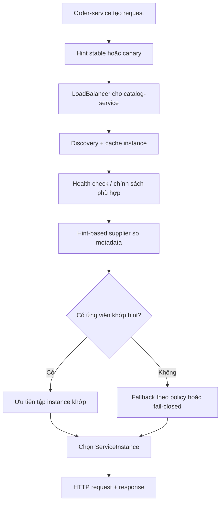

# Định tuyến theo metadata khi triển khai nhiều phiên bản

Khi một hệ thống microservices triển khai đồng thời `catalog-service` phiên bản cũ và mới, việc chọn ngẫu nhiên một bản sao có thể khiến hai request của cùng một luồng nghiệp vụ đi vào hai phiên bản có **hợp đồng API hoặc dữ liệu khác nhau**. Spring Cloud LoadBalancer có thể sử dụng thông tin metadata của `ServiceInstance` và ngữ cảnh request để ưu tiên nhóm instance phù hợp. Kỹ thuật này hữu ích cho *canary release*, thử nghiệm tương thích ngược và chuyển đổi phiên bản có kiểm soát.

Tuy nhiên, cần phân biệt ba khái niệm: **phát hiện instance**, **định tuyến theo nhãn**, và **bảo đảm hợp đồng API**. Metadata giúp nhận diện phiên bản; nó không tự động ngăn một request rơi sang phiên bản không tương thích, cũng không thay thế việc xác thực, kiểm tra readiness hay thiết kế rollback.

Bài học thuộc nhóm **Hợp đồng và lỗi** của Spring Cloud LoadBalancer, tập trung vào cách quảng bá metadata từ discovery, áp dụng hint-based routing ở phía client, xử lý tình huống không có instance tương thích và quan sát các lỗi khi nhiều phiên bản phục vụ song song qua RestClient, WebClient hoặc OpenFeign.

## 1. Bài toán: cùng service ID, nhiều phiên bản

Giả sử hệ thống đang chuyển `catalog-service` từ v1 sang v2, trong khi `order-service` vẫn gọi URL logic:

```text
http://catalog-service/api/products/42
```

Registry công bố ba instance:

| Instance ID | Service ID | API major version | Nhóm triển khai | Zone | Trạng thái |
|---|---|---|---|---|---|
| `catalog-1` | `catalog-service` | `v1` | `stable` | `az-a` | Ready |
| `catalog-2` | `catalog-service` | `v1` | `stable` | `az-b` | Ready |
| `catalog-3` | `catalog-service` | `v2` | `canary` | `az-a` | Ready |

Nếu chỉ dùng round-robin mà không có cơ chế lọc hoặc ưu tiên theo phiên bản, cả ba có thể trở thành ứng viên. Kết quả có thể là:

- Request đầu dùng v1, request sau dùng v2, dù caller chỉ hiểu schema v1.
- DTO phía client không decode được JSON của v2 vì trường/kiểu dữ liệu đã thay đổi không tương thích.
- Một instance mới nhận traffic quá sớm khi migration database hoặc warm-up chưa hoàn tất.
- Phiên bản thử nghiệm gặp lỗi nhưng hệ thống không xác định được release nào đã xử lý request.

**Điểm mấu chốt:** mỗi instance có thể vẫn khỏe, còn LoadBalancer vẫn chọn đúng một instance đang đăng ký, nhưng **lời gọi vẫn vi phạm hợp đồng giữa caller và callee**. Do đó việc chọn instance phải gắn với điều kiện tương thích và chiến lược triển khai.

## 2. Metadata là gì và nằm ở đâu?

`ServiceInstance` trong Spring Cloud có phương thức `getMetadata()` để đọc những nhãn dạng key–value do discovery cung cấp hoặc do nguồn instance được cấu hình. Các trường thường gặp:

| Metadata key minh họa | Giá trị | Mục đích |
|---|---|---|
| `api-major` | `v1` / `v2` | Phân biệt major contract |
| `release` | `1.8.4` / `2.0.0` | Theo dõi bản build cụ thể |
| `channel` | `stable` / `canary` | Nhóm rollout |
| `zone` | `az-a` / `az-b` | Phục vụ chính sách locality |
| `hint` | `stable` / `canary` | Nhãn mà hint-based supplier dựng sẵn có thể dùng |
| `capability` | `bulk-pricing` | Nêu khả năng API cụ thể nếu có contract tương ứng |

**Không phải mọi metadata key đều được Spring Cloud LoadBalancer hiểu mặc định.** Ví dụ `api-major=v2` chỉ là nhãn mô tả; round-robin thông thường không tự lọc theo trường này. Một chính sách routing phải được cấu hình để **đọc đúng key**, so sánh đúng giá trị và xác định fallback.

Trong Java, có thể quan sát từ discovery:

```java
import java.util.List;
import org.springframework.cloud.client.ServiceInstance;
import org.springframework.cloud.client.discovery.DiscoveryClient;

public void printInstances(DiscoveryClient discoveryClient) {
    List<ServiceInstance> instances =
            discoveryClient.getInstances("catalog-service");

    for (ServiceInstance instance : instances) {
        System.out.printf(
                "id=%s host=%s port=%d metadata=%s%n",
                instance.getInstanceId(),
                instance.getHost(),
                instance.getPort(),
                instance.getMetadata());
    }
}
```

Mã chỉ chứng minh **client hiện nhìn thấy metadata nào**; nó không xác nhận LoadBalancer đã chọn instance nào hay metadata có đúng với bản build đang chạy không. Một registry, cache hoặc client có thể giữ snapshot cũ trong thời gian nhất định.

### 2.1. Quảng bá metadata lúc đăng ký

Ví dụ với một instance đăng ký qua Eureka, metadata được khai báo theo cách thường dùng như sau:

```yaml
spring:
  application:
    name: catalog-service

eureka:
  instance:
    metadata-map:
      api-major: v2
      release: "2.0.0"
      channel: canary
      hint: canary
      zone: az-a
```

Đây là **ví dụ phụ thuộc Eureka**. Nếu sử dụng Consul, Kubernetes hoặc cơ chế discovery khác, cấu hình nhãn và cơ chế chuyển thành `ServiceInstance.getMetadata()` sẽ khác. Cũng cần kiểm tra cách zone của registry được ánh xạ vào metadata hoặc cách Spring Cloud xác định zone, thay vì mặc định mọi platform dùng cùng một key.

Một nguyên tắc triển khai: metadata phải phản ánh **artifact thật đang chạy**, không chỉ tên môi trường. Nếu pod thực tế đã chạy v2 nhưng registry vẫn gắn `api-major=v1`, bộ lọc theo nhãn sẽ có quyết định sai dù logic Java đúng.

## 3. Hai mô hình định tuyến phiên bản

Có hai chiến lược chính; lựa chọn phụ thuộc mức tương thích của API và yêu cầu cách ly.

### 3.1. Cùng service ID, lọc hoặc ưu tiên theo metadata

Cả v1 và v2 đều đăng ký dưới `catalog-service`. Caller gửi thêm ngữ cảnh, ví dụ hint `stable` hoặc `canary`; supplier chọn tập ứng viên tương ứng trước khi LoadBalancer thực hiện round-robin/random.

Ưu điểm là caller tiếp tục dùng một tên dịch vụ logic, thuận tiện cho canary và điều khiển traffic. Hạn chế là **cần chính sách lọc chính xác** và phải hiểu hành vi fallback khi không có instance mang nhãn yêu cầu.

### 3.2. Tách service ID cho phiên bản không tương thích

Khi v1 và v2 có hợp đồng **không thể thay thế nhau**, có thể công bố riêng:

```text
catalog-v1 -> các instance chỉ hỗ trợ contract v1
catalog-v2 -> các instance chỉ hỗ trợ contract v2
```

Caller phụ thuộc v1 dùng `http://catalog-v1/...`, caller đã nâng cấp dùng `http://catalog-v2/...`. Cách này giúp **ranh giới định tuyến dễ kiểm soát hơn** vì một request cho v2 không được fallback vào tập v1 chỉ do hint sai.

Đổi lại, có thêm service ID, cấu hình discovery, quan sát và quản lý lifecycle. Việc dùng cùng hay khác service ID là quyết định kiến trúc: **không bắt buộc mỗi release patch/minor phải có service ID riêng**.

| Tiêu chí | Cùng service ID + metadata | Service ID riêng |
|---|---|---|
| Phù hợp nhất | Phiên bản tương thích, canary, routing linh hoạt | Major contract không tương thích, cần cách ly |
| Điều khiển | Hint, zone, custom supplier/weight | Chọn tên service đích |
| Fallback | Phải định nghĩa rõ; có thể bị mở rộng ngoài nhóm | Thường không lẫn nhóm nếu discovery đúng |
| Rollback | Điều chỉnh cohort/routing | Đổi caller sang service ID phù hợp hoặc dừng nâng cấp |
| Nguy cơ | Header sai, nhãn sai, fallback nhầm phiên bản | Gọi nhầm service ID, lỗ hổng migration |

## 4. Luồng định tuyến theo metadata

Một luồng hợp lý để lựa chọn canary qua request hint:



Sơ đồ diễn tả **quyết định cần thiết**, không có nghĩa mọi thành phần mặc định được bật theo đúng thứ tự trên. Discovery, cache và health check là các bước cấu hình được; một số supplier có fallback riêng và thứ tự thực tế phải dựa trên chain đã tạo.

Ví dụ đối chiếu snapshot:

| Stage | Danh sách instance | Giải thích |
|---|---|---|
| Discovery | `catalog-1`, `catalog-2`, `catalog-3` | Đã đăng ký |
| Sau health (nếu bật) | `catalog-1`, `catalog-2`, `catalog-3` | Cả ba đáp ứng health probe |
| Sau hint `canary` | `catalog-3` | Chỉ instance có metadata `hint=canary` |
| LoadBalancer | `catalog-3` | Chọn một ứng viên từ danh sách cuối |

Nếu `catalog-3` không còn available, một **hint-based preference có fallback** có thể trả lại `catalog-1` và `catalog-2`. Đây là vấn đề **hợp đồng**, không chỉ hiệu năng: v1 có thể không hiểu request v2. Cần chọn cách fail-closed hoặc service ID riêng khi fallback xuyên phiên bản là không chấp nhận được.

## 5. Cấu hình hint-based routing của Spring Cloud LoadBalancer

Spring Cloud LoadBalancer có `HintBasedServiceInstanceListSupplier` để ưu tiên các instance theo hint. Ở cách dùng dựng sẵn, hint thường được truyền bằng header `X-SC-LB-Hint` hoặc cấu hình mặc định của client, sau đó so với metadata key `hint` của instance.

Cần phân biệt:

- `hint=canary` trong **metadata instance**: thông tin do registry/discovery cung cấp.
- `X-SC-LB-Hint: canary` trong **request**: điều kiện mà caller muốn ưu tiên.
- `api-major=v2` hoặc `channel=canary`: nhãn bổ sung phục vụ audit/contract, **không tự trở thành bộ lọc** nếu không có code hoặc cấu hình đọc chúng.

Ví dụ supplier riêng cho `catalog-service`:

```java
package com.example.lb.catalog;

import org.springframework.cloud.loadbalancer.core.ServiceInstanceListSupplier;
import org.springframework.context.ConfigurableApplicationContext;
import org.springframework.context.annotation.Bean;
import org.springframework.context.annotation.Configuration;

@Configuration(proxyBeanMethods = false)
public class CatalogLoadBalancerConfiguration {

    @Bean
    ServiceInstanceListSupplier catalogServiceInstanceListSupplier(
            ConfigurableApplicationContext context) {

        return ServiceInstanceListSupplier.builder()
                .withDiscoveryClient()
                .withCaching()
                .withHints()
                .build(context);
    }
}
```

Ở đây `withDiscoveryClient()` lấy các instance; `withCaching()` giữ snapshot discovery theo cấu hình; `withHints()` thêm bước ưu tiên theo hint. Khi cần health check, zone hoặc bước tùy biến, phải thiết kế thứ tự supplier có chủ đích và kiểm tra khả năng chuyển tiếp `get(Request)` để không làm mất ngữ cảnh request.

Lớp cấu hình trên nên nằm **ngoài component scan** của ứng dụng chính nếu chỉ dành cho một service ID. Ứng dụng gắn như sau:

```java
package com.example.orders;

import com.example.lb.catalog.CatalogLoadBalancerConfiguration;
import org.springframework.boot.SpringApplication;
import org.springframework.boot.autoconfigure.SpringBootApplication;
import org.springframework.cloud.loadbalancer.annotation.LoadBalancerClient;

@SpringBootApplication
@LoadBalancerClient(
        name = "catalog-service",
        configuration = CatalogLoadBalancerConfiguration.class)
public class OrderApplication {

    public static void main(String[] args) {
        SpringApplication.run(OrderApplication.class, args);
    }
}
```

Ví dụ chỉ trình bày phần cấu hình LoadBalancer. Ứng dụng cần dependency Spring Cloud LoadBalancer, discovery phù hợp và HTTP client có tích hợp cân bằng tải. Các API builder/thuộc tính có thể phụ thuộc phiên bản Spring Cloud; nên xác minh bằng integration test trước khi triển khai.

### 5.1. Nhận diện một hạn chế quan trọng: hint là preference, không phải hợp đồng cứng

Với `HintBasedServiceInstanceListSupplier` dựng sẵn, nếu không tìm thấy ứng viên khớp hint, cơ chế có thể **trả về danh sách ứng viên gốc** thay vì trả danh sách rỗng. Điều này hữu ích cho routing mềm nhưng không an toàn nếu v1 và v2 **không tương thích**.

Ví dụ giả định:

```text
Request: X-SC-LB-Hint: canary
Discovery: [catalog-1(hint=stable), catalog-2(hint=stable)]
Hint matches: []
Default preference fallback: [catalog-1, catalog-2]
Possible selected instance: catalog-1
```

Nếu `catalog-1` không hỗ trợ contract v2, request có thể lỗi dù client có gửi header `canary`. **Không dùng hint-based fallback mềm làm cơ chế bảo đảm rằng mọi request bắt buộc đến đúng major version.**

Khi cần cách ly cứng, dùng **service ID riêng**, gateway route bắt buộc hoặc custom supplier có chính sách *fail-closed*. Trong custom supplier, nếu request yêu cầu v2 mà không còn instance v2 phù hợp, cần trả một tập rỗng hoặc lỗi định tuyến rõ ràng **thay vì chuyển ngầm về v1**; không nên đánh đổi tính tương thích lấy availability một cách vô thức.

## 6. Truyền routing hint từ HTTP client

### 6.1. WebClient

Nếu `order-service` dùng builder đã tích hợp LoadBalancer:

```java
import org.springframework.cloud.client.loadbalancer.LoadBalanced;
import org.springframework.context.annotation.Bean;
import org.springframework.web.reactive.function.client.WebClient;

@Bean
@LoadBalanced
WebClient.Builder loadBalancedWebClientBuilder() {
    return WebClient.builder();
}
```

Có thể gửi hint theo từng lời gọi:

```java
Mono<ProductResponse> product = webClient.get()
        .uri("http://catalog-service/api/products/{id}", "42")
        .header("X-SC-LB-Hint", "canary")
        .retrieve()
        .bodyToMono(ProductResponse.class);
```

Đoạn thứ hai giả định `webClient` được tạo từ builder `@LoadBalanced` và `ProductResponse` là DTO ứng dụng. Để request hint ảnh hưởng việc chọn instance, exchange filter của HTTP client phải đưa header vào **request context** mà hint supplier xử lý. Nếu không, header chỉ được gửi xuống backend mà không làm thay đổi danh sách ứng viên.

### 6.2. OpenFeign

Một Feign interface cũng có thể công bố header trong hợp đồng request:

```java
package com.example.orders.client;

import org.springframework.cloud.openfeign.FeignClient;
import org.springframework.web.bind.annotation.GetMapping;
import org.springframework.web.bind.annotation.PathVariable;
import org.springframework.web.bind.annotation.RequestHeader;

@FeignClient(name = "catalog-service")
public interface CatalogClient {

    @GetMapping("/api/products/{id}")
    ProductResponse getProduct(
            @PathVariable("id") String id,
            @RequestHeader("X-SC-LB-Hint") String routingHint);
}
```

Ví dụ gọi `client.getProduct("42", "stable")` hoặc `client.getProduct("42", "canary")`. Cần kiểm tra phiên bản tích hợp Spring Cloud OpenFeign–LoadBalancer đang dùng có chuyển tiếp đúng header vào ngữ cảnh của `ServiceInstanceListSupplier` không. Một số đường xử lý có thể khác giữa Feign blocking client, WebClient và RestClient; **có header** chưa đủ chứng minh routing đã hoạt động.

### 6.3. RestClient và các hop trung gian

Với một `RestClient.Builder` được đánh dấu `@LoadBalanced`, cách phát header HTTP ở mức lời gọi thường có dạng:

```java
ProductResponse product = restClient.get()
        .uri("http://catalog-service/api/products/{id}", "42")
        .header("X-SC-LB-Hint", "canary")
        .retrieve()
        .body(ProductResponse.class);
```

`restClient` ở ví dụ phải là instance đã xây từ builder có LoadBalancer và dependency tương ứng; code trên không minh họa việc khai báo bean. Cần kiểm tra việc request context được chuyển tiếp đến supplier theo đúng version/integration.

Nếu một gateway hoặc `order-service` nhận request từ trình duyệt rồi gọi `catalog-service`, HTTP header ở **hop trình duyệt → gateway** không mặc nhiên được sao chép sang **hop gateway → catalog**. Cần xác định thành phần đáng tin cậy nào chọn cohort và gắn hint vào lời gọi nội bộ. Không cho client bên ngoài tự chọn canary bằng cách tin cậy hoàn toàn một header tùy ý.

## 7. Canary routing: phân nhóm ổn định và giới hạn traffic

Gửi hint `canary` cho một tập request là một cách chuyển traffic vào phiên bản mới, nhưng **hint không đồng nghĩa bộ chia phần trăm**. Nếu cần 5% request, thành phần chọn cohort phải quyết định những request nào được gắn `canary`, ví dụ dựa trên quy tắc rollout:

```text
Một request đi vào order-service.
    |
    +-- Khách hàng thuộc cohort thử nghiệm? -- Có --> hint = canary
    |                                           |
    +-- Không ---------------------------------+--> hint = stable
```

Quy tắc cohort có thể dựa trên feature flag hoặc phép băm ổn định của một định danh đã được bảo vệ. Sử dụng giá trị ngẫu nhiên cho mỗi request có thể khiến **cùng một khách hàng đi qua v1/v2 liên tục**, không thích hợp khi cần ổn định hành vi. Ngược lại, cohort dựa theo người dùng/tenant cần tuân thủ chính sách bảo mật và không tiết lộ ID nhạy cảm trong hint, metadata hoặc log.

Ví dụ chính sách:

| Cohort | Hint | Mục tiêu |
|---|---|---|
| Người dùng thông thường | `stable` | Giữ đường đi ổn định |
| Nhóm thử nghiệm nội bộ | `canary` | Kiểm chứng v2 trong phạm vi hẹp |
| Nhóm benchmark có quyền truy cập | `canary` | Đo hiệu năng và độ tương thích trước rollout |

Nếu cả canary và stable vẫn dùng **cùng API major version và tương thích ngược**, fallback mềm có thể chấp nhận được theo quyết định vận hành. Nếu canary thay đổi contract phá vỡ tương thích, cohort cần được ràng buộc cứng hoặc dùng service ID riêng.

Lưu ý số lượng instance không tạo trực tiếp phần trăm traffic. Một v2 trong ba instance không có nghĩa 33% request sẽ đến v2 khi có hint, zone preference, affinity, trọng số hoặc độ lệch tải.

## 8. Hợp đồng API: metadata không thay thế tương thích ngược

Định tuyến theo nhãn không sửa được những khác biệt về HTTP contract. Cần lập ma trận tương thích giữa caller và callee trước khi rollout:

| Caller | Callee v1 | Callee v2 | Quyết định |
|---|---|---|---|
| `order-service` cũ, chỉ hiểu schema v1 | Hợp lệ | Có thể không tương thích | Giữ stable/v1 hoặc bảo đảm v2 backward-compatible |
| `order-service` mới, hiểu cả hai schema | Hợp lệ | Hợp lệ | Có thể triển khai canary mềm nếu đã kiểm chứng |
| `order-service` mới, yêu cầu field chỉ v2 có | Không hợp lệ | Hợp lệ | Hard route đến v2 hoặc service ID riêng; không fallback v1 |

Các dạng thay đổi có thể phá vỡ hợp đồng:

- Đổi tên hoặc kiểu field JSON mà caller phải deserialize.
- Xóa endpoint hoặc thay đổi HTTP method/path/query bắt buộc.
- Thay đổi ý nghĩa business error code, HTTP status hoặc idempotency semantics.
- Đòi header/token mới mà caller cũ chưa biết gửi.
- Migration dữ liệu khiến các phiên bản không cùng đọc/ghi an toàn vào một database.

**Mẹo:** phân biệt `release` (build cụ thể, ví dụ `2.0.7`) và `api-major` (hợp đồng, ví dụ `v2`). Không phải mỗi build mới đều yêu cầu tách hướng định tuyến; đôi khi chỉ cần release-level canary trong cùng một API major.

Khi nhiều phiên bản cùng chạy, cách triển khai thường an toàn hơn là dùng **expand–migrate–contract** cho schema dữ liệu: trước hết mở rộng theo cách các phiên bản cũ vẫn hiểu, chuyển caller/callee dần dần, cuối cùng mới loại bỏ trường hoặc hành vi cũ khi không còn phụ thuộc.

## 9. Sức khỏe instance, cache, zone và thứ tự supplier

Hint-based routing chỉ có ý nghĩa nếu danh sách ứng viên thể hiện đúng những instance **đang có thể phục vụ**. Một danh sách sai hoặc stale có thể khiến request v2 vẫn chọn instance vừa dừng.

Các lớp cần kiểm tra:

1. **Registry/discovery:** phiên bản nào đang đăng ký, metadata gì, khi nào refresh?
2. **Cache:** snapshot discovery giữ trong bao lâu? Có khả năng metadata đã đổi nhưng client còn dùng nhãn cũ?
3. **Health check:** probe có loại instance lỗi hoặc chưa ready chưa? `registered` khác `ready`.
4. **Zone preference:** hint cần canary ở `az-b` nhưng client ở `az-a`; chính sách ưu tiên zone có làm mất canary không?
5. **Hint filter:** metadata key và request context có thực sự khớp không?
6. **LoadBalancer:** instance được chọn thuộc version/cohort nào?
7. **HTTP:** response thực tế có đúng contract, độ trễ và error rate của release nào?

Cần thiết kế thứ tự cache/health và các bước phụ thuộc request phù hợp. **Không cache kết quả đã lọc theo một request hint trong một cache danh sách chung mà không phân biệt ngữ cảnh**; nó có thể làm request stable bị dùng lại danh sách canary hoặc ngược lại.

Ví dụ minh họa cách so snapshot ở từng ranh giới:

```text
Discovery:      [catalog-1(stable), catalog-2(stable), catalog-3(canary)]
After health:   [catalog-1(stable), catalog-3(canary)]
Request hint:   canary
After hint:     [catalog-3(canary)]
Chosen:         catalog-3
HTTP:           200, contract=v2
```

Không được suy từ **HTTP 200** rằng version routing đã đúng: nếu v1 và v2 đều trả 200 cho một endpoint, phải có log/trace chứa instance ID/release hoặc một cách xác minh contract an toàn trong môi trường thử nghiệm.

## 10. Khi không có instance đúng phiên bản: fallback hay fail-closed?

Giả sử caller yêu cầu API v2 nhưng tất cả instance v2 bị loại vì health check:

| Chính sách | Kết quả | Phù hợp khi |
|---|---|---|
| **Fallback tất cả ứng viên** | Có thể gọi v1 để cứu availability | Chỉ khi v1 thực sự xử lý được request |
| **Fail-closed** | Không chọn instance không tương thích; trả lỗi không có đích phù hợp | Bắt buộc giữ contract v2 |
| **Gọi service ID v2** | Chỉ tìm trong tập v2 | Có cách ly dịch vụ và discovery đúng |
| **Fallback nghiệp vụ** | Trả dữ liệu cache/fallback riêng, có ghi nhận | Chính sách sản phẩm cho phép và dữ liệu đủ tin cậy |

Cần quyết định rõ trong **hợp đồng** thay vì để fallback ngầm. Nếu không còn instance v2 hợp lệ, biểu hiện lỗi có thể là không chọn được instance, lỗi upstream từ gateway/LoadBalancer, hoặc exception HTTP client. Trả `404 Not Found` cho **sản phẩm** chỉ vì không còn v2 là sai ngữ nghĩa. Ứng dụng nên ánh xạ sang lỗi phụ thuộc hoặc phiên bản không khả dụng phù hợp với hợp đồng API bên ngoài.

Đặc biệt, retry sau timeout có thể chọn một instance khác **trong cùng hoặc ngoài cohort**, tùy thuật toán và việc truyền hint qua từng attempt. Nếu bắt buộc v2, phải xác minh **mọi attempt** đều giữ ràng buộc phiên bản. Không retry vô hạn khi chỉ còn một release đã lỗi; retry có thể khuếch đại tải và che giấu nguyên nhân.

## 11. Quan sát lỗi theo phiên bản và kiểm soát độ lệch

Trong rollout, metric tổng thể của service có thể che giấu lỗi chỉ xảy ra trên canary. Nên theo dõi ít nhất:

| Nhóm | Trường quan sát | Mục đích |
|---|---|---|
| Request intent | `serviceId`, `hint`, cohort logic | Caller muốn gửi đến nhóm nào? |
| Discovery | `instanceId`, `api-major`, `release`, `zone` | Instance nào có sẵn và metadata gì? |
| Chọn instance | Candidate count, instance đã chọn, metadata sau chọn | Routing có đúng policy không? |
| HTTP | Status, lỗi kết nối, timeout, latency, attempt | Version nào gây lỗi? |
| Contract | Decoder error, schema validation, business error code | Caller/callee có tương thích không? |
| Rollout | Canary traffic thực tế, error rate, p95/p99 | Có nên mở rộng hoặc rollback? |

Không thêm mọi `instanceId`, `traceId` hoặc user ID thành nhãn metric không giới hạn; dùng nhãn release/service có cardinality kiểm soát và log/trace có sampling khi cần chi tiết từng instance. Không gửi bearer token, dữ liệu nhận dạng người dùng hoặc raw cohort seed vào log.

Nên có ít nhất hai chỉ số chất lượng riêng theo release: **tỷ lệ lỗi HTTP/transport** và **tỷ lệ lỗi hợp đồng** (decode mismatch, field missing, unexpected status). Một bản canary có ít 5xx nhưng thường xuyên lỗi DTO vẫn không đủ điều kiện tăng traffic.

## 12. Thực hành kiểm thử định tuyến v1/v2

Chuẩn bị ba instance như phần 1. Hai instance stable đăng ký metadata `hint=stable`, `api-major=v1`; một instance canary đăng ký `hint=canary`, `api-major=v2`. Mỗi instance có endpoint thử nghiệm trả thông tin phiên bản trong **môi trường kiểm thử** để dễ xác minh, không nhất thiết công bố endpoint này trong production.

Thực hiện:

1. **Preflight:** kiểm tra `DiscoveryClient.getInstances("catalog-service")` trên chính caller; xác nhận instance ID, host:port, `hint` và `api-major` đều đúng.
2. **Không hint:** gửi request không có `X-SC-LB-Hint` và ghi nhận danh sách ứng viên/chọn instance; xác định policy mặc định thực tế.
3. **Stable:** gửi header `X-SC-LB-Hint: stable` nhiều lần; xác nhận chỉ các instance phù hợp được ưu tiên khi có đủ instance.
4. **Canary:** gửi `X-SC-LB-Hint: canary` và quan sát `catalog-3` được chọn. Kiểm tra response decode đúng DTO mong đợi.
5. **Sai hint:** gửi `X-SC-LB-Hint: unknown`. Ghi nhận hành vi fallback thực tế, đặc biệt xem liệu request có rơi vào nhóm stable không.
6. **Mất canary:** dừng hoặc loại `catalog-3` khỏi discovery/health. Ghi nhận thời gian hội tụ cache và hành vi fallback/fail-closed; nếu contract v2 không tương thích, **không cho phép gọi v1**.
7. **Zone:** đặt canary trong zone khác caller, thử zone preference cùng hint và quan sát thứ tự, fallback, latency cross-zone.
8. **Retry:** gây lỗi timeout có kiểm soát và xác minh cohort được giữ ở từng attempt; kiểm tra số attempt và budget.
9. **Schema:** giả lập v2 đổi kiểu field quan trọng, chạy contract test để chắc chắn caller v1 không nhận response v2 nếu chưa tương thích.
10. **Rollback:** gỡ canary khỏi cohort, kiểm tra request stable vẫn thành công và không còn request nào phụ thuộc bắt buộc vào v2 trước khi hạ instance.

Bảng ghi chép có thể dùng:

| Trace | Hint | Ứng viên phù hợp | Instance chọn | API contract | Kết quả |
|---|---|---|---|---|---|
| `r-101` | `stable` | `1, 2` | `1` | `v1` | `200` |
| `r-102` | `canary` | `3` | `3` | `v2` | `200` |
| `r-103` | `canary` | Không có sau health | Theo fallback đã cấu hình | Không được gọi v1 nếu v2 bắt buộc | Lỗi có kiểm soát |
| `r-104` | `unknown` | Không có match | Kiểm tra fallback thực tế | Không được đoán | Theo policy |

Bảng là dữ liệu minh họa. Trạng thái thực phụ thuộc source discovery, thứ tự supplier, LoadBalancer, HTTP client integration và hợp đồng API.

## 13. Checklist rollout an toàn nhiều phiên bản

**Trước rollout:**

- Xác định v1/v2 tương thích ngược hay cần tách service ID.
- Định nghĩa metadata schema, ví dụ `api-major`, `release`, `hint`, tránh tên và giá trị mâu thuẫn.
- Đảm bảo metadata tự động gắn theo artifact và readiness đúng với khả năng phục vụ.
- Chọn policy fallback **trước** khi canary bắt đầu, đặc biệt với contract không tương thích.
- Chuẩn bị contract tests, integration tests cho request hint và giám sát per-release.

**Khi rollout:**

- Đưa v2 lên và chờ discovery, health, cache hội tụ trước khi chuyển traffic.
- Chuyển một cohort nhỏ, ổn định; đo traffic thực, error rate, latency và decode errors theo release.
- Kiểm tra cả đường **không hint**, **hint sai**, **mất instance**, **zone khác**, **retry**.
- Tăng cohort từng bước theo tiêu chí chất lượng đã đặt, không chỉ theo số lượng instance.

**Khi rollback:**

- Ngừng chuyển cohort mới sang v2; chặn hoặc chuyển an toàn request chưa tương thích.
- Chờ các request đang thực thi hoàn tất theo quy trình graceful drain.
- Xác minh discovery/LoadBalancer không còn chọn instance v2 cho nhóm stable.
- Kiểm tra lại schema dữ liệu chia sẻ, cache, event và các thao tác v2 đã ghi trước khi rollback mã.
- Ghi nhận quyết định và kết quả đo để không lặp lỗi trong lần triển khai sau.

## 14. Ghi nhớ

Trong Spring Cloud LoadBalancer, metadata của `ServiceInstance` giúp định danh release, API major version, zone hoặc cohort, nhưng **metadata không tự trở thành chính sách định tuyến**. `HintBasedServiceInstanceListSupplier` có thể ưu tiên các instance mang metadata `hint` phù hợp với ngữ cảnh request, trong khi round-robin/random chỉ chọn trong danh sách ứng viên được cung cấp. Cần hiểu rõ fallback của hint routing, bảo toàn ngữ cảnh qua các HTTP client và từng retry attempt, cũng như thứ tự cache, health check và zone.

Với những phiên bản **tương thích ngược**, hint-based canary routing có thể là công cụ triển khai linh hoạt. Với phiên bản **không tương thích**, phải ưu tiên cách ly contract bằng service ID riêng hoặc policy *fail-closed*, vì việc fallback ngầm sang bản cũ có thể tạo lỗi nghiệp vụ nghiêm trọng. Quan sát metadata, candidate list, instance được chọn, HTTP response và lỗi hợp đồng theo từng release là điều kiện để triển khai, mở rộng và rollback an toàn.

