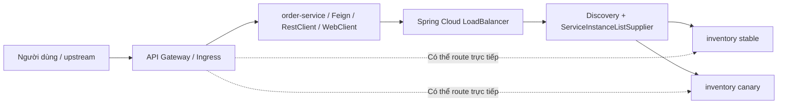
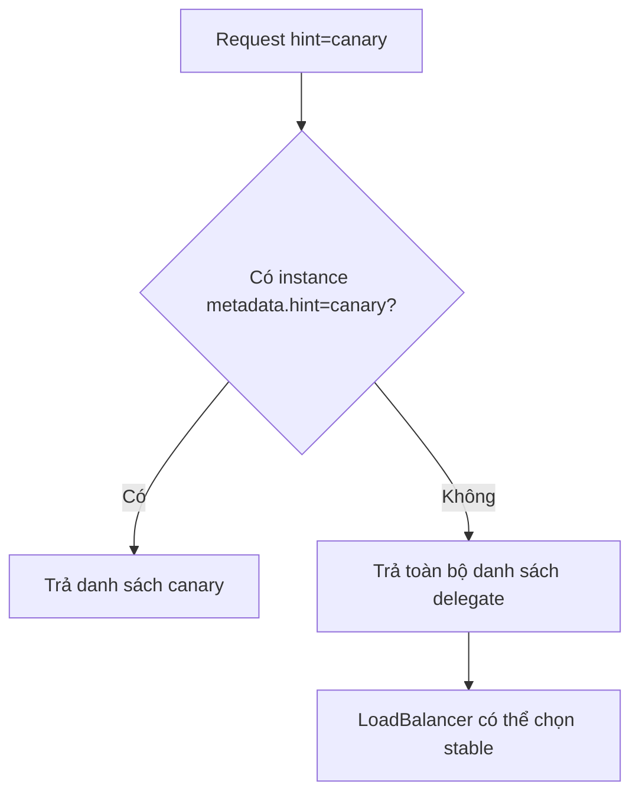
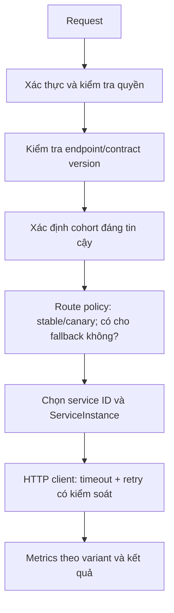
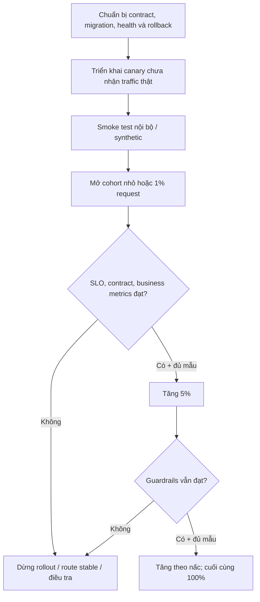

# Ranh giới giữa thử nghiệm canary và chính sách định tuyến đầy đủ

## Mục tiêu

Khi phát hành phiên bản mới của `inventory-service`, nhóm phát triển thường triển khai một hoặc vài bản sao **canary**, sau đó đưa một phần nhỏ traffic thật vào để quan sát trước khi mở rộng. Spring Cloud LoadBalancer giúp chọn `ServiceInstance` theo service ID, metadata, hint, zone hoặc trọng số. Tuy nhiên, **chọn được một phần traffic cho canary không đồng nghĩa đã có một chính sách định tuyến đầy đủ**.

Một chính sách định tuyến cho production còn phải trả lời: ai được đưa vào canary, khi nào được phép chuyển nhóm, nếu không còn canary thì xử lý ra sao, hợp đồng HTTP giữa stable/canary có tương thích không, lỗi nào có thể retry, khi nào rollback và làm sao chứng minh traffic không đi nhầm nhóm.

Sau bài học, bạn có thể:

- Phân biệt **thử nghiệm canary** với **định tuyến có ràng buộc nghiệp vụ, bảo mật và độ tin cậy**.
- Hiểu phạm vi của `WeightedServiceInstanceListSupplier`, `HintBasedServiceInstanceListSupplier` và route weight tại Spring Cloud Gateway.
- Thiết kế lựa chọn **ngẫu nhiên theo request** hoặc **ổn định theo cohort/user** phù hợp mục tiêu thí nghiệm.
- Phân biệt **fallback chấp nhận được** với **fail-open nguy hiểm** khi không có instance phù hợp.
- Kiểm tra hợp đồng API, mã lỗi, retry, timeout và idempotency giữa stable/canary.
- Xây dựng bài thực hành canary 95/5 bằng Gateway và hai service ID riêng, có khả năng rollback.
- Thiết lập metrics, tiêu chí tăng traffic và bộ kiểm thử xác minh giới hạn định tuyến.

> Bối cảnh: Bài thuộc chương **Hợp đồng và lỗi** của mô-đun Spring Cloud Service Communication Load Balancing. Trọng tâm là tính đúng đắn của định tuyến, hợp đồng giữa các service và xử lý lỗi. Một tỷ lệ canary đẹp trên dashboard không phải bằng chứng hệ thống đã cô lập traffic an toàn.

## 1. Canary release thực sự là gì?

Một **canary release** là chiến lược triển khai phiên bản mới cho một phần lưu lượng hoặc một nhóm người dùng nhỏ, quan sát các chỉ số quan trọng, rồi quyết định mở rộng, giữ nguyên hoặc rollback.

Ví dụ `inventory-service` có:

| Nhóm | Phiên bản | Số instance | Trạng thái |
|---|---|---:|---|
| Stable | `v1.8` | 9 | Đang phục vụ chính |
| Canary | `v1.9-rc1` | 1 | Đang thử nghiệm |

Nhóm có thể mong muốn **5% yêu cầu đọc tồn kho** được xử lý bởi canary. Nhưng từ “5%” còn thiếu nhiều thông tin:

- 5% **request**, 5% **người dùng** hay 5% **đơn hàng**?
- Áp dụng cho toàn bộ API hay chỉ `GET /api/items/{sku}`?
- Một người dùng có bị chuyển qua lại giữa stable và canary trong cùng phiên không?
- Có áp dụng cho operation thanh toán/giữ hàng không?
- Nếu canary không có instance khỏe, có được chuyển về stable không?
- Một response 404 do canary trả có được chuyển sang stable để thử lại không?
- Ai có quyền thay đổi tỷ lệ và quyết định dừng thử nghiệm?

Nếu chưa trả lời được các câu hỏi này, cấu hình đang có nhiều khả năng chỉ là **thí nghiệm phân phối traffic**, chưa phải một chính sách định tuyến hoàn chỉnh.

## 2. Ranh giới: thử nghiệm canary và định tuyến production

| Khía cạnh | Canary thử nghiệm tối thiểu | Chính sách định tuyến đầy đủ |
|---|---|---|
| Mục tiêu | Đưa một ít request vào phiên bản mới | Đưa **đúng traffic** tới **đúng nhóm** theo quy tắc có kiểm chứng |
| Phân bổ | Trọng số ngẫu nhiên xấp xỉ 95/5 | Có thể kết hợp tỷ lệ, cohort, tenant, API, vùng, phiên và mức ưu tiên |
| Độ ổn định nhóm | Một người dùng có thể chuyển nhóm giữa các request | Sticky assignment khi nghiệp vụ và phép đo yêu cầu |
| Trường hợp không có backend | Có thể tự fallback theo thư viện | Fail-open/fail-closed được quy định rõ cho từng loại traffic |
| Tương thích API | Có thể chỉ thử happy path | Kiểm tra status, body, schema, semantics và contract version |
| Retry | Dùng cấu hình mặc định | Giới hạn attempts, chọn lại instance và kiểm soát cross-variant fallback |
| Bảo mật | Header/metadata minh họa | Không tin header từ bên ngoài; kiểm tra quyền truy cập độc lập |
| Quan sát | Đếm request canary | Metrics phân theo variant, release, operation, cohort và lỗi có ý nghĩa |
| Rollback | Giảm weight bằng thao tác thủ công | Có kill switch, quyền thay đổi, quy trình và kiểm thử rollback |
| Triển khai dữ liệu | Có thể dùng DB giống stable | Schema/data migration tương thích tiến/lùi, idempotency và quy trình phục hồi |

**Canary là cách giảm phạm vi rủi ro của một thay đổi; chính sách định tuyến là cơ chế đảm bảo rủi ro đó được giới hạn đúng như đã thiết kế.**

## 3. Các tầng có thể tham gia quyết định đích

Trong kiến trúc Spring Cloud có thể tồn tại nhiều nơi phân phối request:



Cần xác định **tầng nào sở hữu quyết định canary**:

1. **Gateway/ingress**: chọn route vào `inventory-stable` hoặc `inventory-canary`, có thể dùng route weights. Hữu ích khi traffic đều đi qua Gateway.
2. **Client-side LoadBalancer**: chọn `ServiceInstance` trong một service ID duy nhất, có thể dựa trên trọng số hoặc hint.
3. **Service mesh/proxy**: áp dụng policy theo version/label ở tầng mạng; ứng dụng có thể không biết phiên bản đích.
4. **Ứng dụng nghiệp vụ**: tự xác định cohort và route tới service ID khác nhau; có thêm thông tin về tenant, đơn hàng hoặc contract.

Nếu `order-service` gọi trực tiếp `http://inventory-service` bằng `@LoadBalanced RestClient`, một route weight tại public Gateway **không tự áp dụng** cho lời gọi nội bộ này. Ngược lại, chính sách supplier trong `order-service` không tự áp dụng cho request đi thẳng qua Gateway đến backend.

Không nên khai báo “canary 5%” tại nhiều tầng mà không biết hiệu ứng tổ hợp. Ví dụ Gateway chọn 5% request vào nhóm canary, rồi trong nhóm này LoadBalancer chỉ đưa 10% sang một canary instance: tỷ lệ request thực sự chạm canary có thể khác hẳn mục tiêu ban đầu.

## 4. WeightedServiceInstanceListSupplier: trọng số instance không phải contract cohort

Spring Cloud Commons cung cấp `WeightedServiceInstanceListSupplier`, đọc `weight` từ metadata của `ServiceInstance` (mặc định **1** khi không có giá trị). Các trọng số định hướng tần suất chọn những **instance** trong danh sách ứng viên.

Ví dụ một service ID chứa:

| Instance | Release | Metadata `weight` |
|---|---|---:|
| `inventory-stable-1` | stable | 19 |
| `inventory-canary-1` | canary | 1 |

Tỷ trọng kỳ vọng trong mô hình hai instance đơn giản là:

```text
stable : canary = 19 : 1
canary share = 1 / (19 + 1) = 5%
```

Nhưng nếu nhóm stable có **chín instance**, mỗi instance mang weight `19`, còn một canary mang weight `1`:

```text
Tổng stable weight = 9 × 19 = 171
Tổng canary weight = 1
Canary share ≈ 1 / 172 ≈ 0,58%
```

Đây là lỗi thường gặp: **weight áp dụng trên từng instance, không tự phân bổ 95/5 theo nhãn release**. Thêm/xóa replica có thể làm thay đổi tỷ lệ thực tế ngay cả khi weight metadata trên mỗi instance không đổi.

### 4.1. Bật weighted supplier cho một service ID

Ví dụ cấu hình riêng cho `inventory-service`:

```java
import org.springframework.cloud.loadbalancer.annotation.LoadBalancerClient;
import org.springframework.cloud.loadbalancer.core.ServiceInstanceListSupplier;
import org.springframework.context.ConfigurableApplicationContext;
import org.springframework.context.annotation.Bean;
import org.springframework.context.annotation.Configuration;

@Configuration(proxyBeanMethods = false)
@LoadBalancerClient(
        name = "inventory-service",
        configuration = InventoryWeightedConfiguration.class
)
class InventoryLoadBalancerRegistration {
}

// Không đánh dấu @Configuration nếu class nằm trong vùng component scan chính.
class InventoryWeightedConfiguration {

    @Bean
    ServiceInstanceListSupplier inventoryInstanceListSupplier(
            ConfigurableApplicationContext context) {
        return ServiceInstanceListSupplier.builder()
                .withDiscoveryClient()
                .withCaching()
                .withWeighted()
                .build(context);
    }
}
```

Đoạn này thể hiện **weighted load balancing dựa vào metadata của instance**. Không có bước kiểm tra tenant, route hợp đồng API, giữ assignment theo người dùng hay dừng hoàn toàn traffic khi canary không còn ready.

Trong hệ thống dùng Eureka, metadata của instance có thể được đăng ký qua `eureka.instance.metadata-map.weight`. Nếu dùng discovery provider khác, phải kiểm tra cách nó cung cấp metadata sang `ServiceInstance.getMetadata()`.

### 4.2. Giới hạn của weighted routing

- Trọng số đưa ra một **phân bố xác suất hoặc phân bố tương đối**, không hứa hẹn chính xác 5 trong mỗi 100 request.
- Khi mẫu nhỏ, tỷ lệ quan sát có thể dao động đáng kể.
- Tỷ lệ request không đồng nghĩa tỷ lệ user, session hoặc giao dịch.
- Retry có thể tạo thêm **physical attempts** khiến tỷ lệ backend nhận traffic khác tỷ lệ logical requests.
- Các supplier lọc theo zone, hint và health check có thể làm thay đổi tập instance trước khi áp dụng trọng số.
- Cache discovery chưa cập nhật có thể khiến canary chưa xuất hiện hoặc instance cũ tiếp tục được chọn.
- Weight **không phải cổng phân quyền** hoặc quy tắc bắt buộc cô lập dữ liệu.

Nếu yêu cầu là “5% user được gán canary ổn định trong một ngày”, weighted instance selection **chưa đủ**. Cần quy tắc cohort và lưu giữ quyết định gán nhóm.

## 5. Hint-based routing: định hướng traffic, không mặc định fail-closed

`HintBasedServiceInstanceListSupplier` có thể đọc hint từ header `X-SC-LB-Hint` hoặc property `spring.cloud.loadbalancer.hint.<serviceId>`, sau đó lọc các instance có metadata key `hint` khớp giá trị đó.

Ví dụ các instance dưới cùng service ID:

```text
inventory-service:
  instance stable-a: metadata.hint = stable
  instance stable-b: metadata.hint = stable
  instance canary-a: metadata.hint = canary
```

Một `@LoadBalanced WebClient` có thể gửi hint trong request nội bộ:

```java
Mono<String> response = webClient.get()
        .uri("http://inventory-service/api/items/{sku}", "SKU-42")
        .header("X-SC-LB-Hint", "canary")
        .retrieve()
        .bodyToMono(String.class);
```

Đoạn ví dụ giả định `webClient` được tạo từ builder có `@LoadBalanced` và supplier chain đã thêm `withHints()`. Chỉ thêm header khi supplier chưa được bật sẽ không tự kích hoạt hint-based routing.

### 5.1. Fallback mặc định là ranh giới nguy hiểm

Theo tài liệu Spring Cloud Commons, khi **không có instance nào khớp hint**, `HintBasedServiceInstanceListSupplier` **trả lại toàn bộ danh sách từ delegate**.



Đối với thử nghiệm canary đơn giản, chuyển về stable khi canary biến mất đôi khi là kết quả chấp nhận được. Nhưng nếu đang yêu cầu **phân tách tenant theo luật**, **chỉ được gọi phiên bản hỗ trợ contract mới**, hoặc **không được chuyển dữ liệu nhạy cảm sang stable**, hành vi fallback này không đủ an toàn.

**Hint không phải cơ chế xác thực hoặc phân quyền.** Không tin một header `X-SC-LB-Hint: canary` đến từ người dùng bên ngoài rồi xem đó là quyền truy cập tính năng canary. Gateway hoặc service đáng tin cậy phải xác minh quyền, loại bỏ/ghi đè header không đáng tin cậy và quyết định routing.

### 5.2. Khi cần fail-closed

Nếu policy quy định “request canary **không được** chạy trên stable”, cần một trong những giải pháp rõ ràng:

- **Tách service ID:** `inventory-canary` chỉ chứa canary instances; nếu không còn instance, caller nhận lỗi/chuyển sang chính sách đã định, không tùy tiện lấy stable instances.
- **Strict custom supplier:** sau khi lọc metadata, trả danh sách rỗng khi không có match thay vì fallback toàn bộ delegate.
- **Gateway/mesh rule có khả năng bảo đảm isolation:** route đến nhóm đích cụ thể, có test khi nhóm đích rỗng.

Nếu viết supplier riêng, phải kiểm tra toàn bộ chuỗi, thứ tự cache/discovery/health check và cách LoadBalancer xử lý danh sách rỗng. Việc trả danh sách rỗng có thể dẫn tới lỗi lựa chọn instance; đây là một quyết định có chủ đích để **không vi phạm ranh giới**.

## 6. Thiết kế an toàn hơn: stable và canary có service ID riêng

Một cách dễ giải thích và kiểm thử là đăng ký hai nhóm như **hai service ID**:

| Service ID | Deployment | Mục đích |
|---|---|---|
| `inventory-stable` | `inventory-service:v1.8` | Lưu lượng chính |
| `inventory-canary` | `inventory-service:v1.9-rc1` | Lưu lượng thí nghiệm |

Tại đây, **service ID là ranh giới tập backend**. Một route tới `lb://inventory-canary` chỉ lấy instance thuộc service ID canary từ discovery/LoadBalancer tương ứng.

### 6.1. Weight route tại Spring Cloud Gateway

Với **Spring Cloud Gateway Server WebFlux**, có thể dùng `Weight` route predicate:

```yaml
spring:
  cloud:
    gateway:
      server:
        webflux:
          routes:
            - id: inventory-stable-route
              uri: lb://inventory-stable
              predicates:
                - Path=/api/items/**
                - Weight=inventory-rollout, 95

            - id: inventory-canary-route
              uri: lb://inventory-canary
              predicates:
                - Path=/api/items/**
                - Weight=inventory-rollout, 5
```

Ở đây:

1. Hai route cùng match `/api/items/**`, thuộc group trọng số `inventory-rollout`.
2. Gateway phân bổ **xấp xỉ 95%** request phù hợp vào route stable và **5%** vào route canary theo trọng số.
3. `lb://inventory-stable` và `lb://inventory-canary` được Spring Cloud LoadBalancer xử lý **riêng theo service ID**.
4. Backend phải expose cùng path `/api/items/{sku}`. Nếu path khác nhau, cần chủ động dùng filter rewrite và kiểm thử hợp đồng.

Ví dụ áp dụng cho **Gateway Server WebFlux** với dependency Gateway/LoadBalancer tương ứng; Gateway Server MVC có cách cấu hình khác. Không sao chép YAML này vào `order-service` thông thường rồi cho rằng nó tự định tuyến các lời gọi Feign nội bộ.

### 6.2. Weight route 95/5 vẫn chưa giữ cùng user trong một nhóm

`Weight` của Gateway phân phối ở **mức route selection cho request**, không tự ghi nhớ user A đã vào canary ở request trước. Một user có thể được route:

```text
Request 1 của user A -> inventory-stable
Request 2 của user A -> inventory-canary
Request 3 của user A -> inventory-stable
```

Nếu mục tiêu thử nghiệm cần so sánh cùng user theo nhóm ổn định, nên **xác định cohort** dựa trên user ID/tenant ID hoặc assignment được lưu, rồi route theo cohort bằng cơ chế trusted. Cấu hình `Weight` không thay thế assignment policy.

### 6.3. Rollback route weight không tự rollback mọi thứ

Để dừng canary tại Gateway, thay cấu hình thành **chỉ còn route stable** cho path liên quan và triển khai thay đổi cấu hình theo quy trình đã kiểm thử; tránh giả định đặt weight 0 luôn được mọi phiên bản chấp nhận.

Nhưng rollback routing **không hoàn tác** dữ liệu đã ghi, migration schema, message phát vào queue hay side effect đã thực hiện bởi canary. Một thiết kế rollout an toàn phải giải quyết cả hai lớp **traffic routing** và **data compatibility**.

## 7. Khi nào cần cohort/sticky assignment?

Tùy mục tiêu, “phân phối 5%” có thể mang ba ý nghĩa khác nhau:

| Mục tiêu | Đơn vị gán nhóm | Cơ chế phù hợp |
|---|---|---|
| Smoke test kỹ thuật với traffic thật | Request | Weight theo route/instance, giới hạn phạm vi |
| Đánh giá trải nghiệm ổn định của người dùng | User/session | Cohort ổn định, cookie hoặc assignment server-side |
| Phân tách dữ liệu/khả năng theo khách hàng | Tenant/account | Rule kiểm tra quyền và route bắt buộc, fail-closed |

### 7.1. Deterministic bucketing

Một chiến lược cohort minh họa dùng hash ổn định theo định danh nội bộ của subject:

```java
final class CanaryCohort {
    static boolean assignedToCanary(String subjectId, int percentage) {
        if (percentage < 0 || percentage > 100) {
            throw new IllegalArgumentException("percentage must be 0..100");
        }
        if (subjectId == null || subjectId.isBlank()) {
            return false; // Chưa xác thực: theo policy mặc định stable.
        }

        long bucket = Integer.toUnsignedLong(subjectId.hashCode()) % 100;
        return bucket < percentage;
    }
}
```

Với cùng `subjectId` và cùng `percentage`, kết quả ổn định giữa các lời gọi. Nhưng đây chỉ là **cơ chế minh họa**, không phải giải pháp production hoàn chỉnh:

- `String.hashCode()` không phải hàm hash bảo mật, phân bố có thể lệch theo định dạng ID.
- Nếu cần tránh người dùng đoán/điều khiển cohort, hãy dùng HMAC với secret/key version được quản lý an toàn.
- Nếu đổi percentage, một số subject có thể đổi nhóm; nếu cần giữ assignment sau khi vào canary, phải lưu quyết định.
- Một người dùng dùng nhiều thiết bị vẫn cần cùng subject ID sau xác thực.
- Không gửi raw user ID hoặc tenant ID vào log/metric labels; dùng identifier đã được kiểm soát.

Sau khi xác định cohort, router phải gửi tới **service ID phù hợp**, không chỉ thêm header rồi hy vọng hint supplier luôn trả đúng nhóm. Đối với thao tác cần tuân thủ strict isolation, không có route đích phù hợp phải là lỗi rõ ràng thay vì rơi sang nhóm khác.

### 7.2. Thứ tự áp dụng policy

Một pipeline quyết định định tuyến có thể là:



Đừng quyết định nhóm chỉ từ header `X-Canary` do client không đáng tin cậy cung cấp. Ngoài ra, **đưa request vào canary là quyết định về traffic**, không được đồng nhất với cấp quyền truy cập API nội bộ.

## 8. Hợp đồng API là điều kiện trước khi tăng canary

Giả sử stable và canary cùng expose:

```http
GET /api/items/SKU-42
Accept: application/json
```

Stable trả:

```json
{
  "sku": "SKU-42",
  "available": 12,
  "warehouse": "HN-01"
}
```

Canary trả:

```json
{
  "sku": "SKU-42",
  "available": 12,
  "warehouse": {
    "code": "HN-01",
    "region": "north"
  }
}
```

Dù đều là HTTP 200 và JSON hợp lệ, **kiểu dữ liệu của trường `warehouse` đã thay đổi**. Nếu caller đang deserialize `warehouse` thành `String`, request vào canary có thể thất bại trong quá trình decode. Canary routing không giúp sửa contract breakage.

### 8.1. Ma trận tương thích cần kiểm tra

| Thành phần | Bắt buộc đối chiếu giữa stable/canary |
|---|---|
| HTTP method và path | Không đổi hoặc có versioning rõ ràng |
| Request body | Trường bắt buộc, kiểu dữ liệu, validation, default |
| Response body | Kiểu/ý nghĩa field, nullability, enum và backward compatibility |
| HTTP status | 200/201/204, 400/404/409/429/503 theo cùng ngữ nghĩa |
| Error body | Cấu trúc Problem Details/mã lỗi ứng dụng ổn định |
| Headers | Auth, correlation ID, cache control, idempotency key |
| Side effects | Đơn hàng, giữ hàng, message, DB write không bị thực hiện khác |
| Data schema | Migration và rollback tương thích với cả hai phiên bản |
| Timeout/retry | Được tính theo operation và an toàn khi gọi lại |
| Feature flags | Có quyền kiểm soát độc lập; route không tự bật mọi feature |

**Tương thích schema chưa đủ:** thay đổi cách tính tồn kho từ “tồn kho vật lý” sang “tồn kho khả dụng sau đặt giữ” có thể giữ cùng kiểu JSON nhưng thay đổi ngữ nghĩa nghiệp vụ. Cần hợp đồng về dữ liệu, không chỉ check JSON shape.

### 8.2. Chuẩn hóa error contract

Spring Framework hỗ trợ `ProblemDetail` để biểu diễn HTTP API errors theo RFC 9457. Ví dụ handler:

```java
import org.springframework.http.HttpStatus;
import org.springframework.http.ProblemDetail;
import org.springframework.http.ResponseEntity;
import org.springframework.web.bind.annotation.ExceptionHandler;
import org.springframework.web.bind.annotation.RestControllerAdvice;

@RestControllerAdvice
class InventoryErrorAdvice {

    @ExceptionHandler(ItemNotFoundException.class)
    ResponseEntity<ProblemDetail> itemNotFound(
            ItemNotFoundException exception) {
        ProblemDetail problem =
                ProblemDetail.forStatus(HttpStatus.NOT_FOUND);
        problem.setTitle("Item not found");
        problem.setDetail("Requested item does not exist");
        problem.setProperty("code", "ITEM_NOT_FOUND");
        return ResponseEntity.status(HttpStatus.NOT_FOUND)
                .body(problem);
    }
}
```

`ItemNotFoundException` là exception nghiệp vụ do ứng dụng định nghĩa; nội dung message từ exception không được phản chiếu thẳng ra người dùng nếu có nguy cơ chứa dữ liệu nội bộ. Stable và canary cần giữ cùng ngữ nghĩa **HTTP 404 + `code=ITEM_NOT_FOUND`** khi item thực sự không có.

Response minh họa:

```json
{
  "type": "about:blank",
  "title": "Item not found",
  "status": 404,
  "detail": "Requested item does not exist",
  "code": "ITEM_NOT_FOUND"
}
```

Nếu canary tự thay 404 bằng 500 hoặc response 200 chứa `{"error":"not found"}`, số liệu lỗi và contract ở caller đều bị sai lệch. Một policy tốt phải kiểm tra **semantics**, không chỉ percentage.

## 9. Retry, fallback và lỗi: đừng để canary rò sang stable ngoài ý muốn

Spring Cloud LoadBalancer có retry theo status/exception và khả năng chọn lại `ServiceInstance`. Điều này có thể làm một logical request tạo nhiều **physical HTTP attempts**.

Ví dụ:

```text
Logical request: GET /api/items/SKU-42

Attempt 1: inventory-canary-a -> 503
Attempt 2: inventory-canary-b -> 200

Kết quả caller: 200
Physical attempts: 2
```

Đây có thể là retry hợp lệ **trong cùng nhóm canary**. Nhưng nếu attempt 2 chuyển sang stable mà policy không cho phép, kết quả 200 có thể **che lỗi canary** và làm phép đo trở nên sai.

### 9.1. Bảng quyết định lỗi

| Tình huống | Hành vi gợi ý | Vì sao |
|---|---|---|
| Canary trả 404 cho SKU không tồn tại | Giữ 404 theo contract, không tự fallback sang stable | 404 nghiệp vụ không phải lỗi hạ tầng tạm thời |
| Canary trả 400 do input sai | Giữ 400, không retry | Gửi lại input sai không sửa được lỗi |
| Canary trả 503 trong GET idempotent | Có thể retry giới hạn **trong canary group** | Có thể là lỗi tạm thời, cần đo failures |
| Không có instance canary phù hợp | Fail-closed hoặc chuyển stable **nếu policy ghi rõ** | Không để default fallback quyết định thay nghiệp vụ |
| Canary gặp read timeout trên POST giữ hàng | Không tự retry/cross-variant nếu thiếu idempotency | Backend có thể đã ghi dữ liệu trước khi timeout |
| Canary và stable dùng schema DB khác nhau | Chặn rollout/rollback đến khi tương thích | Đổi route không hoàn tác dữ liệu |
| Header route không đáng tin cậy | Bỏ/ghi đè tại trusted boundary | Tránh tự chọn nhóm và lộ tính năng |

### 9.2. Giới hạn retry theo service ID

Ví dụ các service ID riêng có thể dùng chính sách khác nhau:

```yaml
spring:
  cloud:
    loadbalancer:
      retry:
        enabled: true
        max-retries-on-same-service-instance: 0
        max-retries-on-next-service-instance: 1
        retry-on-all-operations: false
        retryable-status-codes: [502, 503, 504]
      clients:
        inventory-canary:
          retry:
            max-retries-on-next-service-instance: 0
        inventory-stable:
          retry:
            max-retries-on-next-service-instance: 1
```

Đây là cấu hình minh họa **khi client thực sự tích hợp retry LoadBalancer**. Chú ý:

- `retry.enabled` toàn cục là cổng bật/tắt; property riêng theo service có thể thu hẹp.
- `max-retries-on-next-service-instance: 0` giúp tránh chọn lại instance sau attempt đầu tại tầng retry đó, hữu ích khi muốn đo lỗi canary rõ hơn.
- Retry ở Feign, WebClient `retryWhen`, Gateway hoặc thư viện resilience khác vẫn có thể tạo attempts riêng.
- Nếu route đã phân tách theo service ID, retry LoadBalancer trong `inventory-canary` chỉ có tập instance canary; **đây là lợi ích quan trọng của ranh giới service ID**.

Không tắt retry vĩnh viễn chỉ để metrics dễ đọc. Quyết định cần dựa trên SLA, tính idempotent và mục tiêu thí nghiệm; song song thu thập cả lỗi mỗi attempt và outcome của logical request.

### 9.3. Fail-open và fail-closed không có đáp án chung

- **Fail-open về stable** khi canary không khả dụng có thể phù hợp với một trải nghiệm đọc không nhạy cảm, miễn là client chấp nhận khác biệt hành vi và việc fallback được ghi log/metric.
- **Fail-closed** là yêu cầu bắt buộc khi request chỉ được xử lý trong tenant/region/version được phê duyệt hoặc khi stable không hiểu contract mới.
- **Không có route/instance** phải trở thành lỗi có phân loại rõ ràng, ví dụ một response 503 tại gateway/upstream nếu không có backend; không ngụy tạo 404 như thể resource không tồn tại.

Trong rollout production, định nghĩa rõ fail mode theo **operation**, không chỉ theo service ID. Cùng một `inventory-service`, đọc số lượng có thể cho fallback, còn thao tác giữ hàng không được cross-variant tự động.

## 10. Observability: đo được canary, không chỉ đếm request

Để kết luận canary ổn định, cần quan sát **đúng nhóm** và **đúng mẫu số**.

| Metric | Nhóm phân tách cần có | Ý nghĩa |
|---|---|---|
| Request count | stable/canary, endpoint, release | Tỷ lệ traffic thực tế |
| HTTP error rate | status class, variant | Canary gây thêm lỗi HTTP không? |
| Business error rate | error code, operation | Có tăng lỗi nghiệp vụ bất thường không? |
| p50/p95/p99 latency | variant, endpoint | Canary có làm tail latency tăng? |
| Timeout/connect errors | instance/release, caller | Phát hiện lỗi hạ tầng và route |
| Retry attempts | logical request vs physical attempt | Có che lỗi hoặc tăng tải bất thường? |
| Fallback count | from/to variant, reason | Có traffic đi khỏi nhóm ngoài kỳ vọng? |
| No-instance count | service ID | Discovery/cache/rollout có thiếu instance? |
| CPU/heap/DB latency | release/instance | Canary có saturate backend không? |
| Business outcome | cohort, funnel/operation | Semantics nghiệp vụ có thay đổi ngoài ý muốn? |

Giữ riêng:

1. **Exposure count**: logical requests **được gán** vào canary.
2. **Physical requests**: tổng HTTP attempts thực tế **đến** các canary instance.
3. **Successful outcomes**: logical requests cuối cùng thành công.

Nếu canary được gán 5% logical requests nhưng mỗi request trung bình retry thêm một lần, backend canary có thể nhận khoảng 10% tổng physical traffic trong một số kịch bản. Đừng lấy “tỷ lệ request tới pod” làm phép đo duy nhất cho assignment.

Không gắn user ID, order ID hoặc raw tenant ID vào metric labels; đây là thông tin nhạy cảm và làm tăng cardinality. Dùng cohort/variant đã chuẩn hóa, correlation ID trong trace/log được quản trị, và release version có tập giá trị hữu hạn.

### 10.1. Thống kê canary 5% không tự có ý nghĩa thống kê

Nếu chỉ có 100 request tổng, 5% canary tương đương khoảng **5 request** — không đủ để kết luận về các lỗi hiếm hoặc tail latency. Ngay cả khi canary có 0 lỗi trong 5 request, không có bằng chứng nó an toàn ở quy mô lớn.

Trước khi tăng tỷ lệ, hãy quy định:

- Cửa sổ quan sát tối thiểu theo traffic thực.
- Số mẫu tối thiểu theo endpoint/operation quan trọng.
- Ngưỡng error rate và latency so với stable **cùng thời điểm**.
- Điều kiện nghiêm ngặt với data corruption, security incident hoặc duplicate payment: có thể rollback ngay khi gặp dấu hiệu nghiêm trọng, không chờ đủ số mẫu.
- Trường hợp thiếu dữ liệu hoặc metrics pipeline lỗi thì **không tự động tăng traffic**.

Ngưỡng cụ thể phải đến từ SLO và đặc thù hệ thống, không sao chép một tỷ lệ thành công chung cho mọi dịch vụ.

## 11. Quy trình rollout có guardrail

Một pipeline canary an toàn có thể đi qua những bước:



Trình tự triển khai:

1. **Trước rollout:** chạy unit/contract/integration test, kiểm tra readiness và khả năng chạy song song hai version.
2. **Bật canary nhưng chưa mở traffic:** xác nhận instance, endpoint, credential và observability.
3. **Mở lượng nhỏ:** route bằng policy có thể rollback và ghi nhận cohort.
4. **Giám sát:** so sánh stable/canary cùng thời gian và cùng loại operation; phân biệt lỗi hạ tầng với lỗi hợp đồng.
5. **Tăng dần khi đủ bằng chứng:** ví dụ 1% → 5% → 10% → 25% → 100%; các con số này chỉ là ví dụ, không phải quy tắc bắt buộc.
6. **Rollback nếu vi phạm guardrail:** dừng route tới canary, xử lý request in-flight và side effects, không chỉ scale pod xuống 0 ngay lập tức.
7. **Sau rollout:** tiếp tục theo dõi, hoàn tất migration và chỉ xóa compatibility code khi hết cửa sổ rollback đã định.

### 11.1. Đừng scale-to-zero trước khi xử lý in-flight

Nếu ngay sau khi bỏ route canary bạn tắt mọi instance, caller hoặc gateway còn cache topology cũ có thể tiếp tục gửi request tới instance vừa dừng. Cần kết hợp readiness/deregistration, draining, graceful shutdown, timeout và retry. Với request ghi dữ liệu, phải bảo đảm idempotency và trạng thái giao dịch.

### 11.2. Rollback contract dữ liệu

Giả sử canary ghi một trường mới không được stable hiểu. Chuyển traffic trở lại stable có thể làm stable đọc dữ liệu lỗi dù không còn request đi vào canary.

Đối với database schema, ưu tiên **expand-and-contract migration**:

- Giai đoạn 1: thêm field/table tương thích ngược để stable vẫn đọc/ghi được.
- Giai đoạn 2: triển khai canary có thể hiểu cả dữ liệu cũ và mới.
- Giai đoạn 3: mở traffic dần, quan sát dữ liệu và fallback.
- Giai đoạn 4: chỉ loại cách biểu diễn cũ sau khi không còn cần rollback.

Không dùng canary routing như công cụ thay thế migration policy.

## 12. Thực hành: canary 95/5 với hai service ID

Mục tiêu: tạo một bài thử có thể tái hiện, **phân biệt routing fraction với chính sách failover**. Ví dụ giả định dùng Spring Boot, Spring Cloud Gateway Server WebFlux và Spring Cloud LoadBalancer cùng Release Train tương thích.

### Bước 1. Tạo hai backend cùng hợp đồng API

Chạy hai ứng dụng/nhóm instance có endpoint:

```java
import java.util.Map;
import org.springframework.beans.factory.annotation.Value;
import org.springframework.web.bind.annotation.GetMapping;
import org.springframework.web.bind.annotation.PathVariable;
import org.springframework.web.bind.annotation.RestController;

@RestController
class InventoryController {

    private final String release;

    InventoryController(@Value("${demo.release:stable}") String release) {
        this.release = release;
    }

    @GetMapping("/api/items/{sku}")
    Map<String, Object> getItem(@PathVariable String sku) {
        return Map.of(
                "sku", sku,
                "available", 12,
                "release", release
        );
    }
}
```

`release` chỉ dùng để quan sát nhóm trong bài thực hành. Ở production, không nhất thiết expose release identifier trong public response; có thể dùng tracing/metrics nội bộ. Backend stable/canary phải giữ **cùng schema và semantics** cho `sku` và `available`.

Chạy backend:

```text
Stable:
  --server.port=8081 --demo.release=stable

Canary:
  --server.port=8082 --demo.release=canary
```

### Bước 2. Cấu hình hai service ID ở Gateway

Để không cần một registry riêng cho demo, thêm `SimpleDiscoveryClient`:

```yaml
server:
  port: 8080

spring:
  application:
    name: inventory-gateway
  cloud:
    discovery:
      client:
        simple:
          instances:
            inventory-stable:
              - uri: http://localhost:8081
            inventory-canary:
              - uri: http://localhost:8082
    gateway:
      server:
        webflux:
          routes:
            - id: inventory-stable-route
              uri: lb://inventory-stable
              predicates:
                - Path=/api/items/**
                - Weight=inventory-rollout, 95
            - id: inventory-canary-route
              uri: lb://inventory-canary
              predicates:
                - Path=/api/items/**
                - Weight=inventory-rollout, 5
```

Cần các dependency Gateway Server WebFlux/Reactive Web, Spring Cloud LoadBalancer và Reactor Netty theo Spring Boot/Cloud tương thích. Đây là **cấu hình demo một gateway**, không phải YAML đặt chung với mỗi backend.

### Bước 3. Kiểm tra hai backend trước

```bash
curl "http://localhost:8081/api/items/SKU-42"
curl "http://localhost:8082/api/items/SKU-42"
```

Cả hai phải trả JSON cùng `sku` và `available`, chỉ khác trường `release` chẩn đoán. Nếu canary trả sai schema, dừng thử nghiệm trước khi mở traffic.

### Bước 4. Gửi nhiều request qua Gateway

```bash
curl "http://localhost:8080/api/items/SKU-42"
curl "http://localhost:8080/api/items/SKU-42"
curl "http://localhost:8080/api/items/SKU-42"
```

Để đo tỷ lệ 95/5, cần **hàng trăm hoặc hàng nghìn request** trong môi trường test, không suy luận từ ba request ở trên. Ghi nhận `release`, HTTP status và số lượng request thực tế nhận ở hai backend. Kết quả gần 95/5 theo request mới là kỳ vọng thống kê khi route và backend đều hoạt động; không có bảo đảm “chính xác 5 request canary trong mỗi 100 request”.

### Bước 5. Kiểm tra rollback

Thay hai route weighted bằng một route duy nhất:

```yaml
spring:
  cloud:
    gateway:
      server:
        webflux:
          routes:
            - id: inventory-stable-only
              uri: lb://inventory-stable
              predicates:
                - Path=/api/items/**
```

Đây là **đoạn cấu hình thay thế phần `spring.cloud.gateway.server.webflux.routes`**, không dán đè vào dưới cùng `application.yml` để tạo trùng YAML key. Sau khi config được triển khai/refresh theo cách Gateway của dự án hỗ trợ, toàn bộ **request mới match route** sẽ hướng tới stable. Cần kiểm tra Gateway route cache và request in-flight trong hệ thống thực.

### Bước 6. Thử lỗi khi canary biến mất

1. Tắt backend canary ở port 8082 nhưng giữ `SimpleDiscoveryClient` còn entry canary.
2. Gửi nhiều request qua Gateway.
3. Quan sát: các request được route vào `inventory-canary` vẫn có thể gặp connection error/timeout vì discovery tĩnh chưa loại instance.
4. Xóa entry `inventory-canary` và triển khai lại cấu hình discovery trong demo: LoadBalancer không có instance canary; các request trúng canary route có thể thất bại trước khi kết nối.
5. **Đừng cho rằng Gateway tự chuyển sang stable.** Muốn fallback, cần cấu hình chính sách và kiểm thử hợp đồng cụ thể; không có fallback sẽ tạo lỗi có chủ đích.

Mục đích bài thử là phân biệt **routing fraction** (tỷ lệ chọn route) với **routing availability/failover policy** (đích có khả dụng và có được chuyển nhóm hay không).

### Bước 7. Thử riêng hint fallback

Trong một ứng dụng caller thử nghiệm khác, tạo ba `ServiceInstance` cùng service ID `inventory-service` với metadata `hint=stable` hoặc `hint=canary`, bật supplier `withHints()` và gửi `X-SC-LB-Hint: canary`.

Sau đó loại instance canary khỏi danh sách và lặp lại. Theo hành vi mặc định của `HintBasedServiceInstanceListSupplier`, khi không có match nó trả **toàn bộ delegate list**. Đoạn thử này cho thấy vì sao không dùng hint mặc định làm hard isolation.

Nếu đang triển khai yêu cầu fail-closed, thay bằng service ID tách biệt hoặc strict supplier, rồi viết assertion rằng **không request nào vào stable khi cohort yêu cầu canary-only**.

## 13. Kiểm thử chính sách, không chỉ test tỷ lệ

### 13.1. Bộ tình huống tối thiểu

| ID | Điều kiện | Kết quả cần xác minh |
|---|---|---|
| T01 | Stable + canary đều ready, 1.000 GET | Có traffic ở cả hai nhóm, tỷ lệ xấp xỉ config |
| T02 | Chỉ 10 GET | Tỷ lệ có thể dao động mạnh; test không yêu cầu đúng 95/5 |
| T03 | Không có canary instance | Request canary-only fail-closed hoặc fallback đúng chính sách |
| T04 | Canary trả 404 nghiệp vụ | Không bị retry/fallback mù quáng thành 200 stable |
| T05 | Canary trả 503 | Retry đúng ngân sách, không vượt ranh giới nhóm khi policy cấm |
| T06 | Canary POST đã ghi dữ liệu rồi timeout | Không tạo side effect trùng; có idempotency |
| T07 | Thêm/bớt stable replica | Tỷ lệ route-level vẫn theo group; instance weights phải được tính lại nếu dùng LB weighted |
| T08 | User A gọi liên tiếp | Sticky nếu policy yêu cầu cohort ổn định |
| T09 | User tự gửi header `X-SC-LB-Hint` | Header không được phép tự chọn nhóm nếu boundary không tin cậy |
| T10 | Canary đổi field JSON hoặc status | Contract test phát hiện bất tương thích |
| T11 | Tắt canary route | Request mới không còn vào canary sau khi route config hiệu lực |
| T12 | Gateway metrics pipeline mất dữ liệu | Không tự tăng rollout nếu thiếu bằng chứng |

### 13.2. Tách unit, contract và integration test

- **Unit test**: hàm cohort assignment, quyền lựa chọn variant, quy tắc fail-open/fail-closed.
- **Contract test**: schema request/response, status và error code giữa stable/canary.
- **Integration test**: dùng Gateway/LoadBalancer với discovery thật hoặc mock supplier có kiểm soát, đo route đến đúng service ID.
- **Resilience test**: backend 503, timeout, mất instance, stale cache, retry và rollback.
- **Load test**: quan sát dưới concurrency thật, tách logical request count với physical attempt count.

Tránh viết một test dạng “10 request thì phải có đúng 1 canary” khi router chọn ngẫu nhiên: test đó có thể thất bại không phải do bug. Muốn kiểm thử tỷ lệ, dùng đủ mẫu và khoảng chấp nhận thống kê; muốn kiểm thử strict isolation, dùng assertion tuyệt đối **không request nào vượt ranh giới**.

## 14. Lỗi thiết kế thường gặp

| Triệu chứng | Nguyên nhân gốc có thể | Hướng xử lý |
|---|---|---|
| Canary chiếm ít hơn nhiều so với mục tiêu | Trọng số đặt theo từng instance, stable có nhiều replica hơn | Tính lại tổng weights hoặc dùng route-level weight |
| Một user thấy hai hành vi khác nhau liên tiếp | Weighted route theo request không sticky | Dùng cohort assignment ổn định khi cần |
| Không có canary mà request vẫn vào stable | Hint supplier mặc định fallback về toàn bộ delegate | Tách service ID hoặc strict filtering/fail-closed |
| Mở Gateway canary nhưng Feign nội bộ không bị ảnh hưởng | Feign không đi qua Gateway | Thống nhất nơi sở hữu quyết định định tuyến |
| Canary 200 nhưng caller báo lỗi decode | Schema/semantic contract khác stable | Contract test, migration tương thích |
| Canary lỗi nhưng dashboard tổng vẫn đẹp | Stable traffic áp đảo và che tỷ lệ lỗi canary | Metric theo variant + endpoint + release |
| Rollback traffic nhưng lỗi dữ liệu vẫn còn | Canary đã ghi schema/side effect không tương thích | Expand-and-contract, idempotency và recovery plan |
| Canary nhận thêm traffic do retry | Logical request sinh nhiều physical attempts | Giới hạn retry, đo attempt count |
| Canary header bị user giả mạo | Dùng header như quyền truy cập | Trusted routing boundary, xác thực/phân quyền |
| Scale-in canary làm tăng timeout | Discovery/cache và graceful shutdown chưa phối hợp | Readiness/deregister/draining rồi stop |
| Đặt weight 5 nhưng canary không nhận request | Cache/discovery chưa biết instance, supplier lọc loại, route không match | Kiểm tra route, service ID, metadata và metrics |
| Tăng canary trước khi có đủ mẫu | Thiếu cửa sổ quan sát/guardrail | Dừng tự động tăng tỷ lệ khi dữ liệu chưa đủ |

## 15. Checklist trước khi gọi đây là chính sách định tuyến đầy đủ

- [ ] Đã xác định **mục tiêu thí nghiệm** là request share, user cohort hay tenant isolation.
- [ ] Biết tầng nào chọn variant: Gateway, service mesh, application hay LoadBalancer.
- [ ] Không có hai tầng độc lập cùng điều chỉnh canary mà chưa tính hiệu ứng tổng hợp.
- [ ] Đã phân biệt trọng số **theo instance** với trọng số **theo route**.
- [ ] Không coi `HintBasedServiceInstanceListSupplier` mặc định là fail-closed khi thiếu match.
- [ ] Có quy tắc rõ ràng khi không có canary instance hoặc tất cả backend không khỏe.
- [ ] Header định tuyến từ bên ngoài không được tự coi là quyền chọn variant.
- [ ] Có assignment ổn định nếu phép đo hay nghiệp vụ cần sticky cohort.
- [ ] Stable và canary tương thích HTTP status, JSON schema, error code và business semantics.
- [ ] Có migration dữ liệu tương thích ngược và quy trình rollback cả traffic lẫn side effects.
- [ ] Retry không vượt variant boundary ngoài chính sách; POST/write có idempotency.
- [ ] Có timeout, deadline, circuit breaker và graceful shutdown phù hợp.
- [ ] Metrics tách theo stable/canary, release, endpoint, logical request và physical attempts.
- [ ] Có ngưỡng canary guardrail và quy định không tăng traffic khi thiếu dữ liệu.
- [ ] Rollback được kiểm thử: bỏ route canary, xử lý in-flight và ổn định traffic stable.
- [ ] Có test nghiêm ngặt cho fail-closed, auth header, 404/503, stale discovery và scale-in.
- [ ] Các cấu hình Spring Cloud Gateway/LoadBalancer dùng đúng phiên bản và service IDs thực tế.

## Kết luận

**Thử nghiệm canary không tự trở thành một chính sách định tuyến đầy đủ** chỉ vì 5% traffic đã đi vào phiên bản mới. `WeightedServiceInstanceListSupplier` giúp phân phối trọng số **trên từng instance**; `HintBasedServiceInstanceListSupplier` hỗ trợ định hướng request nhưng mặc định **fallback về toàn bộ danh sách khi không có match**; Spring Cloud Gateway `Weight` có thể chia request theo **route**, nhưng không tự bảo đảm sticky user, hợp đồng API hay rollback dữ liệu.

Định tuyến production cần có **ranh giới đáng tin cậy**: quy tắc cohort, nơi quyết định variant, fail-open/fail-closed theo operation, hợp đồng HTTP đồng nhất, retry/timeout có giới hạn, metrics riêng và quy trình rollout/rollback được kiểm thử. Khi xác định rõ những ranh giới đó, canary mới thực sự giảm rủi ro thay vì chỉ chuyển rủi ro sang một nhóm traffic nhỏ khó quan sát.

## Tài liệu tham khảo

- [Spring Cloud Commons — Spring Cloud LoadBalancer: weighted, hint, zone và per-service configuration](https://docs.spring.io/spring-cloud-commons/reference/spring-cloud-commons/loadbalancer.html)
- [Spring Cloud Commons — Configuration Properties và retry](https://docs.spring.io/spring-cloud-commons/reference/configprops.html)
- [Spring Cloud Gateway Server WebFlux — Weight Route Predicate Factory](https://docs.spring.io/spring-cloud-gateway/reference/spring-cloud-gateway-server-webflux/request-predicates-factories.html#the-weight-route-predicate-factory)
- [Spring Cloud Gateway — Spring Cloud Gateway Server WebFlux](https://docs.spring.io/spring-cloud-gateway/reference/spring-cloud-gateway-server-webflux.html)
- [Spring Framework — Error Responses và ProblemDetail](https://docs.spring.io/spring-framework/reference/web/webmvc/mvc-ann-rest-exceptions.html)
- [RFC 9457 — Problem Details for HTTP APIs](https://www.rfc-editor.org/rfc/rfc9457.html)
- [RFC 9110 — HTTP Semantics, idempotent methods và response codes](https://www.rfc-editor.org/rfc/rfc9110.html)
- [Spring Cloud OpenFeign — Declarative REST clients](https://docs.spring.io/spring-cloud-openfeign/reference/spring-cloud-openfeign.html)
