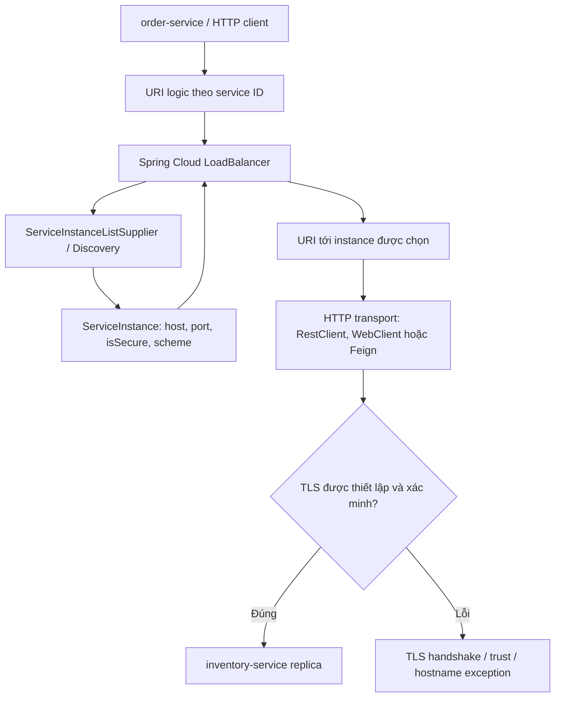
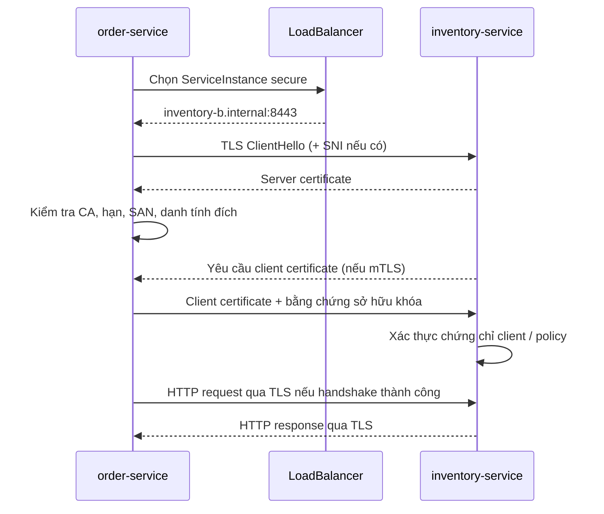

# HTTPS và thông tin secure của ServiceInstance

Khi `order-service` gọi `inventory-service` bằng Spring Cloud LoadBalancer, ứng dụng không nhất thiết biết trước địa chỉ thực của bản sao sẽ được chọn. Nó chỉ biết service ID, ví dụ `inventory-service`. Spring Cloud lấy danh sách `ServiceInstance` từ discovery, chọn một instance và gửi HTTP request tới host/port cụ thể. Nếu kết nối giữa hai dịch vụ cần được mã hóa bằng TLS, thông tin **instance có hỗ trợ kết nối bảo mật hay không** trở thành một phần quan trọng của quá trình chọn và dựng URI.

Trong Spring Cloud Commons, `ServiceInstance` có phương thức **`isSecure()`** để thể hiện instance có được công bố là sử dụng kết nối bảo mật hay không. Giá trị này cùng host, port, URI scheme và cấu hình HTTP client ảnh hưởng đến việc request cuối cùng được thực hiện qua `http` hay `https`.

Tuy vậy, **`isSecure() == true` không chứng minh đường truyền thực sự an toàn**. Nó là thông tin mô tả do discovery hoặc implementation cung cấp, không thay thế việc bật TLS trên server, xác thực chứng chỉ, kiểm tra hostname, quản lý CA hay giới hạn quyền truy cập.

Bài này thuộc chương **Bảo mật giao tiếp** của module `SPRING_CLOUD_SERVICE_COMMUNICATION_LOAD_BALANCING`. Mục tiêu là hiểu chính xác ranh giới giữa service discovery, LoadBalancer, RestClient/WebClient/OpenFeign và lớp bảo mật mạng; biết cấu hình HTTPS đúng cho từng `ServiceInstance`, nhận diện lỗi TLS và kiểm thử để tránh kết nối plaintext ngoài ý muốn.

## 1. HTTPS ở đường gọi giữa các dịch vụ bảo vệ điều gì?

HTTPS là HTTP chạy trên TLS. Với cấu hình và chứng chỉ hợp lệ, TLS cung cấp những thuộc tính quan trọng:

- **Bảo mật nội dung khi truyền:** bên nghe lén đường mạng không thể đọc trực tiếp request/response đã mã hóa.
- **Toàn vẹn dữ liệu trên đường truyền:** phát hiện việc sửa đổi dữ liệu trái phép trong quá trình trao đổi.
- **Xác thực danh tính server:** HTTP client kiểm tra chứng chỉ và tên đích theo chính sách trust/hostname verification.
- **Xác thực client nếu dùng mTLS:** server có thể yêu cầu và xác minh chứng chỉ của bên gọi, ngoài chứng chỉ server.

TLS không tự thay thế mọi lớp bảo mật. Chẳng hạn HTTPS không quyết định `order-service` có quyền đọc kho của tenant nào; điều đó vẫn cần xác thực/ủy quyền tại API. TLS cũng không mã hóa dữ liệu khi đã được giải mã bên trong một endpoint hoặc lưu xuống database.

Ví dụ một luồng có HTTPS từ caller tới replica:

```text
order-service
  -> URL logic: https://inventory-service/api/stocks/BOOK-001
  -> Spring Cloud LoadBalancer chọn ServiceInstance B
  -> URI đích được dựng theo thông tin instance và integration
  -> TLS tới inventory-b.internal:8443
  -> HTTP GET được gửi qua kênh TLS
  -> inventory-service B trả response
```

**Lưu ý:** URI logic nhìn thấy trong code là đầu vào; cần kiểm chứng **URI đích và transport thực tế** chứ không chỉ dựa trên chuỗi `https://inventory-service`.

## 2. Những ranh giới bảo mật trên đường đi của LoadBalancer



Mỗi lớp có một trách nhiệm riêng:

| Thành phần | Trách nhiệm | Không tự bảo đảm |
| --- | --- | --- |
| DiscoveryClient | Cung cấp host, port, metadata và thông tin secure của instance | Server đã bật TLS hoặc chứng chỉ hợp lệ |
| `ServiceInstance` | Biểu diễn một bản sao và khả năng kết nối bảo mật được khai báo | Xác thực server trong lúc bắt tay TLS |
| Spring Cloud LoadBalancer | Chọn instance và phối hợp dựng địa chỉ đích | Quyền truy cập API, cấp phát chứng chỉ |
| HTTP client / transport | Thiết lập TCP/TLS, kiểm tra chứng chỉ theo cấu hình | Chính sách nghiệp vụ hoặc lựa chọn replica |
| API server | Chấp nhận HTTPS, thực hiện authentication/authorization | Caller chắc chắn dùng đúng transport nếu metadata sai |
| Gateway / service mesh nếu có | Có thể terminate/originate TLS, thực thi policy riêng | Mặc định duy trì TLS đầu cuối xuyên mọi hop |

Nhầm lẫn lớn nhất là coi lựa chọn của LoadBalancer và việc bắt tay TLS như một thao tác duy nhất. Trong thực tế, LoadBalancer có thể chọn thành công instance B nhưng transport vẫn báo lỗi chứng chỉ.

## 3. Contract của ServiceInstance: host, port, isSecure và URI

`ServiceInstance` thuộc Spring Cloud Commons và biểu diễn một instance cụ thể của service ID. Những dữ liệu quan trọng thường gồm:

| Thuộc tính/method | Ví dụ | Ý nghĩa |
| --- | --- | --- |
| `getServiceId()` | `inventory-service` | Tên dịch vụ logic |
| `getInstanceId()` | `inventory-b` | Định danh bản sao khi discovery có cung cấp |
| `getHost()` | `inventory-b.internal` | Tên/địa chỉ đích của instance |
| `getPort()` | `8443` | Cổng mà instance công bố |
| `isSecure()` | `true` | Instance được khai báo hỗ trợ giao tiếp bảo mật |
| `getUri()` | `https://inventory-b.internal:8443` | URI được biểu diễn bởi implementation |
| `getMetadata()` | `zone=zone-a` | Dữ liệu bổ sung tùy discovery |
| `getScheme()` | Có thể là `null` hoặc giá trị implementation cung cấp | Scheme cụ thể nếu implementation có hỗ trợ |

**Ý nghĩa của `isSecure()`:** đây là thông tin dùng để biểu diễn rằng instance nên được liên hệ bằng HTTPS thay vì HTTP theo hợp đồng của discovery/LoadBalancer. Nó không phải kết quả TLS probe và không kiểm tra certificate chain.

Ví dụ Java sử dụng implementation chuẩn `DefaultServiceInstance`:

```java
import org.springframework.cloud.client.DefaultServiceInstance;
import org.springframework.cloud.client.ServiceInstance;

ServiceInstance secureReplica = new DefaultServiceInstance(
        "inventory-b",
        "inventory-service",
        "inventory-b.internal",
        8443,
        true
);

System.out.println(secureReplica.getServiceId()); // inventory-service
System.out.println(secureReplica.isSecure());      // true
System.out.println(secureReplica.getUri());        // https://inventory-b.internal:8443
```

Constructor trong ví dụ tạo một đối tượng minh họa trong ứng dụng Java; **nó không tự đăng ký instance vào Eureka/Consul/Kubernetes**. Muốn LoadBalancer thấy instance, cần một `DiscoveryClient` hoặc supplier thực sự cung cấp đối tượng đó.

### 3.1. Secure flag và scheme không phải cùng một trường

Trong implementation thông thường, `isSecure()` có thể được sử dụng để quyết định scheme `https` khi dựng URI. Tuy nhiên một discovery adapter hoặc `ServiceInstance` tùy chỉnh có thể có logic `getScheme()` hoặc `getUri()` riêng. Hành vi cuối cùng còn phụ thuộc integration của LoadBalancer và HTTP client.

Không nên đặt `metadata["secure"] = "true"` rồi mặc định Spring Cloud chắc chắn đọc metadata tùy ý đó thành `isSecure() == true`. Việc ánh xạ metadata vào secure flag **phụ thuộc discovery implementation**. Hãy kiểm tra trực tiếp giá trị `instance.isSecure()` mà caller thực sự nhận.

## 4. Service ID không phải hostname của bản sao

Giả sử caller gọi:

```text
https://inventory-service/api/stocks/BOOK-001
```

Service ID là `inventory-service`, nhưng danh sách discovery có thể gồm:

| Instance | Host | Port | `isSecure()` |
| --- | --- | ---: | --- |
| A | `inventory-a.internal` | 8443 | `true` |
| B | `inventory-b.internal` | 8443 | `true` |
| C | `inventory-c.internal` | 8443 | `true` |

Nếu LoadBalancer chọn B, transport được kỳ vọng kết nối tới `inventory-b.internal:8443` theo thông tin từ instance. Tên logic `inventory-service` **không tự chứng minh chứng chỉ TLS dùng tên nào**; điều đó còn phụ thuộc URI cuối, SNI và cách transport kết nối.

Không được đánh đồng:

- **Service ID** dùng để tìm tập replica.
- **Instance ID** dùng để định danh một bản sao trong discovery.
- **Hostname dùng cho TLS** là tên mà transport xác thực theo chứng chỉ của đích.
- **DNS record** có thể hỗ trợ phân giải một hostname, nhưng không thay thế sự lựa chọn của Spring Cloud LoadBalancer.

Trong một số topology có proxy/service mesh, transport thực sự kết nối tới sidecar hoặc hostname proxy khác instance application. Khi đó phải kiểm tra chính xác nơi TLS được thiết lập và danh tính nào được xác thực.

## 5. Scheme của request logic và secure của instance phối hợp ra sao?

Trong quá trình dựng lại URI, Spring Cloud LoadBalancer có thể dùng host, port, thông tin secure và scheme từ `ServiceInstance`, cùng URI ban đầu. **Cơ chế ưu tiên scheme có thể phụ thuộc version, implementation và integration**, nên không nên tuyên bố mọi đường gọi đều sửa `http` thành `https` theo một quy tắc bất biến.

Bảng sau là các **mục tiêu vận hành cần xác minh**, không phải cam kết tự động của mọi adapter:

| URI logic | Instance được công bố | Điều cần xác minh |
| --- | --- | --- |
| `https://inventory-service/...` | Secure=true, cổng 8443 | URI cuối và transport thật sự dùng HTTPS tới instance |
| `http://inventory-service/...` | Secure=true, cổng 8443 | Integration có đổi scheme theo secure flag không; đừng dựa vào URI đầu vào |
| `https://inventory-service/...` | Secure=false, cổng 8080 | Có xảy ra downgrade sang HTTP không; chính sách bảo mật phải chặn nếu không cho phép |
| `http://inventory-service/...` | Secure=false, cổng 8080 | HTTP plaintext có phù hợp threat model hay trái yêu cầu bắt buộc TLS? |
| `https://inventory-service/...` | Metadata/secure không đồng nhất | Nguy cơ một số replica chạy HTTP và một số chạy HTTPS |

Khi hệ thống **bắt buộc HTTPS**, hãy coi đó là một **invariant cần kiểm thử và thực thi**: danh sách instance phải khai báo đúng, transport phải xác thực certificate, và policy mạng/gateway phải ngăn các đường plaintext trái phép. Một chuỗi URI bắt đầu bằng `https://` trong source code **chưa đủ để chứng minh invariant**.

## 6. Nguồn dữ liệu secure từ discovery

Giá trị secure thường bắt đầu từ hệ thống đăng ký dịch vụ hoặc adapter cho nền tảng triển khai. Những nguồn thường gặp:

- Ứng dụng tự đăng ký với registry cùng thông tin cổng secure/non-secure.
- Discovery adapter chuyển thông tin từ scheme/port của endpoint.
- Danh sách instance tĩnh phục vụ kiểm thử.
- Một `ServiceInstance` tùy chỉnh được tạo bởi supplier trong ứng dụng.
- Thông tin endpoint từ service mesh/proxy, tùy cách hệ thống xuất bản.

Điểm cần kiểm tra là **caller nhận được `ServiceInstance` có `isSecure()` và cổng nào**, không chỉ việc người vận hành đã bật TLS trên máy chủ.

### 6.1. Ví dụ SimpleDiscoveryClient với HTTPS URI

Trong môi trường lab, có thể khai báo instance tĩnh:

```yaml
spring:
  cloud:
    discovery:
      client:
        simple:
          instances:
            inventory-service:
              - uri: https://inventory-a.internal:8443
              - uri: https://inventory-b.internal:8443
```

Ở đây URI phản ánh **ý định** gọi các endpoint HTTPS. Discovery adapter và cấu hình version hiện hành cần được kiểm tra để xác nhận dữ liệu `ServiceInstance` cuối cùng có `isSecure() == true`.

Tệp cấu hình này **không mở cổng 8443**, không sinh chứng chỉ và không tự khởi động server. Trong bài test tích hợp phải có server HTTPS thật tại các địa chỉ được khai báo, và HTTP client phải tin cậy CA/chứng chỉ tương ứng.

### 6.2. Ví dụ đăng ký cổng secure với Eureka

Một ứng dụng `inventory-service` sử dụng Eureka có thể công bố thông tin secure như sau:

```yaml
server:
  port: 8443
  ssl:
    enabled: true

eureka:
  instance:
    non-secure-port-enabled: false
    secure-port-enabled: true
    secure-port: 8443
```

Đoạn này **chỉ minh họa các thuộc tính liên quan**. Server thực tế còn phải có cấu hình chứng chỉ/keystore hoặc SSL bundle hợp lệ, quyền đọc secret và cấu hình kết nối Eureka đầy đủ. Chỉ đặt `server.ssl.enabled: true` mà không có vật liệu TLS cần thiết không đủ để chạy HTTPS thành công.

Trong những tích hợp Eureka, bật secure port có thể ảnh hưởng cách client coi instance là secure, nhưng các URL thông tin như status/home/health của Eureka **có thể cần cấu hình riêng** nếu muốn chúng cũng dùng HTTPS. Không được suy ra mọi endpoint đã secure chỉ từ một cờ.

### 6.3. TLS ở phía ứng dụng và thông tin discovery phải đồng bộ

Khi đổi từ HTTP sang HTTPS, tối thiểu cần đồng bộ:

1. Listener HTTPS ở đúng host/port.
2. Chứng chỉ server hợp lệ cho tên mà client xác thực.
3. Secure flag/scheme/port được registry công bố.
4. Trust configuration của caller.
5. Health probe, readiness và đường đăng ký/hủy đăng ký.
6. Network policy/firewall/gateway để tránh đi qua đường plaintext không mong muốn.

Nếu server bật HTTPS trên 8443 nhưng registry vẫn công bố port 8080 và `isSecure=false`, LoadBalancer có thể tiếp tục chọn đích không phù hợp. Ngược lại, nếu registry công bố secure=true nhưng server chỉ nghe HTTP, TLS handshake sẽ thất bại.

## 7. HTTPS ở ingress khác HTTPS giữa các dịch vụ

Một tình huống dễ nhầm:

```text
Client bên ngoài
     |
     | HTTPS
     v
Ingress / API Gateway (TLS termination)
     |
     | HTTP plaintext nội bộ
     v
inventory-service:8080
```

Từ trình duyệt đến gateway được mã hóa, **nhưng hop từ gateway đến service không nhất thiết được mã hóa**. Việc browser hiển thị ổ khóa HTTPS không chứng minh mọi hop phía sau cùng dùng TLS.

Một kiến trúc end-to-end hơn có thể là:

```text
Client bên ngoài --HTTPS--> Gateway
Gateway --HTTPS hoặc mTLS--> order-service
order-service --HTTPS hoặc mTLS--> inventory-service
```

Tùy hệ thống, gateway hoặc service mesh có thể giải mã rồi thiết lập một phiên TLS **mới** trên hop kế tiếp. Đây là **mã hóa theo từng hop**, không nhất thiết là một phiên TLS duy nhất chạy xuyên toàn bộ đường đi.

Đối với `ServiceInstance.isSecure()`, câu hỏi đúng là: **hop mà HTTP transport của caller thực sự kết nối tới có yêu cầu HTTPS không?** Nếu caller kết nối tới sidecar HTTP cục bộ rồi sidecar mới dùng mTLS tới replica khác, secure flag của endpoint mà caller thấy có thể khác với trạng thái mã hóa của hop sidecar-to-sidecar. Cần kiểm chứng cấu trúc dữ liệu discovery theo kiến trúc thực tế.

## 8. Kết nối RestClient qua LoadBalancer tới HTTPS instance

`RestClient` là HTTP client đồng bộ của Spring Framework. Để URL logic được phân giải theo service ID bằng Spring Cloud LoadBalancer, hãy tạo client từ bean builder đã được gắn `@LoadBalanced`:

```java
import org.springframework.cloud.client.loadbalancer.LoadBalanced;
import org.springframework.context.annotation.Bean;
import org.springframework.context.annotation.Configuration;
import org.springframework.web.client.RestClient;

@Configuration
class InventoryRestClientConfiguration {

    @Bean
    @LoadBalanced
    RestClient.Builder loadBalancedRestClientBuilder() {
        return RestClient.builder();
    }
}
```

Tạo gateway cho nghiệp vụ:

```java
import org.springframework.cloud.client.loadbalancer.LoadBalanced;
import org.springframework.stereotype.Service;
import org.springframework.web.client.RestClient;

@Service
class InventoryGateway {

    private final RestClient client;

    InventoryGateway(@LoadBalanced RestClient.Builder builder) {
        this.client = builder
                .baseUrl("https://inventory-service")
                .build();
    }

    StockResponse getStock(String sku) {
        return client.get()
                .uri("/api/stocks/{sku}", sku)
                .retrieve()
                .body(StockResponse.class);
    }
}
```

`StockResponse` là DTO do ứng dụng định nghĩa theo JSON của API. Ví dụ giả định đã có dependency Spring Cloud LoadBalancer, nguồn instance của `inventory-service` và HTTP transport phù hợp.

**Tại sao dùng `https://inventory-service` trong ví dụ?** Nó làm rõ yêu cầu bảo mật ở URL logic của caller. Nhưng vẫn phải kiểm chứng URI cuối cùng sau LoadBalancer, vì secure flag và cách dựng lại URI có thể ảnh hưởng scheme thực tế. Nếu bắt buộc không bao giờ dùng plaintext, cần kết hợp policy thực thi và kiểm thử, không chỉ cấu hình base URL.

### 8.1. Truststore và request factory

TLS handshake diễn ra trong HTTP client/transport do `ClientHttpRequestFactory` sử dụng. Với JDK HTTP Client, Apache HttpComponents hoặc factory khác, cách cấu hình truststore, client certificate và hostname verification có thể khác nhau.

Ví dụ hệ thống nội bộ có CA riêng:

- Phân phối CA root/intermediate hợp lệ tới truststore hoặc SSL configuration mà transport sử dụng.
- Giữ việc **xác thực hostname** bật.
- Chỉ tin cậy CA cần thiết, có cơ chế thay/thu hồi certificate.
- Không dùng `trust-all` hoặc tắt hostname verification để khắc phục lỗi PKIX trong production.
- Nếu dùng SSL bundle của Spring Boot, cần kiểm tra cách áp dụng bundle cho **đúng HTTP client instance**; khai báo một bundle không có nghĩa mọi client sẽ tự sử dụng nó.

Các thuộc tính JVM như `javax.net.ssl.trustStore` có thể hữu ích với những transport dùng cấu hình JSSE mặc định, nhưng **không nên giả định mọi Reactor Netty/Apache client đều đọc chúng theo cùng cách**. Hãy kiểm tra cấu hình thực tế và công cụ SSL debugging tương ứng.

## 9. WebClient và kết nối reactive

Với `WebClient`, Spring Cloud LoadBalancer thường được tích hợp qua bean `@LoadBalanced WebClient.Builder`:

```java
import org.springframework.cloud.client.loadbalancer.LoadBalanced;
import org.springframework.context.annotation.Bean;
import org.springframework.context.annotation.Configuration;
import org.springframework.web.reactive.function.client.WebClient;

@Configuration
class InventoryWebClientConfiguration {

    @Bean
    @LoadBalanced
    WebClient.Builder loadBalancedWebClientBuilder() {
        return WebClient.builder();
    }
}
```

Mã gọi:

```java
import org.springframework.cloud.client.loadbalancer.LoadBalanced;
import org.springframework.web.reactive.function.client.WebClient;
import reactor.core.publisher.Mono;

class ReactiveInventoryGateway {

    private final WebClient client;

    ReactiveInventoryGateway(@LoadBalanced WebClient.Builder builder) {
        this.client = builder
                .baseUrl("https://inventory-service")
                .build();
    }

    Mono<StockResponse> getStock(String sku) {
        return client.get()
                .uri("/api/stocks/{sku}", sku)
                .retrieve()
                .bodyToMono(StockResponse.class);
    }
}
```

Đường đi lựa chọn instance cũng sử dụng danh sách `ServiceInstance`, nhưng HTTP transport reactive (thường Reactor Netty) quản lý connection/TLS khác với client đồng bộ. Nếu cần CA riêng hoặc mTLS, phải cấu hình `HttpClient`/`ClientHttpConnector` thích hợp, đồng thời giữ các kiểm tra chứng chỉ.

Một `Mono<StockResponse>` thường chỉ thực sự thực thi request khi được subscribe. Vì vậy lỗi TLS có thể xuất hiện trong tín hiệu lỗi reactive, không phải tại thời điểm tạo WebClient hoặc tạo publisher.

## 10. OpenFeign và HTTPS khi gọi theo service ID

OpenFeign khai báo HTTP contract qua interface:

```java
import org.springframework.cloud.openfeign.FeignClient;
import org.springframework.web.bind.annotation.GetMapping;
import org.springframework.web.bind.annotation.PathVariable;

@FeignClient(name = "inventory-service", path = "/api/stocks")
public interface InventoryFeignClient {

    @GetMapping("/{sku}")
    StockResponse getStock(@PathVariable("sku") String sku);
}
```

Khi **không có URL vật lý ghi đè**, client này có thể sử dụng Spring Cloud LoadBalancer để chọn instance theo tên `inventory-service`, nếu các dependency và cấu hình phù hợp đã được bật.

Tuy nhiên:

- `@FeignClient(name = "inventory-service")` **không tự bật TLS trên server**.
- Feign có thể dùng transport khác nhau tùy classpath/configuration; CA, certificate validation và client certificate phải được áp dụng cho transport thật.
- Nếu khai báo `url = "https://inventory-a.internal:8443"`, request thường đi tới URL cố định thay vì chọn instance qua service ID.
- Không nên coi `@FeignClient` là bảo đảm hostname verification đã được cấu hình đúng khi ai đó đã thay đổi SSL client hoặc tạo custom transport.

Cũng như RestClient/WebClient, cần quan sát **instance đích, effective URI và TLS handshake** để xác nhận kết nối an toàn.

## 11. Chứng chỉ: certificate chain và hostname verification

TLS xác thực server bằng chứng chỉ được CA đáng tin cậy cấp hoặc bằng cơ chế trust tương đương đã được cấu hình an toàn. Nhưng **tin cậy CA vẫn chưa đủ** nếu chứng chỉ không khớp tên đích.

Giả sử LoadBalancer chọn:

```text
host = inventory-b.internal
port = 8443
isSecure = true
```

Transport kết nối đến `inventory-b.internal`. Trong một cấu hình HTTPS thông thường, certificate cần chứa tên phù hợp trong **Subject Alternative Name (SAN)**; không nên dựa vào Common Name (CN) cũ thay thế SAN.

Một số ví dụ:

| Certificate có SAN | Đích được client xác minh | Đánh giá |
| --- | --- | --- |
| `DNS:inventory-b.internal` | `inventory-b.internal` | Phù hợp nếu CA và thời hạn hợp lệ |
| `DNS:inventory-service.internal` | `inventory-b.internal` | Không tự khớp chỉ vì cùng service logic |
| `DNS:*.svc.internal` | `inventory-b.svc.internal` | Có thể khớp theo quy tắc wildcard hợp lệ |
| `IP:10.0.1.12` | `10.0.1.12` | Có thể phù hợp khi SAN chứa IP thật |
| `DNS:inventory-b.internal` | `10.0.1.12` | Không tự khớp IP chỉ từ một SAN dạng DNS |

Không nên “sửa lỗi” bằng cách tắt hostname verification. Cách đúng thường là:

1. Cấp chứng chỉ với SAN khớp hostname mà transport sẽ dùng.
2. Công bố hostname/port phù hợp trong discovery.
3. Bảo đảm caller có CA/truststore tương ứng.
4. Kiểm thử đường gọi bằng HTTP client thật sau khi LoadBalancer chọn instance.

### 11.1. SNI liên quan đến hostname nào?

**Server Name Indication (SNI)** là thông tin hostname mà client có thể gửi trong TLS handshake để server/proxy chọn đúng chứng chỉ. Khi một endpoint dùng nhiều virtual host, thiếu hoặc sai SNI có thể khiến server trả certificate không phù hợp.

Trong hệ thống LoadBalancer, URI đích có thể được viết lại từ service ID sang host instance; cách HTTP transport xác định SNI và hostname verification phụ thuộc client và cấu hình. Khi lỗi chỉ xuất hiện qua service ID nhưng gọi trực tiếp DNS hostname thành công, cần kiểm tra **effective host, SNI và certificate SAN**, không chỉ `isSecure()`.

## 12. mTLS: hai phía đều được xác thực

HTTPS thông thường chủ yếu xác thực server tới client. **Mutual TLS (mTLS)** còn yêu cầu client trình chứng chỉ để server xác thực caller.



Từng phía cần cấu hình riêng:

- **Caller:** trust của server certificate, và key/certificate của chính caller nếu dùng mTLS.
- **Destination:** certificate/key cho HTTPS listener, trust của client CA và chính sách yêu cầu client certificate.
- **Hạ tầng:** phân phối, thay thế và thu hồi chứng chỉ; hạn chế quyền đọc private key.

Thông tin `ServiceInstance.isSecure()` **không biểu diễn đầy đủ mTLS**. Nó không cho biết server yêu cầu client cert, CA nào hợp lệ, principal nào được ủy quyền hay certificate còn hạn bao lâu. Những chính sách này thuộc TLS transport, service mesh và security layer.

## 13. TLS termination và bảo mật theo từng hop

Khi có ingress proxy hoặc service mesh, điều quan trọng là biết **ai thiết lập TLS với ai**.

| Topology | Hop mã hóa | Câu hỏi cần kiểm tra |
| --- | --- | --- |
| Caller trực tiếp gọi HTTPS instance | Caller ↔ instance | Cert SAN có khớp host/port được discovery công bố? |
| Caller gọi HTTP vào sidecar cục bộ; sidecar dùng mTLS ra ngoài | Sidecar ↔ sidecar | Hop app ↔ sidecar có bị chấp nhận plaintext theo threat model không? |
| Gateway terminate TLS rồi dùng HTTP tới backend | Client ↔ gateway | Có yêu cầu bảo mật hop gateway ↔ backend không? |
| Gateway terminate rồi re-encrypt HTTPS tới backend | Hai phiên TLS riêng | Chính sách trust/identity được áp dụng cho từng hop thế nào? |

Không nên xác định `isSecure=true` cho backend chỉ vì external ingress có HTTPS. Secure flag phải mô tả endpoint mà caller/LoadBalancer thực sự dùng và phù hợp adapter discovery.

Nếu tổ chức yêu cầu TLS end-to-end hoặc mTLS nội bộ, cần đặt network policy và kiểm tra cấu hình mesh/gateway tương ứng. **TLS đã mã hóa một hop không tự mã hóa những hop còn lại.**

## 14. Metadata sai, port sai và những lỗi kết nối tương ứng

Bảng phân biệt các lớp lỗi:

| Triệu chứng | Khả năng nguyên nhân | Hướng kiểm tra |
| --- | --- | --- |
| `Connection refused` | Port sai, listener chưa chạy, firewall từ chối | `getHost()`, `getPort()`, listener, mạng |
| TLS `handshake_failure` | Không tương thích TLS/protocol, client cert, cipher hoặc policy | TLS config của hai bên, certificate request |
| `PKIX path building failed` / trust error | CA/chain không được trust | Chain server, truststore của HTTP transport |
| `No subject alternative names matching` | Host được xác minh không có trong SAN | Effective host, DNS/SNI, certificate SAN |
| `NotSslRecordException` hoặc HTTP trên cổng TLS | Scheme/port không nhất quán | Secure flag, URI cuối, listener, proxy |
| HTTP `401` / `403` | TLS có thể đã thành công nhưng authn/authz thất bại | Token, principal, policy API |
| HTTP `404` / `503` | Server/gateway có phản hồi HTTP | Path, routing, overload và error contract |
| Chỉ một replica báo TLS lỗi | Cert/port/scheme của instance đó khác các instance còn lại | Metadata theo replica, certificate rollout |

Các exception cụ thể thay đổi theo JDK/Apache/Reactor Netty/OpenFeign và phiên bản client. Khi chẩn đoán cần đọc **root cause**, chứ không kết luận mọi lỗi có chữ “SSL” đều do LoadBalancer.

### 14.1. Tại sao lỗi TLS không nên bị retry vô hạn?

Nếu cert của B hết hạn hoặc CA không được trust, retry tới B nhiều lần hầu như không chữa được nguyên nhân. Retry sang A có thể thành công nếu A có cert hợp lệ, nhưng **điều đó không hợp thức hóa B**, cũng không có nghĩa nên retry TLS lỗi như một lỗi mạng tạm thời thông thường.

- Tách lỗi cấu hình/chứng chỉ với timeout hoặc connection reset.
- Không retry vô hạn sau handshake/certificate validation error.
- Nếu thử instance khác theo chính sách rõ, giới hạn attempt và deadline.
- Báo lỗi để xử lý certificate rotation/metadata thay vì che đi toàn bộ sự cố.
- Với API ghi dữ liệu, giữ cơ chế idempotency khi retry qua các replica.

## 15. Secure flag không phải một cơ chế ủy quyền

Một request có thể đi qua HTTPS đúng cách nhưng vẫn không có quyền truy cập. Ví dụ:

```http
GET /api/stocks/BOOK-001 HTTP/1.1
Host: inventory-service
Authorization: Bearer <token-redacted>
```

TLS bảo vệ nội dung token khi truyền trên một hop đã mã hóa, nhưng server vẫn phải **xác minh token**, scope, audience, hạn sử dụng và quyền đối với tài nguyên.

Không dùng những giá trị sau làm bằng chứng phân quyền:

- `ServiceInstance.isSecure()`.
- Tên zone hoặc hint trong request.
- Việc đã chọn cùng replica hoặc cùng subnet.
- Header do client bên ngoài tự khai báo như `X-Forwarded-Proto` mà chưa được trusted proxy xác thực.

Nếu downstream yêu cầu token delegation hoặc identity của service, cần thiết kế riêng cơ chế propagation/cấp token với nguyên tắc đặc quyền tối thiểu. Không tự sao chép Authorization header tới mọi host bên ngoài; phải ràng buộc vào downstream tin cậy và hợp đồng auth tương ứng.

## 16. Secure migration: chuyển replica từ HTTP sang HTTPS

Một đợt chuyển đổi có thể đi theo các giai đoạn:

1. **Chuẩn bị hạ tầng:** cấp certificate/SAN hợp lệ, phân phối trust và kiểm tra keystore.
2. **Mở listener HTTPS:** triển khai cổng 8443, readiness và health probe phù hợp.
3. **Đăng ký endpoint đúng:** công bố `isSecure=true`, scheme/cổng HTTPS cho các instance đã sẵn sàng.
4. **Kiểm thử caller:** xác nhận RestClient/WebClient/OpenFeign đi qua LoadBalancer và thực sự dùng TLS.
5. **Chuyển traffic có kiểm soát:** quan sát lỗi TLS, selected instance và độ trễ handshake.
6. **Loại endpoint HTTP cũ:** hủy đăng ký, đợi discovery/cache hội tụ, chặn network plaintext khi chính sách cho phép.
7. **Theo dõi dài hạn:** rotation và rollover certificate, tránh instance có metadata lệch.

### 16.1. Rủi ro ở giai đoạn trộn HTTP và HTTPS

Nếu discovery trả cả hai loại instance:

```text
A: inventory-a.internal:8080, secure=false
B: inventory-b.internal:8443, secure=true
C: inventory-c.internal:8443, secure=true
```

một thuật toán như Round Robin có thể lần lượt chọn A, B, C tùy danh sách. **Kết quả là tính bảo mật của từng attempt có thể khác nhau** nếu HTTP client và LoadBalancer cho phép cả hai scheme.

Khi yêu cầu bắt buộc HTTPS, nên đảm bảo **toàn bộ tập ứng viên đã tương thích TLS trước khi chấp nhận mọi lựa chọn**, hoặc áp dụng một policy lọc/chặn rõ ràng để không gửi plaintext tới A. Không chỉ hy vọng Round Robin “sẽ ít chọn A” trong giai đoạn chuyển đổi.

### 16.2. Hủy đăng ký và cache cũ

Sau khi A được gỡ khỏi registry, `DiscoveryClient` hoặc `CachingServiceInstanceListSupplier` vẫn có thể giữ bản sao thông tin cũ. Client có thể tiếp tục chọn port 8080 trong một khoảng thời gian.

Cần đo thời gian hội tụ từ registry → caller discovery view → supplier cuối → instance được chọn. Nếu chính sách bảo mật yêu cầu **không có plaintext**, phải có cơ chế thực thi độc lập với TTL cache: network policy, listener đã đóng hoặc validation ở tầng client/policy phù hợp.

## 17. Quan sát HTTPS theo service ID và instance

Một bộ log hữu ích nên đủ để phân biệt lỗi chọn replica và lỗi TLS mà không làm lộ dữ liệu nhạy cảm.

```text
traceId=4ab8... serviceId=inventory-service
selectedInstance=inventory-b.internal:8443
instanceSecure=true effectiveScheme=https
tlsResult=HANDSHAKE_OK httpStatus=200 durationMs=54
```

Log trên là **mẫu minh họa do ứng dụng tự xây**, không phải định dạng mặc định Spring Cloud. Không phải HTTP client nào cũng cung cấp trực tiếp một event `tlsResult=HANDSHAKE_OK`. Phải dùng instrumentation phù hợp nếu muốn xác nhận bắt tay TLS, certificate principal và hostname.

Các trường có ích:

| Nhóm | Trường nên quan sát |
| --- | --- |
| Lựa chọn LoadBalancer | Service ID, selected host/port, secure flag |
| URI/transport | Effective scheme, kết quả kết nối, HTTP version nếu hữu ích |
| TLS | Nhóm lỗi handshake/trust/hostname, thời điểm rotation cert |
| Hiệu năng | Connect/TLS handshake latency, response latency, retry attempts |
| Nghiệp vụ | HTTP status, error code miền, outcome cuối |
| Sức khỏe | Số instance secure, số instance đủ điều kiện, thời gian cập nhật discovery |

Không log private key, certificate chain đầy đủ khi không cần, token, cookie hoặc request body nhạy cảm. Với metrics, không dùng mỗi hostname/SKU/request ID động làm label nếu cardinality có thể tăng không kiểm soát.

## 18. Đọc ServiceInstance thật tại phía caller

Để kiểm tra caller đang nhìn thấy dữ liệu gì từ discovery, có thể dùng:

```java
import org.slf4j.Logger;
import org.slf4j.LoggerFactory;
import org.springframework.cloud.client.ServiceInstance;
import org.springframework.cloud.client.discovery.DiscoveryClient;
import org.springframework.stereotype.Component;

@Component
class InventorySecureInspector {

    private static final Logger log =
            LoggerFactory.getLogger(InventorySecureInspector.class);

    private final DiscoveryClient discoveryClient;

    InventorySecureInspector(DiscoveryClient discoveryClient) {
        this.discoveryClient = discoveryClient;
    }

    void logInstances() {
        for (ServiceInstance instance :
                discoveryClient.getInstances("inventory-service")) {

            log.info("serviceId={} instanceId={} host={} port={} secure={} scheme={}",
                    instance.getServiceId(),
                    instance.getInstanceId(),
                    instance.getHost(),
                    instance.getPort(),
                    instance.isSecure(),
                    instance.getUri().getScheme());
        }
    }
}
```

Ví dụ này đọc **discovery view** của `order-service`. Danh sách cuối đi qua cache, health check, zone hoặc các supplier tùy chỉnh có thể khác. Để chứng minh request đi qua TLS tới instance đã chọn, cần đối chiếu thêm LoadBalancer selection và log/trace của HTTP transport hoặc HTTPS server.

Chú ý: `isSecure()` và `getUri().getScheme()` của một custom `ServiceInstance` có thể không nhất quán. Việc log cả hai giúp phát hiện khác biệt trước khi truy lỗi HTTP client.

## 19. Ma trận kiểm thử HTTPS và secure flag

Một bài test tích hợp nên chạy ít nhất hai HTTPS mock server với chứng chỉ SAN phù hợp, và thêm những trường hợp lỗi có kiểm soát:

| Tình huống | Kết quả cần kiểm tra |
| --- | --- |
| Hai instance `secure=true`, HTTPS listener và CA đúng | HTTP client gửi request qua TLS đến một instance được chọn |
| Instance `secure=true` nhưng chỉ có HTTP listener | TLS handshake thất bại; không diễn giải thành lỗi nghiệp vụ |
| Instance `secure=false` nhưng chỉ chạy HTTPS | Phát hiện scheme/port lệch giữa discovery và server |
| CA không được caller trust | Fail closed với trust error; không bật trust-all |
| Certificate SAN sai hostname của instance | Hostname verification từ chối kết nối |
| Certificate hết hạn | Ghi nhận lỗi và thực hiện rotation; không retry vô hạn |
| mTLS server yêu cầu client certificate | Caller thiếu cert phải bị từ chối; caller có cert hợp lệ được chấp nhận |
| Caller có nhiều builder HTTP | Chỉ builder `@LoadBalanced` phân giải service ID đúng cách |
| Mixed HTTP và HTTPS replicas | Chính sách bắt buộc TLS không cho plaintext lọt qua |
| Một instance đổi port/chứng chỉ | Discovery/cache và trust cập nhật theo kế hoạch |
| Replica HTTPS bị timeout | Retry có giới hạn, phân biệt timeout với TLS config error |
| OpenFeign có URL cố định | Không nhầm gọi URL trực tiếp với lựa chọn replica qua LoadBalancer |

### 19.1. Các bước thực hành

1. Tạo hai HTTPS test server tại hai hostname đã có chứng chỉ test hợp lệ theo CA dùng trong lab.
2. Đưa CA test vào trust configuration của HTTP client.
3. Công bố hai `ServiceInstance` có `isSecure=true` và port tương ứng.
4. Gọi URL logic `https://inventory-service/...` qua `@LoadBalanced` RestClient hoặc WebClient.
5. Quan sát URI/instance được chọn và HTTPS handshake ở server.
6. Cố tình thay cert bằng cert có SAN sai rồi xác minh request bị từ chối.
7. Cố tình đặt `isSecure=false` cho một instance và kiểm tra hệ thống không vô tình dùng plaintext trái chính sách.
8. Tắt một server, kiểm tra timeout/retry chỉ hoạt động với lỗi được cho phép và không che lỗi certificate.
9. Nếu dùng mTLS, yêu cầu client certificate và thử cả trường hợp thiếu và hợp lệ.
10. Kiểm tra log không chứa token, private key hoặc dữ liệu nhạy cảm.

Không dùng cấu hình “bỏ qua chứng chỉ SSL” làm một bước bình thường của lab, vì điều đó không kiểm tra được thuộc tính bảo mật cốt lõi.

## 20. Quy trình chẩn đoán khi HTTPS không hoạt động qua service ID

Nếu gọi trực tiếp `https://inventory-b.internal:8443` thành công nhưng `https://inventory-service` qua Spring Cloud LoadBalancer thất bại, hãy kiểm tra theo trình tự:

1. **Client wiring:** RestClient/WebClient có dùng builder `@LoadBalanced` không? Feign có `url` cố định làm bỏ qua LB không?
2. **Service ID:** tên `inventory-service` có đúng với nguồn discovery không?
3. **Discovery view:** caller nhìn thấy instance nào, port bao nhiêu và `isSecure()` là gì?
4. **Supplier chain:** health/zone/hint/cache có làm đổi danh sách ứng viên không?
5. **Instance được chọn:** địa chỉ thực được chọn có phải B hay là A/C với chứng chỉ khác?
6. **Scheme cuối:** HTTP client đang dùng `http` hay `https` sau khi dựng lại URI?
7. **Hostname verification:** hostname transport xác minh có nằm trong SAN không?
8. **Trust:** CA/chain có được truststore hoặc HTTP client SSL context chấp nhận không?
9. **SNI/proxy:** virtual host, ingress, service mesh có cần SNI hoặc chính sách TLS riêng không?
10. **mTLS:** có yêu cầu client cert, trust của server và quyền truy cập phù hợp không?
11. **Timeout/retry:** có retry vào nhiều instance và che lỗi TLS ở một instance không?
12. **Kết quả nghiệp vụ:** TLS thành công rồi mới trả HTTP `401/403/404/5xx` hay thất bại trước khi có response?

Một kết quả `HTTP 403` từ server HTTPS thường có nghĩa đã nhận được HTTP response sau tầng transport, không phải tự động là lỗi `ServiceInstance.isSecure()`. Ngược lại, `SSLHandshakeException` có thể xảy ra sau khi LoadBalancer đã chọn được instance hợp lệ.

## 21. Những sai lầm thiết kế nên tránh

1. **Coi secure=true là bằng chứng TLS hợp lệ.** Đây là metadata/contract, không phải kết quả xác minh certificate.
2. **Chỉ bật HTTPS ở ingress rồi tuyên bố toàn bộ giao tiếp nội bộ đã mã hóa.**
3. **Cấu hình server TLS nhưng để registry công bố scheme/port HTTP cũ.**
4. **Chỉ thấy URL logic bắt đầu bằng HTTPS rồi mặc định URI thực không thể bị downgrade.**
5. **Tắt hostname verification hoặc dùng trust-all để vượt lỗi cert.**
6. **Công bố IP nhưng cert chỉ có SAN dạng DNS không phù hợp.**
7. **Dùng mTLS flag ở metadata như một cơ chế ủy quyền.** Quyền truy cập phải được xác minh ở server/security layer.
8. **Log Authorization, cookie, private key hoặc dữ liệu nhạy cảm khi debug handshake.**
9. **Để HTTP và HTTPS replicas lẫn nhau nhưng không có chính sách chặn plaintext.**
10. **Retry lỗi trust/certificate liên tục thay vì sửa cấu hình hoặc rotation.**
11. **Để cache discovery giữ port/scheme cũ quá lâu trong migration mà không đo hội tụ.**
12. **Nhầm HTTP status lỗi với lỗi TLS trước khi có HTTP response.**
13. **Giả định mọi transport RestClient/WebClient/OpenFeign đọc chung một cấu hình truststore.**
14. **Dùng zone/hint hoặc tên service thay thế xác thực danh tính TLS và phân quyền API.**

## 22. Câu hỏi tự kiểm tra

1. Vai trò của `ServiceInstance.isSecure()` trong Spring Cloud LoadBalancer là gì? Nó không bảo đảm những điều gì?
2. Vì sao `getHost()`, `getPort()` và `getUri()` cũng quan trọng khi cấu hình HTTPS?
3. URL logic `https://inventory-service` có tự chứng minh mọi replica đều được gọi qua TLS không?
4. Tại sao chỉ đặt `metadata["secure"] = "true"` có thể chưa đủ để instance được coi là secure?
5. Điều gì khác nhau giữa TLS termination ở gateway và mã hóa hop từ `order-service` tới `inventory-service`?
6. Vì sao certificate có SAN `inventory-service.internal` chưa chắc hợp lệ khi transport xác minh `inventory-b.internal`?
7. mTLS yêu cầu thêm điều gì so với HTTPS server-auth thông thường?
8. Khi `RestClient` gọi service ID, annotation `@LoadBalanced` cần gắn ở đâu?
9. Nếu một replica secure=true nhưng chỉ mở HTTP 8080, bạn mong đợi nhóm lỗi nào?
10. Vì sao `HTTP 401` hoặc `403` không thể kết luận là lỗi TLS?
11. Để chuyển đổi từ HTTP sang HTTPS, vì sao cần xét TTL của discovery cache và thứ tự rollout?
12. Những phép kiểm thử nào chứng minh caller không dùng plaintext trong giai đoạn mixed replicas?
13. Khi gặp `SSLHandshakeException`, vì sao retry sang nhiều replica không thay thế việc sửa certificate?
14. Nếu dùng service mesh, nên xác định thông tin secure của `ServiceInstance` theo hop nào?

**Kết luận:** Spring Cloud LoadBalancer lựa chọn một `ServiceInstance` dựa trên service ID và danh sách discovery; thông tin `isSecure()`, scheme, host và port giúp mô tả cách liên hệ tới bản sao đó. Nhưng **HTTPS thực sự an toàn** chỉ khi endpoint được cấu hình TLS đúng, HTTP transport kết nối qua kênh mã hóa, certificate/hostname được kiểm tra và các hop trong kiến trúc tuân thủ chính sách bảo mật. Cần đối chiếu metadata discovery với kết nối thực tế, giữ timeout/retry có giới hạn và kiểm thử fail-closed để giao tiếp giữa các dịch vụ vừa ổn định vừa bảo mật.
