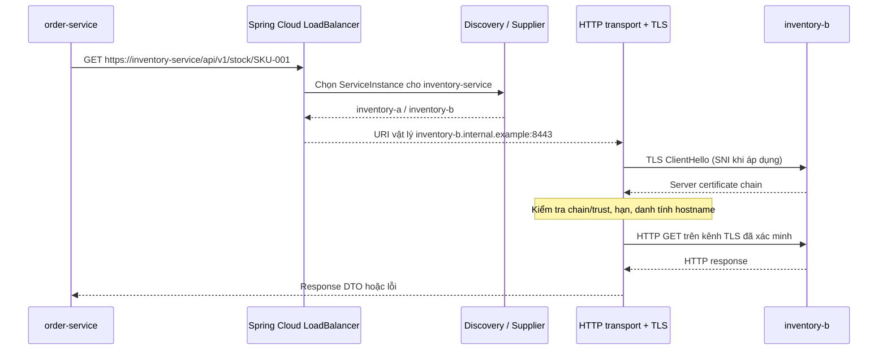
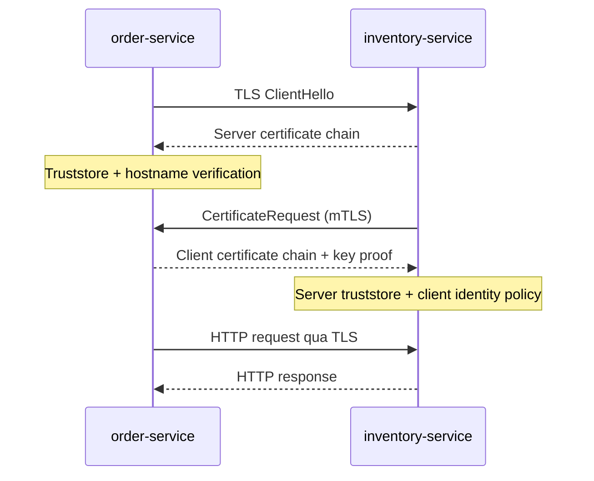

# Truststore, hostname verification và quản lý chứng chỉ

Khi `order-service` gọi `inventory-service` thông qua Spring Cloud LoadBalancer, hệ thống không chỉ phải chọn được `ServiceInstance` còn hoạt động. Nếu lời gọi dùng HTTPS, client còn phải xác minh rằng **đầu bên kia thực sự là endpoint được phép tin cậy**. Một cấu hình sai truststore, một chứng chỉ thiếu hostname trong Subject Alternative Name (SAN), hoặc một đợt gia hạn chứng chỉ không đồng bộ có thể khiến **tất cả instance đều khỏe nhưng mọi request vẫn thất bại tại TLS handshake**.

Bài thuộc chương **Bảo mật giao tiếp** của module `SPRING_CLOUD_SERVICE_COMMUNICATION_LOAD_BALANCING`. Bài học tập trung vào ba vấn đề: **truststore xác định nguồn tin cậy**, **hostname verification xác định đúng danh tính endpoint**, và **quản lý vòng đời chứng chỉ** giữ kết nối ổn định qua deploy, scale, retry và rotation. Các ví dụ sử dụng RestClient, WebClient, OpenFeign và Spring Cloud LoadBalancer; phân biệt rõ những gì do TLS thực hiện với những gì do discovery, health check hoặc thuật toán cân bằng tải thực hiện.

Mục tiêu sau khi học:

- Phân biệt truststore, keystore, CA, certificate chain, private key và mTLS.
- Đọc được lỗi `PKIX path building failed`, `certificate expired` và `No subject alternative DNS name matching`.
- Hiểu vì sao HTTPS tới một service ID logic có thể thất bại khi LoadBalancer chọn instance có host/IP không khớp chứng chỉ.
- Cấu hình trust material riêng cho HTTP client bằng Spring Boot SSL bundles mà không tắt xác minh TLS.
- Thiết kế kiểm thử hai bản sao HTTPS, quy trình thay chứng chỉ/CA và tín hiệu giám sát trước hạn.

> **Quy tắc an toàn:** Không giải quyết lỗi TLS bằng `TrustAll`, `InsecureTrustManagerFactory`, `NoopHostnameVerifier` hoặc tắt xác minh chứng chỉ. Các cách đó loại bỏ bảo đảm danh tính server và có thể mở đường cho man-in-the-middle, kể cả trên mạng nội bộ.

## 1. TLS nằm ở đâu trong chuỗi giao tiếp có cân bằng tải?

Giả sử `order-service` sử dụng một `@LoadBalanced RestClient.Builder` và gọi:

```text
https://inventory-service/api/v1/stock/SKU-001
        └ service ID logic ┘
```

Nguồn discovery công bố:

| Service ID | Instance | URI thực tế |
|---|---|---|
| `inventory-service` | `inventory-a` | `https://inventory-a.internal.example:8443` |
| `inventory-service` | `inventory-b` | `https://inventory-b.internal.example:8443` |

Đường đi khái niệm:



Ba trách nhiệm tách biệt:

1. **Discovery/LoadBalancer**: danh sách ứng viên và instance nào được chọn.
2. **TLS client/HTTP transport**: chứng chỉ server có đáng tin và có đúng danh tính kết nối hay không.
3. **HTTP application**: Authorization, dữ liệu request/response, status, timeout/retry.

Nếu bước TLS thất bại, không có nghĩa LoadBalancer chọn sai: nó có thể đã chọn **đúng instance theo discovery** nhưng chứng chỉ của instance không đáp ứng chính sách bảo mật.

### 1.1. Service ID không mặc nhiên là hostname TLS

`inventory-service` là tên logic dùng để tìm instance. Khi `BlockingLoadBalancerClient` hoặc reactive LoadBalancer dựng lại URI vật lý, hostname thực tế có thể trở thành `inventory-b.internal.example` hoặc `10.0.2.12`. TLS transport thường xác minh danh tính của **host mà nó thực sự kết nối theo URI sau khi LoadBalancer xử lý**, tùy transport và cách routing/SNI được cấu hình.

Vì vậy phải **kiểm thử hostname được TLS client xác minh thật sự**. Không suy luận rằng vì URL ban đầu viết `inventory-service` nên chứng chỉ chỉ cần SAN `inventory-service`.

## 2. Certificate, CA, chain, truststore và keystore khác nhau thế nào?

| Khái niệm | Chứa gì? | Ai sử dụng? | Mục đích |
|---|---|---|---|
| **Leaf/server certificate** | Public key, danh tính SAN, hạn dùng, chữ ký issuer | HTTPS server trình cho client | Chứng minh danh tính endpoint |
| **Intermediate CA** | Public key/chữ ký CA trung gian | Server thường gửi kèm chain; client dùng để xây path | Nối leaf tới trust anchor |
| **Root CA / trust anchor** | CA certificate được chấp nhận làm gốc tin cậy | Trust manager phía client | Quyết định chuỗi nào được tin |
| **Truststore** | Các certificate/trust anchors được phép tin | HTTP client hoặc server khi xác minh peer | Xác thực certificate chain của bên kia |
| **Keystore** | Private key và certificate chain của chính một bên | TLS server; TLS client khi dùng mTLS | Chứng minh danh tính của chính bên đó |
| **Private key** | Bí mật ký/chứng minh sở hữu key | Chỉ bên sở hữu | Không bao giờ phát cho peer hoặc commit vào repo |
| **Certificate chain** | Leaf và các intermediate cần thiết | Peer trình trong handshake | Cho phép xác minh liên kết chữ ký |
| **mTLS** | Server và client đều dùng certificate identity | Cả hai phía | Xác thực hai chiều bên cạnh mã hóa |

`truststore` và `keystore` đều có thể dùng định dạng `PKCS12` hoặc `JKS`, nhưng **vai trò sử dụng khác nhau**. Truststore để xác thực bên kia; keystore thường giữ private key và chứng chỉ của **chính client/server**.

### 2.1. Ví dụ một chuỗi tin cậy

```text
inventory-b.internal.example (leaf, serverAuth)
          được ký bởi
Internal Service Issuing CA (intermediate)
          được ký bởi
Company Internal Root CA (trust anchor)
```

Client chỉ tin root CA nội bộ. Nếu server trình leaf và intermediate hợp lệ, trust manager có thể xây đường dẫn tới root CA đó. Client vẫn cần kiểm tra hostname và những ràng buộc khác: hạn dùng, chữ ký, key usage/extended key usage, chính sách thuật toán, v.v.

**Truststore không phải danh sách mọi server được phép gọi.** Một root CA rộng có thể phát hành nhiều chứng chỉ hợp lệ khác nhau. Việc phân biệt `inventory-b.internal.example` với `payments.internal.example` dựa vào hostname verification và chính sách định danh bổ sung. Nếu tổ chức cần giới hạn nghiêm hơn, dùng CA phân vùng hoặc cơ chế xác thực danh tính dịch vụ thích hợp, không chỉ tin một root CA rất rộng.

### 2.2. Server có nhất thiết phải gửi root CA?

Thông thường server trình **leaf + intermediate certificates** cần thiết. Root CA đã nằm trong truststore của client nên thường không cần gửi trong TLS handshake. Nếu server bỏ sót intermediate, client có thể báo lỗi xây dựng certificate path dù root CA hợp lệ đã có.

### 2.3. Truststore không đồng nghĩa certificate pinning

Import **một leaf certificate** vào truststore có thể khiến ứng dụng phụ thuộc chặt vào chính chứng chỉ hiện tại. Khi leaf được thay bằng chứng chỉ mới, trust có thể bị mất ngay cả khi hostname không thay đổi. Tin một CA nội bộ phù hợp thường giúp rotate leaf dễ hơn, nhưng cần bảo vệ phạm vi phát hành và áp dụng hostname verification.

Certificate/public-key pinning là chính sách chuyên biệt, đòi hỏi kế hoạch xoay pin dự phòng; không nên xem đó là hành vi mặc định của truststore.

## 3. Xác minh TLS gồm nhiều bước độc lập

Khi một HTTPS client kết nối, các kiểm tra thường bao gồm:

1. **Handshake và thuật toán**: thương lượng phiên bản TLS, cipher suite và tham số mật mã được chấp nhận.
2. **Chain validation**: chữ ký, liên kết certificate path, CA constraints và trust anchor.
3. **Validity period**: chứng chỉ chưa tới `NotBefore` và chưa qua `NotAfter`.
4. **Certificate usage**: key usage/extended key usage phù hợp, ví dụ server authentication.
5. **Hostname verification**: danh tính endpoint khớp SAN của leaf certificate.
6. **Revocation policy** (nếu hệ thống bật/cấu hình): OCSP/CRL và chính sách xử lý khi dịch vụ tra cứu không sẵn sàng.

Một chứng chỉ có **chain hợp lệ** nhưng **hostname không khớp** vẫn phải bị từ chối. Ngược lại, SAN đúng nhưng không có đường dẫn tin cậy tới trust anchor cũng phải bị từ chối.

### 3.1. SAN quan trọng hơn CN

Ví dụ leaf certificate:

```text
Subject: CN=inventory.internal.example
X509v3 Subject Alternative Name:
    DNS:inventory-a.internal.example
    DNS:inventory-b.internal.example
```

Nếu TLS client kết nối tới `inventory-b.internal.example`, tên đó khớp một mục `dNSName` trong SAN. Nhưng kết nối đến IP `10.0.2.12` thường cần SAN kiểu **iPAddress:10.0.2.12**, không chỉ một mục DNS có nội dung nhìn giống IP.

Không nên dựa vào `Common Name` (CN) như biện pháp thay thế SAN; thực hành hiện đại đặt tên cần xác minh trong SAN.

| Đích được xác minh | SAN của leaf | Kết quả mong đợi |
|---|---|---|
| `inventory-a.internal.example` | `DNS:inventory-a.internal.example` | Khớp |
| `inventory-b.internal.example` | `DNS:inventory-a.internal.example` | Không khớp |
| `10.0.2.12` | `DNS:inventory-b.internal.example` | Không khớp theo IP |
| `10.0.2.12` | `IP:10.0.2.12` | Khớp |
| `a.team.internal.example` | `DNS:*.internal.example` | Không khớp hai cấp nhãn |
| `a.internal.example` | `DNS:*.internal.example` | Có thể khớp theo quy tắc wildcard của client |

Wildcard phải tuân thủ quy tắc hostname verification và chính sách phát hành chứng chỉ của tổ chức; không nên dùng wildcard rộng khi mỗi service cần ranh giới danh tính riêng.

### 3.2. SNI không phải hostname verification

**Server Name Indication (SNI)** là thông tin hostname mà TLS client có thể gửi trong ClientHello để server/proxy chọn certificate tương ứng. **Hostname verification** là kiểm tra certificate server đã trình có phù hợp danh tính mà client định kết nối hay không.

Chúng có liên hệ nhưng không đồng nghĩa:

- SNI có thể giúp reverse proxy chọn đúng leaf certificate.
- SNI không chứng minh certificate đó đáng tin.
- Server trình đúng chain nhưng SAN khác hostname vẫn thất bại.
- Khi dùng IP literal, SNI có thể không được gửi như khi dùng DNS hostname, tùy TLS client.
- Việc tự sửa SNI hoặc `Host` header không phải cách mặc định để vượt hostname verification.

## 4. Những điểm đặc biệt khi dùng Spring Cloud LoadBalancer

### 4.1. URI logic và URI vật lý khác nhau

Giả sử:

```text
Ứng dụng gọi:
https://inventory-service/api/v1/stock

Supplier trả:
inventory-a -> https://inventory-a.internal.example:8443
inventory-b -> https://inventory-b.internal.example:8443
```

LoadBalancer chọn B và tạo đích vật lý phù hợp:

```text
https://inventory-b.internal.example:8443/api/v1/stock
```

Để TLS thành công, cần đồng thời:

- Host `inventory-b.internal.example` có thể giải quyết và kết nối được.
- Certificate server có SAN hợp lệ cho danh tính hostname được transport xác minh.
- Certificate chain được client tin.
- Endpoint thực sự nói HTTPS trên port tương ứng.
- Những chính sách network, TLS version, cipher và thời gian phù hợp.

**Thêm CA vào truststore không sửa được lỗi SAN sai.** Bỏ hostname verification để dùng chứng chỉ chỉ cấp cho tên logic là giải pháp không an toàn.

### 4.2. Tên hostname trong discovery cần ổn định

Nếu discovery chỉ công bố IP động của Pod/container, certificate SAN có DNS name nhưng client kết nối bằng IP có thể thất bại. Các lựa chọn thiết kế tốt hơn:

- Đăng ký **DNS hostname có thể phân giải và được chứng chỉ bao phủ**, thay vì IP thô, khi hạ tầng cho phép.
- Dùng ingress/gateway/service mesh với danh tính TLS rõ ràng và kiểm soát nơi TLS kết thúc.
- Thiết kế PKI và cấp chứng chỉ phù hợp với danh tính từng workload/instance nếu dùng mTLS nội bộ.
- Kiểm thử URL vật lý được LoadBalancer dựng và tên TLS thực sự được xác minh khi scale.

Không phải mọi service cần chứng chỉ riêng cho từng Pod nếu kiến trúc dùng TLS termination tại một endpoint ổn định. Nhưng phải ghi rõ **TLS kết thúc ở đâu** và **đoạn traffic nào đang được bảo vệ**.

### 4.3. Scheme và `ServiceInstance.isSecure()`

`ServiceInstance` công bố host, port, secure flag và URI; Spring Cloud LoadBalancer có logic dựng lại URI từ instance được chọn. Ở một số integration, scheme `http`/`https` có thể được điều chỉnh theo `isSecure()` hoặc `getScheme()` của instance.

**Không đủ** nếu chỉ viết `https://inventory-service` trong code rồi giả định mọi instance sẽ được gọi qua HTTPS. Cần kiểm tra discovery metadata, URI thực tế, secure flag và integration đang dùng. Nếu instance có port HTTP hoặc khai báo secure sai, request có thể đi sai scheme/port.

Ví dụ danh sách tĩnh để thử nghiệm:

```properties
spring.cloud.discovery.client.simple.instances.inventory-service[0].uri=https://inventory-a.internal.example:8443
spring.cloud.discovery.client.simple.instances.inventory-service[1].uri=https://inventory-b.internal.example:8443
```

Hai hostname ví dụ cần tồn tại trong DNS hoặc file hosts của **môi trường test**, và các server phải trình certificate tương ứng. `SimpleDiscoveryClient` không tự phát hành certificate hoặc cấu hình SSL cho HTTP server.

### 4.4. HTTPS qua proxy/gateway là một kiến trúc khác

```text
Client -> https://inventory-gateway.internal.example
                  |
                  +--> HTTP hoặc HTTPS đến backend A/B
```

Ở đây TLS client thường xác minh **gateway**, không phải trực tiếp xác minh certificate của từng backend nếu gateway kết thúc TLS. Kênh gateway → backend cần chính sách TLS riêng nếu muốn mã hóa/xác thực end-to-end giữa các hop.

Một `@FeignClient(url="https://inventory-gateway...")` hoặc RestClient dùng direct URL có thể bỏ qua client-side Spring Cloud LoadBalancer, dù **gateway** vẫn có cơ chế load balancing riêng. Không gộp hai tầng thành một khi chẩn đoán lỗi certificate.

## 5. Truststore mặc định của Java và truststore tùy chỉnh

Java JSSE thường dùng trust material mặc định của runtime, chẳng hạn `cacerts` trong JDK, trừ khi ứng dụng hoặc HTTP transport đã cấu hình nguồn trust khác. Một số JDK/runtime container có tập CA khác nhau.

| Trường hợp | Cách xử lý |
|---|---|
| Server dùng CA công khai đã được JDK tin | Có thể không cần custom truststore |
| Server dùng CA nội bộ của tổ chức | Cần cấp trust anchor phù hợp cho client |
| Server dùng self-signed leaf trong test | Tạo CA/leaf hợp lệ cho test hoặc trust cụ thể với kế hoạch rotation; không tắt verify |
| Ứng dụng gọi cả internal API và public API | Phân vùng trust per-client hoặc thiết kế trust kết hợp có kiểm soát |
| Truststore không có root/intermediate cần thiết | Có thể gặp `PKIX path building failed` |

**Lưu ý:** cấu hình custom truststore không nhất thiết **tự hợp nhất** với toàn bộ CA mặc định của JDK. Tùy HTTP client/SSL context, nó có thể **thay thế** tập trust anchors mặc định. Nếu client cần cả public và internal CA, hãy xác minh cách kết hợp trust material một cách tường minh; không tự động tắt validation khi một nhóm endpoint thất bại.

### 5.1. Truststore nên chứa gì?

Trong mô hình doanh nghiệp, thường dùng **CA certificate đáng tin** (root hoặc trust anchor cụ thể theo chính sách) thay vì sao chép mọi leaf certificate của từng service. Chọn phạm vi càng hẹp càng tốt để tránh vô tình tin một CA không liên quan.

Trust anchor lấy từ PKI/CA do tổ chức kiểm soát, được xác minh fingerprint qua kênh độc lập. **Không tải bất kỳ certificate từ kết nối đang bị lỗi rồi import ngay chỉ để hết lỗi**; nếu endpoint bị giả mạo, thao tác đó sẽ tạo niềm tin cho attacker.

### 5.2. Tạo PKCS12 truststore bằng keytool

Giả sử đã có `inventory-root-ca.pem` được xác minh là CA tin cậy:

```shell
keytool -importcert -trustcacerts -alias inventory-internal-ca -file inventory-root-ca.pem -keystore inventory-truststore.p12 -storetype PKCS12
```

`keytool` sẽ yêu cầu password khi cần. Không ghi password thật vào tài liệu, commit script chứa bí mật hoặc đặt `-storepass` trực tiếp trong process arguments của production nếu có giải pháp quản lý bí mật tốt hơn.

Liệt kê entry:

```shell
keytool -list -v -keystore inventory-truststore.p12 -storetype PKCS12
```

Khi kiểm tra, đối chiếu:

- Alias và certificate fingerprint (ưu tiên SHA-256).
- Subject/issuer, serial và `NotBefore`/`NotAfter`.
- Có đúng certificate CA dự kiến và không vô tình import leaf từ nguồn không tin cậy.
- Quyền truy cập file và đường dẫn triển khai.
- Cơ chế cấp password cho ứng dụng khi khởi động.

`PKCS12` là định dạng phổ biến để trao đổi key/trust material; `JKS` cũng được JSSE và Spring Boot hỗ trợ theo phiên bản. Định dạng container **không quyết định certificate có đáng tin**: tính đúng của trust anchor và validation policy mới quan trọng.

## 6. Spring Boot SSL bundles: quản lý trust riêng theo client

Spring Boot hỗ trợ **SSL bundles** để đặt tên một tập trust/key material, giúp tái sử dụng khi cấu hình HTTP clients. Đây thường là cách dễ quản lý hơn so với việc sửa `javax.net.ssl.trustStore` cho toàn bộ JVM.

Ví dụ client `order-service` cần tin CA của `inventory-service`.

### 6.1. Bundle dạng PKCS12/JKS

```yaml
spring:
  ssl:
    bundle:
      jks:
        inventory-internal:
          truststore:
            location: "file:/etc/order-service/tls/inventory-truststore.p12"
            password: "${INVENTORY_TRUSTSTORE_PASSWORD}"
            type: PKCS12
```

Ở đây:

- `inventory-internal` là tên bundle do ứng dụng chọn.
- `truststore` chứa trust anchors để xác minh server.
- `file:/etc/...` là đường dẫn minh họa trong container/VM, không phải file do Spring tự tạo.
- Password lấy từ secret injection của môi trường triển khai.
- Không cấu hình `keystore` phía client nếu không cần mTLS.

Nếu truststore đặt trong `classpath` để phục vụ bài test, cần đánh giá vòng đời: cập nhật file trong artifact đóng gói thường đòi rebuild/redeploy. Với production, mount truststore từ nguồn cấu hình/secret được quản lý thường linh hoạt hơn.

### 6.2. Bundle dạng PEM

Nếu tổ chức cung cấp certificate CA ở dạng PEM, Spring Boot cũng hỗ trợ:

```yaml
spring:
  ssl:
    bundle:
      pem:
        inventory-internal:
          truststore:
            certificate: "file:/etc/order-service/tls/inventory-root-ca.pem"
```

**Chỉ chọn một cách cung cấp bundle có cùng tên trong một môi trường** để tránh xung đột/khó kiểm soát. PEM certificate chứa public data, nhưng vẫn cần bảo vệ **tính toàn vẹn**; kẻ tấn công thay CA file có thể thay đổi tập server mà client tin.

SSL bundles hỗ trợ tạo `SSLContext` và các lớp trust/key managers. Tuy nhiên, **khai báo bundle không tự động áp dụng cho mọi RestClient/WebClient/Feign client**. Cần gắn nó vào đúng transport hoặc builder mà ứng dụng đang dùng.

## 7. Áp dụng SSL bundle cho @LoadBalanced RestClient

Ví dụ với **Spring Boot 3.2–3.5**, `RestClientSsl` ở package `org.springframework.boot.autoconfigure.web.client`. Code minh họa cho một client đồng bộ:

```java
package com.example.order.config;

import org.springframework.beans.factory.annotation.Qualifier;
import org.springframework.boot.autoconfigure.web.client.RestClientSsl;
import org.springframework.cloud.client.loadbalancer.LoadBalanced;
import org.springframework.context.annotation.Bean;
import org.springframework.context.annotation.Configuration;
import org.springframework.web.client.RestClient;

@Configuration(proxyBeanMethods = false)
public class InventoryRestClientConfiguration {

    @Bean("loadBalancedRestClientBuilder")
    @LoadBalanced
    RestClient.Builder loadBalancedRestClientBuilder() {
        return RestClient.builder();
    }

    @Bean
    RestClient inventoryRestClient(
            @Qualifier("loadBalancedRestClientBuilder")
            RestClient.Builder builder,
            RestClientSsl ssl) {

        return builder.clone()
                .baseUrl("https://inventory-service")
                .apply(ssl.fromBundle("inventory-internal"))
                .build();
    }
}
```

Một gateway sử dụng bean này:

```java
package com.example.order.inventory;

import org.springframework.beans.factory.annotation.Qualifier;
import org.springframework.stereotype.Service;
import org.springframework.web.client.RestClient;

@Service
public class InventoryGateway {

    private final RestClient client;

    public InventoryGateway(
            @Qualifier("inventoryRestClient")
            RestClient client) {
        this.client = client;
    }

    public StockView findStock(String sku) {
        return client.get()
                .uri("/api/v1/stock/{sku}", sku)
                .retrieve()
                .body(StockView.class);
    }
}
```

`StockView` là DTO do ứng dụng tự định nghĩa. Cấu hình cần `spring-boot-starter-web` hoặc dependency Spring Web tương ứng, `spring-cloud-starter-loadbalancer` và nguồn `ServiceInstance` cho `inventory-service`.

**Các điểm kiểm tra:**

1. `@LoadBalanced` được gắn trên builder **do Spring quản lý**.
2. Gateway được inject đúng bean đã build từ builder đó.
3. Base URL dùng service ID, không dùng IP hay một host vật lý của duy nhất một instance.
4. SSL bundle `inventory-internal` có trong environment của ứng dụng.
5. Các certificate của từng instance đều khớp host mà TLS transport xác minh.
6. TLS errors phải làm request thất bại; không được chuyển sang HTTP không mã hóa như một “fallback”.

### 7.1. Sự khác nhau giữa Spring Boot 3.x và 4.x

API `RestClientSsl.fromBundle("...")` vẫn là ý tưởng cấu hình, nhưng **package có thể thay đổi giữa major versions**:

| Dòng Spring Boot | Package RestClientSsl |
|---|---|
| Boot 3.2–3.5 | `org.springframework.boot.autoconfigure.web.client.RestClientSsl` |
| Boot 4.x | `org.springframework.boot.restclient.autoconfigure.RestClientSsl` |

Đây là khác biệt import đáng chú ý khi nâng cấp, không phải lý do để tắt TLS. Luôn dùng Spring Cloud release train tương thích với Spring Boot đang chạy.

### 7.2. SSL áp dụng có thể thay HTTP request factory

Theo tài liệu Spring Boot, việc `builder.apply(ssl.fromBundle(...))` có thể **thay thế `ClientHttpRequestFactory` trước đó**. Nếu client đã có connection pool, proxy, TLS settings, timeout hoặc custom request factory, phải xác minh chúng vẫn được bảo toàn hoặc cấu hình lại bằng cơ chế builder/settings phù hợp.

Không nên chỉ assert HTTPS thành công rồi bỏ qua việc connect/read timeout hoặc pool bị thay đổi sau khi áp dụng SSL bundle. Thứ tự các customizers và request factory của phiên bản Spring Boot là một phần của cấu hình cần kiểm thử.

## 8. Áp dụng SSL bundle cho @LoadBalanced WebClient

Với Spring Boot **3.x**, `WebClientSsl` nằm trong `org.springframework.boot.autoconfigure.web.reactive.function.client`; Boot **4.x** chuyển sang `org.springframework.boot.webclient.autoconfigure`.

Ví dụ Boot 3.x:

```java
package com.example.order.config;

import org.springframework.beans.factory.annotation.Qualifier;
import org.springframework.boot.autoconfigure.web.reactive.function.client.WebClientSsl;
import org.springframework.cloud.client.loadbalancer.LoadBalanced;
import org.springframework.context.annotation.Bean;
import org.springframework.context.annotation.Configuration;
import org.springframework.web.reactive.function.client.WebClient;

@Configuration(proxyBeanMethods = false)
public class InventoryWebClientConfiguration {

    @Bean("loadBalancedWebClientBuilder")
    @LoadBalanced
    WebClient.Builder loadBalancedWebClientBuilder() {
        return WebClient.builder();
    }

    @Bean
    WebClient inventoryWebClient(
            @Qualifier("loadBalancedWebClientBuilder")
            WebClient.Builder builder,
            WebClientSsl ssl) {

        return builder.clone()
                .baseUrl("https://inventory-service")
                .apply(ssl.fromBundle("inventory-internal"))
                .build();
    }
}
```

Sử dụng:

```java
public Mono<StockView> findStock(WebClient client, String sku) {
    return client.get()
            .uri("/api/v1/stock/{sku}", sku)
            .retrieve()
            .bodyToMono(StockView.class);
}
```

`Mono<StockView>` yêu cầu Project Reactor và WebFlux tương ứng. Người gọi cần subscribe hoặc kết hợp vào pipeline reactive; chỉ tạo publisher không bảo đảm request đã xảy ra.

### 8.1. Sự khác nhau giữa Boot 3.x và 4.x

| Dòng Spring Boot | Package WebClientSsl |
|---|---|
| Boot 3.x | `org.springframework.boot.autoconfigure.web.reactive.function.client.WebClientSsl` |
| Boot 4.x | `org.springframework.boot.webclient.autoconfigure.WebClientSsl` |

`WebClientSsl` áp dụng SSL bundle lên connector. Tài liệu Spring Boot lưu ý việc áp dụng SSL có thể **thay thế `ClientHttpConnector` được cấu hình trước đó**. Với Reactor Netty, cần kiểm tra lại connection pool, timeout, proxy, tracing và HTTP/2 nếu ứng dụng đã tùy chỉnh những thành phần đó.

TLS handshake validation thuộc connector/transport; `@LoadBalanced` chọn service instance. Hai khả năng phải **cùng hiện diện** để có một HTTPS call vừa load-balanced vừa xác thực server đúng.

## 9. RestTemplate, OpenFeign và HTTP Interface có chung truststore không?

Các HTTP client có thể dùng các transport khác nhau, nên **đừng mặc định** một SSL bundle được áp vào `RestClient` sẽ áp dụng tự động cho tất cả client khác.

| Client | Tích hợp LoadBalancer | Nơi cấu hình trust |
|---|---|---|
| `RestClient` | `@LoadBalanced RestClient.Builder` | SSL bundle qua `RestClientSsl`/request factory |
| `WebClient` | `@LoadBalanced WebClient.Builder` | SSL bundle qua `WebClientSsl`/client connector |
| `RestTemplate` | `@LoadBalanced RestTemplate` hoặc builder tương ứng | Request factory/`RestTemplateBuilder` và SSL bundle phù hợp version |
| OpenFeign | `@FeignClient(name="inventory-service")` không có direct URL | HTTP client transport của Feign (JDK, Apache HC5, OkHttp...); cần trust/hostname verification đúng implementation |
| HTTP Interface | `HttpServiceProxyFactory` dùng RestClient/WebClient adapter | Trust nằm ở **RestClient/WebClient** tạo adapter, không ở annotation `@HttpExchange` |

Ví dụ OpenFeign:

```java
@FeignClient(name = "inventory-service")
public interface InventoryFeignClient {
    @GetMapping("/api/v1/stock/{sku}")
    StockView findStock(@PathVariable("sku") String sku);
}
```

Để client này gọi bằng HTTPS, cần cả **source instance HTTPS hợp lệ** và transport Feign có trust material đúng. Một số property của Feign liên quan SSL validation là lựa chọn **không an toàn** nếu tắt verification; không dùng chúng để bỏ qua lỗi PKIX/hostname.

Đừng suy rằng `@FeignClient(name="inventory-service", url="https://inventory-a.internal.example")` sẽ tự chọn B khi A lỗi. Khi khai báo `url` trực tiếp, client không đi qua vòng chọn instance theo service ID của Spring Cloud LoadBalancer cho target đó; dù TLS handshake tới A có thể vẫn được xác thực.

### 9.1. HTTP Interface không tự cấu hình TLS

Nếu khai báo:

```java
@HttpExchange("/api/v1")
interface InventoryHttpApi {
    @GetExchange("/stock/{sku}")
    StockView findStock(@PathVariable("sku") String sku);
}
```

`HttpServiceProxyFactory` chỉ sinh proxy từ hợp đồng method. HTTPS trust và hostname validation được quyết định bởi **RestClientAdapter** hoặc **WebClientAdapter** bên dưới, cùng SSL bundle/transport đã cấu hình. Không đặt một certificate path trong annotation rồi mặc định nó thay đổi trust manager.

## 10. Khi cần mTLS giữa các service

HTTPS thông thường chủ yếu xác thực server với client. **Mutual TLS (mTLS)** yêu cầu thêm bước server xác minh certificate của client.



Client có hai vai trò:

- **Client truststore**: xác minh `inventory-service`.
- **Client keystore**: chứa private key và certificate để `order-service` chứng minh danh tính khi server yêu cầu mTLS.

Server cũng có:

- **Server keystore**: chứng chỉ/private key của `inventory-service`.
- **Server truststore**: các CA/danh tính client mà server chấp nhận cho mTLS.

### 10.1. Ví dụ cấu hình bundle có truststore và keystore

```yaml
spring:
  ssl:
    bundle:
      jks:
        inventory-mtls:
          truststore:
            location: "file:/etc/order-service/tls/inventory-truststore.p12"
            password: "${INVENTORY_TRUSTSTORE_PASSWORD}"
            type: PKCS12
          keystore:
            location: "file:/etc/order-service/tls/order-client-identity.p12"
            password: "${ORDER_CLIENT_KEYSTORE_PASSWORD}"
            type: PKCS12
```

Sau đó áp bundle `inventory-mtls` lên HTTP transport tương ứng. Cấu hình này chỉ cấp **vật liệu để client trình certificate**, không tự động buộc `inventory-service` yêu cầu và xác minh client cert. Server cần bật chế độ yêu cầu client authentication và chính sách nhận diện hợp lệ.

Không dùng cùng một private key cho mọi microservice. Nếu nhiều workload cùng dùng một identity certificate, khả năng audit/revocation và cô lập blast radius suy giảm.

### 10.2. mTLS không thay thế phân quyền nghiệp vụ

mTLS có thể chứng minh “request đến từ workload identity của `order-service`”, nhưng không tự chứng minh user có quyền xem kho, tạo reservation hay truy cập tenant cụ thể. Hệ thống vẫn có thể cần token OAuth2/JWT, service authorization và kiểm tra scope/tenant theo hợp đồng API.

Không tin header `X-Service-Name` từ Internet như danh tính service nếu nó không được tạo trong một trust boundary đã xác thực.

## 11. Kiểm tra chứng chỉ trước khi triển khai

### 11.1. Kiểm tra nội dung certificate

```shell
openssl x509 -in inventory-a.pem -noout -text
```

Đọc các mục:

- Subject và Issuer.
- `Not Before` / `Not After`.
- Subject Alternative Name: DNS names/IP addresses.
- Key Usage, Extended Key Usage (serverAuth).
- Basic Constraints của CA/leaf.
- Public-key algorithm/size và signature algorithm.
- Fingerprint SHA-256 khi đối chiếu với nguồn tin cậy.

### 11.2. Kiểm tra handshake, SNI, chain và hostname

```shell
openssl s_client -connect inventory-a.internal.example:8443 -servername inventory-a.internal.example -CAfile inventory-root-ca.pem -verify_hostname inventory-a.internal.example -verify_return_error
```

Ở đây `-servername` chỉ định SNI; `-verify_hostname` yêu cầu OpenSSL kiểm tra danh tính hostname; `-CAfile` đưa CA đáng tin vào phép thử. Tùy bản OpenSSL và cấu hình shell, lệnh có thể chờ nhập dữ liệu từ stdin; khi cần có thể gửi EOF sau handshake.

**Không chỉ nhìn dòng `CONNECTED`** rồi kết luận TLS hợp lệ. Phải kiểm tra verification result, certificate chain, SAN và endpoint đúng.

### 11.3. Truy cập cả hai bản sao

```text
inventory-a.internal.example:8443
inventory-b.internal.example:8443
```

Cần kiểm tra **từng host**, không chỉ DNS alias của service. Một bản sao được triển khai thiếu intermediate hoặc dùng certificate cũ có thể khiến request lỗi **ngắt quãng**, ví dụ round robin chọn A thành công, chọn B lỗi.

Đó là tình huống dễ bị nhầm với lỗi “LoadBalancer không ổn định”, trong khi nguyên nhân thật là các instance **không đồng nhất chứng chỉ**.

## 12. Kịch bản kiểm thử tích hợp với hai HTTPS instance

Một bài test có thể dùng hai server HTTPS cục bộ (WireMock, MockWebServer, embedded server hoặc test container) do **CA dành cho test** cấp chứng chỉ, mỗi server có SAN đúng.

Ví dụ tổ chức test:

```text
Test CA (không dùng CA production)
  ├─ inventory-a.test.internal (DNS SAN)
  └─ inventory-b.test.internal (DNS SAN)

SimpleDiscoveryClient:
  inventory-service -> [
    https://inventory-a.test.internal:<portA>,
    https://inventory-b.test.internal:<portB>
  ]

HTTP client:
  @LoadBalanced
  SSL bundle chứa Test CA
```

Hai hostname phải phân giải được trong môi trường test; dùng DNS test hoặc cấu hình network thích hợp. **Không chỉ thay host bằng 127.0.0.1** nếu chứng chỉ không có SAN kiểu IP cho 127.0.0.1.

### 12.1. Ma trận test tối thiểu

| Test | Truststore | Server certificate | Kỳ vọng |
|---|---|---|---|
| Trust + SAN đúng | Có CA test | Chain đầy đủ, SAN đúng hostname A | HTTPS thành công |
| B cũng đúng | Có CA test | Chain đầy đủ, SAN đúng hostname B | HTTPS thành công |
| Thiếu CA | Không có CA test | Chain đầy đủ, SAN đúng | Trust validation thất bại |
| SAN sai | Có CA test | Chain đúng nhưng chỉ cấp hostname khác | Hostname verification thất bại |
| Hết hạn | Có CA test | `NotAfter` trong quá khứ | Certificate validity error |
| Thiếu intermediate | Có root CA test | Server thiếu intermediate cần thiết | Có thể không xây được path |
| Sai protocol | Có CA test | Server chỉ HTTP ở port mong đợi HTTPS | TLS handshake/protocol error |
| CA rotation có overlap | Trust cả CA cũ và mới | A dùng CA cũ, B dùng CA mới | Cả hai hoạt động trong cửa sổ chuyển tiếp |
| Thu hồi trust CA cũ | Chỉ trust CA mới | A vẫn dùng CA cũ | A bị từ chối — báo lỗi cấu hình/rollout |

### 12.2. Assert endpoint thật nhận request

Mỗi server test có thể trả:

```http
HTTP/1.1 200 OK
Content-Type: text/plain
X-Instance-Id: inventory-a

inventory-a
```

Gửi nhiều request tuần tự tới `https://inventory-service/whoami` bằng client đã gắn bundle. Nếu dùng round robin và hai candidate hợp lệ, test quan sát cả A/B; **không** cứng hóa thứ tự A,B,A,B nếu không kiểm soát trạng thái chọn ban đầu.

Đối với test SAN sai của B, cần xác nhận:

1. A vẫn có thể hoàn tất request khi được chọn.
2. Request tới B thất bại **trước khi controller B xử lý HTTP**.
3. Exception chain có TLS/hostname verification origin.
4. Không có cơ chế fallback tự động sang HTTP plaintext.
5. Khi certificate B được sửa đúng SAN, request chọn B thành công trở lại.

Đây là test TLS và LoadBalancer **cùng hoạt động**, khác với unit test chỉ mock `RestClient`/`WebClient` và trả sẵn 200.

### 12.3. Đừng tắt hostname verification để “làm test xanh”

Nếu test dùng địa chỉ `127.0.0.1`, hãy cấp certificate test có SAN `IP:127.0.0.1` phù hợp hoặc dùng hostname test được chứng chỉ bao phủ. Đừng đặt `NoopHostnameVerifier` hay trust-all trong code test rồi copy nhầm vào production. Một bài test bỏ kiểm tra danh tính endpoint không còn chứng minh bảo mật TLS.

## 13. Những lỗi TLS thường gặp trong Java

| Triệu chứng | Nguyên nhân khả dĩ | Cách kiểm tra |
|---|---|---|
| `PKIX path building failed` | Thiếu trust anchor hoặc intermediate | Kiểm tra chain được server gửi và truststore thực tế |
| `unable to find valid certification path to requested target` | Không xây được đường dẫn từ leaf tới CA tin | Xem issuer, truststore, CA và intermediates |
| `No subject alternative DNS name matching ... found` | Host của URI thực tế không có trong DNS SAN | Kiểm tra hostname sau LoadBalancer và SAN |
| `No subject alternative names present` | Certificate không có SAN phù hợp | Cấp lại leaf với SAN |
| `CertificateExpiredException` | `NotAfter` đã qua | Kiểm tra thời gian và certificate rotation |
| `CertificateNotYetValidException` | `NotBefore` ở tương lai hoặc clock lệch | Kiểm tra đồng bộ thời gian và thời hạn |
| `bad_certificate` / `unknown_ca` | Có thể là bên kia từ chối client cert trong mTLS | Xem TLS alert từ server, client chain/identity |
| `handshake_failure` | TLS version/cipher, client auth, certificate hoặc policy không tương thích | Xem debug handshake có kiểm soát |
| `wrong version number` / `NotSslRecordException` | Gọi TLS vào cổng HTTP/plaintext hoặc proxy sai | Kiểm tra scheme, port, `isSecure()` |
| `Unrecognized SSL message` | Scheme HTTP/HTTPS không khớp transport | Kiểm tra URI instance và port |
| Chỉ lỗi với instance B | B dùng certificate/chain khác A | Kết nối và xác minh từng instance |
| Sau rotate toàn bộ outbound lỗi | CA mới chưa có trong trust bundle, process vẫn dùng SSL context cũ | Kiểm tra rollout trust-first và reload/restart |
| HTTPS tới public API hỏng sau thêm custom truststore | Client custom trust đã thay thế CA mặc định | Xác minh trust material của đúng HTTP client |
| RestClient lỗi nhưng WebClient thành công | Hai client dùng trust material/connector khác nhau | So bundle, request factory, connector, proxy |
| Gọi trực tiếp IP lỗi nhưng URL gateway đúng | Certificate chỉ có DNS SAN của gateway | Phân biệt identity từng TLS hop |

### 13.1. Debug SSL có kiểm soát

Trong môi trường staging, có thể bật tùy chọn Java JSSE khi khởi động:

```text
-Djavax.net.debug=ssl,handshake,certpath
```

Tùy JDK, debug về certificate path có thể được bật riêng bằng:

```text
-Djava.security.debug=certpath
```

Không để TLS debug logging dài hạn trong production. Handshake logs có thể chứa danh tính server/client, chain certificates và thông tin kết nối nhạy cảm về hạ tầng; bảo vệ log và tắt sau khi chẩn đoán.

**Quy trình chẩn đoán tốt:** tìm hostname/port của instance được chọn → kiểm tra scheme → kết nối tới endpoint đó với SNI/hostname verification → kiểm tra chain/SAN/thời hạn → kiểm tra truststore thực sự gắn trên client → tái hiện bằng integration test.

## 14. Vì sao retry không sửa được lỗi certificate?

Retry được thiết kế cho những lỗi có thể phục hồi, ví dụ transient connection reset hoặc một số response 5xx. **Lỗi trust/hostname mismatch là lỗi cấu hình/danh tính**, nên gửi lại cùng request đến cùng server thường không có giá trị.

```text
Attempt 1 -> inventory-b -> TLS hostname mismatch
Retry same -> inventory-b -> TLS hostname mismatch
Retry next -> inventory-a -> có thể thành công
```

Nếu retry next thành công ở A, điều đó chỉ **che bớt triệu chứng**. B vẫn được discovery/health coi là ứng viên nếu các tầng đó chưa phát hiện lỗi TLS. Thao tác đúng là sửa chứng chỉ/cấu hình B và giảm ảnh hưởng trong thời gian xử lý.

Các nguyên tắc:

- Phân loại `SSLHandshakeException`, `SSLPeerUnverifiedException` và nguyên nhân `CertificateException`, thay vì retry mọi `IOException` không giới hạn.
- Không coi certificate invalid là trạng thái bình thường để “chọn instance khác cho đến khi may mắn”.
- Nếu một instance liên tục lỗi TLS, đưa nó ra khỏi pool bằng cơ chế vận hành/health phù hợp sau khi xác minh, không bỏ các kiểm tra bảo mật.
- Không chuyển từ HTTPS sang HTTP vì TLS failure.
- Có giới hạn retry và deadline để tránh retry storm.
- Với POST, retry sau handshake/network failure cần xem tác động nghiệp vụ và idempotency, dù handshake thông thường diễn ra trước khi gửi HTTP payload.

Lỗi handshake thường xảy ra **trước khi server xử lý HTTP request**. Nhưng không được suy diễn từ một exception TLS ở bất kỳ điểm nào rằng mọi thao tác nghiệp vụ đều chưa xảy ra: connection reuse, proxy, response phase và retry tầng khác có thể khiến bối cảnh phức tạp hơn. Đối với thao tác ghi, vẫn cần idempotency.

## 15. Quản lý chứng chỉ theo vòng đời

Chứng chỉ có vòng đời: **phát hành → phân phối → xác minh → sử dụng → gia hạn → thu hồi/thay thế**.

| Giai đoạn | Việc cần làm | Điều không nên làm |
|---|---|---|
| Cấp phát | CA được ủy quyền, SAN/usage hợp lệ, private key đủ mạnh | Tạo self-signed leaf tùy tiện cho production |
| Phân phối | Secret manager, workload identity hoặc mount file với quyền chặt | Commit private key/password vào Git |
| Triển khai | Xác nhận trust trước, HTTPS endpoint đúng trên từng instance | Chỉ test một bản sao |
| Vận hành | Theo dõi hạn dùng, lỗi handshake và cert chain của mọi endpoint | Chỉ cảnh báo khi cert đã hết hạn |
| Gia hạn leaf | Cấp chứng chỉ mới cùng danh tính, rollout có giám sát | Giả định mọi process tự reload |
| Đổi CA | Cho phép overlap CA cũ/mới với kế hoạch rõ | Gỡ CA cũ trước khi tất cả server đổi cert |
| Thu hồi | Theo chính sách PKI/revocation và phạm vi ứng dụng | Nghĩ rằng xóa file certificate của server là đã thu hồi mọi trust |

### 15.1. Gia hạn leaf certificate

Nếu CA không đổi, client truststore thường không cần thay khi leaf được gia hạn hợp lệ với SAN đúng. Tuy nhiên, server phải nạp certificate/private key mới và cung cấp chain đầy đủ. Kiểm thử tất cả instance, không chỉ endpoint cân bằng chung.

### 15.2. Đổi CA: “trust first, serve later”

Một kế hoạch chuyển Root/Issuing CA an toàn thường có dạng:

```text
Pha 1: client trust CA cũ
       server dùng leaf do CA cũ phát hành

Pha 2: client trust CA cũ + CA mới
       server vẫn dùng CA cũ

Pha 3: server lần lượt đổi leaf/chain sang CA mới
       client trust cả hai trong cửa sổ chuyển tiếp

Pha 4: xác nhận toàn bộ server/clients đã chuyển xong
       client gỡ CA cũ theo chính sách và kiểm thử
```

Nếu thực hiện pha 3 **trước pha 2**, các client chưa được cập nhật truststore có thể mất kết nối. Nếu gỡ CA cũ trước khi rollout server hoàn tất, các request chọn instance còn dùng certificate cũ có thể thất bại ngắt quãng.

Cần xác định **cửa sổ chuyển tiếp tối đa** và giới hạn tin cậy khi buộc phải giữ hai CA, tránh trạng thái “trust cả cũ và mới mãi mãi”.

### 15.3. Reload hay restart?

Spring Boot có hỗ trợ **reload SSL bundle** cho một số consumer. Theo tài liệu Spring Boot, khả năng reload được công bố cho một số **embedded web server** như Tomcat và Netty khi cấu hình thích hợp; **không thể mặc định mọi outbound RestClient/WebClient/Feign đang dùng SSL bundle sẽ tự hot reload trust manager**.

Cần xác minh từng consumer:

- Có theo dõi file và nạp lại key/trust material không?
- SSL context/connector/connection pool hiện tại có được dựng lại không?
- Connection đã mở có tiếp tục dùng trust/certificate cũ không?
- Có cần drain pool, restart hoặc rolling deployment để thay đổi có hiệu lực không?
- Mất bao lâu để toàn bộ client replicas nạp CA mới?

**Cách an toàn mặc định nếu chưa có bằng chứng reload:** rolling restart hoặc recreate client/connection pool có kiểm soát sau khi cập nhật secret, với test kết nối thật.

## 16. Lưu trữ private key, trust material và bí mật

Mặc dù certificate CA là public data, **tính toàn vẹn** của truststore rất quan trọng. Một truststore bị thay bằng CA của attacker có thể biến kết nối giả mạo thành “đáng tin” với client.

### 16.1. Thực hành quản lý an toàn

- Dùng secret manager/Kubernetes Secret hoặc nền tảng PKI có quyền truy cập tối thiểu.
- Private key của mTLS/server không xuất hiện trong image public, source repository, log hoặc báo cáo lỗi.
- Cấp tài liệu truststore chỉ cho workload cần nó; tránh CA quá rộng.
- Không hard-code password; dùng secret injection/runtime mechanism phù hợp.
- Giới hạn quyền đọc file và tránh log nội dung PEM/private key.
- Theo dõi thay đổi trust material và audit quyền cập nhật secret.
- Cấp cert có SAN, EKU, thời hạn và scope theo policy; tự động hóa vòng đời.
- Khi revoke hoặc sự cố, có runbook tách khỏi quy trình gia hạn bình thường.

### 16.2. Tránh thiết lập global gây tác động ngoài dự kiến

Các JVM properties như:

```text
javax.net.ssl.trustStore
javax.net.ssl.trustStorePassword
javax.net.ssl.trustStoreType
```

có thể ảnh hưởng tới nhiều thư viện HTTP trong cùng JVM, tùy implementation và thời điểm tạo SSL context. Một truststore toàn cục chỉ chứa CA nội bộ có thể vô tình làm client gọi public API không còn tin CA công khai.

Ưu tiên **trust per-client** bằng SSL bundle hoặc cấu hình transport có phạm vi rõ, nhất là khi ứng dụng gọi cả inventory nội bộ, payment provider và public APIs.

## 17. Observability và cảnh báo chứng chỉ

Các tín hiệu cần theo dõi:

| Nhóm | Chỉ số / event | Mục đích |
|---|---|---|
| Certificate inventory | `notAfter` theo service/endpoint | Cảnh báo hết hạn sớm |
| Certificate chain | Issuer, serial, fingerprint, SAN, algorithm | Kiểm tra tính nhất quán các instance |
| Handshake failures | Số lỗi theo loại: PKIX, hostname, expired, handshake | Phát hiện certificate/configuration drift |
| LoadBalancer | Instance được chọn và số candidate | Biết lỗi TLS tập trung ở instance nào |
| HTTP client | Kết nối/TLS handshake duration, timeout, connect errors | Tách network với handshake |
| Rotation | CA version/secret revision đã triển khai | Biết client nào chưa nạp trust mới |
| Security operations | Certificate issuance, revocation, truststore change | Điều tra và audit |

Một mẫu log nội bộ:

```text
event=tls.handshake.failure
serviceId=inventory-service
selectedInstanceId=inventory-b
peerHost=inventory-b.internal.example
failureCategory=HOSTNAME_MISMATCH
certificateIssuer=Internal-Service-CA
correlationId=req-801
```

Các field trên là **đề xuất instrumentation**, không phải metric mặc định của Spring Cloud LoadBalancer. Không biến mỗi certificate serial, request ID hoặc instance IP thành tag Micrometer không giới hạn. Dữ liệu chi tiết per-event phù hợp hơn với log/trace có kiểm soát truy cập.

### 17.1. Cảnh báo trước hạn

Đặt cảnh báo nhiều mức theo yêu cầu tổ chức (ví dụ trước vài tuần, trước một tuần, trước một ngày), không chỉ dựa vào lịch phát hành. Tự động kiểm tra **certificate server đang thực sự phục vụ** qua mỗi instance; cert file mới nằm trên ổ đĩa không chứng minh process đã reload.

Khi một phần request lỗi TLS sau rolling deploy, ưu tiên đối chiếu `selectedInstanceId` với fingerprint/serial/hạn dùng của certificate thực tế trên từng endpoint.

## 18. Bài thực hành: tìm nguyên nhân một instance HTTPS thất bại

Giả sử telemetry cho thấy:

```text
inventory-a: 100% TLS handshake thành công
inventory-b: liên tục lỗi No subject alternative DNS name matching
LoadBalancer: vẫn nhìn thấy hai instance healthy
```

Quy trình xử lý:

1. Xác nhận client thực sự dùng URI logic `https://inventory-service` và đi qua LoadBalancer.
2. Ghi lại host/port/scheme của hai `ServiceInstance`.
3. Kiểm tra client đang dùng SSL bundle/truststore nào.
4. Dùng OpenSSL xác minh chain và hostname của **từng host vật lý**.
5. So SAN của B với hostname trong URI vật lý mà client đang xác minh.
6. Đối chiếu certificate B với version và certificate A.
7. Cấp lại/triển khai certificate B đúng SAN, có intermediate đầy đủ.
8. Kiểm tra server B đã nạp certificate mới; restart/reload theo cơ chế hỗ trợ.
9. Gửi test requests nhiều lần và quan sát cả A/B đều thành công.
10. Chỉ mở rộng retry nếu có mục đích resilience rõ ràng; không dùng retry làm cách che lỗi TLS kéo dài.

**Đầu ra của thực hành** cần có các bằng chứng:

| Bằng chứng | Trước sửa | Sau sửa |
|---|---|---|
| Host TLS được xác minh | `inventory-b.internal.example` | Không đổi |
| SAN leaf B | Thiếu hostname B | Có `DNS:inventory-b.internal.example` |
| Chain trust | Hợp lệ | Hợp lệ |
| HTTPS GET tới B | Hostname mismatch | HTTP 200 |
| HTTPS GET qua service ID | Lỗi gián đoạn khi chọn B | Thành công trên A/B |
| Hostname verification | Bật | Vẫn bật |
| Trust-all / insecure mode | Không dùng | Không dùng |

Mục tiêu là **khôi phục kết nối mà không giảm tiêu chuẩn bảo mật**.

## 19. Những sai lầm cần tránh

| Sai lầm | Vì sao sai | Giải pháp đúng |
|---|---|---|
| Tắt hostname verification để xử lý mismatch | Cho phép cert của host khác được chấp nhận | Cấp đúng SAN, sửa DNS/URI instance |
| Tin mọi certificate | Mất bảo đảm về danh tính server | Dùng trust anchors hợp lệ và verify chain |
| Import leaf bất kỳ từ endpoint lỗi | Có thể tin attacker, gây lỗi rotation về sau | Xác minh CA/fingerprint từ PKI độc lập |
| Chỉ sửa truststore khi lỗi SAN | Trust và identity là hai kiểm tra khác nhau | Sửa certificate hostname/SAN |
| Gọi `https` vào port HTTP | Lỗi protocol/handshake | Kiểm tra scheme, port, `isSecure()` |
| Cấp cert chỉ cho service ID logic | Host vật lý sau LB có thể khác | Thiết kế danh tính TLS cho host/route thực tế |
| Chỉ test một instance | Instance còn lại có thể dùng cert cũ | Verify tất cả endpoints |
| Đổi CA server trước client | Client không tin CA mới | Triển khai trust overlap trước |
| Cho rằng SSL bundle auto áp mọi HTTP client | Mỗi transport có cấu hình riêng | Gắn bundle vào đúng request factory/connector |
| Cho rằng sửa secret file là hot reload | Client context/pool có thể giữ SSL cũ | Kiểm tra reload hoặc rolling restart |
| Retry vô hạn lỗi PKIX | Lỗi cấu hình không tự hết nhờ retry | Sửa PKI/trust và cách chọn instance |
| Log private key, token hoặc truststore password | Lộ bí mật và tăng blast radius | Mask/không log và dùng secret manager |
| Dùng global truststore thiếu CA public | Làm hỏng các dependency khác | Phân vùng trust per-client |
| Cho rằng mTLS thay thế Authorization | Chưa kiểm soát user/tenant scopes | Kết hợp service identity với quyền nghiệp vụ |

## 20. Checklist trước khi đưa vào production

- [ ] Đã xác định TLS termination point: client → instance, client → gateway hay qua service mesh.
- [ ] Client có Spring Cloud LoadBalancer và gọi bằng **service ID** nếu cần client-side selection.
- [ ] Discovery công bố đúng hostname, port, scheme và secure metadata.
- [ ] Leaf certificate của **mọi** instance có SAN khớp danh tính TLS thực tế.
- [ ] Server gửi chain phù hợp; truststore có đúng CA cần thiết.
- [ ] Hostname verification và chain validation luôn bật.
- [ ] Truststore chỉ chứa các CA cần thiết và được cập nhật qua kênh đáng tin.
- [ ] RestClient, WebClient, RestTemplate, OpenFeign có trust configuration đúng **từng transport**.
- [ ] SSL bundle được áp đúng bean request factory/connector và không làm mất timeout/pool.
- [ ] Có integration tests cho hai HTTPS instance và cả lỗi thiếu CA/SAN/hết hạn.
- [ ] Có kế hoạch rotate leaf, rotate CA với overlap, rollback và kiểm thử từng bước.
- [ ] Đã xác nhận reload/restart policy cho outbound clients.
- [ ] Không commit private key/password, không dùng trust-all/NoopHostnameVerifier.
- [ ] Có cảnh báo ngày hết hạn và thống kê TLS failures theo từng endpoint.
- [ ] Retry/timeout không che lỗi TLS, không chuyển sang HTTP và không gây request ghi trùng.
- [ ] Nếu dùng mTLS, server thật sự yêu cầu/xác minh client certificate và ứng dụng vẫn phân quyền nghiệp vụ.

## 21. Kết luận

Trong Spring Cloud LoadBalancer, **chọn được `ServiceInstance` mới chỉ là bước định tuyến**. Một kết nối HTTPS an toàn cần thêm **truststore xác minh certificate chain** và **hostname verification xác minh danh tính endpoint**. Hai kiểm tra này độc lập: CA hợp lệ không bù được SAN sai, SAN đúng không bù được CA chưa được tin.

Khi dùng URI logic `https://inventory-service/...`, LoadBalancer có thể chuyển thành URI của `inventory-a.internal.example` hoặc `inventory-b.internal.example`. Vì vậy chứng chỉ và DNS phải phù hợp **đích TLS thực tế**, không chỉ tên service ID. Spring Boot SSL bundles giúp cấu hình trust material riêng theo client, nhưng phải áp đúng transport, kiểm tra thay đổi giữa Boot 3.x và 4.x, và xác minh hostname verification vẫn bật.

Quản lý chứng chỉ là quy trình liên tục: cấp phát đúng SAN/CA, bảo vệ private key, triển khai trust trước khi đổi CA, quan sát tất cả instances, lên lịch rotation và kiểm chứng reload/restart. Không dùng retry hay disable verification để che lỗi định danh. Bài test tốt nhất chứng minh **cả hai instance HTTPS** được gọi thành công qua service ID với chain và hostname được xác minh đầy đủ.

### Tài liệu tham khảo

- [Spring Boot — SSL Bundles](https://docs.spring.io/spring-boot/reference/features/ssl.html) — JKS/PKCS12, PEM, `SslBundles` và phạm vi SSL reload.
- [Spring Boot — Calling REST Services](https://docs.spring.io/spring-boot/reference/io/rest-client.html) — áp dụng `RestClientSsl` và `WebClientSsl`, lưu ý về request factory/connector.
- [Spring Boot 3.5 — Calling REST Services](https://docs.spring.io/spring-boot/3.5/reference/io/rest-client.html) — import SSL helper cho Spring Boot 3.x.
- [Spring Cloud Commons — Common Abstractions](https://docs.spring.io/spring-cloud-commons/reference/spring-cloud-commons/common-abstractions.html) — `@LoadBalanced RestClient.Builder` và `@LoadBalanced WebClient.Builder`.
- [Spring Cloud Commons — LoadBalancer](https://docs.spring.io/spring-cloud-commons/reference/spring-cloud-commons/loadbalancer.html) — chọn instance và dựng URI cho service ID.
- [Oracle — Java Secure Socket Extension (JSSE) Reference Guide](https://docs.oracle.com/en/java/javase/25/security/java-secure-socket-extension-jsse-reference-guide.html) — certificate trust, endpoint identification và hostname verification.

