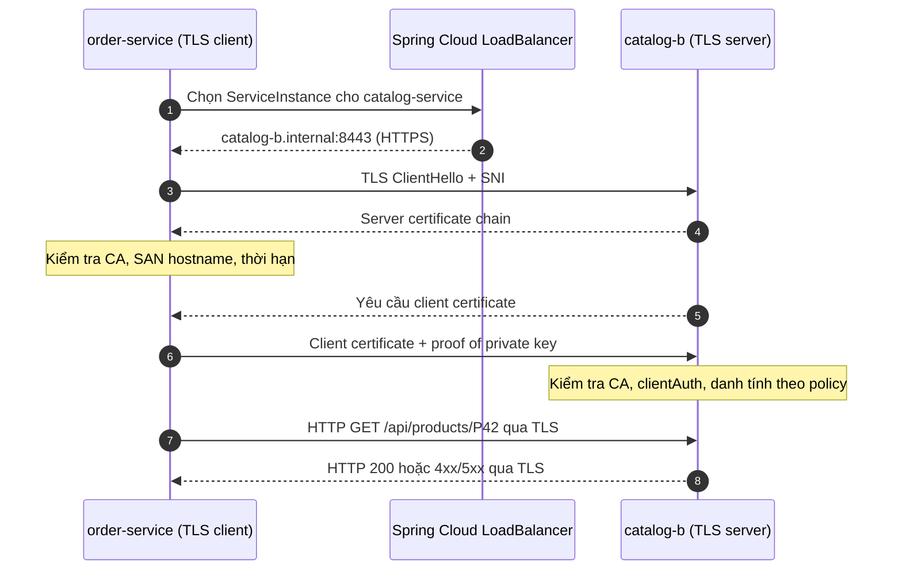
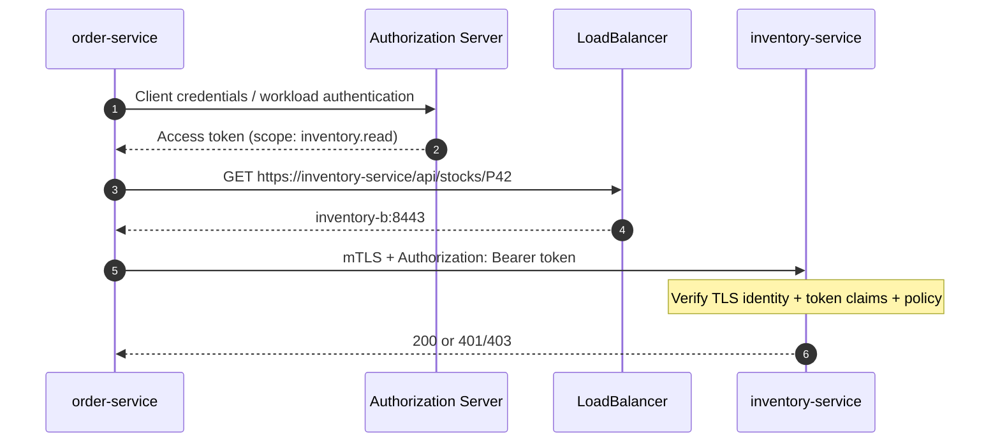

# mTLS và xác thực giữa các dịch vụ

Trong microservices, `order-service` có thể gọi `https://catalog-service/api/products/P42` mà không biết trước bản sao cụ thể của `catalog-service`. Spring Cloud LoadBalancer sử dụng service ID, discovery và `ServiceInstanceListSupplier` để chọn host/port; sau đó HTTP client thực hiện kết nối. **Chọn đúng địa chỉ không đồng nghĩa đã xác thực đúng dịch vụ.** Nếu một bản sao bị giả mạo, registry bị cấu hình sai hoặc đường truyền bị can thiệp, request có thể bị gửi tới đích không đáng tin cậy. Với dữ liệu như token truy cập, đơn hàng hay tồn kho, hệ thống cần bảo vệ cả kết nối lẫn danh tính hai phía.

**mTLS (mutual Transport Layer Security)** bổ sung việc *server xác thực client bằng chứng chỉ*, bên cạnh cơ chế TLS thông thường nơi client xác thực server. Tuy nhiên, mTLS không tự cấp quyền gọi API, không thay thế kiểm tra `scope`/`role` và không thay việc giới hạn request bằng timeout, retry hay circuit breaker. Trong module `SPRING_CLOUD_SERVICE_COMMUNICATION_LOAD_BALANCING`, bài này trình bày cách mTLS hoạt động khi LoadBalancer chọn nhiều `ServiceInstance`, cách cấu hình Spring Boot và HTTP clients, cách phối hợp với OAuth2, cũng như kiểm thử, vận hành và phòng tránh lỗi phổ biến.

## 1. Ba mục tiêu bảo mật phải tách biệt

| Mục tiêu | Câu hỏi cần trả lời | Công cụ điển hình |
|---|---|---|
| **Bảo mật kênh truyền** | Có ai đọc hoặc sửa request/response trên đường đi không? | TLS: mã hóa và bảo vệ tính toàn vẹn |
| **Xác thực workload** | Bên nhận thực sự là dịch vụ nào? Bên gọi có đúng danh tính được cấp không? | Chứng chỉ X.509, mTLS, SPIFFE/SVID hoặc danh tính tương đương |
| **Phân quyền** | Workload đã xác thực có được thực hiện hành động này trên tài nguyên này không? | Chính sách authorization, OAuth2 access token, scopes/claims, policy engine |

TLS một chiều thường bảo vệ kết nối và cho client kiểm tra chứng chỉ của server; mTLS cung cấp thêm danh tính bằng chứng chỉ của client. **Không được suy ra rằng “đã handshake mTLS thành công” đồng nghĩa mọi API đều được phép.** Một certificate được ký bởi CA tin cậy có thể thuộc về một workload khác và cần tiếp tục so khớp danh tính/đặc quyền.

Ví dụ, `order-service` được phép đọc tồn kho, còn `reporting-service` chỉ được đọc dữ liệu tổng hợp. Cả hai có thể sở hữu chứng chỉ hợp lệ từ cùng CA nội bộ, nhưng điều đó không có nghĩa `reporting-service` được phép gọi endpoint `POST /api/stocks/reserve`.

## 2. TLS một chiều và mTLS: luồng bắt tay

Trong HTTPS thông thường:

1. Client mở kết nối tới host/port đã chọn.
2. Server trình bày certificate chain.
3. Client kiểm tra chain tới trust anchor tin cậy, thời hạn, tên đích trong **SAN (Subject Alternative Name)** và chính sách sử dụng chứng chỉ.
4. Hai phía thiết lập khóa phiên để bảo vệ dữ liệu trao đổi.

Với mTLS, phía server **còn yêu cầu và kiểm tra chứng chỉ của client** trong TLS handshake. Client cần có private key phù hợp với certificate và chain được server tin cậy.



Sơ đồ được đơn giản hóa: TLS 1.3 có thứ tự thông điệp handshake chi tiết riêng; một số bước xác thực có thể được xử lý bởi proxy hoặc sidecar. Điều cần nhớ là **TLS handshake phải hoàn tất trước khi HTTP endpoint thông thường xử lý request**.

| Tình huống | Client xác thực server? | Server xác thực client bằng TLS certificate? |
|---|---|---|
| HTTP không mã hóa | Không | Không |
| HTTPS/TLS thông thường | Có, nếu verification được bật đúng | Thường không |
| mTLS | Có | Có |
| HTTPS + bearer token, không mTLS | Có | Không; server xác thực token ở tầng HTTP |

## 3. PKI: certificate, private key, CA và truststore

Để triển khai mTLS, cần quản lý đúng các thành phần:

- **Server certificate + private key:** được sử dụng bởi từng bản sao của `catalog-service` hoặc TLS proxy trước nó; private key phải được giữ bí mật.
- **Client certificate + private key:** thể hiện danh tính `order-service` khi kết nối tới downstream qua mTLS.
- **CA certificate/trust anchor:** giúp bên kiểm tra xác định certificate được ký bởi tổ chức phát hành mà mình tin cậy.
- **Certificate chain:** liên kết certificate đầu cuối với intermediate CA và trust anchor.
- **Keystore/key material:** nơi lưu certificate và private key của **chính bên đó**.
- **Truststore/trust material:** tập CA/certificate được sử dụng để **tin cậy phía đối tác**.

| Phía | Chứng chỉ trình bày | Chứng chỉ/CA cần tin cậy |
|---|---|---|
| `catalog-service` (server) | Server certificate chứa SAN phù hợp hostname đích | CA cấp chứng chỉ cho workload client hợp lệ |
| `order-service` (client) | Client certificate cho danh tính workload `order-service` | CA cấp chứng chỉ cho những server `catalog-service` hợp lệ |

Chứng chỉ có thể chứa **EKU (Extended Key Usage)**: `serverAuth` dành cho TLS server, `clientAuth` dành cho TLS client. Một CA nội bộ có thể cấp chứng chỉ cho cả hai loại, nhưng việc sử dụng chứng chỉ sai mục đích có thể khiến handshake thất bại khi implementation kiểm tra EKU.

**Không bao giờ phân phối private key của CA cho ứng dụng.** CA signing key thuộc hệ thống cấp phát chứng chỉ; các service chỉ nhận certificate/key riêng và trust anchors cần thiết. Sử dụng cơ chế quản trị secrets, volume có quyền truy cập tối thiểu hoặc hệ thống cấp phát workload identity, thay vì commit `*.key`, mật khẩu keystore hoặc certificate bí mật vào Git.

## 4. Điểm quan trọng với LoadBalancer: service ID khác hostname TLS

Trong mã nghiệp vụ, request được viết:

```java
ProductDto product = client.get()
        .uri("https://catalog-service/api/products/{id}", id)
        .retrieve()
        .body(ProductDto.class);
```

`catalog-service` là **service ID logic** để tìm `ServiceInstance`. Nhưng LoadBalancer có thể chọn một endpoint cụ thể:

```text
Service ID: catalog-service
  ├─ catalog-a.internal.example:8443  (HTTPS)
  └─ catalog-b.internal.example:8443  (HTTPS)

Lần gọi 1 → catalog-a.internal.example:8443
Lần gọi 2 → catalog-b.internal.example:8443
```

Ở tầng TLS, client phải xác thực **tên thực tế mà HTTP transport dùng cho kết nối** theo chính sách certificate/hostname verification của nó. Ví dụ server certificate của `catalog-b` có thể cần SAN `DNS:catalog-b.internal.example`. Nếu discovery công bố `10.20.1.12` nhưng certificate chỉ có SAN DNS, việc kết nối bằng IP sẽ không khớp trừ khi certificate có SAN `IP:10.20.1.12` hoặc kiến trúc TLS sử dụng tên định danh phù hợp được cấu hình đúng.

**Không sửa lỗi certificate mismatch bằng cách tắt hostname verification.** Cần sửa một trong những điểm đúng trách nhiệm:

1. Discovery công bố host name mà client có thể phân giải và phù hợp với certificate.
2. CA cấp certificate có SAN đúng với tên/IP cần được xác thực.
3. TLS proxy/service mesh thống nhất điểm termination, danh tính và cách định tuyến.
4. Trường hợp SNI/authority cần khác đích kết nối TCP, phải cấu hình rõ ở transport/proxy và giữ verification an toàn.

Một vấn đề nữa: Spring Cloud LoadBalancer có thể xây URI thực tế dựa trên `ServiceInstance.isSecure()` và scheme ban đầu. **Không chỉ nhìn thấy `https://` trong mã nguồn rồi cho rằng request cuối cùng chắc chắn dùng TLS.** Cần kiểm tra metadata của registry, `ServiceInstance.getUri()`, secure flag và URI cuối của HTTP request trong phiên bản đang sử dụng.

## 5. Hai kiểu triển khai mTLS trong microservices

### 5.1. mTLS trực tiếp tại ứng dụng

Ứng dụng Java trực tiếp mở HTTPS, gửi client certificate và xác thực server certificate. Spring Boot cấu hình SSL cho inbound server, HTTP client dùng SSL bundle hoặc SSL context tương ứng.

Ưu điểm: danh tính và kênh bảo mật được cấu hình tại ứng dụng, thấy rõ điểm tạo và dùng client. Nhược điểm: phải quản lý key/trust, rotation, client configuration và quy tắc authorization ở nhiều ứng dụng.

### 5.2. mTLS tại service mesh hoặc proxy

Sidecar, ingress/egress proxy hoặc service mesh có thể thực hiện mTLS giữa các proxy, còn Java application giao tiếp với proxy theo mô hình được triển khai.

```text
order-service → local proxy
                  └── mTLS ──→ remote proxy → catalog-service
```

Điều này giảm số ứng dụng phải trực tiếp xử lý certificate, nhưng cần trả lời rõ: **đoạn ứng dụng ↔ local proxy có được bảo vệ không, ai xác thực workload, và chính sách authorization thực thi tại đâu?**

| Tiêu chí | mTLS tại ứng dụng | mTLS tại mesh/proxy |
|---|---|---|
| TLS endpoint | Java HTTP client/server | Proxy/sidecar hoặc gateway |
| Chứng chỉ workload | Ứng dụng quản lý hoặc được inject | Mesh/control plane thường quản lý |
| Khi app nhìn URL | Thường `https://...` | Có thể là HTTP tới proxy local tùy kiến trúc |
| Chính sách danh tính | Spring Security/custom authorization | Mesh authorization policy, có thể kết hợp app auth |
| Nguy cơ sai cấu hình | Sai SSL client, truststore, SAN, private key | Sai mesh policy, mode, identity hoặc plaintext gap |
| Rotation | Ứng dụng/SSL context/connection lifecycle | Hệ thống mesh điều phối, vẫn phải kiểm thử |

Hai cách có thể kết hợp khi yêu cầu bảo mật end-to-end hoặc tách trust domain, nhưng **không nên bật hai cơ chế một cách ngẫu nhiên**. Khi TLS được terminate ở proxy, certificate mà Java client thực sự kiểm tra có thể là proxy chứ không phải ứng dụng đích. Hợp đồng định danh và ủy quyền phải nói rõ điểm này.

## 6. Cấu hình HTTPS/mTLS inbound với Spring Boot SSL bundle

Ví dụ `catalog-service` sử dụng Spring Boot 3.2+ (hoặc release tương thích có SSL bundles), phục vụ HTTPS trên cổng `8443` và **yêu cầu** client certificate:

```yaml
server:
  port: 8443
  ssl:
    bundle: catalog-server
    client-auth: need

spring:
  ssl:
    bundle:
      pem:
        catalog-server:
          keystore:
            certificate: file:/etc/catalog/tls/server-chain.pem
            private-key: file:/etc/catalog/tls/server-key.pem
          truststore:
            certificate: file:/etc/catalog/tls/trusted-client-ca.pem
```

Ý nghĩa:

1. `keystore.certificate` là server certificate (có thể kèm intermediate chain).
2. `keystore.private-key` là private key tương ứng của server.
3. `truststore.certificate` xác định CA/certificate được tin để kiểm tra **client certificate**.
4. `server.ssl.client-auth: need` yêu cầu client đưa chứng chỉ hợp lệ trong handshake; không có hoặc không hợp lệ sẽ bị từ chối ở tầng TLS.
5. `server.ssl.bundle` nối HTTP server với SSL bundle đã khai báo; cách tích hợp và hot reload phụ thuộc Spring Boot version/container được sử dụng.

Đường dẫn trên là ví dụ của container có mount secrets; không phải file phải đặt trong source tree. **Không đưa private key, password hoặc nội dung secret thật vào Markdown/YAML commit.** Quyền file, rotation và nơi cấp certificate phải được kiểm soát độc lập.

Nếu cấu hình `client-auth: want`, server có thể yêu cầu chứng chỉ nhưng **không bắt buộc** mọi client phải gửi; điều đó không đáp ứng yêu cầu “chỉ workload có chứng chỉ mới vào được” trừ khi ứng dụng có thêm kiểm tra phù hợp. Với mTLS bắt buộc ở endpoint này, dùng `need` và kiểm chứng thực tế.

Ngoài TLS handshake, service vẫn nên triển khai **authorization** xác nhận identity được cấp quyền. Ví dụ, một truststore tin toàn bộ CA nội bộ có thể chấp nhận chứng chỉ của nhiều workload khác nhau; phần việc còn lại là chỉ cho `order-service` gọi API được phép.

## 7. HTTP client mTLS với Spring Boot SSL bundle và RestClient

Trong `order-service`, khai báo một SSL bundle dành cho việc gọi dịch vụ nội bộ:

```yaml
spring:
  ssl:
    bundle:
      pem:
        catalog-client:
          keystore:
            certificate: file:/etc/order/tls/client-chain.pem
            private-key: file:/etc/order/tls/client-key.pem
          truststore:
            certificate: file:/etc/order/tls/trusted-server-ca.pem
```

Ở các phiên bản Spring Boot có hỗ trợ `RestClientSsl`, có thể tạo bean `@LoadBalanced RestClient.Builder` được áp SSL bundle:

```java
package com.example.orders.config;

import org.springframework.boot.autoconfigure.web.client.RestClientSsl;
import org.springframework.cloud.client.loadbalancer.LoadBalanced;
import org.springframework.context.annotation.Bean;
import org.springframework.context.annotation.Configuration;
import org.springframework.web.client.RestClient;

@Configuration(proxyBeanMethods = false)
public class CatalogHttpClientConfiguration {

    @Bean
    @LoadBalanced
    RestClient.Builder catalogLoadBalancedBuilder(RestClientSsl ssl) {
        return RestClient.builder()
                .apply(ssl.fromBundle("catalog-client"));
    }

    @Bean
    CatalogClient catalogClient(
            @LoadBalanced RestClient.Builder builder) {
        RestClient restClient = builder.clone()
                .baseUrl("https://catalog-service")
                .build();
        return new CatalogClient(restClient);
    }
}
```

```java
package com.example.orders.config;

import org.springframework.web.client.RestClient;

public class CatalogClient {
    private final RestClient restClient;

    public CatalogClient(RestClient restClient) {
        this.restClient = restClient;
    }

    public String getProduct(String id) {
        return restClient.get()
                .uri("/api/products/{id}", id)
                .retrieve()
                .body(String.class);
    }
}
```

Trong ví dụ:

- `@LoadBalanced` yêu cầu Spring Cloud cấu hình builder để URL logic được phân giải qua LoadBalancer.
- `RestClientSsl.fromBundle(...)` kết nối HTTP transport với chứng chỉ client và trust anchors trong bundle. Khả năng tự chọn `ClientHttpRequestFactory`, TLS provider và các customizer phụ thuộc phiên bản Spring Boot/HTTP libraries.
- `baseUrl("https://catalog-service")` nói rằng ứng dụng **muốn** gọi một endpoint HTTPS; phải xác minh URI sau LoadBalancer vẫn dùng scheme secure.
- Certificate server phải có danh tính phù hợp endpoint đã chọn; client phải kiểm tra chain/SAN chứ không được cấu hình trust-all.
- `CatalogClient` được tái sử dụng, không tạo SSL context hoặc TCP connection manager mới cho mỗi request.

**Điều kiện phiên bản:** `RestClient` có từ Spring Framework 6.1, `RestClientSsl` là tích hợp Spring Boot cho SSL bundles trong các release hỗ trợ nó. Kiểm tra BOM Spring Boot/Spring Cloud và constructor/API trước khi dùng code trong một dự án khác phiên bản. Trong hệ thống có nhiều `RestClient.Builder`, dùng qualifier/tên bean rõ ràng, tránh vô tình chọn builder không mTLS.

## 8. Tại sao HTTPS có thể bị sai khi LoadBalancer chọn instance?

Một bài lab local thường khai báo:

```yaml
spring:
  cloud:
    discovery:
      client:
        simple:
          instances:
            catalog-service:
              - uri: https://catalog-a.internal.example:8443
              - uri: https://catalog-b.internal.example:8443
```

Đây là **địa chỉ minh họa**, phải có DNS/hosts và certificate hợp lệ trong môi trường thử nghiệm. Mục tiêu là buộc người học đối chiếu:

| Trường cần kiểm tra | Yêu cầu |
|---|---|
| `service ID` | `catalog-service` |
| `ServiceInstance` được chọn | `catalog-a` hoặc `catalog-b` với địa chỉ mạng truy cập được |
| URI/scheme sau LoadBalancer | HTTPS, đúng host/port và secure metadata |
| Trust chain | Client tin CA đã cấp server certificate |
| SAN | Khớp hostname/IP mà TLS thực sự xác thực |
| Client certificate | Server tin CA ký client certificate; private key đúng |
| Authorization | Caller này được quyền dùng endpoint đã gọi |

Một lỗi phổ biến: `catalog-a` và `catalog-b` có certificate cho `catalog-service.internal.example` nhưng discovery công bố tên `catalog-a.internal.example` và `catalog-b.internal.example`. Nếu TLS xác thực hostname của từng instance, certificate có thể bị từ chối. Không mặc định rằng service ID ở `baseUrl` sẽ luôn được dùng làm tên cần xác thực sau khi LoadBalancer thay URI.

Trong môi trường thay đổi IP liên tục, ưu tiên danh tính ổn định do DNS/discovery/PKI/mesh thiết kế thống nhất. Nếu dùng SAN chứa IP, cần có quy trình cấp lại certificate khi IP thay đổi; nếu dùng DNS SAN, phải bảo đảm host được công bố và phân giải đúng.

## 9. WebClient và OpenFeign cũng cần TLS ở tầng transport

### WebClient

Với `WebClient`, `@LoadBalanced WebClient.Builder` chỉ giúp lựa chọn `ServiceInstance` qua exchange filter. Để mTLS trực tiếp, cần cấu hình SSL context của **HTTP connector** thực tế (ví dụ Reactor Netty) với:

- Client certificate cùng private key.
- Trust anchors để xác thực server.
- Hostname/SAN verification và SNI thích hợp.
- TLS protocols/cipher suites an toàn.
- Connection timeout, handshake timeout, response timeout và connection pool phù hợp.

```java
// Khung tích hợp minh họa: nettySslContext phải được tạo từ
// client certificate, private key và trust CA của workload.
HttpClient nettyHttpClient = HttpClient.create()
        .secure(spec -> spec.sslContext(nettySslContext));

WebClient client = loadBalancedBuilder.clone()
        .clientConnector(new ReactorClientHttpConnector(nettyHttpClient))
        .baseUrl("https://catalog-service")
        .build();
```

Đoạn này giả định `nettySslContext` đã được cấu hình an toàn; **không phải ví dụ hoàn chỉnh để copy vào production**. Khi tùy chỉnh SSL provider, cần xác minh **hostname verification có thực sự được bật** theo Reactor Netty version (một số cấu hình tùy chỉnh cần `handlerConfigurator` tương ứng). Đừng dùng `InsecureTrustManagerFactory`, bỏ qua kiểm tra SAN hoặc tắt TLS validation để “sửa” lỗi handshake.

Khi dùng Spring Boot SSL bundles, có thể tự tích hợp material tương ứng vào Reactor Netty thông qua các API được phiên bản đang dùng hỗ trợ, hoặc để mesh/proxy sở hữu mTLS. Phải xác minh client thật sự dùng connector đã cấu hình; chỉ khai báo SSL bean mà không đưa vào WebClient sẽ không bảo vệ request.

### OpenFeign

Với OpenFeign, `@FeignClient(name = "catalog-service")` và Spring Cloud LoadBalancer quyết định đích; **Feign Client/HTTP transport** (Apache HttpClient, OkHttp hoặc implementation khác) mới chịu trách nhiệm thực hiện mTLS.

```java
@FeignClient(name = "catalog-service", path = "/api/products")
public interface CatalogFeignClient {
    @GetMapping("/{id}")
    ProductDto getProduct(@PathVariable("id") String id);
}
```

Không có annotation nào trong interface trên tự nạp client certificate. Cần cấu hình Feign HTTP client thực sự được dùng với key/trust material và hostname verification, hoặc dùng proxy/mesh bảo vệ kênh truyền. Nếu đặt `url = "http://..."` cố định, request có thể bỏ qua discovery và mTLS dự kiến; đây là rủi ro cấu hình chứ không phải lỗi encoder/decoder.

## 10. mTLS chỉ xác thực workload; ứng dụng vẫn phải phân quyền

Sau khi handshake thành công, server có thể biết client có certificate được CA tin cậy cấp. Điều đó **chưa cho biết** client có quyền gọi mọi route.

Ví dụ chính sách dịch vụ:

| Workload identity | Quyền được phép | Không được phép |
|---|---|---|
| `order-service` | `inventory.read`, `inventory.reserve` | Quản trị kho |
| `catalog-service` | `inventory.read` khi cần | `inventory.reserve` |
| `reporting-service` | `inventory.read-aggregate` | Đặt giữ hàng, thanh toán |
| `payment-service` | `payments.capture` theo hợp đồng | Sửa thông tin sản phẩm |

Định danh workload có thể dựa trên SAN DNS/URI, SPIFFE ID hoặc ánh xạ từ certificate do hạ tầng cấp phát. Nếu dùng X.509 authentication của Spring Security, không nên chỉ nhìn chuỗi CN tùy ý rồi cấp quyền rộng; cần xem cách xác thực certificate chain, danh tính được trích xuất và ràng buộc với chính sách. Trường hợp TLS terminate ở proxy, ứng dụng chỉ được tin identity header do proxy **đáng tin cậy** cung cấp qua kênh đã bảo vệ, không đọc header tự khai từ Internet.

**mTLS xác thực “ai gọi tới tôi”; authorization xác định “người đó được làm gì”.** Các kiểm tra thuộc hai lớp này phải phối hợp với quyền truy cập dữ liệu của người dùng cuối, thay vì lấy quyền service-account làm quyền người dùng.

## 11. OAuth2 client credentials cho gọi service-to-service

Một mô hình phổ biến kết hợp mTLS với OAuth2 access token:

1. `order-service` xác thực ở TLS bằng client certificate.
2. `order-service` nhận access token bằng `client_credentials` từ authorization server dành cho workload đã đăng ký.
3. HTTP request tới `inventory-service` mang `Authorization: Bearer ...` trong kênh TLS bảo mật.
4. `inventory-service` kiểm tra issuer, chữ ký, hạn sử dụng, audience, scope và các điều kiện authorization khác.



`client_credentials` cấp token cho **ứng dụng/workload**, không trực tiếp đại diện cho người dùng cuối. Không tự chuyển tiếp access token của người dùng qua mọi service nếu token không dành cho downstream đó; khi cần ủy quyền thay mặt người dùng, dùng token exchange/on-behalf-of theo hạ tầng IAM hỗ trợ, với audience và scope phù hợp.

Mẫu cấu hình OAuth2 Client của Spring Security (chưa chứa secret):

```yaml
spring:
  security:
    oauth2:
      client:
        registration:
          inventory-client:
            provider: internal-idp
            authorization-grant-type: client_credentials
            client-id: order-service
            scope: inventory.read
        provider:
          internal-idp:
            token-uri: https://idp.internal.example/oauth2/token
```

Client secret hoặc cách xác thực client khác phải được cung cấp qua secret manager/identity platform, không hard-code. Cần có `spring-boot-starter-oauth2-client` và cấu hình `OAuth2AuthorizedClientManager` phù hợp với môi trường gọi (Servlet, service nền, reactive).

**Không giả định chỉ thêm các properties sẽ khiến mọi RestClient/WebClient/OpenFeign tự gắn token.** Cần mã hoặc integration được cấu hình đúng để lấy/cached token và đính kèm `Authorization` vào mỗi request. Với WebClient reactive, tránh gọi token manager blocking trên event-loop.

## 12. Cách kiểm tra quyền ở phía nhận

Dịch vụ nhận bearer token có thể sử dụng Spring Security Resource Server để kiểm tra access token, ví dụ một JWT hợp lệ với issuer tin cậy:

```yaml
spring:
  security:
    oauth2:
      resourceserver:
        jwt:
          issuer-uri: https://idp.internal.example
```

Với dependency `spring-boot-starter-oauth2-resource-server`, Spring Security có thể tải thông tin xác thực khóa từ issuer theo metadata thích hợp. Tuy nhiên, **không được xem cấu hình issuer là đã đủ mọi chính sách**:

- Kiểm tra `aud`/audience cho đúng downstream API; không chấp nhận token dành cho hệ thống khác.
- Kiểm tra scopes/authorities như `SCOPE_inventory.read` hoặc `SCOPE_inventory.reserve`.
- Xác thực hạn dùng `exp`, not-before và chữ ký; đảm bảo đồng hồ có độ lệch chấp nhận được.
- Không tin token unsigned hoặc tự parse JWT mà bỏ qua signature verification.
- Thiết lập authorization theo route, method và **đối tượng dữ liệu**. Một service có scope đọc không mặc nhiên có quyền đọc mọi tenant/đơn hàng.
- Nếu cần ràng buộc token với client certificate (certificate-bound token), phải có cấu hình và khả năng kiểm tra `cnf`/thumbprint theo giao thức hỗ trợ; mTLS tự nó không tự ràng buộc mọi bearer token với certificate.

Khi trả lỗi, phân biệt `401 Unauthorized` (chưa xác thực hoặc credential không hợp lệ) với `403 Forbidden` (đã xác thực nhưng không có quyền). Lỗi certificate thường xảy ra trong TLS handshake trước HTTP; khi đó không nhất thiết có HTTP 401/403 để ứng dụng trả về.

## 13. Không truyền credential một cách mù quáng

Khi `order-service` gọi nhiều downstream, mỗi dịch vụ có thể cần loại credential khác nhau:

| Thông tin | Có nên tự truyền qua mọi hop? | Nguyên tắc |
|---|---|---|
| mTLS client certificate | Không phải HTTP header | Gắn với TLS connection và identity của workload |
| OAuth2 access token | **Không** | Chỉ gửi đến audience/resource server dự kiến |
| User JWT | Không mặc định | Chỉ dùng khi downstream được phép nhận và cần ngữ cảnh người dùng |
| Cookie phiên của browser | Không mặc định | Tránh sao chép cookie sang các service nội bộ tùy ý |
| Correlation ID / W3C trace context | Thường có, nếu được kiểm soát | Dùng cho observability, không phải credential |
| API key nội bộ | Chỉ theo hợp đồng riêng | Bảo vệ như secret, ưu tiên cơ chế token/identity quản lý tập trung |

Đặc biệt, khi HTTP client theo redirect sang host khác hoặc retry một request đã đổi đích, phải đảm bảo **Authorization header và các credential không bị phát tới endpoint ngoài trust boundary**. Service ID không được lấy trực tiếp từ dữ liệu người dùng để tìm đến tùy ý endpoint nội bộ; nếu cho caller điều khiển target URL, rủi ro SSRF có thể xuất hiện.

Các token cần có vòng đời ngắn, cơ chế refresh/cache có giới hạn và handling cho trường hợp `401` do token hết hạn. Không đặt token trong query string, không ghi token vào application log, trace attributes hoặc error response.

## 14. Timeout, retry và mTLS: bảo mật không thay thế chịu lỗi

Khi HTTP client dùng mTLS, kết nối có thể phát sinh thêm chi phí TLS handshake và lỗi đặc thù: chứng chỉ hết hạn, CA rotation, SAN mismatch, client certificate chưa được cấp. Các tình huống này cần được tách khỏi lỗi discovery hay HTTP status.

| Giai đoạn | Lỗi ví dụ | Có nên tự retry? |
|---|---|---|
| Discovery/LoadBalancer | Không có `ServiceInstance` | Thường fail fast hoặc retry rất hạn chế |
| TCP connect | Địa chỉ không truy cập được | Có thể đổi instance nếu còn ngân sách |
| TLS handshake | CA không tin, SAN sai, certificate hết hạn | **Không** retry hàng loạt; sửa trust/identity |
| Client authentication | Không đưa certificate hoặc client certificate bị từ chối | **Không** retry y nguyên credential lỗi |
| HTTP authorization | 401/403 | Chỉ làm mới credential hợp lệ nếu chính sách cho phép; không retry vô điều kiện |
| Downstream HTTP | 502/503/504 | Có điều kiện theo idempotency, backoff và deadline |
| Response decode | JSON/schema sai | Sửa contract; retry thường không chữa được |

**Không tăng read timeout để chữa TLS handshake failure**, và không tắt hostname verification để làm một instance lỗi trở thành “khỏe”. Cần đo thời gian connect, TLS handshake, pool acquisition, response và tổng deadline theo HTTP transport đang dùng.

Khi retry trên một `ServiceInstance` khác, TLS phải xác thực lại endpoint thực tế nếu dùng kết nối mới. Connection pooling có thể giữ các TLS connections được thiết lập trước khi certificate rotation; quy trình rotation cần xét việc đóng/drain kết nối cũ và đồng bộ trust anchors.

## 15. Quản lý vòng đời certificate và key rotation

Chứng chỉ ngắn hạn giúp hạn chế thời gian bị lạm dụng khi private key lộ, nhưng đòi hỏi tự động hóa vòng đời:

1. **Cấp phát:** CA/identity platform xác thực workload trước khi cấp chứng chỉ.
2. **Phân phối:** certificate, private key và CA bundle tới đúng workload bằng kênh an toàn.
3. **Sử dụng:** HTTP server/client nạp material vào TLS context/SSL bundle.
4. **Giám sát:** theo dõi thời gian hết hạn, lỗi handshake, số kết nối bị từ chối và certificate identity.
5. **Gia hạn:** nạp certificate mới **trước** khi cũ hết hạn, cân nhắc giai đoạn chồng lấn tin cậy.
6. **Thu hồi:** thu hồi/giảm thời gian sống khi key bị lộ; policy phải phản ánh trust và nhu cầu revocation của hạ tầng.
7. **Dọn kết nối:** xác nhận clients/servers không tiếp tục tái sử dụng context hoặc connection với trạng thái không còn phù hợp.

Việc thay file trên disk không có nghĩa mọi JVM/HTTP connection pool **tự động** nạp lại TLS material. Tùy phiên bản, Spring Boot SSL bundle có thể hỗ trợ cơ chế reload tại những nơi tích hợp cho phép; các HTTP client/proxy khác có thể cần thay SSL context, recreate pool hoặc restart có kiểm soát. Phải **kiểm thử rotation thật**, không chỉ kiểm tra file đã được thay.

Với CA rotation, thường cần một khoảng thời gian mà phía client/server tin cả CA cũ và mới để tránh làm toàn bộ service-to-service traffic thất bại cùng lúc. Không xóa CA cũ trước khi các certificate/workload tương ứng đã được chuyển đổi.

## 16. Bài thực hành: hai replica HTTPS và một client mTLS

**Mục tiêu:** chứng minh rằng Spring Cloud LoadBalancer chọn instance nhưng TLS vẫn phải xác thực từng endpoint, và server phải từ chối client không có danh tính mTLS hợp lệ.

### Chuẩn bị môi trường local

- Tạo **CA chỉ dùng cho lab** và cấp server certificate cho hai replica.
- `catalog-a` chạy HTTPS `8443`, có SAN tương ứng hostname được công bố.
- `catalog-b` chạy HTTPS `8444` hoặc hostname khác, có SAN phù hợp.
- Cấp client certificate cho `order-service` có `clientAuth`; server tin CA đã ký nó.
- Client tin CA ký server certificate và dùng key/cert của `order-service`.
- Khai báo `SimpleDiscoveryClient` với các URI `https://...` và xác minh `isSecure` thực tế.
- Mỗi replica có endpoint `/whoami` trả instance ID không chứa thông tin nhạy cảm.

Không sử dụng certificate/self-signed trust-all của lab trong production. Nếu dùng `localhost` ở hai port, SAN của server cert cần có `DNS:localhost` và đường kết nối phải dùng tên phù hợp; nếu gọi bằng IP loopback, SAN cần bao gồm IP tương ứng theo chính sách verification của client.

### Ma trận kiểm thử

| Ca | Thay đổi | Kỳ vọng |
|---|---|---|
| A — mTLS hợp lệ | Cả server/client có key, cert và CA tin cậy | Request `https://catalog-service/whoami` qua LoadBalancer thành công |
| B — thiếu client cert | Client không cấu hình keystore | TLS handshake bị từ chối khi server yêu cầu client auth |
| C — sai client CA | Client cert do CA không được server tin | Handshake thất bại, không phải HTTP 403 từ controller |
| D — sai server CA | Client không tin issuer của server | Handshake thất bại trước HTTP |
| E — sai hostname/SAN | Discovery trả hostname không có trong cert | Hostname verification từ chối kết nối |
| F — cert hết hạn | Thử certificate quá hạn trong lab | TLS validation lỗi, không được tự bypass |
| G — service khác có cert hợp lệ | Client `reporting-service` gọi route cấm | Handshake có thể thành công, authorization trả 403 hoặc proxy policy từ chối |
| H — đổi instance | Luân phiên hai instance với certificate khác nhau | Mỗi kết nối xác thực đúng endpoint đã chọn |
| I — client token sai audience | Token dành cho service khác | Resource server từ chối dù mTLS thành công |
| J — rotation | Thay leaf cert/CA theo quy trình | Không có downtime ngoài mục tiêu, trust và pool cập nhật đúng |

### Ví dụ gọi trực tiếp từng endpoint

Trong lab đã có `ca.pem`, `client.pem` và `client-key.pem` do môi trường thử nghiệm cấp:

```bash
curl --cacert ca.pem \
  --cert client.pem \
  --key client-key.pem \
  https://catalog-a.internal.example:8443/whoami
```

Lệnh kiểm tra mTLS **trực tiếp** tới một instance; nó **không kiểm tra thuật toán LoadBalancer**. Sau đó mới thử qua `@LoadBalanced RestClient` với URL service ID và so sánh kết quả. Đừng thêm `-k` hoặc `--insecure` vào curl vì chúng tắt bước xác thực server và che giấu lỗi quan trọng nhất của bài lab.

Nếu một lệnh không thành công, kiểm tra trước hostname/SAN và CA chain, sau đó mới xem client certificate, EKU, port, firewall và server mTLS policy. Phải phân biệt lỗi handshake với HTTP status 401/403/503.

## 17. Chẩn đoán sự cố: tìm đúng tầng

| Triệu chứng | Nguyên nhân có thể | Điểm cần kiểm tra |
|---|---|---|
| `No instances available` | Discovery/LoadBalancer không trả instance | Service ID, supplier, registry, zone, health; **chưa tới TLS** |
| `Connection refused` | Host/port không có process lắng nghe | Network, service port, ingress policy |
| TLS `unknown_ca` | Bên xác thực không tin issuer của đối tác | Truststore và certificate chain đúng chiều |
| TLS `bad_certificate` | Certificate bị từ chối | Leaf/chain, key, EKU, validity, issuer |
| `No subject alternative DNS name` | SAN không khớp host được kết nối | URI thực sau LoadBalancer, DNS SAN/IP SAN |
| TLS handshake success nhưng HTTP 401 | Thiếu/sai access token | OAuth2 client config, token expiry, JWT validation |
| TLS handshake success nhưng HTTP 403 | Workload/token không có quyền | Authorization policy, scope, audience, route |
| Chỉ một replica lỗi TLS | Cert/key/SAN của replica đó khác hoặc hết hạn | So sánh từng `ServiceInstance` và cert |
| HTTP 503 từ server | Server đã trả status lỗi | Response, readiness, downstream dependency |
| Chạy trong container mới bị lỗi | DNS/hostname, volume mount, permissions hoặc mesh config sai | Vị trí secrets, network namespace, service identity |
| Sau rotation nhiều request lỗi | Client/server chưa reload key/trust hoặc pool giữ kết nối cũ | Rotation timeline, SSL context, connection lifecycle |

Hãy đi từ **service ID → instance được chọn → URI/scheme → TCP → TLS verification → HTTP authentication/authorization → nghiệp vụ**. Đừng đổi retry hoặc timeout trước khi biết request thất bại ở lớp nào.

Các thông tin nên ghi: service ID, identity đã xác thực ở mức an toàn, instance ID, certificate expiry còn lại, TLS failure category, HTTP status, trace ID và duration. Không log private key, bearer token, client secret hoặc nguyên văn certificate chain nhạy cảm nếu không có yêu cầu bảo mật cho phép.

## 18. Những anti-pattern dễ tạo lỗ hổng

| Anti-pattern | Rủi ro | Cách thay thế |
|---|---|---|
| Dùng `TrustAll` hoặc tắt hostname verification | Bất kỳ server giả mạo nào cũng có thể được chấp nhận | CA trust đúng và SAN verification |
| Tin mọi cert từ cùng CA là có mọi quyền | Workload khác có cert hợp lệ lạm quyền | Authorization dựa trên danh tính/scope |
| Gắn client secret/private key vào Git | Lộ credential lâu dài | Secret manager, mount bảo vệ, rotation |
| Dùng HTTPS ở base URL nhưng registry trả instance không secure | Giao thức thực có thể không như kỳ vọng | Kiểm tra URI được tạo và `isSecure` |
| Nhầm service ID với tên SAN của instance | TLS hostname mismatch | Thiết kế DNS/PKI/discovery thống nhất |
| Chuyển tiếp user JWT/cookie đến mọi downstream | Credential leak và mở rộng quyền không kiểm soát | Token audience/scope thích hợp |
| Tin identity header tự khai từ Internet | Giả mạo workload identity | Chỉ tin proxy được xác thực và trust boundary |
| Retry vô hạn lỗi CA/cert | Tạo tải vô ích, che nguyên nhân | Fail fast, alert và sửa material |
| Chỉ thay file certificate rồi nghĩ pool đã reload | Lỗi định kỳ hoặc outage khi hết hạn | Test reload/recreate SSL context và connection pool |
| Dùng mTLS như bằng chứng phân quyền người dùng | Service identity bị dùng thay end-user permissions | Phân quyền service **và** người dùng theo ngữ cảnh |
| Bật mTLS ở proxy nhưng để plaintext ngoài trust boundary | Dữ liệu không được bảo vệ toàn đường đi | Kiểm tra từng hop và security zone |
| Dùng `-k`/`insecure` để vượt bài test | Bỏ qua mục tiêu xác thực server | Sửa CA/SAN/cert thật |

## 19. Checklist trước khi triển khai production

1. Đã xác định **ranh giới TLS termination**: ở ứng dụng Java, gateway hay service mesh chưa?
2. Discovery công bố HTTPS URI/secure flag và địa chỉ tương thích với certificate SAN của **mỗi** `ServiceInstance` chưa?
3. Client và server có trust anchors đúng chiều, certificate/key và EKU phù hợp không?
4. Có bật hostname verification và không sử dụng trust-all/insecure trong transport không?
5. `server.ssl.client-auth=need` (hoặc proxy policy tương đương) có thực sự từ chối client không có certificate hợp lệ không?
6. Có authorization theo workload identity, endpoint/method và resource thay vì chỉ kiểm tra CA trust không?
7. Khi dùng OAuth2, có kiểm tra issuer, signature, audience, scopes, expiry và không chuyển token sai audience không?
8. SSL bundles/HTTP connectors có được gắn vào **đúng** `@LoadBalanced RestClient.Builder`, WebClient hoặc Feign Client đang sử dụng không?
9. Secrets có được cấp qua kênh an toàn với quyền tối thiểu, không hard-code hoặc ghi log không?
10. Chứng chỉ/CA có cơ chế cấp, gia hạn, rotation, thu hồi và quan sát ngày hết hạn không?
11. Đã kiểm thử rotation với connection pooling/retry và xác nhận TLS context reload hoặc thay thế đúng chưa?
12. Có timeout cho connect/handshake/response, retry có giới hạn và không retry vô ích khi certificate bị từ chối không?
13. Đã thử sai CA, sai SAN, thiếu client certificate, hết hạn cert, sai token audience, thiếu scope và chỉ một replica lỗi chưa?
14. Có trace/log đủ để phân biệt lỗi discovery, TLS handshake và HTTP 401/403/503 mà không làm lộ bí mật không?

**Kết luận:** Spring Cloud LoadBalancer giải quyết **đi đến bản sao nào**, còn TLS/mTLS giải quyết **kết nối có an toàn và hai phía có chứng minh được danh tính không**. Sau handshake, ứng dụng vẫn cần authorization dựa trên workload, token và hợp đồng API. Khi giữ đúng trust chain, SAN của `ServiceInstance` thực tế, quản lý private key/rotation và phối hợp với deadline/retry có giới hạn, giao tiếp giữa các dịch vụ vừa có thể mở rộng theo discovery vừa duy trì bảo mật đầu cuối theo ranh giới đã thiết kế.
