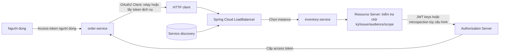
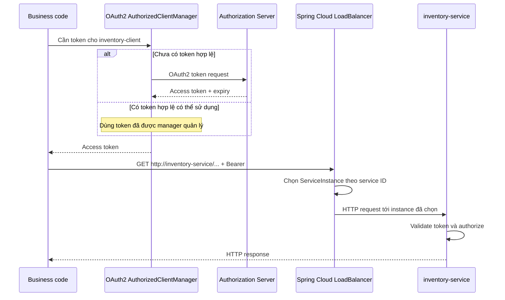
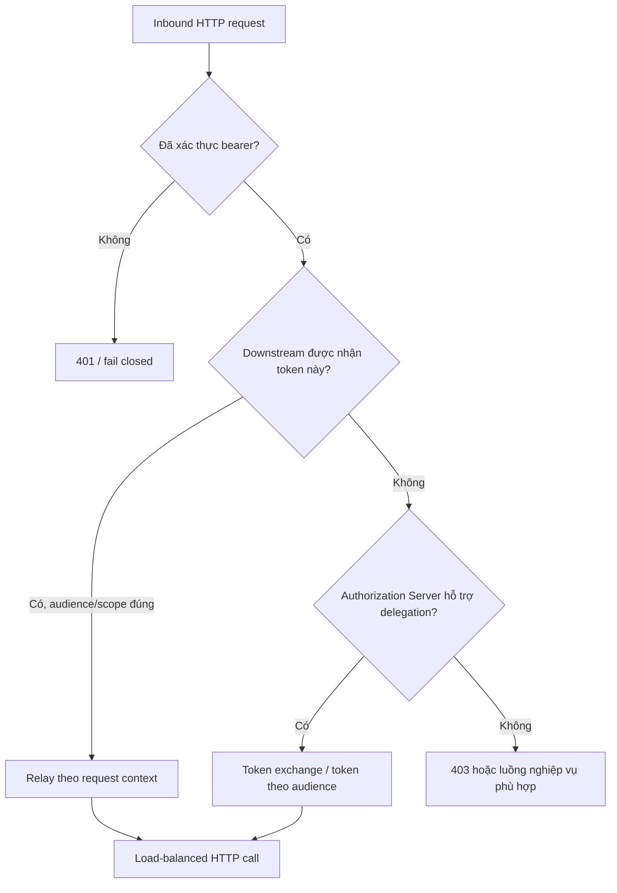
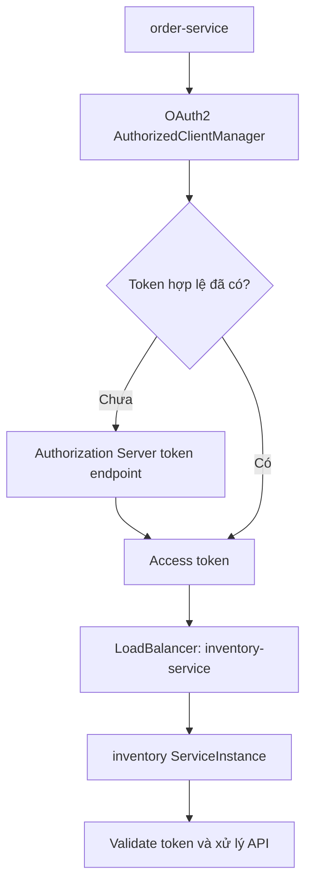

# Truyền access token và tích hợp OAuth2 theo loại HTTP client

Trong kiến trúc microservice, `order-service` có thể nhận HTTP request của người dùng rồi gọi `inventory-service` bằng `RestClient`, `WebClient` hoặc `OpenFeign`. Spring Cloud LoadBalancer giải quyết việc **chọn `ServiceInstance` theo service ID**; nó **không tự xác thực người dùng, không tạo OAuth2 access token, không tự thêm header `Authorization` và cũng không thay thế kiểm tra quyền ở dịch vụ đích**.

Ví dụ một lời gọi `GET http://inventory-service/api/products/P-1001` có thể được định tuyến chính xác tới một instance nhưng vẫn nhận `401 Unauthorized` nếu thiếu bearer token hoặc `403 Forbidden` nếu token thiếu quyền. Ngược lại, thêm một bearer token tùy tiện có thể làm rò rỉ thông tin hoặc tạo ra sai lệch danh tính giữa các dịch vụ.

Bài thuộc chương **Bảo mật giao tiếp** trong module Spring Cloud LoadBalancer. Mục tiêu là hiểu **khi nào cần truyền token người dùng, khi nào cần cấp token riêng cho dịch vụ**, cách tích hợp OAuth2 phù hợp với ba loại HTTP client, cách kết hợp token với `@LoadBalanced`, và cách kiểm chứng hệ thống an toàn khi có discovery, health check, timeout, retry và nhiều instance.

## 1. Bốn vai trò cần tách biệt

| Thành phần | Vai trò | Không chịu trách nhiệm cho việc gì? |
|---|---|---|
| **OAuth2 Authorization Server** | Xác thực/cấp quyền theo flow, phát hành access token cho client được phép. | Không lựa chọn `ServiceInstance` của microservice. |
| **OAuth2 Client** (ví dụ `order-service` khi gọi downstream) | Lấy, quản lý và gắn access token vào HTTP request tới resource server. | Không tự xác nhận token cho server đích. |
| **Resource Server** (ví dụ `inventory-service`) | Xác minh token (JWT hoặc opaque token), issuer/audience/scope và áp dụng authorization. | Không tin request chỉ vì đến từ một instance nội bộ. |
| **Spring Cloud LoadBalancer** | Từ service ID chọn `ServiceInstance` rồi chuyển lời gọi đến địa chỉ thực. | Không cấp, refresh, relay hoặc kiểm tra OAuth2 token thay cho Spring Security. |

Đồng thời cần phân biệt **HTTP client library** (`RestClient`, `WebClient`, `OpenFeign`) với **cơ chế bảo mật** (Spring Security OAuth2 Client và OAuth2 Resource Server). Một client có thể tải đúng destination nhưng gửi sai token; một token đúng chưa chắc route đúng hoặc TLS an toàn.



Mũi tên đến Authorization Server chỉ mô tả các tương tác **có thể có**: resource server dùng JWT có thể kiểm tra chữ ký với khóa JWKS đã cache, không cần gọi Authorization Server cho từng request; opaque token thường cần cơ chế introspection hoặc dữ liệu kiểm tra phù hợp.

## 2. Hai chiến lược gửi access token hoàn toàn khác nhau

### 2.1. Token relay: chuyển token của người dùng

Người dùng gọi `order-service` với một bearer access token. Nếu `order-service` đã xác thực token đó và **hợp đồng bảo mật cho phép** downstream nhận cùng token, caller có thể relay token đến `inventory-service`. Downstream dùng token để xác định quyền của **người dùng**.

```text
User --(access token của user)--> order-service
order-service --(cùng access token, có điều kiện)--> inventory-service
inventory-service --(validate token + authorize)--> response
```

Chỉ relay khi đáp ứng đầy đủ các điều kiện:

- Token vốn dành cho API đích hoặc cho một tập resource servers hợp lệ; **`aud`/audience phải được downstream chấp nhận theo chính sách**.
- Scope/permission của token phù hợp với hành động, không chỉ với endpoint ở tầng đầu.
- `order-service` đã xác thực request đầu vào và được phép truyền danh tính đó đến downstream.
- Downstream tin đúng issuer, signature/introspection, audience, expiry, token type và claims cần thiết.
- Không đưa token người dùng tới dịch vụ khác chỉ vì LoadBalancer có instance trùng service ID; không gửi token sang URL không được phép hoặc domain bên ngoài.

**Cạm bẫy phổ biến:** Một access token chỉ có audience `order-api` **không tự động trở thành token hợp lệ cho `inventory-api`**. Chuyển nguyên token khi audience sai là lỗi mô hình ủy quyền, dù header Bearer đúng cú pháp.

### 2.2. Client credentials: dịch vụ lấy token cho chính nó

Khi `order-service` chạy tác vụ nội bộ không gắn với người dùng — ví dụ đồng bộ tồn kho hàng đêm — nó có thể dùng OAuth2 **`client_credentials`** để lấy access token dành cho **danh tính ứng dụng/dịch vụ**.

```text
order-service --(client authentication)--> Authorization Server
order-service <--(service access token)---- Authorization Server
order-service --(service token)-----------> inventory-service
inventory-service --(check service permissions)--> allow/deny
```

Đặc điểm:

- Scope thường đại diện cho quyền ứng dụng như `inventory.read`.
- Không có người dùng cuối cùng được xác thực **chỉ vì** token chứa client ID hoặc một claim dạng tên người dùng.
- Token được cấp theo OAuth2 client registration, có expiry, được cache/quản lý qua authorized-client manager thích hợp.
- Client secret/private key hoặc phương thức xác thực client phải được quản lý an toàn; không ghi bí mật vào repository.
- Đối với các thao tác cần audit danh tính người dùng hoặc quyền user-specific, token `client_credentials` **không tự thay thế** token relay, token exchange hoặc mô hình ủy quyền thích hợp.

### 2.3. Token exchange / on-behalf-of khi không được relay trực tiếp

Một hệ thống yêu cầu token dành riêng cho từng audience có thể dùng **token exchange** hoặc một luồng ủy quyền “on behalf of” do Authorization Server hỗ trợ. `order-service` dùng ngữ cảnh người dùng đã được xác thực để xin một token mới dành cho `inventory-api`, có scope được thu hẹp và chủ thể/ủy quyền phù hợp.

Không giả định Spring Cloud LoadBalancer hoặc `client_credentials` tự thực hiện việc trao đổi token này; cần khả năng ở Authorization Server, contract của ứng dụng và tích hợp OAuth2 chuyên biệt.

| Tình huống | Lựa chọn cần cân nhắc | Danh tính mà downstream được phép tin |
|---|---|---|
| Người dùng xem tồn kho được phép dùng cùng token trên nhiều API | Token relay **nếu audience và trust boundary cho phép**. | Người dùng đã được xác minh. |
| Batch job tự đồng bộ số lượng hàng | `client_credentials`. | Client/service identity. |
| Người dùng thao tác qua API A, API B yêu cầu token audience khác | Token exchange / delegated token theo policy. | User delegation trong giới hạn token mới. |
| Dịch vụ muốn truyền “userId” bằng header tùy ý | Không xem header tự thêm là chứng thực danh tính. | Phải được xác thực/ủy quyền bởi cơ chế đáng tin cậy. |

## 3. Bearer token được truyền qua HTTP như thế nào?

Theo cách sử dụng bearer token phổ biến, client đặt access token trong header:

```http
GET /api/products/P-1001 HTTP/1.1
Host: inventory-service
Authorization: Bearer <access-token>
Accept: application/json
```

`<access-token>` là ký hiệu minh họa, **không phải token thật**. Không đưa token vào query string hay URL vì URL thường bị log ở proxy, browser, tracing và monitoring. Không mặc định đưa token trong cookie chỉ vì ứng dụng đã dùng session login: cookie thuộc một mô hình khác và có ngữ nghĩa domain, CSRF, SameSite và session riêng.

### Access token không phải ID token

Trong OpenID Connect, **ID token** dùng để thông báo kết quả xác thực cho client, còn **OAuth2 access token** được dùng để gọi protected resource. Không gắn ID token vào `Authorization: Bearer` của API chỉ vì nó cũng là một chuỗi JWT.

### JWT và opaque token

| Loại token | Resource server thường cần làm gì? | Lưu ý |
|---|---|---|
| **JWT access token** | Xác minh chữ ký và các claims: issuer, audience, expiry, quyền; dùng JWKS/khóa tin cậy. | JWT có payload đọc được, **không mã hóa nội dung** chỉ vì được ký; đừng đặt dữ liệu nhạy cảm không cần thiết vào claims. |
| **Opaque access token** | Sử dụng introspection hoặc cơ chế xác minh theo Authorization Server/provider. | Có thể thêm latency/phụ thuộc mạng tới introspection service; cấu hình timeout, cache theo policy. |

Downstream không được tin header `Authorization` chỉ vì upstream nói “đã kiểm tra rồi”. Mỗi resource server cần thực thi chính sách xác thực/ủy quyền phù hợp với trust boundary của mình.

## 4. OAuth2, Spring Security và LoadBalancer nằm ở đâu trong request?



Sơ đồ dùng `client_credentials` làm ví dụ token được lấy riêng. Với token relay, token đến từ inbound security context sau khi resource server ở caller đã xác thực, nên không nhất thiết có lượt xin token mới.

**Hai địa chỉ không được nhầm:** URL logic `http://inventory-service` là đầu vào cho LoadBalancer, còn `token-uri` (hoặc issuer metadata) của Authorization Server là endpoint OAuth2 độc lập. Token request thường không cần đi qua LoadBalancer dành cho `inventory-service`. Nếu chọn transport/proxy/TLS khác cho Authorization Server, phải thiết kế timeout, truststore và giám sát riêng.

## 5. Cấu hình chung cho client credentials

Với ứng dụng Spring Boot và Spring Security OAuth2 Client, có thể định nghĩa một OAuth2 client registration dành cho inventory. Ví dụ:

```yaml
spring:
  security:
    oauth2:
      client:
        registration:
          inventory-client:
            provider: corporate-iam
            client-id: ${INVENTORY_OAUTH_CLIENT_ID}
            client-secret: ${INVENTORY_OAUTH_CLIENT_SECRET}
            authorization-grant-type: client_credentials
            scope: inventory.read
        provider:
          corporate-iam:
            token-uri: https://identity.example.internal/oauth2/token
```

Các biến môi trường `INVENTORY_OAUTH_CLIENT_ID` và `INVENTORY_OAUTH_CLIENT_SECRET` phải được cấp qua secret manager hoặc cơ chế quản lý bí mật của môi trường, **không lưu mật khẩu tĩnh trong Git, log hoặc tài liệu**. Địa chỉ `identity.example.internal` chỉ là domain minh họa, cần thay bằng Authorization Server thật và xác minh TLS.

Spring Boot và Spring Security phải có phiên bản tương thích; dependency `spring-boot-starter-oauth2-client` cung cấp khả năng OAuth2 Client. Starter `spring-boot-starter-oauth2-resource-server` là **vai trò khác**: dùng ở dịch vụ nhận request và xác thực access token. Một ứng dụng vừa nhận API protected vừa gọi downstream có thể cần **cả hai**.

### Dependency minh họa

```xml
<dependencies>
    <dependency>
        <groupId>org.springframework.boot</groupId>
        <artifactId>spring-boot-starter-oauth2-client</artifactId>
    </dependency>
    <dependency>
        <groupId>org.springframework.cloud</groupId>
        <artifactId>spring-cloud-starter-loadbalancer</artifactId>
    </dependency>
</dependencies>
```

Đoạn Maven là **phần phụ thuộc chung**, chưa chứa Spring Web/WebFlux hoặc OpenFeign. Thêm `spring-boot-starter-web`, `spring-boot-starter-webflux` hoặc `spring-cloud-starter-openfeign` tương ứng với HTTP client cần sử dụng. Dùng Spring Boot parent/BOM và Spring Cloud BOM đúng release train; không ghép version Spring Security/Spring Cloud tùy ý.

### Scope và audience là hợp đồng bảo mật

`scope: inventory.read` chỉ mô tả quyền client yêu cầu; việc Authorization Server có cấp quyền đó hay không phụ thuộc registration/policy. Downstream cần tự kiểm tra đủ quyền và audience. Nếu hệ thống cần audience `inventory-api`, cấu hình cách yêu cầu audience phụ thuộc Authorization Server (không có một property OAuth2 client chung cho mọi nhà cung cấp).

## 6. RestClient: gắn bearer token an toàn theo đúng builder

`RestClient` là HTTP client **blocking** của Spring Framework. Khi dùng Spring Cloud LoadBalancer, cần một bean `RestClient.Builder` có `@LoadBalanced`. Phần gắn token nằm ở `ClientHttpRequestInterceptor` hoặc tích hợp OAuth2 Client mà phiên bản Spring Security cung cấp.

### 6.1. Client credentials bằng AuthorizedClientManager

Ví dụ sau minh họa **Spring MVC/servlet hoặc ứng dụng đồng bộ** dùng `OAuth2AuthorizedClientManager`. `AuthorizedClientServiceOAuth2AuthorizedClientManager` phù hợp với việc quản lý OAuth2 authorized client ngoài ngữ cảnh request servlet, ví dụ batch/service-to-service.

```java
import org.springframework.context.annotation.Bean;
import org.springframework.context.annotation.Configuration;
import org.springframework.security.oauth2.client.OAuth2AuthorizedClientManager;
import org.springframework.security.oauth2.client.OAuth2AuthorizedClientProvider;
import org.springframework.security.oauth2.client.OAuth2AuthorizedClientProviderBuilder;
import org.springframework.security.oauth2.client.OAuth2AuthorizedClientService;
import org.springframework.security.oauth2.client.AuthorizedClientServiceOAuth2AuthorizedClientManager;
import org.springframework.security.oauth2.client.registration.ClientRegistrationRepository;

@Configuration(proxyBeanMethods = false)
class InventoryOAuth2ManagerConfiguration {

    @Bean
    OAuth2AuthorizedClientManager serviceAuthorizedClientManager(
            ClientRegistrationRepository registrations,
            OAuth2AuthorizedClientService authorizedClientService) {

        OAuth2AuthorizedClientProvider provider =
                OAuth2AuthorizedClientProviderBuilder.builder()
                        .clientCredentials()
                        .build();

        AuthorizedClientServiceOAuth2AuthorizedClientManager manager =
                new AuthorizedClientServiceOAuth2AuthorizedClientManager(
                        registrations, authorizedClientService);
        manager.setAuthorizedClientProvider(provider);
        return manager;
    }
}
```

Bean manager là đối tượng phối hợp lấy và quản lý authorized client/token. Tên `inventory-client` bên dưới phải đúng với `registration` trong YAML.

```java
import org.springframework.cloud.client.loadbalancer.LoadBalanced;
import org.springframework.context.annotation.Bean;
import org.springframework.context.annotation.Configuration;
import org.springframework.security.oauth2.client.OAuth2AuthorizeRequest;
import org.springframework.security.oauth2.client.OAuth2AuthorizedClient;
import org.springframework.security.oauth2.client.OAuth2AuthorizedClientManager;
import org.springframework.web.client.RestClient;

@Configuration(proxyBeanMethods = false)
class InventoryRestClientConfiguration {

    @Bean
    @LoadBalanced
    RestClient.Builder inventoryLoadBalancedRestClientBuilder(
            OAuth2AuthorizedClientManager serviceAuthorizedClientManager) {

        return RestClient.builder().requestInterceptor((request, body, execution) -> {
            OAuth2AuthorizeRequest authorizeRequest =
                    OAuth2AuthorizeRequest.withClientRegistrationId("inventory-client")
                            .principal("order-service")
                            .build();

            OAuth2AuthorizedClient authorizedClient =
                    serviceAuthorizedClientManager.authorize(authorizeRequest);
            if (authorizedClient == null) {
                throw new IllegalStateException(
                        "OAuth2 client authorization unavailable");
            }

            request.getHeaders().setBearerAuth(
                    authorizedClient.getAccessToken().getTokenValue());
            return execution.execute(request, body);
        });
    }

    @Bean
    RestClient inventoryRestClient(
            @LoadBalanced RestClient.Builder inventoryLoadBalancedRestClientBuilder) {
        return inventoryLoadBalancedRestClientBuilder
                .baseUrl("http://inventory-service")
                .build();
    }
}
```

Trong ví dụ, principal `"order-service"` là **khóa đại diện service client khi quản lý authorized client cho `client_credentials`**, không phải danh tính một người dùng đã đăng nhập. Interceptor chỉ dành cho `inventory-service`; không dùng builder gắn bearer token này để gọi các host bất kỳ.

**Cần lưu ý:**

- Token manager có thể dùng token hợp lệ đã lưu và lấy token mới khi cần theo provider/configuration; **không thiết kế gửi request tới token endpoint cho mỗi HTTP call**.
- `authorize(...)` là lời gọi đồng bộ và có thể thực hiện network I/O để lấy token. Không đưa pattern đồng bộ này lên Reactor event-loop.
- Nếu `authorize(...)` trả `null` hoặc ném exception, đó là **lỗi lấy token**; chưa có HTTP request nghiệp vụ được gửi tới downstream.
- `RestClient.builder()` tự tạo có thể không kế thừa tất cả Boot customizers (HTTP transport, SSL, observation, timeout). Trong production cần tích hợp với builder/configurer phù hợp phiên bản Boot và kiểm chứng client cuối cùng.
- Nếu dùng Spring Security thế hệ có `OAuth2ClientHttpRequestInterceptor`, có thể áp dụng adapter đó thay cho interceptor tự viết; **API và khả năng hỗ trợ phải được kiểm tra theo Spring Security version**. Không giả định mọi Spring Boot release đều có class này.

### 6.2. Không tự đọc user token từ service manager

Đoạn `client_credentials` trên không phải token relay. Đừng thay `principal("order-service")` bằng user ID rồi cho rằng token trở thành token của user: **grant type không đổi**, danh tính và quyền vẫn là của client registration.

Khi cần token người dùng, nguồn token phải là security context đã được xác thực/authorized ở inbound request, hoặc một cơ chế token exchange/delegation thích hợp. Nếu ứng dụng xử lý bất đồng bộ hoặc scheduled tasks, có thể không tồn tại security context của người dùng.

### 6.3. RestClient relay từ servlet Resource Server

Nếu inbound authentication là một bearer access token **đã được Resource Server xác thực** và downstream được phép nhận cùng token, có thể dùng một `RestClient.Builder` **riêng**:

```java
import org.springframework.cloud.client.loadbalancer.LoadBalanced;
import org.springframework.context.annotation.Bean;
import org.springframework.context.annotation.Configuration;
import org.springframework.security.access.AccessDeniedException;
import org.springframework.security.core.Authentication;
import org.springframework.security.core.context.SecurityContextHolder;
import org.springframework.security.oauth2.server.resource.authentication.AbstractOAuth2TokenAuthenticationToken;
import org.springframework.web.client.RestClient;

@Configuration(proxyBeanMethods = false)
class InventoryUserRelayRestClientConfiguration {

    @Bean
    @LoadBalanced
    RestClient.Builder inventoryUserRelayRestClientBuilder() {
        return RestClient.builder().requestInterceptor((request, body, execution) -> {
            Authentication authentication =
                    SecurityContextHolder.getContext().getAuthentication();
            if (!(authentication instanceof
                    AbstractOAuth2TokenAuthenticationToken<?> bearer)) {
                throw new AccessDeniedException(
                        "Verified user bearer token required");
            }

            request.getHeaders().setBearerAuth(
                    bearer.getToken().getTokenValue());
            return execution.execute(request, body);
        });
    }
}
```

Đây là **phương án thay thế** bean client credentials ở `6.1`, không đăng ký cả hai bean cùng kiểu để inject mơ hồ vào cùng gateway. Chỉ sử dụng từ request servlet có security context và **sau khi hệ thống bảo đảm token đủ audience/scope cho inventory**; ví dụ không tự thực hiện token exchange hay kiểm tra business authorization. Nếu cần phục vụ scheduled job, tạo một client credentials client độc lập với qualifier riêng.

Đừng nhầm việc đọc token từ `SecurityContextHolder` với kiểm tra danh tính người dùng bằng giá trị header raw: token phải trải qua xác thực trước đó. Khi RestClient chạy ngoài thread request, phải xử lý context propagation đúng hoặc fail closed.

## 7. WebClient: OAuth2 Client trong môi trường reactive

`WebClient` là HTTP client reactive, trả `Mono`/`Flux`. Khi chạy trên WebFlux/Reactor Netty event loop, **không dùng OAuth2 manager blocking** kiểu `OAuth2AuthorizedClientManager.authorize(...)` trong một filter reactive, vì việc xin token có thể block thread I/O. Sử dụng `ReactiveOAuth2AuthorizedClientManager` và các filter tương ứng của Spring Security.

### 7.1. Reactive client credentials cho service-to-service

Một cách thiết lập dành cho tác vụ không dựa vào servlet request hoặc end-user session là dùng `AuthorizedClientServiceReactiveOAuth2AuthorizedClientManager` cùng provider `client_credentials`:

```java
import org.springframework.context.annotation.Bean;
import org.springframework.context.annotation.Configuration;
import org.springframework.security.oauth2.client.ReactiveOAuth2AuthorizedClientManager;
import org.springframework.security.oauth2.client.ReactiveOAuth2AuthorizedClientProvider;
import org.springframework.security.oauth2.client.ReactiveOAuth2AuthorizedClientProviderBuilder;
import org.springframework.security.oauth2.client.ReactiveOAuth2AuthorizedClientService;
import org.springframework.security.oauth2.client.AuthorizedClientServiceReactiveOAuth2AuthorizedClientManager;
import org.springframework.security.oauth2.client.registration.ReactiveClientRegistrationRepository;

@Configuration(proxyBeanMethods = false)
class ReactiveServiceOAuth2Configuration {

    @Bean
    ReactiveOAuth2AuthorizedClientManager inventoryReactiveAuthorizedClientManager(
            ReactiveClientRegistrationRepository registrations,
            ReactiveOAuth2AuthorizedClientService authorizedClientService) {

        ReactiveOAuth2AuthorizedClientProvider provider =
                ReactiveOAuth2AuthorizedClientProviderBuilder.builder()
                        .clientCredentials()
                        .build();

        AuthorizedClientServiceReactiveOAuth2AuthorizedClientManager manager =
                new AuthorizedClientServiceReactiveOAuth2AuthorizedClientManager(
                        registrations, authorizedClientService);
        manager.setAuthorizedClientProvider(provider);
        return manager;
    }
}
```

Ví dụ tiếp theo dùng `ServerOAuth2AuthorizedClientExchangeFilterFunction` của Spring Security để đặt token vào một `WebClient.Builder` dành riêng cho inventory:

```java
import org.springframework.cloud.client.loadbalancer.LoadBalanced;
import org.springframework.context.annotation.Bean;
import org.springframework.context.annotation.Configuration;
import org.springframework.security.oauth2.client.ReactiveOAuth2AuthorizedClientManager;
import org.springframework.security.oauth2.client.web.reactive.function.client.ServerOAuth2AuthorizedClientExchangeFilterFunction;
import org.springframework.web.reactive.function.client.WebClient;

@Configuration(proxyBeanMethods = false)
class InventoryReactiveHttpConfiguration {

    @Bean
    @LoadBalanced
    WebClient.Builder inventoryLoadBalancedWebClientBuilder(
            ReactiveOAuth2AuthorizedClientManager
                    inventoryReactiveAuthorizedClientManager) {

        ServerOAuth2AuthorizedClientExchangeFilterFunction oauth2 =
                new ServerOAuth2AuthorizedClientExchangeFilterFunction(
                        inventoryReactiveAuthorizedClientManager);
        oauth2.setDefaultClientRegistrationId("inventory-client");

        return WebClient.builder().filter(oauth2);
    }

    @Bean
    WebClient inventoryWebClient(
            @LoadBalanced WebClient.Builder inventoryLoadBalancedWebClientBuilder) {
        return inventoryLoadBalancedWebClientBuilder
                .baseUrl("http://inventory-service")
                .build();
    }
}
```

**Điều kiện:** Chọn đúng Spring Security/Spring Cloud WebFlux release train, cấu hình `spring.security.oauth2.client.registration.inventory-client` và đăng ký `@LoadBalanced WebClient.Builder` như trên. Một ứng dụng dùng `ReactiveOAuth2AuthorizedClientManager` phải có context/principal phù hợp theo authorization request; với flow chạy ngoài web request, cần kiểm chứng manager và filter thực sự tạo được `OAuth2AuthorizeRequest` cho service identity. Nếu filter được dùng trong mô hình khác, phải cung cấp các thuộc tính authorization cần thiết cho kiểu flow đó, thay vì giả định có sẵn session người dùng.

Các ví dụ chỉ nhằm mô tả cách **kết hợp OAuth2 filter với LoadBalancer filter**, không bảo đảm một `WebClient.builder()` tự tạo có đủ observation, codec, TLS hoặc connector customization của Spring Boot. Khi triển khai thực tế, dùng `WebClientCustomizer`/builder do Boot quản lý theo phiên bản phù hợp và kiểm tra client cuối.

### 7.2. Tránh lạm dụng default registration

`setDefaultClientRegistrationId("inventory-client")` áp dụng policy token cho các request sử dụng builder/client này. Nếu tái sử dụng cùng builder để gọi URL ngoài như `https://third-party.example`, token dịch vụ có thể bị gửi **sai đích**.

Vì vậy, nên:

- Xây `WebClient` chuyên biệt cho đúng service ID/audience.
- Không cho caller nhập tùy ý full URL qua một client đã được gắn token mặc định.
- Xác minh client không đi theo redirect đến host khác kèm header Authorization; cấu hình redirect policy của transport nếu cần.
- Khi một ứng dụng gọi nhiều downstream có audience/scope khác nhau, sử dụng client registration và client object phù hợp cho từng downstream.

### 7.3. WebClient trong ứng dụng Servlet không giống WebFlux

Một ứng dụng Spring MVC có thể sử dụng `WebClient` như outbound client **mà không phải** ứng dụng reactive server. Trong servlet stack, Spring Security có các cơ chế như `ServletOAuth2AuthorizedClientExchangeFilterFunction` và các manager blocking liên quan servlet request. Không copy nguyên cấu hình `ServerOAuth2AuthorizedClientExchangeFilterFunction`/`ReactiveOAuth2AuthorizedClientManager` vào MVC nếu application context không có các reactive beans cần thiết.

Khi WebClient thực hiện non-blocking HTTP mà token acquisition cần gọi network, ưu tiên giải pháp không block event loop; nếu dự án thực sự chạy mixed MVC/WebFlux, phân biệt context quản lý token, principal, transaction và nguồn `SecurityContext` của từng stack.

### 7.4. Token relay trong reactive pipeline

Trong WebFlux resource server, danh tính đã xác thực thường nằm trong **Reactor Context**, không đơn giản là `SecurityContextHolder` thread-local. Với relay, lấy token từ `ReactiveSecurityContextHolder` hoặc cơ chế được Spring Security hỗ trợ, xác minh loại authentication và đối tượng nhận token, rồi gắn header vào **request cụ thể**. Không capture token ở startup hoặc đặt token một người dùng vào bean `WebClient` singleton.

Nếu dùng token exchange, request có thể cần một token audience-specific thay vì relay nguyên access token. Không mặc định servlet `SecurityContextHolder.getContext()` sẽ hoạt động đúng trong Reactor pipeline.

### 7.5. Ví dụ filter WebClient relay token theo Reactor Context

Chỉ với **WebFlux Resource Server đã xác thực bearer token** và một downstream được phép chấp nhận cùng audience/scope, có thể tạo filter lấy token tại thời điểm publisher được subscribe:

```java
import org.springframework.cloud.client.loadbalancer.LoadBalanced;
import org.springframework.context.annotation.Bean;
import org.springframework.context.annotation.Configuration;
import org.springframework.security.access.AccessDeniedException;
import org.springframework.security.core.context.ReactiveSecurityContextHolder;
import org.springframework.security.core.context.SecurityContext;
import org.springframework.security.oauth2.server.resource.authentication.AbstractOAuth2TokenAuthenticationToken;
import org.springframework.web.reactive.function.client.ClientRequest;
import org.springframework.web.reactive.function.client.ExchangeFilterFunction;
import org.springframework.web.reactive.function.client.WebClient;
import reactor.core.publisher.Mono;

@Configuration(proxyBeanMethods = false)
class InventoryUserRelayWebClientConfiguration {

    @Bean
    @LoadBalanced
    WebClient.Builder inventoryUserRelayWebClientBuilder() {
        ExchangeFilterFunction relay = (request, next) ->
                ReactiveSecurityContextHolder.getContext()
                        .map(SecurityContext::getAuthentication)
                        .switchIfEmpty(Mono.error(new AccessDeniedException(
                                "Bearer context required")))
                        .flatMap(authentication -> {
                            if (!(authentication instanceof
                                    AbstractOAuth2TokenAuthenticationToken<?> bearer)) {
                                return Mono.error(new AccessDeniedException(
                                        "Verified bearer token required"));
                            }
                            ClientRequest authorized = ClientRequest.from(request)
                                    .headers(headers -> headers.setBearerAuth(
                                            bearer.getToken().getTokenValue()))
                                    .build();
                            return next.exchange(authorized);
                        });

        return WebClient.builder().filter(relay);
    }
}
```

Đây là **phương án thay thế** WebClient `client_credentials` ở `7.1`, không phải một filter bắt buộc cài song song. Filter không tự kiểm tra downstream audience hoặc thực hiện token exchange: hợp đồng bảo mật trước đó phải xác nhận token có thể dùng tại `inventory-api`, và chính resource server downstream bắt buộc kiểm tra audience, issuer và scope. Chỉ dùng builder trên cho một service được phê duyệt; không chuyển nó thành HTTP client dùng URL do người dùng kiểm soát.

Nếu publisher được subscribe ngoài Reactor security context — chẳng hạn scheduled job — ví dụ sẽ fail closed, không tự “mượn” token của request gần nhất. Hãy dùng WebClient service credentials riêng cho tác vụ không gắn với người dùng.

## 8. OpenFeign: OAuth2AccessTokenInterceptor và client registration

`OpenFeign` là declarative HTTP client **đồng bộ**. Trong những Spring Cloud OpenFeign release train hỗ trợ OAuth2 tích hợp, có thể bật interceptor được cung cấp bởi framework để lấy access token từ OAuth2 authorized-client manager rồi gắn bearer token cho Feign request.

Ví dụ `@FeignClient`:

```java
import org.springframework.cloud.openfeign.FeignClient;
import org.springframework.web.bind.annotation.GetMapping;
import org.springframework.web.bind.annotation.PathVariable;

@FeignClient(name = "inventory-service")
public interface InventoryFeignClient {

    @GetMapping("/api/products/{id}")
    ProductView getProduct(@PathVariable("id") String productId);
}
```

Với registration `inventory-client` trong phần 5:

```yaml
spring:
  cloud:
    openfeign:
      oauth2:
        enabled: true
        clientRegistrationId: inventory-client
```

Khi đủ dependency và các điều kiện auto-configuration, `OAuth2AccessTokenInterceptor` của Spring Cloud OpenFeign sẽ cố lấy access token cho registration đó và đặt `Authorization: Bearer ...` lên Feign request. **Cần xác minh qua version hiện dùng**, vì tên property, cách chọn manager và điều kiện bean có thể thay đổi giữa các dòng Spring Cloud.

Nếu không khai báo `clientRegistrationId`, một số phiên bản OpenFeign cố suy registration theo service ID lấy từ host URL, nhưng cách suy này **không bảo đảm luôn đúng**: `inventory-service` không tự tương đương `inventory-client`. Dùng registration ID rõ ràng giúp tránh phụ thuộc vào fallback và tránh nhầm quyền của các downstream.

### Mức độ bảo vệ của cấu hình tích hợp

| Điều kiện | Kết quả cần mong đợi |
|---|---|
| Có `spring-cloud-starter-openfeign`, OAuth2 Client và property tích hợp hỗ trợ | Feign có cơ hội thêm access token bằng interceptor được auto-configure. |
| Có `spring-cloud-starter-loadbalancer` và không đặt URL đích cố định | Feign có thể chọn instance theo service ID trước khi HTTP transport thực thi. |
| Có registration `inventory-client` hợp lệ với `client_credentials` | Token service identity có thể được lấy từ Authorization Server. |
| Downstream có resource-server validation phù hợp | Token được xác minh và scope/audience được áp dụng. |
| Có custom `RequestInterceptor` hoặc `feign.Client` khác | Cần kiểm tra thứ tự và không làm mất wrapper hoặc header đã cấu hình. |

**Bật `spring.cloud.openfeign.oauth2.enabled=true` không có nghĩa auto-relay access token người dùng.** Interceptor tích hợp làm việc với authorized client/registration; nếu registration là `client_credentials`, token thông thường phản ánh danh tính service client.

### Token relay tùy chỉnh cho Feign: khi thật sự được phép

Trong một ứng dụng **Spring MVC OAuth2 Resource Server** nhận bearer token đã xác thực, có thể tạo `RequestInterceptor` riêng cho một Feign client để relay token **chỉ khi token đó được phép gọi inventory-api**:

```java
import feign.RequestInterceptor;
import org.springframework.context.annotation.Bean;
import org.springframework.http.HttpHeaders;
import org.springframework.security.access.AccessDeniedException;
import org.springframework.security.core.Authentication;
import org.springframework.security.core.context.SecurityContextHolder;
import org.springframework.security.oauth2.server.resource.authentication.AbstractOAuth2TokenAuthenticationToken;

class InventoryTokenRelayFeignConfiguration {

    @Bean
    RequestInterceptor inventoryTokenRelay() {
        return template -> {
            Authentication authentication =
                    SecurityContextHolder.getContext().getAuthentication();

            if (!(authentication instanceof
                    AbstractOAuth2TokenAuthenticationToken<?> bearerAuth)) {
                throw new AccessDeniedException(
                        "No verified inbound bearer token");
            }

            template.header(
                    HttpHeaders.AUTHORIZATION,
                    "Bearer " + bearerAuth.getToken().getTokenValue());
        };
    }
}
```

Gắn configuration này chỉ vào Feign client cần relay:

```java
@FeignClient(
        name = "inventory-service",
        configuration = InventoryTokenRelayFeignConfiguration.class)
public interface InventoryFeignClient {
    @GetMapping("/api/products/{id}")
    ProductView getProduct(@PathVariable("id") String productId);
}
```

Hai interface `InventoryFeignClient` ở đây là **hai cách cấu hình thay thế**, không phải khai báo cùng lúc trong một project. Đặt lớp Feign configuration **ngoài phạm vi component scan toàn cục** nếu cần tránh interceptor ảnh hưởng tất cả clients. Trong ví dụ relay, không bật đồng thời một interceptor `client_credentials` khác cho cùng request trừ khi đã định nghĩa rõ cơ chế chọn token, vì hai interceptor có thể ghi đè hoặc tạo nhiều header Authorization.

**Điểm bảo mật bắt buộc:**

1. Chỉ dùng khi inbound request đã được xác thực bằng Spring Security Resource Server, không lấy một chuỗi token chưa được verify từ header do caller tự nhập.
2. Kiểm tra trust boundary, token audience và scope của `inventory-service` **trước khi quyết định relay**.
3. Nếu không có bearer authentication, **fail closed** như ví dụ, không tự động thay bằng một token quyền cao để “chữa” lỗi.
4. Không dùng `SecurityContextHolder` thread-local theo cách này cho reactive chain, `@Async` hoặc worker thread không được truyền security context có chủ đích. Trong batch job không có user token, dùng `client_credentials`.
5. Với token opaque, các loại authentication có thể khác JWT; ví dụ dùng lớp cơ sở cho token authentication của Spring Security Resource Server, nhưng vẫn cần kiểm thử đúng flow resource server của dự án.

### Feign interceptor không thay thế quyền ở downstream

Khi interceptor đã thêm token, `inventory-service` vẫn phải xác minh token và kiểm tra quyền. Việc custom interceptor có chạy đúng không phải là bằng chứng bảo mật đúng: phải thử cả token bị từ chối vì sai issuer/audience, token hết hạn và scope không đủ.

## 9. Chọn đúng HTTP client theo loại ứng dụng

| Bối cảnh | Cách lấy token phù hợp | Vị trí thêm token | Rủi ro đáng kiểm chứng |
|---|---|---|---|
| **RestClient** trong ứng dụng đồng bộ, service identity | `OAuth2AuthorizedClientManager` với `client_credentials`. | `ClientHttpRequestInterceptor` hoặc OAuth2 adapter tương thích. | Token endpoint blocking, Boot builder customizations, timeout và retry. |
| **RestClient** relay user token từ servlet resource server | Security context đã xác thực hoặc token exchange. | Interceptor theo request, không lưu token trong singleton field. | Audience/scope, thread-local context và vô tình gửi sai host. |
| **WebClient** trong WebFlux, service identity | `ReactiveOAuth2AuthorizedClientManager`. | `ServerOAuth2AuthorizedClientExchangeFilterFunction` hoặc filter tương thích. | Không block event loop; Reactor Context; filter ordering. |
| **WebClient** trong Spring MVC | Servlet OAuth2 authorized-client integration tương ứng. | Servlet exchange filter/authorized client theo cấu hình. | Trộn nhầm reactive manager và servlet security context. |
| **WebClient** relay user token trong WebFlux | Reactor security context sau xác thực, hoặc delegated token. | Exchange filter có context request, không cache user token toàn cục. | Token leak cross-request, absence of context trên background task. |
| **OpenFeign** service identity | Spring Cloud OpenFeign OAuth2 integration + client registration. | `OAuth2AccessTokenInterceptor` khi enabled. | Registration ID sai, auto-config không hoạt động, interceptor khác ghi đè. |
| **OpenFeign** relay từ servlet resource server | RequestInterceptor tùy chỉnh có kiểm tra security context và audience. | Chỉ Feign client đích đã được phê duyệt. | Thread-local context, custom config trở thành global, không có token. |

**Không biến một builder gắn access token thành HTTP client dùng chung cho mọi host.** Lý do cốt lõi: access token chỉ được cấp cho một tập đối tượng nhận và quyền nhất định, còn LoadBalancer có thể định tuyến theo service ID hoặc custom supplier thay đổi destination. Nhiệm vụ của ứng dụng là gắn đúng token với **đúng service/API contract**, không chỉ với hostname.

## 10. Dịch vụ đích phải xác thực và phân quyền độc lập

Client gửi `Authorization: Bearer ...` chưa đủ để API đích được bảo vệ. `inventory-service` cần đóng vai trò **OAuth2 Resource Server**, kiểm tra access token và thực thi quyền với endpoint. Với ứng dụng servlet sử dụng JWT và Spring Security tương thích:

```yaml
spring:
  security:
    oauth2:
      resourceserver:
        jwt:
          issuer-uri: https://identity.example.internal/issuer
```

Ví dụ security filter chain:

```java
import org.springframework.context.annotation.Bean;
import org.springframework.context.annotation.Configuration;
import org.springframework.http.HttpMethod;
import org.springframework.security.config.Customizer;
import org.springframework.security.config.annotation.web.builders.HttpSecurity;
import org.springframework.security.web.SecurityFilterChain;

@Configuration(proxyBeanMethods = false)
class InventoryApiSecurity {

    @Bean
    SecurityFilterChain inventorySecurityFilterChain(HttpSecurity http)
            throws Exception {
        return http
                .authorizeHttpRequests(auth -> auth
                        .requestMatchers(
                                HttpMethod.GET, "/api/products/**")
                        .hasAuthority("SCOPE_inventory.read")
                        .anyRequest().denyAll())
                .oauth2ResourceServer(oauth2 ->
                        oauth2.jwt(Customizer.withDefaults()))
                .build();
    }
}
```

Ví dụ giả định JWT issuer hợp lệ và claims `scope`/`scp` được ánh xạ thành `SCOPE_inventory.read` theo cấu hình Spring Security. Trong hệ thống thật, không mặc định mọi Authorization Server dùng cùng cách biểu diễn scope; cần xác minh converter của resource server.

### Kiểm tra audience thay vì chỉ chữ ký

Tùy phiên bản/cấu hình, việc khai báo `issuer-uri` **không tự đảm bảo yêu cầu audience cụ thể của API**. Resource server cần chính sách xác minh token được phát hành **cho `inventory-api`**, chẳng hạn thông qua `JwtDecoder` cùng `OAuth2TokenValidator<Jwt>` kiểm tra claim `aud`, hoặc cơ chế tương đương được phiên bản Boot/Security hỗ trợ.

Không xem token hợp lệ cho `order-api` là đủ để truy cập `inventory-api` chỉ vì cả hai cùng tin một issuer. Đừng chỉ lấy `sub`/`client_id` rồi bỏ qua scope/audience.

### Kiểm tra scope, subject và quyền nghiệp vụ

Với GET đọc sản phẩm, `SCOPE_inventory.read` có thể là mức tối thiểu. Với API giữ hàng, thanh toán hoặc chỉnh tồn kho, cần quyền riêng và đôi khi kiểm tra tenant, store, order owner hoặc attribute-based authorization. Client credentials token của service không mang quyền user-level; nếu thao tác cần sự đồng ý/quyền cụ thể của người dùng, dùng mô hình delegation thích hợp.

Resource server phải trả lỗi phù hợp:

- **`401 Unauthorized`:** token thiếu, không hợp lệ, hết hạn hoặc không thể xác thực theo policy.
- **`403 Forbidden`:** token đã được xác thực nhưng không có quyền thực hiện hành động.
- **`200/204`:** operation hợp lệ và được xử lý thành công, không chỉ vì token có cú pháp Bearer.

Trên thực tế cách ánh xạ lỗi và `WWW-Authenticate` còn phụ thuộc phiên bản Spring Security, exception handler và gateway. Khi điều tra, đọc response/error source thay vì suy mọi `401` là token hết hạn.

## 11. Ngữ cảnh xác thực không tự truyền qua mọi thread hoặc scheduler

Một lỗi phổ biến là gọi:

```java
SecurityContextHolder.getContext().getAuthentication()
```

trong một chỗ không còn ngữ cảnh request, rồi nhận `null` hoặc authentication không phải bearer token.

### Ở ứng dụng servlet

`SecurityContextHolder` thường lưu context theo thread của request. Một Feign call đồng bộ ngay trong request có thể truy cập context; nhưng khi chuyển công việc sang `@Async`, executor, scheduled job hoặc CompletableFuture, thread có thể khác và context **không được truyền tự động**.

Giải pháp không phải gắn token vào static field, `ThreadLocal` tùy tiện hoặc dùng một principal giả để bỏ qua quyền. Nếu cần truyền ngữ cảnh, dùng cơ chế delegation/context propagation phù hợp với Spring Security và thiết kế giới hạn thời gian, scope, tenant; tốt hơn là truyền một định danh operation rồi lấy delegated token đúng audience khi công việc thực thi.

### Ở ứng dụng reactive

WebFlux dùng **Reactor Context** cho security context. Một filter reactive cần truy cập security context trong publisher lúc subscribe, không lấy `SecurityContextHolder` tại thời điểm tạo bean rồi gắn token cố định.



**Tách token theo request**: Nếu một `WebClient` singleton phục vụ hai người dùng A/B cùng lúc, token A và token B phải được gắn vào **đúng request**. Không lưu token cuối cùng trong mutable field của builder/client, vì rủi ro cross-request token leakage nghiêm trọng.

## 12. Khi LoadBalancer chọn instance, token vẫn phải gắn với đúng audience

Spring Cloud LoadBalancer chọn `ServiceInstance` sau khi biết service ID; danh sách có thể đến từ Eureka, Consul, Kubernetes hoặc `SimpleDiscoveryClient`. Token cần được cấp cho **API logic** chứ không phải tự động cho một IP/port cụ thể.

Ví dụ discovery:

```yaml
spring:
  cloud:
    discovery:
      client:
        simple:
          instances:
            inventory-service:
              - uri: https://inventory-1.internal:8443
              - uri: https://inventory-2.internal:8443
```

Hai instance này là cùng một logical API. Nếu chính sách yêu cầu token audience `inventory-api`, mọi instance của service đó phải nhất quán về issuer, audience, scope và validation policy. Khi canary deployment chạy version mới, không được vô tình cấu hình instance mới chấp nhận token không đúng audience hoặc bỏ kiểm tra quyền.

### Không nhầm host của URI với audience

OAuth2 token audience là claim/chính sách của Authorization Server và resource server. Host `inventory-1.internal` hay logical host `inventory-service` **không tự động quyết định audience**. Đừng tạo policy “token nào có host giống service ID thì hợp lệ” mà không có token validation thực.

### Tránh rò token khi định tuyến/redirect

- Chỉ cấp bearer token cho endpoint đã được phê duyệt, dùng WebClient/RestClient/Feign client chuyên dụng theo service hoặc registration.
- Kiểm tra custom `ServiceInstanceListSupplier`, metadata, route policy và registry không thể bị thao túng để chuyển request tới host độc hại.
- Kiểm soát redirect ở HTTP transport; không mặc định header Authorization được loại bỏ trên mọi redirect/cross-host trong mọi client/version.
- Không forward inbound `Authorization` sang service B khi token chỉ dành cho A; nếu cần call-chain delegation thì thực hiện token exchange.
- Khi dùng proxy/service mesh, xác minh service identity/TLS/route thực mà HTTP transport kết nối tới.

**Tránh lỗ hổng confused deputy:** Một dịch vụ có client credentials quyền cao không được nhận request từ bất cứ người dùng nào rồi gọi downstream bằng token quyền cao mà không kiểm tra authorization nghiệp vụ của người dùng trước.

## 13. OAuth2 token và TLS/mTLS là các lớp bảo vệ khác nhau

Bearer token là **credential dạng người mang**: ai có giá trị token hợp lệ có thể dùng nó trong giới hạn claim và chính sách. Vì thế phải tránh lộ token trên đường truyền và trong hệ thống quan sát.

### HTTPS đến API đích

Ưu tiên HTTPS với certificate, trust chain và hostname/SAN hợp lệ cho kết nối tới downstream, theo chính sách của hệ thống. Khi discovery cung cấp scheme HTTPS nhưng code dùng URL logic `http://inventory-service`, phải kiểm chứng **scheme thực sự được client dùng sau load balancing**, vì nó phụ thuộc metadata instance và client integration. Không giả định mọi tổ hợp sẽ tự nâng cấp HTTP lên HTTPS như mong muốn.

Các yếu tố cần kiểm tra: TLS termination ở ingress/sidecar, certificate rotation, hostname verification, CA nội bộ, mTLS client authentication và chính sách proxy. **Không dùng trust-all SSL hoặc tắt hostname verification** để làm demo chạy được trong production.

### HTTPS đến Authorization Server

Endpoint `token-uri` cũng cần TLS an toàn. Việc lấy token có thể chứa client authentication/secret và trả về bearer token nhạy cảm. Sự cố DNS/TLS của Authorization Server có thể gây lỗi **trước khi** LoadBalancer chọn inventory instance.

### mTLS không thay OAuth2

mTLS chứng minh danh tính endpoint/kết nối ở tầng transport và mã hóa luồng, còn OAuth2 có thể thể hiện delegated/user/service permission theo API. Một hệ thống có thể yêu cầu **cả hai**. Khi dùng certificate-bound access token hoặc những cơ chế ràng buộc token với client certificate, resource server còn phải kiểm tra binding theo contract tương ứng; mTLS thông thường không tự biến bearer token thành token bị ràng buộc nếu policy chưa thiết lập.

### Nơi token dễ bị lộ

| Vị trí | Rủi ro | Biện pháp |
|---|---|---|
| HTTP request/response logging | Ghi nguyên `Authorization` hoặc error body chứa credential. | Redact header, hạn chế Feign FULL logging, HTTP wiretap và tracing. |
| Trace/metric labels | Dùng token, user ID, URL có query nhạy cảm làm tags. | Chỉ tag service ID, route template, auth outcome, client registration ID có giới hạn. |
| Build/configuration | Hard-code client secret trong YAML/Git, container image. | Secret manager/env vars với quyền truy cập tối thiểu; rotation. |
| Redirect / URL do client nhập | Gửi bearer token đến host ngoài tập cho phép. | Dedicated client + allowlist routing + redirect policy. |
| Thread/Singleton state | Token người dùng A bị reuse cho request B. | Bind token theo request/security context; không dùng mutable singleton field. |
| Debug exception | Ném hoặc log toàn bộ OAuth2AuthorizedClient/claims. | Log error code/correlation ID, không serialize token/secret. |

## 14. Token caching, hết hạn và cấp lại

Access token thường có thời hạn. Khi sử dụng `client_credentials`, authorized-client manager được cấu hình phù hợp có thể quản lý token và xin token mới khi token cũ không còn hợp lệ theo policy. **Không viết một HTTP interceptor tự gọi token endpoint mỗi lần request** nếu Spring Security đã có manager đảm nhiệm việc cấp và lưu authorized client.

Những tình huống cần phân biệt:

| Tình huống | Dấu hiệu | Hướng xử lý |
|---|---|---|
| Lần gọi đầu chưa có token service | Lấy token trước request nghiệp vụ; có thêm latency từ Authorization Server. | Quan sát token acquisition và timeout độc lập; dùng authorized-client manager. |
| Token còn hợp lệ | Có thể dùng token đã quản lý mà không xin mới. | Không tự tạo token request mỗi HTTP call. |
| Token sắp/hết hạn | Manager có thể xin token mới theo grant/provider. | Kiểm tra clock skew, policy expiry và manager/authorized-client service. |
| Token bị revoke trước expiry | Resource server có thể trả `401` dù caller nghĩ token còn hợp lệ. | Xem failure handling/eviction policy và cơ chế reauthorization của phiên bản. |
| Scope hoặc audience sai | `403` hoặc `401` tùy resource server/validation. | Sửa registration, policy/authorization contract; refresh cùng scope không chắc giúp. |
| Authorization Server không sẵn sàng | Lỗi token acquisition, chưa gửi HTTP nghiệp vụ. | Failsafe có giới hạn; xem network/TLS/token endpoint, không retry inventory instance vô nghĩa. |

### Client credentials không thường có refresh token

Với grant `client_credentials`, thông thường khi access token hết hạn client sẽ **xin access token mới bằng grant đó**, không dựa trên refresh token người dùng. Đừng thiết kế logic “lấy refresh token cho service client” như mặc định.

### Xử lý `401` sau khi token đã được gắn

`401` **không tự đồng nghĩa token hết hạn**: issuer sai, audience sai, chữ ký không hợp lệ, token bị revoke, clock skew hoặc header bị ghi đè đều có thể gây ra. Một số OAuth2 integration có handler xóa authorized client khi nhận failure phù hợp, nhưng hành vi phụ thuộc manager/filter/interceptor và release train.

Một quy trình có kiểm soát:

1. Xác định response từ **resource server** nào, có đúng instance/backend không.
2. Kiểm tra error code/`WWW-Authenticate` theo policy; không log bearer token.
3. Nếu đúng là token service hết hạn/bị từ chối và token acquisition vẫn được phép, invalidate/re-authorize theo API được version hỗ trợ.
4. Có thể retry **tối đa một lần có chủ đích** với token mới cho request an toàn; không lặp vô hạn hoặc retry tất cả `401`.
5. Nếu vẫn `401`, dừng và điều tra issuer, audience, registration, clock, signing keys hoặc proxy/header handling.

Không tự động fallback sang token `client_credentials` quyền cao nếu token người dùng bị `403`. Điều này có thể trở thành **privilege escalation** khi downstream từ chối đúng quyền của người dùng.

## 15. Sự cố của Authorization Server không phải sự cố của inventory instance

Một call dùng `client_credentials` có hai dependency logic:



Nếu `token-uri` bị timeout hoặc trả `invalid_client`, không có nghĩa `inventory-1`/`inventory-2` bị lỗi. Đổi thuật toán round robin hoặc retry sang instance khác **không giải quyết lỗi token acquisition**.

Thiết kế resiliency nên tách:

- **Token acquisition:** timeout/connect/TLS tới Authorization Server, auth failure classification, rate limiting và circuit breaker riêng nếu cần.
- **Service call:** lựa chọn instance, connect/read timeout tới inventory, LoadBalancer retry và business retry.
- **Authorization response:** token invalid/forbidden cần xử lý theo security contract, không gộp vào nhóm `503`.

Khi token endpoint gặp sự cố, không tạo vòng lặp retry nhiều tầng khiến client đồng loạt xin token mới (**refresh storm**). Dùng token còn hợp lệ theo policy, hạn chế requests đồng thời, backoff khi transient failure và dừng đúng deadline. Không mở rộng tuổi token/skip validation để “giữ hệ thống chạy”.

### Tránh vòng phụ thuộc khi cấu hình client token endpoint

Nếu một interceptor gắn token trên **tất cả** HTTP clients và token acquisition lại dùng chính HTTP client đó, có thể gây vòng lặp “cần token để xin token” hoặc gửi sai header đến Authorization Server. Dùng một HTTP transport/authorized-client configuration dành riêng cho token endpoint, không buộc token endpoint đi qua `inventory-service` LoadBalancer.

## 16. Retry, circuit breaker và timeout khi có OAuth2

Khi một lời gọi sử dụng token và LoadBalancer, số lớp gây lỗi tăng lên: token acquisition, service discovery, HTTP transport và authorization tại resource server. Chính sách retry phải phân loại đúng trước khi thử lại.

| Kết quả / lỗi | Có nên retry request tới inventory? | Hướng xử lý |
|---|---|---|
| `401` vì bearer token hết hạn, có cơ chế cấp lại hợp lệ | **Có điều kiện**, một lần sau khi lấy token mới cho request idempotent. | Phân tích auth error; không retry vô hạn. |
| `401` vì issuer/audience/signature sai | **Không** với cùng credential. | Sửa issuer/trust/audience/registration. |
| `403` vì thiếu scope/permission | **Không** với cùng token. | Kiểm tra quyền được cấp; không tự thay token bằng một credential quyền cao. |
| OAuth2 token endpoint `invalid_client` | **Không** với cùng client secret/cấu hình. | Sửa đăng ký OAuth2, secret, phương thức client authentication. |
| Token endpoint `503` hoặc timeout tạm thời | Có thể retry **token acquisition riêng** trong deadline. | Backoff giới hạn, không làm request storm. |
| LoadBalancer không có `ServiceInstance` | Không phải lỗi token. | Kiểm tra service ID, discovery, health check/cache. |
| Kết nối HTTPS tới inventory thất bại | Tùy lỗi; hostname/cert sai thường không retry. | Kiểm tra TLS và URI instance. |
| Inventory `503` sau khi token đã được chấp nhận | Có thể retry với request idempotent và giới hạn. | Phân biệt overload, health, timeout và backend capacity. |
| Inventory `429` | Theo quota và `Retry-After` nếu được hỗ trợ. | Hạn chế tốc độ; không retry ngay. |

**Thứ tự bảo vệ hợp lý** cho một GET service-to-service có thể là: xác định authorization policy → lấy token hợp lệ → chọn instance → gửi HTTP, với deadline tổng bao phủ các bước cần thiết. Nhưng implementation của interceptor/filter có thể lấy token **sau** khi logical operation đã bắt đầu; đo theo trace để biết thời gian lấy token có nằm trong circuit breaker/timeout của operation hay không.

Một hệ thống có breaker bao ngoài toàn gateway có thể ghi “inventory failed” khi thực tế Authorization Server hết hạn hoặc lỗi token endpoint. Nếu muốn tìm đúng nguyên nhân, nên instrument hoặc phân lớp kết quả: `TOKEN_ACQUISITION_ERROR`, `NO_SERVICE_INSTANCE`, `CONNECT_ERROR`, `AUTHENTICATION_REJECTED`, `AUTHORIZATION_DENIED`, `BACKEND_5XX`.

## 17. Health check và OAuth2 không nhất thiết dùng cùng một client

Spring Cloud LoadBalancer có thể dùng `HealthCheckServiceInstanceListSupplier` để probe sức khỏe các instance. **Health-check HTTP request không mặc định đi qua interceptor của RestClient/WebClient/Feign nghiệp vụ**, nên không thể giả định token `inventory-client` được tự động gắn lên mọi probe.

Nếu health endpoint yêu cầu bearer token mà probe không cung cấp credential phù hợp, nó có thể trả `401` hoặc `403`; health supplier có thể đánh giá instance là unhealthy dù business API vẫn chạy. Hệ quả là LoadBalancer loại hết đích, dẫn tới lỗi “không có ServiceInstance” — **khác với** việc API đích trả 401 cho một business request.

### Ba hướng thiết kế

1. **Readiness endpoint tối thiểu được phép truy cập từ mạng nội bộ/management plane**, không cần bearer token nhưng bị hạn chế bởi network policy và đường quản trị. Không công khai dữ liệu sức khỏe chi tiết hoặc actuator endpoints nhạy cảm.
2. **Probe có service identity riêng** nếu chính sách bắt buộc auth, với cơ chế gắn token/truststore phù hợp và quyền tối thiểu. Phải kiểm chứng probe HTTP client thực tế có hỗ trợ cách xác thực đó.
3. **Health signal từ hệ thống điều phối hoặc discovery provider** khi kiến trúc phù hợp, thay vì mở một endpoint nghiệp vụ cần token cho mọi probe.

Không sao chép interceptor gắn user token vào health check: probe có thể chạy ngoài request context, và user token vừa sai chủ thể vừa có expiry/context không ổn định. Không dùng client secret có quyền quản trị chỉ để ping readiness.

### TLS đến management endpoint

Nếu health endpoint nằm ở management port hoặc dùng HTTPS riêng, cần cấu hình chính xác path, scheme, port, certificate và network reachability. Mỗi lỗi probe cần được phân loại: unauthorized, forbidden, TLS handshake, connect timeout, HTTP 503 readiness. Không chỉ xem chung một trạng thái “DOWN”.

## 18. Quan sát bảo mật mà không tiết lộ credential

Để điều tra lỗi OAuth2 với LoadBalancer, nên lưu **metadata an toàn** thay vì giá trị bearer token.

| Trường/chỉ số | Nên ghi nhận | Không nên ghi |
|---|---|---|
| Correlation | `traceId`, operation name, client registration ID, service ID. | Raw token, cookie session, client secret. |
| Token acquisition | Grant type, success/failure code, duration, token endpoint health, số lần xin token. | Client authentication header, token response JSON đầy đủ. |
| Downstream auth | HTTP 401/403, error class, route template và selected instance. | Toàn bộ `Authorization` hoặc body chứa credential. |
| LoadBalancer | Service ID, number of eligible instances, selected instance có kiểm soát cardinality. | Token hoặc thông tin user-specific trong metric label. |
| HTTP transport | Connect/TLS/read timeout, proxy errors, retry count. | TLS private keys, secret values, full URL với query chứa token. |
| Authorization decision | Allowed/denied theo policy và permission group, có audit phù hợp. | Toàn bộ claims nhạy cảm của người dùng trong log. |

Ví dụ log **minh họa**:

```text
traceId=8e52
serviceId=inventory-service
clientRegistrationId=inventory-client
grantType=client_credentials
selectedInstance=inventory-2
oauthTokenAcquisitionMs=35
httpStatus=403
authOutcome=INSUFFICIENT_SCOPE
accessTokenLogged=false
```

Các trường trên không tự xuất hiện mặc định; cần instrumentation/correlation có chủ đích. `accessTokenLogged=false` chỉ mang tính minh họa, không phải bằng chứng hệ thống thật đã redact mọi header. Khi bật Feign logging hoặc Reactor Netty wiretap để debug, phải xác minh giá trị `Authorization` đã được ẩn hoặc không thu thập.

### Không dùng token làm cache key hoặc metric tag

Token raw hoặc một hash dễ liên kết liên phiên có thể trở thành dữ liệu nhạy cảm và gây cardinality lớn. Cache authorized client nên sử dụng cơ chế của Spring Security, khóa theo client registration/principal theo contract; không tự dùng token như tag metric. Với token relay, không lưu token user A trong cache global rồi dùng lại cho user B.

## 19. Bài thực hành: hai instance, hai kiểu token

Mục tiêu của lab là kiểm chứng **OAuth2 đúng danh tính/quyền** và **LoadBalancer chọn instance độc lập**. Dùng môi trường local/test có Authorization Server dành riêng cho lab (hoặc identity provider test hợp lệ), JWT/opaque tokens thử nghiệm, hai backend và dữ liệu giả.

### Chuẩn bị

| Thành phần | Nhiệm vụ |
|---|---|
| `order-service` | Caller, có `RestClient` hoặc `WebClient` hoặc `OpenFeign` được gắn LoadBalancer. |
| `inventory-1` tại `localhost:8081` | Resource server với endpoint `GET /api/products/{id}`. |
| `inventory-2` tại `localhost:8082` | Cùng resource-server policy và endpoint như inventory-1. |
| OAuth2 Authorization Server test | Cấp token `client_credentials` cho registration `inventory-client`; tùy lab có user token để thử relay. |
| Test client/load generator | Gửi request có kiểm soát, ghi trace ID, route instance và HTTP outcome. |

Nếu dùng plain HTTP ở `localhost` cho backend **chỉ trong lab**, không dùng cách này để biện minh cho HTTP không mã hóa qua mạng production. Authorization Server token endpoint và môi trường thật phải theo chính sách TLS.

### Bước A — Xác nhận đường gọi trước OAuth2

Đăng ký hai instance bằng `SimpleDiscoveryClient` và gọi endpoint public thử nghiệm không chứa dữ liệu nhạy cảm (nếu có) để kiểm tra định tuyến. Hoặc xem logs/metrics của LoadBalancer đã chọn instance; không tắt kiểm tra authentication trên API nghiệp vụ thật để làm bước này.

```yaml
spring:
  cloud:
    discovery:
      client:
        simple:
          instances:
            inventory-service:
              - uri: http://localhost:8081
              - uri: http://localhost:8082
```

Ghi lại round robin hoặc chính sách thực sự được chọn, `instanceId` và URI. Nếu chỉ có một instance trong supplier thì không thể chứng minh được cân bằng tải giữa hai đích.

### Bước B — Thử client credentials

1. Đăng ký `inventory-client` trên Authorization Server test với scope `inventory.read`.
2. Cấu hình Spring Security OAuth2 Client tại `order-service` bằng `client_credentials`.
3. Cài một trong ba HTTP client như ví dụ bài học, tạo client chuyên dụng cho `inventory-service`.
4. Gửi GET nhiều lần; kiểm tra cả hai instance nhận token hợp lệ và trả kết quả nếu quyền đủ.
5. Kiểm tra token acquisition: lời gọi đầu có thể cần token endpoint, các lượt tiếp theo có thể reuse token hợp lệ theo manager. Không xem số token requests thực là một hằng số bảo đảm nếu có nhiều caller replica.

### Bước C — Thử token relay đúng audience

1. Tạo một user access token test có audience hợp lệ cho `inventory-api` và scope `inventory.read`.
2. Gửi token vào `order-service` qua một inbound endpoint được Spring Security Resource Server xác thực.
3. Dùng một **client relay chuyên dụng** để chuyển đúng token vào outbound call; không dùng lại client `client_credentials`.
4. Tại `inventory-service`, xác minh user identity và quyền đã được xác thực theo policy, không chỉ đọc header `X-User-Id`.
5. Lặp với token chỉ có audience `order-api`: downstream phải từ chối, dù signature hợp lệ theo cùng issuer.

### Bước D — Thử sai scope và thiếu token

| Token test | Kết quả mong muốn |
|---|---|
| Thiếu bearer token, endpoint bắt buộc auth | Bị từ chối, thường `401`. |
| Token có chữ ký/issuer hợp lệ nhưng thiếu `inventory.read` | Bị từ chối, thường `403`. |
| Token sai audience `inventory-api` | Bị từ chối theo audience validator/policy, thường `401`. |
| Token sai issuer hoặc chữ ký bị sửa | Bị từ chối; không có thông tin nhạy cảm trong response/log. |
| Token hết hạn | Bị từ chối; client token acquisition được quản lý đúng khi có thể cấp lại. |
| `client_credentials` không có user context | Không tự suy có danh tính người dùng hoặc cấp quyền user-specific. |

### Bước E — Tách lỗi token acquisition và lỗi LoadBalancer

Thử từng trường hợp **riêng**:

- Ngắt endpoint token thử nghiệm: dự kiến lỗi cấp token, chưa có request nghiệp vụ đến backend nếu không có token còn hợp lệ.
- Giữ token hợp lệ nhưng dừng inventory backend: dự kiến lỗi transport/health/instance theo cấu hình, không biến thành `invalid_client`.
- Cấu hình service ID sai: không có `ServiceInstance`, dù token vẫn hợp lệ.
- Đặt audience sai: network và LoadBalancer có thể chạy bình thường, nhưng Resource Server từ chối.

### Bước F — Kiểm thử nhiều người dùng đồng thời

Với relay flow, tạo user A và B có token/permissions khác nhau; gửi request đồng thời qua một bean WebClient/Feign gateway dùng chung. Xác minh **mỗi outbound request giữ token của chính request inbound**, không bị token của người dùng còn lại ghi đè. Đây là bài kiểm thử quan trọng khi dùng singleton clients, thread pools và Reactor.

### Bước G — Retry và health check

Tạo một response `503` tạm thời từ một instance sau khi xác thực thành công; với GET idempotent và retry giới hạn, xem lần thử tiếp theo có tiếp tục gắn token thích hợp không. Sau đó thử health endpoint yêu cầu auth trong khi probe không có token: quan sát `401` probe và ảnh hưởng đến danh sách eligible instances. Thay đổi thiết kế health probe thay vì vô tình bỏ xác thực mọi API.

**Không dùng token/secret thật của production, không stress test Authorization Server thật và không đặt credential test trong file source commit lên Git.**

## 20. Bảng chẩn đoán sự cố

| Triệu chứng | Khả năng cần xem | Cách kiểm tra |
|---|---|---|
| `UnknownHostException: inventory-service` | HTTP client chưa được load balance hoặc sai builder/Feign URL. | Kiểm tra `@LoadBalanced`, Feign wrapper, discovery; lỗi này không phải do token. |
| Không có eligible `ServiceInstance` | Registry rỗng, sai ID hoặc health filter loại hết. | Xem supplier/health; không tăng OAuth2 token expiry để sửa. |
| Resource server trả `401` | Thiếu token, sai issuer/audience, hết hạn, chữ ký lỗi hoặc header bị ghi đè. | Kiểm tra `WWW-Authenticate` và server auth logs đã redact. |
| Resource server trả `403` | Scope/role/tenant permission chưa đủ. | Kiểm tra registration, token claims và authorization policy; không tự nâng quyền. |
| Authorization Server báo `invalid_client` | Client secret, client ID, authentication method hoặc registration sai. | Kiểm tra secret manager, config provider và client auth. |
| `client_credentials` token bị từ chối vì audience | Token được cấp cho resource khác. | Cấu hình audience/token request theo Authorization Server và Resource Server. |
| Feign có OAuth2 property nhưng không gửi header | Auto-config condition/classpath/registration ID không đúng, interceptor khác ghi đè. | Kiểm tra delegate/interceptor chain, cấu hình `clientRegistrationId`. |
| WebClient không lấy được token trong batch | Dùng web-request manager thiếu principal/context hoặc trộn MVC/reactive. | Kiểm tra `ReactiveOAuth2AuthorizedClientManager` và authorization context. |
| Relay chỉ hoạt động trên request thread, lỗi khi `@Async` | Thread-local security context không truyền theo tác vụ. | Dùng context propagation phù hợp hoặc delegated service token. |
| User A đôi lúc dùng token user B | Token lưu trong mutable singleton/shared builder. | Gắn token theo request/publisher; tránh global cache token user. |
| Token bị lộ trong Feign FULL logs/tracing | HTTP logging ghi raw Authorization. | Redact/tắt logs nhạy cảm, kiểm soát trace attributes. |
| Health probe trả `401` dù business call thành công | Probe không dùng cùng OAuth2 filter/interceptor. | Tạo readiness policy/credential riêng, kiểm soát mạng và path. |
| `SSLHandshakeException` sau khi LoadBalancer chọn instance | Certificate/CA/SAN/mTLS chưa đúng. | Kiểm tra TLS và URI instance; không tắt validation. |
| `503` sau khi token đã hợp lệ | Backend overload/no instance/proxy lỗi. | Tách nguồn 503, selected instance và retry policy. |
| `401` tăng sau token rotation | Client cached token cũ, clock skew, signing keys hoặc expiry policy. | Xem manager authorized-client lifecycle, issuer keys, failure handler. |
| Chậm trước khi có request inventory | Token endpoint latency, pool wait, discovery hoặc caller scheduling. | Đo riêng token acquisition và business HTTP spans. |
| Redirect sang external host | HTTP client redirect policy hoặc URL động không giới hạn. | Chặn cross-origin credential forwarding; dùng dedicated clients. |

## 21. Những sai lầm cần tránh

**Sai lầm 1 — Coi LoadBalancer là lớp bảo mật.** LoadBalancer chọn instance, không thay thế OAuth2 Client/Resource Server, TLS hoặc authorization.

**Sai lầm 2 — Forward mọi inbound `Authorization`.** Token có thể sai audience, sai scope, hoặc đến từ đầu vào chưa được xác thực. Chỉ relay sau xác minh trust boundary và policy; ưu tiên token exchange khi cần audience riêng.

**Sai lầm 3 — Dùng token `client_credentials` để đại diện người dùng.** Service token không mặc định mang user identity, consent và permission của người dùng. Dùng nó để bỏ qua một `403` có thể gây privilege escalation.

**Sai lầm 4 — Gắn token vào client singleton có URL tùy ý.** Một caller có thể làm lộ token khi thay host, redirect hoặc dùng lại builder cho API bên ngoài.

**Sai lầm 5 — Dùng blocking authorized-client manager trong WebFlux event loop.** Token acquisition có thể thực hiện network I/O và block hàng loạt request. Dùng reactive manager và context đúng stack.

**Sai lầm 6 — Bật Feign OAuth2 rồi nghĩ là user relay.** Built-in `OAuth2AccessTokenInterceptor` dùng registration/manager theo cấu hình; thường không làm phép relay user token như một servlet `RequestInterceptor` tùy chỉnh.

**Sai lầm 7 — Chỉ kiểm tra chữ ký JWT mà không kiểm tra audience/expiry/scope.** Token hợp lệ theo issuer chưa có nghĩa được phép gọi API cụ thể.

**Sai lầm 8 — Retry mọi `401`.** Lỗi issuer/audience/scope không biến mất sau khi thử lại. Chỉ thực hiện re-authorization hạn chế khi nguyên nhân xác định và request được phép thử lại.

**Sai lầm 9 — Tin health check được gắn bearer token nghiệp vụ.** Probe có thể dùng HTTP client/transport khác, làm instance bị loại sai nếu endpoint protected nhưng probe không được phép.

**Sai lầm 10 — Bỏ TLS vì đã có OAuth2.** Bearer token bị đánh cắp trên đường truyền vẫn có thể được sử dụng; OAuth2 không tự mã hóa HTTP.

## 22. Checklist trước khi vận hành

- [ ] Xác định mỗi outbound operation dùng **user token relay, delegated token hay `client_credentials`**, không trộn tùy tiện.
- [ ] Thiết kế rõ service ID, OAuth2 client registration ID, issuer, audience và scope của từng downstream.
- [ ] Chỉ truyền access token, không dùng OIDC ID token thay bearer API token.
- [ ] Resource server xác minh chữ ký/introspection, issuer, audience, expiry và authorization nghiệp vụ.
- [ ] Dùng Spring Security OAuth2 Client manager/filter/interceptor phù hợp **RestClient, WebClient hay OpenFeign** và servlet/reactive stack.
- [ ] Chọn Spring Boot/Spring Security/Spring Cloud release train tương thích và kiểm tra API theo phiên bản.
- [ ] Đảm bảo `@LoadBalanced` builder hoặc Feign wrapper được áp dụng đúng; không vô tình đặt URL cố định.
- [ ] Không dùng cùng client gắn token cho host/URL do người dùng kiểm soát.
- [ ] Không relay user token sai audience; token exchange khi Authorization Server/API contract yêu cầu.
- [ ] Không biến service token thành credential để vượt qua quyền hạn của người dùng.
- [ ] Quản lý client credentials bằng secret manager, rotation và quyền tối thiểu.
- [ ] Không block Reactor event loop bằng OAuth2 manager đồng bộ hoặc truy cập sai security context.
- [ ] Gắn user token **theo request**, không cache trong singleton mutable state; kiểm thử concurrent users.
- [ ] Kiểm tra chính sách redirect, proxy/service mesh, TLS/mTLS, CA và hostname verification.
- [ ] Quan sát riêng latency/error của token endpoint, discovery/LoadBalancer và business HTTP call.
- [ ] Không log bearer token, client secret, user claims nhạy cảm hoặc toàn bộ Authorization header.
- [ ] Hạn chế retry `401`; không retry `403`/`invalid_client` giống hệt để tránh storm hoặc nâng quyền.
- [ ] Xác nhận health probe có chính sách bảo mật phù hợp và không bị đánh DOWN giả vì `401/403`.
- [ ] Kiểm thử token thiếu, hết hạn, sai signature/issuer/audience/scope, TLS lỗi và nhiều instance.
- [ ] Kiểm thử retry, token rotation và failure recovery mà không dùng credential production.

**Kết luận:** Spring Cloud LoadBalancer chịu trách nhiệm **từ service ID chọn `ServiceInstance`**, còn OAuth2 Client chịu trách nhiệm **lấy hoặc truyền access token**, và OAuth2 Resource Server quyết định **token có hợp lệ và được phép gọi API hay không**. Với `RestClient` cần interceptor/manager đồng bộ thích hợp; với `WebClient` cần OAuth2 filter và context reactive hoặc servlet đúng loại; với `OpenFeign` có thể dùng OAuth2 interceptor tích hợp hoặc một relay interceptor giới hạn theo client. Điều quan trọng nhất không phải “có header Bearer” mà là **đúng chủ thể, đúng audience, đúng scope, đúng đích và không rò rỉ credential**, đồng thời tách lỗi token acquisition, định tuyến, TLS và backend để giao tiếp liên dịch vụ ổn định.
