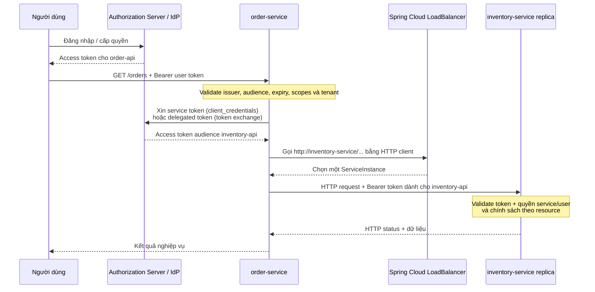
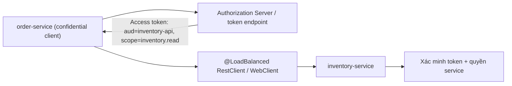
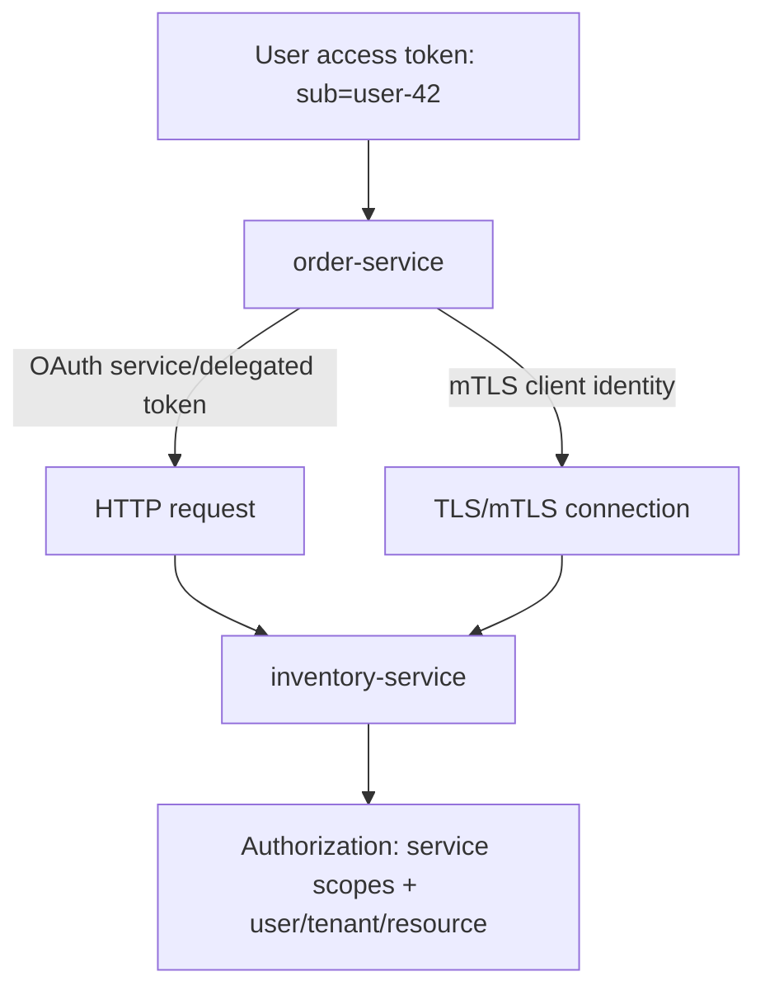

# Phân biệt danh tính người dùng với danh tính dịch vụ

## 1. Vấn đề: ai là người yêu cầu và dịch vụ nào đang gọi?

Trong chương **Bảo mật giao tiếp** của module `SPRING_CLOUD_SERVICE_COMMUNICATION_LOAD_BALANCING`, ta đã biết cách giao tiếp theo service ID: `order-service` gọi `inventory-service` qua Spring Cloud LoadBalancer; danh sách `ServiceInstance` đến từ discovery, có thể lọc theo health/zone, rồi `RestClient`, `WebClient` hoặc OpenFeign gửi HTTP request tới bản sao được chọn.

Nhưng giả sử một khách hàng tên An gọi chức năng giữ hàng. `order-service` nhận request và gọi tiếp `inventory-service`:

- **Ai đang yêu cầu hành động?** Người dùng An, đã đăng nhập và có quyền giữ hàng hay không?
- **Dịch vụ nào đang gọi?** Workload `order-service`, được phép sử dụng API tồn kho nào?
- **Dịch vụ nào đang nhận?** Một instance thực sự thuộc `inventory-service`, không phải máy giả mạo tự đăng ký cùng service ID?
- **Hành động được cho phép?** Kiểm tra quyền với cả loại yêu cầu, sản phẩm, tenant, số lượng và trạng thái giao dịch.

Bốn câu hỏi liên quan nhưng **không đồng nhất**. Nếu chỉ nhận một bearer token bất kỳ rồi kết luận “request an toàn”, ứng dụng có thể tạo lỗ hổng **confused deputy**: service nội bộ có nhiều quyền thay mặt người dùng thực hiện thao tác mà người dùng chưa được phép.

Ngược lại, nếu nhận diện IP, DNS name hoặc service ID là “danh tính”, ta đã nhầm **định tuyến** với **xác thực**. Spring Cloud LoadBalancer không tự tạo, xác thực hay cấp phép JWT/mTLS cho service; nó chọn điểm đến từ danh sách instance.

### Mục tiêu học tập

Sau bài này, bạn có thể:

1. Phân biệt `end-user identity`, `OAuth client identity`, `workload/service identity`, danh tính instance và service ID.
2. Hiểu JWT access token, issuer, audience, subject, scopes/roles và cách các claim liên quan nhưng không tự chứng minh cùng một loại chủ thể.
3. Biết trường hợp dùng **OAuth2 client credentials**, trường hợp cần **ủy quyền theo người dùng** hoặc **token exchange/on-behalf-of**.
4. Giải thích vai trò riêng của TLS/mTLS, OAuth2/OIDC, Spring Security Resource Server và Spring Cloud LoadBalancer.
5. Cấu hình consumer/protected service Spring Security kiểm tra token, phát hành token cho lời gọi machine-to-machine qua `OAuth2AuthorizedClientManager`.
6. Nhận diện lỗi 401/403/503, token relay sai audience, header mạo danh, retry sai và nguy cơ rò rỉ token sang instance không đáng tin.
7. Thực hành kiểm thử hai instance inventory, token hợp lệ/sai audience/sai scope, token người dùng, token workload và mTLS.

## 2. Những loại danh tính khác nhau trong một hệ thống microservice

| Khái niệm | Chủ thể | Nguồn xác thực điển hình | Dùng để quyết định |
|---|---|---|---|
| **Người dùng cuối (end user)** | Tài khoản/phiên đăng nhập của An | Identity Provider (IdP), OAuth2/OIDC, session và chính sách MFA | Người dùng có quyền xem/đặt/mua sản phẩm nào |
| **OAuth2 client** | Ứng dụng được cấp `client_id` | Client secret, private key JWT, mTLS client authentication hoặc workload federation | Ứng dụng được yêu cầu token/quyền nào |
| **Workload/service identity** | `order-service` đang chạy trong môi trường triển khai | mTLS certificate/SPIFFE ID, workload identity, service account, token do issuer cấp | Workload nào đang kết nối và được phép truy cập API nào |
| **Service ID trong LoadBalancer** | Tên logic như `inventory-service` | Discovery/registry cung cấp mapping | **Định tuyến** đến tập instance, không tự là bằng chứng bảo mật |
| **ServiceInstance** | Một replica cụ thể `inventory-a:8081` | Metadata/host/port từ discovery | Instance nào được chọn; vẫn phải xác minh trust khi kết nối |
| **Caller principal trong Spring Security** | Đối tượng `Authentication` hiện tại | Filter/resource server đã kiểm tra token | Quyền truy cập tại endpoint hiện tại |

**Service ID không phải danh tính được chứng thực bằng mật mã.** Ngay cả khi discovery trả `inventory-a` từ registry đáng tin, ứng dụng vẫn cần tin tưởng hạ tầng đăng ký, xác thực TLS/mTLS hoặc mesh identity phù hợp và giới hạn quyền của từng endpoint.

**OAuth client identity không nhất thiết bằng workload identity.** Một ứng dụng có `client_id=order-backend`, còn mTLS certificate mang SPIFFE ID của pod/deployment. Chúng có thể đại diện cho cùng một workload theo chính sách tổ chức, nhưng việc ánh xạ giữa hai danh tính là **cấu hình và trust policy**, không phải suy ra tự động từ hai chuỗi tên.

### 2.1. Ba hướng quan hệ không nên trộn

1. **User → order-service:** client gọi API, `order-service` cần xác thực user token/session và kiểm tra quyền nghiệp vụ.
2. **order-service → inventory-service:** `inventory-service` cần xác thực workload/caller có quyền gọi API.
3. **order-service nhân danh user → inventory-service:** ngoài quyền của workload, `inventory-service` cần biết ngữ cảnh **người dùng đã được ủy quyền**, nhưng không được tin một header user-id tùy ý.

Đối với API chỉ đọc dữ liệu hệ thống chung, có thể đủ service identity và quyền `inventory.read` của ứng dụng. Đối với giữ hàng, dữ liệu theo tenant hoặc hành động của một khách hàng cụ thể, có thể cần **cả hai** loại thông tin và cơ chế delegation rõ ràng.

## 3. Sơ đồ luồng xác thực và định tuyến



Sơ đồ đưa ra **hai phương án khác nhau** để có outbound token: `client_credentials` hoặc token exchange. Không có nghĩa một request cần xin cả hai token hay mọi phiên bản Spring đều tự hỗ trợ token exchange. Cách cấp token phải theo authorization server và mô hình ủy quyền của tổ chức.

**LoadBalancer chọn instance sau khi caller xác định service ID cần gọi.** Một token có `aud=inventory-api` phải được các replica inventory chấp nhận theo cùng chính sách. Nếu client gửi token có `aud=order-api` đến inventory, inventory cần từ chối dù request đến từ pod `order-service`.

## 4. JWT access token: mỗi claim trả lời một câu hỏi

Một access token JWT minh họa (payload đã giải mã, **không phải token có chữ ký hợp lệ**):

```json
{
  "iss": "https://auth.example.test",
  "sub": "user-42",
  "aud": ["order-api"],
  "exp": 1795000000,
  "iat": 1794999700,
  "scope": "order.read order.create",
  "azp": "shop-web",
  "tenant": "tenant-a"
}
```

Các claim cần hiểu:

| Claim hoặc thuộc tính | Diễn giải | Chú ý |
|---|---|---|
| `iss` | Issuer đã phát hành token | Phải khớp issuer được tin và được xác minh cùng chữ ký |
| `sub` | Subject trong ngữ cảnh issuer | Không tự bảo đảm là **người dùng**, vì machine token cũng có thể có `sub` |
| `aud` | Tập recipient/API được phép nhận token | Resource server phải kiểm tra có audience của chính nó |
| `exp`, `nbf`, `iat` | Thời gian hiệu lực | Phải có clock skew hợp lý và chống dùng token hết hạn |
| `scope`/`scp` | Quyền đã được cấp, theo định dạng issuer | Không mặc định role user = OAuth scope của service |
| `azp`/`client_id` | Thông tin OAuth client theo profile issuer | Không đồng nhất với user identity, không nhất thiết có cả hai |
| `tenant`/custom claim | Ngữ cảnh ứng dụng được issuer bảo đảm | Chỉ tin khi issuer và schema contract đã thống nhất |
| `act` (trong token exchange) | Có thể biểu diễn actor đang hành động nhân danh subject | Phụ thuộc token exchange profile và authorization server |

Không đọc payload JWT từ base64 rồi coi là hợp lệ. Resource server phải **xác minh chữ ký hoặc introspection**, issuer, audience, hiệu lực và quyền; các claim chỉ có giá trị tin cậy **sau** bước xác minh.

### 4.1. Ví dụ machine token khác user token

Token minh họa từ `client_credentials`:

```json
{
  "iss": "https://auth.example.test",
  "sub": "order-service-client",
  "aud": ["inventory-api"],
  "scope": "inventory.read",
  "client_id": "order-service-client",
  "exp": 1795000000
}
```

Ở ví dụ này, `sub` là đại diện cho **OAuth client**, không phải user An. Không được gán `userId=order-service-client` vào bảng giao dịch với nghĩa “người mua hàng”.

Một số IdP phát machine token với `sub` là ID nội bộ, một số có claim `gty` hay `token_use`, một số định danh client theo `azp` hoặc `client_id`. **Không có một claim riêng nào áp dụng phổ quát để phân biệt user token và machine token trên mọi issuer.** Cần định nghĩa token profile với IdP, kiểm tra issuer/client/scope/claims và resource policy trong cùng trust domain.

### 4.2. Ba điều kiện độc lập khi xử lý bearer token

1. **Token hợp lệ:** chữ ký/introspection, issuer, audience, thời hạn.
2. **Chủ thể và hành vi được phép:** scopes/roles và chính sách theo loại actor (người dùng, workload hoặc delegated actor).
3. **Resource cụ thể được phép:** SKU/tenant/warehouse/order owner; phải kiểm tra business authorization, không chỉ thấy `authenticated()==true`.

Một access token `aud=inventory-api` có `scope=inventory.read` hợp lệ **vẫn không tự cho phép** trả dữ liệu của tenant khác. Các ràng buộc đối tượng và quyền sở hữu phải được kiểm tra tại inventory hoặc service đã được tin cậy theo hợp đồng.

## 5. OAuth2 client credentials: danh tính ứng dụng khi không hành động thay user

`client_credentials` phù hợp khi `order-service` thực hiện **nhiệm vụ của chính ứng dụng**: đồng bộ tồn kho nền, health-related read có kiểm soát hoặc đọc dữ liệu chung không cần quyền riêng của người dùng.

Luồng khái niệm:



Client phải được IdP cho phép scope tối thiểu. Nếu service chỉ cần `inventory.read`, không cấp `inventory.write` hoặc toàn quyền quản trị. Credentials được lưu trong secret manager hoặc workload identity, không commit vào repository hay embed trong source.

### 5.1. Khai báo OAuth2 client registration cho Spring Boot

Ví dụ `application.yml` trong `order-service` dùng Spring Security OAuth2 Client (các URI là placeholder):

```yaml
spring:
  security:
    oauth2:
      client:
        registration:
          inventory-machine:
            provider: company-auth
            client-id: ${INVENTORY_CLIENT_ID}
            client-secret: ${INVENTORY_CLIENT_SECRET}
            authorization-grant-type: client_credentials
            scope:
              - inventory.read
        provider:
          company-auth:
            token-uri: https://auth.example.test/oauth2/token
```

Trong môi trường triển khai thật, cấu hình client authentication method phù hợp với IdP, ví dụ `client_secret_basic`, `private_key_jwt` hoặc mTLS client authentication; không phải IdP nào cũng dùng client secret. Secret từ biến môi trường là **minh họa**, nên dùng secret manager và chính sách rotation/cấp quyền đọc.

### 5.2. Để OAuth2AuthorizedClientManager quản lý token

Trong ứng dụng Servlet/blocking, Spring Security cung cấp `AuthorizedClientServiceOAuth2AuthorizedClientManager` để lấy/lưu token từ một `ClientRegistrationRepository` và `OAuth2AuthorizedClientService`. Ví dụ:

```java
@Configuration(proxyBeanMethods = false)
class MachineTokenConfiguration {

    @Bean
    OAuth2AuthorizedClientManager machineAuthorizedClientManager(
            ClientRegistrationRepository registrations,
            OAuth2AuthorizedClientService authorizedClientService) {

        var manager = new AuthorizedClientServiceOAuth2AuthorizedClientManager(
                registrations, authorizedClientService);

        manager.setAuthorizedClientProvider(
                OAuth2AuthorizedClientProviderBuilder.builder()
                        .clientCredentials()
                        .build());
        return manager;
    }
}
```

Cách này dành cho các ứng dụng gọi **ngoài HTTP request của một user**, không phụ thuộc servlet request/session của người dùng. Manager có thể tái sử dụng access token còn hạn theo cơ chế authorized client service/provider; không cần tự gọi token endpoint trước **mọi** HTTP request.

Định danh principal dùng trong lời gọi authorize là **tên caller workload**, không phải người dùng:

```java
OAuth2AuthorizeRequest request =
        OAuth2AuthorizeRequest.withClientRegistrationId("inventory-machine")
                .principal("order-service")
                .build();

OAuth2AuthorizedClient authorizedClient = manager.authorize(request);
if (authorizedClient == null) {
    throw new IllegalStateException(
            "Không có OAuth2 authorized client phù hợp");
}
String accessToken = authorizedClient.getAccessToken().getTokenValue();
```

Không log giá trị `accessToken`. Nếu không lấy được token, không gửi request đến inventory với token rỗng hoặc cố dùng token đã hết hạn.

### 5.3. Kết hợp service token với @LoadBalanced RestClient

Một cấu hình client blocking tự chứa:

```java
@Configuration(proxyBeanMethods = false)
class InventoryRestClientConfiguration {

    @Bean
    @LoadBalanced
    RestClient.Builder loadBalancedRestClientBuilder() {
        return RestClient.builder();
    }

    @Bean
    RestClient inventoryRestClient(
            @LoadBalanced RestClient.Builder builder) {
        return builder.clone()
                .baseUrl("http://inventory-service")
                .build();
    }
}
```

Một gateway sử dụng token machine được manager cấp:

```java
@Service
class InventoryMachineGateway {

    private final RestClient client;
    private final OAuth2AuthorizedClientManager manager;

    InventoryMachineGateway(
            RestClient inventoryRestClient,
            OAuth2AuthorizedClientManager manager) {
        this.client = inventoryRestClient;
        this.manager = manager;
    }

    InventoryStock readStock(String sku) {
        OAuth2AuthorizeRequest authRequest =
                OAuth2AuthorizeRequest
                        .withClientRegistrationId("inventory-machine")
                        .principal("order-service")
                        .build();

        OAuth2AuthorizedClient authorized = manager.authorize(authRequest);
        if (authorized == null) {
            throw new IllegalStateException(
                    "Không cấp được token dịch vụ inventory");
        }

        String token = authorized.getAccessToken().getTokenValue();

        return client.get()
                .uri("/api/inventory/{sku}", sku)
                .headers(headers -> headers.setBearerAuth(token))
                .retrieve()
                .body(InventoryStock.class);
    }
}

record InventoryStock(String sku, int available) {}
```

Các import Java/Spring Security/RestClient được lược bỏ. Ví dụ này cần Spring Boot và Spring Cloud Release Train tương thích, OAuth2 Client và OAuth2 Resource Server được cấu hình **đúng ở các ứng dụng tương ứng**. OAuth2 client registration chưa mặc nhiên đảm bảo `aud=inventory-api`: IdP phải cấp access token dành cho inventory, thông qua resource/scope/audience configuration riêng.

**Điểm phân biệt:** manager lấy token cho **service client**; `@LoadBalanced RestClient.Builder` chọn **ServiceInstance**; inventory resource server kiểm tra token và quyền. Ba công việc này không thay thế nhau.

## 6. Khi nào cần user identity ở downstream?

Với một giao dịch giữ hàng theo chủ tài khoản, `inventory-service` có thể cần biết **user nào** sở hữu giỏ hàng/đơn và tenant nào; chỉ có token `client_credentials` của `order-service` không đủ để quyết định user có quyền hay không.

Có ba mô hình thường gặp:

| Mô hình | Outbound request chứa gì? | Khi nào phù hợp | Rủi ro cần kiểm soát |
|---|---|---|---|
| **Machine-to-machine** | Service access token của order-service | Thao tác kỹ thuật, dữ liệu hệ thống chung | Không có quyền người dùng; không dùng thay việc kiểm tra quyền user |
| **Token relay có kiểm soát** | User access token được chuyển tiếp | Chỉ khi token **có audience/scope phù hợp** với downstream và policy cho phép | Lộ quyền rộng, token dùng sai audience, downstream nhầm caller |
| **Token exchange/on-behalf-of** | Token mới do AS phát cho inventory, chứa user context và actor được ủy quyền | Downstream cần user-specific authorization với token có audience và scope tối thiểu | Cần AS hỗ trợ delegation, kiểm tra chuỗi ủy quyền, giới hạn actor |

### 6.1. Vì sao không chuyển tiếp nguyên bearer token một cách mù quáng?

Ví dụ trình duyệt có token:

```json
{
  "sub": "user-42",
  "aud": ["order-api"],
  "scope": "order.create"
}
```

`order-service` **không nên** gửi nguyên token này đến `inventory-service` rồi mong inventory xác thực thành công. Token được cấp cho `order-api`, không phải `inventory-api`. Inventory cần từ chối vì sai `aud`, dù chữ ký hợp lệ, `sub` có vẻ đúng và kết nối đến từ mạng nội bộ.

Nếu bỏ kiểm tra audience ở inventory để “cho chạy”, một token hợp lệ ở API A có thể bị dùng ngoài mục đích ở API B (**token substitution**). Đây là lỗi trust boundary nghiêm trọng.

Có thể relay token chỉ khi AS chủ đích phát token đa audience hoặc audience của downstream, scope đủ và policy ủy quyền đã được phê duyệt. Quyền rộng/multi-audience cần xem xét kỹ vì tăng vùng tác động nếu bearer token bị lộ.

### 6.2. Token exchange / on-behalf-of

Theo RFC 8693, OAuth 2.0 Token Exchange cho phép một client đề nghị authorization server phát token mới dựa trên token/chứng cứ ban đầu, tùy policy. Một luồng khái niệm:

```text
User -> order-service:
    Bearer access token (aud=order-api, sub=user-42)

order-service -> Authorization Server:
    token-exchange(subject_token=user-token,
                   audience=inventory-api,
                   requested_scope=inventory.reserve)
    + xác thực client order-service

Authorization Server -> order-service:
    delegated access token
    (aud=inventory-api,
     subject/user context=user-42,
     actor/order-service theo policy)

order-service -> inventory-service:
    Bearer delegated-token

inventory-service:
    validate signature/issuer/audience/expiry
    validate scope + actor + user/tenant/resource permissions
```

Đây là **pseudocode protocol**, không phải bean mà Spring Cloud LoadBalancer hay Spring Security tự động cung cấp cho mọi AS. Cần IdP hỗ trợ token exchange hoặc một cơ chế ủy quyền tương đương theo chuẩn, có policy giới hạn scopes và lifetime.

Với delegated token, `inventory-service` cần biết:

- Ai là user subject theo issuer?
- Caller/workload nào đang thay mặt user (actor), nếu protocol cung cấp?
- User và workload có quyền yêu cầu hành động đó hay không?
- Token có `aud` dành cho inventory và scope phù hợp không?
- Resource có thuộc đúng tenant/owner không?

**Không chỉ dùng `sub` là đủ.** Với token machine, `sub` có thể là client; với token delegated, actor và user có thể là hai định danh khác nhau.

### 6.3. Header X-User-Id có an toàn không?

Một header như `X-User-Id: user-42` do `order-service` gửi **không tự là bằng chứng xác thực người dùng**. Nếu client bên ngoài có thể tự gửi header đó, hoặc gateway/proxy không strip và ghi đè header trước khi chuyển vào vùng đáng tin, kẻ tấn công có thể giả mạo user khác.

Nếu kiến trúc thật sự dùng asserted identity headers giữa các service, phải có **ranh giới trust nghiêm ngặt**: kết nối workload đã xác thực, header từ bên ngoài bị loại bỏ, proxy phát hành/ký hoặc bảo vệ assertion, quyền được kiểm tra ở downstream và mọi thành phần trung gian không được sửa tùy ý. Đối với hành động nhạy cảm, token delegation được chứng thực có audience/scopes rõ thường dễ kiểm toán hơn header tự do.

## 7. mTLS: xác thực kết nối giữa workload, không chứng minh user

TLS server authentication giúp caller xác minh server thực sự sở hữu chứng chỉ hợp lệ cho danh tính endpoint đích và bảo mật dữ liệu trên đường truyền. **Mutual TLS (mTLS)** bổ sung việc server xác thực client certificate của workload gọi.



| Công nghệ | Xác thực cái gì? | Không tự chứng minh |
|---|---|---|
| HTTPS/TLS | Danh tính server endpoint trong cơ chế trust/hostname verification | Danh tính của end user đang thao tác |
| mTLS | Cả server và client workload ở tầng TLS | Quyền user cụ thể và ngữ nghĩa transaction |
| SPIFFE/SPIRE hoặc workload identity | Danh tính workload theo trust domain/certificate/SVID | Tự động map một user session |
| OAuth2 access token | Chủ thể và quyền theo token profile/issuer/audience | Kết nối mạng nhất định là an toàn nếu không dùng TLS |
| Spring Cloud LoadBalancer | Instance được chọn theo service ID/discovery | Chứng minh certificate/token của instance hợp lệ |

### 7.1. Service mesh và trust boundary

Nếu dùng Envoy/Istio hoặc service mesh khác, mTLS có thể **kết thúc ở sidecar proxy**, không phải trong JVM của Spring Boot. Khi đó:

- Proxy có thể xác minh workload identity của bên gọi và bên nhận.
- Ứng dụng có thể nhận request nội bộ từ proxy qua một hop riêng, tùy deployment mode; phải bảo vệ hop đó.
- Network policy/authorization policy của mesh có thể quyết định `order-service` được kết nối `inventory-service`.
- **Ứng dụng vẫn phải kiểm tra user authorization** hoặc delegated token cho nghiệp vụ cần user context.

Không coi một header `X-Forwarded-Client-Cert` hay header proxy tương tự là đáng tin khi bất kỳ client bên ngoài cũng có thể tự tạo nó. Chỉ cho proxy đáng tin chèn/sửa các header này và chặn đường bypass.

### 7.2. Khi LoadBalancer đổi instance, bảo mật ra sao?

`order-service` gọi service ID `inventory-service`. LoadBalancer chọn `inventory-a` rồi ở request kế tiếp có thể chọn `inventory-b`. Điều này có nghĩa:

- Cả hai replica phải có cấu hình resource server và policy **tương đương** cho hợp đồng API.
- TLS certificate/SAN/identity phải phù hợp với endpoint thực kết nối và cơ chế định tuyến. Nếu dùng TLS trực tiếp đến pod/host, hostname verification phải dựa trên danh tính tên mà chứng chỉ thật sự bảo đảm; không tự tắt hostname verification.
- Nếu mesh mTLS, sidecar/proxy xác thực workload identity của destination trong trust domain; kiểm tra policy của mesh thay vì giả định mọi pod có IP nội bộ là đáng tin.
- Token `aud=inventory-api` thường dành cho **resource API logic**, không buộc caller chọn một instance duy nhất. Việc chọn instance thay đổi không nên làm token vượt phạm vi audience.

Không đặt logic “gọi được host:port tức là authenticated” trong API. Discovery metadata có thể sai hoặc bị nhiễm; cần giới hạn ai được đăng ký instance và bảo vệ registry. Bảo vệ cả đường admin/actuator, không chỉ endpoint nghiệp vụ.

## 8. Spring Security Resource Server xác thực token tại inventory-service

Một service nhận bearer token cần **validate** chứ không chỉ parse. Ví dụ với Spring Security 6.x trong ứng dụng Servlet (Spring MVC), dùng OAuth2 Resource Server JWT.

Các dependency liên quan:

```xml
<dependencies>
    <dependency>
        <groupId>org.springframework.boot</groupId>
        <artifactId>spring-boot-starter-security</artifactId>
    </dependency>
    <dependency>
        <groupId>org.springframework.boot</groupId>
        <artifactId>spring-boot-starter-oauth2-resource-server</artifactId>
    </dependency>
</dependencies>
```

### 8.1. Cấu hình xác minh issuer, chữ ký, thời hạn và audience

Spring Security có thể cấu hình tự động qua `issuer-uri` của resource server; ở đây viết mã minh họa tường minh để thấy **audience validation** không bị bỏ quên:

```java
@Configuration(proxyBeanMethods = false)
class InventoryResourceServerSecurity {

    @Bean
    SecurityFilterChain apiSecurity(HttpSecurity http) throws Exception {
        return http
                .authorizeHttpRequests(auth -> auth
                        .requestMatchers(HttpMethod.GET, "/api/inventory/**")
                            .hasAuthority("SCOPE_inventory.read")
                        .anyRequest().denyAll())
                .oauth2ResourceServer(oauth2 ->
                        oauth2.jwt(Customizer.withDefaults()))
                .build();
    }

    @Bean
    JwtDecoder inventoryJwtDecoder(
            @Value("${security.inventory.issuer}") String issuer,
            @Value("${security.inventory.jwk-set-uri}") String jwkSetUri) {

        NimbusJwtDecoder decoder =
                NimbusJwtDecoder.withJwkSetUri(jwkSetUri).build();

        OAuth2TokenValidator<Jwt> standard =
                JwtValidators.createDefaultWithIssuer(issuer);

        OAuth2TokenValidator<Jwt> audience = jwt ->
                jwt.getAudience().contains("inventory-api")
                        ? OAuth2TokenValidatorResult.success()
                        : OAuth2TokenValidatorResult.failure(
                                new OAuth2Error(
                                        "invalid_token",
                                        "Token audience is not inventory-api",
                                        null));

        decoder.setJwtValidator(
                new DelegatingOAuth2TokenValidator<>(
                        standard, audience));

        return decoder;
    }
}
```

Cấu hình minh họa cho service `inventory-service`:

```yaml
security:
  inventory:
    issuer: https://auth.example.test
    jwk-set-uri: https://auth.example.test/oauth2/jwks
```

Các URI trên chỉ là ví dụ. Ở production, issuer/JWKS phải lấy từ IdP đáng tin, qua HTTPS với TLS validation; cấu hình key rotation, thuật toán ký được phép và xử lý outage theo chính sách bảo mật. Không lấy JWKS URL từ giá trị request do người dùng đưa vào để tránh tấn công chọn key/issuer.

`JwtValidators.createDefaultWithIssuer` kiểm tra các điều kiện tiêu chuẩn theo Spring Security của version đang dùng, gồm issuer và thời hạn; `audience` bổ sung ràng buộc `aud=inventory-api`. Nếu dùng nhiều issuers hoặc token introspection thay vì JWT, mô hình validate sẽ khác, nhưng **yêu cầu audience/resource policy vẫn cần được bảo đảm**.

`hasAuthority("SCOPE_inventory.read")` chỉ là một ràng buộc scope. Nếu endpoint cho phép dữ liệu theo user/tenant, thêm authorization ở tầng nghiệp vụ hoặc method security để phân biệt **user identity** và **workload identity**. **Scope trùng nhau không tự xác minh loại token.** Phải đối chiếu token profile/claims/client identity do AS định nghĩa; không tự giả định mọi token có `SCOPE_inventory.read` đều được phép thực hiện hành động trên dữ liệu người dùng.

### 8.2. Đọc principal đã xác minh

Trong controller/resource service, có thể nhận `JwtAuthenticationToken`:

```java
@GetMapping("/api/inventory/me")
Map<String, String> whoAmI(JwtAuthenticationToken auth) {
    Jwt jwt = auth.getToken();

    return Map.of(
            "subject", jwt.getSubject(),
            "issuer", jwt.getIssuer().toString());
}
```

Đây là endpoint **lab**, không nên public nguyên thông tin token/claim cho người dùng ngoài production. `auth` là kết quả đã qua Spring Security filter, khác việc tự đọc header `Authorization` rồi decode không kiểm chứng.

Nếu `jwt.getSubject()` bằng `order-service-client`, đó có thể là **machine subject**. Không hiển thị nó như user sở hữu đơn hàng. Nếu token exchange cấp token có actor và subject user, đọc/cấp quyền theo token profile đã thống nhất, không đoán chỉ từ tên claim.

### 8.3. Phân biệt bảo vệ GET và POST

Cấu hình ở mục 8.1 chỉ cho `GET /api/inventory/**` với scope `inventory.read`; các path khác bị `denyAll()`. Nếu thêm `POST /api/inventory/reservations`, phải bổ sung policy riêng:

- Máy gọi có scope/authority phù hợp như `inventory.reserve`.
- Nếu nghiệp vụ cần user, delegated user context phải được xác minh.
- Phải kiểm tra tenant, order owner, quantity, idempotency key và quyền trên resource.
- Chỉ cho phép endpoint từ workload đúng danh tính mTLS hoặc qua gateway policy phù hợp khi kiến trúc yêu cầu.

Không sử dụng chỉ một scope rộng kiểu `inventory.admin` cho cả API chỉ đọc và giao dịch nếu không có lý do đã được kiểm soát.

## 9. Token relay có kiểm soát qua WebClient

Nếu thật sự có user access token hợp lệ cho **inventory-api** và chính sách cho phép relay, caller có thể truyền token tới HTTP client. Ví dụ *pseudocode mức adapter*, không trích xuất token tùy ý từ browser:

```java
// Precondition: delegated token đã được IdP cấp cho inventory-api,
// đã đáp ứng chính sách audience/scope và được xử lý an toàn.
Mono<InventoryStock> readForUser(
        String sku, String delegatedAccessToken) {

    return loadBalancedWebClient.get()
            .uri("http://inventory-service/api/inventory/{sku}", sku)
            .headers(headers ->
                    headers.setBearerAuth(delegatedAccessToken))
            .retrieve()
            .bodyToMono(InventoryStock.class);
}
```

`loadBalancedWebClient` là `WebClient` đã được tạo từ builder có `@LoadBalanced`. Ví dụ trên minh họa chỗ gắn bearer token **sau** khi có token phù hợp, không minh họa cách nhận token exchange. Không chuyển `Authentication.getCredentials().toString()` một cách mù quáng: kiểu credentials/giá trị phụ thuộc authentication mechanism, có thể không chứa access token dạng text hoặc có thể lộ bí mật.

Nếu dùng Spring Security OAuth2 Client, có thể cấu hình filter như `ServletOAuth2AuthorizedClientExchangeFilterFunction` hoặc `ServerOAuth2AuthorizedClientExchangeFilterFunction` theo stack Servlet/WebFlux, nhưng phải hiểu **client registration/authorized client nào** được chọn, có lấy token từ user context hay machine principal, và default nào được áp. Đừng bật chế độ “tự gắn token mặc định” lên WebClient dùng chung cho mọi downstream; điều đó có thể khiến token của inventory bị gửi nhầm sang payment hoặc URL redirect.

### 9.1. Không forwarding Authorization qua mọi HTTP redirect

Một token là **bearer credential**: ai giữ token có thể dùng nó trong phạm vi token cho phép. Khi HTTP client theo redirect, proxy hay custom filter, phải kiểm tra chính sách có gửi lại `Authorization` tới host khác không. Không tạo interceptor sao chép bearer token từ incoming request sang **mọi** outbound request mà không kiểm tra destination/audience.

Với nhiều service IDs, tạo client/token policy riêng cho từng resource, chẳng hạn `inventory-api` vs `pricing-api`. Token exchange hoặc client credentials phải request đúng audience; không gom token vào một cache toàn cục chia sẻ giữa các API không cùng trust domain.

## 10. Authorization không chỉ là “đã xác thực service”

Có ba tầng quyết định:

| Tầng | Ví dụ | Lỗi nếu bỏ qua |
|---|---|---|
| **Workload/network policy** | Mesh chỉ cho `order-service` gọi `inventory-service` | Pod bất kỳ có thể gọi API nội bộ |
| **Token/resource server policy** | `aud=inventory-api`, `scope=inventory.read` | Token hợp lệ cho API khác bị chấp nhận |
| **Domain authorization** | User thuộc tenant-a, được giữ SKU trong kho A | Workload có quyền rộng thao tác trên dữ liệu không thuộc người dùng |

Một API có thể **vừa** xác thực workload qua mTLS, **vừa** yêu cầu access token JWT dành cho inventory, **vừa** kiểm tra user/tenant tùy endpoint. Không phải mọi hệ thống bắt buộc dùng cả ba tầng cho mọi GET, nhưng những tầng nào bị bỏ qua phải là một **quyết định kiến trúc có phân tích rủi ro**, không phải mặc định cho môi trường nội bộ.

### 10.1. Quyền theo người dùng cần kiểm tra tại nơi có dữ liệu

Nếu `order-service` khẳng định “user có quyền trên order” nhưng `inventory-service` giữ dữ liệu theo tenant, inventory vẫn nên có cách bảo đảm tenant/user context không bị giả mạo và không bị dùng vượt phạm vi. Để tránh duplicated business logic, có thể dùng policy service/authorization server hoặc contract đã định nghĩa về claims, nhưng **không đơn giản tin `X-Tenant-Id` do caller tùy ý truyền**.

Nếu quyết định ủy quyền chỉ ở `order-service`, inventory phải xác minh workload caller và được thiết kế như một **trusted internal API**, giới hạn khả năng gọi từ nơi khác. Trust boundary này phải được tài liệu hóa và kiểm thử bypass.

### 10.2. Tránh confused deputy

Một ví dụ lỗi:

1. `order-service` có quyền service-wide để sửa mọi reservation.
2. User An chỉ được phép sửa reservation của An.
3. API ở `order-service` nhận `reservationId` bất kỳ, không kiểm tra owner.
4. `order-service` dùng service token mạnh gọi inventory và sửa reservation của Bình.

Tất cả JWT, mTLS và LoadBalancer có thể đều hoạt động **đúng kỹ thuật**, nhưng authorization nghiệp vụ sai. Cần kiểm tra owner/tenant ở điểm có đầy đủ bối cảnh hoặc truyền delegated token đã bị giới hạn quyền. Không dùng service identity mạnh như giấy phép ngầm để vượt quyền user.

## 11. Phân biệt lỗi bảo mật với lỗi discovery và lỗi HTTP

| Triệu chứng | Tầng phát sinh | Ý nghĩa điển hình | Nên làm |
|---|---|---|---|
| `401 Unauthorized` | Resource server/authentication | Thiếu token, token hết hạn/không hợp lệ, issuer/audience sai | Kiểm tra token issuance/validation; không retry vô điều kiện |
| `403 Forbidden` | Authorization | Principal đã xác thực nhưng thiếu quyền/scope/tenant | Sửa policy/quyền đúng quy trình; không retry y nguyên |
| `503` do LoadBalancer không có instance | Caller trước HTTP | Không có đích đủ điều kiện, chưa chắc liên quan authentication | Xem discovery, supplier, health, cache |
| `503` do inventory trả | Downstream đã nhận HTTP | Server đang không sẵn sàng | Phân loại availability, timeout/retry có giới hạn |
| `502` tại API biên | Gateway/caller policy | Lỗi upstream hoặc contract/transport, tùy hợp đồng | Đối chiếu trace, không mặc định do token |
| `SSLHandshakeException` / hostname mismatch | TLS hoặc mTLS | Trust/certificate/SAN/issuer/workload identity lỗi | Sửa trust chain/identity, không tắt verify |
| `invalid_client` tại token endpoint | OAuth client authentication | Workload không được xác thực/cấp token | Kiểm tra client credentials/config, rotation |
| `invalid_grant` hoặc denied token exchange | Authorization Server | Yêu cầu delegation không hợp lệ hoặc không được phép | Kiểm tra policy/as/audience, không fallback token rộng |
| `404 Not Found` từ inventory | Domain hoặc route | SKU/endpoint không tồn tại theo contract | Không coi là “service ID không tồn tại” |
| `429 Too Many Requests` | Rate limit | Caller quá tải hoặc vượt quota | Respect `Retry-After`, hạn chế retry |

HTTP **401** có thể bao gồm `WWW-Authenticate: Bearer ...` với thông tin phù hợp. HTTP **403** không có nghĩa user token không thể đọc; có thể token hợp lệ nhưng thiếu quyền. Một cuộc gọi machine-to-machine có thể nhận 403 nếu service scope không đủ. Đừng tự động lấy token user khác hoặc đổi client credentials rộng hơn để “sửa 403”.

**Không retry lỗi xác thực/ủy quyền như 503.** Retry cùng token không làm issuer, audience hoặc quyền thay đổi. Nếu access token hết hạn, OAuth2 client manager có thể xin token mới theo quy tắc được phép; đó là **lifecycle token**, không phải lý do retry mọi lỗi 401 không giới hạn.

## 12. LoadBalancer, health check và retry không mang danh tính

Khi `inventory-service` có hai replica, `RoundRobinLoadBalancer` chọn A rồi B theo policy; thuật toán không biết token là của user hay service. Cần chú ý:

- **Cả hai instance** phải validate token theo cùng issuer/audience/scopes/API contract. Một replica quên audience check có thể tạo lỗ hổng chỉ xuất hiện ở một phần traffic.
- **Retry** có thể chọn instance khác. Nếu retry làm thay đổi danh tính caller hoặc token audience, đó là lỗi client integration; token không nên bị ghép với instance hostname một cách tùy tiện.
- **Health check** kiểm tra sự sẵn sàng nhưng không cấp quyền. Một `/actuator/health/readiness` trả 200 không chứng minh service sẽ chấp nhận token hay phân quyền đúng.
- **Discovery/cache** có thể trả instance stale. Kết nối tới instance chưa được tin cậy không được phép nhận bearer token chỉ vì có trong danh sách. Cần harden registry và transport trust.
- **Zone routing** là chính sách locality, không phải security boundary. Nếu tenant/region có yêu cầu pháp lý hoặc residency, dùng chính sách định tuyến cứng, network segmentation và authorization/tenant enforcement; không dựa vào zone preference có fallback.

### 12.1. Retry và token expiration

Một logical request có thể có nhiều attempts. Token ở attempt thứ hai có thể hết hạn trong lúc backoff:

- Client manager phù hợp có thể lấy token mới trước khi gửi, không cache token hết hạn.
- Với user delegated token, phải theo cơ chế đổi token/ủy quyền đã được phê duyệt; không kéo dài quyền user chỉ vì request đang retry.
- Không tự retry POST giao dịch nhạy cảm khi chưa có idempotency key và chống ghi trùng.
- Nếu token exchange thất bại, không fallback sang service token mạnh hơn để bỏ qua kiểm tra user.

### 12.2. DNS, service ID, chứng chỉ và audience là bốn danh sách khác nhau

Ví dụ:

```text
Service ID LoadBalancer: inventory-service
Discovery endpoint:      inventory-a.internal:8443
TLS server identity:     spiffe://example.test/ns/shop/sa/inventory
JWT audience:            inventory-api
```

Bốn giá trị này **không nhất thiết trùng nhau**, nhưng phải có mapping được quản lý và kiểm tra theo chính sách. Không kiểm tra audience bằng cách so sánh chuỗi với hostname vật lý mới chọn; inventory có thể chạy ở nhiều hostname/pod trong cùng API audience. Cũng không bỏ hostname verification vì certificate SAN không chứa service ID: hãy dùng mô hình identity/certificate phù hợp với triển khai TLS trực tiếp hoặc mesh.

## 13. Lab: hai replica inventory và hai loại token

### 13.1. Topology

| Thành phần | Port / địa chỉ ví dụ | Vai trò |
|---|---|---|
| `order-service` | `localhost:8080` | Caller dùng `@LoadBalanced RestClient` |
| `inventory-a` | `localhost:8081` | Resource server, xác minh token |
| `inventory-b` | `localhost:8082` | Resource server, xác minh token |
| Authorization Server | `https://auth.example.test` | Phát access tokens ký hợp lệ |
| Discovery | `SimpleDiscoveryClient` trong lab | Danh sách hai instance |

Cấu hình caller:

```yaml
spring:
  application:
    name: order-service
  cloud:
    discovery:
      client:
        simple:
          instances:
            inventory-service:
              - uri: http://localhost:8081
                instance-id: inventory-a
              - uri: http://localhost:8082
                instance-id: inventory-b
    loadbalancer:
      retry:
        enabled: false
server:
  port: 8080
```

Ví dụ dùng HTTP `localhost` **chỉ để học cơ chế LoadBalancer** và giả định chạy cùng network namespace trong môi trường cô lập. Bài thực hành bảo mật thật cần HTTPS/mTLS hoặc mesh thích hợp và IdP thực; không gửi bearer token thật qua cleartext HTTP trên mạng không tin cậy. Trong Docker/Kubernetes phải dùng địa chỉ mà caller truy cập được, không nhầm `localhost` của container với pod khác.

### 13.2. Tạo endpoint được bảo vệ

Trong cả `inventory-a` và `inventory-b`, đăng ký `InventoryResourceServerSecurity` của mục 8 và endpoint:

```java
@RestController
class InventoryApiController {

    private final String instanceId;

    InventoryApiController(Environment env) {
        instanceId = env.getRequiredProperty("app.instance-id");
    }

    @GetMapping("/api/inventory/{sku}")
    Map<String, Object> stock(@PathVariable String sku) {
        return Map.of(
                "sku", sku,
                "available", 12,
                "instanceId", instanceId);
    }
}
```

A dùng `app.instance-id=inventory-a`, B dùng `inventory-b`. Cả hai phải dùng **cùng policy issuer/audience và scopes** để kết quả authentication không thay đổi theo replica.

### 13.3. Bộ token cho thử nghiệm

Tạo token **thực được IdP ký** và cấp theo policy, không tự ghép JWT payload giả rồi kỳ vọng resource server tin. Chuẩn bị:

| Token | Subject/Client | Audience | Scope | Kỳ vọng đối với `GET inventory` |
|---|---|---|---|---|
| A — service token đúng | `order-service-client` | `inventory-api` | `inventory.read` | 200 khi request/cert/tenant policy hợp lệ |
| B — user token cho order | `user-42` | `order-api` | `order.read` | 401 do sai audience đối với inventory |
| C — service token thiếu quyền | `order-service-client` | `inventory-api` | `order.read` | 403 theo `hasAuthority("SCOPE_inventory.read")` |
| D — hết hạn | Bất kỳ | `inventory-api` | `inventory.read` | 401 do `exp` |
| E — issuer sai | Subject bất kỳ | `inventory-api` | `inventory.read` | 401 do issuer/chữ ký không tin cậy |
| F — token delegated đúng | Subject user, actor service theo AS | `inventory-api` | `inventory.read` | 200 với read, còn quyền user/tenant phải kiểm tra riêng |

Nếu endpoint chỉ yêu cầu scope ở cấu hình mẫu, token A và F đều có thể qua lớp scope; việc phân biệt chính xác token class là **policy bổ sung** cần được thiết kế với AS. Không kết luận machine token A được phép thực hiện mọi giao dịch theo user chỉ vì GET trả 200.

### 13.4. Trình tự thí nghiệm

1. Chạy hai inventory instances và IdP thử nghiệm, kiểm tra cả hai đang có cùng security config.
2. Gửi request hợp lệ qua `order-service` bằng `InventoryMachineGateway`; ghi instance ID ở response và trace.
3. Gọi với token sai audience/issuer/expired theo môi trường test; xác nhận 401, không fallback sang anonymous.
4. Gọi token đúng issuer/audience nhưng thiếu `inventory.read`; xác nhận 403.
5. Bật luân phiên A/B và thử làm B thiếu audience validator trong môi trường test; chứng minh có khoảng trống security chỉ ở một phần lưu lượng, rồi khôi phục policy tương đương.
6. Dừng A và để discovery còn URI A; phân biệt lỗi transport/timeout với 401/403.
7. Thử mTLS/mesh policy từ một workload không được phép, xác nhận kết nối bị từ chối **trước** khi kiểm tra user token; theo dõi log mesh/proxy.
8. Kiểm tra log/metric không xuất access token, refresh token, secret hay private key.

**Không thực hành vô hiệu hóa kiểm tra signature, audience hoặc TLS hostname verification trên môi trường có dữ liệu thật.** Với bài test “token sai”, nên yêu cầu AS phát các token dùng cho test hoặc dùng server kiểm thử có JWKS và issuer riêng được tin trong lab.

## 14. Ma trận lỗi và cách xử lý trên caller

Một API gateway hoặc `order-service` phải trả status nhất quán cho user khi dependency có lỗi nhưng không che ý nghĩa:

| Upstream/tầng lỗi | Hành vi caller phù hợp |
|---|---|
| Token user gửi tới order-api không hợp lệ | Trả 401 cho user; không gọi inventory |
| User đã xác thực nhưng không có quyền thao tác | Trả 403 cho user; không gọi inventory |
| Không cấp được service token do cấu hình `invalid_client` | Alert và lỗi dependency; không tự gửi request anonymous |
| Inventory từ chối machine token vì sai audience | Sự cố security/config; **không retry cùng token vô hạn** |
| Inventory từ chối vì thiếu scope | Sửa chính sách/quyền client; không dùng token có quyền rộng hơn vô cớ |
| Không có `ServiceInstance` | 503 hoặc lỗi dependency theo contract, điều tra discovery/health |
| Instance đã chọn nhưng connection timeout | Giới hạn deadline, retry có điều kiện đối với GET an toàn |
| Circuit breaker đang OPEN | Fail fast / fallback nghiệp vụ phù hợp, không gán lỗi cho user |
| Mã HTTP 404 cho SKU không tồn tại | Xử lý domain `NOT_FOUND`, không nhầm với service ID không tồn tại |
| Lỗi dữ liệu/contract | Không tự giả `available=0` hoặc cấp quyền mặc định |

Ở API nội bộ, việc chuyển error từ inventory sang order-service phải **giữ phân loại nguyên nhân**: 401 do user thiếu xác thực khác 401 do service token hết hạn, và cả hai có thể cần hành động sửa khác nhau. Không ném tất cả lỗi thành `403` để “ẩn thông tin” nếu mục tiêu là một hợp đồng API rõ ràng.

### 14.1. Không tin dữ liệu không có chữ ký

Các trường hợp nên từ chối:

- JWT được decode nhưng chưa verify chữ ký.
- Token có `iss` khác issuer đáng tin hoặc `aud` không chứa resource API.
- Token hết hạn hoặc `nbf` chưa tới.
- Token có scope nhưng thiếu user/actor context cần cho thao tác nhạy cảm.
- Header `X-User-Id`/`X-Tenant-Id` đến từ client ngoài mà không có trust boundary.
- Service certificate không hợp lệ hoặc không map tới workload được phép.
- Redirect sang host khác và tiếp tục đính kèm bearer token.
- Registry chứa instance lạ nhưng application tin rằng “cùng service ID là cùng trust”.

## 15. Những sai lầm phổ biến

| Nhận định sai | Vì sao sai | Cách sửa |
|---|---|---|
| “Cùng mạng nội bộ là đã xác thực” | Internal IP không là bằng chứng mật mã | TLS/mTLS, network policy, resource server |
| “Service ID là danh tính service đã ký” | Nó chủ yếu là khóa discovery/routing | Xác thực workload qua mTLS/token/mesh |
| “Bearer token nào cũng dùng được giữa các service” | Token có `aud`/scope riêng | Kiểm tra audience; token exchange khi cần |
| “`sub` luôn là user ID” | Machine token cũng có subject | Dựa trên token profile và actor/client identity |
| “Có `scope=inventory.read` nghĩa là user được xem mọi tenant” | Scope API không thay resource authorization | Kiểm tra owner/tenant/warehouse |
| “Có mTLS thì không cần user authorization” | mTLS xác thực workload, không phải end user | Bổ sung delegated user context khi cần |
| “`X-User-Id` do caller truyền là đủ” | Header có thể bị giả mạo | Trusted proxy/cryptographic delegation và policy |
| “client_credentials thay được user token khi checkout” | Token service không đại diện quyền user | Chặn thao tác hoặc dùng user delegation |
| “Token exchange tự xảy ra khi bật LoadBalancer” | LoadBalancer không là OAuth2 client/token service | Cấu hình AS/token exchange riêng |
| “Một replica khỏe thì mọi replica đều bảo mật đúng” | Security config có thể lệch giữa các pod | Test A/B và canary security parity |
| “Đã xác thực JWT rồi không cần kiểm tra audience” | Token cho API khác có thể bị dùng lại | Validate `aud` tại từng resource server |
| “JWT parse được là hợp lệ” | Payload có thể giả mạo | Verify signature, issuer, expiry, audience |
| “SSLHandshakeException thì tắt hostname verification” | Làm mất xác thực server | Sửa certificate/SAN/trust/cấu hình mesh |
| “401/403 nên retry như 503” | Thiếu quyền không tự biến mất khi lặp lại | Xử lý token lifecycle/policy riêng |
| “Health check 200 chứng minh endpoint đã có quyền” | Readiness không liên quan authentication | Test protected API bằng token cụ thể |
| “Retry đổi instance thì token tự đổi audience” | Token áp cho API/resource logic | Tách token issuance khỏi chọn instance |
| “Lưu bearer token trong trace để debug” | Token là credential có thể bị phát lại | Chỉ log mã lỗi và metadata không nhạy cảm |

## 16. Bài tập vận dụng

### Bài 1 — Vẽ trust boundary

Vẽ lại sơ đồ user → order → inventory. Chỉ rõ tại đâu xác thực user token, tại đâu cấp service token, tại đâu kiểm tra JWT audience, tại đâu mesh mTLS xác thực workload, và LoadBalancer chọn instance ở đâu. Giải thích vì sao mỗi bước không thay thế bước khác.

### Bài 2 — Phân loại JWT

Cho ba payload: (A) `sub=user-42, aud=order-api`; (B) `sub=order-client, aud=inventory-api, scope=inventory.read`; (C) `sub=user-42, aud=inventory-api, act=order-client`. Phân loại user/service/delegated theo **profile issuer đã biết**, không chỉ dựa vào `sub`. Nêu trường hợp cần từ chối do scope/tenant thiếu.

### Bài 3 — Client credentials và thiếu user context

Viết `InventoryMachineGateway` dùng `OAuth2AuthorizedClientManager` để gọi GET inventory từ một background job. Sau đó thử dùng cùng machine token để giữ hàng cho user; giải thích vì sao phải kiểm tra quyền user/tenant hoặc chuyển sang delegated token.

### Bài 4 — Không chuyển tiếp sai audience

Nhận token `aud=order-api` ở `order-service`. Viết test xác nhận inventory resource server từ chối request nếu token này bị relay nguyên trạng. Đề xuất cách xin token mới `aud=inventory-api` thông qua AS.

### Bài 5 — Hai replica, một security policy

Dựng hai inventory instance có cùng code security. Gửi 50 GET qua LoadBalancer, xác nhận tất cả request với token A hợp lệ; token sai audience B phải bị từ chối ở **cả** replica. Chủ động thay cấu hình B trong lab rồi đo failure lệch theo instance.

### Bài 6 — mTLS và user token độc lập

Bật mTLS/service mesh cho tuyến order → inventory. Cho một workload không được phép kết nối: phải bị chặn ngay ở tầng mTLS/policy. Sau đó cho order-service được phép kết nối nhưng gửi token user thiếu scope: API vẫn phải từ chối theo chính sách bearer/authorization.

### Bài 7 — Confused deputy

Giả lập user An muốn sửa reservation của Bình qua order-service. Dù order-service có token `inventory.write`, kiểm tra owner/tenant phải ngăn thao tác. Đề xuất vị trí kiểm tra và cách truyền delegated context đáng tin.

### Bài 8 — 401, 403 và 503

Tạo ba test riêng: token hết hạn (401), token hợp lệ nhưng thiếu scope (403), discovery trả không có instance (503 do caller). Chỉ trong trường hợp lỗi tạm thời/timeout phù hợp mới cân nhắc retry có giới hạn; ghi rõ event/metric theo loại lỗi.

## 17. Checklist trước khi vận hành

- [ ] Đã định nghĩa user identity, OAuth client identity, workload identity và service ID riêng biệt.
- [ ] Mỗi resource server xác minh token signature/introspection, issuer, audience, thời hạn và quyền.
- [ ] Không coi `sub` luôn là user ID; machine/delegated token có profile rõ.
- [ ] Client credentials chỉ dùng cho công việc service được phép, không tự thay quyền user.
- [ ] Có token exchange hoặc delegation đáng tin khi downstream cần user context.
- [ ] Header user/tenant từ bên ngoài không thể giả mạo vượt trust boundary.
- [ ] Có TLS/mTLS hoặc service mesh policy cho đường truyền và danh tính workload khi cần.
- [ ] Không tắt hostname/certificate verification để “sửa” lỗi chọn instance.
- [ ] Hai hoặc nhiều replica cùng service ID dùng cùng chính sách resource server.
- [ ] Client HTTP có `@LoadBalanced` đúng bean, không nhầm routing với authentication.
- [ ] Token audience gắn với API nhận, không tự động dựa trên host:port replica.
- [ ] Retry/timeout, health check và circuit breaker không được làm suy yếu authorization.
- [ ] Đã thử 401, 403, wrong audience, expired token, no-instance, TLS failure và rollback.
- [ ] Không log token/secret/private key, không truyền Authorization tới host không tin cậy.
- [ ] Có audit principal loại user/service/actor, trace và quyết định authorization mà không lộ PII.
- [ ] Có kế hoạch secret/certificate rotation, token revocation/introspection nếu policy cần.
- [ ] Các thao tác ghi có idempotency và quyền trên resource, không chỉ scope API chung.

## Tài liệu tham khảo chính thức

- [Spring Security — OAuth 2.0 Resource Server JWT](https://docs.spring.io/spring-security/reference/servlet/oauth2/resource-server/jwt.html): xác thực JWT, issuer, JWK, JWT validators và chuyển scopes thành authorities.
- [Spring Security — OAuth2 Client, Core Interfaces/Authorized Client Manager](https://docs.spring.io/spring-security/reference/servlet/oauth2/client/core.html): `OAuth2AuthorizedClientManager`, `client_credentials` và authorized client services.
- [Spring Security — Reactive OAuth2 Client](https://docs.spring.io/spring-security/reference/reactive/oauth2/client/index.html): OAuth2 client/filter trong hệ thống WebFlux.
- [Spring Cloud Commons — Spring Cloud LoadBalancer](https://docs.spring.io/spring-cloud-commons/reference/spring-cloud-commons/loadbalancer.html): service ID, `ServiceInstance`, discovery, health check, retry và chọn đích.
- [RFC 6749 — OAuth 2.0 Authorization Framework](https://www.rfc-editor.org/rfc/rfc6749): `client_credentials` và mô hình authorization.
- [RFC 7519 — JSON Web Token](https://www.rfc-editor.org/rfc/rfc7519): các claim `iss`, `sub`, `aud`, `exp` và ý nghĩa token.
- [RFC 8707 — Resource Indicators for OAuth 2.0](https://www.rfc-editor.org/rfc/rfc8707): chỉ định tài nguyên/audience phù hợp khi yêu cầu token.
- [RFC 8693 — OAuth 2.0 Token Exchange](https://www.rfc-editor.org/rfc/rfc8693): subject token, actor/delegation và mô hình token exchange.
- [RFC 6750 — OAuth 2.0 Bearer Token Usage](https://www.rfc-editor.org/rfc/rfc6750): gửi bearer token, status 401 và `WWW-Authenticate`.
- [SPIFFE — Workload Identity Standard](https://spiffe.io/docs/latest/spiffe-about/overview/): định danh workload và chứng chỉ/SVID.
- [Spring Cloud — Release Train](https://spring.io/projects/spring-cloud/): đối chiếu Spring Cloud/Boot/Security khi dùng ví dụ và dependency.

**Điểm cần nhớ:** **user identity** trả lời “người dùng nào và có quyền gì?”, **service/workload identity** trả lời “ứng dụng nào đang gọi?”, còn **service ID của Spring Cloud LoadBalancer** trả lời “gọi tập instance nào?”. Token dành cho inventory phải được cấp và xác minh theo **audience, scopes và policy của inventory**, bất kể request rơi vào replica nào. Bảo mật giao tiếp đáng tin cậy đòi hỏi xác thực **đúng chủ thể**, ủy quyền **đúng tài nguyên** và giữ ranh giới tin cậy qua từng bước.
