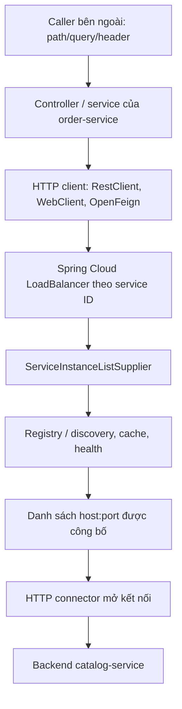

# Ngăn URL không tin cậy và nguy cơ SSRF ở bên gọi

Trong kiến trúc microservices, ứng dụng thường gửi HTTP request đến dịch vụ khác qua `RestClient`, `RestTemplate`, `WebClient` hoặc OpenFeign. Với Spring Cloud LoadBalancer, client có thể gọi một URL logic như `http://catalog-service/api/products/42`, để LoadBalancer tìm và chọn `ServiceInstance` phù hợp. **Tuy nhiên, khả năng chọn instance không phải cơ chế bảo vệ khỏi URL không tin cậy.**

Khi ứng dụng lấy toàn bộ URL, hostname, service ID hoặc đích chuyển hướng từ tham số người dùng rồi dùng chúng để gọi HTTP, một đối tượng bên ngoài có thể lợi dụng quyền truy cập mạng của server để gửi request đến hệ thống không nên được truy cập. Đó là một dạng **Server-Side Request Forgery (SSRF)**. Rủi ro vẫn tồn tại khi ứng dụng có service discovery, health check, round-robin, retry hoặc TLS.

Bài học thuộc phần **Bảo mật giao tiếp** của module Spring Cloud LoadBalancer. Trọng tâm là xác định ranh giới tin cậy, không để dữ liệu ngoài quyết định đích kết nối, cấu hình client theo service ID đã kiểm soát, và kết hợp kiểm tra URI với chính sách mạng khi thực sự cần gọi URL do bên ngoài cung cấp.

## 1. SSRF là gì trong giao tiếp liên dịch vụ?

SSRF xảy ra khi một thành phần có quyền truy cập mạng **thực hiện request đến địa chỉ do nguồn ít tin cậy tác động**, vượt ra ngoài những đích mà ứng dụng được thiết kế để gọi.

Giả sử `order-service` có endpoint hỗ trợ xem trước một hình ảnh sản phẩm. Một cách triển khai nguy hiểm là nhận nguyên chuỗi `url` từ caller rồi cho backend tải URL đó. Nếu không có kiểm soát, đối tượng gọi có thể thử khiến `order-service` truy cập:

- Địa chỉ loopback như `http://127.0.0.1:8080/...`, nơi chỉ server có thể tự kết nối.
- Địa chỉ link-local hoặc endpoint metadata của hạ tầng cloud.
- Dịch vụ nội bộ trên mạng riêng mà người dùng bên ngoài không được gọi trực tiếp.
- Host bên ngoài có redirect về một địa chỉ nội bộ.
- DNS name ban đầu trông hợp lệ nhưng sau đó phân giải sang IP bị cấm.

Hậu quả có thể là lộ dữ liệu nội bộ, truy cập trái phép API quản trị, tiêu thụ tài nguyên mạng hoặc làm ứng dụng trở thành một **confused deputy**: server sử dụng quyền mạng của chính nó để thực hiện hành động mà caller không được phép.

**Phân biệt:** SSRF không nhất thiết yêu cầu một URL có dạng `http://...` xuất hiện trong API. Nếu một tham số người dùng được biến thành tên service ID, host, port, gateway route hoặc metadata để chọn instance nội bộ, ranh giới tin cậy cũng có thể bị vượt qua.

## 2. Ranh giới tin cậy trong Spring Cloud LoadBalancer

Một lời gọi qua LoadBalancer thường đi qua các lớp:



Có **hai nơi quyết định đích** khác nhau:

1. **Ở mã ứng dụng:** lựa chọn service ID hoặc URL logic, chẳng hạn `catalog-service`; đây phải là quyết định từ cấu hình và nghiệp vụ đáng tin cậy.
2. **Ở discovery và LoadBalancer:** lựa chọn một host/port từ các instance được công bố; danh sách này chỉ đáng tin trong phạm vi bảo đảm của registry, danh tính đăng ký, chính sách mạng và quy trình vận hành.

Ví dụ controller chấp nhận tham số:

```text
GET /proxy?service=internal-admin&path=/...
```

Sau đó xây `http://{service}/{path}` để gọi qua `@LoadBalanced` là một thiết kế nguy hiểm. Dù không gọi trực tiếp IP, caller vẫn có khả năng chọn **một service ID nội bộ không nằm trong nghiệp vụ cho phép**. LoadBalancer chỉ thực hiện chọn instance; nó không biết caller có quyền dùng tên dịch vụ đó hay không.

**Nguyên tắc đầu tiên:** URL hoặc service ID cho request liên dịch vụ nên do **mã ứng dụng/cấu hình tin cậy** lựa chọn. Người dùng chỉ được cung cấp **dữ liệu nghiệp vụ** như product ID, filter, ngày hoặc số lượng, không được chọn tùy ý máy chủ hoặc protocol.

## 3. Phân biệt phần nào của URI có thể nhận từ người dùng

Một URI HTTP có nhiều thành phần:

```text
https://api.partner.example:443/products/42?locale=vi#section
  │       │               │     │          │       │
scheme   host             port  path       query   fragment
```

Tác động bảo mật của từng phần khác nhau:

| Thành phần | Ai nên quyết định? | Rủi ro khi nguồn ngoài kiểm soát |
|---|---|---|
| Scheme (`http`/`https`) | Cấu hình tin cậy | Hạ chuẩn TLS hoặc dùng protocol không mong muốn |
| Host / service ID | Cấu hình, allowlist | SSRF vào internal/loopback hoặc một dịch vụ khác |
| Port | Cấu hình, allowlist | Truy cập cổng quản trị hoặc cổng không được phép |
| Path template | Mã ứng dụng | Gọi endpoint đặc quyền, path traversal/định tuyến ngoài dự kiến |
| Path variable | Dữ liệu nghiệp vụ đã validate và encode | Thoát khỏi một segment hoặc làm lệch route |
| Query value | Dữ liệu nghiệp vụ đã encode | Thay đổi tham số nếu nối chuỗi sai; có thể mang URL thứ cấp |
| Header | Do code hoặc policy có kiểm soát | Giả mạo Host, auth, proxy/forwarded hoặc routing hint |
| Fragment | Không gửi trong HTTP request tới server | Không có tác dụng định tuyến server nhưng dễ gây sai lầm khi kiểm tra string |

Dấu `@` trong URL là ví dụ kinh điển cho lý do **không kiểm tra host bằng `startsWith`**: chuỗi chứa một tên miền được phép ở phần thông tin user vẫn có thể có host thật khác. Tương tự, `api.partner.example.evil.example` không phải cùng host với `api.partner.example`.

Các phép kiểm tra như `url.contains("api.partner.example")`, `startsWith("https://api.partner.example")` hoặc chỉ chặn chuỗi `localhost` đều không đủ để bảo đảm an toàn.

## 4. Cách phòng vệ ưu tiên: đích cố định, chỉ biến thiên dữ liệu

Nếu nghiệp vụ chỉ cần gọi `catalog-service`, giải pháp đơn giản và mạnh nhất là **không cho caller truyền URL**.

### 4.1. RestClient với service ID cố định

Khai báo một `RestClient.Builder` có LoadBalancer:

```java
import org.springframework.cloud.client.loadbalancer.LoadBalanced;
import org.springframework.context.annotation.Bean;
import org.springframework.context.annotation.Configuration;
import org.springframework.web.client.RestClient;

@Configuration(proxyBeanMethods = false)
class HttpClientConfiguration {

    @Bean
    @LoadBalanced
    RestClient.Builder loadBalancedRestClientBuilder() {
        return RestClient.builder();
    }
}
```

Tạo client chỉ phục vụ một service ID:

```java
import java.util.regex.Pattern;

import org.springframework.beans.factory.annotation.Qualifier;
import org.springframework.stereotype.Component;
import org.springframework.web.client.RestClient;

@Component
public class CatalogClient {

    private static final Pattern SAFE_PRODUCT_ID =
            Pattern.compile("[A-Za-z0-9_-]{1,64}");

    private final RestClient restClient;

    public CatalogClient(
            @Qualifier("loadBalancedRestClientBuilder")
            RestClient.Builder builder) {
        this.restClient = builder
                .baseUrl("http://catalog-service")
                .build();
    }

    public ProductResponse getProduct(String productId) {
        if (productId == null
                || !SAFE_PRODUCT_ID.matcher(productId).matches()) {
            throw new IllegalArgumentException("Invalid product ID");
        }

        return restClient.get()
                .uri(uriBuilder -> uriBuilder
                        .path("/api/products/{id}")
                        .build(productId))
                .retrieve()
                .body(ProductResponse.class);
    }
}
```

Đoạn code giả định `ProductResponse` là DTO của ứng dụng. Các điểm cần lưu ý:

- `catalog-service` và path template là **literal do code kiểm soát**, không đến từ request bên ngoài.
- `productId` chỉ là một path variable; regex minh họa hợp đồng ID đơn giản, không cho phép dấu `/`, `?`, `#` hoặc chuỗi chứa ký tự điều khiển.
- URI builder thực hiện quá trình mở rộng và encode URI theo cấu hình Spring; **không tự ghép string URL** từ dữ liệu chưa tin cậy.
- Bộ lọc LoadBalancer giải quyết tên service ID bằng discovery, nhưng không được giao trách nhiệm kiểm tra product ID hay quyền người dùng.

Regex ở đây là **quy tắc nghiệp vụ minh họa**, không bắt mọi API phải dùng cùng định dạng ID. Nếu ID cho phép Unicode, dấu cách hoặc các ký tự khác, nên có cách validate/encode nhất quán với API contract; mục tiêu là **giữ dữ liệu trong một vị trí URI được xác định trước**, không biến nó thành host hoặc URI hoàn chỉnh.

Cần chú ý rằng `baseUrl(...)` của một HTTP client không luôn ngăn tuyệt đối method call ghi đè bằng **absolute URI**. Đừng xây wrapper cho phép truyền `uri(String arbitraryUrl)` rồi nghĩ rằng `baseUrl` tự bảo vệ được đích. API gọi nội bộ nên chỉ cung cấp các **phương thức nghiệp vụ** như `getProduct(id)`, không lộ method `fetchUrl(url)`.

### 4.2. WebClient với builder LoadBalancer

Mẫu tương tự cho WebClient:

```java
import org.springframework.cloud.client.loadbalancer.LoadBalanced;
import org.springframework.context.annotation.Bean;
import org.springframework.web.reactive.function.client.WebClient;

@Bean
@LoadBalanced
WebClient.Builder loadBalancedWebClientBuilder() {
    return WebClient.builder();
}
```

Sau đó tạo client với đích tin cậy:

```java
public final class CatalogReactiveClient {
    private final WebClient webClient;

    public CatalogReactiveClient(WebClient.Builder builder) {
        this.webClient = builder
                .baseUrl("http://catalog-service")
                .build();
    }

    public Mono<ProductResponse> getProduct(String id) {
        if (id == null || !id.matches("[A-Za-z0-9_-]{1,64}")) {
            return Mono.error(
                    new IllegalArgumentException("Invalid product ID"));
        }
        return webClient.get()
                .uri(uriBuilder -> uriBuilder
                        .path("/api/products/{id}")
                        .build(id))
                .retrieve()
                .bodyToMono(ProductResponse.class);
    }
}
```

Ví dụ giả định builder được inject là bean `@LoadBalanced`, đã import `WebClient` và `Mono`. Khi dùng WebClient trong Spring WebFlux, trả `Mono` cho framework quản lý subscription thay vì gọi `block()` hoặc `subscribe()` không kiểm soát.

Mẫu **cần tránh** trong cả WebClient và RestClient:

```java
// KHÔNG AN TOÀN: userUrl có thể là một absolute URL hoặc service ID lạ.
webClient.get()
        .uri(userUrl)
        .retrieve()
        .bodyToMono(String.class);
```

Nếu caller được quyền đặt toàn bộ URI, application không còn kiểm soát đích HTTP. Việc dùng `@LoadBalanced` không bảo đảm tên service ID được chọn thuộc allowlist.

### 4.3. Query parameter không phải URL template tự do

Ví dụ tìm kiếm sản phẩm nên cố định endpoint:

```java
Mono<List<ProductResponse>> search(
        String category, int page, int size) {
    if (page < 0 || size < 1 || size > 100) {
        return Mono.error(
                new IllegalArgumentException("Invalid pagination"));
    }
    return webClient.get()
            .uri(uriBuilder -> uriBuilder
                    .path("/api/products")
                    .queryParam("category", category)
                    .queryParam("page", page)
                    .queryParam("size", size)
                    .build())
            .retrieve()
            .bodyToMono(new ParameterizedTypeReference<
                    List<ProductResponse>>() {});
}
```

`ParameterizedTypeReference` thuộc `org.springframework.core`. Query builder giúp không phải tự nối `"&"`, `"="` hoặc encode thủ công. Tuy nhiên, nếu một query parameter như `callbackUrl` lại được **backend đích sử dụng để phát HTTP request tiếp**, nguy cơ SSRF có thể chuyển sang backend đó. Validate và giới hạn giá trị URL **ở đúng nơi thực hiện request**.

## 5. OpenFeign: khóa service ID ngay trong interface

Với Spring Cloud OpenFeign, cách thông thường là khai báo service ID tĩnh:

```java
import org.springframework.cloud.openfeign.FeignClient;
import org.springframework.web.bind.annotation.GetMapping;
import org.springframework.web.bind.annotation.PathVariable;

@FeignClient(name = "catalog-service")
public interface CatalogFeignClient {

    @GetMapping("/api/products/{id}")
    ProductResponse getProduct(@PathVariable("id") String id);
}
```

Khi gọi method, Spring Cloud OpenFeign chuyển annotation thành HTTP request; Spring Cloud LoadBalancer có thể chọn instance theo service ID `catalog-service`. Nếu yêu cầu phân loại ID nghiêm ngặt, kiểm tra trong service/gateway trước khi gọi Feign và vẫn áp dụng authorization cho product.

Những chỗ cần đặc biệt kiểm soát:

- `@FeignClient(url = "...")`: đích cố định có thể phù hợp khi lấy từ cấu hình tin cậy; **không lấy URL đó từ request của người dùng**.
- Tính năng **dynamic target** của Feign, hoặc method nhận `java.net.URI` để override đích nếu được hỗ trợ bởi contract hiện tại, cần được xem là ranh giới nhạy cảm. Không truyền URI không tin cậy vào cơ chế đó.
- `RequestInterceptor` có thể thêm header từ request/context. Không cho caller quyết định `Host` hoặc routing hint tùy ý nếu nó có thể khiến client gọi nhầm một service hoặc cohort nội bộ.
- Khi nhiều Feign client có cùng contract nhưng khác mục đích, dùng interface/bean riêng và `contextId` theo nhu cầu, không tạo một Feign client có chức năng gọi mọi URL do người dùng cung cấp.

Tương tự, `RestTemplate.exchange(userUrl, ...)` cũng không an toàn nếu `userUrl` đến từ caller và không được ràng buộc. Chuyển từ một HTTP client này sang client khác **không tự giải quyết SSRF**.

## 6. Khi chọn giữa nhiều dịch vụ: dùng allowlist định danh, không nhận URL

Có trường hợp `order-service` cần gọi `catalog-service` hoặc `inventory-service` tùy một lựa chọn nghiệp vụ. Thiết kế an toàn hơn là cho caller chọn một **mã lựa chọn hữu hạn**, rồi map trong code sang các client được cấu hình sẵn:

```java
public enum LookupSource {
    CATALOG, INVENTORY
}
```

```java
public ProductView lookup(
        LookupSource source, String productId) {
    return switch (source) {
        case CATALOG -> catalogClient.find(productId);
        case INVENTORY -> inventoryClient.find(productId);
    };
}
```

Trong đó `catalogClient` và `inventoryClient` là các adapter có đích cố định; `ProductView` là kiểu dữ liệu ứng dụng. Không cần xây `"http://" + source + "/..."` từ input.

Nếu input ngoài chỉ là chuỗi, chuyển nó thành enum hoặc ID có validate tại ranh giới API; giá trị không thuộc allowlist nên bị từ chối. **Đừng tự nới allowlist** bằng cách chấp nhận mọi service ID xuất hiện trong registry. Discovery cho biết những dịch vụ *được tìm thấy*, không quyết định caller *được phép gọi* dịch vụ nào.

## 7. Trường hợp bắt buộc nhận URL ngoài: kiểm soát nhiều lớp

Một số nghiệp vụ thực sự cần tải ảnh từ URL đối tác, kiểm tra webhook hoặc truy vấn endpoint do tenant cấu hình. Khi đó không thể dùng service ID cố định cho tất cả trường hợp. Cần áp dụng chính sách **outbound URL** với điều kiện cụ thể.

Các lớp thường cần:

1. **Giới hạn chức năng:** nếu có thể, chỉ nhận ID tài nguyên hoặc lựa chọn đối tác đã đăng ký, không nhận URL đầy đủ.
2. **Parse URI bằng thư viện chuẩn:** không lấy host bằng biểu thức chuỗi. Xác định scheme, host, port, user info, fragment và đường dẫn.
3. **Allowlist đích:** chỉ cho phép những hostname và port đúng hợp đồng; ưu tiên exact-match với danh sách nhỏ, quản lý bằng cấu hình được phê duyệt.
4. **Giới hạn protocol:** đối với kết nối ngoài, thường chỉ `https`; không chấp nhận URI scheme khác hoặc URI tương đối.
5. **Kiểm tra DNS/IP tại điểm kết nối:** từ chối kết nối đến địa chỉ loopback, link-local, private, multicast và các dải bị cấm theo chính sách, kể cả mọi kết quả DNS hoặc IPv6/IPv4-mapped forms.
6. **Kiểm soát redirect:** tắt redirect tự động nếu không cần. Nếu cần follow, giới hạn hop và áp lại **toàn bộ policy** cho từng đích sau redirect.
7. **Phòng DNS rebinding và TOCTOU:** không chỉ resolve để kiểm tra một lần rồi để HTTP client tự resolve lại một địa chỉ khác. Phải đảm bảo địa chỉ được kết nối chính là địa chỉ đã được xác thực, hoặc đi qua proxy/egress gateway cưỡng chế policy.
8. **Giới hạn truy cập mạng:** egress firewall, network policy hoặc proxy bắt buộc để phòng khi tầng application có lỗi.
9. **Giới hạn tài nguyên:** timeout, response-size cap, stream limit, redirect count, concurrency/rate limit; không tải vô hạn body từ URL ngoài.

### 7.1. Ví dụ validator hostname tĩnh

Đoạn code dưới đây chỉ minh họa **bước kiểm tra URI đầu vào** cho một tập hostname đối tác cố định. Nó **không phải giải pháp SSRF hoàn chỉnh**; sau khi pass vẫn cần bảo đảm kiểm soát DNS, kết nối, redirect và egress.

```java
import java.net.URI;
import java.util.Locale;
import java.util.Set;

public final class PartnerUriPolicy {

    private static final Set<String> ALLOWED_HOSTS =
            Set.of("api.partner.example", "assets.partner.example");

    public URI validate(String input) {
        if (input == null || input.length() > 2_048) {
            throw new IllegalArgumentException("Invalid URL length");
        }

        final URI uri;
        try {
            uri = URI.create(input);
        } catch (IllegalArgumentException ex) {
            throw new IllegalArgumentException("Malformed URL", ex);
        }

        if (!uri.isAbsolute()
                || !"https".equalsIgnoreCase(uri.getScheme())
                || uri.getHost() == null
                || uri.getRawUserInfo() != null
                || uri.getRawFragment() != null) {
            throw new IllegalArgumentException("Unapproved URL form");
        }

        String host = uri.getHost().toLowerCase(Locale.ROOT);

        // Exact hostname match. No subdomain wildcard or string prefix.
        if (!ALLOWED_HOSTS.contains(host)) {
            throw new IllegalArgumentException("Host not allowed");
        }

        // For these endpoints, HTTPS default port only.
        if (uri.getPort() != -1 && uri.getPort() != 443) {
            throw new IllegalArgumentException("Port not allowed");
        }

        return uri;
    }
}
```

Ví dụ hoạt động về mặt chính sách:

| URI đầu vào | Kết quả bước validator | Lý do |
|---|---|---|
| `https://api.partner.example/products/42` | Chấp nhận qua bước URI policy | Scheme, host, port nằm trong allowlist |
| `http://api.partner.example/products/42` | Từ chối | Không phải HTTPS |
| `https://api.partner.example.evil.example/` | Từ chối | Host không exact-match |
| `https://api.partner.example@other.example/` | Từ chối | User-info/host không hợp lệ |
| `https://127.0.0.1/` | Từ chối | Host không thuộc allowlist |
| `https://assets.partner.example:8443/image` | Từ chối | Port không thuộc allowlist |

Danh sách `*.example` chỉ là hostname tài liệu, không phải endpoint thực. Không dùng những ví dụ này làm cấu hình production.

**Hạn chế cần nêu rõ:** validator trên chưa kiểm tra DNS resolution và địa chỉ socket sẽ kết nối; cũng chưa buộc HTTP client không follow redirect. Một hostname **được phép** vẫn có thể phân giải sang IP nội bộ hoặc trả HTTP redirect đến URL không được phép. Bởi vậy, kết quả `validate()` **không được xem là bằng chứng rằng HTTP request đã an toàn**.

Khi cần URL động từ nhiều tenant, tránh để tenant tự thêm hostname vào allowlist không kiểm soát. Quy trình đăng ký endpoint phải có xác minh quyền sở hữu và phê duyệt egress phù hợp, đặc biệt nếu hostname được trỏ vào hệ thống nội bộ.

### 7.2. DNS, IP đặc biệt và hiện tượng rebinding

Chỉ chặn `127.0.0.1` hoặc `localhost` không đủ. Những nhóm địa chỉ cần được chính sách egress cân nhắc gồm:

- IPv4 loopback, private RFC 1918, link-local, unspecified và các dải reserved theo môi trường.
- IPv6 loopback, link-local, unique-local và IPv4-mapped IPv6.
- Địa chỉ metadata link-local của cloud và các địa chỉ nội bộ đặc quyền.
- Tên DNS trỏ đến nhiều IP mà có một IP không thuộc vùng được phép.
- CNAME hoặc DNS answer thay đổi giữa **lần kiểm tra** và **lần kết nối**.

Các phương thức `InetAddress.isLoopbackAddress()`, `isSiteLocalAddress()` hoặc `isLinkLocalAddress()` hỗ trợ một số kiểm tra, nhưng **không bao phủ đầy đủ mọi dải cần chặn**, đặc biệt một số địa chỉ IPv6 và địa chỉ đặc biệt. Không triển khai một bộ lọc IP an toàn chỉ bằng vài lời gọi boolean.

Với ứng dụng yêu cầu kiểm soát mạnh, **egress proxy** hoặc connection factory có cơ chế kiểm tra và ràng buộc địa chỉ tại thời điểm kết nối sẽ đáng tin cậy hơn cách parse URL rồi resolve trước để kiểm tra. Cần tính tới việc pool connection được tái sử dụng, proxy DNS khác DNS ứng dụng và cơ chế TLS SNI/certificate verification.

### 7.3. Redirect và credential leakage

Giả sử một hostname thuộc allowlist trả `302 Location: ...` sang hostname khác. Nếu HTTP client tự follow, **đích thứ hai cũng phải qua kiểm tra** như đích đầu; không thể kết luận “đã kiểm tra URL đầu vào rồi là đủ”.

Nên:

- Tắt follow redirect mặc định trong HTTP client hoặc HTTP connector nếu nghiệp vụ không cần.
- Nếu cho phép redirect, giới hạn số hop và tái xác minh scheme, host, port, resolved IP và egress ở **mỗi hop**.
- Không tự chuyển tiếp `Authorization`, cookie hoặc các header bí mật sang host khác.
- Không để redirect đổi protocol từ HTTPS sang HTTP nếu policy không cho phép.

Mỗi HTTP client (Reactor Netty, Apache HttpClient, JDK HTTP client, Feign HTTP transport) có cài đặt redirect khác nhau. Không suy đoán một mặc định chung của mọi phiên bản: **kiểm tra connector được ứng dụng sử dụng thực tế**.

## 8. Bảo vệ discovery và thông tin ServiceInstance

Ngay cả khi application luôn gọi `http://catalog-service`, vẫn cần giữ an toàn cho nguồn địa chỉ mà LoadBalancer chọn. Nếu kẻ tấn công có thể tự đăng ký instance dưới service ID của dịch vụ nội bộ hoặc sửa metadata host/port, caller có thể bị dẫn tới một địa chỉ do kẻ đó kiểm soát.

Các kiểm soát cần cân nhắc:

| Thành phần | Mục tiêu bảo vệ |
|---|---|
| Registry/service discovery | Xác thực đăng ký, phân quyền sửa/xóa instance, tránh dịch vụ giả mạo |
| Thông tin instance | Ràng buộc host, port, service ID và namespace theo platform đáng tin cậy |
| Spring Cloud LoadBalancer | Chỉ cấu hình chính sách từ nguồn được quản lý, không nhận service ID tùy ý từ request |
| Egress policy | Chặn kết nối từ caller đến vùng mạng/cổng không cần thiết, kể cả khi discovery bị nhiễm |
| TLS/mTLS | Xác thực endpoint hoặc danh tính dịch vụ khi mô hình bảo mật có yêu cầu |
| Audit/observability | Truy vết instance ID, host:port được chọn và kết quả gọi khi xảy ra sự cố |

Health check **không** phải biện pháp chống SSRF hoặc giả mạo service identity. Một endpoint giả mạo vẫn có thể trả `200 OK`. Tương tự, việc đăng ký hợp lệ không thay thế TLS certificate verification hay xác thực caller tại dịch vụ đích.

Khi dùng mTLS hoặc service mesh, cần xác minh danh tính dịch vụ sau LoadBalancer và chính sách truy cập thực tế. Đừng cho rằng tên service ID logic tự bảo đảm rằng host/port đang được kết nối thuộc đúng danh tính mong đợi.

## 9. Ngăn URL injection qua header, metadata và forwarding

URL đích đôi khi không đến từ một tham số `url` trực tiếp, mà được **suy ra từ metadata hoặc header**:

- `Host` và `X-Forwarded-Host` có thể phản ánh input phía client/proxy. Không dùng chúng làm host cho request HTTP ra ngoài nếu chưa có một chính sách trusted proxy rõ ràng.
- `X-Forwarded-Proto` có thể không đáng tin nếu proxy chain không được cấu hình đúng. Không để header này quyết định có dùng TLS cho cuộc gọi nội bộ hay không.
- `X-SC-LB-Hint` hoặc metadata canary/zone có thể thay đổi tập instance được ưu tiên. Đừng cho phép client bên ngoài chọn một cohort hoặc service nhạy cảm ngoài quyền của nó.
- API nhận `redirectUrl`, `avatarUrl` hoặc `callbackUrl` có thể tạo thêm request ở một backend khác. Validation phải nằm ở **dịch vụ thực sự thực hiện outbound call**.
- Event/message từ queue hoặc bản ghi database có thể chứa URL do người dùng nhập từ trước. Việc dữ liệu đi qua database **không biến nó thành dữ liệu đáng tin**.

Một hệ thống có thể dùng header để phân chia traffic hoặc authorization cho mục đích hợp lệ, nhưng việc chọn route phải được kiểm soát bởi ứng dụng/gateway đáng tin cậy, không tự động tin dữ liệu gửi từ Internet.

## 10. Phân biệt phản hồi lỗi bảo mật và lỗi kết nối

Để phòng SSRF hiệu quả, không chỉ chặn request mà còn cần trả lỗi đúng và không tiết lộ hạ tầng nội bộ.

| Trường hợp | Xử lý ở caller | Không nên làm |
|---|---|---|
| URL đầu vào sai/không được phép | Từ chối **trước khi** gọi HTTP; ánh xạ sang lỗi validation phù hợp, ví dụ HTTP 400 | Thử gửi request rồi mới kiểm tra status |
| Người dùng thiếu quyền gọi nghiệp vụ | Áp dụng authorization; trả 403 theo hợp đồng | Xem URL allowlist là cơ chế phân quyền người dùng |
| Không có ServiceInstance phù hợp | Xử lý lỗi discovery/availability, có thể ánh xạ lỗi dependency | Trả 404 “không có sản phẩm” khi chưa đến backend |
| DNS/connection timeout | Ghi nhận như lỗi transport, giới hạn retry | Retry vô hạn nhiều endpoint hoặc tự mở rộng allowlist |
| Response 302 | Theo policy redirect; kiểm tra đích tiếp theo hoặc chặn | Follow tự động đến nội bộ |
| HTTP 4xx/5xx từ upstream | Phân loại lỗi theo hợp đồng; giới hạn error body | Trả nguyên raw response nhạy cảm cho caller |

Một URL bị chặn phải được ghi nhận như **quyết định bảo mật**, không phải lỗi mạng. Có thể log mã lý do như `UNAPPROVED_HOST` hoặc `BLOCKED_DESTINATION`, nhưng không cần đưa URL đầy đủ, user-info, token, query string nhạy cảm vào log/response.

`RestClient`, `WebClient` và OpenFeign có cơ chế exception khác nhau, nhưng chính sách từ chối URL không tin cậy nên diễn ra **trước tầng HTTP client**. Khi request đã ra khỏi process, chỉ dựa vào HTTP status để quyết định có phải SSRF hay không là quá muộn.

## 11. Kiểm thử SSRF như một phần của integration tests

Các bài test cần đảm bảo **không phát sinh request ngoài ý muốn**, thay vì chỉ kiểm tra một validator trả `false`. Một bộ test hợp lý có thể bao gồm:

1. **URL cố định:** với API chỉ cần `catalog-service`, thử truyền ID chứa chuỗi giống URL, dấu `/`, `?`, `#` hoặc dấu chấm kép; xác minh method từ chối hoặc giữ chúng đúng vị trí path variable, không làm thay đổi host.
2. **Absolute URL:** thử đưa chuỗi có scheme/host vào parameter mà application trước đây dùng để ghép URI. Kỳ vọng bị từ chối trước HTTP.
3. **Host giả mạo:** kiểm tra host có prefix/suffix giống allowlist, user-info chứa hostname được phép, port khác 443, case/Unicode/IDN và trailing dot theo policy.
4. **IP nội bộ:** kiểm tra loopback, RFC 1918, link-local, IPv6 loopback/unique-local và địa chỉ metadata trong chính sách egress của môi trường test.
5. **DNS nhiều kết quả:** dùng resolver/mocks có một kết quả hợp lệ và một kết quả bị cấm; xác minh không có kết nối đến IP không hợp lệ.
6. **DNS thay đổi:** mô phỏng DNS rebinding giữa validation và connection; bảo đảm tầng actual-connect hoặc proxy vẫn chặn.
7. **Redirect:** endpoint thử nghiệm trả redirect về một đích không thuộc allowlist; xác minh client không follow hoặc chặn sau khi kiểm tra đích mới.
8. **Discovery bị nhiễm:** cố đưa một instance giả có host/port không được phép vào nguồn discovery thử nghiệm; xác minh policy mạng/identity không cho request tới đích đó.
9. **Retry:** lỗi bị chặn không được kích hoạt retry hay thử qua nhiều host; mỗi HTTP attempt vẫn phải theo cùng chính sách.
10. **Timeout và body limit:** URL ngoài cố ý phản hồi chậm hoặc trả body lớn; kiểm tra resource limit và cancellation.

Ví dụ unit test cho bước URI policy ở phần 7:

```java
import static org.junit.jupiter.api.Assertions.assertThrows;

import org.junit.jupiter.api.Test;

class PartnerUriPolicyTest {
    private final PartnerUriPolicy policy = new PartnerUriPolicy();

    @Test
    void rejectsLocalAddress() {
        assertThrows(IllegalArgumentException.class,
                () -> policy.validate("https://127.0.0.1/"));
    }

    @Test
    void rejectsLookalikeHost() {
        assertThrows(IllegalArgumentException.class,
                () -> policy.validate(
                        "https://api.partner.example.evil.example/"));
    }

    @Test
    void rejectsUntrustedPort() {
        assertThrows(IllegalArgumentException.class,
                () -> policy.validate(
                        "https://api.partner.example:8443/data"));
    }
}
```

**Giới hạn của unit test:** các test này chỉ xác minh parser/allowlist. Để đánh giá SSRF thực sự, cần kiểm thử **HTTP transport/redirect/DNS/egress**, tốt nhất trong môi trường mạng giả lập không thể truy cập tài nguyên nội bộ nhạy cảm. Không thực hiện thử nghiệm SSRF đối với hệ thống của bên thứ ba khi chưa được phép.

## 12. Quan sát và ứng phó khi phát hiện yêu cầu đáng ngờ

Các số liệu hữu ích:

| Nhóm quan sát | Trường nên ghi | Điều cần tránh |
|---|---|---|
| Quyết định URL policy | Policy ID, lý do từ chối, nguồn API/tenant đã ẩn danh phù hợp | Log nguyên URL kèm token/query nhạy cảm |
| Routing | Service ID logic, instance ID/remote class, allowlisted destination | Ghi metadata chưa kiểm soát |
| Connection | HTTP connector, loại lỗi DNS/timeout/TLS, attempt | Xem mọi timeout là lỗi SSRF |
| Redirect | Số hop, blocked redirect count, scheme/host đã được chuẩn hóa | Tự follow không ghi nhận |
| Egress network | Allowed/denied destination class, blocked ports | Mở egress rộng để “chữa lỗi” |
| Tải và lỗi | Reject rate, timeout rate, concurrency, response size | Retry dồn dập khi URL bị chặn |

Nên có cảnh báo khi tỷ lệ URL bị từ chối tăng đột biến hoặc xuất hiện nhiều yêu cầu đến vùng IP bị cấm. Điều này có thể là lỗi tích hợp của một đối tác hoặc hành vi dò tìm; cần đối chiếu trace, caller identity và lịch triển khai trước khi kết luận.

Khi phát hiện sự cố, có thể tạm ngừng tính năng fetch URL ngoài, giảm quyền egress, khóa endpoint/cấu hình bị lạm dụng, kiểm tra audit log và xoay credential nếu có dấu hiệu lộ. **Không để response từ đích không tin cậy tự quyết định lại chính sách bảo mật**.

## 13. Checklist bảo mật trước khi đưa lên production

- [ ] Mọi call nội bộ qua Spring Cloud LoadBalancer dùng **service ID được định nghĩa sẵn hoặc chọn từ allowlist nghiệp vụ**, không lấy service ID/absolute URI tùy ý từ HTTP request.
- [ ] Path template và endpoint được khai báo bằng code; path/query variable được validate và encode theo contract.
- [ ] Các WebClient/RestClient/RestTemplate/Feign adapter không để lộ hàm nhận URL bất kỳ ở những nghiệp vụ không cần URL động.
- [ ] Nếu cần URL ngoài, có URL policy chặt chẽ về scheme, exact hostname, port, user-info và redirect; không dùng `startsWith` hoặc `contains` để kiểm tra host.
- [ ] Actual connection chịu kiểm tra DNS/IP và egress; chống DNS rebinding/TOCTOU, bao gồm IPv6 và các dải IP đặc biệt.
- [ ] Không gửi credential hay header nội bộ sang host ngoài/redirect chưa được cho phép.
- [ ] Registry được xác thực và phân quyền; instance identity và network access được kiểm soát.
- [ ] Timeout, response size, concurrency, retry và redirect hop count có giới hạn.
- [ ] Test cả tình huống chặn **trước khi gửi request** và tình huống redirect/DNS khi HTTP request được phát thực sự.
- [ ] Có metrics/log/trace cho quyết định policy và lỗi kết nối, đồng thời bảo vệ dữ liệu nhạy cảm trong log.

## 14. Ghi nhớ

**Không tin cậy URL do bên ngoài kiểm soát.** Với giao tiếp liên dịch vụ, mô hình an toàn nhất là để mã ứng dụng lựa chọn service ID cố định, sau đó chỉ truyền những tham số nghiệp vụ đã validate/encode vào path, query hoặc body. `@LoadBalanced`, service discovery và các thuật toán chọn `ServiceInstance` giải quyết bài toán định tuyến/khả dụng, **không phải cơ chế chống SSRF**.

Khi nghiệp vụ buộc phải gọi URL động, chỉ kiểm tra chuỗi hostname là chưa đủ: phải kiểm soát scheme, host, port, redirect, DNS/IP tại kết nối thực, quyền đăng ký instance, egress mạng, credential forwarding và giới hạn tài nguyên. Các lớp bảo vệ nên độc lập và kiểm thử được, để dù có một lỗi trong mã tạo request, ứng dụng cũng không thể tùy ý truy cập hệ thống nội bộ ngoài phạm vi được phép.

