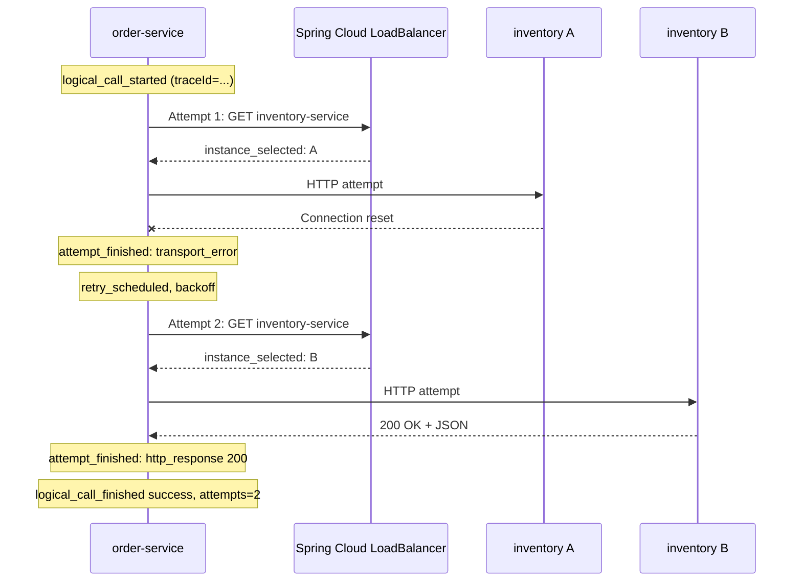

# Log định danh dịch vụ, bản sao và kết quả lời gọi

Khi một microservice gọi microservice khác qua Spring Cloud LoadBalancer, việc chỉ ghi log `GET /items thất bại` gần như không đủ để xử lý sự cố. Bên vận hành cần biết **dịch vụ logic nào được gọi, bản sao (replica) nào đã được chọn, lời gọi thực sự đi đến đâu, kết quả HTTP hay lỗi xảy ra tại giai đoạn nào, và sự kiện đó thuộc request nghiệp vụ nào**.

Ví dụ, `order-service` gọi `inventory-service` theo service ID `http://inventory-service`. Spring Cloud LoadBalancer có thể chọn instance A ở lần thử thứ nhất; A ngừng nhận kết nối, nên caller thử lại và chọn B. Cuối cùng client nhận `200 OK`. Nếu chỉ log kết quả cuối `200`, người đọc không biết request đã trải qua một lần lỗi, mất thêm thời gian hoặc tạo thêm tải. Nếu chỉ log một dòng `inventory-service 503`, lại không biết `503` đến từ upstream, proxy hay nhánh không còn `ServiceInstance` khả dụng.

Bài học thuộc chương **Quan sát hệ thống** trong module `SPRING_CLOUD_SERVICE_COMMUNICATION_LOAD_BALANCING`. Mục tiêu là thiết kế log có cấu trúc cho giao tiếp HTTP giữa các dịch vụ, phối hợp `RestClient`, `WebClient`, OpenFeign, discovery, health check, routing, timeout và retry. Chúng ta sẽ phân biệt **service ID** với **instance ID**, xác định đúng điểm quan sát việc chọn replica, ghi **kết quả từng attempt** và **kết quả toàn bộ logical request**, đồng thời bảo vệ dữ liệu nhạy cảm.

## 1. Bốn câu hỏi một dòng log tốt phải trả lời

Một sự kiện outbound HTTP nên giúp trả lời:

1. **Ai gọi ai?** Caller là `order-service`; target service ID là `inventory-service`.
2. **Replica nào?** Nếu đã chọn được đích, ghi `instanceId` (hoặc định danh tương đương), không tự suy từ service ID.
3. **Kết quả gì, ở tầng nào?** HTTP status, exception, no-instance, timeout, decode error hay request bị từ chối tại caller?
4. **Gắn với thao tác nào?** `traceId`/`spanId` hoặc correlation ID, operation ổn định, attempt number và thời gian.

Hãy nhìn các ví dụ log rút gọn:

```text
KÉM:  Inventory request failed.
KÉM:  GET /items/42 -> 503.

TỐT: targetService=inventory-service event=instance_selected
      instanceId=inventory-b attempt=2 traceId=4bf9...

TỐT: targetService=inventory-service event=outbound_attempt_finished
      attempt=2 outcome=http_response httpStatus=200 durationMs=48

TỐT: targetService=inventory-service event=logical_call_finished
      outcome=success attempts=2 totalDurationMs=276 traceId=4bf9...
```

Các giá trị trong bài học là **dữ liệu giả lập**, không phải log mặc định do Spring Cloud LoadBalancer tự phát ra.

## 2. Service ID khác instance ID, hostname và caller ID

| Trường | Ý nghĩa | Ví dụ | Có luôn sẵn không? |
|---|---|---|---|
| `callerService` | Ứng dụng tạo HTTP call. | `order-service` | Có thể đọc từ cấu hình `spring.application.name`. |
| `callerInstance` | Bản sao của caller đang thực hiện lời gọi. | `order-7f9d` | Cần định danh runtime/deployment; không phải lúc nào cũng được cấp. |
| `targetService` | Service ID logic dùng cho Spring Cloud LoadBalancer. | `inventory-service` | Thường biết lúc tạo RestClient/WebClient/Feign. |
| `selectedInstanceId` | ID `ServiceInstance` được thuật toán chọn. | `inventory-a12` | Chỉ có nếu đã chọn được instance; có provider không cung cấp ID. |
| `selectedHost`/`selectedPort` | Host/port của `ServiceInstance`. | `10.20.1.12:8080` | Có thể quan sát tại bước chọn; nhạy cảm về topology. |
| `upstreamService` | Tên ứng dụng do **server đích** tự ghi. | `inventory-service` | Có nếu server được instrument. |
| `upstreamInstance` | Định danh của process/Pod thực sự nhận request. | `inventory-a12` | Cần server log hoặc response debug được bảo vệ. |
| `route`/`operation` | Định danh API có cardinality thấp. | `GET /api/items/{id}` | Nên đặt từ contract thay vì log URI chứa dữ liệu. |

**`targetService` không phải `selectedInstanceId`.** Khi discovery trả ba bản sao A/B/C, cả ba có thể nhận cùng service ID; một dòng log chỉ chứa `inventory-service` không chứng minh replica nào được chọn.

**Replica được chọn cũng chưa chắc xử lý thành công request.** Kết nối có thể hỏng trước khi gửi HTTP, request có thể bị proxy chuyển tiếp, hoặc caller có thể hủy sau khi server đã bắt đầu xử lý. Do đó cần phân biệt `selectedInstanceId` bên caller với `upstreamInstance` trong log phía server.

`ServiceInstance.getInstanceId()` có thể trả `null` tùy nguồn discovery và provider. Khi thiếu, có thể tạo định danh nội bộ dựa trên thông tin endpoint được phép log, nhưng không được coi fallback đó là định danh toàn cục ổn định qua rollout. Không sử dụng một IP ngắn hạn như khóa nghiệp vụ hoặc bằng chứng quyền truy cập.

## 3. Log sự kiện theo vòng đời request, không chỉ dòng kết thúc

Một lời gọi logic có thể tạo nhiều attempt. Mỗi attempt lại có các giai đoạn riêng:



Một bộ sự kiện tương đối đầy đủ:

| Sự kiện | Khi nào? | Giá trị quan trọng |
|---|---|---|
| `logical_call_started` | Bắt đầu thao tác nghiệp vụ gọi service khác. | Service ID, operation, trace ID, deadline. |
| `loadbalancer_selection_started` | Khi bắt đầu lựa chọn ứng viên nếu được instrument. | Service ID, policy/hint hợp lệ. |
| `instance_selected` | Khi có `ServiceInstance` được chọn. | Instance ID, zone (nếu cho phép), attempt number. |
| `no_eligible_instance` | Danh sách được chọn rỗng hoặc không có đích phù hợp. | Service ID, nguyên nhân được biết; **không có instance ID**. |
| `outbound_attempt_started` | Trước khi HTTP transport thực hiện một attempt. | Operation, attempt, selected target nếu có. |
| `outbound_attempt_finished` | Response status hoặc lỗi transport ở attempt đó. | Status/exception, duration, outcome. |
| `retry_scheduled` | Chính sách quyết định thử lại. | Lỗi gốc, attempt tiếp theo, backoff, remaining budget. |
| `logical_call_finished` | Toàn bộ thao tác gọi kết thúc. | Kết quả cuối, tổng thời gian, tổng attempts. |

Không nhất thiết phải ghi **tất cả** sự kiện này ở mức INFO trong production; với hệ thống có RPS lớn, log per-attempt mọi request có thể quá tốn kém. Nên phân tách **sự kiện quan trọng cần log**, metric aggregate, trace span và sampling. Nhưng schema phải đủ rõ để debug được khi bật logging chọn lọc.

### HTTP response không đồng nghĩa body đã decode xong

Client có thể nhận `200 OK` và các response headers, rồi gặp JSON không hợp lệ hoặc body vượt codec buffer limit. Vì vậy:

- `http_response_received`: biết HTTP status, có thể **chưa** có DTO.
- `response_decoded`: body đã được đọc và chuyển đổi thành dữ liệu mong đợi.
- `logical_call_finished`: biết kết quả nghiệp vụ cuối cùng.

Một filter WebClient dừng ở `next.exchange(request)` chủ yếu thấy sự kiện **nhận headers/ClientResponse**, không chắc thấy lỗi phát sinh khi tầng bên trên tiêu thụ `bodyToMono(...)`. Để ghi lỗi decode, cần instrument cả pipeline xử lý body hoặc vùng gateway/service.

## 4. Mẫu log JSON có cấu trúc

Đối với một request GET qua LoadBalancer, schema có thể dùng các trường ổn định:

```json
{
  "timestamp": "2026-11-17T14:00:00Z",
  "level": "INFO",
  "event": "outbound_attempt_finished",
  "callerService": "order-service",
  "callerInstance": "order-a1",
  "targetService": "inventory-service",
  "operation": "GET /api/items/{id}",
  "traceId": "4bf92f3577b34da6a3ce929d0e0e4736",
  "spanId": "00f067aa0ba902b7",
  "attempt": 2,
  "selectedInstanceId": "inventory-b12",
  "outcome": "http_response",
  "httpStatus": 200,
  "durationMs": 48,
  "retryable": false
}
```

Giá trị timestamp, trace/span ID, instance ID và thời gian ở trên đều minh họa. Nếu chưa chọn được instance, trường `selectedInstanceId` nên **vắng mặt hoặc null**, không ghi một ID giả là `unknown-instance` để rồi đếm thành replica thật.

Nên dùng các giá trị `event`, `outcome` và `operation` thuộc **tập tên có kiểm soát**, vì việc đưa nguyên URI, exception message hay header tùy ý vào trường phân nhóm làm khó dashboard và có thể gây lộ dữ liệu.

### Nhóm outcome nên có ngữ nghĩa rõ

| `outcome` | Điều đã xảy ra | Có HTTP status từ upstream không? |
|---|---|---|
| `success` | Logical request hoàn tất đúng hợp đồng. | Thường có. |
| `http_response` | HTTP transport nhận response status, không mặc định coi mọi 4xx/5xx đều là lỗi nghiệp vụ. | Có. |
| `no_instance` | Không chọn được `ServiceInstance` hợp lệ. | Không có response thực từ một replica. |
| `transport_error` | Lỗi connect, TLS, reset, read timeout hoặc I/O phù hợp. | Có thể chưa có status. |
| `decode_error` | Có response nhưng parse/deserialize/codec thất bại. | Có thể có status trước đó. |
| `client_cancelled` | Subscription/request phía caller bị hủy. | Không chắc. |
| `bulkhead_rejected` | Caller từ chối vì hết ngân sách đồng thời. | Có thể chưa gọi LoadBalancer. |
| `deadline_exceeded` | Logical request hết hạn tổng. | Không mặc nhiên suy ra upstream chưa xử lý. |

**HTTP `404` không luôn là sự cố:** với API tra cứu `findOptional(id)`, “không tìm thấy” có thể là kết quả nghiệp vụ dự kiến; một contract khác lại coi nó là lỗi. Log nên giữ `httpStatus=404` và đánh giá `outcome` theo hợp đồng thay vì ghi mọi status ngoài 2xx là `system_failure`.

## 5. Định danh request: traceId, spanId, correlationId và attempt

| ID | Phạm vi | Mục đích |
|---|---|---|
| `traceId` | Một trace xuyên qua các dịch vụ được instrument. | Nối inbound/outbound và các hop của một thao tác phân tán. |
| `spanId` | Một span cụ thể trong trace. | Phân biệt các bước hoặc HTTP attempts theo mô hình tracing. |
| `correlationId` | ID liên kết do ứng dụng hoặc gateway quy định. | Tra cứu log khi hệ thống không có tracing hoàn chỉnh hoặc khi cần ID nghiệp vụ không nhạy cảm. |
| `logicalRequestId` | Một lượt gọi logic theo hợp đồng nội bộ. | Nhóm các attempts thuộc cùng một cuộc gọi downstream. |
| `attemptNumber` | Thứ tự lần thử trong một logical call. | Biết retry xảy ra bao nhiêu lần và đến những instance nào. |

Trong hệ thống có Micrometer Tracing hoặc OpenTelemetry, nên ưu tiên cơ chế trace propagation đã được cấu hình (thường dùng chuẩn W3C `traceparent`/`tracestate`), tránh tự viết một cơ chế phát trace ID khác. Correlation ID riêng nếu có vẫn có thể được duy trì, nhưng **không thay thế trace context** và không được xem là bằng chứng xác thực người dùng.

### Không tin hoàn toàn ID đến từ caller ngoài

Một header như `X-Correlation-ID` do client gửi có thể rất dài, chứa ký tự xuống dòng hoặc cố ý gây log injection. Ở ingress, nên:

- Chỉ chấp nhận độ dài/định dạng cho phép, hoặc sinh ID mới nếu không hợp lệ.
- Không tin header để xác định tenant, role, quyền truy cập hoặc route hard constraint.
- Không đính token, cookie, email hoặc thông tin cá nhân vào correlation ID.
- Khi có tracing tự động, tránh ghi đè các trace headers mà instrumentation đang quản lý.

**MDC không phải Reactor Context.** MDC thông thường gắn với thread; reactive pipeline có thể chuyển scheduler nên việc `MDC.put(...)` trong controller không tự đảm bảo dữ liệu có mặt trong mọi filter/callback. Tích hợp Micrometer Context Propagation/Tracing theo phiên bản đang chạy hoặc đọc `Reactor Context` trực tiếp trong reactive chain.

## 6. Ví dụ inbound servlet: tạo correlation ID và dọn MDC

Trong ứng dụng Spring MVC, một `OncePerRequestFilter` có thể chuẩn hóa correlation ID và gắn vào MDC của thread hiện tại. Ví dụ:

```java
import java.io.IOException;
import java.util.UUID;
import jakarta.servlet.FilterChain;
import jakarta.servlet.ServletException;
import jakarta.servlet.http.HttpServletRequest;
import jakarta.servlet.http.HttpServletResponse;
import org.slf4j.MDC;
import org.springframework.stereotype.Component;
import org.springframework.web.filter.OncePerRequestFilter;

@Component
public class CorrelationFilter extends OncePerRequestFilter {

    private static final String HEADER = "X-Correlation-ID";

    @Override
    protected void doFilterInternal(
            HttpServletRequest request,
            HttpServletResponse response,
            FilterChain chain)
            throws ServletException, IOException {

        String incoming = request.getHeader(HEADER);
        String id = normalize(incoming);
        response.setHeader(HEADER, id);

        try (MDC.MDCCloseable ignored =
                 MDC.putCloseable("correlationId", id)) {
            chain.doFilter(request, response);
        }
    }

    private static String normalize(String candidate) {
        if (candidate != null && candidate.length() <= 80
                && candidate.matches("[A-Za-z0-9._-]{1,80}")) {
            return candidate;
        }
        return UUID.randomUUID().toString();
    }
}
```

Code này minh họa cách đặt/dọn giá trị **trên thread hiện tại** để tránh MDC rò sang request servlet tiếp theo. Với async servlet, thread-switching, virtual thread hoặc reactive composition, cần kiểm tra cơ chế propagation/cleanup phù hợp; filter trên **không** bảo đảm mọi thao tác chạy ở thread khác nhìn thấy cùng MDC.

Nếu deployment đã bật Micrometer Tracing, việc tạo và đưa `traceId`/`spanId` vào log có thể do instrumentation xử lý. Correlation ID tùy chỉnh là dữ liệu bổ sung; không nên phát sinh một “trace ID” tùy ý rồi gây mâu thuẫn với trace thực.

## 7. Ghi log kết quả với RestClient

Một gateway gọi `inventory-service` nên biết chính xác **service ID logic** và **operation**, sau đó log status hoặc exception theo hợp đồng. Bean RestClient phải được tạo từ `@LoadBalanced RestClient.Builder` để host service ID được phân giải bằng Spring Cloud LoadBalancer.

```java
import org.springframework.cloud.client.loadbalancer.LoadBalanced;
import org.springframework.context.annotation.Bean;
import org.springframework.context.annotation.Configuration;
import org.springframework.web.client.RestClient;

@Configuration
class HttpClientConfiguration {

    @Bean
    @LoadBalanced
    RestClient.Builder loadBalancedRestClientBuilder() {
        return RestClient.builder();
    }

    @Bean("inventoryRestClient")
    RestClient inventoryRestClient(
            @LoadBalanced RestClient.Builder builder) {
        return builder.clone()
            .baseUrl("http://inventory-service")
            .build();
    }
}
```

Log tại gateway đồng bộ:

```java
import org.slf4j.Logger;
import org.slf4j.LoggerFactory;
import org.springframework.beans.factory.annotation.Qualifier;
import org.springframework.http.ResponseEntity;
import org.springframework.stereotype.Service;
import org.springframework.web.client.ResourceAccessException;
import org.springframework.web.client.RestClient;
import org.springframework.web.client.RestClientResponseException;
import java.util.concurrent.TimeUnit;

@Service
class InventoryGateway {

    private static final Logger log =
        LoggerFactory.getLogger(InventoryGateway.class);

    private final RestClient client;

    InventoryGateway(
            @Qualifier("inventoryRestClient") RestClient client) {
        this.client = client;
    }

    ItemDto findItem(String id) {
        long started = System.nanoTime();
        String operation = "GET /api/items/{id}";
        try {
            ResponseEntity<ItemDto> response = client.get()
                .uri("/api/items/{id}", id)
                .retrieve()
                .toEntity(ItemDto.class);

            log.info(
                "event=logical_call_finished targetService={} operation={} outcome=success httpStatus={} durationMs={}",
                "inventory-service", operation,
                response.getStatusCode().value(), elapsedMs(started));

            return response.getBody();
        } catch (RestClientResponseException ex) {
            log.warn(
                "event=logical_call_finished targetService={} operation={} outcome=http_error httpStatus={} durationMs={}",
                "inventory-service", operation,
                ex.getStatusCode().value(), elapsedMs(started));
            throw ex;
        } catch (ResourceAccessException ex) {
            log.warn(
                "event=logical_call_finished targetService={} operation={} outcome=transport_error exceptionType={} durationMs={}",
                "inventory-service", operation,
                ex.getClass().getSimpleName(), elapsedMs(started));
            throw ex;
        }
    }

    private static long elapsedMs(long start) {
        return TimeUnit.NANOSECONDS.toMillis(
            System.nanoTime() - start);
    }
}
```

Ví dụ lược bớt DTO `ItemDto` và một số import bổ sung. Nó ghi **logical outcome** và HTTP status khi có. Trường `exceptionType` là tên lớp exception có kiểm soát; **không ghi nguyên message, stack trace hay URL** ở mức cảnh báo liên tục nếu chúng có thể chứa dữ liệu nhạy cảm. Dùng log exception chi tiết có sampling/khi điều tra.

**Giới hạn cố ý của ví dụ:** `InventoryGateway` không biết chắc `ServiceInstance` được chọn ở đâu và không điền `selectedInstanceId`. Không nên bịa trường replica bằng cách parse `http://inventory-service` hoặc giả định interceptor luôn nhìn thấy URI đã rewrite. Để log selected replica, instrument **bước chọn instance của LoadBalancer** theo mục 10.

Ngoài hai exception được bắt, `RestClient` vẫn có thể gặp lỗi giải mã hoặc lỗi chưa được phân loại, cũng như lỗi từ chính integration LoadBalancer. Trong mã production cần thêm ánh xạ outcome theo contract, bảo đảm mọi logical call đều có completion event, tránh vừa log warning ở gateway vừa log error y hệt ở từng tầng khiến số dòng lỗi nhân lên.

## 8. Ghi log HTTP attempt bằng RestClient interceptor

Nếu cần ghi thông tin tại boundary HTTP client cho mọi request, có thể dùng `ClientHttpRequestInterceptor`:

```java
import java.io.IOException;
import java.util.concurrent.TimeUnit;
import org.slf4j.Logger;
import org.slf4j.LoggerFactory;
import org.springframework.http.client.ClientHttpRequestInterceptor;
import org.springframework.http.client.ClientHttpResponse;

class OutboundResultInterceptor {

    private static final Logger log =
        LoggerFactory.getLogger(OutboundResultInterceptor.class);

    static ClientHttpRequestInterceptor forInventory() {
        return (request, body, execution) -> {
            long started = System.nanoTime();
            try {
                ClientHttpResponse response =
                    execution.execute(request, body);
                log.debug(
                    "event=http_response_received targetService={} httpStatus={} durationMs={}",
                    "inventory-service",
                    response.getStatusCode().value(),
                    TimeUnit.NANOSECONDS.toMillis(
                        System.nanoTime() - started));
                return response;
            } catch (IOException | RuntimeException ex) {
                log.warn(
                    "event=http_exchange_failed targetService={} exceptionType={} durationMs={}",
                    "inventory-service", ex.getClass().getSimpleName(),
                    TimeUnit.NANOSECONDS.toMillis(
                        System.nanoTime() - started));
                throw ex;
            }
        };
    }
}
```

Gắn vào builder riêng của inventory:

```java
return builder.clone()
    .baseUrl("http://inventory-service")
    .requestInterceptor(
        OutboundResultInterceptor.forInventory())
    .build();
```

Interceptor này thấy **kết quả trao đổi HTTP tại vị trí nó được cài**. Thứ tự với LoadBalancer interceptor/transport và retry có thể thay đổi theo cấu hình/phiên bản. Vì vậy **không khẳng định `request.getURI()` luôn là địa chỉ instance đã chọn**, cũng không giả định mỗi invocation của interceptor tương ứng đúng một socket attempt nếu có retry bên trong. Nếu cần số attempt chính xác, hãy instrument tại lớp sở hữu retry hoặc lớp transport tương ứng.

Interceptor thường log lúc đã có response headers; lỗi deserialize sau đó có thể chỉ xuất hiện ở gateway. Đừng tính một dòng `http_response_received=200` là thành công nghiệp vụ tuyệt đối.

## 9. WebClient reactive: log khi subscribe, hoàn tất và hủy

WebClient sử dụng Reactor. HTTP call thường bắt đầu khi `Mono`/`Flux` được subscribe; ghi log lúc **dựng pipeline** có thể tạo dòng `outbound_start` ngay cả khi không có request nào được gửi. Vì vậy dùng `Mono.defer(...)`/`Mono.deferContextual(...)` và operator của Reactor ở phạm vi hợp lý.

Ví dụ một gateway sử dụng WebClient đã build từ `@LoadBalanced WebClient.Builder`:

```java
import java.util.concurrent.TimeUnit;
import org.slf4j.Logger;
import org.slf4j.LoggerFactory;
import org.springframework.web.reactive.function.client.WebClient;
import reactor.core.publisher.Mono;

class ReactiveInventoryGateway {

    private static final Logger log =
        LoggerFactory.getLogger(ReactiveInventoryGateway.class);

    private final WebClient client;

    ReactiveInventoryGateway(WebClient inventoryWebClient) {
        this.client = inventoryWebClient;
    }

    Mono<ItemDto> findItem(String itemId) {
        return Mono.deferContextual(context -> {
            String correlationId =
                context.getOrDefault("correlationId", "missing");
            long started = System.nanoTime();

            log.debug(
                "event=logical_call_started targetService={} operation={} correlationId={}",
                "inventory-service", "GET /api/items/{id}", correlationId);

            return client.get()
                .uri("/api/items/{id}", itemId)
                .retrieve()
                .bodyToMono(ItemDto.class)
                .doOnNext(item -> log.info(
                    "event=body_decoded targetService={} outcome=success correlationId={}",
                    "inventory-service", correlationId))
                .doOnError(error -> log.warn(
                    "event=logical_call_error targetService={} exceptionType={} correlationId={}",
                    "inventory-service",
                    error.getClass().getSimpleName(), correlationId))
                .doFinally(signal -> log.debug(
                    "event=logical_call_terminated targetService={} signal={} durationMs={} correlationId={}",
                    "inventory-service", signal,
                    TimeUnit.NANOSECONDS.toMillis(
                        System.nanoTime() - started),
                    correlationId));
        });
    }
}
```

`contextWrite(context -> context.put("correlationId", id))` ở downstream của chuỗi này có thể cung cấp giá trị cho `deferContextual` theo semantics Reactor; truyền correlation ID cần được thiết kế tại ingress và giữ đúng subscription. Ví dụ trên **chưa** đưa ID thành HTTP header và chưa phân loại HTTP status cụ thể; Spring Security/Micrometer Tracing có thể đã cung cấp cơ chế propagation riêng.

**Lưu ý:**

- `doOnNext` không chạy nếu `Mono` hoàn tất rỗng; không được coi “không log success” mặc nhiên là lỗi mạng.
- `doFinally` chạy trên complete/error/cancel; `signal=cancel` giúp phát hiện caller hủy subscription, nhưng không chứng minh upstream chưa xử lý request.
- `doOnError` có thể thấy lỗi HTTP, transport hoặc decode; cần phân loại theo kiểu exception và giai đoạn nếu muốn phân biệt.
- Nếu dùng `retryWhen`, cách đặt `doOnError` và `doFinally` **trước hay sau retry** quyết định chúng chạy cho mỗi lần thử hay chỉ cho logical request kết hợp.
- Không dùng `MDC.put(...)` trên event-loop rồi tin rằng nó đi theo toàn bộ pipeline; dùng Reactor Context hoặc instrumentation context propagation.

### Lấy HTTP status tại thời điểm nhận headers

Nếu cần status kể cả khi sau đó decode thất bại, `exchangeToMono(...)` có thể ghi `ClientResponse.statusCode()` rồi đọc body:

```java
return client.get()
    .uri("/api/items/{id}", itemId)
    .exchangeToMono(response -> {
        int status = response.statusCode().value();
        log.debug(
            "event=http_response_received targetService={} httpStatus={}",
            "inventory-service", status);

        if (response.statusCode().is2xxSuccessful()) {
            return response.bodyToMono(ItemDto.class);
        }
        return response.createException()
            .flatMap(Mono::error);
    });
```

`exchangeToMono` là ví dụ mức thấp hơn `retrieve()`; phía caller phải định nghĩa đúng xử lý các status khác 2xx và body. Log `http_response_received` lúc này **không thay thế** log `body_decoded`/`logical_call_finished`.

## 10. Quan sát chính xác replica được chọn ở LoadBalancer

Nếu cần trả lời “request thứ hai chọn B vì sao?”, hãy instrument ở chỗ mà **Spring Cloud LoadBalancer thật sự chọn `ServiceInstance`**, thay vì đoán từ URI trước khi request đi qua LoadBalancer.

Trong các phiên bản Spring Cloud LoadBalancer hỗ trợ, có các cơ chế quan sát liên quan:

- **LoadBalancer lifecycle hooks**, ví dụ SPI `LoadBalancerLifecycle`, với callback tại những giai đoạn bắt đầu/chọn instance/hoàn tất theo API của phiên bản đang dùng.
- **Micrometer Observation** và instrumentation/metrics của Spring Cloud LoadBalancer nếu được bật, cùng tracing ở HTTP client/server.
- **LoadBalancer DEBUG logs** theo package hoặc component cụ thể, chỉ bật có giới hạn để chẩn đoán.

Ý tưởng xử lý ở lifecycle observer (pseudocode, **không phải lớp Java copy-paste nguyên vẹn**):

```text
on load-balancer selection start:
    event = loadbalancer_selection_started
    targetService = service ID logic

when response contains a selected ServiceInstance:
    event = instance_selected
    selectedInstanceId = ServiceInstance.getInstanceId(), nếu có
    selectedHost/port = chỉ dùng khi được phép log
    traceId / logicalCallId / attemptNumber = correlation hợp lệ

when no ServiceInstance is available:
    event = no_eligible_instance
    selectedInstanceId = null

when completion is observed:
    event = loadbalancer_operation_completed
    record success/error/timing according to lifecycle API
```

Tên interface, generic types, callback argument và loại `CompletionContext` có thể thay đổi theo phiên bản Spring Cloud. Trong project thật, đọc API của BOM đang dùng để tạo bean lifecycle đúng cách, xác minh observer được đăng ký cho **đúng service ID**, và kiểm tra nó có chạy trên đường gọi của `RestClient`, `WebClient`, OpenFeign tương ứng hay không.

**Điểm cốt lõi:** sự kiện `instance_selected` nên phát ra **sau khi đã biết response của LoadBalancer chứa một instance**, không phải chỉ khi có service ID. Trường `selectedInstanceId` phải vắng/null nếu chọn thất bại.

Một retry có thể chọn lại cùng A hoặc B; đừng giả định cứ có retry là `selectedInstanceId` mới sẽ khác. Nếu retry nằm **bên trong HTTP transport** sau bước chọn host/port, lifecycle observer có thể chỉ thấy **một** lần chọn dù HTTP transport đã thử lại. Để giải thích đầy đủ, cần instrument cả retry owner và transport.

### Server-side instance identity để đối chiếu

Tại `inventory-service`, mỗi process nên có tên dịch vụ và định danh runtime do deployment cung cấp, ví dụ `spring.application.name=inventory-service` và `app.instance-id=inventory-b12`. Log server-side có thể ghi:

```text
event=inbound_call_started service=inventory-service
instanceId=inventory-b12 traceId=... operation="GET /api/items/{id}"
```

Giá trị `app.instance-id` phải lấy từ cấu hình/deployment đáng tin (Pod UID/name, workload ID hoặc instance ID của discovery theo khả năng thực tế), không lấy từ `X-Instance-ID` do caller ngoài tự gửi. Không nên expose endpoint trả topology chi tiết ra Internet; nếu có debug endpoint, cần xác thực/quyền và chỉ dùng ở môi trường phù hợp.

## 11. WebClient, RestClient và OpenFeign quan sát ở những điểm nào?

| HTTP client | Hook/logging tiêu biểu | Nó biết gì? | Không nên suy ra gì? |
|---|---|---|---|
| `RestClient` | Gateway wrapper, `ClientHttpRequestInterceptor`, Micrometer Observation. | Logical outcome, HTTP headers/status, một số lỗi transport. | Interceptor bất kỳ luôn biết instance ID sau LB. |
| `WebClient` | `ExchangeFilterFunction`, `exchangeToMono`, Reactor operators, tracing. | Request/response reactive, status, signal/error/cancel. | Filter nhận headers đã biết body decode thành công. |
| OpenFeign | `Logger.Level.BASIC`, `RequestInterceptor`, `ErrorDecoder`, wrapper service, Micrometer Feign integration. | HTTP method/status, elapsed time tùy logger/instrumentation, exception. | `RequestInterceptor` tự nhìn thấy mọi response hoặc chọn instance. |
| Spring Cloud LoadBalancer | Lifecycle/Observation/DEBUG ở bước chọn instance. | Service ID và instance ứng viên/được chọn tùy hook. | HTTP call đã kết nối, decode xong hoặc nghiệp vụ đã thành công. |
| Upstream server | Inbound filter/interceptor, access log, tracing. | Process nào thực sự nhận request, status phát ra. | Caller chắc chắn đã nhận response nếu server ghi `200`. |

### Feign Logger và phạm vi cấu hình

Ví dụ chỉ thiết lập mức BASIC cho Feign client cụ thể:

```java
@FeignClient(
    name = "inventory-service",
    contextId = "inventoryRead",
    configuration = InventoryReadLoggingConfig.class
)
interface InventoryReadClient {

    @GetMapping("/api/items/{id}")
    ItemDto findItem(@PathVariable("id") String id);
}

// Đặt ngoài component scan của ứng dụng chính nếu chỉ dành cho client này.
public class InventoryReadLoggingConfig {

    @Bean
    Logger.Level feignLoggerLevel() {
        return Logger.Level.BASIC;
    }
}
```

Feign logging còn phụ thuộc logger category/level (thường cần DEBUG theo tên interface Feign), phiên bản và cách HTTP client được tích hợp. `BASIC` thường đủ quan sát method/URL/status/timing ở mức cơ bản; `FULL` có thể log body và headers, bao gồm `Authorization`/cookie. **Không bật FULL rộng rãi trong production** và không để lớp cấu hình client riêng bị `@ComponentScan` đưa vào parent làm lan logging sang client khác.

Muốn quan sát selected instance, vẫn cần integration ở **LoadBalancer selection** hoặc điểm giao tiếp transport phù hợp; Feign `RequestInterceptor` không phải hook báo kết quả chọn `ServiceInstance`.

## 12. Ba nhóm lỗi cần tách biệt trong log

| Tình huống | Giai đoạn | Bằng chứng quan trọng | Không nên làm |
|---|---|---|---|
| **Không có instance** | Discovery/filter/LoadBalancer selection. | `targetService`, `outcome=no_instance`; không có replica đích. | Ghi “inventory A timeout” khi A chưa từng được chọn. |
| **Lỗi sau khi chọn** | HTTP connection/TLS/transport. | `selectedInstanceId` nếu có, exception type, duration, attempt. | Ghi `HTTP 503` nếu không hề có response 503 thực. |
| **Upstream trả HTTP error** | Response status đã nhận. | `httpStatus=404/429/500/503`, selected instance và contract. | Tự suy thành discovery rỗng hoặc “no server available”. |
| **Lỗi decode sau response** | Chuyển body thành DTO/codec. | Response status trước đó, `decode_error`, kiểu decoder/exception. | Đổi thành “upstream trả 500” nếu upstream đã trả 200. |
| **Caller từ chối trước gửi** | Bulkhead/rate limit/circuit open. | `bulkhead_rejected`/`circuit_open`, không có HTTP attempt. | Đổ lỗi cho một replica cụ thể. |

Một số integration có thể ánh xạ no-instance thành HTTP-like status `503` hoặc exception. Vì vậy nếu chỉ có trường `status=503`, không biết chắc nó có đến từ upstream hay không. Để chẩn đoán đúng, schema cần thêm **`errorStage`/`outcome`**, và chỉ ghi `httpStatus` như một upstream response khi có bằng chứng rõ.

### Timeout không cho biết server có xử lý hay chưa

Nếu caller log `read_timeout` nhưng server log đã commit giao dịch, hai dòng không mâu thuẫn: response có thể bị mất hoặc đến muộn. Đối với `POST`/`PATCH` cần idempotency key và chống trùng tại server nếu retry. **Không bao giờ diễn giải mọi timeout là “request chắc chắn chưa được xử lý”.**

## 13. Retry: log từng attempt và kết quả cuối

Giả sử có 1 logical call, tối đa 3 attempts:

```json
{"event":"outbound_attempt_finished","targetService":"inventory-service","attempt":1,"selectedInstanceId":"inventory-a","outcome":"transport_error","durationMs":110}
{"event":"retry_scheduled","targetService":"inventory-service","nextAttempt":2,"backoffMs":120}
{"event":"outbound_attempt_finished","targetService":"inventory-service","attempt":2,"selectedInstanceId":"inventory-b","outcome":"http_response","httpStatus":200,"durationMs":54}
{"event":"logical_call_finished","targetService":"inventory-service","outcome":"success","attempts":2,"totalDurationMs":298}
```

Với retry, các trường **cùng logical call** nên giữ chung trace/correlation theo cơ chế đã chọn; `attemptNumber` tăng qua mỗi lần thử. Retry owner (gateway, client wrapper, Spring Cloud LoadBalancer, HTTP engine, proxy...) cần được xác định rõ để tránh tính trùng số attempts.

**Thứ tự log không luôn là thứ tự nhân quả:** trong pipeline reactive hoặc logging asynchronous, các sự kiện có thể được ghi/xuất ở các thời điểm khác nhau. Dùng trace/span/logical ID, monotonic duration và attempt number để ghép; không chỉ sort theo timestamp rồi mặc định có thứ tự tuyệt đối.

Nếu retry xảy ra **bên trong** thư viện HTTP, wrapper nghiệp vụ có thể chỉ thấy một invocation; ngược lại wrapper `retryWhen` có thể khiến filter WebClient chạy lại. Hãy kiểm tra vị trí retry trong chuỗi filter/operator. Không hứa “attempt count = số lần vào gateway” nếu có retry bên dưới.

## 14. Logging và tracing: bổ sung, không thay nhau

Ba công cụ quan sát giải quyết các câu hỏi khác nhau:

| Công cụ | Phù hợp để trả lời | Giới hạn |
|---|---|---|
| **Logs có cấu trúc** | Request cụ thể thất bại thế nào, instance nào được chọn, lỗi phát sinh ở đâu? | Dễ nhiều dữ liệu; sampling có thể bỏ sót; cần bảo vệ PII. |
| **Metrics** | Tỷ lệ lỗi, p95/p99, phân bố traffic, retry rate và mức tiêu thụ tài nguyên. | Không lý tưởng để lưu một requestId/instance ID thay đổi liên tục. |
| **Distributed tracing** | Các hop của một request, span latency, quan hệ caller/downstream. | Có thể được lấy mẫu và cần propagation/instrumentation đúng. |

Một log `traceId` chỉ hữu ích nếu hệ thống thật sự có thể tìm các sự kiện liên quan và propagation qua những hop phù hợp. Tracing không thay thế việc log **reason code** ở service gọi; và metric aggregate không cho biết bản sao nào đã nhận một request đơn lẻ.

### Cardinality: log khác metric label

Instance ID có thể hữu ích trong **log chi tiết** hoặc trace để điều tra lỗi replica cụ thể. Nhưng gắn `selectedInstanceId`, IP/port, `traceId`, `userId` hoặc raw URI vào **metric label** có thể làm số time series bùng nổ khi Pods thay đổi. Trên metric, ưu tiên nhãn có tập giá trị hữu hạn như `targetService`, operation template, HTTP status class và outcome group. Nếu cần metric per-instance, phải thiết kế whitelist/giới hạn cardinality có chủ đích.

## 15. Bảo mật và quyền riêng tư khi log outbound calls

Không phải thông tin nào quan sát được cũng nên ghi:

| Nên cân nhắc log | Không nên ghi nguyên văn |
|---|---|
| Service ID, operation template, outcome, status code. | `Authorization`/Bearer token, API key, refresh token. |
| Trace/correlation ID đã kiểm tra độ dài và định dạng. | Cookie/Set-Cookie, credential trong query. |
| Instance ID nội bộ đã được duyệt và event type. | Toàn bộ `ServiceInstance.metadata` chứa thông tin nhạy cảm. |
| Exception **type/category** và duration. | Exception message chứa URI, token, header hoặc body nhạy cảm. |
| Số lần retry, timeout stage và deadline. | Raw request/response body có dữ liệu cá nhân/tài chính. |
| Route đã chuẩn hóa, ví dụ `GET /api/items/{id}`. | Full URI có item ID, email, search query hoặc signed URL. |

Log cả host/port của từng replica có thể lộ topology nội bộ, nhất là khi log được chia sẻ với các bên ngoài. Giữ trường này ở kênh vận hành có quyền truy cập phù hợp; ở log thông thường có thể chỉ cần `selectedInstanceId`. Cũng không nên tự động trả thông tin instance đã chọn về response header gửi tới người dùng ngoài.

### Sampling và log volume

Với 10.000 HTTP requests/giây, nếu mỗi attempt ghi 5 dòng INFO, hệ thống có thể tạo 50.000 dòng/giây **chưa kể retry**. Một chiến lược thực tế có thể là:

- Log summary của logical request ở mức INFO có chọn lọc, metric cho toàn bộ traffic.
- Log lỗi/retry/no-instance có kiểm soát theo mức WARN và sampling/rate limiting khi xảy ra bão lỗi.
- Bật DEBUG chi tiết chọn instance hoặc HTTP headers ở thời gian ngắn, phạm vi hẹp và với redaction thích hợp.
- Tôn trọng quy định retention, masking và quyền truy cập log.

Nếu bật DEBUG trong toàn cụm trong lúc sự cố, log I/O có thể làm tăng tải lên hệ thống đã đang quá tải. Quan sát hệ thống phải là **cơ chế hỗ trợ phục hồi**, không trở thành một nguồn áp lực mới.

## 16. Bài thực hành: tìm đúng replica và đúng giai đoạn lỗi

Chuẩn bị `order-service` dùng `@LoadBalanced RestClient.Builder` hoặc `@LoadBalanced WebClient.Builder` để gọi `inventory-service` qua service ID, với ba replica A/B/C. Mỗi inventory replica có cấu hình định danh runtime riêng và log inbound chứa `traceId`/correlation ID. Chỉ chạy các kịch bản lỗi trong môi trường test có giới hạn tải.

### Dữ liệu ghi lại cho mỗi kịch bản

```text
logicalRequestId
traceId / spanId (nếu tracing được bật)
callerService / callerInstance
targetService / operation
attemptNumber
selectedInstanceId (nếu có)
event / outcome / errorStage
httpStatus (chỉ khi thực nhận response)
attemptDurationMs / logicalDurationMs
retryOwner / retryBackoffMs (nếu có)
```

### Ma trận kiểm thử

| Kịch bản | Cách mô phỏng | Log cần chứng minh |
|---|---|---|
| **200 OK từ A/B/C** | Gọi nhiều lần qua cùng service ID. | `targetService` luôn là `inventory-service`, `selectedInstanceId` biến đổi theo selection thực, status 200. |
| **Discovery rỗng** | Không cung cấp instance cho service ID. | `outcome=no_instance`, không bịa replica, không có upstream HTTP status. |
| **A connection refused** | A còn trong cache nhưng listener đã dừng. | `instance_selected=A` rồi `transport_error`; lỗi khác với response HTTP. |
| **B trả `503`** | Stub B gửi status 503. | `httpStatus=503` và `selectedInstanceId=B`; phân biệt với no-instance. |
| **200 nhưng JSON lỗi** | Server trả body không parse được. | `http_response_received=200`, sau đó `decode_error`. |
| **Retry A → B** | A lỗi tạm thời, B khỏe; bật retry có giới hạn. | Một logical ID, ít nhất hai attempts, log instance từng attempt theo cơ chế thực tế. |
| **Retry A → A** | Chính sách chọn lại cùng instance. | Không giả định attempt tiếp theo luôn có instance khác. |
| **Bulkhead đầy** | Giới hạn concurrency thấp, gửi nhiều request test. | `bulkhead_rejected` trước HTTP attempt, không gán sai lỗi cho A/B/C. |
| **Client timeout** | Upstream cố ý phản hồi chậm. | Deadline/timeout stage, cancel nếu có; không khẳng định server chưa xử lý. |
| **Hai caller cùng lúc** | Gửi request song song có correlation ID khác nhau. | Không lẫn MDC/Reactor Context giữa logical requests. |
| **Rolling shutdown** | Gỡ A khỏi discovery với graceful drain. | Có thể quan sát cache stale/connection reset; instance từ client và server được đối chiếu. |

### Quy trình chẩn đoán một lỗi thật

1. Tìm `traceId`/correlation ID từ phản hồi người dùng, log ingress hoặc request ID nội bộ.
2. Xác định `callerService`, `targetService` và `operation`; kiểm tra logical request outcome.
3. Đếm attempts và xem có retry ở bao nhiêu lớp; kiểm tra deadline còn lại.
4. Với từng attempt, xác định có `ServiceInstance` được chọn không.
5. Nếu có instance, phân biệt transport error, HTTP status và decode error.
6. Dùng server-side log của `upstreamInstance` để xác định request có tới server không.
7. Đối chiếu discovery/health/zone policy, instance rollout và connection pool khi nghi ngờ lỗi định tuyến.
8. Tổng hợp nguyên nhân; không sửa bằng cách tăng retry hoặc timeout khi lỗi thực ra là contract, security hoặc no-instance kéo dài.

Nếu server log đã ghi `200` nhưng caller nhận timeout, hãy kiểm tra thời điểm response được gửi, mạng, body transfer và deadline. Không vội quy lỗi cho LoadBalancer, vì thuật toán chọn đích không quản lý toàn bộ vòng đời HTTP.

## 17. Checklist triển khai observability cho LoadBalancer

- Xác định rõ **caller service**, **target service ID** và **selected ServiceInstance** là các khái niệm khác nhau.
- Thiết kế schema log ổn định: `event`, `outcome`, `errorStage`, `operation`, `traceId`, `attemptNumber`, `durationMs`.
- Chỉ log `selectedInstanceId` sau khi đã có kết quả chọn thực; để null/vắng nếu không có instance.
- Phân biệt **logical request**, **LoadBalancer selection** và **HTTP attempt**, đặc biệt khi retry nhiều tầng.
- Tách no-instance, transport failure, upstream HTTP error, body decode failure và caller-side rejection.
- Ghi HTTP status chỉ khi thực sự có HTTP response từ upstream/proxy phù hợp; không nhầm status tổng hợp với phản hồi instance.
- Với RestClient, instrument gateway và interceptor đúng thứ tự; với WebClient, dùng Reactor operators theo subscription; với Feign, giới hạn logger/interceptor theo client.
- Sử dụng Micrometer Observation/Tracing và W3C propagation theo phiên bản nếu có; không tạo thêm trace ID song song tùy tiện.
- Không phụ thuộc `ThreadLocal`/MDC xuyên qua mọi reactive scheduler; kiểm tra propagation và cleanup.
- Cân nhắc lifecycle hooks/instrumentation của Spring Cloud LoadBalancer để log replica chính xác.
- Gắn server-side instance identity từ deployment đáng tin để đối chiếu với instance đã chọn.
- Không log token, cookie, raw request body, query chứa thông tin cá nhân hoặc toàn bộ instance metadata.
- Tránh nhãn metric có cardinality cao như raw URI, trace ID, IP hay instance ID đổi liên tục.
- Có sampling/rate limit cho logging lúc lỗi hàng loạt; không để logging làm hệ thống quá tải thêm.
- Kiểm thử no-instance, retry same/next replica, timeout, cancel, `503` upstream, decode error và graceful shutdown.

**Ghi nhớ:** log giao tiếp liên dịch vụ cần cho biết **dịch vụ logic được gọi, bản sao được chọn (nếu có), kết quả từng HTTP attempt và kết quả toàn bộ logical request**. Spring Cloud LoadBalancer chỉ giải quyết việc chọn `ServiceInstance` theo service ID; điều đó không chứng minh TCP kết nối thành công hay response đã giải mã. Hãy quan sát ở đúng ranh giới selection, transport, codec và nghiệp vụ, nối các sự kiện bằng trace/correlation ID, đồng thời tránh làm lộ dữ liệu nhạy cảm. Như vậy, khi dịch vụ chậm hoặc thất bại, log sẽ giúp xác định **lỗi ở đâu và vì sao**, thay vì chỉ cho thấy một status cuối cùng thiếu ngữ cảnh.
