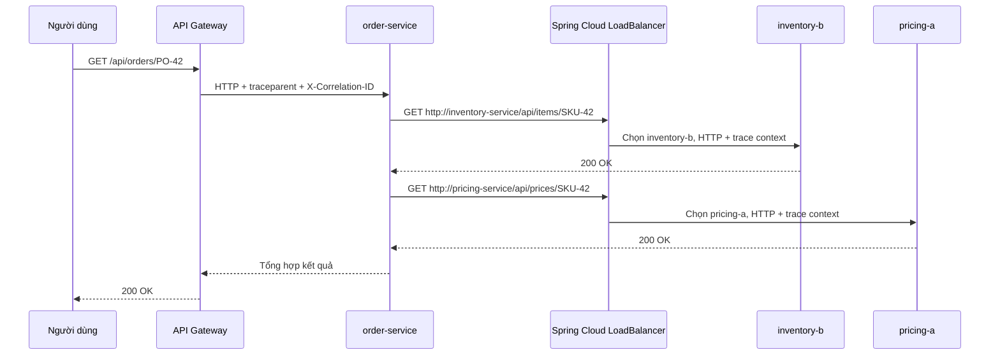
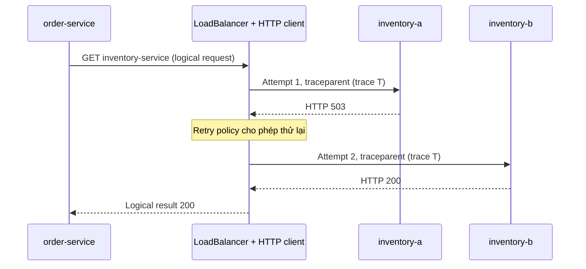

# Correlation ID, trace ID và truyền ngữ cảnh qua HTTP

## Mục tiêu

Trong hệ thống microservices, một request từ người dùng có thể đi qua API Gateway, `order-service`, `inventory-service` và `pricing-service`. Spring Cloud LoadBalancer chọn một `ServiceInstance` cho từng lời gọi dựa trên service ID, discovery và chính sách định tuyến. Nếu một request gặp timeout hoặc HTTP 503, log riêng lẻ ở mỗi service thường chưa đủ để trả lời: **những log nào thuộc cùng một request, request đã đi qua instance nào, và lỗi xuất hiện ở bước nào?**

**Correlation ID** và **distributed tracing** giúp liên kết các sự kiện đó. Tuy nhiên, `X-Correlation-ID` do ứng dụng tự quản lý, `traceId` do hệ thống tracing cấp và `spanId` của mỗi bước xử lý là những khái niệm **khác nhau**. Cũng không thể mặc định một HTTP client bất kỳ sẽ truyền toàn bộ ngữ cảnh chỉ vì đã thêm thư viện Micrometer.

Sau bài học, bạn sẽ:

- Phân biệt correlation ID/request ID, trace ID, span ID, parent span ID và baggage.
- Đọc được định dạng W3C `traceparent`, `tracestate` và hiểu vai trò của `baggage`.
- Cấu hình Micrometer Observation/Tracing trong Spring Boot và truyền trace qua `RestClient`, `RestTemplate`, `WebClient`, OpenFeign.
- Tích hợp tracing với `@LoadBalanced` mà không làm mất customizer/observation của Spring Boot.
- Truyền correlation ID ứng dụng qua HTTP header riêng, không nhầm với trace context.
- Hiểu cách ngữ cảnh thay đổi khi chuyển thread, `@Async`, `CompletableFuture` hoặc Reactor.
- Theo dõi từng lần thử (attempt) khi LoadBalancer retry/chọn lại instance.
- Kiểm thử propagation liên dịch vụ, phân biệt mất trace với sampling và xử lý header từ ranh giới không đáng tin cậy.

> Bài thuộc chương **Quan sát hệ thống** của Spring Cloud Service Communication Load Balancing. Trọng tâm là quan sát đúng một chuỗi giao tiếp giữa dịch vụ; trace context không thay thế cơ chế chọn instance, health check, timeout, retry hay xác thực.

## 1. Một request có thể tạo nhiều log và span

Ví dụ người dùng gửi:

```http
GET /api/orders/PO-42 HTTP/1.1
Host: api.example.internal
X-Correlation-ID: request-2026-0012
```

Đường đi mong muốn:



Giả sử tracing hoạt động đầy đủ:

- **Một trace ID** liên kết các span thuộc cùng giao dịch.
- **Mỗi span ID** xác định một bước xử lý hoặc HTTP client/server span.
- **Correlation ID** có thể được giữ giống nhau qua các service nếu ứng dụng có chính sách truyền riêng.
- Các span có **quan hệ cha–con**, từ đó biết lời gọi nào dẫn đến lời gọi nào.
- Host/port của `inventory-b` được LoadBalancer chọn **không phải** trace ID hoặc correlation ID.

Khi `inventory-service` có nhiều instance, cùng trace có thể chứa các client/server spans của những instance khác nhau, nhất là nếu caller retry sang một bản sao khác.

## 2. Correlation ID, trace ID, span ID: khác nhau ở đâu?

| Định danh | Phạm vi | Ai cấp/quản lý? | Truyền qua HTTP ra sao? | Dùng để làm gì? |
|---|---|---|---|---|
| **Correlation ID** | Thường là một request nghiệp vụ hoặc chuỗi sự kiện do ứng dụng định nghĩa | Gateway/app/đơn vị vận hành | Ví dụ `X-Correlation-ID` do ta tự quy ước | Tìm log liên quan, hỗ trợ khách hàng, liên kết hệ thống |
| **Trace ID** | Toàn bộ distributed trace | Tracer (OpenTelemetry/Brave qua Micrometer) | Trong `traceparent` của W3C hoặc B3 theo propagation format | Liên kết spans và truy vết độ trễ |
| **Span ID** | Một operation cụ thể trong trace | Tracer tạo span | Trong trường `parent-id` của `traceparent` trên outbound request | Phân biệt từng bước và quan hệ cha–con |
| **Parent span ID** | Quan hệ phụ thuộc giữa spans | Tracer nhận từ remote context | Nhận qua header context rồi thiết lập span mới | Xây trace tree |
| **Baggage** | Một số thuộc tính ngữ cảnh cần truyền giữa service | Ứng dụng/tracer theo policy | W3C `baggage` hoặc định dạng propagation phù hợp | Ví dụ nhãn cohort đã được cho phép, không chứa PII |
| **Order ID / business key** | Một thực thể nghiệp vụ | Hệ thống nghiệp vụ | Path/body hoặc API contract | Truy vấn đơn hàng; **không thay thế trace ID** |

### 2.1. Correlation ID không có một chuẩn HTTP duy nhất

Nhiều tổ chức đặt header `X-Request-ID` hoặc `X-Correlation-ID`. Đây là **quy ước ứng dụng**, không phải trường bắt buộc của W3C Trace Context. Có hệ thống đặt correlation ID bằng trace ID, có hệ thống cấp một ID riêng để liên kết nhiều trace của cùng nghiệp vụ.

Spring Boot khi tích hợp Micrometer Tracing còn có khái niệm **“logging correlation ID”** được dựng từ `traceId` và `spanId` trong MDC. Điều đó không đồng nghĩa ứng dụng tự động tạo và gửi header `X-Correlation-ID`.

**Quyết định rõ chính sách của bạn:** nếu cần một mã để hỗ trợ khách hàng, có thể cấp `X-Correlation-ID` riêng tại trusted ingress và đưa nó vào response. Nếu chỉ cần truy vết spans, `traceId` từ hệ thống tracing thường đã đủ cho việc tìm trace.

### 2.2. Span ID có thể thay đổi, trace ID thường được giữ nguyên

Trong cùng một chuỗi:

```text
traceId = 4bf92f3577b34da6a3ce929d0e0e4736

API Gateway span      spanId=1111111111111111
  order-service span  spanId=2222222222222222
    HTTP client span  spanId=3333333333333333
      inventory span  spanId=4444444444444444
```

Những ID trên là ví dụ. Khi ngữ cảnh được truyền đúng, **trace ID liên tục**, nhưng span ID không cần giống nhau. Nếu downstream log có cùng trace ID nhưng span ID khác caller, **đó có thể chính là hành vi đúng**.

## 3. W3C Trace Context: traceparent và tracestate

W3C Trace Context định nghĩa format truyền dấu vết giữa các hệ thống bằng HTTP headers.

Ví dụ:

```http
traceparent: 00-4bf92f3577b34da6a3ce929d0e0e4736-00f067aa0ba902b7-01
tracestate: vendor=value
```

Trường `traceparent` theo phiên bản `00` có cấu trúc:

```text
version - trace-id                         - parent-id        - trace-flags
00      - 4bf92f3577b34da6a3ce929d0e0e4736 - 00f067aa0ba902b7 - 01
```

| Thành phần | Kích thước/ý nghĩa |
|---|---|
| `version=00` | Phiên bản format hiện được dùng trong ví dụ |
| `trace-id` | 32 ký tự hex, 16 byte; không được toàn số 0 |
| `parent-id` | 16 ký tự hex, 8 byte; đại diện cho operation đang gửi context, không được toàn số 0 |
| `trace-flags` | 2 ký tự hex; bit sampled thường biểu diễn bằng `01` hoặc `00` |
| `tracestate` | Header tùy chọn chứa thông tin nhà cung cấp tracing, không phải nơi gửi toàn bộ business context |

Khi `order-service` nhận `traceparent` và tạo span mới, tracer giữ trace ID hợp lệ, liên kết span hiện tại với parent remote, sau đó cập nhật `parent-id` tương ứng khi gửi request outbound. **Không nên copy nguyên header `traceparent` qua mọi hop như một chuỗi bất biến** nếu đang tạo các spans mới; thư viện tracing có trách nhiệm inject đúng context hiện tại.

### 3.1. Sampled flag không bảo đảm trace sẽ xuất hiện ở backend

Bit sampled trong `trace-flags` là tín hiệu lấy mẫu. Giá trị `01` không bảo đảm exporter/collector cuối cùng nhận đủ span; mất dữ liệu exporter, collector hoặc tail-sampling vẫn có thể xảy ra. Ngược lại, `00` không có nghĩa ứng dụng không thể ghi log với trace ID.

Vì thế, **không dùng `sampled=0` để suy ra “context propagation đã hỏng”**. Hãy tách việc truyền định danh qua HTTP khỏi việc export spans sang hệ thống lưu trữ.

### 3.2. W3C khác B3

Một số hệ thống cũ dùng B3 headers như `b3` hoặc `X-B3-TraceId`/`X-B3-SpanId`. Spring Boot có thể cấu hình loại propagation **nhận** và **gửi**:

```yaml
management:
  tracing:
    propagation:
      consume:
        - W3C
        - B3
        - B3_MULTI
      produce:
        - W3C
```

Theo bảng cấu hình Spring Boot hiện hành, mặc định tiếp nhận W3C/B3/B3_MULTI và phát W3C. **Không giả định** service viết bằng framework khác cũng đọc được cả ba format. Nếu một hop chỉ hiểu B3 trong khi upstream chỉ gửi W3C, trace có thể bị tách thành hai phần mặc dù HTTP request vẫn thành công.

Chỉ chuyển sang nhiều định dạng propagation khi có yêu cầu tương thích thực tế; phát nhiều header không cần thiết có thể tạo xung đột nếu hai bộ context không nhất quán.

## 4. Baggage: truyền dữ liệu ngữ cảnh nhỏ có kiểm soát

Header `baggage` của W3C có thể mang các cặp key/value phục vụ context:

```http
baggage: rollout_cohort=stable,client_channel=internal
```

Khác với `tracestate`, baggage là tập thuộc tính ứng dụng có thể được truyền đến các service tiếp theo nếu propagation được bật.

**Không đưa vào baggage:**

- JWT, access token, session cookie hoặc khóa API.
- Email, số điện thoại, dữ liệu định danh cá nhân, thông tin thanh toán.
- Raw user ID/tenant ID nếu chúng không được phép chuyển qua mọi dependency.
- Payload nghiệp vụ hoặc JSON lớn; baggage làm tăng kích thước HTTP headers và chi phí truyền.

Baggage **không được xem là dữ liệu đáng tin cậy** chỉ vì tracing library truyền nó. Metadata từ Internet vẫn phải được xác minh ở ranh giới đáng tin cậy; không dùng baggage hoặc correlation ID làm bằng chứng phân quyền.

Ví dụ tạo baggage bằng Micrometer:

```java
import io.micrometer.tracing.BaggageInScope;
import io.micrometer.tracing.Tracer;
import org.springframework.stereotype.Service;

@Service
class InventoryPolicy {

    private final Tracer tracer;

    InventoryPolicy(Tracer tracer) {
        this.tracer = tracer;
    }

    void readInventory(Runnable remoteCall) {
        try (BaggageInScope ignored =
                     tracer.createBaggageInScope("rollout_cohort", "stable")) {
            remoteCall.run();
        }
    }
}
```

Trong W3C propagation, baggage có thể được truyền tự động theo tracer/provider; với B3, việc truyền baggage không mặc nhiên tương đương và có thể cần cấu hình `management.tracing.baggage.remote-fields`. Nếu muốn ghi một field baggage trong MDC, khai báo `management.tracing.baggage.correlation.fields` (với field được phép), và kiểm tra thực tế theo provider.

Không dùng `baggage` chỉ để truyền `X-Correlation-ID` nếu hệ thống đã có quy ước header riêng ổn định: hai cơ chế có vòng đời và ranh giới bảo mật khác nhau.

## 5. Spring Boot 4: bật Micrometer Tracing

Trong dự án Spring Boot 4.x cùng Spring Cloud Release Train tương thích, có thể dùng OpenTelemetry/OTLP:

```xml
<dependencies>
    <!-- Server demo dùng Spring MVC. -->
    <dependency>
        <groupId>org.springframework.boot</groupId>
        <artifactId>spring-boot-starter-webmvc</artifactId>
    </dependency>

    <dependency>
        <groupId>org.springframework.boot</groupId>
        <artifactId>spring-boot-starter-opentelemetry</artifactId>
    </dependency>

    <dependency>
        <groupId>org.springframework.cloud</groupId>
        <artifactId>spring-cloud-starter-loadbalancer</artifactId>
    </dependency>
</dependencies>
```

Dùng Spring Boot parent/dependency management và Spring Cloud BOM tương thích để quản lý phiên bản, không gắn version tùy ý cho từng starter.

Ví dụ cấu hình local **khi đã có OTLP Collector** nhận HTTP tại `localhost:4318`:

```yaml
spring:
  application:
    name: order-service

management:
  tracing:
    sampling:
      probability: 1.0
  opentelemetry:
    tracing:
      export:
        otlp:
          endpoint: http://localhost:4318/v1/traces
```

`management.tracing.sampling.probability: 1.0` phù hợp cho **bài thực hành**, không phải lựa chọn mặc định cho production. Theo tài liệu Boot 4, xác suất sampling mặc định khoảng `0.1` (10%) để tránh quá tải trace backend.

Nếu chưa chạy Collector, ứng dụng có thể vẫn tạo span/context và ghi trace ID trong log, nhưng **không có trace hoàn chỉnh để xem trên UI**; exporter cũng có thể báo lỗi kết nối. Có thể chọn starter Brave/Zipkin thay thế, nhưng không cần cài hai tracer exporter khác nhau chỉ để thực hành.

### 5.1. Log tự động có trace ID, không tự có custom correlation ID

Khi Micrometer Tracing hoạt động, Spring Boot mặc định đưa `traceId` và `spanId` vào MDC/log correlation. Ví dụ log minh họa:

```text
2026-11-17 INFO [4bf92f3577b34da6a3ce929d0e0e4736-2222222222222222] order-service - start GET SKU-42
2026-11-17 INFO [4bf92f3577b34da6a3ce929d0e0e4736-4444444444444444] inventory-service - lookup SKU-42
```

Để hiển thị cả `correlationId` do ứng dụng tự đưa vào MDC, có thể tùy biến Logback pattern:

```yaml
logging:
  pattern:
    correlation: "[${spring.application.name:},%X{traceId:-},%X{spanId:-},%X{correlationId:-}] "
  include-application-name: false
```

Đoạn pattern có **dấu cách cuối chuỗi** để ngăn cách với phần log tiếp theo. `logging.include-application-name=false` giúp tránh tên ứng dụng bị lặp lại trong log khi pattern đã in nó.

Spring Boot chỉ tự lo phần `traceId`/`spanId` khi tracing và MDC instrumentation có mặt. **Trường `correlationId` phải do bạn cấp và quản lý** nếu dùng header riêng.

### 5.2. ObservationRegistry là điểm nối metrics và traces

Micrometer `ObservationRegistry` cung cấp instrumentation cho HTTP server/client, ghi số liệu quan sát và tạo tracing spans thông qua bridge tương ứng. Spring Framework dùng observation tên `http.client.requests` cho các HTTP client đã instrument.

```java
import io.micrometer.observation.Observation;
import io.micrometer.observation.ObservationRegistry;
import org.springframework.stereotype.Service;

@Service
class InventoryWorkflow {

    private final ObservationRegistry registry;

    InventoryWorkflow(ObservationRegistry registry) {
        this.registry = registry;
    }

    void run(Runnable action) {
        Observation.createNotStarted("inventory.lookup", registry)
                .lowCardinalityKeyValue("target.service", "inventory-service")
                .observe(action);
    }
}
```

Observation này minh họa một bước nghiệp vụ; nó không thay thế client span mà HTTP client đã tạo. Chỉ gắn nhãn ít cardinality như `target.service`, không dùng order ID/user ID làm low-cardinality metric tags.

## 6. Cấu hình @LoadBalanced RestClient mà vẫn giữ trace propagation

Một lỗi phổ biến:

```java
// Không nên coi đoạn này là cách bảo toàn toàn bộ Boot instrumentation.
@Bean
@LoadBalanced
RestClient.Builder incompleteBuilder() {
    return RestClient.builder();
}
```

`@LoadBalanced` giúp gắn logic chọn service instance, nhưng **không bảo đảm đã giữ những customizer/ObservationRegistry của Spring Boot**. Nếu tạo client bằng builder tự làm mà bỏ observability, request có thể vẫn gọi đúng backend nhưng **không tự inject `traceparent`**.

Spring Cloud Commons khuyến nghị dùng `RestClientBuilderConfigurer` để áp dụng khả năng bổ sung của Spring Boot:

```java
import org.springframework.boot.restclient.autoconfigure.RestClientBuilderConfigurer;
import org.springframework.cloud.client.loadbalancer.LoadBalanced;
import org.springframework.context.annotation.Bean;
import org.springframework.context.annotation.Configuration;
import org.springframework.web.client.RestClient;

@Configuration(proxyBeanMethods = false)
class LoadBalancedRestClientConfiguration {

    @Bean
    @LoadBalanced
    RestClient.Builder loadBalancedRestClientBuilder(
            RestClientBuilderConfigurer configurer) {
        return configurer.configure(RestClient.builder());
    }
}
```

Gateway gọi `inventory-service`:

```java
import org.springframework.cloud.client.loadbalancer.LoadBalanced;
import org.springframework.stereotype.Component;
import org.springframework.web.client.RestClient;

@Component
class InventoryRestClientGateway {

    private final RestClient client;

    InventoryRestClientGateway(
            @LoadBalanced RestClient.Builder builder) {
        this.client = builder
                .baseUrl("http://inventory-service")
                .build();
    }

    String whoAmI() {
        return client.get()
                .uri("/whoami")
                .retrieve()
                .body(String.class);
    }
}
```

Luồng:

1. Tracer lấy span context đang active ở caller.
2. Client instrumentation tạo HTTP client observation/span và inject header propagation thích hợp.
3. Spring Cloud LoadBalancer dùng host `inventory-service` làm service ID, chọn `ServiceInstance` và dựng địa chỉ vật lý.
4. HTTP transport gửi request tới instance đã chọn cùng những header quan sát.
5. Service đích nhận context và tạo server span liên quan nếu instrumented.

Chi tiết thứ tự interceptor/observation có thể khác theo phiên bản Spring Cloud, nhưng điều cần kiểm chứng là **cùng trace ID đi qua cả hai service** và caller không làm mất Boot customizers.

## 7. RestTemplate và WebClient: dùng đúng builder, đúng context

### 7.1. RestTemplate

Spring Boot không tự tạo sẵn mọi `RestTemplate` bean; bạn cần đăng ký và cấu hình builder có observability:

```java
import org.springframework.boot.restclient.RestTemplateBuilder;
import org.springframework.cloud.client.loadbalancer.LoadBalanced;
import org.springframework.context.annotation.Bean;
import org.springframework.context.annotation.Configuration;
import org.springframework.web.client.RestTemplate;

@Configuration(proxyBeanMethods = false)
class LoadBalancedRestTemplateConfiguration {

    @Bean
    @LoadBalanced
    RestTemplate loadBalancedRestTemplate(
            RestTemplateBuilder bootBuilder) {
        return bootBuilder.build();
    }
}
```

Trong Spring Boot 4, `RestTemplateBuilder` nằm ở `org.springframework.boot.restclient`. Ở các phiên bản Boot cũ, package có thể khác. Builder do Boot auto-configure có thể áp dụng `ObservationRegistry`, trong khi `new RestTemplate()` trực tiếp **không tự bảo đảm** trace propagation.

Một outbound call:

```java
String result = restTemplate.getForObject(
        "http://inventory-service/whoami",
        String.class
);
```

Đoạn này giả định `restTemplate` là bean `@LoadBalanced` ở trên. Nếu dùng bean trực tiếp để gọi `http://localhost:8081`, host `localhost` có thể bị LoadBalancer hiểu nhầm thành service ID `localhost`.

### 7.2. WebClient

`WebClient` dùng mô hình reactive, nên không nên đọc `MDC.get("traceId")` ở một callback bất đồng bộ rồi dùng làm nguồn đáng tin cậy cho toàn bộ pipeline. Tracing context cần được tích hợp qua `ObservationRegistry` và **Reactor Context**.

Ví dụ cấu hình một `@LoadBalanced WebClient.Builder` được gắn ObservationRegistry:

```java
import io.micrometer.observation.ObservationRegistry;
import org.springframework.cloud.client.loadbalancer.LoadBalanced;
import org.springframework.context.annotation.Bean;
import org.springframework.context.annotation.Configuration;
import org.springframework.web.reactive.function.client.WebClient;

@Configuration(proxyBeanMethods = false)
class LoadBalancedWebClientConfiguration {

    @Bean
    @LoadBalanced
    WebClient.Builder loadBalancedWebClientBuilder(
            ObservationRegistry observationRegistry) {
        return WebClient.builder()
                .observationRegistry(observationRegistry);
    }
}
```

Đây là cách **gắn ObservationRegistry tường minh** cho ví dụ. Khi ứng dụng phụ thuộc thêm vào các `WebClientCustomizer` của Spring Boot (TLS, tracing bổ sung, codecs...), hãy áp dụng các customizer từ Boot hoặc sử dụng builder được Boot quản lý. Đừng thay toàn bộ builder mà không rà soát instrumentation đang dùng.

```java
import org.springframework.cloud.client.loadbalancer.LoadBalanced;
import org.springframework.stereotype.Component;
import org.springframework.web.reactive.function.client.WebClient;
import reactor.core.publisher.Mono;

@Component
class InventoryWebClientGateway {

    private final WebClient client;

    InventoryWebClientGateway(
            @LoadBalanced WebClient.Builder builder) {
        this.client = builder
                .baseUrl("http://inventory-service")
                .build();
    }

    Mono<String> whoAmI() {
        return client.get()
                .uri("/whoami")
                .retrieve()
                .bodyToMono(String.class);
    }
}
```

**Không gọi `block()` trên Netty event-loop** chỉ để xem trace ID. Với WebFlux/Reactor, hãy giữ pipeline reactive, kiểm tra propagation bằng trace/log được tạo khi publisher thật sự được subscribe.

## 8. OpenFeign: MicrometerObservationCapability

OpenFeign có cơ chế instrumentation riêng qua `MicrometerObservationCapability`. Theo tài liệu Spring Cloud OpenFeign, capability này được cấu hình khi:

1. `feign-micrometer` có trên classpath;
2. ứng dụng có bean `ObservationRegistry`;
3. Micrometer integration không bị tắt bằng properties (mặc định được bật khi đủ điều kiện).

Ví dụ dependencies ở caller:

```xml
<dependency>
    <groupId>org.springframework.cloud</groupId>
    <artifactId>spring-cloud-starter-openfeign</artifactId>
</dependency>
<dependency>
    <groupId>org.springframework.cloud</groupId>
    <artifactId>spring-cloud-starter-loadbalancer</artifactId>
</dependency>
<dependency>
    <groupId>io.github.openfeign</groupId>
    <artifactId>feign-micrometer</artifactId>
</dependency>
```

Cấu hình cho một Feign context:

```yaml
spring:
  cloud:
    openfeign:
      client:
        config:
          inventoryFeignClient:
            micrometer:
              enabled: true
```

Feign interface:

```java
import org.springframework.cloud.openfeign.FeignClient;
import org.springframework.web.bind.annotation.GetMapping;

@FeignClient(
        name = "inventory-service",
        contextId = "inventoryFeignClient"
)
public interface InventoryFeignClient {

    @GetMapping("/whoami")
    String whoAmI();
}
```

Với Spring Cloud OpenFeign, cần bật `@EnableFeignClients` trong ứng dụng và bảo đảm discovery có `inventory-service`. Nếu `@FeignClient` có `url` cố định, client có thể được instrument nhưng sẽ **không chọn `ServiceInstance` qua LoadBalancer**.

**Lưu ý phạm vi:** `spring.cloud.openfeign.micrometer.enabled=false` tắt toàn bộ Micrometer capability của OpenFeign, bất kể cờ per-client. Nếu muốn bật/tắt từng Feign context, đừng tắt cổng toàn cục. Không đăng ký đồng thời `MicrometerCapability` và `MicrometerObservationCapability` cho cùng một client nếu dẫn tới đo đếm trùng.

Feign còn có `RequestInterceptor` dành cho header nghiệp vụ; interceptor này **không thay thế** tracing capability hoặc W3C propagation.

## 9. Truyền X-Correlation-ID qua HTTP theo quy ước ứng dụng

Một correlation ID độc lập giúp bộ phận hỗ trợ tìm tất cả log từ gateway đến các backend, kể cả khi trace bị sampling hoặc một dependency chưa hỗ trợ W3C.

**Chọn policy cụ thể tại ingress:**

1. Ở biên Internet, tạo ID mới hoặc chỉ nhận ID từ nguồn tin cậy sau khi kiểm tra định dạng/độ dài.
2. Đặt vào request scope/logging context.
3. Gửi cùng tên header trên HTTP outbound.
4. Downstream tiếp tục giữ ID đã được chấp nhận theo quan hệ tin cậy.
5. Trả ID về response để khách hàng/support có thể báo lại.
6. Xóa ngữ cảnh khi request kết thúc để tránh lộ sang request của người khác.

### 9.1. Filter trong Spring MVC

Ví dụ một `OncePerRequestFilter` dành cho hệ thống Servlet:

```java
import java.io.IOException;
import java.util.UUID;
import jakarta.servlet.FilterChain;
import jakarta.servlet.ServletException;
import jakarta.servlet.http.HttpServletRequest;
import jakarta.servlet.http.HttpServletResponse;
import org.slf4j.MDC;
import org.springframework.stereotype.Component;
import org.springframework.web.filter.OncePerRequestFilter;

@Component
class CorrelationIdFilter extends OncePerRequestFilter {

    static final String HEADER = "X-Correlation-ID";
    static final String MDC_KEY = "correlationId";

    @Override
    protected void doFilterInternal(
            HttpServletRequest request,
            HttpServletResponse response,
            FilterChain chain) throws ServletException, IOException {

        String supplied = request.getHeader(HEADER);
        String id = supplied != null
                && supplied.matches("[A-Za-z0-9_-]{8,64}")
                ? supplied
                : UUID.randomUUID().toString();

        String previous = MDC.get(MDC_KEY);
        MDC.put(MDC_KEY, id);
        response.setHeader(HEADER, id);

        try {
            chain.doFilter(request, response);
        }
        finally {
            if (previous == null) {
                MDC.remove(MDC_KEY);
            }
            else {
                MDC.put(MDC_KEY, previous);
            }
        }
    }
}
```

Mẫu trên phù hợp để hiểu cơ chế **trong luồng Servlet đồng bộ**. Trong deployment thật, nếu ingress nhận request từ Internet, **không mặc định tin** một header chỉ vì nó khớp regex; gateway có thể chủ động sinh ID mới, hoặc chỉ chấp nhận header từ upstream đã xác thực. Filter cần được thiết kế lại cho Servlet async/error dispatch nếu hệ thống có các đường đó.

Định dạng allowlist ngắn/nghiêm ngặt giúp tránh header injection, các chuỗi bất thường và log pollution. ID này vẫn **không phải credential** hoặc dữ liệu xác thực.

### 9.2. Tự gắn correlation header vào RestClient

Đối với lời gọi blocking đồng bộ, có thể thêm HTTP client interceptor vào builder **đã được Boot cấu hình**:

```java
import org.slf4j.MDC;
import org.springframework.boot.restclient.autoconfigure.RestClientBuilderConfigurer;
import org.springframework.cloud.client.loadbalancer.LoadBalanced;
import org.springframework.context.annotation.Bean;
import org.springframework.web.client.RestClient;

@Bean
@LoadBalanced
RestClient.Builder loadBalancedRestClientBuilder(
        RestClientBuilderConfigurer configurer) {

    return configurer.configure(RestClient.builder())
            .requestInterceptor((request, body, execution) -> {
                String correlationId = MDC.get("correlationId");
                if (correlationId != null && !correlationId.isBlank()) {
                    request.getHeaders()
                            .set("X-Correlation-ID", correlationId);
                }
                return execution.execute(request, body);
            });
}
```

Bean này là **bản thay thế** bean `loadBalancedRestClientBuilder` ở phần 6; đừng đăng ký cả hai cùng tên. Đặt trong `@Configuration` Spring-managed và import các annotation tương ứng từ phần trước.

Interceptor chỉ gắn header **`X-Correlation-ID`**. Việc tạo và inject `traceparent` vẫn thuộc instrumentation của Micrometer/HTTP client. **Không tự set `traceparent` bằng correlation ID hoặc tự sinh `spanId` trong HTTP interceptor.**

Khi phải gọi một dependency ngoài biên tin cậy, có thể cần **không truyền** correlation ID nội bộ hoặc dùng ID mới theo data-sharing policy.

### 9.3. RestTemplate và OpenFeign

Với RestTemplate dùng builder, có thể thêm `ClientHttpRequestInterceptor` tương tự:

```java
import org.slf4j.MDC;
import org.springframework.boot.restclient.RestTemplateBuilder;

RestTemplate template = bootBuilder
        .additionalInterceptors((request, body, execution) -> {
            String id = MDC.get("correlationId");
            if (id != null && !id.isBlank()) {
                request.getHeaders().set("X-Correlation-ID", id);
            }
            return execution.execute(request, body);
        })
        .build();
```

Đoạn trên giả định `bootBuilder` được inject từ Boot; nếu dùng `@LoadBalanced RestTemplate`, phải bảo đảm bean trả ra được Spring Cloud nhận diện theo qualifier. Dùng `additionalInterceptors(...)` thay vì thay thế toàn bộ danh sách interceptor khi không cần thiết.

Với Feign có thể khai báo:

```java
import feign.RequestInterceptor;
import org.slf4j.MDC;
import org.springframework.context.annotation.Bean;

@Bean
RequestInterceptor correlationIdFeignInterceptor() {
    return template -> {
        String id = MDC.get("correlationId");
        if (id != null && !id.isBlank()) {
            template.header("X-Correlation-ID", id);
        }
    };
}
```

Với Feign, `RequestInterceptor` chỉ lo header nghiệp vụ và có thể cần cấu hình riêng theo `contextId`. `MicrometerObservationCapability` vẫn là phần quan trọng cho trace HTTP. Trong code thực tế, Bean phải ở trong một cấu hình được Spring quản lý và cần tránh cấu hình riêng bị component scan thành global interceptor ngoài ý muốn.

## 10. WebFlux/Reactor: correlation ID không nên dựa vào MDC ThreadLocal

Trong một HTTP pipeline reactive, execution có thể chuyển thread, quay lại cùng thread để xử lý request khác hoặc chạy xen kẽ nhiều publisher. MDC dựa trên `ThreadLocal` nên **không tự bám theo một request** trong mọi operator.

Với correlation ID riêng, có thể truyền bằng **Reactor Context**:

```java
import org.springframework.web.reactive.function.client.ClientRequest;
import org.springframework.web.reactive.function.client.WebClient;
import reactor.core.publisher.Mono;

static final String CORRELATION_KEY = "correlationId";

WebClient client = builder
        .filter((request, next) -> Mono.deferContextual(context -> {
            String id = context.getOrDefault(CORRELATION_KEY, "");
            if (id.isBlank()) {
                return next.exchange(request);
            }

            ClientRequest enriched = ClientRequest.from(request)
                    .headers(headers ->
                            headers.set("X-Correlation-ID", id))
                    .build();
            return next.exchange(enriched);
        }))
        .build();
```

Đoạn này minh họa cách dùng `WebClient.Builder` đã được inject/cấu hình quan sát, không phải một class hoàn chỉnh. Gửi một request:

```java
Mono<String> result = client.get()
        .uri("http://inventory-service/whoami")
        .retrieve()
        .bodyToMono(String.class)
        .contextWrite(context ->
                context.put(CORRELATION_KEY, "request-2026-0012"));
```

Nếu `builder` là `@LoadBalanced WebClient.Builder` và có ObservationRegistry, WebClient có thể **vừa** truyền trace context theo Micrometer **vừa** truyền header correlation riêng từ Reactor Context.

ID trong `contextWrite` chỉ là ví dụ. Trong WebFlux server, lấy ID đã kiểm tra ở ingress rồi đặt vào Reactor Context qua một `WebFilter` hoặc lớp orchestration; đừng tạo một giá trị hardcoded cho mọi request.

### 10.1. ContextSnapshot khi chuyển từ MVC sang Reactor hoặc @Async

Micrometer Context Propagation có các abstraction `ThreadLocalAccessor`, `ContextAccessor` và `ContextSnapshot` để chuyển ngữ cảnh giữa `ThreadLocal` và Reactor Context hoặc khi handoff sang một executor.

Những trường hợp dễ làm mất trace/correlation:

- `CompletableFuture.supplyAsync(...)` chạy trên common pool không có context-aware wrapper.
- `@Async` dùng executor khác mà không có cấu hình propagation.
- Chuyển giữa MVC blocking code và Reactor pipeline bằng scheduler khác.
- Tự tạo `new Thread(...)` cho tác vụ nền.
- Dùng MDC thủ công nhưng không restore/remove khi hoàn tất request.

Với các trường hợp này, áp dụng `ContextSnapshot`/TaskDecorator hoặc các hook context propagation đã được framework hỗ trợ. **Không copy toàn bộ MDC không kiểm soát** hoặc giữ nguyên scope của request cũ trong một tác vụ lâu dài. Baggage, span context và custom correlation ID có thể có yêu cầu truyền khác nhau; xác minh từng trường cần giữ.

### 10.2. Không truyền vô hạn ngữ cảnh cho background jobs

Một công việc xử lý bất đồng bộ diễn ra nhiều giờ sau khi request đã kết thúc không nhất thiết phải thuộc **cùng active span**. Có thể tạo trace mới và liên kết bằng một business correlation ID đã được lưu an toàn hoặc bằng span link nếu tracing backend hỗ trợ. Đừng giữ một request scope sống vô hạn chỉ để có cùng trace ID.

## 11. LoadBalancer, retry và việc giữ trace qua nhiều attempts

Spring Cloud LoadBalancer quan tâm đến service ID và `ServiceInstance`; tracing quan tâm đến **mối quan hệ giữa operations**. Khi retry đổi backend, cần quan sát cả hai.



Nếu context propagation hoạt động, các attempts có thể cùng **trace ID T** nhưng có span ID khác nhau tùy implementation của retry và HTTP client instrumentation. **Không cam kết mỗi attempt luôn tạo một client span riêng** ở mọi phiên bản/integration; kiểm tra kết quả thực tế trong trace UI.

Một số điều cần phân biệt:

| Tình huống | Dấu vết có thể quan sát |
|---|---|
| LoadBalancer không tìm thấy instance | Caller có lỗi selection; **không có HTTP server span ở backend** vì request chưa đến |
| Attempt 1 tới instance A trả 503, attempt 2 tới B trả 200 | Có thể có logs/HTTP spans ở cả A và B nhưng chỉ một logical request |
| Lỗi connect trước khi gửi request | Caller client span/error; backend không có server span |
| Backend xử lý thành công nhưng response timeout | Backend có server span; caller ghi timeout, có thể sinh retry |
| `@FeignClient(url=...)` dùng URL cố định | Có thể có Feign trace spans nhưng không có bước chọn instance từ LB |
| Sampling thấp | Log có thể có trace ID, nhưng trace UI thiếu một phần hoặc không có span đã export |

Nếu cần phân tích retries, nên thu thập `serviceId`, `instanceId`, HTTP status/root cause và attempt count ở mức **logical call** và **physical attempt**. Tránh gắn nguyên `traceId`/`correlationId` làm tag Prometheus vì cardinality cực cao; dùng trace/log để truy vấn theo ID, dùng metric label đã chuẩn hóa cho thống kê.

### 11.1. Đừng lấy header propagation làm chính sách retry

`traceparent` giúp truy vết. Nó **không bảo đảm idempotency**. Với POST tạo đơn, read timeout có thể xảy ra sau khi backend đã ghi dữ liệu; retry không kiểm soát có thể tạo kết quả trùng. Cần idempotency key nghiệp vụ và logic deduplication phía backend.

`X-Correlation-ID` cũng không nên dùng thay idempotency key nếu policy không quy định như vậy: cùng một correlation ID có thể liên kết nhiều operations khác nhau.

## 12. Quan sát log, trace và metrics cùng lúc

Ba kênh quan sát trả lời những câu hỏi khác nhau:

| Kênh | Phù hợp để làm gì? | Không nên kỳ vọng |
|---|---|---|
| **Logs** | Chi tiết lỗi, input được an toàn hóa, instance và correlation ID | Thay thế hoàn toàn quan hệ cha–con của spans |
| **Traces** | Đường đi request, độ trễ từng hop, lỗi ở bước nào | Có mọi request khi sampling thấp hoặc exporter bị lỗi |
| **Metrics** | Error rate, p95/p99 latency, tỷ lệ 503, số retry, saturation | Truy vấn theo từng request ID làm metric tag |

### 12.1. Các field log nên chuẩn hóa

```text
timestamp=2026-11-17T14:30:00Z
service=order-service
operation=inventory.lookup
targetService=inventory-service
status=503
traceId=4bf92f3577b34da6a3ce929d0e0e4736
spanId=3333333333333333
correlationId=request-2026-0012
errorType=DOWNSTREAM_UNAVAILABLE
```

Đây là ví dụ log dạng key-value, không phải log được tạo tự động đầy đủ bởi Spring Boot. `targetService`, `errorType` và correlation ID riêng cần được thêm bởi ứng dụng/instrumentation nếu muốn sử dụng.

Không ghi access token, password, dữ liệu PII, raw URL có query chứa secret hoặc toàn bộ request/response body vào logs/traces chỉ vì đang debug HTTP 503. Với metric, hạn chế tag `uri` về URI template thay vì URL chứa ID cụ thể.

### 12.2. Kích thước, cardinality và chi phí tracing

Trace data có thể tăng nhanh khi:

- Sampling để 100% ở production với lưu lượng cao.
- Một logical request có nhiều HTTP attempts/retries.
- Mỗi method nhỏ đều được instrument thành span.
- Span attributes chứa chuỗi dài hoặc thông tin động.
- Baggage chứa nhiều field và bị copy qua mọi hop.

Hãy chọn span ở những bước hữu ích để điều tra, dùng sampling phù hợp và thiết lập giới hạn exporter/collector. Spring Boot hỗ trợ các thuộc tính giới hạn span attributes trong nhánh OpenTelemetry.

## 13. Thực hành: hai service, một trace ID và một correlation ID

Mục tiêu: caller `order-service` gọi `inventory-service` bằng `@LoadBalanced RestClient`, quan sát log ở hai service, xác minh propagation qua HTTP và cố tình tạo một lỗi.

### Bước 1. Tạo hai ứng dụng Spring Boot

Ứng dụng `inventory-service` cung cấp:

```java
import java.util.Map;
import io.micrometer.tracing.Span;
import io.micrometer.tracing.Tracer;
import jakarta.servlet.http.HttpServletRequest;
import org.slf4j.MDC;
import org.springframework.web.bind.annotation.GetMapping;
import org.springframework.web.bind.annotation.RestController;

@RestController
class InventoryController {

    private final Tracer tracer;

    InventoryController(Tracer tracer) {
        this.tracer = tracer;
    }

    @GetMapping("/whoami")
    Map<String, String> whoAmI(HttpServletRequest request) {
        Span current = tracer.currentSpan();
        return Map.of(
                "service", "inventory-service",
                "traceId", current == null ? "none" :
                        current.context().traceId(),
                "spanId", current == null ? "none" :
                        current.context().spanId(),
                "correlationId",
                MDC.get("correlationId") == null ?
                        "none" : MDC.get("correlationId")
        );
    }
}
```

Response có trace/span IDs **chỉ để thực hành**, không đưa vào public API nếu không có nhu cầu hợp đồng rõ ràng. Tracing tự động không yêu cầu endpoint tự trả trace ID trong JSON.

Ở cả `inventory-service` và `order-service`, thêm starter tracing và filter `CorrelationIdFilter` của phần 9 nếu đang dùng Spring MVC. Với ứng dụng test, header `X-Correlation-ID` được chấp nhận theo regex đã định.

### Bước 2. Chạy inventory-service và cấu hình caller

Chạy backend:

```text
inventory-service:
  --server.port=8081
```

`order-service` có `SimpleDiscoveryClient`:

```yaml
server:
  port: 8080

spring:
  application:
    name: order-service
  cloud:
    discovery:
      client:
        simple:
          instances:
            inventory-service:
              - uri: http://localhost:8081

management:
  tracing:
    sampling:
      probability: 1.0
```

Ở backend đặt `spring.application.name: inventory-service` và `management.tracing.sampling.probability: 1.0` tương tự. Muốn xem spans trong UI, chạy OTLP Collector/trace backend và cấu hình exporter của cả hai ứng dụng; nếu chỉ kiểm tra log/JSON, có thể xác nhận ID mà chưa cần một giao diện tracing.

### Bước 3. Tạo RestClient có LoadBalancer và tracing

Trong `order-service`, đăng ký **một bean** `@LoadBalanced RestClient.Builder` từ `RestClientBuilderConfigurer`, có interceptor gắn `X-Correlation-ID` như phần 9.2. Sau đó tạo controller:

```java
import org.springframework.web.bind.annotation.GetMapping;
import org.springframework.web.bind.annotation.RestController;

@RestController
class OrderDemoController {

    private final InventoryRestClientGateway inventory;

    OrderDemoController(InventoryRestClientGateway inventory) {
        this.inventory = inventory;
    }

    @GetMapping("/demo/trace")
    String trace() {
        return inventory.whoAmI();
    }
}
```

Đảm bảo `InventoryRestClientGateway` từ phần 6 là Spring bean và dùng đúng URL logic `http://inventory-service/whoami`.

### Bước 4. Gửi request kiểm tra

```bash
curl -i \
  -H "X-Correlation-ID: request-2026-0012" \
  "http://localhost:8080/demo/trace"
```

Đối chiếu:

1. Response header của caller chứa `X-Correlation-ID: request-2026-0012` nếu filter bật.
2. Backend JSON có `correlationId=request-2026-0012` nếu caller đã gửi header và backend filter giữ ID.
3. Log của caller và backend có **cùng trace ID** trong một chuỗi quan sát.
4. `spanId` giữa caller và backend có thể khác; đây là điều bình thường.
5. Với trace exporter đang chạy và sampling 100%, UI hiển thị quan hệ HTTP client/server spans.

Nếu tự gửi header `traceparent` từ curl để thử W3C, hãy dùng **giá trị hợp lệ**, không phải một chuỗi ngẫu nhiên sai format:

```bash
curl -i \
  -H "traceparent: 00-4bf92f3577b34da6a3ce929d0e0e4736-00f067aa0ba902b7-01" \
  -H "X-Correlation-ID: request-2026-0012" \
  "http://localhost:8080/demo/trace"
```

Với tracer chấp nhận remote W3C context, trace ID có thể tiếp tục từ header inbound. **Đây là thí nghiệm**: trong production không coi remote `traceparent`/`tracestate` do người dùng tùy ý gửi là đáng tin để điều khiển sampling, bảo mật hoặc quota.

### Bước 5. Mở rộng sang hai instance và retry

Thêm backend `inventory-service` thứ hai tại port 8082 trong `SimpleDiscoveryClient`, mỗi instance ghi `instanceId` vào log. Sau đó cho một backend cố ý trả 503 với endpoint thử nghiệm và dùng retry LoadBalancer có giới hạn.

Quan sát:

- Một logical request có thể tạo nhiều attempts tới hai instance.
- Context có thể giữ trace ID xuyên attempts khi instrumentation đúng.
- Không nhất thiết mọi attempt đều có client span riêng; kiểm tra sự kiện thực tế.
- Không có instance khả dụng thì không có HTTP request tới backend, dù caller vẫn có thể log/observation về lỗi.

### Bước 6. Tắt sampling nhưng giữ log

Đặt:

```yaml
management:
  tracing:
    sampling:
      probability: 0.0
```

Trong những cấu hình tracer vẫn duy trì ngữ cảnh, log có thể còn trace ID nhưng exporter sẽ không gửi spans đã bị bỏ sample. Hãy xác minh behavior của đúng tracer/Release Train; đây là thí nghiệm để phân biệt **missing exported trace** và **broken HTTP propagation**.

## 14. Chẩn đoán khi trace bị đứt giữa các service

| Triệu chứng | Nguyên nhân có thể | Cách kiểm tra |
|---|---|---|
| Caller có traceId, backend sinh traceId khác | Không inject/consume `traceparent`; HTTP client không instrumented | Xem auto-configured builder, `ObservationRegistry`, wire headers và propagation format |
| RestClient gọi được qua LoadBalancer nhưng không có child trace | Tạo `RestClient.builder()` thuần làm mất Boot customizers | Dùng `RestClientBuilderConfigurer` và kiểm tra client observation |
| RestTemplate không gửi context | Dùng `new RestTemplate()` thay vì Boot builder/observation | Kiểm tra bean `@LoadBalanced` và cấu hình observation |
| WebClient mất context sau chuyển scheduler | Context propagation chưa đúng hoặc callback lấy MDC từ thread sai | Dùng Reactor Context/context-propagation và verify dưới concurrent load |
| Feign không có observation | Thiếu `feign-micrometer`, không có `ObservationRegistry` hoặc micrometer disabled | Xem Feign capability và property per-client/global |
| X-Correlation-ID có ở caller nhưng mất ở backend | Chỉ tạo ID ở filter mà chưa gắn outbound header | Thêm HTTP interceptor/Feign RequestInterceptor/reactive filter |
| X-Correlation-ID thay đổi khi sang service tiếp theo | Downstream filter tự tạo ID mới hoặc reject header | Thống nhất trusted ingress và validation policy |
| Cùng trace ID nhưng span ID khác | Bình thường, mỗi operation tạo span riêng | So sánh quan hệ parent/child trong trace UI |
| Có traceId trong log nhưng không có trace ở collector | Sampling thấp, exporter không kết nối hoặc collector drop spans | Kiểm tra sampling, endpoint OTLP và exporter errors |
| Có `traceparent` nhưng không có request ở backend | LoadBalancer không tìm được instance hoặc connect thất bại | Phân biệt lỗi chọn `ServiceInstance` với lỗi HTTP |
| Log correlation bị “dính” sang request khác | ThreadLocal/MDC không được remove/restore | Dùng finally/TaskDecorator và test tải đồng thời |
| Baggage không sang service khác | W3C/B3 config khác hoặc baggage remote-fields chưa bật | Kiểm tra propagation type và policy baggage |
| Một trace có rất nhiều spans do retry | Nhiều tầng retry tạo physical attempts | Đếm attempts và deadline ở từng tầng |
| Context bị giả mạo từ Internet | Tin header `X-Correlation-ID`/`baggage` như identity | Sanitize tại ingress, không dùng header làm quyền truy cập |

### 14.1. Quy trình điều tra từng hop

1. Xác nhận request thật sự đi qua những service nào và service ID/instance nào được chọn.
2. Lấy một `correlationId`/`traceId` từ caller log, không phải từ metric tag có cardinality cao.
3. Kiểm tra tracing starter, `ObservationRegistry` và auto-configured HTTP client.
4. Kiểm tra outbound `traceparent` và correlation header ở **môi trường test có kiểm soát**, tránh log header có dữ liệu nhạy cảm.
5. Xác nhận downstream nhận được propagation format được hỗ trợ và tạo server span.
6. Nếu trace UI thiếu dữ liệu, kiểm tra sampling/exporter/collector trước khi kết luận HTTP context bị mất.
7. Với async/reactive, kiểm tra chỗ chuyển thread/scheduler và scope lifecycle.
8. Với retry, phân biệt logical request, individual attempts và backend spans.
9. Kiểm tra chính sách tin cậy và việc bỏ headers khi request rời boundary tổ chức.
10. Sau sửa lỗi, chạy lại dưới concurrency để bảo đảm MDC/context không rò giữa hai request.

## 15. Checklist triển khai production

- [ ] Phân biệt correlation ID, trace ID, span ID và business ID.
- [ ] Biết Spring Boot mặc định có logging correlation dựa trên `traceId`/`spanId` khi bật tracing, không tự tạo custom `X-Correlation-ID`.
- [ ] Có chính sách nguồn cấp, validate, truyền và trả về correlation ID riêng nếu cần.
- [ ] Không dùng trace/correlation ID làm authentication, authorization hoặc idempotency key.
- [ ] Thống nhất W3C `traceparent`/`tracestate` hoặc cách tương thích B3 với các dịch vụ cũ.
- [ ] Đã kiểm tra sampling và exporter độc lập với context propagation.
- [ ] Có Micrometer Tracing/ObservationRegistry và tracer/exporter phù hợp.
- [ ] `RestClient` được tạo từ builder đã nhận Spring Boot observability customizers.
- [ ] `RestTemplate` dùng Boot `RestTemplateBuilder` hoặc được đặt `ObservationRegistry` đúng cách.
- [ ] `WebClient` được tạo từ builder có ObservationRegistry; Reactor Context không bị mất qua scheduler.
- [ ] OpenFeign có `feign-micrometer`, `MicrometerObservationCapability` và property phù hợp.
- [ ] Các HTTP client có `@LoadBalanced` khi gọi service ID; tracing và LoadBalancer là hai tích hợp khác nhau.
- [ ] Correlation header riêng được truyền nhất quán, nhưng không rò ra dependency ngoài boundary không được phép.
- [ ] MDC được restore/clear; `@Async`/executor/context handoff đã được kiểm thử.
- [ ] Baggage chỉ chứa metadata đã cho phép, nhỏ gọn, không mang PII/secrets.
- [ ] Tracing có thể liên kết các attempts khi retry, nhưng không giả định mọi attempt tạo một span riêng.
- [ ] Metrics dùng tags ít cardinality; logs/traces chứa ID cho việc tìm request cụ thể.
- [ ] Có test request thành công, backend 503, no-instance, timeout, mất collector và sampling thấp.
- [ ] Có chính sách bảo mật cho inbound `traceparent`, `tracestate`, `baggage` và `X-Correlation-ID`.
- [ ] SLO/độ trễ của exporter và sampling được quan sát; không tăng 100% tracing vô điều kiện khi traffic lớn.

## Kết luận

**Correlation ID** hỗ trợ liên kết log theo quy ước ứng dụng; **trace ID** liên kết toàn bộ distributed trace; **span ID** định danh từng operation. W3C `traceparent`/`tracestate` truyền trace context, còn `baggage` chỉ nên mang metadata được kiểm soát. Một service có thể giữ cùng trace ID qua nhiều HTTP hops nhưng tạo những span ID khác nhau — đó là hành vi đúng của distributed tracing.

Với Spring Cloud LoadBalancer, việc chọn `ServiceInstance` là một bước định tuyến, còn **truyền context phụ thuộc HTTP client instrumentation**. Dùng builder/ObservationRegistry đã được Spring Boot cấu hình cho `RestClient`, `RestTemplate`, `WebClient`, bật Micrometer capability đúng cách cho OpenFeign và kiểm tra `MDC`/Reactor context khi chuyển thread. Kết hợp log, traces, metrics và kiểm thử retry/timeout thực tế sẽ giúp xác định **request nào đi qua bản sao nào và sự cố xảy ra ở đâu**, mà không phụ thuộc vào những giả định sai về header hoặc trace sampling.

## Tài liệu tham khảo

- [Spring Boot 4 — Tracing, log correlation, sampling, baggage và HTTP propagation](https://docs.spring.io/spring-boot/reference/actuator/tracing.html)
- [Spring Boot — Common Application Properties: tracing, propagation, baggage và exporter](https://docs.spring.io/spring-boot/appendix/application-properties/)
- [Spring Boot — Observability và OTLP](https://docs.spring.io/spring-boot/reference/actuator/observability.html)
- [Spring Framework — Observability Support, HTTP Client Instrumentation](https://docs.spring.io/spring-framework/reference/integration/observability.html)
- [Spring Cloud Commons — RestTemplate, RestClient, WebClient as LoadBalancer Clients](https://docs.spring.io/spring-cloud-commons/reference/spring-cloud-commons/common-abstractions.html)
- [Spring Cloud OpenFeign — Micrometer Support](https://docs.spring.io/spring-cloud-openfeign/reference/spring-cloud-openfeign.html)
- [Micrometer Tracing — Reference Documentation](https://docs.micrometer.io/tracing/reference/)
- [Micrometer Context Propagation — ThreadLocalAccessor và ContextSnapshot](https://docs.micrometer.io/context-propagation/reference/purpose.html)
- [W3C Trace Context — traceparent và tracestate](https://www.w3.org/TR/trace-context/)
- [W3C Baggage — truyền metadata qua HTTP](https://www.w3.org/TR/baggage/)
