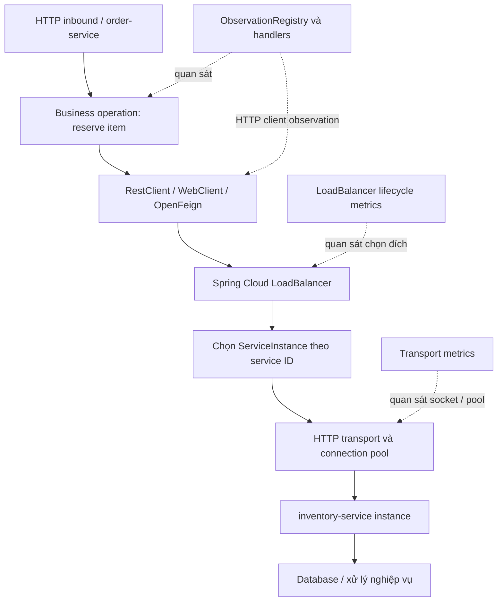
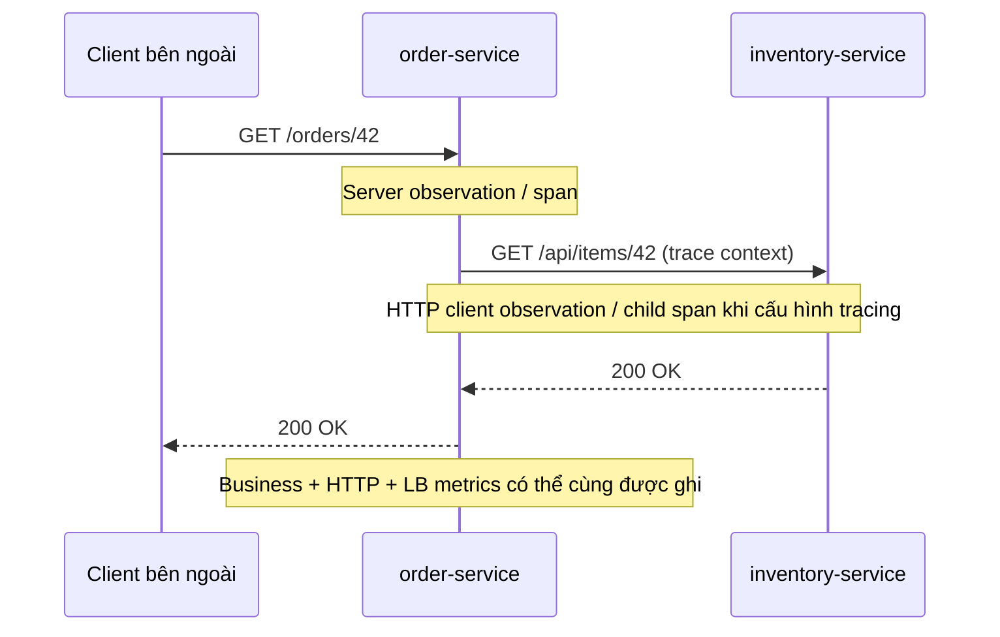
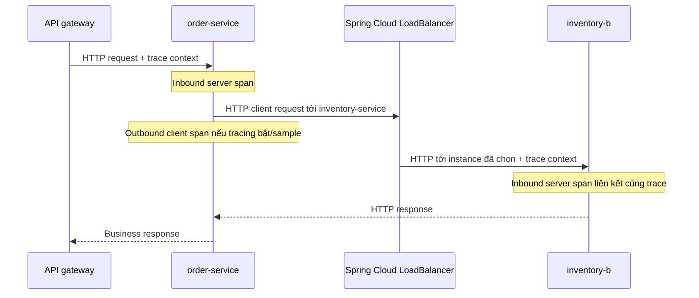
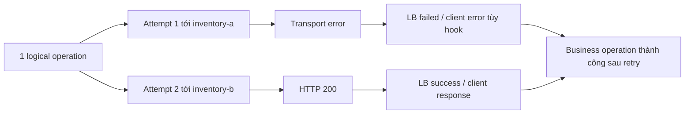
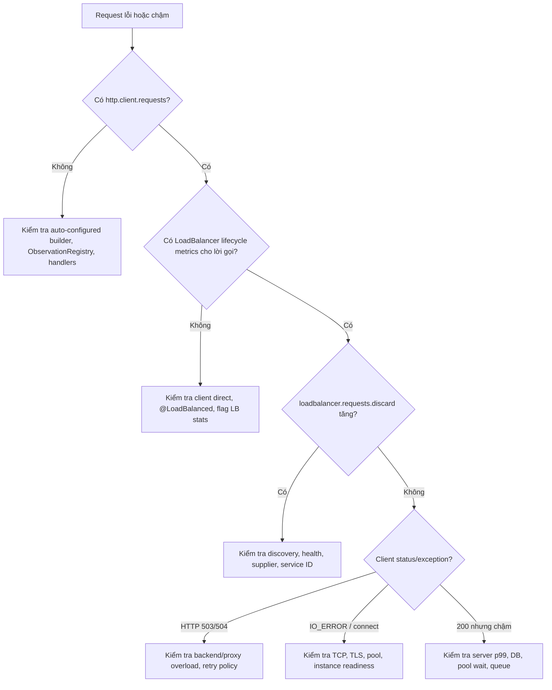

# Micrometer Observation và điểm tích hợp của từng HTTP client

Trong một hệ thống microservices, một lời gọi HTTP có thể đi qua **business service → HTTP client → Spring Cloud LoadBalancer → connection pool → instance đích**. Khi request tới `http://inventory-service` chậm hoặc lỗi, chỉ biết tổng thời gian HTTP không đủ để xác định nguyên nhân: client có chọn được `ServiceInstance` không, đang chờ connection pool hay server đã nhận request rồi nhưng xử lý chậm? Để trả lời, hệ thống cần kết hợp **metrics, distributed traces và logs** mà không tạo quá nhiều dữ liệu giám sát.

Bài thuộc chương **Quan sát hệ thống** của module **Spring Cloud Service Communication Load Balancing**. Chủ đề trực tiếp là **Micrometer Observation và điểm tích hợp của từng HTTP client**: `RestClient`, `RestTemplate`, `WebClient`, Spring Cloud OpenFeign và HTTP Interface. Bài cũng làm rõ metrics riêng của Spring Cloud LoadBalancer, mối liên hệ với discovery/health/retry/timeout, sự khác biệt giữa **một lời gọi nghiệp vụ** và **các HTTP attempt**, cách truyền trace context và kiểm thử instrumentation thực tế.

## 1. Đặt Observation ở đúng lớp

Một lời gọi `order-service → inventory-service` có nhiều phạm vi thời gian khác nhau:



| Điểm đo | Mô tả | Câu hỏi trả lời được |
|---|---|---|
| Business observation | Bao toàn bộ nghiệp vụ, gồm nhiều downstream calls, retry và fallback nếu đặt đúng ranh giới | Mất bao lâu để hoàn thành `reserveItem`? |
| HTTP client observation | Bao một HTTP exchange theo phạm vi client instrumentation | HTTP request nào lỗi/chậm, method, URI template, status? |
| LoadBalancer lifecycle | Quan sát quyết định chọn instance và kết quả bước load balance | Có chọn được `ServiceInstance`? Bao nhiêu lần bị discard? |
| HTTP transport/pool metrics | Theo dõi kết nối, connection acquisition, response time ở tầng transport | Có nghẽn pool, connect timeout hay socket reset không? |
| HTTP server observation | Bên `inventory-service` đo request nhận được | Backend xử lý bao lâu? Status nào trả về? |

**Không nên cộng các latency từ những lớp lồng nhau** rồi coi đó là tổng thời gian thực: chúng thường **chồng lấp**. Ví dụ một HTTP client observation 250 ms có thể đã bao gồm 20 ms connect và 200 ms server processing. Một business observation 300 ms có thể chứa cùng HTTP observation 250 ms.

Đồng thời, **không được suy luận** rằng có `http.client.requests` là chắc chắn có LoadBalancer metrics. Một client direct HTTP tới URL thật vẫn tạo client observation khi được cấu hình, nhưng không tạo quyết định chọn `ServiceInstance` của Spring Cloud LoadBalancer.

## 2. Micrometer Observation gồm những gì?

Micrometer định nghĩa `Observation` để một ứng dụng có thể ghi nhận một hoạt động theo cách trung lập với backend giám sát. Tùy các `ObservationHandler` đã được đăng ký, cùng một observation có thể sinh **timer metrics**, **trace spans**, các sự kiện hoặc các hành vi tích hợp khác.

| Thành phần | Vai trò |
|---|---|
| `ObservationRegistry` | Registry lưu cấu hình, handlers, predicates, filters và conventions của Observation |
| `Observation` | Vòng đời của một hoạt động: `start`, `error`, `event`, `stop` |
| `Observation.Context` | Dữ liệu ngữ cảnh cho hoạt động được quan sát |
| `ObservationHandler` | Phản ứng với lifecycle events; có thể ghi metric/span |
| `ObservationConvention` | Định nghĩa tên observation và metadata theo contract |
| `MeterRegistry` | Registry quản lý meter/timer/counter/gauge và kết nối tới metrics backend |
| Micrometer Tracing | Bridge từ Observation tới tracing implementation như OpenTelemetry hoặc Brave |
| Context propagation | Giữ trace context xuyên thread/scheduler/async boundaries khi được cấu hình |

Một `ObservationRegistry` có mặt **chưa đủ** để chứng minh traces đã được xuất tới backend; cần handlers/bridge/exporter tương ứng. Tương tự, một `MeterRegistry` có mặt chưa bảo đảm mọi loại HTTP client được instrument tự động.

### 2.1. Metrics và tracing khác nhau

- **Metrics** tổng hợp số lượng, thời gian và tỷ lệ; phù hợp theo dõi p95/p99, error rate, active requests trong một khoảng thời gian.
- **Distributed tracing** liên kết các spans của cùng một request xuyên các service; phù hợp điều tra một case cụ thể qua gateway, LoadBalancer, HTTP client và backend.
- **Logs** lưu sự kiện chi tiết, giúp xem exception, message và metadata có kiểm soát; trace ID thường được dùng để tương quan với trace.



Trace sampling có thể khiến một số request **không được xuất trace**, trong khi metrics vẫn có dữ liệu tổng hợp. Không được xem tỷ lệ trace sample 10% là tỷ lệ chỉ ghi 10% HTTP metric: hai hệ thống có cơ chế ghi và cấu hình riêng.

### 2.2. Một ví dụ Observation trong nghiệp vụ blocking

```java
import io.micrometer.observation.Observation;
import io.micrometer.observation.ObservationRegistry;

@Service
class InventoryLookupService {
    private final RestClient inventoryClient;
    private final ObservationRegistry observationRegistry;

    InventoryLookupService(
            RestClient inventoryClient,
            ObservationRegistry observationRegistry) {
        this.inventoryClient = inventoryClient;
        this.observationRegistry = observationRegistry;
    }

    ItemReply findItem(long id) {
        return Observation
                .createNotStarted("inventory.lookup", observationRegistry)
                .lowCardinalityKeyValue("dependency", "inventory-service")
                .lowCardinalityKeyValue("operation", "find-item")
                .observe(() -> inventoryClient.get()
                        .uri("/api/items/{id}", id)
                        .retrieve()
                        .body(ItemReply.class));
    }
}
```

`ItemReply` là DTO minh họa và `inventoryClient` là `RestClient` được dựng từ builder đã tích hợp LoadBalancer. `observe(...)` quản lý vòng đời observation quanh hàm đồng bộ; lỗi phát sinh trong lambda có thể được ghi nhận. Khi HTTP client cũng được instrument, **`inventory.lookup` và `http.client.requests` là hai observation có phạm vi khác nhau**, không phải hai lần đo độc lập cần cộng lại.

**Không tạo observation mới cho từng item hoặc biến đường dẫn riêng thành tên metric** như `inventory.lookup.42`. Tên observation nên ổn định; `id` của bản ghi không phải tag metric phù hợp.

## 3. Điều kiện để instrumentation của Spring hoạt động

Một ứng dụng dùng Spring Boot và Spring Cloud thường cần:

1. `spring-boot-starter-actuator` cho hạ tầng quản lý/observability.
2. `spring-cloud-starter-loadbalancer` để chọn instance theo service ID.
3. Spring Web/`RestClient` hoặc Spring WebFlux/`WebClient` theo mô hình HTTP client.
4. Một nguồn `ServiceInstance` như Eureka, Consul, Kubernetes discovery, `SimpleDiscoveryClient` hoặc supplier tùy chỉnh.
5. Một implementation metrics backend như Micrometer Prometheus registry, nếu muốn export Prometheus.
6. Micrometer Tracing bridge và exporter tương ứng nếu muốn distributed traces.
7. Với OpenFeign, `feign-micrometer` nếu muốn capability Micrometer theo cách Spring Cloud OpenFeign tài liệu hóa.

Ví dụ Maven tối thiểu cho Actuator và LoadBalancer:

```xml
<dependency>
    <groupId>org.springframework.boot</groupId>
    <artifactId>spring-boot-starter-actuator</artifactId>
</dependency>

<dependency>
    <groupId>org.springframework.cloud</groupId>
    <artifactId>spring-cloud-starter-loadbalancer</artifactId>
</dependency>
```

Các starter tracing/exporter phụ thuộc **Spring Boot version và lựa chọn backend**. Boot 4 có những starter OpenTelemetry/Zipkin và cách cấu hình exporter riêng; Boot 3.x có dependency arrangement khác. Dùng BOM phù hợp, không kết hợp tùy ý dependency versions từ nhiều release train.

**Lưu ý:** việc chỉ thêm `spring-boot-starter-actuator` không tự biến tất cả client được tạo bằng constructor hoặc static builder thành instrumented client. Điểm quyết định nằm ở **builder/instance HTTP client có nhận đúng `ObservationRegistry` và customizers hay không**.

## 4. Cấu hình HTTP client bằng auto-configured builders

Spring Boot quản lý instrumentation cho `RestTemplate`, `RestClient` và `WebClient` khi sử dụng builders được Boot tự động cấu hình:

| HTTP client | Đường đi thông thường để có Observation | Nếu tự tạo bằng API thô |
|---|---|---|
| `RestTemplate` | `RestTemplateBuilder` tự động cấu hình | Cần `ObservationRegistry` hoặc observation customizer |
| `RestClient` | `RestClient.Builder` tự động cấu hình | Cần gọi `observationRegistry(...)` / áp dụng Boot configurer |
| `WebClient` | `WebClient.Builder` tự động cấu hình | Cần gọi `observationRegistry(...)` / áp dụng Boot customizers |
| OpenFeign | `MicrometerObservationCapability` khi đủ điều kiện | Kiểm tra `feign-micrometer`, registry và cờ per-client |
| Spring HTTP Interface | Đi qua `RestClient` hoặc `WebClient` adapter | Không tự được instrument chỉ nhờ `@HttpExchange` |

Spring Framework đặt tên mặc định cho HTTP client exchange observation là **`http.client.requests`** cho cả đường blocking và reactive. Spring Boot cho phép thay tên qua `management.observations.http.client.requests.name` khi phù hợp.

### 4.1. Vì sao dùng builder do Boot cung cấp?

Boot có thể gắn các `RestClientCustomizer`/`WebClientCustomizer`, observation registry, message converters/codecs, request factory, TLS và cấu hình khác. Một bean mới như:

```java
@Bean
RestClient.Builder customRestClientBuilder() {
    return RestClient.builder();
}
```

không nên được giả định có toàn bộ những thiết lập như auto-configured builder. Trường hợp thường gặp: HTTP call vẫn thành công nhưng **`http.client.requests` và trace headers không xuất hiện**.

Khi cần tạo builder `@LoadBalanced` riêng, nên giữ các customizers phù hợp hoặc ít nhất gắn `ObservationRegistry` tường minh, rồi kiểm tra instrumentation thực sự bằng request test.

## 5. RestClient: Observation tại builder và LoadBalancer tại interceptor

`RestClient` là client synchronous. Spring Cloud LoadBalancer tích hợp với một `RestClient.Builder` được đánh dấu `@LoadBalanced` để xử lý hostname logic thành service ID. Micrometer Observation lại cấu hình qua **`observationRegistry(...)`** trên builder.

Ví dụ **tối thiểu, tự quản lý Observation**:

```java
import io.micrometer.observation.ObservationRegistry;
import org.springframework.cloud.client.loadbalancer.LoadBalanced;
import org.springframework.context.annotation.Bean;
import org.springframework.context.annotation.Configuration;
import org.springframework.context.annotation.Primary;
import org.springframework.web.client.RestClient;

@Configuration(proxyBeanMethods = false)
class ObservedRestClientConfiguration {

    @Bean
    @LoadBalanced
    RestClient.Builder loadBalancedRestClientBuilder(
            ObservationRegistry observationRegistry) {
        return RestClient.builder()
                .observationRegistry(observationRegistry);
    }

    @Bean
    @Primary
    RestClient.Builder directRestClientBuilder(
            ObservationRegistry observationRegistry) {
        return RestClient.builder()
                .observationRegistry(observationRegistry);
    }

    @Bean
    RestClient inventoryRestClient(
            @LoadBalanced RestClient.Builder builder) {
        return builder
                .baseUrl("http://inventory-service")
                .build();
    }
}
```

- `@LoadBalanced` xác định builder phải chọn một `ServiceInstance` từ `inventory-service`.
- `observationRegistry(...)` cho phép Spring Framework tạo HTTP client observations.
- `@Primary` trên builder direct khiến injection không qualifier mặc định dùng client thông thường; URL đối tác không bị nhầm thành service ID.
- Trong production có nhiều gateway, tránh dùng một mutable builder singleton rồi thay `baseUrl`, header, request factory ở nhiều nơi. Dùng prototype builder/clone và cấu hình client riêng.

**Đây là ví dụ tối thiểu để hiểu wiring, không phải bản sao đầy đủ Boot auto-configuration.** Khi dự án cần converter, request factory, trace propagation và customizers do Spring Boot áp dụng, nên dùng `RestClientBuilderConfigurer` của Boot tương thích phiên bản để dựng builder trước khi thêm cấu hình riêng. Ở Boot 3.x, class thuộc `org.springframework.boot.autoconfigure.web.client`; ở Boot 4.x, class chuyển sang `org.springframework.boot.restclient.autoconfigure`.

### 5.1. Kiểm chứng Observation của RestClient

```java
ItemReply item = inventoryRestClient.get()
        .uri("/api/items/{id}", 42L)
        .retrieve()
        .body(ItemReply.class);
```

Khi `ObservationRegistry` có handlers/meter instrumentation, có thể thấy `http.client.requests` với các thuộc tính tổng quát như method `GET`, URI template `/api/items/{id}`, status và outcome.

Không có bảo đảm mọi request qua client này tự tạo **span được xuất** nếu chưa cài tracing bridge/exporter. Cần phân biệt:

1. Bean `ObservationRegistry` đã được inject.
2. HTTP client đã đăng ký instrumentation.
3. Registry có handlers tạo metrics.
4. Tracing đã cấu hình và request được sample/export.

### 5.2. RestTemplate vẫn xuất hiện trong nhiều ứng dụng cũ

Với `RestTemplate`, dùng `RestTemplateBuilder` được Boot cung cấp sẽ giúp thiết lập Observation; nếu tự tạo một `RestTemplate`, phải cấu hình registry tương ứng, ví dụ:

```java
RestTemplate template = new RestTemplate();
template.setObservationRegistry(observationRegistry);
```

Đoạn code chỉ chứng minh cấu hình Observation; để dùng service ID còn cần đăng ký bean/integration `@LoadBalanced` đúng cách và nguồn discovery. **Gắn `ObservationRegistry` không tự bật LoadBalancer**. Ngược lại, gắn `@LoadBalanced` không tự bật metrics/tracing.

## 6. WebClient: observation của HTTP exchange và ngữ cảnh reactive

`WebClient` dùng reactive pipeline. Với Spring WebFlux, `WebClient.Builder` có phương thức `observationRegistry(ObservationRegistry)` và Spring Boot thường cấu hình registry cho bean builder tự động.

Ví dụ một builder load-balanced đồng thời được quan sát:

```java
import io.micrometer.observation.ObservationRegistry;
import org.springframework.cloud.client.loadbalancer.LoadBalanced;
import org.springframework.context.annotation.Bean;
import org.springframework.context.annotation.Configuration;
import org.springframework.web.reactive.function.client.WebClient;

@Configuration(proxyBeanMethods = false)
class ObservedWebClientConfiguration {

    @Bean
    @LoadBalanced
    WebClient.Builder loadBalancedWebClientBuilder(
            ObservationRegistry observationRegistry) {
        return WebClient.builder()
                .observationRegistry(observationRegistry);
    }

    @Bean
    WebClient inventoryWebClient(
            @LoadBalanced WebClient.Builder builder) {
        return builder
                .baseUrl("http://inventory-service")
                .build();
    }
}
```

Giống ví dụ `RestClient`, cách khai báo thô này nhấn mạnh hai điều kiện của bài: **LB filter** và **ObservationRegistry**. Cần xem xét customizers/codecs/connector/observability khác của Boot nếu muốn hoàn chỉnh production configuration.

### 6.1. Khi nào HTTP observation thực sự bắt đầu/kết thúc?

```java
Mono<ItemReply> result = inventoryWebClient.get()
        .uri("/api/items/{id}", 42L)
        .retrieve()
        .bodyToMono(ItemReply.class);
```

Chỉ tạo biến `Mono` không chứng minh HTTP đã được gửi. Publisher thường thực thi khi **có subscription**; không nên mong đợi meter tăng ngay sau khi tạo pipeline. Một HTTP client observation có thể ghi nhận response, exception và cancellation theo lifecycle framework/transport, nhưng chi tiết timing/cancel cần kiểm chứng theo Spring Framework version.

**Không gọi `block()` trong `ExchangeFilterFunction` hoặc trên Reactor Netty event-loop chỉ để “chờ đủ span”.** Làm vậy có thể chặn event-loop và khiến số liệu latency méo mó. Với reactive API, truyền publisher cho framework/subscriber phù hợp.

### 6.2. Reactor pipeline observation khác HTTP client observation

Nếu muốn đo thêm một đoạn xử lý **ngoài phạm vi một HTTP exchange**, Reactor cung cấp `Micrometer.observation(...)` qua dependency `reactor-core-micrometer`:

```java
import reactor.core.observability.micrometer.Micrometer;

Mono<ItemReply> result = inventoryWebClient.get()
        .uri("/api/items/{id}", 42L)
        .retrieve()
        .bodyToMono(ItemReply.class)
        .name("inventory.lookup.pipeline")
        .tap(Micrometer.observation(observationRegistry));
```

Observation tên `inventory.lookup.pipeline` là **đoạn reactive pipeline** riêng; `http.client.requests` vẫn là HTTP exchange observation do `WebClient` tạo. Hai phép đo có thể lồng nhau. Nếu muốn đo số signal/flow khác thay vì Observation, Reactor còn có `Micrometer.metrics(MeterRegistry)` nhưng **khác loại meters** với `Micrometer.observation(ObservationRegistry)`.

Với những pipeline có retry, hãy chú ý vị trí `tap` so với `retryWhen`: nó quyết định bạn đo **một subscription/attempt** hay phạm vi của **logical operation**. Dùng test cấy lỗi để khẳng định semantics, không dựa vào trực giác nhìn thứ tự operator.

### 6.3. Context propagation khi chuyển thread

Reactive signals có thể chạy qua nhiều scheduler; không được mặc định `ThreadLocal` hoặc MDC của thread Servlet ban đầu vẫn hiện diện. Tracing trong Spring Boot/WebFlux dựa trên sự kết hợp `ObservationRegistry`, Reactor Context, Micrometer Context Propagation và instrumentation phù hợp.

- Dùng integration chính thức thay vì copy `traceId` vào `ThreadLocal` tùy ý.
- Nếu tự tạo `ExecutorService`, `CompletableFuture` hoặc scheduler riêng, xem cơ chế snapshot/context propagation hoặc task decorators tương thích.
- Kiểm thử **trace parent-child** sau `publishOn`, `subscribeOn`, async callbacks và retry.
- Không sao chép một số HTTP trace headers từ request của người dùng chưa tin cậy rồi gán đó là quyền truy cập của request mới.

Cấu hình context propagation thay đổi theo phiên bản Boot/Reactor; hãy khóa BOM và kiểm thử thực tế thay vì thêm một hook toàn cục mà không biết tác động đến mọi pipeline.

## 7. OpenFeign: MicrometerObservationCapability và cấu hình per-client

Spring Cloud OpenFeign thường dùng HTTP client **blocking**, tích hợp LoadBalancer qua `FeignBlockingLoadBalancerClient` khi có dependency phù hợp. Với Micrometer, điểm hook được tài liệu hóa là **Feign Capability**, cụ thể `MicrometerObservationCapability`.

Spring Cloud OpenFeign tạo và đăng ký capability này khi **đồng thời** có:

1. Dependency `feign-micrometer` trên classpath.
2. Bean `ObservationRegistry` khả dụng.
3. Micrometer properties của Feign cho phép instrumentation (mặc định bật nếu các điều kiện khác thỏa).

```xml
<dependency>
    <groupId>io.github.openfeign</groupId>
    <artifactId>feign-micrometer</artifactId>
</dependency>
```

Ví dụ interface:

```java
@FeignClient(name = "inventory-service")
public interface InventoryFeignClient {
    @GetMapping("/api/items/{id}")
    ItemReply getItem(@PathVariable("id") long id);
}
```

Với `@EnableFeignClients`, dependency và cấu hình đúng, Feign có thể tạo HTTP observations mà ứng dụng không cần tự ghi `Timer` trong từng interface method.

### 7.1. Global flag và client-level flag không đối xứng

```yaml
spring:
  cloud:
    openfeign:
      client:
        config:
          inventory-service:
            micrometer:
              enabled: true
          partner-client:
            micrometer:
              enabled: false
```

Bảng hành vi:

| Cấu hình | Ý nghĩa |
|---|---|
| Không khai báo global `spring.cloud.openfeign.micrometer.enabled` | Có thể quản lý bật/tắt theo client khi dependency/registry đúng |
| `spring.cloud.openfeign.micrometer.enabled=false` | **Tắt Micrometer support cho tất cả Feign clients**; client-level `true` không bật lại được |
| `spring.cloud.openfeign.client.config.<name>.micrometer.enabled=false` | Tắt cho một Feign client cụ thể |
| `spring.cloud.openfeign.client.config.<name>.micrometer.enabled=true` | Cho phép cho client cụ thể nếu global không vô hiệu hóa |

Khi kiểm thử, xác minh tên Feign client config (đặc biệt khi dùng `contextId`), bean `ObservationRegistry` và actual `Capability` registration. Việc đưa `feign-micrometer` vào classpath **không đủ** nếu registry chưa sẵn sàng hoặc global switch đã tắt.

### 7.2. MicrometerObservationCapability khác MicrometerCapability

Tài liệu Spring Cloud OpenFeign phân biệt:

- `MicrometerObservationCapability` sử dụng `ObservationRegistry`; có thể phục vụ metrics và tracing theo handlers được cấu hình.
- `MicrometerCapability` là phương án **metrics-only** cũ sử dụng `MeterRegistry`; nếu muốn dùng cần vô hiệu hóa Feign Micrometer observation auto support và tự cung cấp capability phù hợp.

Không gắn **cả hai** capability để đo cùng một lời gọi theo hai đường vô tình trùng lặp. Không đồng nhất các meter do Feign capability tạo với `loadbalancer.requests.*`: chúng quan sát các lớp khác nhau.

### 7.3. Ghi log Feign và Observation là hai thứ riêng

Bật Feign logging `FULL` có thể ghi header, body và response, làm lộ token hoặc dữ liệu cá nhân. Không dùng logging mức FULL làm phương pháp tạo metrics. Nên:

- Dùng Micrometer Observation/Tracing để đo latency, status và lỗi.
- Dùng logger có lọc thông tin nhạy cảm khi cần debug.
- Tránh ghi request body hoặc `Authorization` của đối tác vào span attributes, metric tags và logs.
- Giới hạn lấy mẫu traces, cấu hình retention và quyền xem dữ liệu.

## 8. Spring HTTP Interface: điểm hook ở adapter, không phải annotation

Với Spring HTTP Interface, developer mô tả contract:

```java
@HttpExchange("/api/items")
public interface InventoryHttpApi {
    @GetExchange("/{id}")
    ItemReply getItem(@PathVariable("id") long id);
}
```

`@HttpExchange` và `@GetExchange` **không tự tạo HTTP client observation riêng**. Observability thực tế đến từ client đã được adapter nối vào proxy:

```java
@Bean
InventoryHttpApi inventoryHttpApi(
        @LoadBalanced RestClient.Builder builder) {

    RestClient client = builder
            .baseUrl("http://inventory-service")
            .build();

    HttpServiceProxyFactory factory =
            HttpServiceProxyFactory.builderFor(
                    RestClientAdapter.create(client))
                    .build();

    return factory.createClient(InventoryHttpApi.class);
}
```

Nếu builder mang `ObservationRegistry`, HTTP exchanges qua proxy này được instrument như `RestClient` thông thường. Tương tự, dùng `WebClientAdapter` sẽ dựa trên observation của `WebClient` và semantics reactive.

Spring Boot 4/Spring Cloud 5 có HTTP Service Client groups và integration LoadBalancer mới; với auto-configured group, cần xác nhận **base-url/serviceId semantics theo release train** và registry/customizers được áp dụng. Không mặc định cấu hình group ở Boot 4 dùng nguyên xi được trong Boot 3.

### 8.1. Một request có nên có ba observations?

Một request nghiệp vụ có thể có:

- `inventory.lookup`: business-level observation.
- `http.client.requests`: HTTP exchange từ `RestClient` hoặc `WebClient`.
- `loadbalancer.requests.success/failed/discard`: meters riêng cho LB lifecycle.

Đây **không phải double instrumentation** nếu chúng biểu diễn **ba hoạt động có mục đích và phạm vi khác nhau**. Double instrumentation xảy ra khi cùng một HTTP exchange bị hai interceptor/handler tương đương ghi hai timer hoặc hai spans trùng nhau vì custom code bọc lại đúng tầng mặc định mà không có phân biệt.

## 9. Spring Cloud LoadBalancer metrics là một lớp độc lập

Spring Cloud LoadBalancer cung cấp `MicrometerStatsLoadBalancerLifecycle` (một implementation `LoadBalancerLifecycle`). Để tạo bean này, theo tài liệu cần có:

- `spring.cloud.loadbalancer.stats.micrometer.enabled=true`.
- Một `MeterRegistry` (thường được Boot Actuator cấu hình).
- Một request **thực sự đi qua Spring Cloud LoadBalancer**.

Ví dụ:

```yaml
spring:
  cloud:
    loadbalancer:
      stats:
        micrometer:
          enabled: true
        include-path: false
```

`include-path: false` có ích để giảm high-cardinality ở nhãn URI; chi tiết theo HTTP client/LoadBalancer release train được giải thích phía dưới.

### 9.1. Tên metrics và ý nghĩa chính xác

Theo tài liệu Spring Cloud Commons:

| Meter | Loại | Ý nghĩa |
|---|---|---|
| `loadbalancer.requests.active` | Gauge | Số request đang active theo dữ liệu lifecycle của LoadBalancer |
| `loadbalancer.requests.success` | Timer | Thời gian của load-balanced request kết thúc bằng việc **chuyển response** cho client layer |
| `loadbalancer.requests.failed` | Timer | Thời gian của load-balanced request kết thúc bằng **exception** |
| `loadbalancer.requests.discard` | Counter | Request bị discard do LoadBalancer **không lấy được ServiceInstance** |

**Cực kỳ quan trọng:** tên `loadbalancer.requests.success` **không nhất thiết có nghĩa HTTP 2xx hoặc nghiệp vụ thành công**. Theo mô tả chính thức, nó là nhánh lifecycle khi response được chuyển xuống tầng client; một HTTP 404/503 vẫn có thể là một HTTP response ở bước đó. Muốn tính **HTTP error rate** phải xem `http.client.requests`/server metrics/status và mapping exception cụ thể. Đừng định nghĩa alert “mọi LB success đều là API thành công”.

`loadbalancer.requests.discard` mô tả trường hợp **không chọn được instance**, không phải mọi request server trả 503. Một client gọi URL direct có thể nhận 503 từ proxy nhưng không có sự kiện LB discard.

### 9.2. URI template và sự cố high cardinality

Tài liệu Spring Cloud LoadBalancer phân biệt:

- Với LoadBalancer cho `WebClient` và `RestClient`, hệ thống có thể dùng `uriTemplate` làm tag `uri` khi có.
- Với một số đường `RestTemplate`, không có URI template đủ tốt, tag có thể chứa full path có ID thay đổi.
- Có thể đặt `spring.cloud.loadbalancer.stats.include-path=false` để không thêm path vào tag `uri` khi cần giảm cardinality.

Không lấy ví dụ `/orders/987654321` làm nhãn metric nếu mỗi request có một ID khác. Một số backend metrics có giới hạn series; high cardinality sẽ tăng bộ nhớ, chi phí lưu trữ và độ khó query rất nhanh.

### 9.3. Metrics LB không tự là tracing spans

`MicrometerStatsLoadBalancerLifecycle` được tài liệu hóa để tạo **meters**. Không nên cho rằng mỗi vòng chọn `ServiceInstance` tự tạo một distributed tracing span với đầy đủ host/port, list supplier và retry context. Nếu cần trace chi tiết việc chọn đích, phải cân nhắc custom instrumentation **có chọn lọc**, an toàn về cardinality, và kiểm thử cùng trace exporter thực tế.

## 10. Transport metrics: Reactor Netty và Apache HttpClient 5

HTTP client Observation thường cho biết thời gian trao đổi HTTP, nhưng không phải lúc nào tách rõ connection acquisition, connect, TLS, queue và socket lifecycle.

### 10.1. Reactor Netty của WebClient

Nếu dùng Reactor Netty `ConnectionProvider` với metrics phù hợp, có thể quan sát:

| Metric điển hình | Ý nghĩa |
|---|---|
| `reactor.netty.connection.provider.active.connections` | Connections đang được sử dụng |
| `reactor.netty.connection.provider.idle.connections` | Connections đang rảnh |
| `reactor.netty.connection.provider.pending.connections` | Những yêu cầu chờ pool cấp connection |
| `reactor.netty.connection.provider.pending.connections.time` | Thời gian chờ để acquire connection |
| `reactor.netty.connection.provider.total.connections` | Tổng active + idle |
| `reactor.netty.http.client.response.time` | Thời gian response ở tầng Reactor Netty HTTP client khi HTTP metrics được bật |

**Phân biệt:** metrics của `ConnectionProvider` và metrics của `HttpClient` không nhất thiết được bật bằng cùng một cờ. Ví dụ `ConnectionProvider.builder(...).metrics(true)` phục vụ pool metrics; HTTP client response time có thể cần `HttpClient.metrics(...)` hoặc instrumented connector thích hợp. Không kết luận chỉ bật pool metrics là sẽ có `reactor.netty.http.client.response.time`.

### 10.2. Blocking transport

`RestClient` hoặc OpenFeign có thể dùng Apache HttpClient 5, JDK HttpClient, OkHttp hoặc transport khác. Connection pool của chúng có thể có thống kê `leased`, `available`, `pending` hay thời gian chờ acquisition, nhưng **không phải mọi transport đều tự đưa những số liệu này vào Micrometer**. Cần chọn instrumentation tương ứng và xác định rõ pool owner/lifecycle.

### 10.3. Phân biệt cùng tăng latency nhưng nguyên nhân khác nhau

| Hiện tượng | HTTP client metrics | LB metrics | Transport/backend cần xem |
|---|---|---|---|
| Không có instance | Client có thể ghi lỗi | `discard` tăng | Discovery, supplier, health |
| DNS/connection refused sau khi chọn | HTTP error/exception | `failed` có thể tăng | Connect errors, route, server readiness |
| Hết pool connection | HTTP request chậm | Có thể chưa chọn xong hoặc chưa gửi | Pool pending/acquire time |
| Backend trả HTTP 503 | `status=503` | LB `success` vẫn có thể ghi khi response được chuyển | Backend 5xx, load shedding |
| Backend xử lý chậm nhưng 200 | p99 tăng, status 200 | Timers có thể tăng | Server p99, DB wait, queue |
| Retry nhiều lần | Phụ thuộc vị trí instrumentation | Mỗi LB attempt có thể được ghi | So sánh logical request/outbound attempts |

**Không khẳng định số lượng LB meter events và số HTTP client observations luôn bằng nhau.** Khi retry, một logical request có thể có nhiều attempts; điểm đặt interceptor/filter quyết định một observation bao một exchange, một retry loop hay một lần chọn instance. Hãy quan sát request thực backend nhận để xác minh.

## 11. Low-cardinality và high-cardinality: quy tắc thiết kế tags

Mỗi tổ hợp giá trị tags mới có thể tạo một series mới trong monitoring system. Vì vậy, Observation conventions tách:

| Loại metadata | Ví dụ phù hợp | Ứng dụng |
|---|---|---|
| Low cardinality | `method=GET`, `status=200`, `uri=/api/items/{id}`, `dependency=inventory-service` | Metrics tags, aggregation |
| High cardinality | Full URI chứa item ID, raw query, trace ID, request ID, upload ID | Có thể dùng trong traces/logs nếu không chứa secret và có chính sách bảo vệ |
| Sensitive | Authorization bearer token, cookie, PII, full body | **Không ghi** vào metric tags, traces hoặc logs mặc định |

Spring Framework HTTP client observations có các keys điển hình như:

- `method`.
- `uri` (template của HTTP path nếu có, không gồm scheme/host/port).
- `client.name` (được suy từ request URI host; trong URL logic qua LoadBalancer có thể là service ID).
- `status`.
- `outcome`.
- `error` (class exception hoặc `none`).

Một high-cardinality key như `http.url` có thể tồn tại trong observation/tracing context. **Có high-cardinality attribute trong trace không có nghĩa nên đưa nó thành label Prometheus**. Cần xem quy tắc convention và exporter thực tế, đặc biệt nếu URI chứa query nhạy cảm.

### 11.1. URI template quan trọng hơn URI đã mở rộng

Tốt:

```java
client.get()
        .uri("/api/items/{id}", 42L)
        .retrieve()
        .body(ItemReply.class);
```

Nên tránh dùng một absolute URI/string đã thay tất cả biến rồi ghi full path vào metric tag tùy biến:

```java
// Không phù hợp làm metric tag: mỗi item ID có thể tạo một series.
String rawUri = "/api/items/" + itemId;
meterRegistry.counter("inventory.calls", "uri", rawUri).increment();
```

Tốt hơn:

```java
meterRegistry.counter(
        "inventory.calls",
        "operation", "get-item",
        "dependency", "inventory-service")
        .increment();
```

Nếu cần chẩn đoán một ID cụ thể, sử dụng trace/log có kiểm soát thay vì mở rộng metric cardinality vô hạn.

### 11.2. Độ lớn của cardinality tăng theo tích số

Giả sử metrics gắn 10 methods/status groups, 100 URI templates và 500 instance IDs, số tổ hợp lý thuyết có thể lên đến:

```text
10 × 100 × 500 = 500.000 time series
```

Đây là phép tính minh họa, không phải dự đoán hệ thống nào cũng tạo đủ tổ hợp. Khi thêm `tenantId` hoặc raw `requestId` có hàng triệu giá trị, chi phí còn tăng hơn nhiều. Tốt hơn nên dùng tags theo service/operation ở metrics, còn instance ID chi tiết dùng ở tracing hoặc dashboards có kiểm soát.

## 12. Cấu hình Actuator để thử nghiệm

Ví dụ cấu hình phù hợp với các dòng Spring Boot/Spring Cloud hiện đại, cần điều chỉnh theo release train:

```yaml
management:
  endpoints:
    web:
      exposure:
        include: health,info,metrics,prometheus
  tracing:
    sampling:
      probability: 0.1

spring:
  cloud:
    loadbalancer:
      stats:
        micrometer:
          enabled: true
        include-path: false
```

- `/actuator/metrics`: dùng để truy vấn tên meter và measurements/tags khi management endpoint được bật.
- `/actuator/prometheus`: chỉ có khi Prometheus registry dependency và endpoint tương ứng hiện diện.
- `management.tracing.sampling.probability`: điều chỉnh tỷ lệ sampling tracing; **không thay** số lượng HTTP metrics được ghi.
- `spring.cloud.loadbalancer.stats.micrometer.enabled`: bật thống kê riêng của LoadBalancer; theo bảng configuration properties hiện hành, mặc định là `false`.
- `include-path=false`: giảm rủi ro URI path làm nổ số lượng time series ở metrics LB.

**Production security:** không phơi các Actuator endpoints như metrics/prometheus trực tiếp ra Internet mà không có network access control, authentication hoặc chính sách hạ tầng tương ứng. Metrics có thể tiết lộ tên dịch vụ, instance hoặc topology mạng.

### 12.1. Kiểm tra meter qua Actuator

Sau khi gọi HTTP client được instrument, thử:

```text
GET /actuator/metrics/http.client.requests
GET /actuator/metrics/loadbalancer.requests.success
GET /actuator/metrics/loadbalancer.requests.failed
GET /actuator/metrics/loadbalancer.requests.discard
```

Một meter chỉ xuất hiện khi đã có mẫu phù hợp: `failed` có thể chưa có nếu chưa phát sinh exception; `discard` có thể chưa có nếu luôn chọn được instance. Không kết luận cấu hình sai chỉ vì meter của một nhánh lỗi chưa xuất hiện sau toàn bộ request thành công.

Tên được export sang Prometheus có thể được chuyển dạng theo naming convention, ví dụ dấu chấm thành underscore và hậu tố timer/counter tùy backend. Dùng tên Micrometer gốc trong `/actuator/metrics`; không tự suy ra chính xác chuỗi Prometheus trước khi nhìn exporter thực tế.

## 13. Tracing xuyên dịch vụ: truyền context chứ không truyền instance ID

Khi `order-service` nhận một HTTP request rồi gọi `inventory-service`, HTTP client instrumentation có thể tạo **child span** và inject context propagation headers vào outbound request. Server instrumentation ở inventory tiếp tục trace đó theo cấu hình tracer/propagator tương thích.



Một số quy tắc quan trọng:

1. Service ID trong URI logic và instance host/port được chọn không phải thay thế cho `traceId`.
2. Không tạo trace ID mới ở mỗi filter và xóa mất parent trace.
3. Không dùng request ID/trace ID làm low-cardinality metric tag.
4. Không kỳ vọng exporter xuất mọi request nếu sampling là 10%.
5. Trong WebFlux hoặc công việc async, giữ Reactor/Observation context qua scheduler/ThreadLocal boundaries bằng integration tương thích.
6. Khi có proxy/service mesh, có thể có thêm spans ở hạ tầng; chúng không nhất thiết trùng với spans do Java client phát ra.

### 13.1. Một lỗi thường gặp: client tạo bằng static builder

```java
// Có thể thiếu cấu hình Boot observability, trace propagation, converters.
RestClient unconfigured = RestClient.create("http://inventory-service");

// Phương án do framework quản lý và có thể kiểm chứng:
RestClient configured = observedLoadBalancedBuilder
        .baseUrl("http://inventory-service")
        .build();
```

Ở phương án thứ nhất, còn có rủi ro **không có LoadBalancer** nếu không tạo client từ builder `@LoadBalanced`. Nếu môi trường có DNS hostname `inventory-service`, request có thể thành công nhưng bỏ qua LB policy. Kiểm tra trace spans cùng LB metrics và backend logs để chứng minh đường đi thực sự.

## 14. Retry làm phức tạp số lượng observations

Giả sử một logical operation `reserveItem(42)`:

- Attempt 1 chọn `inventory-a`, bị `Connection reset`.
- Attempt 2 chọn `inventory-b`, trả HTTP 200.
- Business method cuối cùng thành công.



Một business observation đặt ngoài retry có thể chỉ ghi **một thành công cuối cùng**, trong khi LB lifecycle ghi **hai attempts** và transport ghi một lỗi kết nối + một thành công. HTTP client observation có thể nằm ngoài hoặc trong retry tùy instrumentation và cách retry được thực hiện.

**Không dùng quy tắc chung “một method Java = một HTTP metric sample”.** Cần xác định:

- Retry diễn ra trong `RestClient` filter/interceptor, Spring Cloud LoadBalancer, Reactor `retryWhen`, Feign retryer hay gateway.
- Observation bắt đầu trước hay sau lớp retry.
- Khi retry dẫn tới HTTP 503 rồi cuối cùng 200, metric HTTP status và LB success/failed có phản ánh cùng ranh giới không.
- Cancellation/timeouts ở reactive pipeline có được ghi trong metrics của client và server như kỳ vọng không.

Nên có metric riêng cho **logical operation count**, **outbound attempts count**, **retry count** và **backend received requests**. Chúng không nhất thiết bằng nhau vì attempt có thể thất bại trước khi server nhận request.

## 15. Tránh double instrumentation và các meter gây hiểu sai

Một số lỗi thường gặp:

| Lỗi cấu hình | Biểu hiện | Cách xử lý |
|---|---|---|
| Dùng Boot auto-configured builder rồi tự thêm một interceptor cũng tạo cùng HTTP timer | Hai timers/spans cho một exchange | Xác định instrumentation owner, bỏ lớp trùng |
| Tự tạo `RestClient.builder()` không gắn registry | HTTP chạy được nhưng thiếu `http.client.requests` | Dùng builder/configurer phù hợp hoặc gắn registry |
| Có `MeterRegistry` nhưng không có `ObservationRegistry` trên WebClient | Có metrics khác nhưng không có HTTP client observation | Kiểm tra client builder và registry |
| Bật `feign-micrometer` nhưng global flag `false` | Feign không instrument | Sửa flags đúng phạm vi |
| Hiểu LB `success` là HTTP 2xx | Dashboard availability đẹp giả | Dùng client/server status và hợp đồng nghiệp vụ |
| Bật `include-path` cho URI có ID động | Metric cardinality cao | Dùng URI template, hoặc `include-path=false` |
| Gắn instance ID/trace ID vào mọi meter tùy chỉnh | Nhiều series và chi phí lớn | Giữ low-cardinality tags |
| Retry ở nhiều tầng | Outbound attempts tăng hơn logical requests | Một chính sách retry chính, metric attempt |
| Gọi `block()` để giữ trace trong WebFlux filter | Event-loop bị chặn, latency tăng | Dùng reactive context propagation đúng cách |
| Ghi raw `http.url`/headers vào logs/traces không lọc | Lộ token/PII | Redaction, hạn chế thuộc tính và quyền truy cập |

### 15.1. Không làm custom observation để “đo mọi thứ”

Observation càng chi tiết không phải lúc nào càng hữu ích. Nếu mỗi `ServiceInstanceListSupplier`, mỗi filter và mỗi converter đều tạo span riêng trên mọi request, chi phí instrumentation có thể trở thành bottleneck, đặc biệt với latency rất nhỏ. Hãy bắt đầu từ HTTP client, LB metrics và backend server, rồi thêm **custom observation ở ranh giới nghiệp vụ có giá trị** khi đã có câu hỏi chẩn đoán cụ thể.

## 16. Kiểm thử Observation bằng hai instance giả lập

Một bài kiểm thử hữu ích cần chứng minh **request đi qua LB** và **metrics đúng theo lớp**. Chuẩn bị:

```yaml
spring:
  cloud:
    discovery:
      client:
        simple:
          instances:
            inventory-service:
              - uri: http://127.0.0.1:18081
              - uri: http://127.0.0.1:18082
    loadbalancer:
      stats:
        micrometer:
          enabled: true
        include-path: false
```

Chạy hai stub HTTP server ở `18081` và `18082`, mỗi server phản hồi instance ID của mình. Nếu caller ở container khác, `127.0.0.1` cần thay bằng địa chỉ mà container có thể kết nối. Cấu hình này dùng `SimpleDiscoveryClient`, không cần registry ngoài cho bài test.

### 16.1. Các scenario cần kiểm tra

| Scenario | Evidence cần thu thập |
|---|---|
| GET service ID trả 200 | `http.client.requests` được ghi khi Observation handler hoạt động; LB success có sample |
| GET URL direct bằng client quan sát | Có HTTP client observation, **không** có LB lifecycle event cho lời gọi direct đó |
| Discovery trả rỗng | LB discard tăng khi lifecycle có dữ liệu; kiểm tra exception từ client |
| Backend trả 503 | HTTP client/server metrics ghi status 503; LB success vẫn có thể tăng vì có response |
| Backend reset kết nối | LB failed hoặc client error/exception tùy integration và timing |
| Retry một lần sang instance khác | Đếm attempts ở stub A/B; so sánh với LB/client metrics |
| Tăng route ID từ 1 đến 10.000 | URI template không tạo thêm 10.000 metric tags |
| Tắt Feign micrometer riêng | Feign capability không ghi observation trong client được tắt |
| WebClient reactive cancel | Không giữ connection vô hạn; kiểm tra signal/cancel và metrics tương ứng |
| Truyền trace context | Server spans ở cả hai dịch vụ liên kết cùng trace khi được sample |

### 16.2. Một test kiểm tra meter HTTP client sau lời gọi

```java
@SpringBootTest
class InventoryClientObservationIT {

    @Autowired
    RestClient inventoryRestClient;

    @Autowired
    MeterRegistry meterRegistry;

    @Test
    void clientHasHttpRequestMetric() {
        inventoryRestClient.get()
                .uri("/api/items/{id}", 42L)
                .retrieve()
                .toBodilessEntity();

        long samples = meterRegistry.find("http.client.requests")
                .timers()
                .stream()
                .mapToLong(Timer::count)
                .sum();

        assertTrue(samples >= 1L);
    }
}
```

Ví dụ giả định context có `inventoryRestClient` đã được instrument và stub backend được khởi động. Các import JUnit 5/Spring Test/Micrometer được lược bớt. `Timer.count()` tổng hợp trên toàn bộ tags của meter trong registry mà test sử dụng. **Đây là test wiring cơ bản**, chưa đủ để xác minh trace exporter hay LoadBalancer đã chọn đúng instance; cần kiểm tra ở server stub và `loadbalancer.requests.*` khi đã bật.

Test nên tránh phụ thuộc dữ liệu registry của các test chạy song song. Tốt hơn dùng isolated test context, `SimpleMeterRegistry` phù hợp hoặc lấy count trước/sau cùng series nếu environment chia sẻ registry. Nếu test chỉ check `samples >=1` trong một context đã có traffic, nó có thể pass dù request hiện tại không được instrument; vì vậy test integration chính thức cần kiểm soát baseline.

### 16.3. Quan sát trace xuyên hai service

Nếu đã có tracing bridge/exporter và sampling 100% **trong môi trường test**, gửi một request từ caller tới stub backend có instrumentation server. Kiểm tra:

1. Server và client tạo spans có cùng trace ID khi propagation hoạt động.
2. Span client là con/cháu đúng của server/business span theo cấu hình.
3. Retry có thể tạo nhiều spans hoặc ghi events theo vị trí hooks, không mặc định đúng một span.
4. Không có raw token/cookie hoặc dữ liệu cá nhân trong span attributes.
5. Khi chạy với sampling 10% production, thiếu một trace cụ thể không phải bằng chứng HTTP call không xảy ra.

## 17. Quy trình chẩn đoán sự cố bằng cả Observation và LoadBalancer metrics



Một request có thể thiếu HTTP client meter vì:

- Client được dựng bằng builder không instrumented.
- `ObservationRegistry` không có handlers cho loại observation đó.
- Đường code chưa thực sự subscribe/gửi request.
- HTTP call bị từ chối **trước** vị trí HTTP instrumentation.
- Meter chưa có sample, bị filter, naming đổi hoặc exporter không hiển thị.

Để kết luận, đừng chỉ nhìn endpoint `/actuator/prometheus`; so sánh `/actuator/metrics`, registry configuration, LoadBalancer lifecycle, HTTP server access log và trace exporter.

### 17.1. Khi nào cần thêm metric riêng?

Chỉ thêm metric mới khi ba nguồn mặc định chưa trả lời được câu hỏi. Ví dụ:

- Số lần discovery cache trả snapshot stale.
- Số lần supplier health loại toàn bộ candidates.
- Thời gian request nằm trong custom policy chọn zone.
- Tỷ lệ retry từ `inventory-a` sang `inventory-b` trong một sự cố.
- Bulkhead rejected / circuit breaker open ở một dependency.

Mọi metric thêm cần định nghĩa **đơn vị**, **label set**, **lifecycle**, **owner** và **tần suất ghi**. Đừng ghi log/tracing quá nhiều hoặc thêm raw instance URI/tenant ID vào label vì nhu cầu debug tạm thời.

## 18. Checklist trước khi đưa vào production

- [ ] Đã hiểu sự khác nhau giữa `ObservationRegistry`, `MeterRegistry` và Micrometer Tracing/exporter.
- [ ] `RestClient`/`RestTemplate`/`WebClient` dùng builder/instrumentation từ Spring Boot hoặc registry được gắn rõ ràng.
- [ ] Với HTTP Interface, đã xác minh observation đến từ `RestClientAdapter` hoặc `WebClientAdapter` bên dưới.
- [ ] Với OpenFeign, có `feign-micrometer`, `ObservationRegistry` và flags per-client phù hợp; không bật metrics-only capability trùng vô tình.
- [ ] Các HTTP client dùng service ID thực sự có integration `@LoadBalanced` và nguồn `ServiceInstance` đúng.
- [ ] Đã bật `spring.cloud.loadbalancer.stats.micrometer.enabled` nếu cần LB metrics, biết nó mặc định không bật.
- [ ] Hiểu `loadbalancer.requests.success` là response lifecycle, không mặc định HTTP 2xx.
- [ ] URI tag dùng template hoặc đã tắt path của LB stats khi cần để giảm cardinality.
- [ ] Không đưa trace ID, user ID, token, raw query, file ID hoặc cursor vào metric tags.
- [ ] Có transport/connection pool metrics nếu cần tách pool wait khỏi backend processing.
- [ ] Tracing bridge/exporter hoạt động, sampling hợp lý và headers được propagate giữa các service.
- [ ] Với WebClient, Reactor Context/propagation được kiểm thử khi có scheduler boundaries và retry.
- [ ] Không double instrument một HTTP exchange bằng hai interceptor tương đương.
- [ ] Có integration test cho success, 503, exception, không tìm thấy instance và retry.
- [ ] Có phân biệt logical requests, outbound attempts, backend received requests và local rejections.
- [ ] Actuator endpoints và traces/logs được bảo vệ; đã thiết lập retention, sampling, access control.

**Kết luận:** Micrometer Observation là cầu nối thống nhất cho **metrics và tracing**, nhưng mỗi HTTP client có **điểm hook riêng**: `ObservationRegistry` trên builder của `RestClient`/`WebClient`, `RestTemplate` hoặc builder của nó, `MicrometerObservationCapability` của OpenFeign và adapter HTTP client nằm dưới HTTP Interface. Spring Cloud LoadBalancer còn có **`MicrometerStatsLoadBalancerLifecycle` độc lập** để quan sát quá trình chọn `ServiceInstance`. Kết hợp đúng **business observation + HTTP client observations + LB meters + transport/server evidence** giúp chẩn đoán discovery, health, retry, timeout và lỗi kết nối mà không đánh đồng các phạm vi đo hoặc gây nổ cardinality.

## Tài liệu tham khảo

- [Spring Framework — Observability Support](https://docs.spring.io/spring-framework/reference/integration/observability.html): `http.client.requests`, `ObservationRegistry` cho `RestClient`/`RestTemplate`/`WebClient`, các observation keys.
- [Spring Boot — Metrics](https://docs.spring.io/spring-boot/reference/actuator/metrics.html): auto-configured HTTP client builders, observation conventions và Actuator metrics.
- [Spring Boot — Tracing](https://docs.spring.io/spring-boot/reference/actuator/tracing.html): Micrometer Tracing, trace propagation và sampling.
- [Spring Cloud Commons — Spring Cloud LoadBalancer](https://docs.spring.io/spring-cloud-commons/reference/spring-cloud-commons/loadbalancer.html): `MicrometerStatsLoadBalancerLifecycle` và các meter `loadbalancer.requests.*`.
- [Spring Cloud Commons — Configuration Properties](https://docs.spring.io/spring-cloud-commons/reference/configprops.html): `spring.cloud.loadbalancer.stats.micrometer.enabled` và giá trị mặc định.
- [Spring Cloud OpenFeign — Features, Micrometer Support](https://docs.spring.io/spring-cloud-openfeign/reference/spring-cloud-openfeign.html): `MicrometerObservationCapability`, `feign-micrometer` và flags per-client.
- [Micrometer — Observation Introduction](https://docs.micrometer.io/micrometer/reference/observation/introduction.html): registry, handlers, observation lifecycle và conventions.
- [Reactor — Exposing Reactor metrics](https://projectreactor.io/docs/core/release/reference/metrics.html): `tap(Micrometer.observation(...))` và `tap(Micrometer.metrics(...))`.
