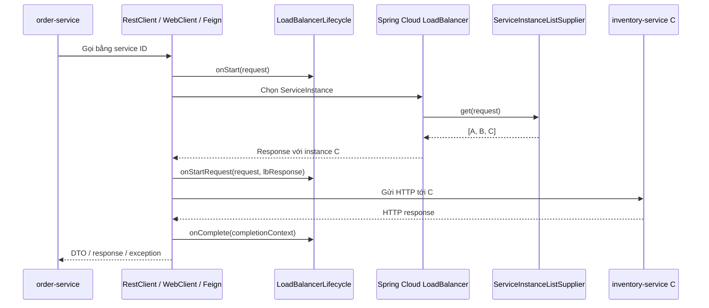

# LoadBalancerLifecycle và thu thập kết quả lựa chọn bản sao

Khi `order-service` gọi `http://inventory-service/api/stocks/BOOK-001`, Spring Cloud LoadBalancer có thể chọn một trong nhiều `ServiceInstance` của `inventory-service`. Nếu lời gọi chậm hoặc thất bại, việc chỉ thấy log HTTP `503` hay `Connection refused` chưa đủ để trả lời các câu hỏi quan trọng: **LoadBalancer đã chọn instance nào, có tìm được instance không, request có thực sự đi tới đích không và retry đã chọn lại mấy lần?**

**`LoadBalancerLifecycle`** là điểm mở rộng của Spring Cloud Commons để quan sát các mốc trước và sau quá trình cân bằng tải. Các callback của nó giúp gắn thông tin **request context**, **instance đã chọn** và **kết quả thực thi** vào log, metric hoặc hoạt động chẩn đoán. Spring Cloud còn có triển khai `MicrometerStatsLoadBalancerLifecycle` để thu thập thống kê tải qua Micrometer khi được bật và có `MeterRegistry`.

Bài thuộc chương **Quan sát hệ thống** của module `SPRING_CLOUD_SERVICE_COMMUNICATION_LOAD_BALANCING`. Nội dung hướng tới việc quan sát giao tiếp giữa các dịch vụ sử dụng RestClient, WebClient và OpenFeign, trong đó `ServiceInstanceListSupplier`, discovery, health check, zone, retry và timeout đều có thể ảnh hưởng tới bản sao được chọn. Mục tiêu là đo đúng và chẩn đoán có căn cứ, không đồng nhất một lựa chọn thành công với một giao dịch nghiệp vụ thành công.

## 1. Vì sao cần điểm quan sát ở tầng LoadBalancer?

Giả sử `inventory-service` công bố ba instance:

| Instance | Địa chỉ | Tình huống giả định |
| --- | --- | --- |
| A | `10.0.1.11:8080` | Đang hoạt động |
| B | `10.0.1.12:8080` | Vừa chết, registry/cache chưa cập nhật |
| C | `10.0.1.13:8080` | Đang hoạt động |

Một lời gọi có thể diễn ra như sau:

```text
order-service nhận yêu cầu kiểm tra tồn kho
  -> Spring Cloud LoadBalancer chọn B
  -> HTTP client kết nối tới 10.0.1.12:8080
  -> Connection refused
  -> Retry policy cho phép thử lại
  -> LoadBalancer chọn C
  -> HTTP client gọi C và nhận HTTP 200
  -> order-service trả kết quả nghiệp vụ
```

Nếu chỉ nhìn HTTP response cuối cùng, ta thấy `200 OK` và có thể tưởng hệ thống khỏe mạnh. Nhưng ở phía sau đã có **hai lựa chọn instance**, **hai HTTP attempt** và một lần lỗi mạng. Thông tin này quan trọng khi:

- Một replica lỗi liên tục nhưng bị cache giữ trong danh sách.
- Retry làm tăng số HTTP attempt và dồn tải sang các instance còn sống.
- Zone preference khiến tỷ lệ lựa chọn cùng vùng thay đổi.
- Một supplier tùy chỉnh lọc hết ứng viên, không còn địa chỉ đích.
- LoadBalancer chọn instance đúng nhưng timeout do pool/network/server.
- Muốn chứng minh việc đổi thuật toán lựa chọn thực sự cải thiện kết quả.

Điểm mạnh của `LoadBalancerLifecycle` là **đặt thiết bị quan sát gần ranh giới quyết định chọn `ServiceInstance`**, thay vì suy đoán từ log HTTP của tầng bên ngoài.

## 2. Ba callback chính trong một lifecycle

Spring Cloud Commons định nghĩa ba callback quan trọng:

| Callback | Thời điểm khái niệm | Thông tin chính |
| --- | --- | --- |
| `onStart(Request<RC> request)` | Bắt đầu quá trình cân bằng tải | Ngữ cảnh request được sử dụng để chọn instance |
| `onStartRequest(Request<RC> request, Response<T> lbResponse)` | Sau bước chọn, trước khi thực hiện request tới đích | Ngữ cảnh request và kết quả chọn từ LoadBalancer |
| `onComplete(CompletionContext<RES,T,RC> context)` | Khi đường gọi load-balanced hoàn tất theo integration | Lựa chọn instance, trạng thái, response client nếu có và exception nếu có |

Một sơ đồ đơn giản:



Đây là **sơ đồ logic**, không phải cam kết tất cả HTTP client hay đường lỗi đều phát callback giống nhau ở mọi phiên bản. Nếu không tìm thấy instance, `onStartRequest` có thể không mang một server hợp lệ. Nếu lỗi xảy ra trước lúc LoadBalancer được gọi (ví dụ client không tích hợp LB), lifecycle hoàn toàn có thể không quan sát được request.

## 3. Contract Java và ý nghĩa ba tham số generic

Interface có dạng khái niệm:

```java
public interface LoadBalancerLifecycle<RC, RES, T> {

    void onStart(Request<RC> request);

    void onStartRequest(
            Request<RC> request,
            Response<T> lbResponse);

    void onComplete(
            CompletionContext<RES, T, RC> completionContext);

    default boolean supports(
            Class requestContextClass,
            Class responseClass,
            Class serverTypeClass) {
        return true;
    }
}
```

Trong đó:

- **`RC` (request context):** kiểu dữ liệu ngữ cảnh mà integration dùng ở bước lựa chọn; có thể liên quan tới HTTP request, hint hoặc retry.
- **`RES` (client response):** kiểu response mà HTTP client/integration cung cấp cho lifecycle.
- **`T` (server type):** kiểu đối tượng đích do LoadBalancer trả về, thường là `ServiceInstance`.

`Response<T>` trong callback là **kết quả lựa chọn server của LoadBalancer**, không phải HTTP `200`/`404`. Chẳng hạn `Response<ServiceInstance>` có thể chứa instance B mà chưa có gói HTTP nào gửi tới B.

`supports(...)` cho phép lifecycle quyết định có xử lý các kiểu context/response/server do một integration cung cấp hay không; mặc định thường trả `true`. Khi triển khai một lifecycle phụ thuộc `RequestDataContext` hay `ResponseData` cụ thể, cần giới hạn kiểu hỗ trợ hoặc xử lý kiểm tra kiểu an toàn, thay vì ép kiểu tùy tiện.

## 4. Request trong lifecycle không giống HTTP request thô

`Request<RC>` là abstraction của Spring Cloud LoadBalancer. Nó chứa ngữ cảnh phục vụ bước lựa chọn; tùy HTTP client, ngữ cảnh có thể bao gồm request data và hint. Nó **không nhất thiết chính là** `HttpServletRequest`, `ClientHttpRequest` hoặc `WebClient.RequestHeadersSpec` của ứng dụng.

Ví dụ các mẩu thông tin có thể hữu ích:

| Thông tin | Lợi ích quan sát | Lưu ý |
| --- | --- | --- |
| Service ID | Phân biệt downstream cần chọn | Có thể nằm ở integration/config, không phải thuộc tính chung của mọi `Request` |
| Hint hoặc routing context | Giải thích vì sao instance khác được ưu tiên | Cần đọc đúng context type ở phiên bản đang chạy |
| Retry context | Phân biệt attempt đầu và attempt sau | Không phải mọi integration truyền cùng kiểu dữ liệu |
| HTTP method | Phân biệt GET/POST và kiểm tra retry | Chỉ có nếu context/instrumentation cung cấp |
| URI template | Nhóm latency theo endpoint | Không log URL chứa user ID/token |
| Correlation/trace ID | Ghép lựa chọn với HTTP attempt và kết quả cuối | Cần ngữ cảnh tracing thống nhất |

Không nên dump `request.getContext().toString()` vào log ở production: context có thể chứa headers hoặc thông tin nhạy cảm; cách in chuỗi cũng không ổn định giữa các phiên bản.

## 5. onStart: biết khi nào bắt đầu một lần chọn

Callback `onStart(...)` được gọi trước bước cân bằng tải trong những đường tích hợp có hỗ trợ lifecycle.

Tại đây phù hợp để:

- Đếm số lần bắt đầu lựa chọn theo service ID nếu có context xác định đáng tin cậy.
- Đánh dấu mốc bắt đầu để liên kết các sự kiện theo cùng một lượt chọn.
- Ghi một sự kiện debug ở mức thấp nếu cần điều tra chính sách routing.
- Kiểm tra định dạng context mà integration cung cấp trong một môi trường test.

Tại đây **chưa biết instance nào được chọn**. Vì vậy không thể đo “tỷ lệ chọn instance B” ngay trong `onStart`.

Một điểm cần lưu ý: không tự giữ trạng thái của request hiện tại trong biến instance field của bean lifecycle kiểu `lastRequest` hoặc `lastStartNanos`. Nhiều request có thể chạy đồng thời, nên biến field dùng chung dễ bị ghi đè. Nếu cần timing/correlation tùy chỉnh, dùng context request, tracing scope hoặc cơ chế lưu trữ riêng theo lượt gọi được thiết kế phù hợp với blocking/reactive.

## 6. onStartRequest: thời điểm biết kết quả chọn bản sao

Callback `onStartRequest(request, lbResponse)` chạy sau khi có kết quả lựa chọn và trước khi client thực thi request load-balanced, theo hợp đồng lifecycle.

Thông tin quan trọng là:

```java
ServiceInstance selected = lbResponse.getServer();
```

Ở đây `selected` là **instance được chọn**, không phải một HTTP response. Từ instance có thể lấy:

```java
selected.getServiceId();
selected.getInstanceId();
selected.getHost();
selected.getPort();
selected.isSecure();
selected.getMetadata();
```

Ví dụ:

```text
event=lb.selection
serviceId=inventory-service
instanceId=inventory-c
host=10.0.1.13
port=8080
secure=false
```

Với dữ liệu này có thể tìm hiểu sự phân phối lựa chọn giữa các instance/zone và kiểm chứng chính sách routing. Tuy nhiên, **được chọn không đồng nghĩa HTTP request đã tới server**. Một lỗi connect timeout, TLS handshake hoặc connection refused có thể xảy ra sau callback.

Cần kiểm tra `lbResponse` và `getServer()` có tồn tại hay không, đặc biệt khi không có instance khả dụng. Việc truy cập `getHost()` trên một kết quả rỗng mà không kiểm tra sẽ làm hỏng chính logic quan sát.

## 7. onComplete: kết quả của đường gọi load-balanced

`onComplete(CompletionContext<RES,T,RC>)` là nơi có thể nối thông tin lựa chọn với **kết quả thực thi**. `CompletionContext` có những dữ liệu hữu ích:

| API | Nội dung |
| --- | --- |
| `status()` | Trạng thái hoàn tất theo ngữ nghĩa lifecycle |
| `getLoadBalancerResponse()` | Kết quả chọn instance từ LoadBalancer |
| `getClientResponse()` | Response do client/integration cung cấp nếu có |
| `getThrowable()` | Exception liên quan nếu có |
| `getLoadBalancerRequest()` | Context của lần chọn khi integration truyền được |

Trong những phiên bản phổ biến, `CompletionContext.Status` có các giá trị:

| Status | Ý nghĩa ở tầng lifecycle |
| --- | --- |
| `SUCCESS` | Đường load-balanced kết thúc bằng việc chuyển response cho client theo quy ước framework |
| `FAILED` | Đường thực thi gặp exception |
| `DISCARD` | Không có request được gửi tới server theo nhánh bị loại/bỏ, ví dụ không chọn được instance |

**`SUCCESS` không đồng nghĩa HTTP 2xx hoặc nghiệp vụ thành công.** Một response HTTP `404` hoặc `503` vẫn là một HTTP response đã nhận được; việc exception hóa status và ghi nhận `SUCCESS`/`FAILED` phụ thuộc điểm đặt callback và HTTP integration. Phải đọc cả HTTP status/error handler ở tầng client nếu muốn thống kê kết quả nghiệp vụ hoặc mã status.

Tương tự, `DISCARD` không nhất thiết có nghĩa registry của toàn hệ thống rỗng: supplier có thể đã lọc hết instance do health, zone, hint, cấu hình hoặc một vấn đề khác. Lifecycle chỉ cho biết không có đích hợp lệ ở đường gọi mà nó quan sát.

## 8. Ví dụ custom LoadBalancerLifecycle ghi lựa chọn và kết quả

Một ví dụ Java tối giản giúp ghi log instance đã chọn và kết quả hoàn tất. Để tránh ràng buộc vào một loại HTTP client duy nhất, đoạn code dùng generic `Object` cho request context và client response; `ServiceInstance` là kiểu server.

```java
package com.example.order.observability;

import org.slf4j.Logger;
import org.slf4j.LoggerFactory;
import org.springframework.cloud.client.ServiceInstance;
import org.springframework.cloud.client.loadbalancer.CompletionContext;
import org.springframework.cloud.client.loadbalancer.LoadBalancerLifecycle;
import org.springframework.cloud.client.loadbalancer.Request;
import org.springframework.cloud.client.loadbalancer.Response;

public final class SelectionLoggingLifecycle
        implements LoadBalancerLifecycle<Object, Object, ServiceInstance> {

    private static final Logger log =
            LoggerFactory.getLogger(SelectionLoggingLifecycle.class);

    @Override
    public void onStart(Request<Object> request) {
        log.debug("event=lb.started");
    }

    @Override
    public void onStartRequest(
            Request<Object> request,
            Response<ServiceInstance> lbResponse) {

        ServiceInstance selected = serverOf(lbResponse);

        if (selected == null) {
            log.debug("event=lb.selection outcome=no_instance");
            return;
        }

        log.info(
                "event=lb.selection serviceId={} instanceId={} secure={}",
                selected.getServiceId(),
                selected.getInstanceId(),
                selected.isSecure());
    }

    @Override
    public void onComplete(
            CompletionContext<Object, ServiceInstance, Object> context) {

        ServiceInstance selected =
                serverOf(context.getLoadBalancerResponse());
        Throwable failure = context.getThrowable();

        log.info(
                "event=lb.complete status={} serviceId={} instanceId={} "
                        + "exceptionType={}",
                context.status(),
                selected == null ? "unknown" : selected.getServiceId(),
                selected == null ? "none" : selected.getInstanceId(),
                failure == null ? "none"
                        : failure.getClass().getSimpleName());
    }

    private static ServiceInstance serverOf(
            Response<ServiceInstance> response) {
        return response == null ? null : response.getServer();
    }
}
```

Những chủ ý trong ví dụ:

1. Ghi **service ID/instance ID**, tránh ghi toàn bộ URI có query parameter.
2. Kiểm tra `null` để xử lý nhánh không chọn được instance.
3. Ghi **loại exception**, không tự động ghi message hoặc stack trace chứa URL/token trong mọi request.
4. Không dùng biến field thay đổi theo request, nên tránh trộn trạng thái các lời gọi đồng thời.
5. Không khẳng định `status=SUCCESS` là HTTP 2xx.
6. Callback không sửa quyết định chọn instance và không điều khiển retry.

Đây là code minh họa theo contract `LoadBalancerLifecycle` của các phiên bản Spring Cloud Commons có ba callback trên. Trong production nên cân nhắc **sampling log** và Micrometer/Tracing thay vì ghi INFO cho mọi request ở mức traffic lớn.

### 8.1. Đăng ký lifecycle riêng cho một service ID

Spring Cloud LoadBalancer thường tạo child context theo service ID. Có thể gắn một cấu hình riêng cho `inventory-service`:

```java
package com.example.order;

import com.example.order.observability.SelectionLoggingLifecycle;
import org.springframework.cloud.client.ServiceInstance;
import org.springframework.cloud.client.loadbalancer.LoadBalancerLifecycle;
import org.springframework.cloud.loadbalancer.annotation.LoadBalancerClient;
import org.springframework.context.annotation.Bean;
import org.springframework.context.annotation.Configuration;

@Configuration
@LoadBalancerClient(
        name = "inventory-service",
        configuration = InventoryLbObservabilityConfiguration.class)
class LoadBalancerConfiguration {
}

// Cấu hình dành cho child context của inventory-service.
// Không đặt @Configuration và không để bị quét như cấu hình toàn cục.
class InventoryLbObservabilityConfiguration {

    @Bean
    LoadBalancerLifecycle<Object, Object, ServiceInstance>
            inventorySelectionLoggingLifecycle() {
        return new SelectionLoggingLifecycle();
    }
}
```

Ở ví dụ này, `InventoryLbObservabilityConfiguration` là lớp cấu hình được khai báo với `@LoadBalancerClient`, không cần được quét thành bean cấu hình chính của ứng dụng. Nếu class thuộc phạm vi component scan và được cấu hình như bean toàn cục, lifecycle có thể vô tình ảnh hưởng tới những service ID khác.

Không cần thêm `ServiceInstanceListSupplier` tùy chỉnh chỉ để ghi log lựa chọn. Đừng sửa supplier hoặc thuật toán Round Robin khi nhu cầu hiện tại chỉ là observability.

## 9. Wiring HTTP client: lifecycle chỉ quan sát lời gọi qua LoadBalancer

Mọi callback ở trên chỉ hữu ích nếu request **thực sự đi qua Spring Cloud LoadBalancer**.

### 9.1. RestClient

```java
import org.springframework.cloud.client.loadbalancer.LoadBalanced;
import org.springframework.context.annotation.Bean;
import org.springframework.context.annotation.Configuration;
import org.springframework.web.client.RestClient;

@Configuration
class HttpClientConfiguration {

    @Bean
    @LoadBalanced
    RestClient.Builder loadBalancedRestClientBuilder() {
        return RestClient.builder();
    }
}
```

Lời gọi nghiệp vụ:

```java
RestClient client = loadBalancedBuilder
        .baseUrl("http://inventory-service")
        .build();

StockResponse stock = client.get()
        .uri("/api/stocks/{sku}", "BOOK-001")
        .retrieve()
        .body(StockResponse.class);
```

`loadBalancedBuilder` là builder được inject từ bean `@LoadBalanced`; `StockResponse` là DTO minh họa. Nếu dùng `RestClient.create()` độc lập hoặc gọi URL vật lý trực tiếp, request có thể bỏ qua Spring Cloud LoadBalancer và do đó không có callback của lifecycle.

### 9.2. WebClient

Với WebClient reactive, có thể dùng `@LoadBalanced WebClient.Builder` tương tự. Một lời gọi trả `Mono<StockResponse>` thường thực sự gửi HTTP khi có subscription, nên callback có thể xảy ra **sau khi tạo publisher**, không phải lúc khai báo chuỗi reactive.

```java
@Bean
@LoadBalanced
WebClient.Builder loadBalancedWebClientBuilder() {
    return WebClient.builder();
}
```

Khi thử nghiệm tracing reactive, phải bảo đảm context propagation của Reactor/Observation được cấu hình đúng, thay vì giả định MDC (Mapped Diagnostic Context) theo thread luôn sẵn có như luồng đồng bộ.

### 9.3. OpenFeign

`@FeignClient(name = "inventory-service")` có thể sử dụng Spring Cloud LoadBalancer khi không đặt URL cố định và dependency/integration phù hợp có mặt. Nếu một Feign client khai báo `url = "http://10.0.1.13:8080"`, nó thường không cần chọn `ServiceInstance` theo service ID; lifecycle của LoadBalancer sẽ không thấy cùng chuỗi lựa chọn như trường hợp gọi qua registry.

Cần kiểm tra thực tế wiring, retryer và transport của Feign; không nên kỳ vọng ba loại HTTP client có cùng nội dung request/response context trong callback.

## 10. Thu thập thống kê có sẵn bằng MicrometerStatsLoadBalancerLifecycle

Nếu mục tiêu chính là số liệu thống kê thay vì log tùy biến, Spring Cloud cung cấp **`MicrometerStatsLoadBalancerLifecycle`**. Để kích hoạt, cần có `MeterRegistry` và property:

```yaml
spring:
  cloud:
    loadbalancer:
      stats:
        micrometer:
          enabled: true
```

Dependency Spring Boot thường dùng cho metric:

```xml
<dependency>
    <groupId>org.springframework.boot</groupId>
    <artifactId>spring-boot-starter-actuator</artifactId>
</dependency>
<dependency>
    <groupId>io.micrometer</groupId>
    <artifactId>micrometer-registry-prometheus</artifactId>
</dependency>
```

Với các điều kiện auto-configuration tương ứng, framework đăng ký bean lifecycle ghi metric. Các meter được tài liệu Spring Cloud Commons mô tả gồm:

| Tên meter Micrometer | Loại | Ý nghĩa |
| --- | --- | --- |
| `loadbalancer.requests.active` | Gauge | Số request load-balanced hiện đang hoạt động |
| `loadbalancer.requests.success` | Timer | Thời gian lời gọi có response chuyển tới client theo định nghĩa lifecycle |
| `loadbalancer.requests.failed` | Timer | Thời gian lời gọi kết thúc bằng exception |
| `loadbalancer.requests.discard` | Counter | Số lời gọi bị bỏ vì không lấy được instance để thực thi |

**Lưu ý quan trọng:** meter `success` ở đây vẫn **không tự đồng nghĩa** “HTTP status là 2xx” hay “nghiệp vụ thành công”. Một lỗi API như `404` có thể cần được phân tích qua metric HTTP client/server hoặc error mapping riêng.

Ở một số implementation (đặc biệt những đường blocking nhất định), request/response context không đầy đủ nên tags về HTTP method, path hoặc response có thể không có. Những meter chỉ được đăng ký khi có sự kiện được ghi nhận; không thấy `discard` trong môi trường hoàn toàn khỏe mạnh **không nhất thiết** là tính năng chưa hoạt động.

### 10.1. Bật endpoint Prometheus trong môi trường có kiểm soát

```properties
management.endpoints.web.exposure.include=health,info,metrics,prometheus
```

Endpoint `/actuator/prometheus` chỉ nên được lộ qua mạng quản trị hoặc phương thức truy cập được bảo vệ. Không công khai metrics và logs có host/instance metadata nhạy cảm ra Internet chỉ vì muốn debug.

Trước khi dựa vào tên chuỗi Prometheus, hãy kiểm tra output thực tế của phiên bản Micrometer đang chạy: tên meter với dấu chấm thường được chuyển sang snake_case, timer thường có suffix `_seconds_count`, `_seconds_sum` và có thể có `_bucket` nếu histogram được bật.

## 11. Đọc metric LoadBalancer đúng cách

Trong một cách đặt tên Prometheus thông thường, các meter nói trên có thể được xuất dưới những chuỗi như:

```text
loadbalancer_requests_active
loadbalancer_requests_success_seconds_count
loadbalancer_requests_success_seconds_sum
loadbalancer_requests_failed_seconds_count
loadbalancer_requests_failed_seconds_sum
loadbalancer_requests_discard_total
```

Tên chính xác, tags và việc có series tại thời điểm scrape cần kiểm tra trên endpoint thật. Đây là **tên ví dụ theo naming convention**, không phải một cam kết cho mọi registry/phiên bản.

### 11.1. Đếm tốc độ lời gọi load-balanced có response

```promql
sum(rate(loadbalancer_requests_success_seconds_count[5m]))
```

Kết quả có đơn vị *lượt/giây* theo định nghĩa Timer của lifecycle. Nó không bằng số **business request thành công** nếu có retry hoặc HTTP status lỗi nhưng vẫn nhận response.

### 11.2. Đếm tốc độ lỗi dạng exception

```promql
sum(rate(loadbalancer_requests_failed_seconds_count[5m]))
```

Có thể đối chiếu chuỗi này với timeout, connection refused, TLS handshake failures và HTTP client error metrics. Không dùng nó như một phép đo đầy đủ cho HTTP `5xx`.

### 11.3. Đếm lượt không chọn được instance

```promql
sum(rate(loadbalancer_requests_discard_total[5m]))
```

Giá trị tăng cho thấy có đường gọi bị loại/bỏ trước khi gửi request tới server theo ngữ nghĩa metric. Cần đối chiếu danh sách discovery, health/zone/hint filters, cache và cấu hình supplier để tìm nguyên nhân.

### 11.4. Số yêu cầu đang hoạt động

```promql
sum(loadbalancer_requests_active)
```

Đây là gauge liên quan đến các lời gọi đang hoạt động trong phạm vi instrument được scrape, không phải số HTTP socket hay concurrency chính xác trên toàn bộ hệ thống. Tần suất scrape, thời gian sống request và cách framework cập nhật gauge ảnh hưởng đến dữ liệu quan sát.

### 11.5. Phân vị latency từ histogram nếu có

```promql
histogram_quantile(
  0.95,
  sum by (le) (
    rate(loadbalancer_requests_success_seconds_bucket[5m])
  )
)
```

Truy vấn này **chỉ có kết quả** khi histogram bucket của Timer được xuất. Spring Cloud cho phép cấu hình thêm distribution statistics qua `MeterFilter` phù hợp; không nên giả định luôn có `_bucket`. p95 từ metric này phản ánh **latency của những lượt được tính trong timer success**, không bao gồm các request cuối cùng thất bại nếu được ghi vào timer failed riêng.

## 12. Vì sao không tự gắn instance ID vào mọi nhãn metric?

`LoadBalancerLifecycle` có thể nhìn thấy instance được chọn. Nhưng việc tạo metric kiểu:

```text
lb_selection_total{instanceId="inventory-c", serviceId="inventory-service"}
```

cần cân nhắc. Trong hệ thống autoscaling, instance ID có thể tăng/đổi liên tục, làm số lượng time series của Prometheus tăng lớn. Nếu ghi thêm SKU, user ID, raw URI, trace ID, token hay request body thành label, cardinality có thể bùng nổ và còn gây rò rỉ dữ liệu nhạy cảm.

Cách phân tầng quan sát an toàn hơn:

| Mức | Trường dữ liệu phù hợp |
| --- | --- |
| Metric tổng hợp | Service ID, trạng thái lifecycle, nhóm exception, HTTP method |
| Metric đã quản trị cardinality | Zone chuẩn hóa, loại client, tập instance ID nhỏ và có vòng đời được kiểm soát |
| Structured log có sampling | Selected instance ID/host, trace ID, attempt index, status |
| Distributed trace | Span attributes liên quan route, selected instance, lỗi và duration |
| Audit có quy định riêng | Ai truy cập tài nguyên nào; không dùng log LB thay log bảo mật |

Không nên bật log mức INFO cho mọi request ở vài nghìn RPS nếu nhu cầu chỉ là theo dõi xu hướng; dùng metric mặc định, sampling trace và log chi tiết có điều kiện thường kinh tế hơn.

## 13. Nối lifecycle với trace ID và HTTP client observation

Mỗi lời gọi đi qua nhiều lớp:

```text
Business request
  -> RestClient/WebClient/OpenFeign logical call
     -> LoadBalancer selection
        -> HTTP transport
           -> inventory-service replica
```

Một mô hình log mong muốn:

```text
traceId=52ac... event=lb.started serviceId=inventory-service
traceId=52ac... event=lb.selection instanceId=inventory-b
traceId=52ac... event=http.client error=ConnectException
traceId=52ac... event=lb.complete status=FAILED instanceId=inventory-b
traceId=52ac... event=lb.selection instanceId=inventory-c attempt=2
traceId=52ac... event=lb.complete status=SUCCESS instanceId=inventory-c
traceId=52ac... event=business.completed outcome=success
```

Đây là **log minh họa từ nhiều tầng**, không phải toàn bộ các dòng mà `LoadBalancerLifecycle` tự sinh ra. Muốn có trace ID và attempt index, cần tích hợp observation/tracing và chính sách retry phù hợp. Với reactive, phải kiểm tra truyền context qua các operator; không lấy giá trị MDC của một thread rồi mặc định nó đi cùng publisher ở thread khác.

**Không đo duplicate một sự kiện ở nhiều tầng:** một business request cuối cùng thành công sau retry có thể có một timer business, một timer logical HTTP call và hai hoặc nhiều timer load-balanced attempt. Đặt tên khác nhau và giải thích rõ ý nghĩa của mỗi metric.

## 14. Đếm selection, HTTP attempt và kết quả nghiệp vụ

Các sự kiện sau **không tương đương**:

| Sự kiện | Có thể xảy ra khi nào? | Ý nghĩa |
| --- | --- | --- |
| `lb.started` | Framework bắt đầu bước cân bằng tải | Bắt đầu quá trình chọn |
| `lb.selection` | LoadBalancer trả instance hợp lệ | Có đích để thử gửi |
| `http.attempt.sent` | Transport đã phát request qua mạng | Attempt có thể tới server hoặc lỗi giữa đường |
| `lb.complete status=SUCCESS` | Framework trả response cho client | Không nhất thiết là HTTP 2xx |
| `lb.complete status=FAILED` | Có exception tại ranh giới integration | Cần xem loại exception |
| `lb.complete status=DISCARD` | Không gửi request tới server ở nhánh đó | Thường liên quan thiếu đích |
| `business.success` | Service hoàn thành hợp đồng nghiệp vụ | Được xác định bởi mã nghiệp vụ, không chỉ LB |

Ví dụ một `POST` đến server nhưng response bị timeout: HTTP attempt có thể đã được gửi và server có thể đã thực hiện ghi dữ liệu. Lifecycle `FAILED` không chứng minh thao tác nghiệp vụ chưa thực hiện; retry phải xét idempotency. Việc chọn instance mới sau timeout cũng không làm mất nguy cơ duplicate.

## 15. Retry-aware supplier và dữ liệu cần ghi theo từng attempt

Spring Cloud LoadBalancer có thể dùng `RetryAwareServiceInstanceListSupplier` để tránh chọn lại instance trước nếu policy retry và request context hỗ trợ.

```text
Attempt 1:
  candidates=[A,B,C]
  selected=A
  result=CONNECTION_REFUSED

Attempt 2:
  previous=A
  candidates_after_retry_filter=[B,C]
  selected=C
  result=HTTP_200
```

Để quan sát chính xác:

1. Gắn **một trace ID** cho business request.
2. Gắn **attempt index** nếu integration/retry engine cung cấp hoặc ứng dụng có thể đánh dấu đáng tin cậy.
3. Ghi **previous instance** từ retry context ở tầng hỗ trợ.
4. Ghi **selected instance** từ `onStartRequest`.
5. Ghi **status/exception** từ `onComplete`.
6. Ghi số attempt thực tế và kết quả nghiệp vụ cuối.

Tránh tự suy attempt index từ số callback toàn cục trong bean singleton: request đồng thời sẽ xen kẽ và tạo số đếm sai. Lưu ý không phải một lần retry của Feign/Reactor luôn đi qua cùng integration LoadBalancer hay mang context giống nhau; phải kiểm chứng trong hệ thống thật.

## 16. Không có instance: quan sát đúng nhánh DISCARD

Giả sử `DiscoveryClient` không có instance cho `inventory-service` hoặc supplier đã lọc hết vì health/zone/hint.

```text
Service ID: inventory-service
Discovery candidates: []
Eligible candidates: []
LoadBalancer selection: no server
HTTP request to inventory-service: NOT SENT
Lifecycle: nhánh DISCARD nếu integration ghi nhận
```

Điều cần phân biệt:

- **Không tìm được `ServiceInstance`:** lỗi ở ranh giới discovery/supplier/LoadBalancer.
- **Đã chọn instance nhưng connection refused:** lỗi transport/network sau lựa chọn.
- **Đã nhận HTTP `503`:** server/gateway có phản hồi HTTP.
- **Đã nhận HTTP `200` nhưng body báo `success=false`:** lỗi hoặc từ chối theo hợp đồng nghiệp vụ.

Nếu thấy metric `loadbalancer.requests.discard` tăng, cần đọc thêm nguồn discovery và danh sách cuối sau filtering. `LoadBalancerLifecycle` không tự cung cấp đầy đủ danh sách instance bị loại; muốn giải thích **vì sao** chỉ còn danh sách rỗng, cần log/instrument supplier chain hoặc các thành phần discovery ở mức thích hợp.

## 17. Kết hợp dữ liệu selection với health, zone và cache

Ví dụ caller chạy tại `zone-a`, registry trả:

| Instance | Zone | Readiness theo giả định |
| --- | --- | --- |
| A | `zone-a` | Khỏe |
| B | `zone-a` | Không khỏe |
| C | `zone-b` | Khỏe |

Một chuỗi supplier có health/zone filter có thể chỉ trả A cho một lượt chọn. Lifecycle ghi `selected=A`, nhưng không tự giải thích việc B bị lọc vì health hoặc C không nằm trong tập ưu tiên cùng zone.

Cần phân biệt ba tập dữ liệu:

```text
Discovery view: [A, B, C]
Eligible after health: [A, C]
Preferred in zone-a: [A]
Chosen by LoadBalancer: A
```

Nếu A chết và cache chưa cập nhật, nhiều request có thể vẫn chọn A; lifecycle cho thấy dấu hiệu này. Nhưng quyết định bỏ A khỏi danh sách thuộc registry, health filtering và cache refresh, không thuộc `LoadBalancerLifecycle`.

Một bộ dữ liệu observability tốt cần nối kết **selection** với số instance trước/sau từng supplier khi điều tra sâu. Không nên thêm instrumentation nặng vào mọi supplier chỉ để tạo một dashboard thường ngày.

## 18. Đo latency ở đúng phạm vi

Có thể có các khoảng thời gian sau:

```text
t0: Bắt đầu business request
t1: onStart ở LoadBalancer
t2: onStartRequest sau khi chọn instance
t3: HTTP transport bắt đầu/hoàn thành kết nối
t4: Server xử lý và trả response
t5: onComplete
t6: Business response hoàn tất
```

Một số khoảng đáng quan tâm:

| Khoảng | Cách hiểu |
| --- | --- |
| `t2 - t1` | Chi phí bước cân bằng tải trong mô hình minh họa |
| `t5 - t2` | Phần thực thi sau lựa chọn đến callback hoàn tất |
| `t5 - t1` | Thời gian đường gọi lifecycle theo integration |
| `t6 - t0` | Độ trễ end-to-end mà caller/người dùng quan sát |

Thực tế có thể có concurrency, callback scheduling, backoff/retry và xử lý response khác với đường tuyến tính trên. Không nên lấy hai timestamp của **hai process khác nhau** trừ nhau để suy thời gian mạng nếu chưa xử lý đồng bộ đồng hồ.

Nếu tự đo elapsed time trong cùng process, nên dùng đồng hồ monotonic như `System.nanoTime()`. Tránh lưu một giá trị `startNanos` dùng chung trong bean lifecycle cho mọi request. Khi chỉ cần thống kê latency, sử dụng Timer của Micrometer có sẵn sẽ đơn giản và an toàn hơn tự giữ state tương quan.

## 19. Ma trận kiểm thử lifecycle

Một bài kiểm thử tích hợp nên có hai server thử nghiệm A/B, một `DiscoveryClient` hoặc `ServiceInstanceListSupplier` được kiểm soát và client thực sự gọi bằng service ID.

| Tình huống | Điều cần kiểm tra |
| --- | --- |
| Có hai instance, GET thành công | Lifecycle nhận mốc bắt đầu, lựa chọn instance và hoàn tất phù hợp |
| Supplier trả danh sách rỗng | Có nhánh không server/`DISCARD` khi integration hỗ trợ; không có HTTP request tới server |
| Instance A không lắng nghe | A đã được chọn nhưng transport lỗi; ghi exception phù hợp |
| Server trả HTTP `404` | Có response HTTP, không tự mặc định mọi `404` là lỗi lựa chọn instance |
| Server trả HTTP `503` | Phân biệt HTTP status với exception/metric lifecycle |
| Retry sau lỗi A, thành công tại B | Quan sát các attempt, selected instances và business outcome |
| Zone preference bật | Lựa chọn phù hợp danh sách ưu tiên cùng zone khi có |
| Cache giữ instance đã dừng | Selection vẫn thấy instance cũ; đối chiếu registry/supplier |
| Custom lifecycle chỉ gắn cho inventory | Không thấy log từ service ID khác ngoài phạm vi được cấu hình |
| WebClient reactive | Callback gắn với thời điểm subscription, không giả định có request chỉ vì tạo `Mono` |
| OpenFeign URL cố định | Không nhầm client trực tiếp với client load-balanced |
| Micrometer stats bật | Thấy meter tương ứng sau khi có sự kiện; kiểm tra tên/tag thật |
| Histogram chưa bật | Không giả định có `_bucket` để tính p95 |
| Lượng tải lớn | Log không bùng nổ, cardinality và overhead nằm trong giới hạn |

**Chỉ mock interface HTTP client** có thể đủ để kiểm tra nghiệp vụ nhưng không kiểm chứng `LoadBalancerLifecycle` được gọi. Muốn kiểm chứng lifecycle, phải đi qua đường tích hợp Spring Cloud LoadBalancer thật trong test context.

## 20. Quy trình chẩn đoán khi không thấy callback hoặc metric

Nếu không xuất hiện `onStartRequest` hoặc meter `loadbalancer.requests.success`, kiểm tra theo thứ tự:

1. **HTTP client có dùng LB?** RestClient/WebClient builder đã gắn `@LoadBalanced` và được inject đúng chưa? Feign có URL cố định không?
2. **Cấu hình lifecycle đúng context?** Bean có tồn tại trong child context của service ID được gọi hay không?
3. **Package scan:** lớp cấu hình per-service có vô tình bị quét toàn cục hoặc không được nạp?
4. **`supports(...)`:** lifecycle có từ chối kiểu request/response/server do integration cung cấp không?
5. **Có thực sự gửi request?** Với reactive, publisher đã được subscribe chưa?
6. **Đường lỗi có server không?** Nếu thiếu instance, đừng kỳ vọng một callback cần selected server luôn chứa instance.
7. **Stats property:** `spring.cloud.loadbalancer.stats.micrometer.enabled` đã có hiệu lực chưa?
8. **MeterRegistry/Actuator:** registry có mặt không, endpoint metrics/prometheus có được expose theo chính sách không?
9. **Sự kiện đã xảy ra chưa?** Một số meter chưa được tạo trước khi lần ghi nhận đầu tiên.
10. **Tên metric:** Prometheus đã đổi tên theo convention hay `MeterFilter` đã đổi/bỏ meter?
11. **Tags/client type:** Với đường blocking có thể thiếu request/response data; selector trong PromQL có đang lọc mất dữ liệu không?
12. **Quyền truy cập:** Endpoints metrics có bị mạng quản trị/authentication chặn theo thiết kế không?

Nếu lifecycle có `onStart` nhưng không có selected instance, hãy kiểm tra supplier/discovery và đường `DISCARD`. Nếu có `onStartRequest` với B nhưng không có HTTP response, hãy kiểm tra transport/network/timeout. Nếu có HTTP `200` mà KPI nghiệp vụ vẫn xấu, hãy xem logic domain phía caller và server.

## 21. Những sai lầm thiết kế dễ gây sai số

1. **Gọi `SUCCESS` của lifecycle là “thành công nghiệp vụ”.** Nó không thay thế HTTP status và mã lỗi domain.
2. **Đếm lần chọn như số request server nhận.** Request có thể lỗi ở DNS/TLS/connect trước khi đến đích.
3. **Không kiểm tra null ở response/server.** Nhánh thiếu instance có thể làm logic logging ném lỗi.
4. **Ghi một biến `currentInstance` toàn cục.** Nhiều request song song có thể làm log trộn dữ liệu.
5. **Ghi mọi request ở INFO không sampling.** Tạo áp lực I/O và làm chậm chính đường gọi cần đo.
6. **Dump request context/headers vào log.** Nguy cơ lộ token, cookie hoặc dữ liệu cá nhân.
7. **Dùng trace ID/SKU/raw URI làm metric label.** Dẫn tới cardinality cao và chi phí lưu trữ.
8. **Chỉ nhìn response cuối mà bỏ qua retry.** Che các replica lỗi và tải phát sinh do retry.
9. **Dùng p95 của timer success làm p95 của mọi business request.** Bỏ qua nhánh failed/discard và thời gian retry tùy scope.
10. **Cho rằng instrumentation có sẵn trong mọi adapter và version.** Phải kiểm chứng bằng test.
11. **Đặt custom bean toàn cục ngoài ý định.** Có thể làm mọi service ID bị log hoặc instrument thêm.
12. **Thay đổi thuật toán lựa chọn chỉ để sửa thiếu log.** Trước tiên cần xác định wiring và quan sát.
13. **Bật histogram không kiểm soát tags.** Số time series có thể tăng rất nhanh với nhiều instance.

## 22. Tài liệu chính thức và tự kiểm tra

Tài liệu tham khảo để đối chiếu với phiên bản Spring Cloud Commons/Spring Cloud LoadBalancer trong dự án:

- [Spring Cloud Commons – Spring Cloud LoadBalancer](https://docs.spring.io/spring-cloud-commons/reference/spring-cloud-commons/loadbalancer.html), các mục *Spring Cloud LoadBalancer Lifecycle* và *Spring Cloud LoadBalancer Statistics*.
- [Spring Cloud Commons – Configuration Properties](https://docs.spring.io/spring-cloud-commons/reference/configprops.html), thuộc tính `spring.cloud.loadbalancer.stats.micrometer.enabled`.
- [Spring Cloud Commons – API LoadBalancerLifecycle](https://javadoc.io/doc/org.springframework.cloud/spring-cloud-commons/latest/org/springframework/cloud/client/loadbalancer/LoadBalancerLifecycle.html), để xem generic, callback và kiểu context theo dependency đang sử dụng.

Các câu hỏi tự kiểm tra:

1. `LoadBalancerLifecycle` có ba callback nào, và mỗi callback tương ứng với giai đoạn nào?
2. Vì sao `Response<ServiceInstance>` của `onStartRequest` không phải HTTP response?
3. `CompletionContext.status() == SUCCESS` có bảo đảm HTTP `200` hoặc nghiệp vụ thành công không?
4. Khi không có instance khả dụng, nên quan sát loại kết quả nào và vì sao không có HTTP request tới server?
5. Làm sao phân biệt selection của instance B với một request thực sự được B nhận?
6. Một GET gặp lỗi ở A rồi retry thành công ở C tạo bao nhiêu lần lựa chọn và bao nhiêu business request?
7. Tại sao `onStart` không phải nơi xác định instance đã được chọn?
8. Vì sao không nên dùng biến field `currentStartNanos` chung để đo request trong bean lifecycle singleton?
9. Làm cách nào bật `MicrometerStatsLoadBalancerLifecycle` và cần dependency nào cho `MeterRegistry`?
10. `loadbalancer.requests.failed` khác HTTP `5xx` như thế nào?
11. Vì sao không nên gắn trace ID hoặc raw URI có ID vào metric tags?
12. Nếu không có callback nào khi gọi OpenFeign, cấu hình nào cần kiểm tra đầu tiên?
13. Khi zone/health filter loại B khỏi ứng viên, lifecycle có tự giải thích được nguyên nhân bị lọc không?
14. Vì sao cần ghi nhận riêng HTTP attempt, lifecycle status và kết quả nghiệp vụ?

**Kết luận:** `LoadBalancerLifecycle` cung cấp ba điểm nhìn quan trọng vào đường gọi load-balanced: **bắt đầu lựa chọn**, **biết instance được chọn** và **hoàn tất với trạng thái/exception/response**. Kết hợp nó với metric Micrometer, tracing và HTTP client/server observability giúp giải thích retry, thiếu instance, stale cache và lỗi kết nối mà không suy đoán từ HTTP status cuối cùng. Điều quan trọng là **giữ rõ phạm vi mỗi phép đo**, tránh dữ liệu nhạy cảm và cardinality cao, đồng thời xác minh callback thực sự hoạt động với RestClient, WebClient hoặc OpenFeign được cấu hình trong hệ thống.
