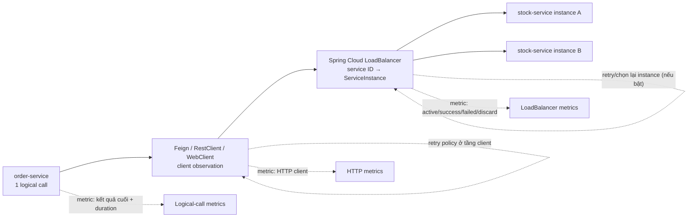

# Metrics theo dịch vụ, kết quả, độ trễ và số lần retry

## Mục tiêu

Khi một dịch vụ gọi dịch vụ khác qua **Spring Cloud LoadBalancer**, một câu hỏi như “`stock-service` đang chậm hay đang lỗi?” không thể trả lời chỉ bằng tổng số HTTP 500. Chúng ta cần biết **dịch vụ đích nào**, **kết quả ở lớp nào**, **độ trễ của lần gọi**, **đã thử lại bao nhiêu lần** và **request đã đi tới instance nào**.

Sau bài này, bạn có thể:

1. Thiết kế metrics theo `service ID` và theo lớp quan sát phù hợp: yêu cầu nghiệp vụ, HTTP client, LoadBalancer, instance.
2. Kích hoạt và đọc các meter có sẵn của `MicrometerStatsLoadBalancerLifecycle`; không nhầm tên meter `success` với HTTP 2xx.
3. Thu thập thời gian đáp ứng, thông lượng, tỉ lệ lỗi và retry bằng **MeterRegistry**, Micrometer Observation, Actuator và Prometheus.
4. Phân biệt **một lần gọi logic** với **một lần gửi HTTP (attempt)**; xác định giới hạn khi chỉ nhìn metric mặc định.
5. Thiết kế dashboard và thí nghiệm có thể kiểm chứng; kiểm soát cardinality của nhãn metric.

Bài thuộc chương **Quan sát hệ thống** của module `SPRING_CLOUD_SERVICE_COMMUNICATION_LOAD_BALANCING`. Phạm vi module là cân bằng tải phía client bằng `service ID`, discovery, health check, chọn `ServiceInstance` và chính sách định tuyến, tích hợp `RestClient`, `WebClient`, `OpenFeign`, timeout/retry và quan sát lỗi. Vì vậy, metrics phải giúp nhìn được hành vi gọi liên dịch vụ chứ không dừng ở traffic HTTP đi vào một controller.

## 1. Chọn ranh giới đo: logical call, HTTP attempt và LoadBalancer

Xét `order-service` gọi `stock-service` để kiểm tra tồn kho. Retry có thể đến từ Feign, Spring Cloud LoadBalancer, gateway hoặc một tầng khác. Sau cùng `order-service` chỉ nhận **một kết quả cuối cùng**, dù downstream đã thấy nhiều request.



| Đơn vị quan sát | Gợi ý meter/nguồn | Trả lời được | Điểm cần chú ý |
| --- | --- | --- | --- |
| **Logical call** từ một thao tác nghiệp vụ | Timer tùy biến `client.call.duration` | Một yêu cầu của caller thành công hay thất bại? Mất bao lâu tính cả retry? | Đếm **một lần** tại ranh giới nghiệp vụ |
| **HTTP client** | Micrometer Observation của Feign/RestClient/WebClient | Phương thức, URI template, mã HTTP, độ trễ theo instrument client | Tên meter/tag và phạm vi attempt tùy instrumentation/phiên bản |
| **LoadBalancer** | `loadbalancer.requests.*` | Có instance để chọn không? Load-balanced request có kết thúc bằng response hay exception? | “success” ở tầng này **không** tự khẳng định HTTP 2xx |
| **Retry decision** | Counter tùy biến tại chính retry policy | Chính sách đã chấp thuận thử lại bao nhiêu lượt? | Chưa chứng minh tất cả các lượt đã tới server |
| **Request thực nhận** của instance | HTTP server metric, access log, distributed trace | Instance nào thực nhận bao nhiêu request? | Một logical call có thể thành nhiều lượt |

Ví dụ: `GET /stocks/SKU-42` có hai lần timeout rồi lần ba trả 200. Khi đó có thể quan sát **1 logical call thành công**, **2 quyết định retry được chấp thuận** và **tối đa 3 HTTP attempts**. Không thể suy ra chắc chắn cả ba lượt đều tới server nếu chỉ có counter retry ở caller. Cần thêm metrics/log phía server hoặc tracing.

## 2. Những meter LoadBalancer có sẵn và ý nghĩa chính xác

Spring Cloud Commons cung cấp một triển khai `LoadBalancerLifecycle` tên là `MicrometerStatsLoadBalancerLifecycle`. Khi có `MeterRegistry` và bật `spring.cloud.loadbalancer.stats.micrometer.enabled=true`, nó ghi các meter:

| Meter trong Micrometer | Loại | Ý nghĩa |
| --- | --- | --- |
| `loadbalancer.requests.active` | Gauge | Số yêu cầu load-balanced đang hoạt động, có thể gắn nhãn liên quan tới service instance |
| `loadbalancer.requests.success` | Timer | Thời gian các lời gọi LoadBalancer đã kết thúc bằng việc chuyển **response** tới client bên dưới |
| `loadbalancer.requests.failed` | Timer | Thời gian các lời gọi LoadBalancer kết thúc bằng **exception** |
| `loadbalancer.requests.discard` | Counter | Số lời gọi bị loại vì LoadBalancer **không lấy được ServiceInstance** |

**Cẩn thận với `success`:** HTTP 500 hoặc 503 vẫn có thể được chuyển tới HTTP client như một response. Theo định nghĩa lifecycle, điều đó có thể làm tăng timer `loadbalancer.requests.success`, dù thao tác nghiệp vụ sau đó thất bại. Ngược lại, `failed` là tín hiệu exception trong luồng LoadBalancer, không phải phép đếm đầy đủ mọi HTTP 5xx. Muốn tính tỉ lệ lỗi HTTP hoặc kết quả cuối, hãy đo thêm ở tầng tương ứng.

Thông tin service instance, request và response có thể xuất hiện trong tag **khi có sẵn**. Với `RestClient` và `WebClient`, LoadBalancer có thể dùng `uriTemplate` cho tag `uri` nếu ngữ cảnh giữ được template. Với `RestTemplate`, URI thực có thể xuất hiện và tăng cardinality. Không giả định mọi client đều mang đủ các tag giống nhau; hãy xem chuỗi metric thực được xuất ra.

Một meter cũng có thể **chưa xuất hiện trước khi có bản ghi đầu tiên**. Vì vậy, “không tìm thấy meter” sau khởi động chưa đủ để kết luận instrumentation hỏng.

Tham khảo: [Spring Cloud Commons – LoadBalancer Statistics](https://docs.spring.io/spring-cloud-commons/reference/spring-cloud-commons/loadbalancer.html).

## 3. Bật Actuator, MeterRegistry và LoadBalancer metrics

Ví dụ phụ thuộc Maven cho ứng dụng Spring Boot dùng Spring Cloud LoadBalancer và OpenFeign (để Spring Boot/Spring Cloud BOM quản lý phiên bản tương thích):

```xml
<dependencies>
    <dependency>
        <groupId>org.springframework.cloud</groupId>
        <artifactId>spring-cloud-starter-loadbalancer</artifactId>
    </dependency>
    <dependency>
        <groupId>org.springframework.cloud</groupId>
        <artifactId>spring-cloud-starter-openfeign</artifactId>
    </dependency>
    <dependency>
        <groupId>org.springframework.boot</groupId>
        <artifactId>spring-boot-starter-actuator</artifactId>
    </dependency>
    <dependency>
        <groupId>io.micrometer</groupId>
        <artifactId>micrometer-registry-prometheus</artifactId>
    </dependency>
    <dependency>
        <groupId>io.github.openfeign</groupId>
        <artifactId>feign-micrometer</artifactId>
    </dependency>
</dependencies>
```

Ví dụ `application.yml`:

```yaml
spring:
  application:
    name: order-service
  cloud:
    loadbalancer:
      stats:
        micrometer:
          enabled: true
        include-path: false
    openfeign:
      micrometer:
        enabled: true
      client:
        config:
          stock-service:
            connectTimeout: 500
            readTimeout: 1500

management:
  endpoints:
    web:
      exposure:
        include: "health,info,metrics,prometheus"
```

- `spring.cloud.loadbalancer.stats.micrometer.enabled=true` **bật** thống kê LoadBalancer; không suy rằng chỉ thêm Actuator là đã tự bật tính năng này. `include-path=false` hạn chế việc URI thực có ID lọt vào tag `uri` của thống kê LoadBalancer.
- Khi có `feign-micrometer`, bean `ObservationRegistry` và cấu hình Feign Micrometer bật, Spring Cloud OpenFeign có thể đăng ký `MicrometerObservationCapability`. Tên observation do Feign Micrometer cung cấp thường là `http.client.requests`; nó là dữ liệu **khác lớp** với thống kê LoadBalancer.
- `connectTimeout` và `readTimeout` chỉ giới hạn những công đoạn tương ứng; số lần retry có thể làm thời gian logical call lớn hơn nhiều so với một timeout.
- Chỉ đưa endpoint `/actuator/metrics` và `/actuator/prometheus` tới hệ thống giám sát được phép truy cập; cấu hình network/auth phù hợp với môi trường.

Kiểm chứng trong môi trường chạy ứng dụng:

```bash
# Gửi ít nhất một lời gọi qua LoadBalancer trước khi kiểm tra.
curl -s http://localhost:8080/actuator/metrics
curl -s http://localhost:8080/actuator/metrics/loadbalancer.requests.success
curl -s http://localhost:8080/actuator/metrics/loadbalancer.requests.failed
curl -s http://localhost:8080/actuator/prometheus
```

`/actuator/metrics` dùng **tên meter theo Micrometer** (có dấu chấm). Export Prometheus có thể chuyển dấu chấm thành gạch dưới và bổ sung hậu tố `_count`, `_sum`, `_bucket`, `_total` theo loại meter. Hãy nhìn tên và label **trong output thực tế**, nhất là khi khác phiên bản hoặc có custom naming convention.

## 4. Thiết kế label: theo dịch vụ, kết quả, độ trễ, instance

Nên định nghĩa trước **nguồn dữ liệu, ý nghĩa và số lượng giá trị** của từng nhãn.

| Nhãn (ví dụ tùy biến) | Giá trị minh họa | Lợi ích | Quy tắc |
| --- | --- | --- | --- |
| `target.service` | `stock-service`, `payment-service` | Nhóm theo service ID | Dùng tên service đã chuẩn hóa, tập giá trị hữu hạn |
| `result` | `success`, `http_4xx`, `http_5xx`, `retryable_error`, `other_error` | Tách kết quả cuối | Dùng tập giá trị nhỏ, định nghĩa rõ |
| `operation` | `read_stock`, `reserve_stock` | Tách thao tác cùng một dịch vụ | Chỉ dùng tên thao tác cố định |
| `http.method` | `GET`, `POST` | Nhìn theo phương thức | Có thể dùng metric HTTP sẵn có |
| `instance` (nếu dùng) | `stock-1`, `stock-2` | Tìm instance lỗi/chậm | Chỉ gắn khi cần; vòng đời pod/instance có thể tăng số chuỗi |
| `uri` | `/stocks/{sku}` | So sánh endpoint | Dùng **URI template**, tránh path chứa ID thực |

**Không dùng** mã đơn hàng, SKU thực, địa chỉ email, token, trace ID, exception message, URL chứa query động làm metric labels. Chúng tạo **high cardinality**, tăng bộ nhớ và chi phí TSDB, thậm chí rò rỉ dữ liệu. Trace ID nên có mặt trong **traces/logs**, không phải label Prometheus.

Trong một dashboard, phân biệt rõ:

- `target.service` là **dịch vụ được gọi**, khác `application`/`service.name` của **dịch vụ đang xuất metrics**.
- `result` tại caller là **kết quả cuối của logical call**. Một HTTP 503 trong attempt đầu nhưng attempt sau thành công có thể làm `result=success` ở logical call.
- `status` HTTP và `loadbalancer.requests.success` là hai khái niệm khác nhau.

## 5. Đo thời gian và kết quả cuối của một logical call

Metrics có sẵn không tự thay thế một bộ đo đặt ở đúng ranh giới nghiệp vụ. Ví dụ dưới đây đo toàn bộ thời gian `StockGateway.lookup`, kể cả retry xảy ra bên trong Feign hoặc LoadBalancer.

Feign client gọi theo `service ID`:

```java
import org.springframework.cloud.openfeign.FeignClient;
import org.springframework.web.bind.annotation.GetMapping;
import org.springframework.web.bind.annotation.PathVariable;

@FeignClient(name = "stock-service")
public interface StockClient {
    @GetMapping("/stocks/{sku}")
    StockResponse getStock(@PathVariable("sku") String sku);
}

public record StockResponse(String sku, int available) {}
```

Gắn timer tại điểm caller gọi Feign:

```java
import feign.FeignException;
import feign.RetryableException;
import io.micrometer.core.instrument.MeterRegistry;
import io.micrometer.core.instrument.Timer;
import org.springframework.stereotype.Service;

@Service
public class StockGateway {
    private final StockClient client;
    private final MeterRegistry meters;

    public StockGateway(StockClient client, MeterRegistry meters) {
        this.client = client;
        this.meters = meters;
    }

    public StockResponse lookup(String sku) {
        Timer.Sample sample = Timer.start(meters);
        String result = "other_error";
        try {
            StockResponse response = client.getStock(sku);
            result = "success";
            return response;
        } catch (RetryableException ex) {
            result = "retryable_error";
            throw ex;
        } catch (FeignException ex) {
            int status = ex.status();
            result = status >= 500 ? "http_5xx"
                : status >= 400 ? "http_4xx" : "other_error";
            throw ex;
        } finally {
            sample.stop(Timer.builder("client.call.duration")
                .description("Elapsed time for one logical downstream call")
                .tag("target.service", "stock-service")
                .tag("operation", "read_stock")
                .tag("result", result)
                .publishPercentileHistogram()
                .register(meters));
        }
    }
}
```

**Đặc tính của phép đo:**

1. `Timer.Sample` bắt đầu **một lần** trước khi gọi và dừng trong `finally`; khi retry nội bộ xảy ra, timer vẫn tính toàn bộ thời gian của logical call.
2. `result=success` ở đây nghĩa phương thức Feign **trả về bình thường**. Các trạng thái 404 được xử lý bằng cấu hình đặc biệt như `dismiss404` hoặc fallback có thể thay đổi tiêu chí nghiệp vụ; cần điều chỉnh cách phân loại tương ứng.
3. `RetryableException` được bắt trước `FeignException` vì nó là lớp con. Các lỗi khác giữ giá trị `other_error`; ví dụ minh họa cố ý dùng tập nhãn nhỏ.
4. Histogram cho phép Prometheus ước lượng p95/p99. Bật histogram cho quá nhiều tổ hợp nhãn sẽ tốn dung lượng; nên cấu hình bucket/SLO theo nhu cầu và đo kích thước metrics thực tế.
5. Chỉ số `client.call.duration` là **metric tùy biến** của ví dụ, không phải tên được Spring Cloud LoadBalancer tự phát sinh.

Nếu muốn tách outcome HTTP chính xác hơn, đặt thêm observation ở tầng HTTP client hoặc trích `status` từ response/exception. Tránh đăng ký cả `MicrometerObservationCapability` lẫn `MicrometerCapability` để đo trùng cùng một lời gọi Feign.

## 6. Đo retry: xác định rõ “đếm cái gì”

Các meter `loadbalancer.requests.*` đã liệt kê **không phải một bộ đếm retry attempt phổ quát**. Hơn nữa:

- `Retryer.NEVER_RETRY` mặc định ở tầng **Spring Cloud OpenFeign** không ngăn những tầng khác retry nếu chúng được cấu hình.
- Một policy có thể quyết định retry nhưng kết nối lần sau vẫn thất bại trước khi tới server.
- Một HTTP transport, Spring Cloud LoadBalancer, Feign và gateway có thể có **các bộ đếm khác nhau**. Tổng của chúng không phải số lần retry thực nhận bởi downstream.

### Ví dụ đếm quyết định retry được Feign chấp thuận

Ví dụ minh họa một `Retryer` riêng cho `stock-service`. Phương thức `continueOrPropagate` chỉ tăng counter **sau khi** delegate đồng ý retry; counter ghi nhận **quyết định thử lại ở tầng Feign**. Đây **không phải** bộ đếm wire attempts hoặc các retry xảy ra ở LoadBalancer.

```java
import feign.RetryableException;
import feign.Retryer;
import io.micrometer.core.instrument.Counter;
import io.micrometer.core.instrument.MeterRegistry;
import org.springframework.context.annotation.Bean;

public class StockFeignMetricsConfig {
    @Bean
    Retryer stockRetryer(MeterRegistry meters) {
        Counter accepted = Counter.builder("client.retry.accepted")
            .description("Retries accepted by this Feign Retryer")
            .tag("target.service", "stock-service")
            .tag("layer", "feign")
            .register(meters);
        return new CountingRetryer(
            new Retryer.Default(100, 300, 3), accepted);
    }

    static final class CountingRetryer implements Retryer {
        private final Retryer delegate;
        private final Counter accepted;

        CountingRetryer(Retryer delegate, Counter accepted) {
            this.delegate = delegate;
            this.accepted = accepted;
        }

        @Override
        public void continueOrPropagate(RetryableException ex) {
            delegate.continueOrPropagate(ex);
            accepted.increment(); // Chỉ khi delegate chấp thuận retry
        }

        @Override
        public Retryer clone() {
            // Delegate có trạng thái attempt riêng cho từng lời gọi.
            return new CountingRetryer(delegate.clone(), accepted);
        }
    }
}
```

Áp dụng vào Feign client bằng `@FeignClient(name = "stock-service", configuration = StockFeignMetricsConfig.class)`. Đặt class cấu hình bên ngoài component scan toàn cục nếu chỉ muốn áp dụng cho client này.

**Lưu ý:** `Retryer.Default(100, 300, 3)` giới hạn **3 attempts tổng**, thường tối đa 2 lần retry được chấp thuận sau lần đầu; áp dụng với lỗi `RetryableException`, không mặc định retry mọi HTTP 500. Counter trong ví dụ trên có thể tăng `2` khi ba lần đều gặp lỗi retryable, nhưng điều đó vẫn không bảo đảm cả ba HTTP request tới server. Với retry của LoadBalancer, phải instrument riêng chính policy/cơ chế retry tương ứng hoặc dùng tracing/log ở lớp gửi HTTP và phía đích.

Nếu không muốn bật retry, có thể giữ `Retryer.NEVER_RETRY` và dùng metrics của client + LoadBalancer. **Không bật retry chỉ để tạo ra counter**; chính sách phải theo tính idempotent, deadline, khả năng phục hồi và tải downstream.

### Phân biệt ba loại con số

| Số đo | Với 1 logical call gồm 3 attempts (2 retry) | Nguồn đáng tin cậy |
| --- | --- | --- |
| Logical calls | **1** | `StockGateway.lookup` hoặc tầng nghiệp vụ |
| Retry được policy chấp thuận | **2** nếu retry được Feign Retryer như ví dụ chấp thuận | Counter ngay trong retry policy |
| HTTP requests tới instance | **Tối đa 3**, có thể ít hơn nếu có lỗi trước khi đến server | Access log/HTTP server meter + trace/ID tương quan |

Không lấy `requests.success + requests.failed` của LoadBalancer làm số attempts tuyệt đối rồi trừ logical calls để tính retry: lifecycle và ranh giới đo không nhất thiết ánh xạ 1–1, nhất là khi có các interceptor hoặc retry ở ngoài.

## 7. Truy vấn Prometheus: traffic, error rate, p95 và retry rate

Với metrics tùy biến **ở mục 5 và 6**, Prometheus thường xuất Timer `client.call.duration` thành:

- `client_call_duration_seconds_count`: số logical calls đã kết thúc.
- `client_call_duration_seconds_sum`: tổng thời gian (giây).
- `client_call_duration_seconds_bucket`: số mẫu tích lũy trong các bucket, do đã bật histogram.
- `client_retry_accepted_total`: số retry được policy Feign của ví dụ chấp thuận.

Ví dụ PromQL (xác minh tên sau export, vì tên/tag có thể bị hệ thống thay đổi):

**Lưu lượng logical calls/giây theo dịch vụ và kết quả:**

```promql
sum by (target_service, result) (
  rate(client_call_duration_seconds_count[5m])
)
```

**Tỉ lệ logical calls thất bại, bao gồm http_4xx/http_5xx/retryable_error/other_error:** 

```promql
sum by (target_service) (
  rate(client_call_duration_seconds_count{result!="success"}[5m])
)
/
sum by (target_service) (
  rate(client_call_duration_seconds_count[5m])
)
```

**P95 độ trễ logical call theo dịch vụ:** 

```promql
histogram_quantile(
  0.95,
  sum by (le, target_service) (
    rate(client_call_duration_seconds_bucket[5m])
  )
)
```

**Số retry được Feign policy chấp thuận trên mỗi logical call:** 

```promql
sum by (target_service) (
  rate(client_retry_accepted_total{layer="feign"}[5m])
)
/
sum by (target_service) (
  rate(client_call_duration_seconds_count[5m])
)
```

Tỉ số cuối có thể lớn hơn 1 khi một logical call được thử lại nhiều lần; nó là **retry được chấp thuận/call**, không phải “phần trăm request được retry” và không bao gồm retry từ tầng khác. Khi traffic bằng 0, biểu thức tỉ lệ có thể không có dữ liệu hoặc không xác định; dashboard phải biểu diễn điều đó đúng cách.

Với metrics gốc LoadBalancer, Prometheus thường dùng các series như `loadbalancer_requests_success_seconds_count`, `loadbalancer_requests_failed_seconds_count` và `loadbalancer_requests_discard_total`. Hãy khám phá tag thật từ `/actuator/metrics/loadbalancer.requests.success` hoặc `/actuator/prometheus` trước khi viết truy vấn phân nhóm theo service/instance; không ép giả định nhãn giống các tag tùy biến ở trên.

## 8. Dashboard nên trả lời câu hỏi vận hành nào?

| Panel | Tín hiệu cần theo dõi | Cách diễn giải |
| --- | --- | --- |
| Traffic per target service | Logical calls/giây theo `target.service` | Dịch vụ nào đang được gọi nhiều nhất? |
| Final outcome rate | `success` vs `http_4xx`/`http_5xx`/`retryable_error` | Caller thực sự đã nhận kết quả gì? |
| Latency p50/p95/p99 | Histogram logical call theo service/operation | Tổng độ trễ có tăng khi bật retry không? |
| Feign retry decisions | `client.retry.accepted` / logical calls | Một lỗi tạm thời đang kích hoạt nhiều retry hơn bình thường? |
| LoadBalancer discard | `loadbalancer.requests.discard` | Discovery/health check có đang khiến không còn instance khả dụng? |
| LB exceptions | `loadbalancer.requests.failed` và instance tags sẵn có | Có lỗi hạ tầng lựa chọn/gửi request theo instance? |
| Instance-side traffic | HTTP server metrics theo instance đã chuẩn hóa | Tải có phân bổ lệch hoặc có instance bất thường? |

Đừng báo động dựa duy nhất vào `loadbalancer.requests.success` cao/thấp. Để đánh giá một giao tiếp liên dịch vụ ổn định, thường cần kết hợp:

1. **Outcome cuối** của lời gọi logic.
2. **Latency percentile** cùng traffic.
3. **Retry rate** và **mức tăng tổng attempts**.
4. **Discard/no-instance** của LoadBalancer và sức khỏe discovery.
5. **Traces/logs có tương quan** khi cần truy ra instance, timeout, status hoặc đường đi nhiều tầng.

Một dấu hiệu đáng chú ý: final success rate giữ nguyên nhưng retry tăng mạnh và p95 xấu đi. Khi đó dịch vụ có thể đang che giấu lỗi tạm thời bằng retry, đồng thời tiêu tốn thêm kết nối và tài nguyên. Ngược lại, `discard` tăng dù downstream HTTP error rate không tăng thường hướng việc điều tra tới discovery và danh sách instance khả dụng.

## 9. Thực hành kiểm chứng với hai instance

Chuẩn bị `order-service` gọi `stock-service` qua service ID với hai instance A/B, hoặc dùng một discovery giả lập/ServiceInstanceListSupplier thích hợp trong môi trường test. Bật metrics ở mục 3; nếu thử retry ở tầng nào thì cấu hình, ghi nhận phiên bản và giới hạn retry của **đúng tầng đó**.

| Kịch bản | Dữ liệu cần quan sát | Kết luận mong đợi |
| --- | --- | --- |
| A/B trả 200 nhanh | Logical call success, latency thấp, metrics LB xuất hiện | Có baseline về service/instance và kết quả |
| Một instance trả 503 | HTTP client status + final outcome + LB timer | “LB success” có thể tăng dù HTTP 503 được chuyển về |
| Instance chậm hơn read timeout | Client exception, logical duration, retry counter | Phân biệt timeout mỗi attempt với thời gian tổng |
| Bật Feign retry có giới hạn | Retry accepted, số request phía A/B, final outcome | Xem có đúng số lần thử mong muốn và load phát sinh |
| Tắt toàn bộ instance trong discovery | `loadbalancer.requests.discard`, final caller error | Nhìn được lỗi “không có ServiceInstance” |
| URI động `/stocks/SKU-42` | Số chuỗi metrics và tag `uri` | Xác minh không đưa SKU thực vào label |

Thứ tự kiểm tra có thể làm thủ công:

1. Gửi một `GET` thành công; xem `/actuator/metrics` và `/actuator/prometheus` có meter mới sau lần gọi đầu tiên.
2. Gửi nhiều lời gọi với độ trễ khác nhau; so sánh `_count`, `_sum` và histogram. Không dùng trung bình để thay cho p95.
3. Gây lỗi 503, rồi gây timeout: xác định lớp nào tạo metric và phân loại `result` nào.
4. Bật retry ở **một** tầng, đối chiếu số quyết định retry với request server A/B nhận; lần lượt kiểm tra trường hợp cùng instance và chuyển sang instance khác nếu chính sách hỗ trợ.
5. Ngắt mọi instance khả dụng, kiểm tra `discard`; bật lại instance rồi xác nhận request hồi phục.
6. Kiểm tra danh sách label values, số time series và dashboard trước khi mở rộng số service/endpoint.

Trong phép thử tự động, có thể dùng `SimpleMeterRegistry` để xác nhận timer tùy biến đã ghi đúng `count=1` và tag `result`, cùng `Counter.count()` để xác nhận retry accepted. Tuy nhiên, **kiểm thử end-to-end có server đếm request** vẫn cần thiết để kiểm chứng số lượt thực nhận; unit test meter không chứng minh hành vi mạng.

## 10. Câu hỏi tự đánh giá

1. Một lời gọi HTTP 503 đi qua LoadBalancer có thể được ghi ở meter `loadbalancer.requests.success` không? Vì sao điều đó không mâu thuẫn với lỗi nghiệp vụ?
2. Nếu 1 logical call mất 2 giây do hai lần timeout và lần ba thành công, bạn cần metric nào để thấy độ trễ caller, và metric nào để thấy quyết định retry?
3. Vì sao `uri="/stocks/SKU-42"` là nhãn nguy hiểm hơn `uri="/stocks/{sku}"`? Có biện pháp nào khi client không còn giữ được URI template?
4. Làm sao phân biệt “đã **chấp thuận** 2 lần retry” với “server đã **nhận** 3 request”?
5. Khi `loadbalancer.requests.discard` tăng nhưng error rate ở HTTP server phía đích vẫn thấp, bạn sẽ kiểm tra discovery, health check và `ServiceInstanceListSupplier` như thế nào?

**Kết luận thực hành:** Giám sát đúng Spring Cloud LoadBalancer cần kết hợp meter gốc của lifecycle với metrics ở ranh giới caller và phép đo retry có chủ đích. Dùng **service ID** để phân nhóm, **kết quả cuối** để đánh giá caller, **histogram** để nhìn p95/p99 và **tracing/server metrics** để xác minh số lần gửi thật. Định nghĩa rõ lớp và đơn vị đo trước khi vẽ dashboard, đặc biệt khi sử dụng đồng thời OpenFeign, RestClient/WebClient, discovery và retry.

### Tài liệu tham khảo

- [Spring Cloud Commons – Spring Cloud LoadBalancer](https://docs.spring.io/spring-cloud-commons/reference/spring-cloud-commons/loadbalancer.html): `MicrometerStatsLoadBalancerLifecycle`, meters và cấu hình.
- [Spring Cloud OpenFeign – Micrometer Support](https://docs.spring.io/spring-cloud-openfeign/reference/spring-cloud-openfeign.html): `MicrometerObservationCapability`, dependencies và cách bật/tắt.
- [Spring Boot – Actuator Endpoints](https://docs.spring.io/spring-boot/reference/actuator/endpoints.html): xuất `metrics` và `prometheus`.
- [OpenFeign – Micrometer](https://github.com/OpenFeign/feign/blob/master/micrometer/README.md): Feign Observation và các khả năng instrumentation.
