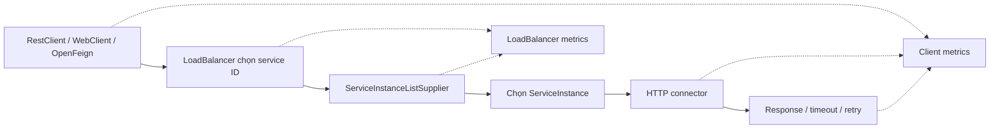

# Kiểm soát độ phân tán nhãn để tránh quá nhiều chuỗi metric

Khi triển khai Spring Cloud LoadBalancer, ứng dụng cần biết lời gọi đến `catalog-service` mất bao lâu, chọn được `ServiceInstance` hay không, có gặp timeout, retry hoặc HTTP 5xx không. Micrometer và hệ thống metrics như Prometheus giúp trả lời các câu hỏi đó bằng **counter, timer, gauge và histogram**.

Tuy nhiên, mỗi tổ hợp giá trị **nhãn (tag/label)** có thể tạo thành một **chuỗi thời gian (time series)** riêng. Nếu gắn `instanceId`, URL chứa ID sản phẩm, `traceId` hoặc định danh người dùng vào metric, số chuỗi tăng nhanh theo lưu lượng, số bản sao và số lần triển khai. Kết quả có thể là ứng dụng tiêu thụ thêm bộ nhớ, hệ thống metrics tốn tài nguyên thu thập/lưu trữ, truy vấn dashboard chậm và chi phí vận hành tăng cao.

Bài này thuộc phần **Quan sát hệ thống** của module Spring Cloud LoadBalancer. Mục tiêu là thiết kế nhãn metric đủ để phân tích **service ID, khả năng chọn instance, lỗi HTTP, timeout, retry và độ trễ**, nhưng không làm bùng nổ cardinality khi dùng `RestClient`, `WebClient`, `RestTemplate` hoặc OpenFeign.

## 1. Tag, label, meter và time series khác nhau ra sao?

Một HTTP client timer có thể ghi nhận độ trễ của lời gọi đến một dịch vụ. Giả sử metric được xuất với các nhãn:

```text
http_client_requests_seconds_count{
  application="order-service",
  client_service="catalog-service",
  method="GET",
  uri="/api/products/{id}",
  status="200"
} 15340
```

Trong ví dụ theo định dạng Prometheus:

- **Tên metric**: `http_client_requests_seconds_count`, tương ứng số mẫu được ghi vào một timer được xuất theo quy ước của registry.
- **Tên nhãn**: `application`, `client_service`, `method`, `uri`, `status`.
- **Giá trị nhãn**: `order-service`, `catalog-service`, `GET`, `/api/products/{id}`, `200`.
- **Một time series**: tập hợp tên metric cùng một tổ hợp giá trị nhãn, được ghi nhận qua thời gian.

Nếu chỉ đổi `status="200"` thành `status="503"`, hệ thống có một **chuỗi khác**. Nếu đổi `uri="/api/products/{id}"` thành `uri="/api/products/42"` rồi sang `/api/products/43`, mỗi ID sản phẩm có thể tiếp tục tạo chuỗi riêng.

Trong Micrometer, `Meter.Id` gồm tên, nhãn và các thuộc tính khác của meter. Khi xuất sang một backend metrics, timer và histogram có thể trở thành **nhiều series** như `_count`, `_sum` và các `_bucket`. Vì thế không nên đồng nhất số meter Java trong một process với tổng số time series backend phải lưu.

**Cardinality** trong ngữ cảnh này là số lượng giá trị hoặc tổ hợp nhãn khác nhau. Một nhãn có ít giá trị vẫn có thể góp phần gây bùng nổ nếu kết hợp với nhiều nhãn khác.

## 2. Vì sao cardinality tăng theo cấp số nhân?

Ước lượng số tổ hợp tối đa cho một họ metric:

```text
Số tổ hợp nhãn tối đa ≈ C1 × C2 × ... × Cn
```

Trong đó `Ci` là số giá trị khác nhau của nhãn thứ `i`, trong cùng phạm vi thu thập. Đây là **cận trên đơn giản hóa**: thực tế không phải mọi tổ hợp đều xảy ra và một số nhãn chỉ có ý nghĩa ở vài nhóm request. Nhưng nó rất hữu ích khi xét ngân sách trước khi đưa nhãn mới vào production.

Giả sử một ứng dụng gọi ra nhiều dịch vụ với các nhãn:

| Nhãn | Số giá trị minh họa |
|---|---:|
| `client_service` | 8 |
| `method` | 5 |
| `uri` (route template) | 12 |
| `outcome` | 6 |
| `zone` | 3 |

Khi mọi tổ hợp xuất hiện, số tổ hợp lý thuyết **trên một target thu thập** là:

```text
8 × 5 × 12 × 6 × 3 = 8.640 tổ hợp nhãn.
```

Nếu có năm bản sao `order-service` với nhãn target như `instance` hoặc `pod`, con số có thể tăng lên **43.200 tổ hợp theo target**. Nếu còn xuất timer histogram với nhiều bucket, tổng chuỗi trong backend có thể tiếp tục tăng nhiều lần, tùy cách registry xuất và cấu hình histogram.

Nếu thêm một nhãn `product_id` có 100.000 giá trị, số chuỗi tiềm năng tăng cực mạnh. Nếu thêm `trace_id` gần như duy nhất cho mỗi request, có thể phát sinh **một tổ hợp mới cho từng request**.

Đây không phải vấn đề chỉ xảy ra khi traffic đạt hàng triệu RPS: một ứng dụng nhỏ nhưng dùng nhãn có giá trị liên tục thay đổi cũng có thể tích lũy nhiều series theo thời gian.

### 2.1. Cardinality và churn là hai vấn đề liên quan

- **Cardinality cao tại một thời điểm**: có rất nhiều tổ hợp nhãn đang được quan sát đồng thời.
- **Churn cao**: các tổ hợp mới liên tục được tạo và tổ hợp cũ biến mất, chẳng hạn khi `instanceId` đổi sau mỗi rollout hoặc URL chứa ID request mới.

Churn khiến hệ thống metrics phải xử lý nhiều series mới theo thời gian ngay cả khi số series đang hoạt động không tăng mãi. Vì vậy, chỉ nhìn một ảnh chụp số series hiện tại có thể bỏ sót chi phí phát sinh trong nhiều lần deploy.

## 3. Chọn nhãn theo câu hỏi vận hành, không theo dữ liệu đang có

Một thiết kế metric nên bắt đầu bằng câu hỏi: *“Nếu cảnh báo này xuất hiện, cần so sánh theo chiều nào để xác định nguyên nhân?”*.

Ví dụ:

| Câu hỏi | Nhãn thường hữu ích | Nhãn không nên đưa vào metric |
|---|---|---|
| Dịch vụ đích nào chậm? | `client_service` hoặc tên client đã chuẩn hóa | URL/hostname tùy ý từ request |
| HTTP method nào lỗi? | `method` | Raw request line |
| API operation nào có p95 cao? | `uri` ở dạng **template** hoặc `operation` | Đường dẫn chứa product/user/order ID |
| Status nào đang tăng? | `status` hoặc nhóm `outcome` | Error message chứa dữ liệu động |
| Lỗi network hay HTTP? | `failure_category` với tập giá trị hữu hạn | Raw exception message, hostname tùy ý |
| Một zone có suy giảm? | `zone` có danh mục kiểm soát | Mọi metadata instance |
| Một release bị lỗi? | `release_channel` hoặc API major ổn định | Build hash luôn mới trên mọi loại metric |
| Request cụ thể đi vào instance nào? | **Trace/log** chứa instance ID và trace ID | `instance_id`/`trace_id` làm nhãn cho mọi request |

Nhãn `client_service=catalog-service` thường hữu ích vì service ID do ứng dụng lựa chọn từ tập dịch vụ được phép. Ngược lại, `request_id`, `trace_id`, `user_id`, `session_id`, `product_id` hay `full_url` thay đổi theo request và không phù hợp với metric tổng hợp.

**Đừng suy từ tên nhãn rằng nó luôn có cardinality thấp.** Nếu ứng dụng cho phép tạo service ID tùy ý từ input người dùng, chính nhãn `client_service` cũng có thể có vô số giá trị. Tập giá trị phải được giới hạn từ nguồn dữ liệu và cơ chế cấu hình.

## 4. Trong Spring Cloud LoadBalancer nên đo ở đâu?

Một lời gọi HTTP theo service ID có nhiều điểm quan sát khác nhau:



Các nhóm số liệu có mục tiêu riêng:

1. **HTTP client metrics**: số lời gọi, thời gian, method, route template, status và nhóm lỗi. Dùng để biết caller đang gặp vấn đề gì với downstream.
2. **LoadBalancer metrics/observations**: số lần có hoặc không có ứng viên, thời gian chọn instance và kết quả chọn nếu instrumentation/phiên bản hỗ trợ. Dùng để phân biệt lỗi discovery/routing với lỗi HTTP.
3. **Supplier chain diagnostics**: danh sách instance trước/sau health, zone, hint hoặc retry filter. Thích hợp hơn ở log/trace có sampling, không tự động gắn tất cả ID vào nhãn metric.
4. **Backend metrics**: độ trễ server, request in-flight, CPU, thread/connection pool, database pool và lỗi nghiệp vụ. Dùng để biết instance đích có bị quá tải thật không.

Không phải mọi nhãn trên đều được **Spring Boot/Micrometer/Spring Cloud LoadBalancer** tự sinh trong mọi phiên bản. Ví dụ tên metric `http.client.requests` có thể được sử dụng cho một số HTTP client timer, nhưng tên/nhãn của từng cơ chế Observation, Feign, Reactor Netty và LoadBalancer phụ thuộc phiên bản và auto-configuration. Hãy đọc meter thực sự được xuất trước khi viết dashboard hoặc `MeterFilter` theo một tên cố định.

Một sai lầm phổ biến là thêm `instanceId` vào **mọi HTTP client timer** chỉ vì đã có hook chọn `ServiceInstance`. Việc này nhân số series với số instance đang/đã chạy, thường ít có ích cho dashboard SLA tổng thể; nên giữ instance ID ở span/log để tra một lỗi cụ thể.

## 5. Chuẩn hóa URI template thay vì gắn URL thật

Hai HTTP request:

```text
GET /api/products/42
GET /api/products/43
```

nên được tổng hợp về một operation:

```text
method=GET
uri=/api/products/{id}
```

Nếu dùng raw path làm nhãn, mỗi sản phẩm mới tạo thêm series. Nếu dùng route template, số giá trị `uri` thường bằng số endpoint trong ứng dụng, một tập có thể kiểm soát.

### 5.1. WebClient

Khai báo builder đã tích hợp LoadBalancer nếu gọi bằng service ID:

```java
import org.springframework.cloud.client.loadbalancer.LoadBalanced;
import org.springframework.context.annotation.Bean;
import org.springframework.web.reactive.function.client.WebClient;

@Bean
@LoadBalanced
WebClient.Builder loadBalancedWebClientBuilder() {
    return WebClient.builder();
}
```

Ở client, ưu tiên truyền template và tham số riêng:

```java
Mono<ProductResponse> product = webClient.get()
        .uri("/api/products/{id}", productId)
        .retrieve()
        .bodyToMono(ProductResponse.class);
```

Ở đây `webClient` phải được tạo từ builder có LoadBalancer và `baseUrl("http://catalog-service")`, còn `ProductResponse` là DTO ứng dụng. Việc dùng template cho phép hệ thống instrumentation **có thông tin dạng route template** để chuẩn hóa URI, thay vì chỉ nhận một chuỗi đường dẫn đã ghép sẵn. Tuy vậy, cách gắn nhãn cụ thể vẫn phải kiểm chứng qua metrics thực tế.

Mẫu cần tránh:

```java
// Dễ khiến hệ thống quan sát thấy nhiều URI khác nhau:
String path = "/api/products/" + productId;
webClient.get().uri(path).retrieve().bodyToMono(ProductResponse.class);
```

### 5.2. RestClient

Tương tự, với một `RestClient` được tạo từ `@LoadBalanced RestClient.Builder`:

```java
ProductResponse product = restClient.get()
        .uri("/api/products/{id}", productId)
        .retrieve()
        .body(ProductResponse.class);
```

Nếu code đang sử dụng absolute URL theo service ID, vẫn nên khai báo template:

```java
ProductResponse product = restClient.get()
        .uri("http://catalog-service/api/products/{id}", productId)
        .retrieve()
        .body(ProductResponse.class);
```

Việc dùng `RestTemplate.exchange(...)` hoặc URI builder cũng nên giữ tách biệt route template và tham số. Không dùng query string tùy ý, body hay ID tài nguyên làm metric label.

### 5.3. OpenFeign

Với Spring Cloud OpenFeign, hợp đồng method đã thể hiện route:

```java
@FeignClient(name = "catalog-service")
public interface CatalogClient {
    @GetMapping("/api/products/{id}")
    ProductResponse getProduct(@PathVariable("id") String id);
}
```

Dùng một tên operation hữu hạn như `get-product` hoặc route template của method để đo lường. Tránh tự lấy URL đã expand từ Feign request rồi gắn thẳng vào tag `uri` của một timer tùy biến.

**Lưu ý:** việc client khai báo route template giúp chọn nhãn đúng ở source nhưng không bảo đảm mọi instrumentation tự dùng nó. Cần xác nhận kết quả ở `/actuator/metrics` hoặc hệ thống backend; nếu raw ID vẫn xuất hiện, phải sửa convention/instrumentation, không chỉ thêm `MeterFilter` để chặn series mới.

## 6. Chuẩn hóa loại lỗi, status, instance và metadata

Không chỉ URI mới gây cardinality cao. Khi một request timeout hoặc decode JSON thất bại, developer có thể muốn gắn toàn bộ tên exception và error message vào metric. Điều đó dễ tạo nhãn biến thiên không kiểm soát.

### 6.1. Nhóm lỗi hữu hạn

Một tập `failure_category` có thể là:

| Giá trị nhãn | Phân loại |
|---|---|
| `none` | Thành công |
| `no_instance` | LoadBalancer không tìm được instance phù hợp |
| `connection` | TCP/TLS/đường mạng bị lỗi |
| `timeout` | Kết nối hoặc response vượt giới hạn thời gian |
| `http_4xx` | Upstream trả HTTP 4xx |
| `http_5xx` | Upstream trả HTTP 5xx |
| `decode` | Response body không khớp hợp đồng |
| `other` | Lỗi còn lại |

Không nhất thiết dùng chính xác tập này cho mọi service; đây là **policy minh họa**. Điều quan trọng là giá trị được gán từ một danh mục đã phê duyệt, không lấy từ `exception.getMessage()`, stack trace, URL, trạng thái DB hoặc input bên ngoài.

### 6.2. HTTP status

Nhãn `status=200`, `404`, `503` có số khả năng hữu hạn hơn ID người dùng nhưng vẫn có thể nhân với nhiều chiều khác. Nếu mục tiêu dashboard chỉ là tỷ lệ thành công/lỗi, `status_family=2xx/4xx/5xx` hoặc `outcome` có thể đủ. Với dashboard cần phân tích `429` riêng, vẫn có thể giữ status code nhưng phải xét ngân sách kết hợp.

### 6.3. `instanceId`, zone và release

- `zone` có thể an toàn khi số zone hữu hạn; nhưng kết hợp với mọi URI/status/method sẽ tiếp tục nhân series.
- `release_channel=stable/canary` thường phù hợp hơn nhãn chứa SHA build hoặc UUID của mỗi deployment.
- `instanceId` thay đổi khi scale/rollout, tạo churn. Nếu rất cần metric per-instance cho vận hành backend, thường nên thu thập từ **chính backend** (với nhãn target của hệ thống thu thập) thay vì thêm instance ID của downstream vào mọi client-side metric.
- `ServiceInstance.getMetadata()` là một map tùy ý; **không** biến mọi cặp metadata thành metrics tags. Cần chọn những key thật sự phục vụ câu hỏi vận hành.

## 7. Ví dụ tự tạo metric trong Micrometer với nhãn ổn định

Một timer ứng dụng có thể đo thời gian toàn bộ lời gọi đến `catalog-service` và phân loại lỗi mà không gắn ID sản phẩm hoặc host đích.

```java
package com.example.orders.observability;

import feign.FeignException;
import io.micrometer.core.instrument.MeterRegistry;
import io.micrometer.core.instrument.Timer;
import org.springframework.stereotype.Component;

import com.example.orders.client.CatalogClient;
import com.example.orders.client.ProductResponse;

@Component
public final class ObservedCatalogGateway {

    private final CatalogClient client;
    private final MeterRegistry registry;

    public ObservedCatalogGateway(
            CatalogClient client,
            MeterRegistry registry) {
        this.client = client;
        this.registry = registry;
    }

    public ProductResponse getProduct(String productId) {
        Timer.Sample sample = Timer.start(registry);
        String outcome = "success";

        try {
            return client.getProduct(productId);

        } catch (FeignException exception) {
            outcome = classifyStatus(exception.status());
            throw exception;

        } catch (RuntimeException exception) {
            outcome = "other_failure";
            throw exception;

        } finally {
            Timer timer = Timer.builder("catalog.client.duration")
                    .description("Duration of catalog product lookups")
                    .tag("client_service", "catalog-service")
                    .tag("operation", "get-product")
                    .tag("outcome", outcome)
                    .register(registry);

            sample.stop(timer);
        }
    }

    private static String classifyStatus(int status) {
        if (status < 0) {
            return "transport";
        }
        if (status >= 400 && status < 500) {
            return "4xx";
        }
        if (status >= 500 && status < 600) {
            return "5xx";
        }
        return "other_http";
    }
}
```

Ví dụ giả định `CatalogClient` là Feign interface đã khai báo và `ProductResponse` là DTO tương ứng. Feign có thể biểu diễn một số lỗi transport bằng exception khác tùy connector; nhánh `other_failure` ở đây là phân loại đơn giản, không được coi là hệ thống error taxonomy hoàn chỉnh.

Điểm đáng chú ý:

- `client_service` và `operation` lấy từ **literal do code kiểm soát**, không lấy từ URL chưa tin cậy.
- `outcome` được chuyển về một số nhóm hữu hạn bằng hàm `classifyStatus`.
- `productId` **không được đưa vào metric tag** dù nó rất hữu ích cho việc tìm log của một request cụ thể.
- `Timer.Sample` ghi thời gian thực thi của lời gọi Feign tại ranh giới gateway. Nếu lời gọi có retry bên dưới, timer có thể bao gồm thời gian của các attempt đó; đây là **thời gian end-to-end ở gateway**, không phải latency của một attempt riêng.
- `finally` vẫn ghi timer khi có lỗi; việc phân loại không được làm mất exception gốc.

Nếu Spring Boot hoặc Feign đã tự instrument cùng thao tác, tránh tạo một metric tùy biến **trùng ý nghĩa** mà không rõ ranh giới đo, vì dashboard có thể đếm hai lần. Mục tiêu của ví dụ là thể hiện cách thiết kế tag có kiểm soát, không bắt buộc thêm một timer thủ công cho mọi HTTP client.

## 8. Dùng `MeterFilter` làm lớp bảo vệ dự phòng

Micrometer có `MeterFilter` để từ chối, biến đổi hoặc giới hạn meter theo tên và tag. Một biện pháp dự phòng là giới hạn số **giá trị khác nhau** của tag `uri` cho một nhóm metric.

Ví dụ Spring configuration:

```java
import io.micrometer.core.instrument.config.MeterFilter;
import org.springframework.context.annotation.Bean;
import org.springframework.context.annotation.Configuration;

@Configuration(proxyBeanMethods = false)
public class ClientMetricsGuardConfiguration {

    @Bean
    MeterFilter limitHttpClientUriValues() {
        return MeterFilter.maximumAllowableTags(
                "http.client.requests",
                "uri",
                80,
                MeterFilter.deny());
    }
}
```

Ý nghĩa:

- Chỉ áp dụng cho meter có tên bắt đầu với prefix `http.client.requests` theo quy tắc `MeterFilter` này.
- Giới hạn ví dụ là **80 giá trị khác nhau** của tag `uri` trong phạm vi registry/meter được lọc; không phải hạn mức 80 series cho toàn backend.
- Khi có giá trị mới vượt ngưỡng, bộ lọc `MeterFilter.deny()` sẽ **từ chối đăng ký meter tương ứng**, làm mất một phần dữ liệu observability thay vì tự rút gọn URL.
- Giới hạn này **không hồi tố xóa** các series đã được tạo trước đó trong registry hoặc dữ liệu đã nằm trong backend; không giải quyết đầy đủ churn hay các metric khác.

Tên `http.client.requests` và tag `uri` chỉ là **ví dụ cho cấu hình cụ thể**; tùy phiên bản Spring Boot/Micrometer và HTTP client, tên meter hoặc bộ tag được quan sát có thể khác. Phải đọc metric thực tế trước khi áp dụng giới hạn theo prefix.

**Vì sao đây chỉ là hàng rào cuối?** Nếu ứng dụng gắn raw product ID làm URI, sau khi đạt 80 giá trị đầu tiên, mọi ID mới có thể bị bỏ khỏi metrics. Dashboard khi đó **không còn phản ánh đầy đủ traffic**, dù số series giảm. Cách sửa gốc là **giữ route template từ lúc tạo request** hoặc thiết kế custom convention để chuẩn hóa nhãn trước khi meter được đăng ký.

Không nên tự động thêm `MeterFilter.deny()` một cách âm thầm; cần có log/metric kiểm soát hoặc công cụ kiểm tra số series để nhận biết dữ liệu bị mất. Hệ thống đo lường phải minh bạch về những thứ nó không ghi nhận.

## 9. Để định danh request ở trace và log, không phải metric label

Có những câu hỏi metric tổng hợp không thể trả lời: request của người dùng X được LoadBalancer chọn instance nào, nó đã retry bao nhiêu lần, và vì sao request thứ hai chọn instance khác? Đây là nhiệm vụ của **distributed tracing** và **structured logging**.

Một cách tổ chức hợp lý:

| Dữ liệu | Nơi nên lưu | Lý do |
|---|---|---|
| Service ID, operation, status family | Metric label | Số giá trị hữu hạn, phù hợp tổng hợp |
| Thời lượng, số request, số lần retry | Timer/counter/histogram | Dùng cho p95/p99, error rate và cảnh báo |
| Trace ID, span ID | Trace/log hoặc exemplar nếu hệ thống hỗ trợ | Dùng để tra từng request, không nhân chuỗi metric |
| Instance được chọn, host:port | Span/log có kiểm soát và sampling | Chi tiết đường đi của một request |
| Product/user/order ID | Log có kiểm soát dữ liệu, tốt nhất có cơ chế che/hash theo chính sách | Dễ nhạy cảm và biến thiên lớn |
| Full URL và exception message | Log có lọc bí mật và giới hạn độ dài | Không phù hợp nhãn metric |

Micrometer Observation có khái niệm **low-cardinality key values** và **high-cardinality key values**. Trong conventions thông thường, nhãn metric nên lấy từ dữ liệu low-cardinality, còn ngữ cảnh có độ phân tán lớn phục vụ tracing. Tuy nhiên, cần kiểm tra observation handler/exporter của hệ thống để tránh vô tình xuất các high-cardinality values thành metric tags.

Một trace phù hợp để điều tra có thể cho thấy:

```text
trace_id=...                        (không gắn vào metric)
service.id=catalog-service
operation=get-product
request.route=/api/products/{id}
attempt=2
selected.instance=catalog-3         (trong span/log)
http.status=503
failure.category=http_5xx
```

Từ một cảnh báo `5xx` tăng theo `client_service=catalog-service`, người vận hành có thể mở trace được lấy mẫu để tìm `selected.instance`. **Không cần gắn instance ID và trace ID vào tất cả time series** để làm được việc này.

## 10. Quan sát retry, timeout và các loại HTTP client khác nhau

Trong môi trường Spring Cloud LoadBalancer, một request nghiệp vụ có thể sinh **nhiều HTTP attempts** khi retry được cấu hình. Phân biệt:

- **Logical request**: một lần caller yêu cầu lấy sản phẩm.
- **Attempt**: một lần HTTP client thực sự cố gắng gọi một instance.
- **LoadBalancer selection**: thao tác chọn instance cho một attempt theo chính sách hiện tại.

Nếu một logical request có ba attempts, metric ở gateway cấp nghiệp vụ có thể ghi **một lần với tổng thời gian**, trong khi HTTP client metric có thể ghi **ba lần**. Cả hai đều đúng nếu đã đặt tên và chú giải ranh giới rõ ràng; không nên so trực tiếp hai counter mà cho rằng thiếu hoặc trùng dữ liệu.

### 10.1. Cách thiết kế nhãn

| Loại metric | Tags gợi ý | Giá trị không nên ghi |
|---|---|---|
| Gateway latency | `client_service`, `operation`, `result` | Product ID, URL raw |
| HTTP attempt latency | `client_service`, `uri_template`, `method`, `status_family` | Trace ID, retry request ID |
| Retry count | `client_service`, `operation`, `retry_reason` | Stack trace, raw exception message |
| No-instance counter | `client_service`, `reason_category` | Danh sách tất cả instance ID trong tag |
| Connection pool | Pool ID **được chuẩn hóa**, trạng thái | Remote address thay đổi tùy request nếu không cần |
| Backend overload | API route, outcome, resource pool type | Request payload, user ID |

Khi có nhiều HTTP client (`RestClient`, `WebClient`, OpenFeign), quy ước tên operation và outcome nên nhất quán để dashboard so được các luồng. Không phải mọi loại client đều xuất cùng metric name; dashboard cần ánh xạ chuẩn giữa các nguồn dữ liệu thay vì giả định một tên chung.

### 10.2. Cardinality tăng cùng histogram và số bản sao

Một lỗi cấu hình thường khó nhận ra là bật histogram quá chi tiết **trên mọi combination nhãn** cùng lúc. Histograms có ích cho p95/p99 và SLO, nhưng mỗi bucket có thể tạo chuỗi riêng trong backend.

Nếu cần histogram cho một số downstream quan trọng, hãy chọn metric/route hoặc SLO buckets có chủ đích, không bật cấu hình bucket rộng khắp mà chưa ước lượng chi phí. Với percentile tính tại client, số giá trị xuất và cách tổng hợp qua instance cũng có đặc tính riêng; không tùy tiện cộng/trung bình các percentile của từng instance để suy ra percentile toàn cụm.

## 11. Xem số chuỗi đang phát sinh ở đâu

Có ba phạm vi cần phân biệt:

1. **Trong JVM/Micrometer registry**: số meter và bộ tag đã đăng ký.
2. **Ở thời điểm scrape/export**: số series mà mỗi metric family tạo ra, bao gồm các suffix/timer/histogram cần thiết.
3. **Trong hệ thống lưu trữ**: tổng series theo target, label bổ sung của hạ tầng, retention và churn theo thời gian.

Nếu ứng dụng dùng Spring Boot Actuator, có thể kiểm tra tên metric thực tế qua `/actuator/metrics` (khi endpoint được bật và bảo vệ phù hợp) hoặc dùng `/actuator/prometheus` nếu đã cấu hình registry Prometheus. Các endpoint này không nên được mở công khai ra Internet.

### 11.1. Ví dụ truy vấn Prometheus

Nếu backend thật sự xuất metric `http_client_requests_seconds_count` như ví dụ ở trên, một truy vấn cho biết **số series đang có dữ liệu** của metric family `_count` là:

```promql
count(http_client_requests_seconds_count)
```

Để xem số series của metric này theo ứng dụng/job (nếu có nhãn `job`):

```promql
count by (job) (http_client_requests_seconds_count)
```

Để kiểm tra bao nhiêu giá trị `uri` khác nhau hiện xuất hiện:

```promql
count(count by (uri) (http_client_requests_seconds_count))
```

Để tìm route template đang sinh nhiều tổ hợp series nhất:

```promql
topk(10, count by (uri) (http_client_requests_seconds_count))
```

Các truy vấn này **đếm series theo những mẫu hiện có trong query**, không phải tổng mọi series lịch sử trong TSDB. Tên metric và nhãn thay đổi theo registry, version hoặc relabeling; nếu không có metric trên, phải tìm đúng tên do ứng dụng thực sự xuất. Kết quả còn phụ thuộc thời điểm và scrape target.

Đặc biệt, Prometheus có thể thêm nhãn hạ tầng như `job`, `instance`, `pod`. Cần tính chúng vào số chuỗi thực, nhưng không nên nhầm `instance` là tên instance **backend được LoadBalancer chọn**; thông thường đó là instance của **target được scrape**.

## 12. Đặt ngân sách cardinality và kiểm soát thay đổi

Một quy trình vận hành nên có **budget** cho metric, thay vì chỉ chữa khi storage đã quá tải.

Ví dụ bảng ngân sách cho nhóm client metric (giả định, phải đo lại theo hệ thống):

| Nhãn | Giới hạn mong muốn | Nguồn giá trị và biện pháp |
|---|---:|---|
| `client_service` | ≤ 20 | Danh sách service ID do code/cấu hình tin cậy kiểm soát |
| `operation` | ≤ 50 | Enum hoặc route template đã định nghĩa |
| `method` | ≤ 8 | HTTP methods được hỗ trợ |
| `result` | ≤ 8 | Danh mục status family/failure category hữu hạn |
| `zone` | ≤ 5 | Tập zone được cấu hình |
| `trace_id` | **0** | Chuyển sang log/trace |
| `user_id` | **0** | Không dùng làm metric label |
| `instance_id` ở client metric | Mặc định **0** | Lưu trong span/log hoặc đo tại backend |

Đừng chỉ xem từng giới hạn riêng lẻ. Ngay cả khi mỗi nhãn đều “ít giá trị”, tích của năm hoặc sáu nhãn có thể vượt ngân sách chung. Không nên gắn `zone`, `release`, `tenant_type` và `status` vào tất cả metric nếu chỉ một vài dashboard thực sự cần.

### 12.1. Cách kiểm soát một thay đổi instrumentation

Khi một đội phát triển muốn thêm label mới:

1. **Nêu câu hỏi cần trả lời** và dashboard/alert nào sẽ dùng nhãn đó.
2. **Xác định tập giá trị** bằng code hoặc cấu hình, bao gồm giá trị mới sau rollout và các giá trị lỗi.
3. **Ước lượng phép nhân nhãn** với các tag hiện có, số replica, số histogram buckets và số service target.
4. **Thử với dữ liệu động** như hàng nghìn product ID và nhiều trace ID trong môi trường test.
5. **So số meter/series trước và sau** bằng registry và backend, tính cả churn trong thời gian chạy.
6. **Đặt guardrail/alert** cho mức tăng cardinality bất thường; guardrail không được che mất dữ liệu quan trọng âm thầm.
7. **Phê duyệt theo ngân sách** trước khi đưa label vào thư viện instrumentation dùng chung.

Nếu một nhãn không có câu hỏi vận hành rõ ràng hoặc chứa dữ liệu gần như duy nhất mỗi request, nên dùng log hoặc trace thay cho metric.

## 13. Thực hành: phát hiện và sửa URI cardinality

Giả sử `order-service` dùng `WebClient` gọi `catalog-service`, có thể thực hiện bài thử sau trên môi trường được kiểm soát.

### Bước 1: Ghi baseline

Bật instrumentation/Actuator phù hợp và xác nhận một HTTP client metric có nhãn route. Gửi vài request:

```text
GET /api/products/1
GET /api/products/2
GET /api/products/3
```

Quan sát `uri` trong metrics. Nếu kết quả đã là `/api/products/{id}`, route được chuẩn hóa đúng; nếu là ba giá trị khác nhau, nguy cơ cardinality cao.

### Bước 2: Tạo dữ liệu đa dạng

Gửi hàng trăm hoặc hàng nghìn product ID khác nhau đến một endpoint thử nghiệm có kiểm soát. Không cần gọi dịch vụ thật ngoài phạm vi test. So trước/sau:

- Số giá trị `uri` khác nhau.
- Số series của HTTP client metric.
- Bộ nhớ/chi phí scrape nếu công cụ quan sát có sẵn.
- Tỷ lệ request và số liệu có bị mất do meter filter hay không.

### Bước 3: Sửa ở nguồn

Thay cách ghép URL động:

```java
// Trước: tạo URI từ một chuỗi đã có giá trị productId.
webClient.get().uri("/api/products/" + productId);

// Sau: truyền route template và biến riêng.
webClient.get().uri("/api/products/{id}", productId);
```

Đảm bảo `client_service` lấy từ một service ID đáng tin cậy. Nếu đang có timer custom, thay `tag("uri", rawPath)` bằng `tag("operation", "get-product")` hoặc template đã được phê duyệt.

### Bước 4: Kiểm tra guardrail

Trong môi trường test, tạm bật `MeterFilter.maximumAllowableTags(...)` với giới hạn nhỏ để quan sát hành vi từ chối meter mới. Ghi nhận rằng **khi chạm ngưỡng, dữ liệu có thể bị bỏ**. Sau đó sửa nguồn nhãn và test lại; đừng coi việc thấy số series không tăng nữa là dấu hiệu đã xử lý lỗi gốc.

### Bước 5: Kiểm tra traffic thực tế

Gây lần lượt các lỗi 404, 503, timeout, no-instance và retry có kiểm soát. Xác nhận:

- Mỗi lỗi được nhóm thành số ít `outcome` hoặc `failure_category`.
- Logical request và HTTP attempts được phân biệt.
- Trace ID, instance ID, error message chỉ xuất hiện ở trace/log phù hợp, không trở thành nhãn metric.
- Khi scale-out/scale-in, dashboard vẫn thể hiện đúng error rate/latency theo **service ID và operation**, không bị chia nhỏ theo UUID của bản sao.

## 14. Những lỗi thường gặp và cách sửa

| Dấu hiệu | Nguyên nhân thường gặp | Cách xử lý |
|---|---|---|
| Số series tăng theo số ID sản phẩm | Gắn raw URL hoặc path làm `uri` | Chuẩn hóa route template; không đưa product ID vào tag |
| Số series tăng sau mỗi deployment | Gắn build hash/instance UUID vào metric client | Dùng channel/major ổn định; chuyển ID chi tiết sang trace |
| Prometheus memory/TSDB tăng nhanh | Tổ hợp nhiều nhãn và histogram buckets | Đo series theo family, giảm tags/buckets không cần thiết |
| `MeterFilter` đã chặn nhưng dashboard thiếu traffic | Filter bỏ meter vượt ngưỡng | Sửa nguồn nhãn, kiểm tra dữ liệu bị mất, thay đổi guardrail có giám sát |
| Một request làm xuất hiện một series mới | Gắn `traceId`/`requestId` | Dùng distributed tracing/exemplars |
| Dashboard không phân biệt lỗi discovery và HTTP | Chỉ đo HTTP status hoặc gộp mọi exception | Thêm failure category hữu hạn và metric ở LB boundary |
| Tỷ lệ retry không khớp số lời gọi nghiệp vụ | Một logical request có nhiều attempts | Đặt tên/tách ranh giới metric rõ ràng |
| Cardinality vẫn cao dù từng nhãn ít giá trị | Các tập tag nhân nhau và số replica lớn | Lập ngân sách theo tổ hợp và target, không chỉ từng tag |
| Một nhóm API thiếu số liệu sau rollout | Prefix/tag guardrail làm rơi các meter mới | Theo dõi lượng dropped/denied, rà soát convention/registry |

## 15. Ghi nhớ

**Metric phù hợp để tổng hợp, trace/log phù hợp để điều tra từng request.** Với Spring Cloud LoadBalancer, các nhãn có tập giá trị hữu hạn như `service ID được kiểm soát`, `operation`, `HTTP method` và `outcome` giúp phân tích độ trễ, lỗi, retry và khả năng chọn `ServiceInstance`. Ngược lại, URL chứa ID, `traceId`, `userId`, raw exception message và ID instance biến thiên thường không phù hợp làm metric labels.

Hãy **chuẩn hóa URI ngay khi tạo request**, chỉ instrument những chiều thật sự cần, ước lượng tác động của tổ hợp nhãn và histogram, và dùng `MeterFilter` như một **hàng rào dự phòng có giám sát**, không phải giải pháp thay thế việc sửa cardinality ở nguồn. Khi thiết kế được cả ngân sách metric, quan sát theo service ID và trace chứa chi tiết instance được chọn, hệ thống có thể chẩn đoán lỗi liên dịch vụ mà không làm nổ số lượng time series.

