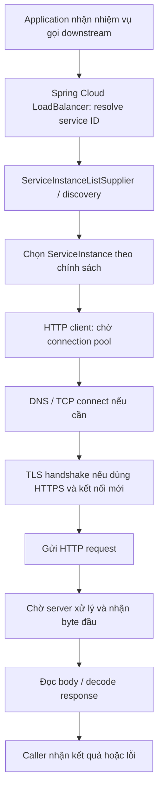
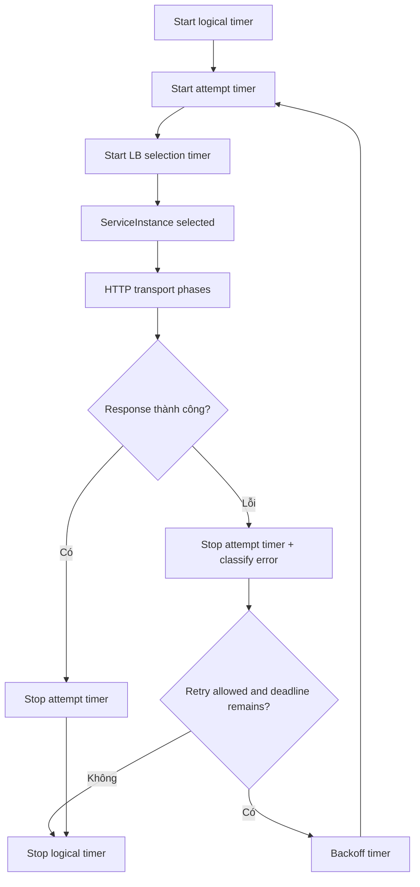

# Tách thời gian chọn đích khỏi thời gian kết nối và xử lý

Khi `order-service` gọi `http://catalog-service/api/products/P42` qua Spring Cloud LoadBalancer, log có thể chỉ ghi: “HTTP request mất 850 ms”. Con số này **không trả lời được** 850 ms đã tiêu tốn ở đâu: đợi discovery, chọn `ServiceInstance`, chờ lấy connection từ pool, kết nối TCP/TLS, đợi downstream xử lý hay đọc/giải mã response. Nếu chỉ tăng `readTimeout` khi gặp một request chậm, ta có thể vô tình giữ nhiều connection lâu hơn trong khi nguyên nhân thật là **pool cạn** hoặc **danh sách instance cập nhật chậm**.

Bài này thuộc chương **Quan sát hệ thống** của module `SPRING_CLOUD_SERVICE_COMMUNICATION_LOAD_BALANCING`. Mục tiêu là xây dựng mô hình đo đạc có ranh giới rõ ràng giữa **thời gian chọn đích của Spring Cloud LoadBalancer** và **thời gian thực thi HTTP của RestClient, WebClient, OpenFeign**, sau đó dùng metrics, tracing và kiểm thử lỗi có kiểm soát để xác định chính xác nút thắt. Mọi ví dụ về tên metric/hook cần được kiểm chứng với Spring Boot, Spring Cloud và HTTP transport đang chạy; không coi việc thêm Actuator là bằng chứng mọi giai đoạn đã được đo tự động.

## 1. Một HTTP call thực chất gồm nhiều pha

Khi ứng dụng gọi một URL chứa service ID, có thể phân rã thành những phần sau:



Có thể gom các phần thành ba vùng trách nhiệm:

| Vùng | Công việc chính | Ví dụ tín hiệu quan sát |
|---|---|---|
| **A. Chọn đích** | Lấy danh sách `ServiceInstance`, áp dụng health/zone/sticky policy, chọn một bản sao | `service.id`, `instance.id`, thời gian từ bắt đầu chọn đến khi có kết quả |
| **B. Thiết lập và sử dụng kết nối** | Chờ connection từ pool, phân giải DNS, TCP connect, TLS handshake, gửi HTTP request | Pool pending/leased/available, connect time, handshake time, timeout transport |
| **C. Downstream và response** | Server nhận request, xử lý nghiệp vụ/DB, phát byte đầu, chuyển body, client decode | Server processing, time-to-first-byte, response time, bytes, decode error |

**Điểm đặc biệt:** một kết nối đã được tái sử dụng từ pool có thể **không cần DNS/TCP/TLS handshake mới**. Vì thế không nên cố gán một “TLS handshake = 0 ms” cho mọi request; đối với request tái sử dụng connection, sự kiện handshake **không xảy ra** trong attempt đó.

Bộ lọc LoadBalancer và HTTP client nằm ở các lớp khác nhau. `RoundRobinLoadBalancer` chọn từ ứng viên; `ClientHttpRequestFactory`, Reactor Netty hoặc Feign HTTP transport tạo/gửi request thực tế. Một lựa chọn instance nhanh không bảo đảm kết nối nhanh, và kết nối nhanh không bảo đảm server xử lý nghiệp vụ nhanh.

## 2. Phân biệt logical request, attempt và một kết nối TCP

Khi retry được bật, một hành động nghiệp vụ có thể phát nhiều HTTP attempts:

```text
Logical request: order-service cần Product P42
  ├─ Attempt 1: chọn catalog-a → connect timeout
  ├─ Backoff 100 ms
  └─ Attempt 2: chọn catalog-b → HTTP 200

Một connection pool riêng có thể tái sử dụng TCP connection của lần gọi trước.
```

Cần ghi nhận ít nhất ba đơn vị đo:

1. **Logical request duration:** từ lúc nghiệp vụ bắt đầu lời gọi downstream đến khi hoàn thành/lỗi, **bao gồm** retries, backoff và xử lý kết quả tại ranh giới đang đo.
2. **Attempt duration:** thời gian của mỗi lần thử gửi request riêng; có thể gồm chọn lại instance, chờ pool, kết nối, response.
3. **Connection lifecycle:** từ lúc tạo/mượn/trả/đóng một connection, có thể trải rộng nhiều attempts và nhiều logical requests.

Nếu gộp ba khái niệm, dashboard có thể báo “50 request chậm” dù thực tế 50 logical requests tạo ra 150 attempts, tất cả bị nghẽn tại cùng một pool. Hoặc một connect metric tăng chỉ vì nhiều connection mới được tạo lúc deployment, không phải server xử lý chậm.

**Quy ước đo phải chỉ rõ ranh giới:** metric HTTP client có thể được bắt đầu sau khi LoadBalancer hoàn tất một số bước tùy adapter/interceptor; metric server thường chỉ đo thời gian sau khi HTTP request tới server. Không được cộng hoặc so sánh chúng như thể mọi thiết bị đo đều bắt đầu tại cùng một thời điểm.

## 3. Một timeline định lượng, dễ đọc và dễ đối chiếu

Giả sử một logical request chỉ có một attempt, không có retry và không có pha chồng lấp. Ta chủ động định nghĩa các đoạn thời gian **không trùng nhau** để giải thích:

| Giai đoạn minh họa | Thời gian | Ý nghĩa |
|---|---:|---|
| Chờ việc được xử lý tại caller | 30 ms | Scheduling/queue trước khi bắt đầu chọn đích |
| Discovery/supplier và chọn instance | 15 ms | Có được `catalog-b` để gọi |
| Chờ lấy connection từ pool | 85 ms | Route tới `catalog-b` đang đông |
| Phân giải tên DNS | 10 ms | Chỉ nếu transport cần tra cứu mới |
| TCP connect | 35 ms | Mở socket mới |
| TLS handshake | 55 ms | HTTPS/mTLS, chỉ trên kết nối mới |
| Gửi HTTP request | 5 ms | Đẩy headers/body ra mạng |
| Chờ byte response đầu tiên | 240 ms | Network + server xử lý + network trở lại |
| Đọc/giải mã response | 50 ms | Nhận body, converter/Jackson và hoàn tất |
| **Tổng** | **525 ms** | Từ caller đến khi nhận kết quả |

Các giá trị trên **chỉ là dữ liệu giả lập** để học cách phân tích; không phải số đo thật của Spring Cloud. Khi instrumentation thực tế được đặt ở những hook chồng nhau (ví dụ HTTP client total bao trùm connect/TLS/response), **không cộng trực tiếp** các timer vì sẽ tính lặp.

```text
0ms          30     45            130  140    175      230  235              475   525
| caller wait | LB | pool acquire | DNS | TCP | TLS | send | wait first byte | body/decode |
```

Trong ví dụ này, nếu chỉ thấy `http.client.duration=525ms`, việc tăng `connection pool` hay tăng `readTimeout` đều là phỏng đoán. Nếu đã có dữ liệu per-phase, ta thấy nhóm chờ byte đầu 240 ms lớn nhất; pool wait 85 ms cũng đáng điều tra. Cần đối chiếu các dấu hiệu này với server spans, pool statistics và tần suất tạo kết nối mới.

## 4. Chỉ số “chọn đích” phải được định nghĩa chính xác

Với Spring Cloud LoadBalancer, chuỗi chọn instance có thể gồm:

```text
URL logic: http://catalog-service/api/products/P42
      ↓
Tên service: catalog-service
      ↓
ServiceInstanceListSupplier
      ├─ DiscoveryClient hoặc dữ liệu tĩnh
      ├─ cache/refetch khi có
      ├─ health filtering / zone preference khi có
      └─ các supplier khác
      ↓
ReactorLoadBalancer.choose(...)
      ↓
ServiceInstance: catalog-b.internal:8081
```

Một phép đo **LB selection duration** có thể bắt đầu khi consumer khởi động lựa chọn và kết thúc khi kết quả `ServiceInstance` được xác định hoặc thất bại. Nó có thể **bao gồm thời gian lấy danh sách từ supplier**, nhất là khi nguồn discovery phải truy vấn/refresh. Vì vậy gọi metric này “thời gian round robin” là không chính xác: phép tính chỉ số round robin thường rất nhỏ, còn phần lớn chậm trễ có thể đến từ discovery hoặc filter/supplier.

Các yếu tố cần tách thêm khi cần chẩn đoán sâu:

| Thành phần | Có thể làm tăng latency? | Cách đọc đúng |
|---|---|---|
| `DiscoveryClient`/registry lookup | Có, nếu cần I/O hoặc dữ liệu chưa cache | Đo việc lấy danh sách, không đổ cho HTTP TCP |
| Cache của instance list | Cache hit thường nhanh; cache miss/refresh có thể chậm | Cần quan sát hit/miss và độ mới danh sách |
| `HealthCheckServiceInstanceListSupplier` | Health probe chạy định kỳ và kết quả được phát lại | Không coi thời gian probe nền là latency của từng request |
| Zone/hint/sticky filters | Có chi phí lọc danh sách, thường nhỏ | Xác minh số ứng viên trước/sau lọc |
| `RoundRobinLoadBalancer`/Random | Chọn một phần tử trong danh sách | Không nhầm thuật toán chọn với network latency |
| Không có `ServiceInstance` | Không thể chuyển sang kết nối đến đích | Đếm riêng `no_instance`, không biến thành connect timeout |

**Lưu ý về health check:** nếu probe định kỳ mất 800 ms nhưng request đang dùng kết quả probe đã được phát lại, **không được gán 800 ms đó vào thời gian chọn đích của request**. Phép đo phải bám hook thật sự trên đường xử lý request.

## 5. Ba lớp quan sát nên có song song

Không một metric đơn lẻ nào bao trùm mọi câu hỏi. Thiết kế dễ vận hành gồm:

| Lớp quan sát | Ranh giới đo | Câu hỏi trả lời |
|---|---|---|
| **Application/outbound logical** | Trước khi gọi client đến khi caller nhận terminal signal/kết quả | Người dùng/nghiệp vụ chờ tổng bao lâu, gồm retry/backoff? |
| **Spring Cloud LoadBalancer** | Lúc yêu cầu chọn đến khi có response lựa chọn/hoàn tất lifecycle theo hook | Service ID có instance? Chọn được bản sao nào? Selection latency là bao nhiêu? |
| **HTTP transport** | Mượn/tạo connection, connect, TLS, gửi request, nhận response | Tắc pool, TCP, TLS hay server/response? |
| **Downstream server** | Server nhận request → controller/handler/DB → phát response | Chính server tiêu tốn bao nhiêu thời gian xử lý? |
| **Tracing xuyên dịch vụ** | Chuỗi spans ở các service/attempts | Request chậm xuất phát từ hop nào, có retry/queue chồng lên nhau không? |

Những thành phần này nên dùng **cùng trace context** khi có thể, nhưng không nên sao chép các thông tin có cardinality cao vào mọi metric label. Ví dụ `traceId`, `spanId`, raw product ID và URL đầy đủ phù hợp hơn với trace/log có kiểm soát, không phải label metric Prometheus thông thường.

## 6. Spring Boot Actuator, Micrometer và quan sát HTTP client

Một ứng dụng Spring Boot có thể sử dụng Micrometer Observation, Actuator và registry thích hợp để phát metrics/traces:

```xml
<dependencies>
    <dependency>
        <groupId>org.springframework.boot</groupId>
        <artifactId>spring-boot-starter-actuator</artifactId>
    </dependency>
    <dependency>
        <groupId>io.micrometer</groupId>
        <artifactId>micrometer-registry-prometheus</artifactId>
    </dependency>
    <dependency>
        <groupId>org.springframework.cloud</groupId>
        <artifactId>spring-cloud-starter-loadbalancer</artifactId>
    </dependency>
</dependencies>
```

Nếu sử dụng `RestClient`/`WebClient`/Feign, ứng dụng còn cần các starter tương ứng (`spring-boot-starter-web`, `spring-boot-starter-webflux`, `spring-cloud-starter-openfeign`) và cấu hình HTTP client đúng cách. Versions phải tương thích theo **Spring Boot dependency management** và **Spring Cloud BOM**.

Trong môi trường thử nghiệm nội bộ:

```yaml
management:
  endpoints:
    web:
      exposure:
        include: health,info,prometheus
  metrics:
    tags:
      application: order-service
```

Chỉ expose endpoint cần thiết cho người có quyền; **không công khai Prometheus/Actuator bừa bãi ra Internet**. Cấu hình trên giả định đã thêm registry Prometheus; nếu chỉ thêm Actuator mà không có registry/exporter, `/actuator/prometheus` không mặc nhiên xuất hiện.

Khi dùng Spring Boot auto-configured HTTP client, instrumentation có thể tạo metric/observation về **toàn HTTP exchange**. Tuy nhiên, tên meter/spans, nội dung chính xác và thứ tự các hook thay đổi giữa các Spring Boot/Spring Cloud/HTTP client versions. Người vận hành phải xác minh những timer đó có **bao gồm lựa chọn instance, retry, pool wait, body decode** hay không, thay vì dựa vào suy đoán từ tên `http.client.requests`.

## 7. Micrometer metrics của Spring Cloud LoadBalancer nói được điều gì?

Spring Cloud LoadBalancer có các điểm mở rộng như `LoadBalancerLifecycle` và, ở các phiên bản có hỗ trợ, khả năng thu thập số liệu Micrometer cho các lần yêu cầu cân bằng tải.

Cần phân biệt các loại tín hiệu:

- **Số lần có yêu cầu chọn/khởi chạy LoadBalancer**, thành công, thất bại hoặc không có instance.
- **Service ID** đang được cân bằng tải và outcome.
- **Instance được chọn** nếu lifecycle/metrics/tracing cho phép lấy giá trị này.
- **Thời gian lifecycle** mà instrumentation đo được.

Tùy release train, metric có thể mang tên thuộc nhóm `loadbalancer.requests.*` hoặc được xuất qua observation riêng. **Không mặc định đây là timer thuần cho bước chọn instance.** Một lifecycle callback có thể bắt đầu trước khi chọn, còn callback hoàn tất có thể được gọi **sau khi HTTP request kết thúc**. Nếu đo `onStart → onComplete` và gọi toàn bộ là “selection duration” thì đang gộp cả transport/response, làm sai ý nghĩa.

### Cách thiết kế custom selection timer

Muốn có một metric “chọn xong instance” thực sự, cần instrument **đúng ranh giới** của lựa chọn trong phiên bản đang dùng. Mã giả sau minh họa ý tưởng, **không phải implementation Java của một interface API cụ thể**:

```text
on_before_choose(serviceId):
    selectionStart = monotonicClock.now()

response = actualLoadBalancer.choose(request)

on_selection_response(response):
    selectionDuration = monotonicClock.now() - selectionStart
    emitHistogram(
        "app.lb.selection.duration",
        serviceId = sanitizedServiceId,
        outcome = response.hasServer ? "selected" : "no_instance",
        value = selectionDuration
    )
    trace/log selected instance safely (avoid high-cardinality metric tags)
```

Nếu `choose()` trả `Mono<Response<ServiceInstance>>`, cần đo khi publisher **được subscribe** và khi có kết quả, không phải đo thời gian tạo `Mono`. Nếu có replay/caching, request-scoped context và scheduler khác nhau, đảm bảo mỗi lần lựa chọn có một cặp start/end riêng. Tránh bật custom timer trong một vị trí chỉ chạy ở background health check rồi gán metric đó cho logical HTTP request.

**Lưu ý triển khai:** `LoadBalancerLifecycle` có những callback quanh việc bắt đầu và kết thúc request (chẳng hạn `onStart`, `onStartRequest`, `onComplete` trong các phiên bản hỗ trợ). Trước khi sử dụng một callback làm ranh giới, đọc tài liệu/code của chính release train đang dùng để biết nó chạy **trước chọn, sau chọn hay sau HTTP**, và chỉ đặt tên metric theo phạm vi đã xác minh. Không suy ra “callback nào có chữ request là lúc bắt đầu TCP”.

## 8. Đo logical request bằng RestClient: ví dụ Micrometer Timer

Ví dụ sau đo **tổng thời gian một lời gọi tại tầng ứng dụng**. Nó cố ý **không** đặt tên là selection timer:

```java
package com.example.orders.catalog;

import io.micrometer.core.instrument.MeterRegistry;
import io.micrometer.core.instrument.Timer;
import org.springframework.cloud.client.loadbalancer.LoadBalanced;
import org.springframework.stereotype.Component;
import org.springframework.web.client.RestClient;

@Component
public class CatalogClient {

    private final RestClient client;
    private final MeterRegistry registry;

    public CatalogClient(
            @LoadBalanced RestClient.Builder builder,
            MeterRegistry registry) {
        this.client = builder.clone()
                .baseUrl("http://catalog-service")
                .build();
        this.registry = registry;
    }

    public ProductDto getProduct(String id) {
        Timer.Sample sample = Timer.start(registry);
        String outcome = "success";

        try {
            return client.get()
                    .uri("/api/products/{id}", id)
                    .retrieve()
                    .body(ProductDto.class);
        } catch (RuntimeException exception) {
            outcome = "error";
            throw exception;
        } finally {
            Timer timer = Timer.builder("app.outbound.logical.duration")
                    .description("Duration of one logical downstream call")
                    .tag("service.id", "catalog-service")
                    .tag("client.kind", "restclient")
                    .tag("outcome", outcome)
                    .register(registry);
            sample.stop(timer);
        }
    }
}
```

`Timer.Sample` dùng đồng hồ monotonic của Micrometer để đo thời gian, rồi `sample.stop(timer)` ghi sample vào meter với các tags đã chọn. Trong ví dụ, exception lúc gọi client được gắn `outcome=error`, còn kết quả trả bình thường là `success`. Đặt timer quanh toàn phương thức để đo logical call ở vị trí này; nếu retry nằm bên trong HTTP client, duration sẽ bao gồm thời gian retry nhưng **một sample không phản ánh số attempts**.

Đối với ứng dụng MVC, đây là phép đo blocking theo vòng đời lời gọi. Với `RestClientAdapter` của HTTP Interface hoặc OpenFeign, có thể đặt phép đo tương tự quanh proxy/service method, nhưng phải công bố ranh giới khác nhau nếu không cùng vị trí. **Đừng gọi cùng một meter cho các phép đo có phạm vi khác nhau.**

## 9. Đo reactive WebClient đúng thời điểm subscription

Trong Reactor, `Mono` là publisher có thể thực thi sau khi method đã trả về. Vì vậy đo từ lúc **tạo** publisher đến lúc có kết quả có thể cộng cả thời gian một `Mono` chưa được subscribe và không mô tả chính xác request thực thi.

Ví dụ đo từ subscription cho đến terminal/cancel:

```java
package com.example.orders.catalog;

import io.micrometer.core.instrument.MeterRegistry;
import java.util.concurrent.TimeUnit;
import org.springframework.cloud.client.loadbalancer.LoadBalanced;
import org.springframework.stereotype.Component;
import org.springframework.web.reactive.function.client.WebClient;
import reactor.core.publisher.Mono;

@Component
public class ReactiveCatalogClient {

    private final WebClient client;
    private final MeterRegistry registry;

    public ReactiveCatalogClient(
            @LoadBalanced WebClient.Builder builder,
            MeterRegistry registry) {
        this.client = builder.clone()
                .baseUrl("http://catalog-service")
                .build();
        this.registry = registry;
    }

    public Mono<ProductDto> getProduct(String id) {
        return Mono.defer(() -> {
            long started = System.nanoTime();

            return client.get()
                    .uri("/api/products/{id}", id)
                    .retrieve()
                    .bodyToMono(ProductDto.class)
                    .doFinally(signal -> registry.timer(
                            "app.outbound.logical.duration",
                            "service.id", "catalog-service",
                            "client.kind", "webclient",
                            "terminal.signal", signal.name())
                        .record(System.nanoTime() - started,
                                TimeUnit.NANOSECONDS));
        });
    }
}
```

`Mono.defer` tạo thời điểm đo **cho mỗi subscription**. `doFinally` chạy khi publisher kết thúc thành công, lỗi hoặc bị cancel. `signal.name()` thuộc một tập giá trị hữu hạn nên phù hợp làm low-cardinality tag; `id` của sản phẩm thì không. Nếu một pipeline được subscribe nhiều lần, mỗi subscription tạo một phép đo riêng; đó là hành vi cần lưu ý khi diễn giải logical request.

Nếu có retry Reactor, thứ tự đặt timer rất quan trọng:

```java
// Timer ở bên ngoài: đo cả các attempts và backoff của pipeline.
return Mono.defer(() -> {
    long started = System.nanoTime();
    return fetchOneAttempt()
            .retryWhen(retryPolicy)
            .doFinally(signal -> recordLogicalDuration(started, signal));
});

// Timer bên trong fetchOneAttempt(): đo từng attempt riêng.
// Hai phép đo có mục đích khác nhau; không gắn cùng tên meter.
```

Trong ví dụ, `fetchOneAttempt`, `retryPolicy` và `recordLogicalDuration` là thành phần minh họa do ứng dụng xây dựng. Khi retry nhiều tầng đang bật, cần thêm `attempt_number` trong trace/log và kiểm tra request thực tế nhận ở server; chỉ một timer tổng không phát hiện được amplification.

## 10. Đo transport bằng Reactor Netty và connection provider

Nếu `WebClient` dùng Reactor Netty, transport có thể xuất các metrics chuyên biệt khi được bật theo phiên bản và registry tương thích, ví dụ thời gian connect, TLS handshake, HTTP response và connection pool pending/acquire.

```java
import java.time.Duration;
import org.springframework.http.client.reactive.ReactorClientHttpConnector;
import org.springframework.web.reactive.function.client.WebClient;
import reactor.netty.http.client.HttpClient;
import reactor.netty.resources.ConnectionProvider;

ConnectionProvider provider = ConnectionProvider.builder("catalog-outbound")
        .maxConnections(40)
        .pendingAcquireMaxCount(80)
        .pendingAcquireTimeout(Duration.ofMillis(300))
        .metrics(true)
        .build();

HttpClient transport = HttpClient.create(provider)
        .metrics(true, uri -> "/catalog-api")
        .responseTimeout(Duration.ofSeconds(2));

WebClient catalogClient = loadBalancedBuilder.clone()
        .clientConnector(new ReactorClientHttpConnector(transport))
        .baseUrl("http://catalog-service")
        .build();
```

`loadBalancedBuilder` phải là một `@LoadBalanced WebClient.Builder` và `ConnectionProvider` cần có **vòng đời được quản lý**, được dispose khi ứng dụng dừng. Đoạn mã giả định đã có bean builder và tập trung vào cấu hình transport; người học cần đưa provider/connector vào cấu hình Spring bean thực tế. Các giới hạn pool/timeout trong ví dụ là số cho bài lab, không phải thông số mặc định cần áp dụng trên production.

Reactor Netty có các nhóm meter tùy phiên bản, chẳng hạn:

| Nhóm metric/quan sát | Ý nghĩa khi xuất hiện | Điều không nên suy ra |
|---|---|---|
| `reactor.netty.connection.provider.*` | Pool active/idle/pending, thời gian chờ acquire | Không phải thời gian `RoundRobinLoadBalancer` chọn instance |
| `reactor.netty.http.client.connect.time` | Thời gian tạo kết nối TCP mới theo transport | Không bao gồm mọi request được tái sử dụng connection |
| `reactor.netty.http.client.tls.handshake.time` | Chi phí bắt tay TLS của connection mới | Không phải server xử lý endpoint |
| `reactor.netty.http.client.response.time` | Thời gian response theo hook Reactor Netty | Không mặc nhiên bằng latency logical gồm LB/retry/deserialize |
| `http.client.requests` hoặc observation HTTP | Request duration theo instrumentation Spring | Phải xác minh ranh giới đo và mức độ bao gồm response body |

**Không mặc định tên meter và tag chính xác tồn tại trên mọi phiên bản**: xem kết quả thật ở `/actuator/metrics`, `/actuator/prometheus` hoặc hệ thống metrics khi app đang chạy. Một số timer vận chuyển được đăng ký chỉ khi có request thực tế và registry/enablement phù hợp. Việc tạo một HTTP client khác với client thực sự được injection sử dụng có thể khiến người vận hành không nhìn thấy số liệu mong đợi.

Chú ý **URI mapping** trong `metrics(true, uri -> "/catalog-api")`: mục tiêu là tránh đưa `/api/products/P42`, `P43`, ... thành vô hạn metric label. Trong production cần quy hoạch đường dẫn theo route template và kiểm tra khả năng phân biệt các API cần thiết. Không map tất cả route thành một giá trị duy nhất nếu điều đó làm mất khả năng chẩn đoán quan trọng.

## 11. RestClient/OpenFeign: phân biệt request factory và HTTP transport

`RestClient` hoặc `RestTemplate` có thể dùng `HttpComponentsClientHttpRequestFactory` với Apache HttpClient 5. Cấu hình đúng request factory cho phép quản lý:

- **Lease/pool wait:** đợi lấy connection từ `PoolingHttpClientConnectionManager`.
- **Connect:** mở connection tới route đã được LoadBalancer chọn.
- **Response/socket:** chờ dữ liệu của request qua connection đó.
- **Pool stats:** số connection leased, available và pending theo toàn pool/route.

Ví dụ lấy một snapshot của connection manager do ứng dụng **thực sự sử dụng**:

```java
import org.apache.hc.client5.http.impl.io.PoolingHttpClientConnectionManager;
import org.apache.hc.core5.pool.PoolStats;

// connectionManager phải chính là manager dùng để tạo CloseableHttpClient.
PoolStats stats = connectionManager.getTotalStats();

int leased = stats.getLeased();
int available = stats.getAvailable();
int pending = stats.getPending();
int max = stats.getMax();
```

Các giá trị này là **gauge trạng thái pool**, không tự cung cấp duration từng HTTP request. Muốn biết có pool wait kéo dài bao nhiêu, cần instrumentation tại điểm lease/transport phù hợp hoặc correlation giữa pending và latency. Chỉ thấy `pending > 0` không chứng minh tất cả request chậm do pool; cần đối chiếu trên cùng thời gian và route.

OpenFeign có thể sử dụng các transport khác nhau: Feign mặc định, Apache HttpClient, OkHttp hoặc implementation được Spring Cloud tích hợp. Quan sát và cấu hình timeouts/connection pool phải theo **client thực tế**, không theo dependency chỉ có trong classpath. Khi dùng Micrometer với OpenFeign, các capability/auto-configuration về observation có thể cung cấp số liệu Feign; cần kiểm tra enabled flag và thực tế tạo proxy. Feign error decoding cũng có chi phí riêng sau khi nhận response; đừng gộp lỗi decode thành “connect timeout”.

## 12. Connection reuse làm biến đổi phân bố thời gian

Khi kết nối HTTPS được tái sử dụng, không cần handshake mới cho request tiếp theo. Một tập dữ liệu thực tế có thể trộn:

```text
Request A: LB 10ms + pool 5ms + TCP 25ms + TLS 40ms + response 150ms
Request B: LB  8ms + pool 1ms + TCP N/A  + TLS N/A  + response 145ms
Request C: LB 12ms + pool 90ms + TCP N/A + TLS N/A  + response 150ms
```

Nếu chỉ xem giá trị trung bình, người vận hành có thể bỏ qua việc một phần nhỏ request mất 90 ms chờ pool. Cần đo **p50, p95, p99** hoặc histogram cùng số mẫu, tách theo loại kết nối nếu instrumentation hỗ trợ.

Một số chi tiết cần ghi nhận:

1. **Keep-alive:** connection có thể được dùng lại nếu server/proxy không đóng.
2. **Idle eviction / TTL:** connection cũ bị dọn có thể làm tần suất TCP/TLS handshake tăng.
3. **Route-per-instance:** LoadBalancer chọn các host:port khác nhau; pool có thể có hạn mức **theo route**, không chỉ tổng.
4. **Deployment/scale:** instance mới hoặc IP thay đổi làm tạo connection mới.
5. **Stale connection:** reuse một socket đã bị đóng có thể tạo I/O error/retry, làm latency logical tăng dù một attempt không nhận response.
6. **mTLS:** rotation certificate và connection pool có thể khiến các handshake mới/thời điểm hết hạn khác nhau.

Không suy luận “TCP connect time = 0” từ việc không có một sự kiện connect; đó có thể đơn giản là request dùng lại socket, hoặc transport metrics chưa được bật.

## 13. Server latency và time-to-first-byte không giống nhau

Client quan sát **time-to-first-byte (TTFB)** như thời gian từ lúc gửi request đến khi nhận byte đầu của response; nó thường bao gồm:

```text
network client→server
+ thời gian server queue/scheduling
+ thời gian controller/service xử lý, DB, downstream khác
+ thời gian ghi byte response đầu
+ network server→client
```

Server có thể đo một `http.server.requests` timer từ lúc HTTP request vào ứng dụng đến response, nhưng boundary có thể khác khi có proxy, filter, streaming response hoặc middleware. TTFB ở client **không phải** server processing duration, và hiệu số giữa hai timer từ hai host **không chính xác tuyệt đối** nếu clock, hooks và mạng không được tính.

Tình huống điển hình:

- **Client TTFB tăng, server duration cũng tăng:** nghi xử lý server, DB, queue server hoặc downstream được server gọi.
- **Client TTFB tăng, server duration ổn định:** nghi network, proxy/ingress queue, connection reuse, packet loss hoặc khác biệt instrumentation.
- **Thời gian decode tăng, TTFB ổn định:** kiểm tra kích thước JSON, schema/converter hoặc CPU/GC bên client.
- **Chỉ response body lớn bị chậm:** đo throughput nhận dữ liệu, streaming, compression hoặc backpressure; TTFB chưa phản ánh toàn bộ thời gian tải.

Với response streaming, thời gian nhận byte đầu có thể nhanh nhưng thời gian đọc hết body rất dài. Định nghĩa “request completed” phải nói rõ **hoàn tất headers**, **đọc hết response body** hay **parse xong DTO**.

## 14. Tracing: nối lựa chọn instance với transport và downstream span

Metrics cho biết xu hướng và phân bố; distributed tracing giúp biết request cụ thể đã đi qua những hop nào. Một trace có thể được trình bày:

```text
traceId=ab12... OrderPreviewHandler                         620ms
  └─ logical catalog-service call                        570ms
       ├─ attempt 1                                       300ms
       │    ├─ LB selection                                18ms → catalog-a
       │    ├─ pool acquire                                12ms
       │    └─ connect timeout                            270ms
       ├─ backoff                                        100ms
       └─ attempt 2                                       170ms
            ├─ LB selection                                10ms → catalog-b
            ├─ pool acquire                                 5ms
            └─ HTTP exchange                              155ms
                 └─ catalog-b server span                110ms
```

Các con số và span names chỉ là **mô hình minh họa**. Từng span có thể bắt đầu và kết thúc ở những hook khác nhau; hệ thống tracing tự động không nhất thiết tạo span `LB selection` và `pool acquire`. Nếu cần những span đó, phải tạo instrumentation riêng ở ranh giới phù hợp.

Dùng `traceparent` của W3C Trace Context hoặc hệ thống context propagation được framework hỗ trợ để nối spans qua RestClient/WebClient/OpenFeign và server. Mỗi retry có thể tạo attempt span riêng nhưng giữ cùng trace ID của logical request. Nếu ứng dụng tự dùng `X-Correlation-Id`, nó là một quy ước bổ sung, **không** tự thay thế distributed tracing.

Các attributes nên cân nhắc:

| Attribute/log field | Vị trí tốt | Cảnh báo |
|---|---|---|
| `service.id` | Metric low-cardinality và trace | Giữ registry service names được kiểm soát |
| `instance.id` hoặc host đã chọn | Trace/log chẩn đoán | Có thể high-cardinality khi autoscaling |
| `attempt.number` | Attempt span/log | Không dùng làm unbounded label |
| `lb.outcome` | Metric và trace | Tập giá trị hữu hạn: selected/no_instance/error |
| `http.method`, route template | Metric và trace | Không dùng URL chứa product ID/token |
| `failure.stage` | Metric và trace | Tập hữu hạn: selection, pool, connect, tls, response, decode |
| `traceId` | Log/trace | Không đặt vào Prometheus label |
| `deadline.remaining` | Trace/log thời điểm gọi | Không tiết lộ thông tin nhạy cảm |

Trên một dịch vụ có hàng nghìn replica, việc gắn IP hoặc instance ID vào mọi time series có thể tạo cardinality rất lớn. Để truy lỗi theo instance, ưu tiên trace/log/sampling hoặc một tập dashboard có kiểm soát, thay vì thêm mọi dimension vào metric global.

## 15. Đặt timer đúng ranh giới khi có retry và timeout

Một sơ đồ đặt phép đo tham khảo:



Lưu ý chính:

- Timer **logical** bao cả attempt 1, attempt 2, backoff và thời gian chờ do retry.
- Timer **attempt** không bao thời gian backoff trước attempt kế tiếp.
- Timer **selection** bắt đầu và kết thúc quanh việc chọn instance thật sự, không phải quanh cả HTTP exchange.
- **No instance** là outcome riêng; không có pool/connect/TTFB cho attempt không tìm được đích.
- **Pool acquire timeout** xảy ra sau khi có instance, trước khi có request thực sự đến server.
- **Connect timeout** khác với read/response timeout; retry một attempt có thể làm cả hai xuất hiện.
- **Timeout tổng/deadline** có thể hủy pipeline; ghi nhận `cancelled`/`deadline_exceeded` thay vì coi là HTTP `200`.
- Với outbound HTTP transport tự retry, số request thực tế có thể lớn hơn số attempts của tầng ứng dụng; cần kiểm tra retry owner của toàn stack.

Nếu muốn tính “thời gian chọn instance trung bình”, chỉ lấy samples thật sự tương ứng lựa chọn. **Đừng trộn** `loadbalancer.requests.*` (có thể đo lifecycle dài hơn) với custom `app.lb.selection.duration` nếu phạm vi đo chưa được chứng minh giống nhau.

## 16. Chẩn đoán theo triệu chứng: đo đúng để sửa đúng

| Triệu chứng | Giai đoạn đáng nghi | Cách xác minh trước khi sửa |
|---|---|---|
| Không tìm được instance | Discovery/selection | Service ID, supplier list, registry, health/zone, `no_instance` |
| Selection p95 tăng, connect ổn định | Discovery refresh/cache/supplier | Đo cache hit/miss, retrieval latency, filter chain |
| Pool pending và acquisition latency tăng | HTTP connection pool | Leased/available/pending, per-route limit, response release |
| TCP connect p95 tăng | Network/instance accessibility | IP/port, firewall, packet loss, route, connect timeout |
| TLS handshake tăng hoặc fail | TLS/mTLS/PKI | CA, SAN, certificate expiry, connection churn |
| TTFB tăng với server span chậm | Downstream processing | DB, queue, CPU, downstream dependencies của server |
| TTFB tăng nhưng server span bình thường | Proxy/network boundary | Gateway/ingress queue, egress, network latency |
| Body/decode tăng | Large response, JSON parser/GC | Body size, CPU, converter, compression |
| Logical duration tăng nhưng attempt duration không | Backoff/retry/queue trước attempt | Attempts per request, backoff và scheduler |
| Chỉ p99 chậm sau rollout | Connection churn, cold caches | New connection ratio, DNS/SSL, cache refresh |
| `503` ngay lập tức, không có connect event | No instance/circuit breaker | Giai đoạn gây `503`, trace và outcome |
| `503` sau HTTP response | Downstream thực sự trả lỗi | Server logs/traces, selected instance và response status |

Từ bảng này, hành động sửa có thể khác hoàn toàn:

- **Selection chậm:** kiểm tra discovery refresh, cache và supplier; không tăng connection pool như giải pháp đầu tiên.
- **Pool cạn:** giảm thời gian giữ connection, giới hạn concurrency, kiểm tra release/lease timeout và sizing pool.
- **Connect chậm:** kiểm tra mạng, DNS, instance address, lỗi TCP hoặc TLS; không gán cho server method business.
- **Server xử lý chậm:** tối ưu downstream, DB, queue, giảm payload hoặc thêm capacity khi phù hợp.
- **Retry làm tổng chậm:** giảm attempts và backoff không hợp lý, không mở rộng deadline một cách tùy tiện.

## 17. Bài thực hành: tạo ba kiểu chậm và đọc metric theo từng pha

**Mục tiêu:** từ một con số “HTTP call mất 800 ms” tách được chậm ở **chọn đích**, **kết nối/pool** hay **xử lý server**, đồng thời kiểm chứng tác động của retry và connection reuse.

### 17.1. Chuẩn bị hai bản sao

Chạy `catalog-service` trên hai cổng `8081` và `8082`, có các endpoint:

- `GET /whoami`: trả instance ID và port để biết LoadBalancer chọn bản sao nào.
- `GET /fast`: trả dữ liệu nhỏ ngay.
- `GET /slow?ms=...`: chủ động trì hoãn trong môi trường test.
- `GET /large`: trả JSON/body lớn có kiểm soát để thử read/decode.

Khai báo discovery tĩnh trong consumer:

```yaml
spring:
  cloud:
    discovery:
      client:
        simple:
          instances:
            catalog-service:
              - uri: http://localhost:8081
              - uri: http://localhost:8082
```

`localhost` chỉ hợp lệ khi consumer và hai process cùng chia sẻ ngữ cảnh mạng. Nếu ở Docker/Kubernetes, chọn tên/IP có thể truy cập **từ consumer**. Không tăng timeout để chữa DNS/container networking sai.

Bật Actuator/Micrometer, đo `app.outbound.logical.duration` bằng code đã trình bày, dùng transport metrics phù hợp và thu thập span/trace có service ID, attempt và instance. Không cần và không nên tạo tải lớn lên production để thực hiện bài học này.

### 17.2. Ca A — baseline

Gọi nhiều lần `http://catalog-service/fast`. Đo:

1. Logical duration p50/p95/p99.
2. LB selection duration nếu đã instrument đúng.
3. Pool pending, active, idle; connect events và thời gian connect.
4. HTTP client response duration.
5. Server duration.
6. Instance được chọn và tỷ lệ request tới mỗi bản sao.

Đặc biệt, xem các request sau có reuse connection không. Thời gian kết nối mới có thể ít xuất hiện hơn số HTTP requests.

### 17.3. Ca B — chậm tại server

Cho `catalog-b` trả `/slow?ms=800`; không thay đổi discovery/pool. Kỳ vọng:

- Selection duration gần baseline nếu discovery/supplier vẫn bình thường.
- Pool connect không nhất thiết tăng.
- Client response time và server handling time của B tăng.
- Nếu timeout ở transport thấp hơn 800 ms, client có thể dừng chờ; server vẫn có thể đang xử lý.

Nếu chỉ thấy server span nhanh trong khi client chậm, kiểm tra proxy/network và cách đo TTFB trước khi kết luận.

### 17.4. Ca C — pool bị tranh chấp

Trong môi trường test, dùng một route với `maxConnections` hoặc `maxConnPerRoute` nhỏ và nhiều request giữ connection lâu. Kỳ vọng:

- Pool pending và thời gian chờ acquire tăng.
- Selection duration **không nhất thiết** tăng.
- Connect time có thể vẫn bình thường vì tắc trước khi có connection.
- Có thể xảy ra **pool acquisition timeout** trước HTTP request thực sự được gửi.

Khi LoadBalancer phân phối trên hai route, cần đo hoặc giới hạn đúng route để chứng minh sự cố per-route. Không coi tổng requests của hai bản sao là cùng một queue pool.

### 17.5. Ca D — lựa chọn instance chậm

Để mô phỏng lựa chọn chậm, sử dụng **supplier giả lập trong một ứng dụng test riêng** có chủ ý trì hoãn việc trả danh sách instance. Dùng custom timer quanh `choose` và giữ server/transport phản hồi nhanh. Kỳ vọng selection duration tăng trong khi connect/response của attempt thực tế không tăng tương ứng.

Không làm chậm registry thật của môi trường dùng chung. Không lấy `Thread.sleep` tùy tiện trên Reactor event-loop làm ví dụ thử nghiệm vì nó gây nghẽn event-loop và làm lệch các số đo.

### 17.6. Ca E — retry làm tăng tổng

Cho attempt đầu gặp lỗi connection tới một instance, attempt sau thành công ở instance khác theo cấu hình có kiểm soát. Đo:

- Logical duration tăng do attempt 1 + backoff + attempt 2.
- Mỗi attempt có selected instance và duration riêng.
- Tổng attempts thực tế tại downstream, tránh nhầm một logical request thành một request TCP.
- Nếu tất cả tầng cùng retry, tìm dấu hiệu attempts tăng nhiều hơn giới hạn của một retry owner.

### 17.7. Bảng ghi kết quả

| Ca | Selection p95 | Pool pending/acquire | Connect/TLS | Server/response | Logical outcome |
|---|---|---|---|---|---|
| Baseline | Thấp | Thấp | Thấp hoặc reuse | Nhanh | Thành công |
| Server B chậm | Gần baseline | Có thể tăng theo tải | Thường không phải nguyên nhân đầu | Cao ở B | Chậm/timeout |
| Pool cạn | Gần baseline | Cao | Có thể chưa bắt đầu connect | Server có thể bình thường | Pool timeout |
| Supplier chậm | Cao | Bình thường | Bình thường sau khi chọn | Bình thường | Chậm từ bước LB |
| Retry có giới hạn | Theo từng attempt | Theo tải | Có thể lỗi ở attempt 1 | Attempt 2 có thể thành công | Tổng gồm backoff |

Bảng trên ghi **kỳ vọng định tính**, không phải số liệu đầu ra bảo đảm. Nếu metric không hỗ trợ một trường, hãy đánh dấu `not measured` thay vì tự điền `0`.

## 18. Những bẫy thường gặp khi xây dashboard

| Cách đo sai | Vì sao làm sai kết luận | Cách khắc phục |
|---|---|---|
| Dùng toàn bộ HTTP client timer làm “LB selection” | Bao cả network/server, hoặc ranh giới instrumentation không rõ | Đo sát `choose` và ghi tên metric đúng phạm vi |
| Cộng HTTP total, connect timer và server timer | Các khoảng có thể chồng lấp | Dùng trace timeline và định nghĩa ranh giới không trùng |
| Dùng `System.currentTimeMillis()` để đo duration ngắn | Wall clock có thể điều chỉnh | Dùng monotonic clock/`System.nanoTime()` hoặc Micrometer Timer.Sample |
| Tính duration từ lúc tạo `Mono` | Publisher có thể chưa subscribe | Đo trong `Mono.defer` hoặc hook per-subscription |
| Đo `onStart → onComplete` rồi gắn nhãn “choose time” | Callback complete có thể xảy ra sau HTTP | Kiểm tra lifecycle semantics từng version |
| Chỉ xem trung bình | Che các tail latencies và queue spikes | Dùng histogram/p95/p99, số mẫu và error rate |
| Ghi thiếu các attempts retry | Một logical request có nhiều HTTP attempts | Thêm attempt spans/log và chỉ số amplification |
| Ghi `0 ms` cho TLS của connection tái sử dụng | Không có handshake mới, không phải handshake 0 ms | Đánh dấu not-applicable/không có sample |
| Dùng URL đầy đủ làm metric tag | Product ID/token tạo cardinality vô hạn, nguy cơ lộ dữ liệu | Route template hoặc URI mapping an toàn |
| Chỉ nhìn metric caller không đo server | Không phân biệt network/proxy với server xử lý | Nối distributed traces và server metrics |
| Thấy metric trên dashboard rồi tin là đúng client | Có thể instrument một bean không được dùng | Xác minh bean/adapter/connector thực tế và request count |
| Bật Actuator mà không kiểm tra registry/exporter | Không có dữ liệu đang được thu | Xác nhận meter thật, scrape và endpoint quyền phù hợp |

## 19. Checklist áp dụng trong production

1. Đã định nghĩa rõ điểm bắt đầu/kết thúc **logical request**, **HTTP attempt**, **LB selection** và **transport exchange** chưa?
2. Có phân biệt service ID với `ServiceInstance` được chọn, và tình huống `no_instance` với connect timeout không?
3. Có đo pool acquire/pending, TCP connect, TLS handshake và HTTP response ở **client thực sự đang dùng** không?
4. Có chú thích metric nào bao gồm discovery, retries, backoff và decode, metric nào không không?
5. Với WebClient, phép đo có bắt đầu tại subscription và kết thúc khi complete/error/cancel không?
6. Với RestClient/OpenFeign, có biết `ClientHttpRequestFactory` hoặc Feign transport nào chịu trách nhiệm kết nối không?
7. Tracing có giữ cùng trace ID qua các service, có attempt spans riêng khi retry và có thể điều tra selected instance không?
8. Có phân biệt server processing, client TTFB, body download và decode response không?
9. Đã kiểm tra chính xác tên/nhãn meter theo Spring Boot/Spring Cloud/Reactor Netty version thay vì suy đoán không?
10. Metrics có tránh URL, traceId, userId, productId hoặc instance ID động gây cardinality không kiểm soát không?
11. Có dashboard phân bố p50/p95/p99, request count, error rate, pool saturation và retry amplification không?
12. Có thử server chậm, pool cạn, discovery/supplier chậm, TCP/TLS lỗi và retry dưới tải **được giới hạn** không?
13. Có đảm bảo endpoint metrics/Actuator chỉ expose cho bên được phép, không làm lộ thông tin nội bộ không?
14. Khi chậm tăng, đội vận hành có thể chỉ ra bằng số liệu lỗi ở **chọn instance**, **mượn connection**, **connect/TLS** hay **server response** không?

**Kết luận:** Độ trễ của một request qua Spring Cloud LoadBalancer không phải một đại lượng đơn lẻ. Cần **đo thời gian chọn `ServiceInstance` riêng với chờ connection pool, TCP/TLS, xử lý downstream và decode response**, rồi nối các phép đo bằng tracing và phân biệt logical request với từng retry attempt. Khi định nghĩa đúng ranh giới, kiểm tra instrumentation theo phiên bản và tránh đếm lặp các khoảng thời gian, đội phát triển có thể tìm đúng nơi cần sửa thay vì tăng timeout, retry hoặc connection pool một cách phỏng đoán.
