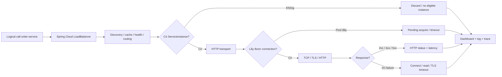
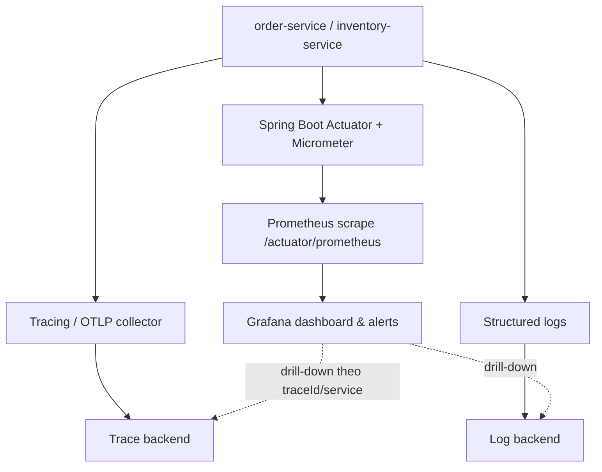
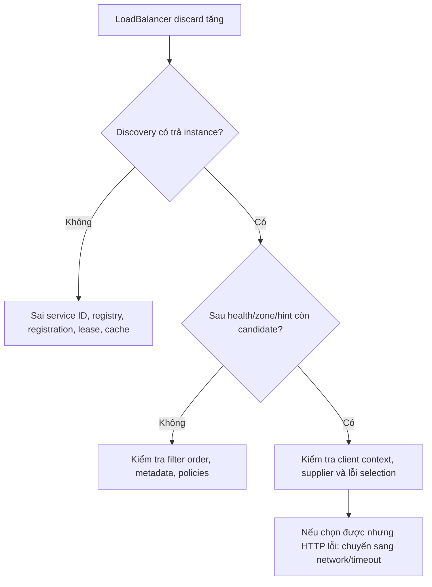

# Dashboard cho lỗi, timeout, pool và bản sao không khả dụng

Khi giao tiếp giữa các microservices sử dụng Spring Cloud LoadBalancer, một request thất bại có thể bắt nguồn từ **HTTP 5xx**, **timeout**, **hết connection pool**, **không có `ServiceInstance`**, hoặc **một bản sao vẫn được discovery trả về nhưng đã không còn phục vụ**. Cả năm tình huống đều có thể biểu hiện với người dùng là “API chậm” hay “gọi service không được”, nhưng cách xử lý hoàn toàn khác nhau.

Bài học thuộc chương **Quan sát hệ thống** của module `SPRING_CLOUD_SERVICE_COMMUNICATION_LOAD_BALANCING`. Mục tiêu là thiết kế một **dashboard vận hành** cho các lời gọi theo service ID, dùng số liệu từ Spring Boot Actuator, Micrometer, Spring Cloud LoadBalancer và HTTP transport (ví dụ Reactor Netty), đồng thời kết nối được biểu đồ với log/trace và runbook. Thực hành ưu tiên RestClient/WebClient và có lưu ý cho RestTemplate/OpenFeign, discovery, health check, cache, retry và timeout.

Dashboard tốt phải trả lời được bốn câu hỏi trong vài phút:

1. **Ai đang thất bại?** Lỗi HTTP status, lỗi transport, lỗi không chọn được instance hay lỗi phía ứng dụng gọi?
2. **Mắc kẹt ở giai đoạn nào?** Đợi connection pool, TCP connect, TLS, chờ response hay quá deadline tổng?
3. **Có còn bản sao đủ điều kiện không?** Danh sách discovery và danh sách sau health/zone/hint filter là gì?
4. **Ảnh hưởng tới người dùng tới đâu?** Logical request cuối cùng thành công hay thất bại, dù đã retry nhiều lần?

> **Lưu ý về phiên bản:** Meter name được ghi trong bài là tên Micrometer theo tài liệu Spring Boot/Spring Cloud/Reactor Netty. Khi xuất sang Prometheus, tên thường đổi thành `snake_case` và có hậu tố theo loại meter, ví dụ `loadbalancer.requests.discard` thành `loadbalancer_requests_discard_total`. Tags, histogram và việc đăng ký meter còn phụ thuộc thư viện, configuration và HTTP client thực tế. Hãy xem `/actuator/metrics` và `/actuator/prometheus` **trong ứng dụng của mình** trước khi sao chép PromQL.

## 1. Bản đồ quan sát của một lời gọi load-balanced

Giả sử `order-service` gọi:

```text
GET http://inventory-service/api/v1/items/SKU-001
```

Discovery thông báo hai bản sao của `inventory-service`:

| Bản sao | Địa chỉ minh họa | Trạng thái thực tế |
|---|---|---|
| `inventory-a` | `10.0.2.11:8081` | Khỏe |
| `inventory-b` | `10.0.2.12:8082` | TCP connect timeout |
 
Spring Cloud LoadBalancer nhận service ID, lấy danh sách ứng viên từ `ServiceInstanceListSupplier`, chọn instance rồi để HTTP client gửi request. Từng bước cần một nguồn quan sát khác nhau.



Các tầng quan sát không thể thay thế cho nhau:

| Tầng | Nguồn metric | Có thể trả lời |
|---|---|---|
| API đầu vào | `http.server.requests` và SLI nghiệp vụ | Người dùng thấy lỗi/latency nào? |
| Client HTTP | `http.client.requests` | Request outbound trả status gì, tốn bao lâu? |
| LoadBalancer | `loadbalancer.requests.*` | Có chọn được instance và lifecycle chọn đích ra sao? |
| Transport/pool | Reactor Netty `connection.provider.*` hoặc metric transport khác | Pool có bị bão hòa, request có chờ connection không? |
| Discovery/supplier | Metric **tự bổ sung**, registry client/health instrumentation | Có bao nhiêu instance trước/sau filter? |
| Retry | Metric **tự bổ sung** hoặc từ resilience library đã dùng | Một logical request phát sinh bao nhiêu attempts? |
| Trace/log | Micrometer Tracing/OpenTelemetry và log có cấu trúc | Request cụ thể đã chọn bản sao nào và lỗi ở đâu? |

**Không gộp mọi lỗi vào một counter `error` duy nhất.** Một response HTTP 503 do backend trả khác với 503 do client không chọn được instance, dù UI phía người dùng có thể trông giống nhau.

## 2. Định nghĩa đối tượng đo trước khi mở Grafana

Hai khái niệm quan trọng nhất là **logical request** và **HTTP attempt**.

Giả sử một thao tác đọc tồn kho được retry:

```text
Logical request #501
  attempt 1: inventory-a -> connection reset
  attempt 2: inventory-b -> HTTP 200
  final outcome: SUCCESS
```

Với thao tác này:

- Số **logical requests**: 1.
- Số **HTTP attempts**: tối đa 2 theo ví dụ (attempt đầu có thể thất bại trước khi server nhận).
- Số **instance được chọn**: có thể là 2 nếu retry chọn lại instance.
- **Kết quả cuối**: thành công.
- **Hệ thống đang suy giảm?** Có: lần đầu đã thất bại, request phụ thuộc retry để phục hồi.

Nếu dashboard chỉ hiển thị error rate theo **kết quả cuối**, thao tác này có thể không được tính lỗi. Nếu dashboard chỉ hiển thị lỗi trên **attempts**, nó có thể báo tỷ lệ lỗi cao dù tỷ lệ lỗi cuối đang thấp. **Cần cả hai**.

### 2.1. Bộ định nghĩa SLI

| SLI | Tử số | Mẫu số | Trả lời |
|---|---|---|---|
| Final error rate | Logical calls kết thúc lỗi | Tất cả logical calls | Khách hàng bị ảnh hưởng bao nhiêu? |
| Outbound 5xx ratio | HTTP client requests trả 5xx | HTTP client requests có response | Dependency đang trả lỗi ra sao? |
| Timeout ratio | Attempts hoặc logical calls có timeout (xác định rõ loại) | Attempts hoặc logical calls tương ứng | Lỗi thời gian chờ thường xuyên không? |
| Retry amplification | Tổng HTTP attempts | Tổng logical calls | Một operation tiêu tốn bao nhiêu lần gửi? |
| No-instance rate | Lần chọn bị discard vì không lấy được instance | Các lần lựa chọn LB tương ứng | Discovery/filter có gây mất đích? |
| Pool saturation | Active connections / max connections | Tổng capacity pool | Pool đang bão hòa mức nào? |
| Pool queue | Số pending acquires hoặc latency đợi pool | Theo pool | Có kẹt trước khi mở TCP không? |
| Dependency latency P95/P99 | Phân vị latency trên **cùng loại đơn vị đo** | Histogram của logical hoặc HTTP call | Nơi nào đang chậm? |

**Không lấy mẫu số của một tầng để tính tỷ lệ của tầng khác** mà không chứng minh semantics tương đương. Ví dụ `loadbalancer.requests.success` là lifecycle metric: “success” nghĩa là load-balanced request kết thúc bằng việc chuyển response cho client, **không nhất thiết response là HTTP 2xx**.

### 2.2. Quy tắc cho SLO

SLO liên quan người dùng nên bắt đầu từ **final outcome của logical operation**, ví dụ “99,9% request kiểm tra tồn kho hoàn tất đúng hạn”. Tầng HTTP attempt, pool và LoadBalancer phục vụ **giải thích nguyên nhân**, không thay thế SLO. Một request hoàn tất 200 sau 4 retries vẫn cần được tính vào latency tổng và áp lực downstream.

## 3. Kiến trúc thu thập metric, log và trace

Một triển khai minh họa:



**Metric** giúp nhìn xu hướng và phát hiện bất thường. **Trace** giúp theo dõi một logical request qua nhiều services, từng HTTP attempt và thời gian mỗi bước. **Log** giải thích thông điệp lỗi, selected instance, exception cause hoặc dữ liệu chẩn đoán chi tiết. Ba nguồn này có vai trò khác nhau.

Để điều tra nhanh, một panel lỗi nên dẫn được tới trace/log theo service, thời gian và loại lỗi. Không nên tạo một label metric `traceId` hoặc `requestId` riêng cho mọi request: số series sẽ tăng rất nhanh.

## 4. Bật quan sát bằng Spring Boot Actuator và Prometheus

Với Spring Boot và Spring Cloud BOM tương thích, các dependency Maven minh họa:

```xml
<dependencies>
    <dependency>
        <groupId>org.springframework.boot</groupId>
        <artifactId>spring-boot-starter-actuator</artifactId>
    </dependency>

    <dependency>
        <groupId>io.micrometer</groupId>
        <artifactId>micrometer-registry-prometheus</artifactId>
    </dependency>

    <dependency>
        <groupId>org.springframework.cloud</groupId>
        <artifactId>spring-cloud-starter-loadbalancer</artifactId>
    </dependency>

    <!-- Chọn Spring Web hoặc WebFlux theo HTTP client thực tế. -->
    <dependency>
        <groupId>org.springframework.boot</groupId>
        <artifactId>spring-boot-starter-webflux</artifactId>
    </dependency>
</dependencies>
```

Ví dụ `application.yml`:

```yaml
management:
  endpoints:
    web:
      exposure:
        include: health, info, prometheus
  metrics:
    distribution:
      percentiles-histogram:
        http.client.requests: true

spring:
  cloud:
    loadbalancer:
      stats:
        micrometer:
          enabled: true
        include-path: false
```

Các lưu ý:

1. `management.endpoints.web.exposure.include` cho phép truy cập endpoint. **Phải bảo vệ `/actuator/prometheus`** bằng network policy/authentication và cơ chế scrape dành cho monitoring; không phơi metrics nội bộ ra Internet.
2. `spring.cloud.loadbalancer.stats.micrometer.enabled=true` bật `MicrometerStatsLoadBalancerLifecycle` khi có `MeterRegistry` và integration phù hợp.
3. `spring.cloud.loadbalancer.stats.include-path=false` giảm rủi ro label `uri` cardinality cao. Với RestTemplate, đường dẫn thường khó chuẩn hóa thành URI template.
4. Histogram trên `http.client.requests` cho phép tính P95 qua `histogram_quantile`. Histogram có chi phí series/CPU/memory: chỉ bật cho meter/endpoints cần theo dõi và kiểm tra số buckets trong thực tế.
5. Không phải mọi metric xuất hiện ngay sau startup: một số meter được đăng ký **khi đã có observation/record đầu tiên**.

### 4.1. HTTP client phải được instrument đúng

Spring Boot chỉ tự quan sát những client được tạo qua builder/customizer phù hợp, ví dụ `RestTemplateBuilder`, `RestClient.Builder` và `WebClient.Builder` đã được cấu hình Observation. Nếu ứng dụng tự tạo `new RestTemplate()`, `RestClient.create()` hoặc `WebClient.builder()` ở nhiều nơi, có thể bỏ qua instrumentation của Boot.

Ví dụ WebClient có ObservationRegistry rõ ràng:

```java
import io.micrometer.observation.ObservationRegistry;
import org.springframework.cloud.client.loadbalancer.LoadBalanced;
import org.springframework.context.annotation.Bean;
import org.springframework.context.annotation.Configuration;
import org.springframework.web.reactive.function.client.WebClient;

@Configuration(proxyBeanMethods = false)
class ObservedHttpClientConfiguration {

    @Bean("observedLoadBalancedBuilder")
    @LoadBalanced
    WebClient.Builder observedLoadBalancedBuilder(
            ObservationRegistry observationRegistry) {

        return WebClient.builder()
                .observationRegistry(observationRegistry);
    }
}
```

Trong ứng dụng có Spring Boot auto-configured builder và customizations khác, nên bảo toàn các thiết lập đó khi tạo bean load-balanced; đừng vô tình mất TLS, connection pool, trace propagation hoặc timeout. Đoạn trên tập trung minh họa **điểm gắn observation** cho builder mà Spring Cloud tiếp tục cấu hình LoadBalancer.

## 5. Khám phá metric thật trước khi tạo dashboard

Kiểm tra `/actuator/metrics` và `/actuator/prometheus` sau khi đã phát vài lời gọi thử.

### 5.1. Những tên meter chuẩn đáng tìm

| Micrometer meter name | Loại | Ý nghĩa |
|---|---|---|
| `http.client.requests` | Timer | HTTP calls quan sát được ở client |
| `http.server.requests` | Timer | HTTP calls tới API server |
| `loadbalancer.requests.active` | Gauge | Load-balanced requests đang hoạt động |
| `loadbalancer.requests.success` | Timer | LB request kết thúc bằng response được chuyển cho client; **không bảo đảm 2xx** |
| `loadbalancer.requests.failed` | Timer | LB request kết thúc bằng exception |
| `loadbalancer.requests.discard` | Counter | LB không lấy được instance để chuyển request |
| `reactor.netty.connection.provider.active.connections` | Gauge | Kết nối active của Netty pool |
| `reactor.netty.connection.provider.max.connections` | Gauge | Giới hạn active connections |
| `reactor.netty.connection.provider.idle.connections` | Gauge | Kết nối idle |
| `reactor.netty.connection.provider.pending.connections` | Gauge | Requests đang chờ acquire connection |
| `reactor.netty.connection.provider.pending.connections.time` | Timer | Thời gian chờ acquire connection |
| `jvm.memory.used` | Gauge | JVM memory đã dùng, theo vùng |
| `process.cpu.usage` | Gauge | CPU usage tiến trình |

Metric tên `reactor.netty.*` **chỉ phù hợp khi HTTP transport thật sự là Reactor Netty và metrics được bật**. Một RestClient dùng Apache HttpClient 5 hoặc JDK HttpClient có meter/pool riêng, không thể dùng panel Netty mà kết luận pool của nó đang rỗng.

### 5.2. Tên xuất sang Prometheus

Ví dụ thường gặp:

```text
Micrometer: http.client.requests
Prometheus: http_client_requests_seconds_count
            http_client_requests_seconds_sum
            http_client_requests_seconds_bucket  (khi histogram bật)

Micrometer: loadbalancer.requests.failed
Prometheus: loadbalancer_requests_failed_seconds_count
            loadbalancer_requests_failed_seconds_sum

Micrometer: loadbalancer.requests.discard
Prometheus: loadbalancer_requests_discard_total

Micrometer: reactor.netty.connection.provider.pending.connections
Prometheus: reactor_netty_connection_provider_pending_connections
```

Đây là **ví dụ theo Prometheus naming convention**, không thay thế kiểm tra exposition thực tế. Tags có thể được chuẩn hóa, thiếu ở một số integration hoặc thay đổi theo version. `http.client.requests` thường có tags như `method`, `uri`, `status`, `client.name` và `exception`, nhưng phải xem sample đang xuất trước khi viết bộ lọc.

### 5.3. Vì sao một metric có thể vắng mặt?

- Starter Micrometer registry hoặc actuator chưa có.
- Endpoint chưa được expose hay Prometheus không scrape được.
- Client tự tạo ngoài builder instrumented.
- Stats của LoadBalancer chưa bật hoặc chưa có request.
- HTTP client đang dùng transport khác Reactor Netty.
- Pool metrics chưa bật.
- Một label hoặc meter bị `MeterFilter` loại bỏ.
- Chưa có sự kiện kích hoạt meter.
- Sự cố scrape, pod bị restart, target biến mất.

**“Không có series” không đồng nghĩa “giá trị bằng 0”.** Dashboard phải có panel tình trạng scrape như `up`/target health và cảnh báo `No data` khi thiếu nguồn số liệu.

## 6. Thiết kế bố cục dashboard

Một dashboard hiệu quả nên dùng **các hàng theo quá trình chẩn đoán**, không đặt 30 biểu đồ rời rạc.

| Hàng | Panel chính | Câu hỏi vận hành |
|---|---|---|
| **A. Tổng quan** | Traffic, final error rate, outbound HTTP 5xx, P95/P99 latency | Có sự cố và người dùng bị ảnh hưởng thế nào? |
| **B. Phân loại lỗi** | HTTP 4xx/5xx, transport exception, timeout phase, LB failed/discard | Lỗi thuộc tầng nào? |
| **C. Connection pool** | Active/max, idle, pending, pending acquire time, acquire failures | Có bị nghẽn trước khi mở kết nối không? |
| **D. LoadBalancer và instance** | No-instance/discard, candidate count, healthy count, selected instance distribution | Discovery/health/filter đang làm mất đích? |
| **E. Retry và độ mới** | Attempts per logical call, retry amplification, retry success, cache/discovery lag | Retry đang che lỗi hay gây tải thêm? |
| **F. Điều tra** | Recent deploys, log/trace links, runbook, scrape health | Thao tác tiếp theo là gì? |

Nên đặt biến lọc đầu dashboard: `environment`, `namespace`, `caller`, `dependency/serviceId` và `region`. Chỉ hiện những biến thực sự có trong dữ liệu hoặc được tạo qua recording rules/instrumentation có kiểm soát; không giả định mọi label `service_id` đều là tag có sẵn.

### 6.1. Lựa chọn đơn vị biểu đồ

- Counter: dùng `rate(...)` hoặc `increase(...)` cho một khoảng thời gian, không biểu diễn raw counter như số request/giây.
- Timer: dùng `_count`, `_sum`, `_bucket` theo backend Prometheus; `_count` đếm observations, **không nhất thiết logical operations**.
- Gauge: hiển thị giá trị tức thời/`max_over_time` khi phù hợp; **không dùng `rate` cho gauge**.
- Histogram percentile: dùng `histogram_quantile` trên buckets được cộng đúng theo `le` và tập label cần thiết.
- Status và exception: biểu diễn tỷ lệ có mẫu số đúng tầng; không gộp các code ngoài policy vào “5xx”.

## 7. Hàng A — Traffic, HTTP error và latency

Trước tiên chọn một caller cụ thể, ví dụ Prometheus scrape target có label `job="order-service"`.

### 7.1. Lưu lượng HTTP client (requests/second)

```promql
sum(rate(http_client_requests_seconds_count{
  job="order-service"
}[5m]))
```

Query này đếm các **HTTP client observations** đã được instrument. Nếu retry được instrument ở từng attempt, một logical request có thể xuất hiện nhiều lần. Không dùng nó làm mẫu số của SLO logical calls khi chưa kiểm tra cơ chế đếm.

### 7.2. Outbound 5xx ratio

```promql
sum(rate(http_client_requests_seconds_count{
  job="order-service", status=~"5.."
}[5m]))
/
clamp_min(
  sum(rate(http_client_requests_seconds_count{
    job="order-service"
  }[5m])),
  1e-9
)
```

Nếu client không nhận HTTP response mà thất bại vì TCP timeout hoặc DNS error, `status` có thể không phải 5xx. **Không coi biểu đồ 5xx là toàn bộ lỗi dependency.**

### 7.3. P95 latency của HTTP client

Bật histogram phù hợp và dùng:

```promql
histogram_quantile(
  0.95,
  sum by (le) (
    rate(http_client_requests_seconds_bucket{
      job="order-service"
    }[5m])
  )
)
```

Giá trị thường là **giây** theo Prometheus export. Nếu muốn hiển thị mili-giây, nhân kết quả với `1000` ở query hoặc chọn đúng unit trong Grafana. Không dùng `histogram_quantile` khi chưa có `_bucket`; chỉ có `_count`/`_sum` thì không thể tính P95 đúng từ các series đó.

### 7.4. Final outcome của logical call

Nếu ứng dụng có nhiều retry, nên bổ sung metric ở **ranh giới nghiệp vụ**:

```text
app.dependency.logical.requests  (Counter)
  tags: dependency, outcome

app.dependency.logical.duration  (Timer)
  tags: dependency, outcome
```

Ví dụ `outcome` chỉ nhận `success`, `failure`, `cancelled`, không dùng raw exception message làm label. Các metric `app.dependency.*` là **custom metrics đề xuất**, **không phải** metric tự có của Spring Cloud.

SLO dashboard nên ưu tiên final error ratio trên counter này, còn `http.client.requests` giúp phân tích outbound attempts.

## 8. Hàng B — Phân loại HTTP error, timeout và transport failure

Một HTTP client có thể thất bại ở nhiều pha:

```text
Pool acquire → DNS → TCP connect → TLS handshake → Send request
    → Wait for response headers → Read body → Decode → Complete
```

Không có một metric mặc định của mọi client có thể tự động phân loại chính xác tất cả những pha này. Cần kết hợp metric transport với **error taxonomy** trong ứng dụng/adapter.

### 8.1. Bảng phân loại sự cố

| Nhóm | Ví dụ tín hiệu | Nguyên nhân cần điều tra |
|---|---|---|
| HTTP 4xx | `status=400/401/404/429` | Contract, auth, rate limit, tài nguyên |
| HTTP 5xx | `status=502/503/504` | Backend hoặc proxy trả lỗi |
| Pool acquire timeout | Pending acquire kéo dài, acquire timeout | Pool max thấp, leak, stream giữ connection lâu |
| TCP connect timeout | `ConnectTimeoutException` | Endpoint/firewall/routing không truy cập được |
| TLS handshake failure | `SSLHandshakeException` | Truststore, SAN, certificate, TLS policy |
| Response/read timeout | Client chờ headers/body quá lâu | Dependency quá chậm hoặc mạng nghẽn |
| Deadline exceeded | Budget tổng nhiều attempts bị vượt | Retry/timeout chồng, xử lý kéo dài |
| No-instance | LB discard hoặc không có candidate | Discovery/cache/health/zone/hint |
| Decode/contract error | JSON deserialization, DataBuffer limit | Response schema/codec/payload |
| Cancelled | Caller hủy, downstream đóng kết nối | Cần phân biệt intentional cancellation với lỗi |

Với taxonomy tùy biến, có thể dùng label `phase` thuộc một tập nhỏ:

```text
POOL_ACQUIRE
DNS
CONNECT
TLS
WRITE
RESPONSE
READ
DECODE
TOTAL_DEADLINE
SELECTION
UNKNOWN
```

Không phân loại toàn bộ `IOException` thành “timeout”; lỗi connection refused, reset hoặc TLS handshake khác nhau đáng kể.

### 8.2. Metric tùy biến cho timeout

Một thiết kế rõ ràng:

```text
app.dependency.attempts
  type: Counter
  tags:
    dependency: inventory-service
    result: success | http_error | timeout | network_error |
            no_instance | cancelled
    phase: pool_acquire | connect | tls | response |
           read | total_deadline | selection | none
```

Đặt counter **tại đúng tầng biết kết quả attempt**. Nếu code chỉ nhìn exception cuối từ `@Service` thì nó biết final outcome, **không biết đầy đủ từng attempt được retry bên dưới**. Với retry, cần instrument ở interceptor/filter/transport hoặc resilience layer thực tế.

Prometheus thường xuất custom counter này dưới tên:

```promql
sum by (phase) (
  rate(app_dependency_attempts_total{
    job="order-service", result="timeout"
  }[5m])
)
```

Query này **chỉ hoạt động sau khi ứng dụng đã tự đăng ký** `app.dependency.attempts`, gắn tags tương ứng và Prometheus đã scrape. Không trình bày nó như metric Spring Boot có sẵn.

## 9. Hàng C — Dashboard connection pool

Một request có thể timeout **trước khi được phép mở kết nối** vì tất cả connection đã được sử dụng và hàng đợi đợi pool quá đông.

Với WebClient chạy bằng Reactor Netty, các meter thường có:

- `reactor.netty.connection.provider.active.connections`.
- `reactor.netty.connection.provider.max.connections`.
- `reactor.netty.connection.provider.idle.connections`.
- `reactor.netty.connection.provider.pending.connections`.
- `reactor.netty.connection.provider.pending.connections.time`.
- `reactor.netty.connection.provider.max.pending.connections`.

Metric của provider cần được bật. Ví dụ cấu hình Java có **một provider dùng chung**, không tạo mới cho từng request:

```java
import java.time.Duration;

import io.micrometer.observation.ObservationRegistry;
import io.netty.channel.ChannelOption;
import reactor.netty.http.client.HttpClient;
import reactor.netty.resources.ConnectionProvider;

import org.springframework.cloud.client.loadbalancer.LoadBalanced;
import org.springframework.context.annotation.Bean;
import org.springframework.context.annotation.Configuration;
import org.springframework.http.client.reactive.ReactorClientHttpConnector;
import org.springframework.web.reactive.function.client.WebClient;

@Configuration(proxyBeanMethods = false)
public class PoolMonitoringConfiguration {

    @Bean(destroyMethod = "dispose")
    ConnectionProvider downstreamConnectionProvider() {
        return ConnectionProvider.builder("downstream-pool")
                .maxConnections(64)
                .pendingAcquireTimeout(Duration.ofSeconds(2))
                .metrics(true)
                .build();
    }

    @Bean("observedLoadBalancedBuilder")
    @LoadBalanced
    WebClient.Builder loadBalancedBuilder(
            ConnectionProvider downstreamConnectionProvider,
            ObservationRegistry observationRegistry) {

        HttpClient httpClient =
                HttpClient.create(downstreamConnectionProvider)
                        .option(
                                ChannelOption.CONNECT_TIMEOUT_MILLIS,
                                2_000)
                        .responseTimeout(Duration.ofSeconds(5))
                        .metrics(true);

        return WebClient.builder()
                .clientConnector(
                        new ReactorClientHttpConnector(httpClient))
                .observationRegistry(observationRegistry);
    }
}
```

Đoạn mã minh họa cấu hình khi đang sử dụng Reactor Netty và các phiên bản API tương thích. Trong Spring Boot thực tế, hãy xem việc custom builder/connector có làm mất auto-configured customizers, TLS, proxy, tracing hoặc metrics khác không; chỉ dùng **một cấu hình bean** cho cùng tên `observedLoadBalancedBuilder` nếu đã có ví dụ ở mục 4.

### 9.1. Mức sử dụng pool

```promql
sum by (name) (
  reactor_netty_connection_provider_active_connections{
    job="order-service"
  }
)
/
clamp_min(
  sum by (name) (
    reactor_netty_connection_provider_max_connections{
      job="order-service"
    }
  ),
  1
)
```

Đây là **active/max ratio** theo tên provider, với điều kiện hai metric có tags và tập pool tương thích. Nếu provider có nhiều remote addresses/instances, cần kiểm tra cách aggregation được xuất để tránh cộng một mức giới hạn bị lặp lại ở nhiều series không tương đương. Phân tích theo remote address cũng có ích nhưng **không dùng địa chỉ động làm label custom không giới hạn**.

### 9.2. Số request chờ pool

```promql
sum by (name) (
  reactor_netty_connection_provider_pending_connections{
    job="order-service"
  }
)
```

Nếu `active/max` cao và `pending` duy trì tăng, nghi ngờ pool saturation. Nếu pool còn rảnh mà client vẫn timeout, cần tìm nguyên nhân ở TCP/TLS/response hoặc deadline.

### 9.3. P95 thời gian đợi pool

Nếu timer histogram `pending.connections.time` được bật:

```promql
histogram_quantile(
  0.95,
  sum by (le, name) (
    rate(
      reactor_netty_connection_provider_pending_connections_time_seconds_bucket{
        job="order-service"
      }[5m]
    )
  )
)
```

Nếu không có bucket series thì không tính được phân vị theo cách này; có thể quan sát mean từ `_sum / _count` hoặc cấu hình histogram phù hợp sau khi kiểm tra chi phí.

### 9.4. Pool nào đang được đo?

HTTP client thường giữ pool theo connection provider và từng remote endpoint, không phải một “pool Spring Cloud LoadBalancer” chung luôn tồn tại. Khi LB chọn instance khác, HTTP transport có thể phải dùng một nhóm connection khác.

Trong HTTP/2, một connection có thể chứa nhiều streams; `active.connections` một mình không phản ánh hết mức sử dụng. Nếu dùng HTTP/2, cân nhắc metric active/pending streams của Reactor Netty version tương ứng.

**Với RestClient/RestTemplate dùng Apache HC5 hoặc JDK transport**, lập dashboard theo metric của pool implementation đó hoặc instrument riêng; không dùng các query Netty làm bằng chứng pool client ấy khỏe.

## 10. Hàng D — Bản sao không khả dụng và lỗi chọn instance

Spring Cloud LoadBalancer có `MicrometerStatsLoadBalancerLifecycle`. Theo tài liệu Spring Cloud Commons, các meter chính:

| Meter | Loại | Đọc thế nào? |
|---|---|---|
| `loadbalancer.requests.active` | Gauge | Số LB requests hiện đang active, theo tags có sẵn |
| `loadbalancer.requests.success` | Timer | Kết thúc bằng response được truyền đến tầng client |
| `loadbalancer.requests.failed` | Timer | Kết thúc bằng exception |
| `loadbalancer.requests.discard` | Counter | Không lấy được `ServiceInstance` để chạy request |

### 10.1. Alert/panel cho “no-instance”

PromQL minh họa:

```promql
sum by (job) (
  increase(loadbalancer_requests_discard_total{
    job="order-service"
  }[5m])
)
```

Kết quả là **số lần discard trong 5 phút**, không phải số bản sao đã chết. Discard có thể xảy ra vì:

- Service ID sai.
- Discovery trả danh sách rỗng.
- Instance bị gỡ/deregister.
- Supplier health/zone/hint/filter loại hết ứng viên.
- Chuỗi supplier/custom routing trả rỗng do cấu hình.
- Client context truy vấn nhầm service hoặc data source.

**Không suy ra một metric discard tự động cho biết “Eureka chết” hay “có đúng 0 Pod”.** Cần bổ sung quan sát danh sách ứng viên từ discovery/supplier và log context.

### 10.2. Lỗi LoadBalancer không đồng nghĩa HTTP 5xx

`loadbalancer.requests.failed` đo sự kiện kết thúc bằng exception ở lifecycle của LoadBalancer. Trong một số tích hợp blocking, không phải mọi request/response field đều sẵn có. Nếu backend thật trả `503`, client có thể coi đó là một **response** ở thời điểm lifecycle LB hoàn tất, còn `RestClient.retrieve()` ném exception sau đó ở bước xử lý status.

Vì vậy:

- `loadbalancer.requests.success` **không phải tỷ lệ HTTP 2xx**.
- `loadbalancer.requests.failed` **không phải tổng mọi HTTP 5xx**.
- `loadbalancer.requests.discard` **không phải đếm mọi instance unhealthy**.
- Cần dùng `http.client.requests` cho status và telemetry app cho final outcome.

### 10.3. Phân biệt discovery candidates với eligible candidates

Để biết “vì sao không có instance”, cần tối thiểu hai số:

```text
discoveredInstances = 3
eligibleInstancesAfterFilters = 0
```

Tình huống này khác:

```text
discoveredInstances = 0
eligibleInstancesAfterFilters = 0
```

Ví dụ custom metric đề xuất:

```text
app.loadbalancer.instances.discovered
  Gauge: serviceId

app.loadbalancer.instances.eligible
  Gauge: serviceId

app.loadbalancer.selection.empty
  Counter: serviceId, reason
```

**Đây là instrumentation tùy biến, không phải meter được Spring Cloud LoadBalancer đảm bảo có sẵn.** Để ghi chúng đúng:

1. Xác định điểm quan sát *trước* và *sau* toàn bộ supplier/filter.
2. Không gọi `supplier.get()` một cách tùy tiện chỉ để làm gauge nếu gây network traffic hoặc thay đổi selection context.
3. Ghi snapshot an toàn khi danh sách được cập nhật hoặc khi có selection.
4. Đặt label `reason` theo enum đã xác định, ví dụ `discovery_empty`, `health_filtered`, `zone_filtered`, `no_matching_instance` hoặc `unknown`.
5. Không xem health state là bất biến; cache/discovery có thể chậm.
6. Nếu không biết chắc filter nào loại instance, ghi `unknown` thay vì đoán.

### 10.4. “Unhealthy instance” khác “no instance”

Một bản sao còn trong discovery nhưng TCP connect bị từ chối vẫn có thể được chọn. Một health check supplier có thể chưa phát hiện được thay đổi; hoặc health endpoint chỉ xác nhận process còn chạy chứ không kiểm tra đường đi thực tế.

Dashboard cần phân biệt:

- `discovered`: registry có bao nhiêu bản sao.
- `eligible`: sau các bộ lọc còn bao nhiêu ứng viên.
- `selected`: thuật toán đã chọn bản sao nào.
- `reachable`: HTTP transport thực sự kết nối được hay không.
- `healthy`: trạng thái từ nguồn health/supplier (định nghĩa cụ thể).

Nếu A/B được chọn nhưng B liên tục timeout, điều tra B và freshness của health/cache. Nếu cả A/B đều không có trong danh sách, điều tra discovery/registration. Nếu danh sách có A/B nhưng filter còn 0, điều tra zone, hint, metadata hoặc chính sách routing.

## 11. Hàng E — Retry, recovery và lỗi bị che

Một dashboard chỉ nhìn final outcomes có thể bỏ qua sự suy giảm đang được retry che chắn.

Ví dụ:

```text
Request 1: A -> 503, retry B -> 200
Request 2: A -> timeout, retry B -> 200
Request 3: A -> 503, retry B -> 200
```

Final error rate = 0%, nhưng:

- Mỗi logical call dùng 2 HTTP attempts.
- A có tỷ lệ lỗi rất cao.
- P95 latency có thể tăng do retry/backoff.
- B chịu thêm tải đáng kể.

Hãy tạo những panel:

| Panel | Công thức/mục đích |
|---|---|
| Logical request throughput | Số operation nghiệp vụ/giây |
| HTTP attempt throughput | Số lần gửi HTTP/giây |
| Retry amplification | `HTTP attempts / logical requests` |
| Retried logical calls | Tỷ lệ operation cần ít nhất 1 retry |
| Retry success rate | Tỷ lệ operation thất bại ban đầu rồi được cứu bởi retry |
| Retry exhausted | Số operation hết ngân sách |
| Retry by outcome | Timeout/503/connect reset/no-instance |
| Attempt distribution | Số lần gửi theo instance/zone, có giới hạn tags |

Các metric trên thường cần custom instrumentation hoặc số liệu từ Resilience4j/Spring Retry/Reactor instrumentation **thực sự đang dùng**. Không mặc định Spring Cloud LoadBalancer tạo sẵn toàn bộ counters đó.

### 11.1. PromQL cho retry amplification sau khi có custom counters

Giả sử ứng dụng có:

```text
app_dependency_attempts_total{dependency="inventory-service"}
app_dependency_logical_requests_total{dependency="inventory-service"}
```

Query:

```promql
sum(rate(app_dependency_attempts_total{
  job="order-service",dependency="inventory-service"
}[5m]))
/
clamp_min(
  sum(rate(app_dependency_logical_requests_total{
    job="order-service",dependency="inventory-service"
  }[5m])),
  1e-9
)
```

Mục tiêu bình thường gần `1` khi không cần retry, lớn hơn `1` nếu có attempt bổ sung. Tuy nhiên, nếu attempts không được gửi do no-instance, có thể dưới `1`; cần ghi rõ cách đếm và không coi ratio luôn lớn hơn hoặc bằng 1.

### 11.2. Tránh nhân đôi metric khi thêm retry layer

Một số retry diễn ra ở tầng LoadBalancer, một số ở WebClient/Reactor/Feign/Resilience4j hoặc API gateway. Một “logical request” trên order-service có thể tạo nhiều client observations, nhưng không phải mọi library đều instrument từng attempt giống nhau. Do đó phải chọn **một boundary chính thức** để đếm logical calls và **một boundary xác định** để đếm attempts. Kiểm thử bằng server stub, đối chiếu số request đã nhận với số counter tăng trước khi dùng ratio làm tín hiệu vận hành.

## 12. Bổ sung custom metrics bằng Micrometer có kiểm soát

Nếu metric chuẩn chưa đủ để phân loại, có thể tạo telemetry nhỏ cho lỗi sau khi đã xác định nơi đặt hook.

Ví dụ **chỉ minh họa định dạng metric/nhãn**, chưa tự gắn vào mọi interceptor:

```java
package com.example.order.observability;

import io.micrometer.core.instrument.MeterRegistry;
import org.springframework.stereotype.Component;

@Component
public final class DependencyAttemptRecorder {

    private final MeterRegistry registry;

    public DependencyAttemptRecorder(MeterRegistry registry) {
        this.registry = registry;
    }

    public void recordAttempt(
            String dependency,
            Outcome outcome,
            Phase phase) {

        // dependency phải lấy từ service ID đáng tin cậy,
        // không lấy từ URI tự do hay input của người dùng.
        registry.counter(
                "app.dependency.attempts",
                "dependency", dependency,
                "result", outcome.metricValue(),
                "phase", phase.metricValue())
                .increment();
    }

    public enum Outcome {
        SUCCESS("success"),
        HTTP_ERROR("http_error"),
        TIMEOUT("timeout"),
        NETWORK_ERROR("network_error"),
        NO_INSTANCE("no_instance"),
        CANCELLED("cancelled");

        private final String value;
        Outcome(String value) { this.value = value; }
        String metricValue() { return value; }
    }

    public enum Phase {
        NONE("none"),
        POOL_ACQUIRE("pool_acquire"),
        CONNECT("connect"),
        TLS("tls"),
        RESPONSE("response"),
        READ("read"),
        SELECTION("selection"),
        TOTAL_DEADLINE("total_deadline"),
        UNKNOWN("unknown");

        private final String value;
        Phase(String value) { this.value = value; }
        String metricValue() { return value; }
    }
}
```

**Quan trọng:** class này chỉ cung cấp một API ghi counter. Để nó phản ánh đúng *attempt*, cần gọi `recordAttempt` tại điểm biết **một attempt đã kết thúc**, không đơn thuần tại method service được gọi một lần. Nếu không chắc pha gây lỗi, dùng `UNKNOWN`. Phân loại `SSLHandshakeException`/`ConnectTimeoutException`/pool timeout phải dựa trên exception chain của **transport cụ thể** và test, không phân tích message bằng `contains("timeout")`.

Nếu muốn counter về final outcome, tạo một counter **khác** tại ranh giới logical call, ví dụ `app.dependency.logical.requests`, để tránh đếm lại mỗi retry.

## 13. Tag cardinality: nguy cơ làm sập chính hệ thống quan sát

Những label sau có cardinality cao nếu không kiểm soát:

- `sku`, `orderId`, `tenantId` có rất nhiều giá trị.
- `traceId`, `correlationId`, `requestId` (gần như duy nhất mỗi request).
- Raw URI chứa path variable như `/orders/123456`.
- Query string và access token.
- Container/pod IP động làm label dài hạn trên metric custom.
- Raw exception message chứa request URL hoặc thông số người dùng.

Ưu tiên:

| Nên dùng làm tag metric | Nên giữ trong trace/log có phân quyền |
|---|---|
| `serviceId` từ allowlist cấu hình | Instance ID chi tiết của từng attempt |
| `method` | Request ID và trace ID |
| `uriTemplate` đã chuẩn hóa | Raw path/query nếu hợp lệ và được redacted |
| `status` hoặc `statusClass` | Body lỗi đã được lọc thông tin |
| `errorCategory` enum | Exception chain đầy đủ |
| `poolName` có giới hạn | Remote address cụ thể nếu cần điều tra |
| `region/zone` hữu hạn | Metadata động có cardinality cao |

Spring Cloud Commons có option `spring.cloud.loadbalancer.stats.include-path=false` giúp hạn chế path biến thiên thành `uri` tag ở metrics LB. Với `http.client.requests`, đảm bảo có URI template chuẩn hóa thay vì raw URI động; nếu client không tạo template tag, dùng observation conventions/meter filters để giảm cardinality.

**Cardinality phải được đo:** số active series/label values và scrape payload size, không chỉ kiểm tra cấu hình trên giấy.

## 14. Cảnh báo nên kết hợp tỷ lệ, lưu lượng và thời gian

Một error rate 50% với 2 requests trong 10 phút có ý nghĩa khác 5% với 100.000 requests. Cảnh báo cần **ngưỡng lưu lượng**, **for duration** và **mức độ ảnh hưởng**.

Các giá trị sau là **ví dụ để thảo luận**, không phải SLO thật của dự án:

| Cảnh báo | Điều kiện minh họa | Ưu tiên |
|---|---|---|
| User-facing final error | Final logical error rate cao trong 10 phút và traffic đủ lớn | Cao |
| HTTP client 5xx tăng | >5% trong 10 phút, ít nhất 100 outbound observations | Trung bình/cao |
| No-instance | Có nhiều LB discard trong 5 phút với dependency quan trọng | Cao |
| Pool saturation | Active/max >85% **và** pending >0 liên tục | Trung bình/cao |
| Pool acquire latency | P95 acquire time tăng so với baseline | Trung bình |
| Timeout phase tăng | Timeouts ở pool/connect/response tăng liên tục | Theo mức ảnh hưởng |
| Retry amplification tăng | Attempts/logical > baseline và latency tăng | Cảnh báo sớm |
| Metrics scrape mất | Target down hoặc mất series bắt buộc | Lỗi observability riêng |

Không đánh thức người trực chỉ vì một counter increment đơn lẻ từ endpoint hiếm. Ngược lại, với dependency đặc biệt quan trọng, **một lần no-instance** có thể cần log/notification khẩn; điều này do severity policy quyết định.

### 14.1. Ví dụ rule Prometheus cho outbound 5xx

```yaml
groups:
  - name: order-service-dependency-alerts
    rules:
      - alert: OutboundDependency5xxElevated
        expr: |
          (
            sum(rate(http_client_requests_seconds_count{
              job="order-service", status=~"5.."
            }[10m]))
            /
            clamp_min(
              sum(rate(http_client_requests_seconds_count{
                job="order-service"
              }[10m])),
              1e-9
            )
          ) > 0.05
          and
          sum(increase(http_client_requests_seconds_count{
            job="order-service"
          }[10m])) > 100
        for: 5m
        labels:
          severity: warning
        annotations:
          summary: "Outbound HTTP 5xx tăng tại order-service"
          description: "Kiểm tra dependency, status và retry amplification."
```

Rule này giả định job label và metric name đúng như môi trường minh họa. Nó **không phát hiện network timeout không có status 5xx**. Với hoạt động quan trọng, nên có rule riêng cho timeout và final error rate.

### 14.2. Alert no-instance

```yaml
      - alert: LoadBalancerNoInstance
        expr: |
          sum(increase(loadbalancer_requests_discard_total{
            job="order-service"
          }[5m])) > 0
        for: 2m
        labels:
          severity: warning
        annotations:
          summary: "Spring Cloud LoadBalancer không lấy được instance"
          description: "Đối chiếu discovery, health, zone, hint và service ID."
```

Đây là rule nhạy; hệ thống ít traffic hoặc có request tới service ID không tồn tại trong test có thể tạo alert. Khi triển khai, thêm filter environment, dependency và severity phù hợp. Nếu metrics bị mất hoàn toàn, rule này có thể không kích hoạt; phải giám sát scrape và `No data` riêng.

### 14.3. Alert pool saturation

```yaml
      - alert: ConnectionPoolSaturated
        expr: |
          (
            sum by(name) (
              reactor_netty_connection_provider_active_connections{
                job="order-service"
              }
            )
            /
            clamp_min(
              sum by(name) (
                reactor_netty_connection_provider_max_connections{
                  job="order-service"
                }
              ), 1
            )
          ) > 0.85
          and on(name)
          sum by(name) (
            reactor_netty_connection_provider_pending_connections{
              job="order-service"
            }
          ) > 0
        for: 5m
        labels:
          severity: warning
        annotations:
          summary: "Reactor Netty connection pool gần bão hòa"
          description: "Kiểm tra active/max, pending và thời gian acquire."
```

Query này chỉ phù hợp với pool metrics thật sự có trên Reactor Netty và cùng nhãn `name`. Nếu client dùng transport khác hoặc có nhiều `remote.address`/sub-pool với capacity không đồng nhất, cần điều chỉnh aggregation dựa trên exposition thật.

## 15. Runbook: lỗi HTTP 5xx tăng

Khi panel outbound 5xx tăng:

1. Xác định **dependency nào** tăng và thời điểm bắt đầu.
2. So status class: `500`, `502`, `503`, `504` có thể có nguồn khác nhau.
3. Đối chiếu trace/log của caller và server đích. 503 do server trả khác với 503 tạo ở gateway.
4. Kiểm tra deploy/config thay đổi gần đây, rate limit và tài nguyên downstream.
5. So sánh selected instance/zone: có tập trung ở B không?
6. Kiểm tra retries có làm final errors thấp nhưng attempts tăng không.
7. Nếu request là POST/PUT, không tự tăng retry trước khi bảo đảm idempotency.
8. Giữ rõ người chịu trách nhiệm: client, registry, backend hay gateway.

**Đừng dùng `loadbalancer.requests.success` để kết luận HTTP 5xx đang bình thường.** Nó không có nghĩa “HTTP success code”.

## 16. Runbook: timeout tăng

Triệu chứng `timeout` có thể cùng xuất hiện với pool saturation hoặc lỗi một instance.

| Dấu hiệu | Khả năng chính | Hành động |
|---|---|---|
| `pending.connections` cao, active sát max | Đợi lấy connection | Kiểm tra pool limit, connection leaks/long-lived streams, downstream latency |
| Pool bình thường, connect timeout tới B | B/network/firewall không truy cập được | Test TCP tới đúng host/port, kiểm tra instance và security group |
| TLS handshake timeout/failure | PKI, TLS termination, quá tải handshake | Kiểm tra SAN, truststore, ciphers, certificate rollout |
| Client nhận headers chậm, pool bình thường | Server xử lý chậm | Đối chiếu server P95, DB/CPU/queue |
| Response đang stream rồi chậm | Downstream/network/disk/backpressure | Theo dõi stream duration/bytes và cancellation |
| Timeout tổng nhưng từng attempt không quá hạn | Retry/backoff cộng dồn | Kiểm tra deadline và retry budgets |
| Chỉ timeout ở một zone | Route/network/zone preference | Xem supplier filters và instance metadata |

Không tăng `readTimeout` hoặc `responseTimeout` vô hạn để “giải quyết” timeout. Làm vậy có thể giữ connection/thread lâu hơn, tăng pool pending và kéo dài sự cố.

## 17. Runbook: pool bị nghẽn

Quy trình chẩn đoán:

1. Chọn đúng pool mà WebClient/RestClient/Feign đang dùng.
2. So `active`, `idle`, `max` và `pending` trên cùng tập tags.
3. Đo thời gian đợi acquire connection, số acquire timeouts.
4. Tìm long-lived SSE, download/upload lớn, response body chưa consume hết hoặc resource leak.
5. Kiểm tra concurrency, retry storm và client pool tạo quá nhiều kết nối theo từng host/instance.
6. Đo CPU, event-loop health và downstream latency.
7. Ưu tiên sửa nguyên nhân giữ connection quá lâu hoặc giảm concurrency; cân nhắc tăng pool **chỉ khi downstream có capacity**.
8. Kiểm thử sau thay đổi bằng tải phù hợp, không chỉ nhìn `pending==0` ở môi trường idle.

Nếu biểu đồ Netty toàn “No data”, xác nhận connector có phải Reactor Netty không và provider/HttpClient metrics đã bật; không kết luận pool đang trống.

## 18. Runbook: không có instance hoặc instance không khả dụng

Bắt đầu từ `loadbalancer.requests.discard` và log chọn đích, rồi phân nhánh:



Những kiểm tra cụ thể:

- **Sai tên service:** `inventory-service` trong URI và registry có khớp không?
- **Registry/deregistration:** backend đã đăng ký, renew lease hoặc được gỡ chưa?
- **Cache:** danh sách trong client còn stale? TTL và discovery SDK có cache riêng không?
- **Health check:** endpoint health có chính xác; check interval có đủ nhanh; fallback khi không có instance khỏe ra sao?
- **Zone/hint/metadata:** supplier có ưu tiên mềm hay lọc cứng? Request có mang hint bị mất/không hợp lệ không?
- **Circuit breaker:** có đang ngắt lời gọi trước khi đến LoadBalancer không?
- **Direct URL:** OpenFeign client đặt `url` hoặc RestClient dùng IP cố định có thể **bỏ qua** bước chọn theo service ID, nên không xuất hiện metric LB như mong đợi.

**Một bản sao bị TCP timeout** không đồng nghĩa có `discard`. Nếu discovery vẫn trả bản sao đó và thuật toán chọn được, lỗi có thể nằm ở tầng transport chứ không phải no-instance.

## 19. Kiểm thử để dashboard có dữ liệu đúng

Trước khi dùng dashboard cho production, cần chủ động tạo từng loại tín hiệu bằng một bộ test có kiểm soát.

### 19.1. Ma trận test vận hành

| Tình huống giả lập | Kết quả cần quan sát |
|---|---|
| Backend A/B cùng trả HTTP 200 | HTTP client observations tăng; LB hoạt động; không có errors giả |
| A trả HTTP 503, B trả 200, retry tắt | 503 được tính ở HTTP status; phân phối theo instance nếu instrument |
| A trả 503, B trả 200, retry bật | HTTP attempts có thể tăng; logical final result có thể thành công |
| Service ID không đăng ký | LB discard/no-instance tăng nếu lifecycle instrumented; không có server request |
| Supplier có instance nhưng mọi filter loại hết | Eligible candidates=0, discard; discovery count vẫn >0 |
| B không mở port | Transport connect failure; có thể không có HTTP response status |
| Server trì hoãn response | Response/read timeout theo client; latency tăng |
| Pool nhỏ, nhiều in-flight calls | Active/max gần 1, pending/acquire latency tăng |
| Server trả body lớn | Có thể tăng memory/codec errors; không nhầm thành no-instance |
| Mất Prometheus scrape | `up` down hoặc mất series, báo lỗi monitoring riêng |
| B được deregister | Theo dõi thời gian cập nhật discovery/cache và lựa chọn B giảm |
| Restart client | Counter reset được `rate`/`increase` xử lý; không cộng raw counter sai |

### 19.2. Dùng hai HTTP stub để chứng minh phép đo

Dùng hai stub A/B có response header `X-Instance-Id` trong test, ví dụ:

```text
inventory-a:
  GET /whoami -> HTTP 503

inventory-b:
  GET /whoami -> HTTP 200
```

Bắt đầu với `retry.enabled=false` và xác nhận từng request chỉ có một attempt. Sau đó bật retry theo configuration mong muốn, đếm request đã đến từng stub và đối chiếu số lượng client/LB observations.

Nếu round robin bắt đầu ngẫu nhiên hoặc client có concurrency, **đừng assert luôn A rồi B**. Dùng correlation ID, instance marker và tập ứng viên để đọc đúng chuỗi.

### 19.3. Kiểm tra dữ liệu từ Actuator trước khi viết PromQL

Một quy trình:

1. Gọi endpoint thử để meter thật được đăng ký.
2. Đọc danh sách `/actuator/metrics`, xác minh `http.client.requests` và `loadbalancer.requests.*` có mặt.
3. Truy cập `/actuator/metrics/http.client.requests` và xem tags thực tế.
4. Đọc exposition `/actuator/prometheus`, xem tên normalized và label keys.
5. Với Netty, bật pool metrics, tạo requests đồng thời rồi xác nhận gauges có dữ liệu.
6. Tạo một no-instance event và kiểm tra `loadbalancer.requests.discard` thực sự tăng.
7. Chạy query PromQL trong Prometheus trước khi import panel Grafana.
8. Đối chiếu counts bằng test stub/log để biết không bị đếm lặp hoặc bỏ sót.
9. Xác minh dashboard phản ứng đúng khi traffic bằng 0 và khi scrape bị mất.

## 20. Kiểm tra khả năng chẩn đoán bằng một incident giả lập

Giả sử 09:15 có thông báo “Order API timeout cao”.

**Bước 1 — Ảnh hưởng người dùng:** `http.server.requests`/logical SLO cho thấy P95 tăng, final error rate tăng nhẹ.

**Bước 2 — Outbound:** `http.client.requests` tới `inventory-service` có latency tăng, nhưng 5xx không tăng tương ứng. Nghi ngờ timeout/network thay vì HTTP 5xx.

**Bước 3 — Pool:** `active/max` 95%, `pending` duy trì cao, pending acquire P95 tăng. Đây là bằng chứng rõ pool đang bị bão hòa trước khi mở request.

**Bước 4 — LoadBalancer:** `discard` gần 0, discovered/eligible vẫn có A và B. Tình huống **không phải mất toàn bộ instance**.

**Bước 5 — Trace/log:** phần lớn stream tải file lớn đi tới B và giữ connection lâu; retry cùng/khác instance làm attempts tăng.

**Bước 6 — Hành động:** giới hạn số download đồng thời, xác minh body được consume/close đúng cách, đánh giá pool size và downstream capacity. Không tăng retry hoặc tắt health filter một cách cảm tính.

Đây là **kịch bản minh họa cách đọc các panel**, không phải số liệu thật được thu thập từ hệ thống. Mục tiêu là thấy một chuỗi bằng chứng thay vì suy luận chỉ từ một đường biểu diễn.

## 21. Những sai lầm dễ dẫn tới kết luận sai

| Sai lầm | Hậu quả | Sửa thế nào |
|---|---|---|
| Xem LB `success` là HTTP 2xx | Che lỗi HTTP 500/503 | Dùng `http.client.requests` cho status |
| Coi `discard` là “số Pod chết” | Điều tra sai hướng | Đo discovered/eligible, xem supplier |
| Dùng raw counter trong Grafana | Đồ thị chỉ tăng, không thấy tỷ lệ | `rate`/`increase` và window hợp lý |
| Dùng `rate` trên gauge pool | Kết quả khó hiểu/sai | Xem giá trị gauge hoặc time aggregation thích hợp |
| Coi missing metric bằng 0 | Che scrape/instrumentation failure | Theo dõi `up`, `No data` và meter existence |
| Bật histogram cho mọi URI | Metric cardinality và chi phí tăng | Chỉ bật có chọn lọc, chuẩn hóa URI |
| Gắn `requestId`/`orderId` vào tag | Explosion số series | Giữ trong trace/log |
| Nhìn final 200 mà bỏ qua retries | Không thấy dependency suy giảm | Đo attempts và retry amplification |
| Cộng status 503 từ proxy với no-instance | Phân loại nguồn lỗi sai | Ghi error origin và phase |
| Dùng metric Netty cho client dùng Apache HC5 | Dashboard pool “No data” | Instrument đúng HTTP transport |
| Chỉ tăng connection pool khi pending cao | Có thể gây quá tải downstream | Kiểm tra leak/stream/latency/capacity |
| Chỉ tăng timeout khi response chậm | Làm pool bị giữ lâu hơn | Phân tích nguyên nhân và deadline |
| Đếm instance khỏe bằng số registry records | Không phản ánh filter/transport reachability | Tách discovered/eligible/reachable |
| Chỉ test HTTP 200 | Không có metric cho error/no-instance | Fault injection có kiểm soát |
| Đặt cảnh báo rate khi traffic quá thấp | Paging nhiễu | Có volume gate và `for` |
| Tin tất cả client tự được instrument | Thiếu metrics ở client tạo thủ công | Dùng auto-config builder/customizers |

## 22. Checklist đưa dashboard vào vận hành

- [ ] Có bảng định nghĩa **logical requests**, HTTP attempts và LB selections.
- [ ] Có cả final error rate và outbound HTTP status/transport errors.
- [ ] `http.client.requests` thực sự được instrument ở HTTP client đang dùng.
- [ ] `MicrometerStatsLoadBalancerLifecycle` được bật và có metric `loadbalancer.requests.*`.
- [ ] Biểu đồ 5xx không dùng LB `success` làm mẫu số HTTP success.
- [ ] Có dữ liệu pool của **đúng transport**, không giả định mọi client dùng Reactor Netty.
- [ ] Connection pool có active/max, pending và pending acquire latency nếu metrics hỗ trợ.
- [ ] Có nguồn xác định discovered/eligible candidates; phân biệt metric custom với built-in.
- [ ] Có panel LB discard và hướng điều tra service ID/discovery/filter.
- [ ] Timeout có taxonomy ổn định theo phase thay vì chỉ một nhãn `error`.
- [ ] Retry amplification được đo bằng counters có định nghĩa rõ, không cộng lặp.
- [ ] HTTP client latency histogram đã bật và có `_bucket` thật.
- [ ] Dashboard có lọc environment, caller/dependency và region với tags hữu hạn.
- [ ] URI là template hoặc không chứa path dữ liệu động trong metric label.
- [ ] Không đưa secrets, request ID, token hoặc raw query vào metric tags.
- [ ] Prometheus scrape/Actuator có bảo mật và giám sát `up`/No data.
- [ ] Alert có volume threshold, `for` duration và severity phù hợp.
- [ ] Mọi panel quan trọng có link tới trace/log và runbook.
- [ ] Đã thử ít nhất HTTP 503, no-instance, connect timeout, pool saturation và mất scrape.
- [ ] Đã kiểm tra meter names/tags đúng phiên bản Spring Boot/Spring Cloud/Reactor Netty trong môi trường thực.
- [ ] Có chủ sở hữu dashboard, quy trình cập nhật khi đổi BOM/client transport và kiểm tra định kỳ.

## 23. Kết luận

Một dashboard tốt cho Spring Cloud LoadBalancer cần cho thấy **cả kết quả của người dùng và diễn biến bên trong lời gọi**. HTTP 5xx, timeout, pool saturation và không có `ServiceInstance` là bốn nhóm nguyên nhân khác nhau, không nên gộp thành một “service unavailable” không có nguồn.

Hãy dùng `http.client.requests` cho HTTP client status/latency, `loadbalancer.requests.discard` để phát hiện không chọn được instance, `loadbalancer.requests.failed`/`success` đúng theo semantics lifecycle và metrics của connection pool thuộc **transport thực sự được dùng**. Bổ sung custom metrics có kiểm soát cho số ứng viên sau filter, pha timeout, số attempts và final outcome của logical call. Khi triển khai Prometheus/Grafana, kiểm tra metric names và tags thật, tránh cardinality cao, thiết lập alert theo lưu lượng và gắn runbook.

Với cách làm này, khi một API timeout, người vận hành có thể xác định nhanh nó **đang đợi pool, không kết nối được instance, bị backend trả lỗi, hay không còn instance để chọn** — rồi xử lý nguyên nhân đúng tầng, thay vì tăng retry/timeout hoặc thay thuật toán load balancing một cách cảm tính.

### Tài liệu tham khảo

- [Spring Cloud Commons — Spring Cloud LoadBalancer Statistics](https://docs.spring.io/spring-cloud-commons/reference/spring-cloud-commons/loadbalancer.html) — `MicrometerStatsLoadBalancerLifecycle`, bốn meter `loadbalancer.requests.*` và cấu hình `include-path`.
- [Spring Boot — Actuator Metrics](https://docs.spring.io/spring-boot/reference/actuator/metrics.html) — `http.client.requests`, HTTP client observation, histogram và cách đọc meter qua Actuator.
- [Spring Boot — Actuator Endpoints](https://docs.spring.io/spring-boot/reference/actuator/endpoints.html) — `/actuator/prometheus` và bảo vệ endpoint.
- [Reactor Netty — HTTP Client / Connection Pool Metrics](https://projectreactor.io/docs/netty/release/reference/http-client.html) — active/idle/max/pending connections và pool metrics.
- [Micrometer — Concepts: Timers, Counters and Histograms](https://docs.micrometer.io/micrometer/reference/concepts.html) — semantics timer/counter, high-cardinality metrics và histogram.
- [Prometheus — Querying Basics and Functions](https://prometheus.io/docs/prometheus/latest/querying/basics/) — `rate`, `increase`, `histogram_quantile` và alerting queries.

