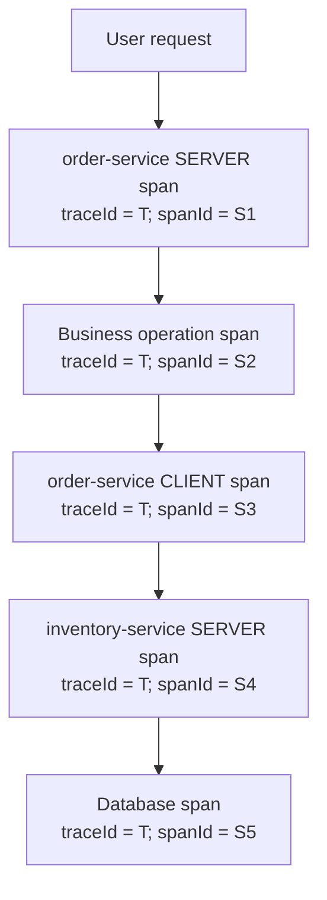
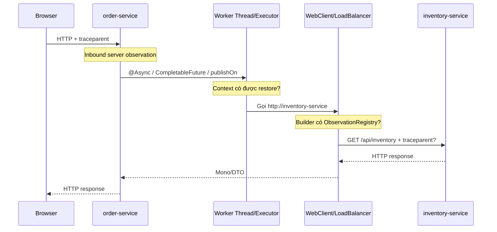

# Kiểm tra mất trace khi đổi luồng hoặc dùng reactive pipeline

## 1. Bài toán: HTTP thành công nhưng trace bị đứt

Trong chương **Quan sát hệ thống** của module `SPRING_CLOUD_SERVICE_COMMUNICATION_LOAD_BALANCING`, chúng ta quan sát các lời gọi từ `order-service` đến `inventory-service`. Spring Cloud LoadBalancer tra `ServiceInstance` theo service ID, dùng discovery/health/routing chọn bản sao, rồi `RestClient`, `WebClient` hoặc OpenFeign thực hiện HTTP. Ngoài thời gian phản hồi và lỗi, một hệ thống vận hành tốt phải xác định được **request nào tại caller đã dẫn tới request nào ở downstream**, kể cả khi chuyển thread, retry hoặc chạy pipeline reactive.

Giả sử log ban đầu:

```text
2026-11-17 10:00:00.010 INFO [order-service,traceId=7e2...,spanId=91a...] accept order
2026-11-17 10:00:00.015 INFO [order-service,traceId=,spanId=] query inventory on parallel-2
2026-11-17 10:00:00.029 INFO [inventory-service,traceId=4b1...,spanId=8c3...] GET /api/inventory
```

Nhìn từ nghiệp vụ, lời gọi vẫn thành công. Nhưng thông tin `traceId` trong log ở giữa bị rỗng và downstream xuất hiện một trace ID mới. Nhóm vận hành không còn xem được một cây span xuyên suốt `user → order → inventory`.

Có nhiều nguyên nhân độc lập:

1. `MDC` chứa `traceId` là **ThreadLocal**, nhưng code đổi sang thread khác mà không chuyển ngữ cảnh.
2. Reactor xử lý `Mono`/`Flux` bằng cơ chế **subscription và Reactor Context**; cố đọc ngữ cảnh bằng `ThreadLocal` trong mọi operator mà chưa cấu hình context propagation sẽ không đáng tin.
3. HTTP client được tạo bằng builder thủ công và **không có observation instrumentation**, nên không gắn `traceparent` lên outbound request.
4. Một đoạn code gọi `subscribe()` thủ công, tạo một reactive flow độc lập, tách lifecycle và propagation của request cha.
5. Có span thực sự nhưng không xuất ra backend do **sampling, exporter, collector hoặc retention**, không phải do thread switch.

**Mục tiêu bài học:** phân biệt các loại “mất trace”, sử dụng đúng `Micrometer Tracing`/`ObservationRegistry`/`Reactor Context`, bảo toàn correlation khi chuyển thread và khi gọi theo service ID, rồi kiểm chứng bằng log, header, span và phép thử tái hiện được.

## 2. Một trace gồm những gì?

| Thành phần | Ý nghĩa | Cách dùng đúng |
|---|---|---|
| **Trace ID** | Định danh một luồng xử lý phân tán | Các span liên quan trong cùng trace thường cùng `traceId` |
| **Span ID** | Định danh một span cụ thể | Thay đổi giữa server span, client span và custom span; **không** phải lỗi nếu khác nhau |
| **Parent span** | Span cha của span hiện tại | Giúp dựng cây quan hệ; không nhất thiết nằm trong cùng JVM |
| **Trace context** | Thông tin span hiện tại, sampling flag, tracestate và propagation | Phải chuyển qua thread/reactive và qua HTTP boundary |
| **MDC** | Bản đồ key/value gắn với **thread hiện tại** để format log | `traceId`/`spanId` trong MDC chỉ là **biểu diễn tại thời điểm log**, không phải nguồn chân lý duy nhất |
| **Observation** | Vòng đời đo lường của Micrometer: start, scope, stop, error | Có thể kích hoạt metrics/tracing qua `ObservationHandler` phù hợp |
| **Reactor Context** | Context bất biến gắn với **subscriber** trong `Mono`/`Flux` | Dùng cho dữ liệu ngữ cảnh trong reactive chain; không phụ thuộc cố định vào một thread |
| **W3C traceparent** | Header truyền trace context giữa các tiến trình | Phải được tạo/đọc theo tracer + propagation instrumentation, không tự lấy từ query param |

Ví dụ một HTTP request với propagation W3C:

```http
GET /api/inventory/ABC-1 HTTP/1.1
Host: inventory-service
traceparent: 00-4bf92f3577b34da6a3ce929d0e0e4736-00f067aa0ba902b7-01
```

Trong `traceparent`, phần trace ID có 32 ký tự hex, parent/span ID có 16 ký tự hex và `01` là flags ví dụ. Header có mặt **không tự bảo đảm** trace được ghi vào Zipkin/Tempo/Jaeger; sampling và exporter vẫn có thể loại hoặc làm rơi span. Không sử dụng `traceparent` như bằng chứng danh tính hay quyền người dùng.

### 2.1. Span ID khác nhau là điều bình thường

Sơ đồ một trace đúng:



**Không yêu cầu `spanId` giống nhau giữa hai service hoặc sau khi thêm custom observation.** Điều cần kiểm tra là trace ID được liên kết đúng, parent/child hoặc link đúng ngữ nghĩa, và span của downstream không vô tình trở thành một root trace không liên quan.

### 2.2. Bốn câu hỏi chẩn đoán

- **MDC rỗng nhưng trace backend vẫn nối cây?** Có thể chỉ mất log correlation ở một operator/thread.
- **MDC có trace ID nhưng backend có hai root traces khác nhau?** Có thể đã copy MDC thủ công nhưng HTTP propagation không đúng.
- **HTTP `traceparent` đúng nhưng không thấy span?** Kiểm tra sampling/exporter/collector, không kết luận ngay Reactor Context hỏng.
- **Có service spans nhưng thiếu custom business span?** Kiểm tra observation lifecycle, scope, AOP và việc publisher được subscribe hay không.

## 3. Bốn ranh giới khiến context dễ bị mất



| Ranh giới | Cơ chế truyền | Dấu hiệu khi hỏng |
|---|---|---|
| HTTP inbound vào `order-service` | HTTP server observation/extractor đọc trace headers | Caller tạo root mới hoặc không có server span |
| `order-service` → executor/`@Async` | Context Propagation snapshot, `TaskDecorator` | Log trên worker thread mất `traceId` |
| Reactor operator → operator | `Reactor Context` và bridge tới ThreadLocal khi cần | `MDC.get("traceId")` ở một số operator rỗng |
| Caller → HTTP outbound | Instrumented `RestClient`/`WebClient`/Feign và propagator | Inventory bắt đầu trace mới do thiếu/sai `traceparent` |
| Inventory inbound → business logic | Resource server/observation + app context | Có server span nhưng nội bộ mất correlation |

**Spring Cloud LoadBalancer không phải bộ truyền trace context.** Nó thay URL logic thành `host:port` instance được chọn. Tracing outbound phải được gắn vào HTTP client và observation instrumentation phù hợp. Cùng một service ID có thể chọn instance khác ở retry, nhưng các attempts thuộc cùng logical request nên được quan sát/correlate qua trace và attempt metadata.

## 4. Bật tracing cho một baseline có thể kiểm chứng

Ví dụ sau dùng **Spring Boot 3.5.x + Spring Cloud Release Train tương thích** (API và property phải kiểm tra theo BOM đang chạy). Với Spring Boot 3.x, tracing qua Spring Boot Actuator, Micrometer Tracing bridge và exporter; **không** dùng lẫn dependency/auto-config của Spring Cloud Sleuth 3.x hay property của Boot 4 nếu chưa nâng stack.

### 4.1. Dependency Maven minh họa dùng OpenTelemetry bridge và Zipkin exporter

```xml
<dependencies>
    <dependency>
        <groupId>org.springframework.boot</groupId>
        <artifactId>spring-boot-starter-actuator</artifactId>
    </dependency>

    <dependency>
        <groupId>io.micrometer</groupId>
        <artifactId>micrometer-tracing-bridge-otel</artifactId>
    </dependency>

    <dependency>
        <groupId>io.opentelemetry</groupId>
        <artifactId>opentelemetry-exporter-zipkin</artifactId>
    </dependency>

    <dependency>
        <groupId>io.micrometer</groupId>
        <artifactId>context-propagation</artifactId>
    </dependency>
</dependencies>
```

Dùng BOM Spring Boot quản lý phiên bản; bổ sung `spring-boot-starter-webflux` hoặc `spring-boot-starter-web` và `spring-cloud-starter-loadbalancer` tùy project. Trong Spring Boot 4.x, tài liệu hiện hành cung cấp các starter khác (ví dụ `spring-boot-starter-opentelemetry`/`spring-boot-starter-zipkin`); không copy dependency Boot 3.x vào Boot 4 mà không kiểm tra migration.

Để xem trace trong bài lab, chạy collector/backend (ví dụ Zipkin) hoặc điểm thu thập mà hệ thống đang dùng. **Exporter phải hoạt động và có quyền kết nối.** Có thư viện tracing nhưng không có exporter/backend thì vẫn có thể thấy MDC/correlation local mà không thấy trace trên UI.

### 4.2. Cấu hình minh họa cho môi trường thử nghiệm

```yaml
spring:
  application:
    name: order-service
  reactor:
    context-propagation: auto

management:
  tracing:
    sampling:
      probability: 1.0
  zipkin:
    tracing:
      endpoint: http://localhost:9411/api/v2/spans
```

Giải thích:

- `spring.application.name` giúp phân biệt service trong log và trace backend.
- `spring.reactor.context-propagation=auto` bật chế độ khôi phục ThreadLocal ở reactive operators trong Spring Boot 3.5 khi Micrometer Context Propagation có mặt.
- `management.tracing.sampling.probability=1.0` chọn 100% traces để **chẩn đoán trong lab**, giúp tránh nhầm sampling với propagation.
- `management.zipkin.tracing.endpoint` trỏ tới collector Zipkin tương thích; ví dụ chạy trên `localhost` cùng network namespace.

**Không giữ sampling 100% mặc định cho production lớn** nếu chưa cân nhắc chi phí/lưu lượng và chính sách sampling. Xác minh default và cách sampling parent-based theo version + backend. Nếu backend dùng OTLP/OpenTelemetry Collector, cấu hình exporter/endpoint tương ứng thay vì vẫn dùng URL Zipkin.

Trong Spring Boot 3.x, correlation log thường dựa trên `traceId`/`spanId` trong MDC khi có Micrometer Tracing. Không dùng duy nhất sự xuất hiện của `%X{traceId}` để kết luận HTTP spans đã được xuất.

### 4.3. Kiểm tra sampling trước khi sửa context code

| Hiện tượng | Kết luận chưa được phép | Kiểm tra thêm |
|---|---|---|
| Một số request không có trong Zipkin | “Reactor làm mất context” | Sampling probability, parent flag, collector, queue/batch exporter |
| Zipkin có span nhưng log không có trace ID | “Không có trace” | Correlation pattern và scope/MDC trên thread tại thời điểm log |
| Cả log và backend không có span | “Chắc chắn LoadBalancer hỏng” | Có tracing bridge/exporter, instrumentation, app context, HTTP server observation? |
| Sau bật `probability=1.0` vẫn thiếu span | “Sampling đã được sửa mọi thứ” | Propagation, exporter connectivity, filter ordering và async |
| Backend có nhiều root spans cùng thời điểm | “Span ID phải giống nhau” | So sánh trace IDs/parent relation và outbound `traceparent` |

## 5. Spring Cloud LoadBalancer và HTTP client cần được instrument

### 5.1. Đường gọi theo service ID

Cấu hình `SimpleDiscoveryClient` cho lab:

```yaml
spring:
  cloud:
    discovery:
      client:
        simple:
          instances:
            inventory-service:
              - uri: http://localhost:8081
                instance-id: inventory-a
              - uri: http://localhost:8082
                instance-id: inventory-b
    loadbalancer:
      retry:
        enabled: false
      stats:
        micrometer:
          enabled: true
```

`localhost` chỉ dành cho bài lab chạy cùng máy/network namespace. Ở Docker/Kubernetes phải dùng địa chỉ mà caller truy cập được. **LoadBalancer metrics không tự bằng distributed tracing**: `MicrometerStatsLoadBalancerLifecycle` có thể tạo các meter như `loadbalancer.requests.success`, `failed`, `discard`, nhưng chúng không tự thay thế HTTP client/server spans.

### 5.2. Bẫy tự tạo WebClient.Builder

Cấu hình sau **có thể mất Boot customizers**, gồm observation configuration, nếu chỉ tạo builder mới mà không áp customizer cần thiết:

```java
// Dễ bị thiếu tracing/observation customization của Spring Boot.
@Bean
@LoadBalanced
WebClient.Builder loadBalancedWebClientBuilder() {
    return WebClient.builder();
}
```

Với Spring Boot, hãy đảm bảo builder dùng cho LoadBalancer **vừa có filter LoadBalancer vừa được Boot customizers áp dụng**. Một pattern minh họa cho Spring Boot 3.x:

```java
import org.springframework.beans.factory.ObjectProvider;
import org.springframework.boot.web.reactive.function.client.WebClientCustomizer;
import org.springframework.cloud.client.loadbalancer.LoadBalanced;
import org.springframework.context.annotation.Bean;
import org.springframework.context.annotation.Configuration;
import org.springframework.web.reactive.function.client.WebClient;

@Configuration(proxyBeanMethods = false)
class InstrumentedWebClientConfiguration {

    @Bean
    @LoadBalanced
    WebClient.Builder loadBalancedWebClientBuilder(
            ObjectProvider<WebClientCustomizer> customizers) {

        WebClient.Builder builder = WebClient.builder();
        customizers.orderedStream()
                .forEach(customizer -> customizer.customize(builder));
        return builder;
    }
}
```

Lớp `WebClientCustomizer` ở đây là API Spring Boot 3.x. Pattern này áp customizers do Boot cung cấp lên builder tự tạo; điều kiện quan trọng là project thực sự có `ObservationRegistry` và cấu hình tracing hợp lệ, đồng thời Spring Cloud đăng ký reactive LoadBalancer filter cho `@LoadBalanced` builder.

Tránh vừa áp một observation filter custom **lần nữa** lên builder đã có instrumentation, vì có thể sinh span/metric trùng. Trên các bản Boot khác, xem lại cơ chế autoconfig/bean scope và thứ tự customizers; công thức trên là ví dụ cần kiểm thử chứ không bảo đảm cho mọi Release Train.

### 5.3. Gateway dùng builder đã instrument

```java
@Service
class InventoryGateway {

    private final WebClient client;

    InventoryGateway(@LoadBalanced WebClient.Builder builder) {
        this.client = builder.clone()
                .baseUrl("http://inventory-service")
                .build();
    }

    Mono<InventoryStock> get(String sku) {
        return client.get()
                .uri("/api/inventory/{sku}", sku)
                .retrieve()
                .bodyToMono(InventoryStock.class);
    }
}

record InventoryStock(
        String sku, int available, String instanceId) {}
```

Các import `@Service`, `Mono`, `WebClient` và `@LoadBalanced` được lược bỏ. Một GET từ `order-service` có thể chọn `inventory-a` hoặc `inventory-b`. Nếu HTTP client instrumentation đúng, outbound `traceparent` chứa trace ID liên quan đến inbound request, còn inventory resource server tạo server span cùng trace theo propagation format hỗ trợ.

**Không suy ra có trace chỉ vì `@LoadBalanced` hoạt động.** Hãy kiểm tra lần lượt: (1) URL resolve thành host instance, (2) HTTP request có trace propagation header, (3) inventory nhập cùng trace, (4) backend xuất đủ span.

### 5.4. RestClient và OpenFeign

Với `RestClient` (blocking), Spring Boot cũng khuyến nghị dựng client từ **auto-configured `RestClient.Builder`** hoặc đảm bảo `RestClientCustomizer`/observation settings được áp trên builder `@LoadBalanced`. Dùng `RestClient.builder()` và chỉ đặt base URL không chứng minh có tracing.

Với OpenFeign, Spring Cloud OpenFeign có `MicrometerObservationCapability` khi:

- `feign-micrometer` nằm trên classpath;
- có bean `ObservationRegistry`;
- thuộc tính `spring.cloud.openfeign.micrometer.enabled` và client-level property không tắt instrumentation.

```yaml
spring:
  cloud:
    openfeign:
      micrometer:
        enabled: true
```

Nếu `ObservationRegistry` không có và chỉ có `MeterRegistry`, integration có thể cung cấp `MicrometerCapability` cho **metrics-only**; không xem nó như một bảo đảm có tracing spans và HTTP propagation. Kiểm tra Feign capability và client-level config đúng phiên bản.

## 6. Vì sao ThreadLocal/MDC không tự đi theo thread switch?

Trong code imperative, logging framework thường dùng `MDC` gắn với **thread hiện tại**:

```java
log.info("before switch, traceId={}", MDC.get("traceId"));
```

Nếu task được gửi sang một worker thread của pool, worker thread đó là một thread khác. Không có cơ chế chuyển context, `MDC.get("traceId")` có thể là `null` hoặc — nếu code copy sai và không cleanup — giá trị còn sót từ request trước.

```mermaid
flowchart LR
  A["http-nio-8080-exec-1\nMDC traceId=T"] -->|submit()| B["app-worker-3\nMDC chưa có T"]
  B --> C["Log thiếu traceId\nhoặc gắn sai request"]
  A -->|capture + restore scope| D["decorated executor\nMDC traceId=T khi task chạy"]
```

Đây là vấn đề **context propagation**, không phải chỉ cấu hình pattern log. Tự thêm `%X{traceId}` vào log format không chuyển ThreadLocal sang executor.

### 6.1. Ví dụ @Async làm mất trace khi executor chưa được trang bị

```java
@Service
class StockAuditService {

    @Async("stockExecutor")
    CompletableFuture<Void> audit(String sku) {
        log.info("audit sku={}, traceId={}",
                sku, MDC.get("traceId"));
        return CompletableFuture.completedFuture(null);
    }
}
```

Nếu `stockExecutor` không có context propagation, trace ID có thể rỗng trên thread xử lý `audit`. `@Async` phải được bật và method phải được gọi qua proxy Spring phù hợp; tự gọi phương thức `@Async` trong cùng instance có thể không thực sự đổi thread, dẫn tới phép thử sai.

### 6.2. Dùng ContextPropagatingTaskDecorator

Với Spring Boot 3.5/Spring Framework 6.x, cấu hình executor riêng có `ContextPropagatingTaskDecorator`:

```java
@Configuration(proxyBeanMethods = false)
@EnableAsync
class StockExecutorConfiguration {

    @Bean(name = "stockExecutor")
    ThreadPoolTaskExecutor stockExecutor() {
        ThreadPoolTaskExecutor executor = new ThreadPoolTaskExecutor();
        executor.setThreadNamePrefix("stock-audit-");
        executor.setCorePoolSize(2);
        executor.setMaxPoolSize(4);
        executor.setQueueCapacity(100);
        executor.setTaskDecorator(
                new ContextPropagatingTaskDecorator());
        executor.initialize();
        return executor;
    }
}
```

TaskDecorator lấy context của thread **gửi task**, chuyển và khôi phục tại thread **thực thi task**, rồi cleanup khi task hoàn thành. Nó tránh giữ ngữ cảnh từ request trước trong thread pool.

Nếu dùng Boot auto-configured `AsyncTaskExecutor` thay vì executor tự tạo, tài liệu Spring Boot 3.5 còn minh họa đăng ký bean `ContextPropagatingTaskDecorator` để Boot áp vào executor. Với Spring Boot 4, có thêm property `spring.task.execution.propagate-context` theo phiên bản. **Không copy property Boot 4 rồi mong Boot 3.5 nhận nó.**

### 6.3. Không copy MDC thủ công mà không có try/finally

Anti-pattern:

```java
Map<String, String> copy = MDC.getCopyOfContextMap();
executor.execute(() -> {
    MDC.setContextMap(copy);  // Có thể null; không hề cleanup.
    doWork();
});
```

Điểm sai:

- `copy` có thể null, tùy logging implementation.
- Code không cleanup `MDC` cuối task; worker thread được pool tái sử dụng có thể rò correlation của request A sang B.
- Chỉ copy MDC **không** chuyển đầy đủ `Observation`, `Tracer`, baggage hoặc security context.
- Việc log hiện trace ID không chứng minh HTTP client outbound phát cùng trace ID.

Dùng `ContextPropagatingTaskDecorator`/`ContextSnapshot` thay vì tự xây cơ chế MDC riêng, trừ khi có lý do được kiểm thử đầy đủ.

## 7. CompletableFuture và ExecutorService tự quản lý

Khi dùng `CompletableFuture.supplyAsync(...)`, `ExecutorService.submit(...)` hoặc một SDK tạo task nội bộ, TaskDecorator của Spring **không tự áp dụng** nếu task chạy qua executor hoàn toàn độc lập.

Ví dụ lỗi điển hình:

```java
CompletableFuture.runAsync(() -> {
    log.info("trace in common pool={}", MDC.get("traceId"));
});
```

Common ForkJoinPool không tự được Spring Boot trang bị `ContextPropagatingTaskDecorator`. Muốn truyền context sang một `Executor` cụ thể, có thể capture ở **thời điểm submit task** bằng Micrometer Context Propagation:

```java
ContextSnapshot snapshot = ContextSnapshot.captureAll();

executor.execute(snapshot.wrap(() -> {
    log.info("inside propagated task, traceId={}",
            MDC.get("traceId"));
    runAudit();
}));
```

Ở đây `executor` là một `Executor` đã được cấp/quản lý lifecycle; `runAudit()` là method nghiệp vụ minh họa. `ContextSnapshot.wrap(Runnable)` tự mở/đóng scope khôi phục các `ThreadLocal` đã được đăng ký qua `ContextRegistry`.

**Điều kiện:** phải có `io.micrometer:context-propagation` và `ThreadLocalAccessor` thích hợp cho observation/tracing context. Snapshot chỉ chứa các giá trị có thể được capture từ thread gọi **tại thời điểm đó**. Nếu capture sau khi current observation đã kết thúc hoặc ở thread không có context, nó không thể “tạo lại trace cũ”.

### 7.1. Capture không đồng nghĩa tạo span

Context propagation **giữ parent/current context** khi task chạy. Nó không tự đảm bảo mỗi task có một span mới riêng. Nếu muốn một child span có ý nghĩa cho operation, instrument operation một cách có chủ đích bằng Micrometer Observation/Tracer ở đúng ranh giới lifecycle, thay vì giả định đổi thread là tạo một span.

### 7.2. Lưu task để chạy về sau cần ranh giới khác

Một task được lưu hàng giờ, đưa vào queue hoặc scheduled job ở ngày sau **không nên** giữ mãi live tracing scope/credentials của HTTP request ban đầu. Với xử lý async bền vững, nên truyền một **correlation/causation ID** trong event payload, và nếu cần **span link** đến trace gốc theo chuẩn OpenTelemetry; không giữ `ThreadLocal` hoặc span đang mở vô thời hạn.

## 8. Reactor Context: ngữ cảnh theo subscription, không theo thread

Spring WebFlux dùng `Mono`/`Flux`, nơi execution có thể nhảy qua các scheduler khi `publishOn`, `subscribeOn`, `flatMap` hoặc asynchronous I/O.

```java
Mono<InventoryStock> pipeline = gateway.get("ABC-1")
        .publishOn(Schedulers.boundedElastic())
        .doOnNext(stock ->
                log.info("sku={}, thread={}, traceId={}",
                        stock.sku(),
                        Thread.currentThread().getName(),
                        MDC.get("traceId")));
```

Nếu thiếu context propagation, `MDC.get("traceId")` ở `doOnNext` có thể null. Không dùng `Thread.currentThread().getName()` làm chứng cứ span nào là parent; thread là tài nguyên scheduling, **không** mang danh tính trace.

### 8.1. Context đi theo subscriber

Reactor `Context` là map bất biến về mặt API, gắn với subscriber. Giá trị `contextWrite` ảnh hưởng tới các operator **upstream** tương ứng, không đồng nghĩa toàn bộ JVM có thể đọc giá trị đó bằng `ThreadLocal`.

```java
Mono<String> readDiagnosticContext() {
    return Mono.deferContextual(ctx -> {
        String diagnosticId = ctx.getOrDefault(
                "diagnostic-id", "missing");
        return Mono.just(diagnosticId);
    });
}

Mono<String> result = readDiagnosticContext()
        .publishOn(Schedulers.parallel())
        .contextWrite(Context.of(
                "diagnostic-id", "request-123"));
```

Khi được subscribe, `readDiagnosticContext` có thể đọc `diagnostic-id=request-123` dù đổi scheduler. Đây chỉ là **khóa nghiệp vụ minh họa** của Reactor Context, **không phải** tự tạo W3C trace context. Đừng đưa raw access token, PII hoặc mật khẩu vào Reactor Context chỉ để debug trace.

### 8.2. ThreadLocal, Reactor Context và Observation

| Nguồn dữ liệu | Gắn với | Khi nào đọc được | Sai lầm thường gặp |
|---|---|---|---|
| `MDC.get("traceId")` | Thread hiện tại | Khi tracer/bridge đã restore MDC trong scope | Nghĩ MDC luôn tồn tại ở mọi operator |
| `Tracer.currentSpan()` | Current tracing scope | Khi observation/tracing context đã được restore | Nghĩ null là chắc chắn không có request |
| `ContextView#get(...)` | Subscriber | Bên trong `deferContextual`/operator hỗ trợ Context | Nghĩ context tự đi sang CompletableFuture không được bridge |
| `ObservationRegistry.getCurrentObservation()` | Current Observation scope | Khi scope đã được tạo/restore | Tạo new thread không chuyển scope |
| W3C `traceparent` | HTTP/message transport | Khi propagator inject/extract | Coi header là bằng chứng user authentication |

Spring Boot + Micrometer Context Propagation đóng vai trò **cầu nối** giữa các cơ chế. Reactor Context được xem là nguồn dữ liệu của subscriber; khi automatic mode bật, các ThreadLocal được đăng ký có thể được khôi phục trong lúc chạy operator trên những thread khác nhau.

## 9. Chế độ context propagation trong Reactor

Reactor Core 3.5+ có tích hợp Micrometer Context Propagation SPI. Có hai chế độ quan trọng:

- **Default/limited mode:** chỉ một số operator restore các ThreadLocal đã đăng ký; `MDC` không được hứa luôn sẵn trong mọi callback.
- **Automatic mode:** khôi phục ThreadLocal qua operator boundaries dựa trên Reactor Context, khi có `context-propagation` dependency và `ThreadLocalAccessor` phù hợp.

Trong Spring Boot 3.x, cách cấu hình được tài liệu hóa:

```yaml
spring:
  reactor:
    context-propagation: auto
```

Trong code Reactor thuần hoặc môi trường không dùng Boot auto-config, có API:

```java
Hooks.enableAutomaticContextPropagation();
```

**Chọn một cách quản lý chủ đạo**, không tùy tiện bật/tắt hook toàn cục giữa chừng. Theo tài liệu Reactor, hook chủ yếu ảnh hưởng tới các **subscription mới**; nên bật khi app khởi động, trước khi traffic chạy, không gọi nó mỗi lần nhận HTTP request.

### 9.1. contextCapture() khi chuyển từ imperative sang reactive

Nếu một `ThreadLocal` đang chứa context ở **thời điểm subscribe**, `contextCapture()` có thể đưa các giá trị đã đăng ký sang Reactor Context trong một số kịch bản. Ví dụ ý tưởng:

```java
Mono<String> pipeline = Mono.deferContextual(ctx ->
        Mono.just(ctx.hasKey("diagnostic-id")
                ? ctx.get("diagnostic-id")
                : "missing"))
        .contextCapture();
```

Ví dụ chỉ có giá trị khi một `ThreadLocalAccessor` đã được đăng ký cho key `diagnostic-id` và thread tại lúc subscribe đang có giá trị; bản thân chuỗi trên **không tự đăng ký accessor hay tạo context value**. Với ứng dụng Spring Boot có automatic mode và inbound HTTP tracing được instrument, việc capture/restore nhiều trường hợp đã được framework xử lý; không nên thêm `contextCapture()` một cách ngẫu nhiên như “thuốc chữa mọi mất trace”.

### 9.2. publishOn và subscribeOn khác nhau

| Toán tử | Hiệu ứng scheduling | Ý nghĩa đối với tracing |
|---|---|---|
| `publishOn(scheduler)` | Chuyển việc chạy các operator **downstream** sang scheduler | MDC chỉ còn sẵn nếu context được restore ở downstream |
| `subscribeOn(scheduler)` | Ảnh hưởng nơi subscription và upstream source được thực thi | Current scope tại lúc subscribe/capture quan trọng |
| `flatMap(inner)` | Kết hợp publisher có thể chạy bất đồng bộ, xen kẽ | Mỗi inner subscription cần giữ context; không dùng shared mutable MDC |
| `parallel().runOn(scheduler)` | Tạo nhiều rails chạy đồng thời | Trace không gắn với một thread cố định; test từng rail |
| `delayElement`/`Mono.delay` | Tín hiệu tới trên scheduler khác | Nếu log mất context, kiểm tra hook và placement |
| `retryWhen` | Subscribe lại publisher khi lỗi phù hợp | Trace của attempts cần được quan sát, không giả cùng span ID |

`contextWrite` và composition nên được kiểm tra theo cách operator thực sự subscribe, không chỉ đọc thứ tự viết từ trên xuống. Với pipeline có nhiều subscription, thêm `cache()`/`share()` có thể thay đổi số HTTP requests và span; đừng quy mọi thay đổi trace count cho LoadBalancer.

## 10. Bẫy subscribe() thủ công làm tách lifecycle

Anti-pattern trong WebFlux controller:

```java
@GetMapping("/bad/{sku}")
Mono<String> bad(@PathVariable String sku) {
    gateway.get(sku)
            .publishOn(Schedulers.boundedElastic())
            .subscribe(stock ->
                    log.info("detached inventory={}", stock.sku()));
    return Mono.just("accepted");
}
```

Vấn đề:

- `subscribe()` kích hoạt một subscription độc lập ngay trong controller, không gắn lifecycle với HTTP response publisher.
- Client có thể nhận `accepted` trước khi gọi inventory hoàn tất hoặc lỗi.
- Error callback không được kiểm soát, cancellation của inbound request không nhất thiết hủy outbound.
- Context có thể bị capture từ scope sai thời điểm, khiến span con/root không đúng.
- Không có backpressure/timeout được quản lý cùng request logic.

Cách tốt hơn khi HTTP API phải **chờ inventory**:

```java
@GetMapping("/good/{sku}")
Mono<String> good(@PathVariable String sku) {
    return gateway.get(sku)
            .map(stock -> "available=" + stock.available())
            .doOnNext(answer ->
                    log.info("answer assembled: {}", answer));
}
```

WebFlux runtime subscribe vào publisher được controller trả về. Observation của server request và các operator có cơ hội chia sẻ context đúng; outbound WebClient được instrument sẽ inject trace headers. Không gọi `block()` trên WebFlux event loop để “giữ trace”: blocking làm giảm khả năng xử lý và có thể gây lỗi runtime.

**Ngoại lệ có chủ đích:** fire-and-forget là thiết kế bất đồng bộ riêng, phải có message broker/job queue, error handling, correlation context và lifecycle sở hữu rõ. Không thay nó bằng `subscribe()` bỏ mặc trong controller.

## 11. Instrument business operation mà không tạo span sai lifecycle

Nếu chỉ dựa vào HTTP server/client spans, bạn có thể chưa thấy thời gian dành cho một đoạn domain logic. Micrometer `ObservationRegistry` cho phép tạo observation có tên ổn định.

### 11.1. Code imperative

```java
@Service
class InventoryDecisionService {

    private final ObservationRegistry registry;

    InventoryDecisionService(ObservationRegistry registry) {
        this.registry = registry;
    }

    boolean decide(InventoryStock stock) {
        return Observation.createNotStarted(
                        "inventory.business.decision", registry)
                .lowCardinalityKeyValue(
                        "operation", "availability-check")
                .observe(() -> stock.available() > 0);
    }
}
```

`Observation#observe(...)` tự quản lý start/scope/stop trong đường imperative. Với tracing handler/bridge phù hợp, observation có thể tạo span con; với metrics handler, nó có thể tạo metric. Đừng đưa SKU/user ID/raw URL vào **low-cardinality metric tags**, vì cardinality tăng và có thể lộ dữ liệu.

### 11.2. Reactive phải gắn lifecycle với subscription

Sai về lifecycle:

```java
// SAI: observation có thể kết thúc trước khi HTTP publisher hoàn tất.
Mono<InventoryStock> read(String sku) {
    return Observation.createNotStarted(
            "inventory.read", registry)
            .observe(() -> gateway.get(sku));
}
```

`observe(() -> gateway.get(sku))` ở đây chỉ quan sát **thời gian tạo Mono**, không phải thời gian HTTP được thực hiện khi subscribe. Nếu cần span đo đúng thời gian của publisher, hãy dùng instrumentation reactive hỗ trợ Reactor observation, ví dụ `reactor-core-micrometer` và operator `tap(Micrometer.observation(registry))` theo Reactor version/BOM:

```java
Mono<InventoryStock> readObserved(String sku) {
    return gateway.get(sku)
            .name("inventory.read")
            .tap(Micrometer.observation(registry));
}
```

Đoạn này yêu cầu `reactor-core-micrometer` và import `reactor.core.observability.micrometer.Micrometer` phù hợp. Tính năng/overload khác theo Reactor version; cần xác minh các observation handler, đặc biệt khi đã có HTTP client span tự động để tránh tạo các span trùng ý nghĩa. Không tạo thêm một span chỉ để log một dòng.

### 11.3. Scope và cleanup là bắt buộc

Nếu mở observation scope thủ công trong code blocking, luôn đóng bằng try-with-resources và stop observation đúng một lần, kể cả khi ném exception:

```java
Observation observation =
        Observation.start("inventory.validation", registry);
try (Observation.Scope scope = observation.openScope()) {
    validateInventory();
}
catch (RuntimeException ex) {
    observation.error(ex);
    throw ex;
}
finally {
    observation.stop();
}
```

`validateInventory()` là logic minh họa. Không mở scope trong callback reactive rồi giữ mở qua nhiều asynchronous emissions nếu chưa quản lý đúng lifecycle; nó có thể kết thúc trên thread khác hoặc rò ThreadLocal khi thread được reuse.

## 12. HTTP propagation qua RestClient, WebClient và OpenFeign

### 12.1. Bảng trách nhiệm

| Client | Cấu hình cần có | Dấu hiệu outbound đúng | Bẫy |
|---|---|---|---|
| `RestClient` | Builder từ Boot auto-config hoặc đầy đủ customizers; `@LoadBalanced` nếu dùng service ID | `traceparent`/B3 theo propagator config trên request | Tự tạo `RestClient.create(...)` rồi bỏ observation |
| `WebClient` | Builder đã instrument + reactive LoadBalancer + context propagation | W3C `traceparent` xuất hiện khi HTTP exchange được subscribe | `WebClient.create(...)` hoặc custom filter làm mất tracing |
| `RestTemplate` | `RestTemplateBuilder`/auto instrumentation theo Boot version + `@LoadBalanced` | Trace header trên downstream call | `new RestTemplate()` không có ObservationInterceptor |
| OpenFeign | `feign-micrometer` + `ObservationRegistry` + `MicrometerObservationCapability` | Client observation/span và trace propagation | Chỉ bật `MicrometerCapability` metrics-only |
| Custom HTTP client | Instrumentation/propagator riêng | Trace header đúng trên wire | MDC copy không đủ |

Đường đi khi dùng service ID:

```text
order-service SERVER observation
  -> current trace context / Reactor Context
  -> instrumented WebClient/RestClient/Feign
  -> Spring Cloud LoadBalancer resolves inventory-service
  -> HTTP CLIENT observation + inject traceparent
  -> inventory-service HTTP SERVER observation extracts traceparent
  -> business operation spans
```

Không nhất thiết span client là con trực tiếp của server span nếu có custom business spans hoặc intermediate filters. **Cùng trace ID và quan hệ parent/link đúng** mới là mục tiêu.

### 12.2. Không tự truyền traceId bằng header X-Trace-Id

Có thể có header `X-Request-Id`/`X-Correlation-Id` cho mục đích vận hành, nhưng tự gắn:

```java
headers.set("X-Trace-Id", MDC.get("traceId"));
```

**không thay thế** W3C propagation. Một string trace ID không chứa đầy đủ parent span, sampling state, tracestate và baggage; downstream không thể khôi phục cây span chuẩn chỉ từ header tùy ý này. Hãy để tracer/instrumented HTTP client inject/extract `traceparent` (hoặc B3 khi hệ thống thống nhất).

### 12.3. Nếu dùng B3 và W3C pha trộn

Hai service có thể dùng propagation formats khác nhau (`traceparent` W3C, `b3` hoặc `X-B3-*`). Nếu downstream chỉ đọc B3 nhưng caller chỉ tạo W3C, downstream có thể bắt đầu root trace mới dù header W3C tồn tại. Phải thống nhất **consume/produce propagation types** theo Boot/tracer và giai đoạn migration.

Không bật mọi format không giới hạn một cách mù quáng: có thể gây xung đột/duplication, ảnh hưởng mạng hoặc chính sách trust. Test chính xác header được inject, extractor nhận và span IDs trong backend.

## 13. Trace biến mất sau retry hoặc scheduler: chẩn đoán theo attempt

Spring Cloud LoadBalancer có thể chọn một instance mới khi retry, nhưng một **logical request** có thể gồm nhiều HTTP attempts. Khi lập trace:

- Ghi **logical correlation ID** ổn định cho request.
- Mỗi HTTP attempt có thể có **client span riêng**, span ID khác nhau là hợp lệ.
- Khi retry, `traceId` nên được nối với logical request hiện tại nếu retry nằm trong context của nó.
- Nếu retry được chạy trong một scheduled task độc lập, queue hoặc callback không mang context, nó có thể xuất hiện thành root trace khác; cần truyền context theo chính sách.
- Khi LoadBalancer không tìm được instance, có thể **không tồn tại HTTP client/server exchange thực tế**. Đừng đòi có inventory server span cho attempt đã bị discard trước HTTP.

### 13.1. LoadBalancer metrics khác trace spans

Spring Cloud Commons có `MicrometerStatsLoadBalancerLifecycle`, bật bằng:

```yaml
spring:
  cloud:
    loadbalancer:
      stats:
        micrometer:
          enabled: true
```

Một số meter được tài liệu hóa:

| Meter | Mô tả |
|---|---|
| `loadbalancer.requests.active` | Số request đang được xử lý qua LoadBalancer tại thời điểm quan sát |
| `loadbalancer.requests.success` | Thời gian của những request được tính là thành công theo lifecycle |
| `loadbalancer.requests.failed` | Thời gian của request kết thúc lỗi theo lifecycle |
| `loadbalancer.requests.discard` | Số request bị loại vì không chọn được instance |

Các tên/nhãn phụ thuộc version và thành phần instrumentation; `failed` không đồng nghĩa HTTP 5xx từ server trong mọi trường hợp, cũng không bảo đảm có trace/span trong backend. Với URI chứa SKU/order ID, tránh nhãn path có cardinality cao; khi cần, dùng `spring.cloud.loadbalancer.stats.include-path=false` theo Spring Cloud Commons hỗ trợ.

### 13.2. Retry có thể bị quan sát trùng

Nếu bật retries ở Spring Cloud LoadBalancer, Reactor `retryWhen`, OpenFeign `Retryer` và gateway, mỗi lớp có thể tạo attempts riêng. Khi một HTTP request chạy lại, bạn có thể thấy nhiều client spans trong cùng trace hoặc cả trace mới nếu async context không được chuyển. Dùng attempt count, service ID và instance ID trong trace/log để phân biệt retry hợp lệ với duplicate subscription ngoài ý muốn.

**Đừng “chữa thiếu trace” bằng cách tắt retry hoặc ép luôn chọn cùng instance**. Sửa đúng propagation giữa asynchronous boundaries và HTTP instrumented client.

## 14. Lab tái hiện: hai instance và các điểm đổi thread

### 14.1. Topology

| Thành phần | Cổng ví dụ | Vai trò |
|---|---:|---|
| `order-service` | 8080 | HTTP inbound + WebClient + LoadBalancer |
| `inventory-a` | 8081 | HTTP server có tracing |
| `inventory-b` | 8082 | HTTP server có tracing |
| Zipkin/collector | 9411 | Thu thập và xem spans trong lab |

`order-service` cấu hình `SimpleDiscoveryClient` như mục 5.1; cả ba service có tracing bridge/exporter tương thích. Dùng sampling `1.0` **chỉ trong lab**. Nếu chạy trong container, sửa hostname/port của registry, collector và service instances theo network thực.

Ở inventory, một endpoint demo:

```java
@RestController
class InventoryController {

    private final String instanceId;

    InventoryController(Environment env) {
        instanceId = env.getRequiredProperty("app.instance-id");
    }

    @GetMapping("/api/inventory/{sku}")
    InventoryStock get(@PathVariable String sku) {
        log.info("inventory instance={} sku={}", instanceId, sku);
        return new InventoryStock(sku, 12, instanceId);
    }
}
```

Chạy A với `app.instance-id=inventory-a`, B với `inventory-b`. Cả hai phải có cùng propagation format và backend exporter, nếu không trace có thể lệch theo instance. Ghi `instanceId` ở server log để phân biệt lỗi context với lỗi chọn instance.

### 14.2. Controller ba tình huống

Ví dụ dùng `InventoryGateway` đã tạo ở mục 5.3:

```java
@RestController
@RequestMapping("/demo/trace")
class TraceDemoController {

    private final InventoryGateway gateway;

    TraceDemoController(InventoryGateway gateway) {
        this.gateway = gateway;
    }

    @GetMapping("/baseline/{sku}")
    Mono<InventoryStock> baseline(@PathVariable String sku) {
        log.info("baseline controller");
        return gateway.get(sku)
                .doOnNext(stock ->
                        log.info("baseline done {}", stock.instanceId()));
    }

    @GetMapping("/switch/{sku}")
    Mono<InventoryStock> switchThread(@PathVariable String sku) {
        return gateway.get(sku)
                .publishOn(Schedulers.boundedElastic())
                .doOnNext(stock ->
                        log.info("switch done thread={}, instance={}",
                                Thread.currentThread().getName(),
                                stock.instanceId()));
    }

    @GetMapping("/many/{sku}")
    Flux<InventoryStock> many(@PathVariable String sku) {
        return Flux.range(1, 3)
                .flatMap(i -> gateway.get(sku), 3);
    }
}
```

- `baseline`: một HTTP request từ order tới inventory; trace ID ở hai service phải được liên kết nếu tracing hoạt động.
- `switch`: vẫn một HTTP request, nhưng có `publishOn` trước log; xem trace ID/MDC trong log sau đổi thread.
- `many`: ba outbound GETs riêng lẻ. Có thể chọn nhiều instances và có nhiều client spans; không mong chỉ một span cho ba attempts. Cần giới hạn concurrency và đo đúng số request thực.

Thử bằng:

```bash
curl -i http://localhost:8080/demo/trace/baseline/ABC-1
curl -i http://localhost:8080/demo/trace/switch/ABC-1
curl -i http://localhost:8080/demo/trace/many/ABC-1
```

Không dùng `Thread.sleep` trên WebFlux event loop để “giữ trace”; nếu cần mô phỏng latency, dùng `Mono.delay`/`delayElement` và quan sát scheduler/context.

### 14.3. Thử tắt/bật automatic context propagation

Thực hiện hai lượt chạy (phải restart để cấu hình hook áp lên **subscription mới**):

**Lượt A — default/limited mode**:

```yaml
spring:
  reactor:
    context-propagation: limited
```

**Lượt B — automatic mode**:

```yaml
spring:
  reactor:
    context-propagation: auto
```

Đối chiếu property/value được hỗ trợ trong **Spring Boot version cụ thể**; ví dụ Boot 3.5 mô tả `auto` là lựa chọn bật automatic mode. Không chỉ dựa vào log MDC: so sánh cả trace tree, outbound `traceparent` và lượng traces được export. Một số bước có thể vẫn có context trong limited mode do framework operator đã instrument; kết quả phải đo thực chứ không giả định mọi log đều rỗng.

### 14.4. Thử @Async có và không có TaskDecorator

Cấu hình executor trước tiên **không có** `ContextPropagatingTaskDecorator`, gọi method `@Async("stockExecutor")` từ một request HTTP; ghi `MDC.get("traceId")` trước và trong worker. Sau đó thêm TaskDecorator và thử lại. Đảm bảo:

- Method được gọi qua Spring proxy thật, không self-invocation.
- Executor đang được dùng đúng tên, không rơi về common pool.
- Task được submit khi inbound observation còn active.
- Không kết luận chỉ từ một request; thử nhiều requests đồng thời để phát hiện rò MDC sang request khác.

### 14.5. Thử builder không được instrument

Tạm thay WebClient trong lab bằng `WebClient.create("http://inventory-service")` có thể khiến service ID đi qua DNS và thất bại **trước khi đo trace**. Muốn cô lập riêng lỗi tracing, có thể dùng URL vật lý `http://localhost:8081` (chỉ trong lab) với WebClient tự tạo: HTTP vẫn thành công, nhưng observation/propagation có thể không có.

Sau đó đổi lại `WebClient` được xây qua builder Boot-customized và LoadBalancer. So sánh request headers và span tree; đừng quy mọi lỗi `UnknownHostException` thành lỗi context.

## 15. Ma trận kiểm thử và kết quả cần chứng minh

| Mã | Tình huống | Điều cần kiểm chứng |
|---|---|---|
| T01 | Baseline một GET qua LoadBalancer | Có server/client spans liên kết, cùng trace ID theo chính sách sampling |
| T02 | `publishOn(boundedElastic)` | Log sau switch có trace ID khi auto propagation được bật |
| T03 | `subscribeOn(parallel)` | Context tại lúc subscription/capture đúng, không tạo root không chủ đích |
| T04 | `flatMap` ba HTTP GET | Ba HTTP attempts, các client spans có thể khác span ID nhưng liên quan trace |
| T05 | `@Async` không TaskDecorator | Có thể mất MDC/current observation trên worker |
| T06 | `@Async` có TaskDecorator | Correlation được restore rồi cleanup, không rò giữa request |
| T07 | `CompletableFuture.runAsync` common pool | Chứng minh TaskDecorator của Spring không tự áp vào executor khác |
| T08 | `ContextSnapshot.wrap(Runnable)` | Khôi phục đúng ngữ cảnh đã capture tại submit |
| T09 | HTTP client không được instrument | HTTP có thể chạy nhưng thiếu trace propagation/span |
| T10 | OpenFeign có/không `MicrometerObservationCapability` | Phân biệt tracing observation với metrics-only |
| T11 | Sampling `0.0` vs `1.0` | Có thể khác số traces trong backend dù ứng dụng vẫn chạy |
| T12 | Tracing exporter sai endpoint | Log local có thể có correlation nhưng collector không nhận span |
| T13 | Không có instance trong discovery | LoadBalancer discard, không kỳ vọng inventory server span |
| T14 | Bị HTTP 503 rồi retry sang replica khác | Span IDs khác nhưng logical request được nối trace/attempt rõ |
| T15 | Hai inbound requests đồng thời | Không rò trace ID của request A sang log của request B |
| T16 | Dừng inventory instance đang nhận request | Phân biệt transport exception với mất context và no-instance |
| T17 | `subscribe()` detached | Quan sát span lifecycle sai/thiếu error; sửa bằng trả publisher |
| T18 | Producer/consumer dùng W3C/B3 khác nhau | Downstream tạo trace mới nếu không extract được format caller |

**Tiêu chí PASS:** đo có thể tái hiện, trace tree và parent relation đúng khi kỳ vọng, không rò context giữa các request, và đã phân biệt rõ sampling/export lỗi với propagation. Một log “đủ traceId” chưa đủ chứng minh distributed tracing end-to-end.

### 15.1. Có thể test tự động mức nào?

- **Unit test:** kiểm tra `ContextSnapshot` và TaskDecorator bằng hai tasks có correlation khác nhau; sau task scope phải cleanup.
- **Spring Boot integration test:** khởi động HTTP server và client đã instrument; dùng test tracer/collector in-memory hoặc exporter test phù hợp với stack, không phụ thuộc Zipkin production.
- **End-to-end test:** dựng hai inventory replicas, client LoadBalancer và backend tracing, xác minh `traceparent` cùng trace ID và parent child/spans.
- **Load/concurrency test:** tạo nhiều requests song song để tìm MDC leak, mất context khi queue đầy hoặc trong retry.

Không ghi test “PASS” chỉ vì đã tạo `ObservationRegistry` bean; phải kiểm tra có `ObservationHandler`/tracer/exporter phù hợp và dữ liệu thực sự đến nơi.

## 16. Playbook kiểm tra khi trace bị đứt

Thực hiện theo thứ tự sau để tránh chữa nhầm nguyên nhân.

### Bước 1 — Xác định phạm vi “mất”

1. Có `traceId` trong log inbound `order-service` không?
2. Log ở operator sau `publishOn`/`@Async` có cùng trace ID không?
3. HTTP outbound có `traceparent` hoặc format tương đương không?
4. Inventory inbound có extract được context và liên kết trace không?
5. Backend có lưu/hiển thị spans không? Với sampling 1.0 trong lab thì sao?

Đừng sửa source code ngay nếu chỉ thiếu span trên UI nhưng network exporter đang mất kết nối.

### Bước 2 — Kiểm tra dependency và builder

- Có `spring-boot-starter-actuator` và tracing bridge/exporter hợp lệ không?
- Có `context-propagation` trên classpath và `ThreadLocalAccessor` đã đăng ký không?
- `WebClient`/`RestClient` có được tạo từ builder Boot-customized không?
- OpenFeign có `MicrometerObservationCapability` không, hay chỉ `MeterRegistry`?
- `@LoadBalanced` đã tích hợp đúng và không bị custom filter thay mất observation?

### Bước 3 — Kiểm tra điểm đổi thread

- Có `@Async`, `ThreadPoolTaskExecutor` tự tạo, `CompletableFuture`, `parallelStream` hay SDK async riêng?
- TaskDecorator/snapshot được capture **trước khi** chuyển thread hay capture sai thời điểm?
- Reactor đã bật `spring.reactor.context-propagation=auto` trong phiên bản Boot đang dùng chưa?
- Có code đọc trực tiếp `MDC`/`SecurityContextHolder` bên trong operator mà chưa khôi phục context không?
- Có `subscribe()` hoặc `block()` sai chỗ, làm lifecycle khác mong muốn không?

### Bước 4 — Kiểm tra đường truyền và sampling

- Caller tạo W3C `traceparent`, downstream hỗ trợ format đó chứ?
- Gateway/proxy có strip/overwrite `traceparent`/`tracestate` không?
- Trace parent sampling flag, `management.tracing.sampling.probability`, exporter sampling có phù hợp không?
- OTLP/Zipkin exporter có lỗi queue/network/auth/retention không?
- Có hạn chế thông tin nhạy cảm trong baggage/log tags không?

### Bước 5 — Kiểm tra LoadBalancer thực sự chọn ai

- Service ID đúng chưa? Có `ServiceInstance` nào?
- Health/cache/discovery có khiến chọn nhầm replica chưa instrument tracing không?
- 503 do server trả hay do caller không có instance?
- Retry có đổi instance, tạo thêm client spans hoặc bắt đầu subscription độc lập không?
- Có đo `loadbalancer.requests.discard`/HTTP client metrics và đối chiếu trace/log theo instance ID không?

### Bước 6 — Sửa có giới hạn, đo lại và rollback được

- Chỉ bật auto context propagation khi có hiểu rõ performance/compatibility và test tải.
- Trang bị TaskDecorator cho executor cần thiết; không thay mọi ThreadLocal bằng copy MDC thủ công.
- Khôi phục Boot customizers/ObservationRegistry trên HTTP client đã `@LoadBalanced`.
- Thống nhất propagation format giữa producer/consumer.
- Chạy lại T01–T18, so sánh metric missing-context, spans per request và trace completion rate.
- Kiểm tra khả năng hủy task, lỗi retry, leak và độ trễ tăng sau thay đổi.

## 17. Anti-pattern và câu trả lời đúng

| Anti-pattern | Vì sao sai | Cách đúng |
|---|---|---|
| `MDC.put("traceId", id)` ở mọi operator | Chỉ đổi text log; dễ leak, không tạo parent span | Để tracing bridge/context propagation quản lý scope |
| Tự sao chép `traceId` qua `X-Trace-Id` và bỏ W3C | Không có parent/sampling/tracestate | Dùng instrumented HTTP client với `traceparent` |
| Gắn `spanId` cố định cho mọi step | Các span khác nhau phải có ID riêng | So sánh trace ID và parent/child/link đúng |
| Cho rằng thread name chính là trace context | Một thread xử lý nhiều requests theo thời gian | Reactor Context và TaskDecorator |
| Dùng `WebClient.create` trên service ID rồi nghĩ có LB+tracing | Thiếu filter LB và Boot observation | Dùng builder có đầy đủ customizers và `@LoadBalanced` |
| Tắt sampling là cách giảm “mất trace” | Sampling ảnh hưởng export, không sửa propagation | Phân biệt sampling với context loss |
| Bật sampling 100% vô thời hạn | Tăng chi phí/tải backend | Chỉ lab/debug có kiểm soát, chọn sampling theo SLO |
| Gọi `subscribe()` thủ công trong controller | Tách lifecycle, error/cancellation và context | Trả `Mono`/`Flux` cho WebFlux |
| Gọi `block()` để giữ trace | Có thể chặn event loop và không khôi phục đúng | Dùng pipeline reactive + auto propagation |
| Tạo observation cho Mono tại assembly | Đo việc tạo publisher, không phải HTTP | Instrument operator tại subscription/lifecycle |
| Giữ observation scope mở qua thread khác | Rò ThreadLocal, sai parent span | Scope đúng thời gian, close trong finally |
| Chỉ copy MDC sang CompletableFuture | Không mang đầy đủ observation/tracing context | `ContextSnapshot`/decorated executor |
| Không cleanup worker thread | Request A dính trace ID request B | Dùng snapshot scope/TaskDecorator |
| Không có span inventory khi no-instance | Có thể không có HTTP request nào | Đo LB discard và trace caller lỗi |
| Gộp mọi retry attempt thành một event | Không biết request nào đã gửi thực tế | Attempt spans/attributes và logical correlation |
| Đặt SKU/user ID làm metric tag | Cardinality cao và rò dữ liệu | Tag operation/route template, chi tiết ở trace an toàn |
| Coi traceparent là token bảo mật | Header tracing không phải authentication | JWT/mTLS và authorization riêng |

## 18. Bài tập vận dụng

### Bài 1 — Xác định mất ở đâu

Cho log có inbound trace ID, operator sau `publishOn` thiếu trace ID, inventory lại có span đúng cùng trace. Hỏi mất **MDC trong operator** hay mất HTTP propagation? Cần chứng minh bằng trace tree và outbound header, không chỉ nhìn một dòng log.

### Bài 2 — So sánh hai builder

Tạo một WebClient qua `WebClient.create("http://localhost:8081")`, một qua Boot-customized builder. Giữ cùng URL vật lý để loại biến số discovery. Đo sự khác biệt ở `traceparent` và client spans; sau đó bật `@LoadBalanced` và đổi lại base URL `http://inventory-service`.

### Bài 3 — @Async và executor

Gọi `StockAuditService.audit` qua proxy từ một HTTP request. Thử executor không có và có `ContextPropagatingTaskDecorator`. Gửi 50 requests đồng thời, xác minh mỗi task mang đúng trace ID và không rò correlation giữa requests.

### Bài 4 — Reactor context và MDC

Tạo `Flux.range(1,10).publishOn(Schedulers.parallel()).flatMap(...)`. Bật/tắt `spring.reactor.context-propagation=auto` và so sánh `MDC.get("traceId")`, `deferContextual(...)` và trace backend. Giải thích vì sao Reactor Context và ThreadLocal không đồng nhất.

### Bài 5 — Sampling khác propagation

Giữ cùng code và HTTP client instrumented, lần lượt chọn sampling `0.0` và `1.0` trong lab. Kiểm tra `traceparent`, log correlation và số span xuất ra. Không khẳng định “mất context” chỉ từ kết quả UI của sampler.

### Bài 6 — Retry đổi instance

Dùng hai inventory replicas. Làm A trả 503, retry GET một lần để chọn lại. Ghi attempts, instance ID, client span IDs và trace ID. Giải thích tại sao số client spans có thể lớn hơn số logical requests và tại sao span ID khác là đúng.

### Bài 7 — Nhiều HTTP trong một Flux

So sánh `bodyToFlux` của một JSON array với `Flux.fromIterable(skus).flatMap(gateway::get)`. Đếm HTTP attempts, LoadBalancer selections và spans; giải thích vì sao nhiều phần tử **không** nhất thiết tương ứng nhiều HTTP exchanges.

### Bài 8 — CompletableFuture không thuộc Spring

Tạo task qua `CompletableFuture.runAsync` dùng common pool; so sánh với task chạy qua executor được capture bằng `ContextSnapshot.wrap(Runnable)`. Ghi thread, trace ID, thời điểm capture và kiểm tra cleanup.

### Bài 9 — W3C/B3 migration

Giả định caller chỉ tạo W3C `traceparent` và downstream chỉ đọc B3. Tái hiện downstream tạo trace mới, cấu hình propagator tiêu thụ/đầu ra tương thích theo stack và kiểm chứng không sinh hai root traces.

### Bài 10 — Phân biệt lỗi exporter

Chạy backend Zipkin trong lab rồi dừng backend khi ứng dụng vẫn hoạt động. Quan sát log local và HTTP headers tiếp tục có trace context, nhưng span không được lưu. Sửa đường exporter, kiểm tra recovery/queue; không sửa Reactor Context chỉ vì không có dữ liệu trên UI.

### Checklist hoàn thành

- [ ] Biết khác nhau giữa trace ID, span ID, MDC, Observation và Reactor Context.
- [ ] Kiểm tra được trace tree, không yêu cầu span ID giống nhau.
- [ ] Đã xác minh tracing bridge/exporter và sampling trước khi kết luận context loss.
- [ ] Dùng HTTP client đã instrument và có `@LoadBalanced` đúng.
- [ ] Có `ContextPropagatingTaskDecorator` cho executor/`@Async` dùng riêng.
- [ ] Không nghĩ TaskDecorator tự áp cho common pool hoặc SDK executor độc lập.
- [ ] Sử dụng `ContextSnapshot` đúng thời điểm khi chuyển thread tùy chỉnh.
- [ ] Hiểu `publishOn`, `subscribeOn`, `flatMap` và `contextWrite`.
- [ ] Có phương án auto propagation được kiểm thử và kích hoạt trước subscription.
- [ ] Không dùng `subscribe()` tách lifecycle trong WebFlux controller.
- [ ] Không đo reactive work bằng observation kết thúc tại lúc tạo publisher.
- [ ] Có test HTTP traceparent/parent relation xuyên order và inventory.
- [ ] Có ma trận retry, no-instance, 503, concurrency và sampling/exporter.
- [ ] Không đưa token/PII vào baggage, trace hoặc metric labels.
- [ ] Có runbook để phân biệt mất MDC, mất HTTP propagation và exporter drop.

## Tài liệu tham khảo chính thức

- [Spring Boot 3.5 — Observability: Context Propagation](https://docs.spring.io/spring-boot/3.5/reference/actuator/observability.html): `spring.reactor.context-propagation=auto`, `ContextPropagatingTaskDecorator` và các ranh giới thread.
- [Spring Boot 3.5 — Tracing](https://docs.spring.io/spring-boot/3.5/reference/actuator/tracing.html): Micrometer Tracing, bridge/exporter, sampling, correlation IDs và yêu cầu dùng auto-configured HTTP builders.
- [Spring Boot hiện hành — Tracing](https://docs.spring.io/spring-boot/reference/actuator/tracing.html): đối chiếu thay đổi của Boot 4.x, starter và exporter configuration.
- [Project Reactor — Context-Propagation Support](https://projectreactor.io/docs/core/release/reference/advanced-contextPropagation.html): `Hooks.enableAutomaticContextPropagation()`, limited/automatic mode, `contextCapture()` và ThreadLocal restoration.
- [Project Reactor — Adding a Context to a Reactive Sequence](https://projectreactor.io/docs/core/release/reference/advancedFeatures/context.html): `Context`, `ContextView`, `contextWrite` và subscriber semantics.
- [Micrometer Context Propagation — Purpose](https://docs.micrometer.io/context-propagation/reference/purpose.html): `ContextSnapshot`, `ContextRegistry` và `ThreadLocalAccessor`.
- [Micrometer — Observation](https://docs.micrometer.io/micrometer/reference/observation/introduction.html): start/stop/scope/error lifecycle, bridging sang tracing.
- [Spring Cloud Commons 4.3 — Spring Cloud LoadBalancer](https://docs.spring.io/spring-cloud-commons/reference/4.3/spring-cloud-commons/loadbalancer.html): `MicrometerStatsLoadBalancerLifecycle` và các meter `loadbalancer.requests.*`, supplier/lifecycle.
- [Spring Cloud OpenFeign — Micrometer Support](https://docs.spring.io/spring-cloud-openfeign/reference/spring-cloud-openfeign.html): `MicrometerObservationCapability` và phân biệt capability metrics-only.
- [W3C — Trace Context](https://www.w3.org/TR/trace-context/): `traceparent`, `tracestate` và wire propagation.
- [Spring Cloud — Release Train](https://spring.io/projects/spring-cloud/): kiểm tra Spring Boot/Spring Cloud compatibility trước khi copy cấu hình.

**Ghi nhớ:** mất `traceId` trong log sau `publishOn`/`@Async` không nhất thiết đồng nghĩa mất distributed trace, và thiếu span trên Zipkin không nhất thiết do Reactor. Hãy kiểm tra **context tại thread/operator**, **observation của HTTP client**, **header propagation giữa service**, và **sampling/exporter** theo thứ tự. Spring Cloud LoadBalancer quyết định instance đích; Micrometer/Context Propagation giúp giữ và phát tán trace đúng qua từng boundary.
