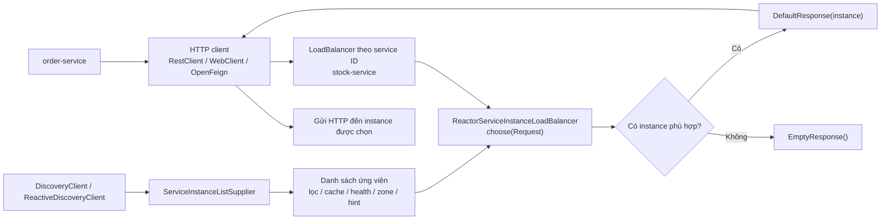

# Viết ReactorServiceInstanceLoadBalancer và hợp đồng chọn đích

## 1. Bài toán và mục tiêu

Giả sử `order-service` gọi `stock-service` theo service ID. Trong lúc triển khai từng phần, `stock-service` có hai instance:

| Instance | Metadata `traffic-weight` | Mong muốn định tuyến |
| --- | ---: | --- |
| `stock-a:8081` | `3` | Nhận khoảng 75% lượt chọn |
| `stock-b:8082` | `1` | Nhận khoảng 25% lượt chọn |

Thuật toán mặc định của Spring Cloud LoadBalancer thường là **Round Robin**, phù hợp để phân phối luân phiên giữa các instance. Nhưng một số tình huống cần thay đổi **quy tắc chọn đích**: ưu tiên instance theo trọng số, khu vực, khả năng xử lý hoặc đặc điểm nghiệp vụ. Lúc đó, ta có thể cung cấp một triển khai của `ReactorServiceInstanceLoadBalancer`.

Bài này nằm trong chương **Tùy biến LoadBalancer** của module `SPRING_CLOUD_SERVICE_COMMUNICATION_LOAD_BALANCING`, nơi người học tìm hiểu cân bằng tải phía client: lấy danh sách `ServiceInstance` qua discovery theo service ID, kết hợp health check và chính sách định tuyến; sau đó tích hợp với `RestClient`, `WebClient`, OpenFeign, timeout, retry và quan sát lỗi. Trọng tâm ở đây là **hợp đồng chọn đích**: cách một thuật toán sử dụng danh sách ứng viên rồi trả lời “gửi tới instance nào?”.

Học xong, bạn có thể:

1. Giải thích đầu vào và đầu ra của `choose(Request)`, phân biệt thành công, không có instance và lỗi truy xuất danh sách.
2. Viết một LoadBalancer tùy biến theo trọng số metadata, không thực hiện I/O chặn luồng trong phần chọn đích.
3. Đăng ký thuật toán **riêng cho một service ID** bằng `@LoadBalancerClient`.
4. Đảm bảo tương thích với chuỗi `ServiceInstanceListSupplier`, ngữ cảnh request và `SelectedInstanceCallback`.
5. Kiểm thử các trường hợp không có instance, một instance, metadata lỗi và phân phối xác suất; đọc kết quả đúng khi có retry/health check.

> **Phạm vi:** `ReactorServiceInstanceLoadBalancer` quyết định **instance sẽ được chọn**. Nó không tự gửi HTTP, không bảo đảm instance còn sống khi request đến, không chịu trách nhiệm retry và không thay thế timeout của client.

## 2. Kiến trúc: lấy ứng viên trước, chọn đích sau



Spring Cloud LoadBalancer thường tạo **child context cho mỗi service ID**. `ServiceInstanceListSupplier` là nguồn danh sách instance trong context đó. Một lớp discovery có thể lấy danh sách, rồi các lớp khác lọc theo zone/hint, quản lý cache hoặc health check. `ReactorServiceInstanceLoadBalancer` tiêu thụ danh sách đã được cung cấp và **chọn một instance** theo thuật toán.

Ví dụ: khi `stock-a` không còn trong danh sách mà supplier công bố, thuật toán không được tự “nhớ” instance A rồi tiếp tục trả nó. Nếu cả A/B đều không khả dụng, nó phải phản ánh tình huống **không có đích**. Ngược lại, có instance trong danh sách cũng chưa bảo đảm TCP/HTTP sẽ thành công vì trạng thái mạng có thể thay đổi giữa lúc chọn và lúc gửi.

## 3. Hợp đồng API của `ReactorServiceInstanceLoadBalancer`

Giao diện trọng tâm (lược bỏ chi tiết khác) là:

```java
public interface ReactorServiceInstanceLoadBalancer
        extends ReactorLoadBalancer<ServiceInstance> {
    // Phương thức được kế thừa từ ReactorLoadBalancer<T>:
    Mono<Response<ServiceInstance>> choose(Request request);
}
```

Trong mã thực tế, nhập interface từ `org.springframework.cloud.loadbalancer.core` và các loại `Request`/`Response` từ `org.springframework.cloud.client.loadbalancer`. Tên package và các API hỗ trợ có thể thay đổi giữa các dòng Spring Cloud; ví dụ bên dưới hướng tới Spring Cloud LoadBalancer hiện đại dùng Reactor và Java 17+.

| Thành phần | Vai trò | Điều phải bảo đảm |
| --- | --- | --- |
| `Request<?> request` | Ngữ cảnh từ client; có thể chứa thông tin về request HTTP, hint hoặc lần retry | Chuyển **chính request này** tới `supplier.get(request)` để giữ khả năng lọc theo context |
| `ServiceInstanceListSupplier` | Cấp `Flux<List<ServiceInstance>>`, có thể đã lọc ứng viên | Chỉ chọn từ danh sách được trả về; không bypass health/discovery |
| `Mono<Response<ServiceInstance>>` | Kết quả bất đồng bộ, hoàn tất một quyết định chọn | Khi được subscribe, phát ra một `Response` rõ ràng; không dùng `null` làm kết quả |
| `DefaultResponse` | Đã chọn thành công một instance | `hasServer() == true`, `getServer()` là ứng viên được chọn |
| `EmptyResponse` | Không có đích khả dụng trong kết quả danh sách | `hasServer() == false`; tầng gọi quyết định xử lý no-instance |
| `Mono.error(...)` | Có lỗi truy vấn danh sách hoặc lỗi cấu hình không thể tiếp tục | Để lỗi được truyền và ghi nhận; không âm thầm biến mọi exception thành “không có instance” |
| `SelectedInstanceCallback` | Cho phép một số supplier biết instance vừa được chọn | Gọi **nếu** supplier hỗ trợ callback và phản hồi có server |

Hai nhầm lẫn phổ biến:

- `supplier.get(request)` trả **Flux của các danh sách**, không phải `Flux<ServiceInstance>`. Dùng `.next()` để lấy một danh sách cho lần chọn hiện tại, rồi mới chọn một phần tử trong danh sách.
- `Mono.empty()` là **không phát ra `Response`**. Nó không thay thế một cách rõ ràng cho `new EmptyResponse()` khi danh sách rỗng hoặc supplier kết thúc mà không phát danh sách.

Trong ví dụ, ta dùng `Mono.defer(...)` để truy xuất supplier và rút thăm khi có subscription. Không dùng `.block()`, `Thread.sleep()`, HTTP I/O hay thao tác discovery đồng bộ trực tiếp trong `choose(...)`. Dù `RestClient` có thể là client blocking, lớp chọn đích ở đây vẫn thực hiện theo hợp đồng Reactor.

### 3.1. Hợp đồng không bao gồm retry hay chính sách health check

`choose(Request)` chỉ trả một kết quả chọn. Nếu request HTTP thất bại, tầng HTTP client/LoadBalancer có thể quyết định gọi lại `choose(...)` tùy policy và phiên bản; bản thân phương thức này không nên tự gửi lại request. Các thành phần như `HealthCheckServiceInstanceListSupplier`, `RetryAwareServiceInstanceListSupplier` hoặc bộ lọc zone/hint có thể thay đổi **tập ứng viên** mà thuật toán nhìn thấy.

Một số supplier dùng `SelectedInstanceCallback` để ghi nhớ instance vừa được chọn, phục vụ chính sách như ưu tiên instance đã chọn trước đó. Bỏ qua callback có thể làm sai hành vi của các supplier đó dù thuật toán vẫn trả về `DefaultResponse` hợp lệ.

## 4. Ví dụ hoàn chỉnh: `TrafficWeightLoadBalancer`

Ta xây dựng thuật toán **weighted random** theo metadata `traffic-weight`. Trong phạm vi ví dụ:

- Mỗi instance có trọng số nguyên từ **1 đến 100**; nếu metadata thiếu/không hợp lệ thì dùng `1`.
- Xác suất được chọn bằng `trọng số của instance / tổng trọng số`.
- Khi không có ứng viên: trả `EmptyResponse`.
- Khi không có `ServiceInstanceListSupplier` do cấu hình thiếu: phát lỗi cấu hình rõ ràng.
- Khi supplier phát lỗi: **cho lỗi truyền tiếp**; không “giấu” lỗi discovery bằng fallback ngầm.
- Sau khi chọn: báo cho `SelectedInstanceCallback` nếu supplier hỗ trợ.

**Mã Java (Java 17+):**

```java
package example.loadbalancer;

import java.util.List;
import java.util.Map;
import java.util.Objects;
import java.util.concurrent.ThreadLocalRandom;

import reactor.core.publisher.Mono;

import org.springframework.beans.factory.ObjectProvider;
import org.springframework.cloud.client.ServiceInstance;
import org.springframework.cloud.client.loadbalancer.DefaultResponse;
import org.springframework.cloud.client.loadbalancer.EmptyResponse;
import org.springframework.cloud.client.loadbalancer.Request;
import org.springframework.cloud.client.loadbalancer.Response;
import org.springframework.cloud.loadbalancer.core.ReactorServiceInstanceLoadBalancer;
import org.springframework.cloud.loadbalancer.core.SelectedInstanceCallback;
import org.springframework.cloud.loadbalancer.core.ServiceInstanceListSupplier;

public final class TrafficWeightLoadBalancer
        implements ReactorServiceInstanceLoadBalancer {

    private final ObjectProvider<ServiceInstanceListSupplier> supplierProvider;
    private final String serviceId;

    public TrafficWeightLoadBalancer(
            ObjectProvider<ServiceInstanceListSupplier> supplierProvider,
            String serviceId) {
        this.supplierProvider = Objects.requireNonNull(supplierProvider);
        this.serviceId = Objects.requireNonNull(serviceId);
    }

    @Override
    @SuppressWarnings("rawtypes")
    public Mono<Response<ServiceInstance>> choose(Request request) {
        return Mono.defer(() -> {
            ServiceInstanceListSupplier supplier =
                    supplierProvider.getIfAvailable();

            if (supplier == null) {
                return Mono.error(new IllegalStateException(
                        "Missing ServiceInstanceListSupplier for " + serviceId));
            }

            return supplier.get(request) // Giữ nguyên request context.
                    .next()               // Lấy List<ServiceInstance> đầu tiên.
                    .map(instances -> select(supplier, instances))
                    .switchIfEmpty(Mono.just(new EmptyResponse()));
        });
    }

    private Response<ServiceInstance> select(
            ServiceInstanceListSupplier supplier,
            List<ServiceInstance> instances) {

        if (instances.isEmpty()) {
            return new EmptyResponse();
        }

        long totalWeight = 0L;
        for (ServiceInstance instance : instances) {
            totalWeight += weight(instance);
        }

        // totalWeight > 0: mỗi instance có weight tối thiểu là 1.
        long ticket = ThreadLocalRandom.current().nextLong(totalWeight);

        for (ServiceInstance instance : instances) {
            ticket -= weight(instance);
            if (ticket < 0L) {
                if (supplier instanceof SelectedInstanceCallback callback) {
                    callback.selectedServiceInstance(instance);
                }
                return new DefaultResponse(instance);
            }
        }

        // Không thể xảy ra nếu trọng số không thay đổi trong lúc chọn.
        throw new IllegalStateException(
                "Weighted selection failed for " + serviceId);
    }

    static int weight(ServiceInstance instance) {
        Map<String, String> metadata = instance.getMetadata();
        String raw = metadata == null
                ? null : metadata.get("traffic-weight");

        if (raw == null) {
            return 1;
        }
        try {
            int value = Integer.parseInt(raw);
            return value >= 1 && value <= 100 ? value : 1;
        } catch (NumberFormatException invalid) {
            return 1;
        }
    }
}
```

**Vì sao các chi tiết này quan trọng?**

1. `supplier.get(request)` cho phép các supplier có khả năng lọc theo request (hint, retry context, ...) nhận được ngữ cảnh. Nếu tự gọi `supplier.get()`, bạn có thể vô tình bỏ qua lọc theo request.
2. `.next()` lấy snapshot đầu tiên được phát cho lần chọn đó. Nó không bảo đảm danh sách luôn mới nhất; chính sách refresh/cache nằm ở supplier.
3. `new EmptyResponse()` được phát khi danh sách rỗng **hoặc khi publisher không phát danh sách**. Không biến lỗi thật của supplier thành EmptyResponse.
4. `ThreadLocalRandom` an toàn cho việc chọn ngẫu nhiên từ nhiều thread và không lưu một bộ đếm toàn cục dễ tranh chấp. Trọng số 3:1 chỉ tạo **xu hướng xác suất**, không bảo đảm cứ bốn request là A ba lần/B một lần.
5. `long totalWeight` tránh tràn số trong nhiều tình huống so với `int`; mỗi trọng số đã được giới hạn 100. Độ phức tạp mỗi lần chọn là `O(n)` theo số instance; với danh sách rất lớn cần cân nhắc tối ưu.
6. `SelectedInstanceCallback` được gọi **đúng khi đã có instance được chọn**. Chỉ gọi callback này nếu supplier triển khai interface; không gọi với EmptyResponse.
7. `serviceId` ở đây dùng để xác định context và thông báo lỗi. Code giả định supplier thuộc đúng service context do Spring Cloud tạo; không tự truy xuất instance của service khác.

Đây là ví dụ **chọn theo trọng số**, không phải cơ chế health check hoặc circuit breaker. Một instance có trọng số cao nhưng đã quá tải vẫn có thể được chọn nếu nó còn trong danh sách do supplier cung cấp.

### 4.1. Không dùng `traffic-weight=0` để “drain” instance ở ví dụ này

Theo hợp đồng được chọn trong bài, `0` và số ngoài khoảng 1–100 là metadata **không hợp lệ**, fallback về `1`. Vì vậy, muốn ngừng gửi request tới một instance, phải loại nó khỏi danh sách bằng discovery, health state hoặc một supplier lọc ứng viên phù hợp. Không nên giả định rằng đặt metadata `traffic-weight=0` sẽ loại instance khỏi traffic.

Nếu nghiệp vụ thật sự cần weight 0, cần **đổi rõ chính sách**, kiểm tra khi tất cả weight bằng 0 và tránh gọi `nextLong(0)`; đồng thời thiết kế cách triển khai đồng bộ với quản lý instance.

## 5. Đăng ký LoadBalancer riêng cho `stock-service`

Spring Cloud LoadBalancer quản lý context theo service ID. Ta gắn thuật toán với **một** service, giữ Round Robin cho các service khác.

Đầu tiên, tạo lớp cấu hình cho child context. **Không đánh dấu lớp này bằng `@Configuration` nếu nó nằm trong component scan của ứng dụng chính**, vì bean có thể bị đăng ký ra phạm vi chung ngoài mong muốn.

```java
package example.loadbalancer;

import org.springframework.cloud.client.ServiceInstance;
import org.springframework.cloud.loadbalancer.core.ReactorLoadBalancer;
import org.springframework.cloud.loadbalancer.core.ServiceInstanceListSupplier;
import org.springframework.cloud.loadbalancer.support.LoadBalancerClientFactory;
import org.springframework.context.annotation.Bean;
import org.springframework.core.env.Environment;

// Cấu hình per-client; không khai báo @Configuration ở phạm vi component scan.
public class StockLoadBalancerConfiguration {

    @Bean
    ReactorLoadBalancer<ServiceInstance> stockLoadBalancer(
            Environment environment,
            LoadBalancerClientFactory clientFactory) {

        String serviceId = environment.getRequiredProperty(
                LoadBalancerClientFactory.PROPERTY_NAME);

        return new TrafficWeightLoadBalancer(
                clientFactory.getLazyProvider(
                        serviceId, ServiceInstanceListSupplier.class),
                serviceId);
    }
}
```

Sau đó, gắn config vào đúng service ID:

```java
package example.config;

import example.loadbalancer.StockLoadBalancerConfiguration;
import org.springframework.cloud.loadbalancer.annotation.LoadBalancerClient;
import org.springframework.context.annotation.Configuration;

@Configuration(proxyBeanMethods = false)
@LoadBalancerClient(
        name = "stock-service",
        configuration = StockLoadBalancerConfiguration.class)
public class StockClientLoadBalancerRegistration {
}
```

`LoadBalancerClientFactory.getLazyProvider(...)` được dùng để lấy supplier từ context của **service tương ứng**. Cách này cũng tránh ép khởi tạo sớm những thành phần phụ thuộc lẫn nhau. Không tự khởi tạo `DiscoveryClientServiceInstanceListSupplier` bằng cách bỏ qua cấu hình discovery, cache, health check hoặc các lớp lọc hiện có.

**Điều kiện sử dụng:** Ứng dụng phải có `spring-cloud-starter-loadbalancer` và cơ chế cung cấp danh sách `ServiceInstance` (discovery thực tế hoặc cấu hình instance tĩnh cho môi trường thử nghiệm). Dùng Spring Boot BOM và Spring Cloud BOM tương thích thay vì tự trộn các phiên bản.

### 5.1. Sử dụng với HTTP client

Thuật toán chọn đích không phụ thuộc API gọi HTTP cụ thể. Ví dụ với `RestClient`:

```java
import org.springframework.cloud.client.loadbalancer.LoadBalanced;
import org.springframework.context.annotation.Bean;
import org.springframework.context.annotation.Configuration;
import org.springframework.web.client.RestClient;

@Configuration(proxyBeanMethods = false)
public class RestClientConfiguration {
    @Bean
    @LoadBalanced
    RestClient.Builder loadBalancedRestClientBuilder() {
        return RestClient.builder();
    }
}
```

```java
import org.springframework.cloud.client.loadbalancer.LoadBalanced;
import org.springframework.stereotype.Service;
import org.springframework.web.client.RestClient;

@Service
public class StockReader {
    private final RestClient restClient;

    public StockReader(@LoadBalanced RestClient.Builder builder) {
        this.restClient = builder.build();
    }

    public String getStock(String sku) {
        return restClient.get()
                .uri("http://stock-service/stocks/{sku}", sku)
                .retrieve()
                .body(String.class);
    }
}
```

Ở đây `stock-service` là **service ID**, không phải hostname cố định. Tầng LoadBalancer nhận tên này và dùng thuật toán vừa đăng ký để chọn instance rồi mới gửi HTTP.

Với `WebClient`, sử dụng một `@LoadBalanced WebClient.Builder` hoặc filter LoadBalancer tương ứng. Với **OpenFeign**, `@FeignClient(name = "stock-service")` không có URL cố định có thể đi qua Spring Cloud LoadBalancer khi starter tương ứng hiện diện. Cấu hình `@FeignClient(url = "...")` trỏ URL trực tiếp có thể bỏ qua bước chọn instance theo discovery.

> Tên interface có chữ *Reactor* không có nghĩa chỉ `WebClient` mới dùng được thuật toán này. Spring Cloud LoadBalancer còn có đường tích hợp với client đồng bộ; lựa chọn instance vẫn thông qua cơ chế tải instance của Spring Cloud.

## 6. Phân biệt việc tùy biến thuật toán và tùy biến danh sách ứng viên

Trong nhiều trường hợp, **không cần viết** một `ReactorServiceInstanceLoadBalancer` mới. Nếu mục tiêu chỉ là lọc theo zone, hint, health hoặc áp dụng trọng số, hãy cân nhắc các `ServiceInstanceListSupplier` do Spring Cloud cung cấp.

| Yêu cầu | Nơi xử lý thích hợp | Lý do |
| --- | --- | --- |
| Chọn ngẫu nhiên đều | `RandomLoadBalancer` có sẵn | Tránh viết thuật toán mới |
| Chọn luân phiên | `RoundRobinLoadBalancer` có sẵn | Là lựa chọn mặc định phổ biến |
| Chọn theo zone/hint | `ZonePreferenceServiceInstanceListSupplier` / `HintBasedServiceInstanceListSupplier` | Lọc ứng viên trước khi chọn |
| Health check, cache | `HealthCheckServiceInstanceListSupplier` hoặc `CachingServiceInstanceListSupplier` | Quản lý trạng thái ứng viên |
| Retry ưu tiên instance khác | Supplier hỗ trợ retry và cấu hình retry tương ứng | Giữ được request context và instance cũ |
| Phân phối theo trọng số | Supplier có cơ chế weighted tích hợp, hoặc thuật toán tùy biến của bài | Chọn **một** nơi áp dụng trọng số để tránh tính hai lần |
| Chính sách đặc thù kết hợp nhiều điều kiện | LoadBalancer tùy biến + supplier phù hợp | Tách lấy/lọc danh sách khỏi ra quyết định cuối |

Ví dụ cấu hình supplier cho ứng dụng dùng **ReactiveDiscoveryClient** và muốn ưu tiên zone:

```java
import org.springframework.cloud.loadbalancer.core.ServiceInstanceListSupplier;
import org.springframework.context.ConfigurableApplicationContext;
import org.springframework.context.annotation.Bean;

public class StockSupplierConfiguration {

    @Bean
    ServiceInstanceListSupplier stockInstances(
            ConfigurableApplicationContext context) {
        return ServiceInstanceListSupplier.builder()
                .withDiscoveryClient()
                .withCaching()
                .withZonePreference()
                .build(context);
    }
}
```

Đoạn trên là **phương án cấu hình thay thế/mở rộng** được đăng ký trong child context, không phải bắt buộc kèm ví dụ trọng số. Với `DiscoveryClient` đồng bộ, cần dùng `withBlockingDiscoveryClient()` hoặc chuỗi supplier phù hợp. Khi dùng health-check supplier, lưu ý tài liệu Spring Cloud khuyến nghị đặt nó sát sau nguồn lấy instance; tránh chồng thêm caching supplier không cần thiết vì health-check có cơ chế phát lại trạng thái riêng.

**Cảnh báo về “nhân trọng số”:** Nếu đã dùng `WeightedServiceInstanceListSupplier` của framework rồi lại thêm thuật toán weighted ở bước chọn, phân phối thực tế có thể khác tỷ lệ dự tính. Thiết kế một tầng chịu trách nhiệm quyết định phân phối và kiểm chứng bằng request count.

## 7. Kiểm thử hợp đồng chọn đích

Cần kiểm tra cả **giá trị trả về** lẫn **ngữ cảnh request** và **callback**. Không cần khởi động server HTTP để kiểm tra thuật toán lựa chọn thuần túy.

### 7.1. Kiểm tra trường hợp rỗng, một instance, metadata

Ví dụ JUnit 5 (đặt test trong package `example.loadbalancer` cùng `TrafficWeightLoadBalancer` để truy cập helper package-private):

```java
package example.loadbalancer;

import org.junit.jupiter.api.Test;
import org.springframework.cloud.client.DefaultServiceInstance;
import org.springframework.cloud.client.ServiceInstance;
import org.springframework.cloud.client.loadbalancer.DefaultRequest;
import org.springframework.cloud.client.loadbalancer.Response;
import org.springframework.cloud.loadbalancer.support.ServiceInstanceListSuppliers;

import static org.junit.jupiter.api.Assertions.*;

class TrafficWeightLoadBalancerTest {

    @Test
    void noInstancesReturnsResponseWithoutServer() {
        var lb = new TrafficWeightLoadBalancer(
                ServiceInstanceListSuppliers.toProvider("stock-service"),
                "stock-service");

        Response<ServiceInstance> response =
                lb.choose(new DefaultRequest()).block();

        assertNotNull(response);
        assertFalse(response.hasServer());
    }

    @Test
    void oneInstanceIsAlwaysChosen() {
        var a = new DefaultServiceInstance(
                "a", "stock-service", "localhost", 8081, false);
        a.getMetadata().put("traffic-weight", "3");
        var lb = new TrafficWeightLoadBalancer(
                ServiceInstanceListSuppliers.toProvider("stock-service", a),
                "stock-service");

        for (int i = 0; i < 100; i++) {
            Response<ServiceInstance> response =
                    lb.choose(new DefaultRequest()).block();
            assertNotNull(response);
            assertTrue(response.hasServer());
            assertEquals("a", response.getServer().getInstanceId());
        }
    }

    @Test
    void invalidOrMissingWeightFallsBackToOne() {
        var a = new DefaultServiceInstance(
                "a", "stock-service", "localhost", 8081, false);
        assertEquals(1, TrafficWeightLoadBalancer.weight(a));

        a.getMetadata().put("traffic-weight", "not-a-number");
        assertEquals(1, TrafficWeightLoadBalancer.weight(a));

        a.getMetadata().put("traffic-weight", "0");
        assertEquals(1, TrafficWeightLoadBalancer.weight(a));

        a.getMetadata().put("traffic-weight", "3");
        assertEquals(3, TrafficWeightLoadBalancer.weight(a));
    }
}
```

`ServiceInstanceListSuppliers.toProvider(...)` trong ví dụ cung cấp danh sách cố định, giúp kiểm tra logic mà không phụ thuộc discovery thật. Khi thử tích hợp với ứng dụng, hãy dùng supplier và HTTP client thực để xác nhận cả chain.

### 7.2. Kiểm chứng xác suất 3:1

Tạo `stock-a` có `traffic-weight=3` và `stock-b` có `traffic-weight=1`, chạy **10.000 lần chọn** với cùng danh sách. Phân phối kỳ vọng về mặt xác suất là gần `7.500` lượt A và `2.500` lượt B; các con số quan sát sẽ dao động. Đừng viết test bắt buộc **đúng** 75.00%; hãy chọn khoảng dung sai hợp lý hoặc dùng thống kê theo nhiều đợt để tránh test flaky.

Quan trọng hơn, khi có hai instance nhưng A đang bị loại bởi health check, **100% lượt chọn còn lại có thể tới B**. Đây là kết quả đúng nếu supplier chỉ cấp B; nó không chứng minh thuật toán weighted bị hỏng.

### 7.3. Kiểm tra request context và callback

Để chứng minh đúng hợp đồng đầu vào, tạo một supplier giả lập có hai hành vi khác nhau:

- `get()` trả cả A/B.
- `get(Request)` đọc hint/đặc điểm của `Request` và trả chỉ B khi hint phù hợp.

Khi gọi `choose(requestWithHint)`, thuật toán phải trả B, chứng tỏ nó **đã chuyển request vào supplier**. Với một supplier triển khai `SelectedInstanceCallback`, ghi lại đối số của `selectedServiceInstance(...)`, rồi đối chiếu với `response.getServer()`. Nếu không có server, callback không được gọi.

Những bài kiểm tra này có giá trị hơn việc chỉ test hàm ngẫu nhiên: chúng bắt được lỗi tích hợp với sticky session, hint và retry-aware supplier.

## 8. Những tình huống hợp đồng cần xử lý rõ

| Trường hợp | Hành vi của ví dụ | Điều vận hành cần nhớ |
| --- | --- | --- |
| Supplier trả danh sách có 1 instance | Chọn instance duy nhất | Trọng số không tạo khác biệt |
| Supplier trả danh sách rỗng | Phát `EmptyResponse` | Client phía trên xử lý no-instance; kết quả HTTP cụ thể tùy tích hợp |
| Supplier trả `Flux.empty()` | Phát `EmptyResponse` nhờ `switchIfEmpty` | Không bỏ lửng kết quả chọn |
| Thiếu supplier bean | `Mono.error(IllegalStateException)` | Đây là lỗi cấu hình; điều tra context của service |
| Supplier ném exception | Lỗi được truyền tiếp | Không đồng nhất với “0 instance khỏe” |
| Metadata sai | Áp trọng số mặc định 1 | Nên log/cảnh báo metadata sai ở nơi phù hợp |
| Hai instance, weight 3:1 | Lựa chọn xác suất ~75/25 | Không đảm bảo tỷ lệ theo từng cửa sổ ít request |
| Retry xảy ra | Có thể gọi `choose` lần nữa | Policy retry nằm bên ngoài thuật toán; giữ request context |
| Discovery thay đổi | Chọn từ list do supplier phát ra lúc gọi | Không cache riêng danh sách vĩnh viễn trong LoadBalancer |
| Supplier có callback | Gọi `selectedServiceInstance` khi chọn | Hỗ trợ đúng các supplier có state về lần chọn trước |

### 8.1. Không tự nhân retry khi chọn đích

Ví dụ `POST /orders` timeout sau khi server đã lưu đơn hàng. Nếu thuật toán chọn đích tự gửi thêm HTTP request hoặc bí mật chọn lại nhiều lần, caller khó kiểm soát idempotency và deadline. Cách đúng là để chính sách **retry** của Feign/RestClient/WebClient/LoadBalancer xử lý ở tầng được thiết kế cho nó, đồng thời giới hạn attempts và quan sát số request server thực nhận.

### 8.2. Không gọi mạng trong `choose`

Mỗi request HTTP có thể phải chọn đích. Nếu `choose` tự ping từng instance, gọi DB, truy vấn registry hoặc chạy `Thread.sleep`, độ trễ và tải sẽ tăng theo số instance và số request. Hãy dùng `ServiceInstanceListSupplier` để tích hợp discovery/health và để việc chọn chỉ thực hiện tính toán ngắn trên danh sách đã cung cấp.

### 8.3. Không để cấu hình per-service trở thành toàn cục

Đặt lớp `StockLoadBalancerConfiguration` ở phạm vi mà main application không component-scan dưới dạng `@Configuration`, hoặc giữ lớp không chú thích `@Configuration` như mẫu. Sau đó đăng ký chỉ bằng `@LoadBalancerClient`. Nếu vô tình quét lớp cấu hình như một bean config chung, bạn có thể thay thuật toán cho các service không liên quan và khó xác định nguyên nhân.

## 9. Quan sát và xác minh trong hệ thống thật

Một lần chọn instance không có nghĩa một lần HTTP thành công. Khi bật thuật toán, nên theo dõi:

- **Service ID:** ví dụ `stock-service`, để nhận ra đúng child context và thuật toán.
- **Instance ID, host/port được chọn:** hữu ích cho log/tracing ở mức phù hợp; không dùng hostname động làm nhãn metrics có cardinality lớn nếu không cần thiết.
- **No-instance:** số lần kết quả `EmptyResponse`/LoadBalancer discard tăng.
- **HTTP outcome, latency, attempts:** xem cùng với số lượt được gửi tới từng instance để kiểm chứng tỷ lệ trọng số.
- **Health, zone, discovery refresh:** xác nhận supplier thật đang cung cấp danh sách nào, không suy từ config tĩnh.

Một thí nghiệm thực tế:

1. Bật hai instance A/B và đăng ký metadata 3:1 trong service discovery (hoặc cấu hình instance tĩnh trong test).
2. Gửi lượng lớn GET độc lập qua **service ID**, không dùng URL cố định tới từng instance.
3. Kiểm tra log/metrics phía A/B và quan sát phân phối gần tỷ lệ mong muốn, có dung sai thống kê.
4. Loại A khỏi supplier bằng cách ngừng đăng ký/health check; chờ chính sách cache/refresh cập nhật rồi xác minh B được chọn.
5. Loại toàn bộ instance; xác minh client nhận kết quả no-instance thích hợp.
6. Bật lại A, thực hiện request có retry và đối chiếu số lần `choose` được gọi với số HTTP attempts đã tới server.

Nếu tỷ lệ khác xa 3:1, trước tiên kiểm tra **danh sách instance mà supplier thật trả ra** và metadata hiện hành. Việc một gateway, client khác hoặc cùng một caller retry cũng sẽ ảnh hưởng phân phối request thực nhận. Ngoài ra, số lượng request quá ít có thể tạo sai lệch thuần ngẫu nhiên.

## 10. Bài tập và câu hỏi tự kiểm tra

1. Vì sao `supplier.get(request).next()` đúng với giao diện `Flux<List<ServiceInstance>>`? Điều gì xảy ra nếu viết nhầm `supplier.get().next()`?
2. Khi không có instance, nên trả `Mono.empty()` hay `Mono.just(new EmptyResponse())`? Phân biệt với trường hợp supplier có lỗi thật.
3. Vì sao `SelectedInstanceCallback` chỉ gọi sau khi chọn được instance? Một supplier có state sẽ bị ảnh hưởng ra sao nếu bỏ qua callback?
4. Với metadata A=3, B=1, C=1, mỗi instance được chọn với xác suất xấp xỉ bao nhiêu? Kết quả thay đổi thế nào khi B bị health check loại?
5. Viết biến thể thuật toán chỉ chọn instance có metadata `tier=gold` khi có yêu cầu tương ứng. Nên lọc tại `ServiceInstanceListSupplier` hay tại `choose(...)`? Giải thích trade-off với request hint.
6. Hãy thiết kế cách chuyển 10% traffic sang phiên bản mới và rollback nếu p95 tăng. Những metrics và điều kiện lỗi nào cần theo dõi ngoài tỷ lệ chọn instance?

## 11. Tài liệu tham khảo

- [Spring Cloud Commons: Spring Cloud LoadBalancer](https://docs.spring.io/spring-cloud-commons/reference/spring-cloud-commons/loadbalancer.html) — custom configuration, service-specific child context, supplier, health check, hints và retry.
- [Mã nguồn RoundRobinLoadBalancer](https://github.com/spring-cloud/spring-cloud-commons/blob/main/spring-cloud-loadbalancer/src/main/java/org/springframework/cloud/loadbalancer/core/RoundRobinLoadBalancer.java) — ví dụ triển khai chính thức của `choose(Request)`, `EmptyResponse`, `DefaultResponse` và `SelectedInstanceCallback`.
- [Mã nguồn LoadBalancerClientConfiguration](https://github.com/spring-cloud/spring-cloud-commons/blob/main/spring-cloud-loadbalancer/src/main/java/org/springframework/cloud/loadbalancer/annotation/LoadBalancerClientConfiguration.java) — cách Spring Cloud đăng ký thuật toán mặc định và các supplier.

**Ghi nhớ:** `ServiceInstanceListSupplier` quyết định **những instance nào có thể được chọn**; `ReactorServiceInstanceLoadBalancer` quyết định **chọn một instance nào trong danh sách ấy**. Hợp đồng tốt phải tôn trọng `Request`, trả `Response` rõ ràng, báo callback đúng lúc và giữ ranh giới với discovery, health check, retry và HTTP transport.
